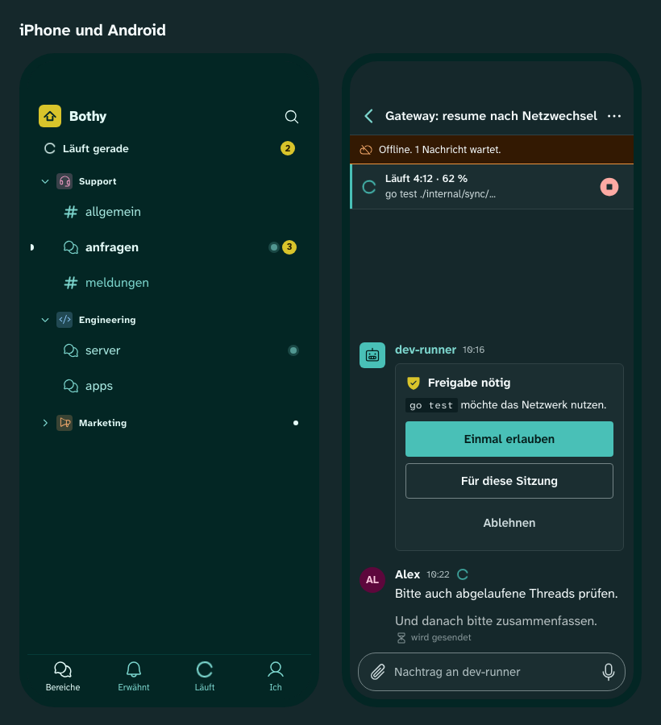

# Bothy

**A command center for AI agents in chat form.**

| Status | License | Start here |
|---|---|---|
| planning, no product code yet | [Apache-2.0](LICENSE) | [Specification](docs/SPEC.md) · [Roadmap](docs/roadmap.md) · [Contributing](CONTRIBUTING.md) · [Security](SECURITY.md) |

## What is Bothy

Bothy (working name) is a command center for AI agents in chat form: chat, live view, approvals,
terminal, costs and statistics in one open-source app that you host yourself.

**In one sentence:** your team and your agents work in one place, where you watch each agent run
live, answer its questions, approve its actions, open a terminal on your own machines and see what
it costs, and every person sees only what is shared with them.

- **Chat like Discord.** Spaces, channels, forums and threads; agents such as
  [Hermes Agent](https://github.com/NousResearch/hermes-agent), Claude Code and your own are full
  participants through the public API.
- **Live view and approvals.** Every thread can be an agent session with a live box of tool calls
  and status lines, questions and approval buttons.
- **Terminal.** Shells and coding-agent sessions on connected machines, from desktop, phone and
  web console, end-to-end encrypted, with a right per machine and a fresh confirmation on every open.
- **Costs and statistics.** Each agent shows what it runs on and what it costs; native views show
  live agent activity, delivery and spend, and a Grafana panel plugin shows the same for operators.
- **Your instance.** One binary, PostgreSQL and object storage, on your own hardware or in your
  own cloud; every permission is checked by the server.

<picture>
  <source media="(prefers-color-scheme: light)" srcset="docs/design/previews/layout-light.png">
  
</picture>



Design previews from the [design system](docs/design/README.md) (petrol with a yellow accent,
dark and light theme); screenshots of the real apps follow with the demo instance (plan, stage M7).

## Quick start

Planned: one command on any Linux or macOS host with Docker Compose. There is no code yet, so
nothing installs today. The setup wizard checks the host, downloads the signed bundle of its
version, asks for the public address, the edge (reverse proxy or Tailscale) and the first owner,
starts the stack and prints the one-time invitation code for the app
([specification](docs/spec/16-betrieb.md), section 3.1; plan ticket M7-29):

```sh
# planned; published with the first release (OWNER is replaced before the repository goes public)
curl -fsSL https://github.com/OWNER/bothy/releases/download/v0.0.0/install.sh | sh
```

The [Compose guide](docs/operations/install-compose.md) describes the same install step by step
and is the contract the first release has to meet.

---

## Überblick (Deutsch)

Bothy ist eine Kommandozentrale für KI-Agenten in Chat-Form: Chat, Live-Ansicht, Freigaben,
Terminal, Kosten und Statistik in einer selbst gehosteten, quelloffenen App. Agenten wie Hermes
Agent, Claude Code und weitere sind vollwertige Teilnehmer. Jede Person sieht und steuert nur, was
ihr freigegeben ist; das prüft der Server bei jedem Zugriff. Was das Produkt kann und was es nie
tun wird, steht in der [Spezifikation](docs/SPEC.md).

## Status

Planung (Etappe M0). Es gibt noch keinen Produktcode. Die Planungsdokumente sind vollständig:
Spezifikation, Architekturentscheidungen, Bau-Plan mit Bau-Briefs, Design-System mit
Vorschaubildern, Konfigurationen für Betrieb und CI und die Werkzeugkette mit allen Gates. M0
schließt mit einem Red Team über den Planungsstand und den letzten Schritten vor dem ersten Push
([PLAN](docs/PLAN.md), "M0 Planung (Abschluss)"). Danach folgt M1 Fundament
([Roadmap](docs/roadmap.md)).

## Lesereihenfolge

1. Dieses README.
2. [SPEC](docs/SPEC.md): Ziele, Invarianten, Kapitelverzeichnis, Lesewege je Rolle.
3. Kapitel [01 Produkt](docs/spec/01-produkt.md) und [02 Architektur](docs/spec/02-architektur.md).
4. [PLAN](docs/PLAN.md): Etappen und Bau-Tickets.
5. [DECISIONS](docs/DECISIONS.md): Ruling-Log.
6. [OPEN-QUESTIONS](docs/OPEN-QUESTIONS.md): Fragen an den Owner mit Voreinstellung.
7. [RISKS](docs/RISKS.md): Produktrisiken.
8. [ADRs](docs/adr/README.md): Architekturentscheidungen.
9. [Design](docs/design/README.md): Design-System.
10. [Qualität](docs/quality/README.md): Gates und Werkzeuge.

## Repo-Struktur

```text
.github/     Workflows, Vorlagen für Issues und Pull Requests, Labels
apps/        Flutter-Apps: client (iOS, Android, macOS, Windows) und console (Web); noch ohne Code
design/      Quelle der Design-Tokens, erzeugte Ausgaben (CSS, Dart) und Vorschauseite
docs/        Spezifikation, Plan, Bau-Briefs, ADRs, API-Verträge, Architektur, Betrieb, Qualität
infra/       Compose-Installation, Collector, Monitoring, OpenTofu- und Helm-Gerüst
packages/    gemeinsame Dart-Pakete der Apps (Design-System, Sync, Terminal, Visualisierung); noch ohne Code
plugins/     Referenz-Adapter für Hermes Agent und den Claude-Code-Runner, Grafana-Plugin; noch ohne Code
quality/     SonarQube-Profile und Gate für lokal und Cloud, Liste erlaubter Lizenzen
sdk/         SDKs für Python und TypeScript; noch ohne Code
services/    Go-Server (ein Binary, Rollen api und worker) und Host-Dienst bothy-host; noch ohne Code
tools/       Gates, Prüfskripte und Generatoren der Werkzeugkette, gepinnt
```

## Gates lokal

```sh
make bootstrap   # gepinnte Werkzeuge und Git-Hooks, einmal je Klon
make check       # jedes Gate, genau wie CI
```

`make docs` baut die Doku-Site streng, `make linkcheck` prüft alle Links und Anker. Was jedes Gate
prüft, steht in [docs/quality/gates.md](docs/quality/gates.md); Beiträge aus Forks setzen die
Schalter aus [CONTRIBUTING](CONTRIBUTING.md).

## Lizenz

[Apache-2.0](LICENSE), Beiträge mit DCO statt CLA
([ADR 0003](docs/adr/0003-lizenz-apache-2-0-mit-dco-statt-cla.md)). Hinweise: [NOTICE](NOTICE).
