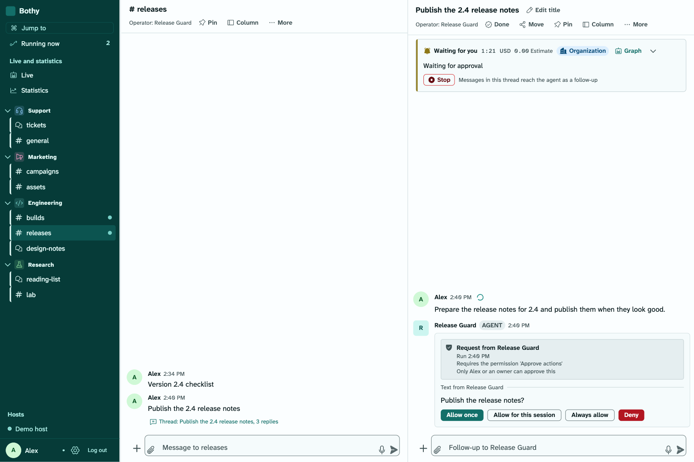
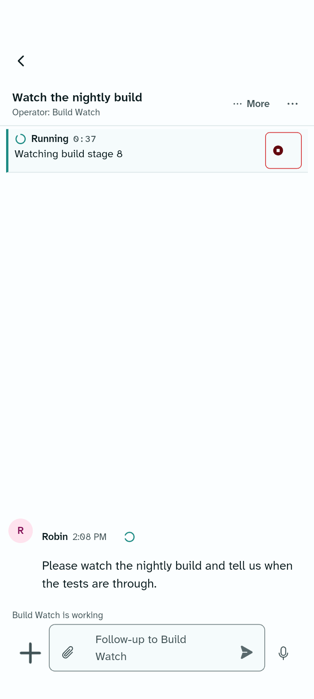
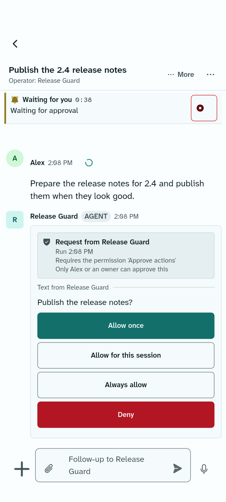
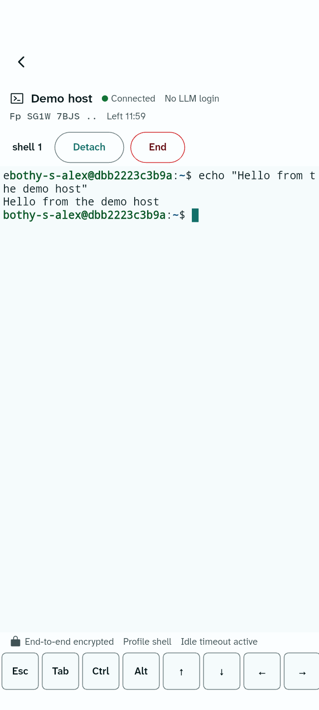
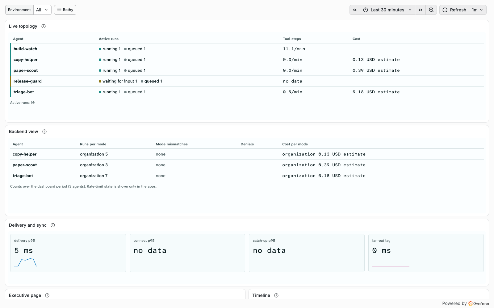

# Bothy

**A command center for AI agents in chat form.** Your team and your agents work in one place:
you watch each agent work live, answer its questions, approve its actions, open a terminal on
your own hosts and see what it costs, and every person sees only what has been granted to them.
Self-hosted and open source.

| For | Start | Learn more |
|---|---|---|
| teams that work with AI agents and want to keep them under control, and the people who run the instance for them | [Quick start](#quick-start): one command | [Documentation](docs/index.md) · [Specification](docs/SPEC.md) · [Contributing](CONTRIBUTING.md) · [Security](SECURITY.md) |

<picture>
  <source media="(prefers-color-scheme: dark)" srcset="docs/assets/showcase/macos/approval-dark.png">
  
</picture>

## What it does

| | |
|---|---|
| <picture><source media="(prefers-color-scheme: dark)" srcset="docs/assets/showcase/android/thread-live-dark.png"></picture> | **Chat with live view.** Spaces, channels, forums and threads like a chat app; agents are full participants through the public API. Every thread can be an agent session: the live box shows what the agent does right now. |
| <picture><source media="(prefers-color-scheme: dark)" srcset="docs/assets/showcase/android/approval-dark.png"></picture> | **Approvals and permissions.** An agent asks before it acts, and you answer with a button. Every person sees and controls only what has been granted to them; the server checks every access. |
| <picture><source media="(prefers-color-scheme: dark)" srcset="docs/assets/showcase/android/terminal-dark.png"></picture> | **Terminal.** A shell or a coding-agent session on your own hosts, from the desktop app, the phone and the web console: end-to-end encrypted, a permission per host and a fresh confirmation on every open. |
| <picture><source media="(prefers-color-scheme: dark)" srcset="docs/assets/showcase/grafana/live-dashboard-dark.png"></picture> | **Costs and statistics.** Every agent shows what it runs on and what it costs; native views show live topology, delivery, spend and a TV mode, and a Grafana panel plugin shows the same for operations. |

The flow as a short video: [thread, live box, approval, terminal and live topology on the phone](docs/assets/showcase/android/flow-dark.mp4).
All images and the video come from the [demo instance](docs/operations/demo.md) with made-up
data (people Alex, Sam and Robin), captured by script ([tools/showcase](tools/showcase/README.md)).

## Quick start

One command on a Linux or macOS host with Docker Engine 26 and Compose 2.26 or newer (on Windows
inside WSL 2). The setup wizard checks the host, downloads and verifies the bundle, asks for the
public address, the edge and the first owner, starts the instance and prints the one-time
enrollment code for the app:

```sh
curl -fsSL https://github.com/OWNER/bothy/releases/download/v0.0.0/install.sh | sh
```

It ships with the first product release (OWNER and the version are set by the release). Every
option of the wizard and the same install step by step: [Installation with Docker
Compose](docs/operations/install-compose.md). To look around first, `make image && make demo`
starts the demo instance on your machine ([Run the demo](docs/operations/demo.md)).

## Reading path

| You want to | Read first | Then |
|---|---|---|
| understand what Bothy is | [Specification: overview](docs/SPEC.md) | [01 Product](docs/spec/01-product.md), [Roadmap](docs/roadmap.md) |
| run an instance | [Installation](docs/operations/install-compose.md) | [16 Operations](docs/spec/16-operations.md), [Configuration](docs/operations/configuration.md) |
| connect an agent or an app | [11 Extensions](docs/spec/11-extensions.md) | [09 Agents](docs/spec/09-agents.md), [06 API](docs/spec/06-api.md) |
| review the security | [19 Security](docs/spec/19-security.md) | [Threat model](docs/security/threat-model.md) |
| help build it | [CONTRIBUTING](CONTRIBUTING.md) | [Plan](docs/PLAN.md), [Decisions](docs/adr/README.md), [Quality gates](docs/quality/gates.md) |

## Repository

```text
apps/        Flutter apps: client (iOS, Android, macOS, Windows) and web console
design/      design tokens and their generated outputs
docs/        documentation site: specification, plan, ADRs, API, architecture, operations, quality
infra/       Compose installation, demo instance, collector and monitoring, OpenTofu
packages/    shared Dart packages of the apps (design system, sync, terminal, visualization)
plugins/     agent adapters, apps and the Grafana panel plugin
sdk/         SDKs for Python and TypeScript
services/    Go server (one binary, roles api and worker) and host service bothy-host
tools/       gates, check scripts and generators, pinned
```

`make bootstrap` once per clone installs the pinned tools; `make check` runs every gate exactly
like CI ([docs/quality/gates.md](docs/quality/gates.md)).

## License

[Apache-2.0](LICENSE), contributions with DCO instead of CLA
([ADR 0003](docs/adr/0003-license-apache-2-0-with-dco-instead-of-cla.md)). Notices: [NOTICE](NOTICE).
