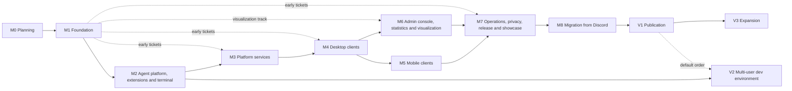

# Plan: milestones and build tickets

Status: draft M0. This plan sets the build order: milestones, their exit criteria,
test strategy, red team check and the build tickets. What is built is stated in the chapters of
the [specification](SPEC.md); in case of a contradiction the chapter applies, and the plan is
adjusted in the same change. The briefs of the milestones M1 to M8 with waves and dependency graph
are in the [brief index](briefs/README.md); the briefs of M2 to M8 were written before M1 was
closed (D-W-100, D-W-114, D-W-120, D-W-124, D-W-125).

Notation: references to chapters name the number and the section title in quotes, for
example 02 "Request path", because section numbers can change. Test IDs come from the
chapters: `AZ-*` from 07, `ID-T*` from 08, `SEC-T*` from 19, `BR-*` from 10, `AG-*` from 09, `DEV-T*`
from 21, `DP-T*` from 20, `TM-T*` from 24, `VZ-T*` from 25, `G1` to `G10` from 06. Limits and thresholds appear only by name; their values
are in the chapter tables and in the [configuration reference](operations/configuration.md).
`B1` to `B13` and `I1` to `I6` are the fundamental decisions and invariants, `L1` to `L24`
the lead's decisions on team deviations, `T1` to `T11` the lead's rulings on the
addendum of 2026-10-10 (terminal, visualization, showcase); all are in
[DECISIONS.md](DECISIONS.md).
Decisions of this plan carry the numbers `P-01` onward (section 19), known
contradictions of the specification the numbers `W1` onward (section 7).

## 1. Principles

1. **No MVP.** Milestones are only the build order. Every milestone ends in production quality
   (section 4): what it builds is finished, tested, documented and checked by the red team.
   Later milestones extend; they do not rebuild.
2. **What exists keeps running.** An existing chat with agent operations that moves to Bothy
   stays unchanged until the switchover. No ticket changes it. Adapter tests run against pinned
   public versions in throwaway folders, never against a production runtime. The switchover
   happens only in M8, channel by channel.
3. **Specification first.** If a ticket changes behavior, API, event, permission or configuration,
   it first changes the chapter or `docs/api/` in the same change. The core contract (00, 03,
   04, 05) is normative. If something that a ticket needs is missing there, the ticket ends with
   `BLOCKED` and a report instead of building a deviation (P-11).
4. **Red first, then green.** Every behavior change has a test that was red before the change.
5. **No dates.** The plan names no calendar dates and no effort estimates; neither can be
   substantiated. Progress means merged tickets and green exit criteria.

## 2. Milestone breakdown

The breakdown follows the contracts, not the screens. M1 builds the server core that everything
else depends on: permissions, identity, event log and sync, built behind gates that apply from the
first code commit. After that come the server parts that clients need (M2 agent platform
and extensions, M3 platform services); this way the apps build against a tested API instead of
against assumptions. The apps split into desktop (M4) and mobile (M5), because mobile brings native
extensions (Notification Service Extension, sharing, push service) that require the push sending
from M3 and the client foundation from M4. The web console (M6) uses the same management packages
as the desktop and follows it. Operations, privacy and release (M7) come before the migration,
because real data requires backup, tested restore, a deletion concept and signed apps.
The migration (M8) ends the product milestones. After that come steps that only make sense with a
product in use: the publication (V1) as a separate step with a checklist, the
multi-user dev environment (V2) as soon as another person needs dev access, and the expansion of
the features that 01 lists as "later" (V3). Milestones overlap: a ticket starts as soon as its
dependencies are merged; the last column names what can already start after M1 (P-01).

Addendum of 2026-10-10: the terminal is core from M2 on, next to the agents. M2 builds the server
module, host service, end-to-end stream, permissions with I6 and the conformance and chaos tests;
the views follow the clients in M4 (desktop), M5 (mobile) and M6 (console), each milestone with a
red team for the terminal (P-20). The visualizations start as a track after M1: tokens, package
`bothy_viz`, fixtures and harness are built against fixtures and the mock server as soon as the
early tickets from M4 are in place; own measurement, live stream and views in apps and console
close in M6, the Grafana panel plugin in M7 (P-21). The showcase (demo instance, images, video,
landing pages, release template) is the last step of M7 before V1 (P-22).

| Milestone | Goal | Closing needs | Tickets that can start after M1 |
|---|---|---|---|
| M0 Planning | Specification, decisions, toolchain, plan and M1 briefs | | |
| M1 Foundation | Toolchain and server core with permissions: identity, devices, grants, `authorize`, I1, audit, structure, messages, event log, sync, gateway, observability foundation, server image | M0 | |
| M2 Agent platform, extensions and terminal | Runs with live box, invocation token, adapter contract, follow-ups, components, commands, sessions, backend policy with costs, apps, webhooks, SDKs, reference adapters; terminal with host service, pairing, end-to-end stream, permissions and I6 | M1 | all |
| M3 Platform services | Files with scanning, images, voice messages, search, notifications and push sending | M1, M2 | M3-01 to M3-06, M3-10, M3-11, M3-13 to M3-18 |
| M4 Desktop clients | Design system, client foundation, desktop app for macOS and Windows with management and terminal view | M1, M2, M3 | M4-01 to M4-20, M4-25 to M4-27, M4-29, M4-31 |
| M5 Mobile clients | iOS and Android with push receipt, sharing, voice recording, app lock, emergency actions and terminal with extra keys bar | M3, M4 | none |
| M6 Admin console, statistics and visualization | Web console with BFF session and strict CSP, statistics, management and terminal; own measurement, live stream and visualizations in apps and console | M1 to M4 | M6-01; visualization track M6-10 to M6-12 |
| M7 Operations, privacy, release and showcase | Backup, restore, sync epoch, GDPR flows, maintenance mode, status page, release chain with host service, app distribution, portability, multi-node operation, Grafana panel plugin, demo instance and showcase | M1 to M6 | M7-01 to M7-04, M7-10, M7-11, M7-14 to M7-16, M7-18 to M7-20, M7-22, M7-24 to M7-26, M7-29 |
| M8 Migration from Discord | Import, read mirror, switchover per channel and execution | M1 to M3, M5 to M7 | M8-01, M8-02, M8-10 |
| V1 Publication | Repository public according to the checklist | M6, M7, build tickets of M8 (P-15) | none |
| V2 Multi-user dev environment | Isolated dev environments per person | M2; by default after V1 | none |
| V3 Expansion | Features that 01 lists as "later" | V1 | none |

Dependencies of the milestones (solid: closing needs the milestone; dashed: early
tickets already start after M1, or default order):

## 3. Way of working per ticket

The following applies to every ticket, even if its brief does not repeat it:

1. **Start.** All dependencies are merged into the base branch; the working tree is clean.
2. **Worktree per ticket.** A separate Git worktree on a branch `feat/<ticket-id>-<slug>`
   (`fix/` or `docs/` by kind). One writer per worktree. Parallel tickets run in their own
   worktrees; none is held back because it could overlap with another.
   The merge resolves conflicts.
3. **TDD.** First the test that is red (output in the report), then the code until green, then
   clean up.
4. **Specification first** (principle 3).
5. **Clean tests.** Tests bind only `127.0.0.1` and port 0 (P-10). PostgreSQL and other services
   run as throwaway containers on random ports (P-09). Temp folders only via `mktemp`, deleted at
   the end. Only self-started processes are terminated, by PID. No network calls except
   package downloads of pinned tools. Real model calls only behind an explicit
   switch, because they cost money. Secrets are never read or printed.
6. **Gates.** `make check` is green, locally identical to CI (ADR 0038). If the ticket touches a
   performance target, `make perf` in addition (P-07). No ticket lowers a threshold, turns off a
   gate or deletes a test, unless its brief names it explicitly.
7. **Documentation duty.** README of the module up to date (status, ports, tables, actions, jobs);
   doc comment on every public symbol (purpose, parameters, return value, errors, example where
   useful), checked by the documentation gate of the language (23 "Documentation in code");
   comments explain the why. An ADR for every architecture decision; if an
   ADR from the lead's list is missing, the implementing ticket writes it (P-12). CHANGELOG entry
   under "Unreleased" of the component. Generated references (configuration, API tables) are
   regenerated.
8. **Commits.** Conventional Commits with module or component as scope and DCO sign-off; before the
   merge squashed into meaningful commits ([push discipline](quality/push-discipline.md)).
9. **Review.** Local review (`make review` and a code review over the diff), then the
   [red team gate](quality/red-team-gate.md) over the diff with the verdict `JA` (yes) or `NEIN`
   (no); the report is present as `.review/<sha>.md` of the commit to be merged, last line
   `Urteil: JA` (the pre-push hook requires it, D-W-32). On `NEIN`: fix, one test per finding,
   check the delta again. If the same `NEIN` comes again, the owner decides.
10. **Merge.** Locally into the base branch, only with a clean review, verdict `JA` and a green
    `make check`; then `git worktree remove`.
11. **Push.** Push, tag and pull request only after approval by the owner.
12. **Report.** First line `Verdict: DONE` or `Verdict: BLOCKED <reason>`; then commits,
    files with line counts, tests with numbers, what is not proven, and only real
    owner decisions with a recommendation. A finding in the ticket's own diff is fixed in the
    ticket, not reported.

## 4. Closing a milestone

A milestone is finished when all of the following hold:

1. All tickets of the milestone are merged, and `make check` is green on the base branch.
2. Every exit criterion of the milestone is substantiated with the named test or command.
3. `make perf` reaches the performance targets of the milestone on `perf.reference_profile`, in
   mode `match` or `emulated` (ADR 0063).
4. The red team gate checks the whole diff since the closing of the previous milestone with the
   verdict `JA`. In addition it checks what the section "Red team" of the milestone names, at
   level P1 from 19 "Penetration test plan".
5. The [threat model](security/threat-model.md) carries "As of milestone" with the name of the milestone: new components,
   data flows and boundaries are entered; every threat with likelihood `medium` or
   `high` has a test or a justified residual risk (section "Maintenance rule").
6. [RISKS.md](RISKS.md) is updated for the risks of the milestone, and the
   [roadmap](roadmap.md) shows the status.
7. The CHANGELOG entries of all affected components are complete.

## 5. Test strategy

| Level | What | Tool | Runs |
|---|---|---|---|
| Unit | pure domain functions, state machines, parsers | `go test`, `pytest`, `dart test` | `make check` |
| Integration server | use cases against PostgreSQL 18 in a throwaway container; other modules via their ports as fakes, real in the integration test | `go test` with the test helper from M1-12 | `make check` |
| Test doubles | Fake IdP (M1-41), virtual WebAuthn authenticator (M1-40), fake agent and FakeServer (M2-29, M2-31), fake Hermes and fake Claude (M2-33, M2-34), fake GitHub and fake Jira API (M2-49, M2-50), fake host and Go test device for the terminal (M2-44, M2-48), host service in a Linux container (M2-48), fake `claude` for `doctor` (M2-42), fake APNs and fake FCM (M3-20, M3-21), clamd and SeaweedFS containers (M3-02, M3-04), Dart fake server (M4-17), fixtures and harness of `bothy_viz` (M6-11) | according to 09 "Test doubles" and the subject chapters | with their tests |
| Contract | G1 to G10 from 06 "Contract tests and gate" | Redocly, check scripts, generators, Schemathesis, recording of the gateway frames | all in `make check`: G1 to G6 as separate gates, G7 as `make contract-test`, G8 to G10 in the integration tests |
| End to end | Compose smoke test (M1), terminal with a real host service (M2-48), desktop (M4), devices (M5), console (M6), portability with Grafana plugin (M7) | `make portability`, `integration_test`, `patrol` | per milestone, before releases |
| Load, endurance, chaos | Performance targets from 02 "Performance targets", 14, 15 and 25; chaos of the event chain and of the terminal (TM-T16) | `make perf`, `test/chaos` | milestone closing and release (P-07) |
| Security | SEC-T01 to SEC-T19, permission matrix and mandatory tests from 07, ID-T01 to ID-T29, TM-T01 to TM-T29, VZ-T01 to VZ-T16, Go fuzzing of the parsers (also Noise frames and terminal session token) | as above | `make check` |
| Golden | Components, views of `bothy_viz` and terminal view according to 15 "Test strategy" | `alchemist` | `make check` |
| Accessibility | Checklist with VoiceOver, TalkBack and Narrator | by hand with the checklist | before every app release |

## 6. M0 Planning (closing)

**Goal.** The planning state is complete, free of contradictions and held by gates; M1 can
start without questions.

**Status.** Specification, core contract, ADRs, design tokens, toolchain, gates and CI workflows
are in the repository. M0-01 is implemented (`make tokens` regenerates, compares and checks contrasts
and palette; `tools/design-tokens/tests/test_gate.py` checks the acceptance cases); open until the closing
are the remaining tickets below.

**Exit criteria.**

1. `make check` is green on the merged state (M0-01, M0-02); until M0-04 only the
   references to the closing documents from M0-04 count as open.
2. The revision of the core contract is merged (M0-03); every addition from "M1: Prerequisites from
   the core contract" is adopted or tracked as an owner question.
3. `make docs` and `make linkcheck` are green (M0-04).
4. A brief exists for every M1 ticket (M0-05).
5. The red team gives the verdict `JA` on the planning state (M0-06).
6. The local SonarQube runs with profile and gate (M0-07); without it `make sonar` fails from the
   first product code on (M1-05).

M0-09 needs the owner's go; the commit identity for M0-08 is decided (D-W-06). Both
are prerequisites for the first push, not for the build. Status (D-W-93): the first push is a
commit without parents; M0-08 is only needed if a history is to be published after all.

| ID | Title | Goal | Files and modules | Acceptance tests | Depends on |
|---|---|---|---|---|---|
| M0-01 | Wire up the token gate | `make tokens` rebuilds the design tokens in a temp folder, compares them with `design/build` and checks the contrasts. | `tools/design-tokens/Makefile` (target `check`), `tools/design-tokens` | `make tokens` green; a changed token file without regeneration makes `make tokens` fail; a contrast pairing below AA makes it fail | none |
| M0-02 | Integration of the team states | All team worktrees are merged, and `make check` is green on the planning state. | all planning files; `docs/api/openapi.yaml` (example values with `EXAMPLE`), `mkdocs.yml`, `docs/adr/README.md` | `make check` green except for references to the closing documents from M0-04, including `make denylist` without a finding; `make gitleaks GITLEAKS_LOG_OPTS=--all` without a finding; `make docs` and `make linkcheck` report only these references; `make diagrams` renders all diagrams | M0-01 |
| M0-03 | Adopt the core contract after the revision | The revision of 00, 03, 04 and 05 from the teams' core contract problems is merged, and every chapter refers to the new state. | `docs/spec/00-glossary.md`, `03-data-model.md`, `04-sync-protocol.md`, `05-actions.md`; notes "(core contract: addition requested)" in the chapters | `make check` green except for the references to the closing documents that M0-04 closes; list of the adopted and rejected additions in DECISIONS.md; every rejected addition that a ticket needs is in OPEN-QUESTIONS.md | M0-02 |
| M0-04 | Closing documents | SPEC.md, DECISIONS.md, OPEN-QUESTIONS.md, RISKS.md, README.md and the navigation are complete. | `docs/SPEC.md`, `docs/DECISIONS.md`, `docs/OPEN-QUESTIONS.md`, `docs/RISKS.md`, `README.md`, `mkdocs.yml`, `CHANGELOG.md` | `make docs` (strict) and `make linkcheck` green | M0-03 |
| M0-05 | Build briefs of milestone M1 | For every M1 ticket a brief following the brief template is in `docs/briefs/` with the name from the brief index. | `docs/briefs/M1-*.md`, `docs/briefs/README.md` | exactly one file per M1 ticket with the name from the index; `make check` green; no gap between brief and chapter (`spec_gaps` responses of the brief writers are fixed or tracked as an owner question) | M0-04 |
| M0-06 | Red team over the planning state | An independent, read-only reviewer assesses the whole planning state according to red-team-gate.md. | Report (ops repo), findings as changes in the product repo | Verdict `JA`; every finding fixed or with a reason in DECISIONS.md | M0-05 |
| M0-07 | Local SonarQube in operation | The local SonarQube Community Build runs with the profile and gate "Bothy way" before the first product code is written. | `tools/sonarqube/compose.yaml`, `quality/sonar/*` | `make sonar-up` reports UP; `make sonar-config` and `make sonar-config-check` green; Dart and Swift reported as skipped | M0-02 |
| M0-08 | Clean up the history before the first push | Status: dropped as long as the first push is a commit without parents (D-W-93); applies only if a history is published. The commit identity chosen by the owner stays and is in `allow-authors.txt` of the private list (D-W-06); authors are not rewritten. Before the first push a `git filter-repo` run over all refs removes two kinds of findings: the old example values that `.gitleaks.toml` lists as an exception for the history (afterwards the exception is deleted), and every finding of `make denylist-history`. One tool per kind of location, all in the same run (D-W-48): text in old file versions with `--replace-text`; commit and tag messages with `--replace-message` (`--replace-text` only changes blobs); paths with `--paths-from-file` and lines `old==>new` (only renames, so all other paths stay); binary blobs with a finding (NUL in the first 8 KiB, which `--replace-text` skips) with `--strip-blobs-with-ids`; in addition `--prune-empty never`, so that no commit is dropped. A hit in the current tree or in a ref name is removed beforehand with a normal commit or by renaming the ref, respectively. As of 2026-10-11 the history scan with the private list and the allow list of the authors reports findings from the private list and from the generic rules, all in old versions of planning files, none in the current tree and none in identities (D-W-36); what counts is the run in the ticket, not this state. The inputs come from a new scanner option `--replacements-out <folder>` that writes three files: `text.txt` with one line `<text>==>REDACTED` per matched text (for `--replace-text` and `--replace-message`), `paths.txt` with `<old path>==><path with REDACTED>` and `blobs.txt` with the IDs of the binary blobs with a finding; all with file permissions for the user only and only outside the repository; it prints no term on the console, and the folder is deleted after the run. | `tools/denylist/denylist_scan.py` (option with test), private deny list (ops repo), `.gitleaks.toml`, history | Test: `--replacements-out` writes every hit exactly once into the matching file, refuses a path in the repository and prints no hit; fixture repository with one hit each in file content, path, commit message, tag message and PNG text chunk: after the documented run the scanner with `--history` reports 0 findings with the same commit count; then `make denylist-history` with 0 findings and `make gitleaks GITLEAKS_LOG_OPTS=--all` green, without an exception for the old example values; `git log --all` shows the same number of commits as before | M0-06 |
| M0-09 | Remote and labels (owner) | After the owner's go the remote exists with labels and the environment `denylist` with access for pull requests and `main`; the repository is public from the first push on, all jobs run on GitHub-hosted runners (ADR 0039, public-switch.md). | `.github/labels.yml`, runbook in the ops repo | `make labels-check` green and `make labels-sync` creates all labels; trial pull request: all jobs on GitHub-hosted runners; after the trial merge `denylist-main.yml` runs green | M0-08 |

## 7. M1 Foundation: toolchain and server core with permissions

### Goal

A server that logs people in securely, binds devices, checks permissions on every request and every
delivery, enforces I1 on every permission change, manages spaces, channels, threads and messages
and delivers every event without gaps, in order and only to those entitled to it. The gates apply
from the first code commit.

### Scope

- Toolchain for server and contracts: gates, action catalogue as data source, API and
  register checks, operations configurations (Block A; 23, 06 "Contract tests and gate").
- Skeleton and platform: modules, configuration, secrets, telemetry foundation, lifecycle,
  PostgreSQL, Unit of Work, jobs, event log, HTTP chain, rate limits, idempotency, transport,
  egress, server image (Block B; 02, 04 "Global, commit-ordered sequence", 16, 17, 19).
- Audit and permission core: hash chain, grant model, `authorize`, I1 and SR8, expiry (Block C; 05,
  07, 10 "I1 transactional", 19 "Supply chain, backups and audit integrity").
- Identity complete: OIDC, proxy headers, local accounts, passkeys, devices with DPoP, sessions,
  step-up, API tokens, disabling (Block D; 08).
- Instance and management of permissions via the API: settings, branding, discovery,
  feature flags, signing keys, groups, grants, explanation, preview, "View as person",
  audit check (Block E; 07 "Requirements for the admin interface", 16 "Environments and
  feature flags").
- Agents as records with backend policy and credential holder, without runtime (P-02);
  spaces, channels, operators, threads, messages (Block F; 01 "Feature list", 09 "Agents as
  principals", 10 "Invariants").
- Sync and gateway: personal sync data, catch-up, snapshot, WebSocket with hub, access withdrawal,
  focus and typing (Block G; 04).
- Closing: metrics, canary, leak tests, contract tests, load tests, Compose smoke test, CodeQL
  (Block H).

### Out of scope

Agent runtime, runs, live box, invocation token, agent consumers, channel behavior and
project binding (M2); apps and webhooks (M2); files, avatars, logo, search, notifications and
push (M3); clients and console (M4 to M6); backup, restore, GDPR flows,
status page, maintenance mode, release chain and multi-node operation (M7); direct messages (V3).
The installation Compose with `bothy-postgres` and the backup service only becomes startable in M7;
M1 checks the server image with the test overlay from P-06.

### Prerequisites from the core contract

M1 builds against the core contract after the revision from M0-03. M1 needs these requested
additions; if one of them is not adopted, the affected ticket ends with `BLOCKED` (P-11).

| Addition (source) | Tickets |
|---|---|
| Prefix `/api/v1` for REST and gateway (06 "Other points" K1) | M1-17, M1-64 |
| no JSON `null` in the envelope (06 K2, ADR 0053); `412` with If-Match instead of `409` (06 K4) | M1-16, M1-18, M1-58 |
| `403 device_pending` for waiting devices (06 K13) | M1-33, M1-38 |
| Actions `instance.settings.read`, `identity.read`, `self.read`, `agent.enable`, `local_credential.set` (06 "New actions for 05"); `health.read` is dropped (L2) | M1-17, M1-31, M1-36, M1-39, M1-46, M1-51 |
| Tables `local_credentials`, `enrollment_codes`, `auth_login_flows` (08 K-ID-1 to K-ID-3) | M1-37, M1-39, M1-41 |
| `device_keys.purpose`; columns on `auth_sessions`; `refresh_token_families.dpop_jkt`; grace period on refresh (08 K-ID-4 to K-ID-6, 06 K10) | M1-33, M1-34 |
| System action `instance.bootstrap`; `user.enable` from `pending` (08 K-ID-7); `auth.dpop_nonce_ttl` according to 08 (K-ID-8) | M1-31, M1-37, M1-08 |
| Capabilities of agents and apps only `upload`; operator rule (07 K-RE-1, K-RE-2) | M1-27, M1-28, M1-54 |
| SR8 on `user.disable`; limits of `grant.revoke` with `manage`; owner permissions only with a session (07 K-RE-5, K-RE-6, K-RE-10) | M1-29, M1-44, M1-45, M1-48 |
| `access.preview`; expiry with `grant.expire`, `group.member.expire`, `access.expiring`, `expiry_reminded_at`; reason codes for `deny_reason` (07 K-RE-7 to K-RE-9) | M1-24, M1-30, M1-49 |
| Purpose `audit_checkpoint` and checkpoints, canonicalization according to RFC 8785; IP only as `ip_hmac` (19 "Audit integrity", 20 K-DP-2) | M1-24, M1-50 |
| `instance.min_server_version` (16 "Upgrade"); `correlation_id` as trace ID and `trace_context` in the envelope (17 "Signals") | M1-15, M1-16 |
| Token format with prefix and checksum (08 "API tokens for agents, apps and tools") | M1-44 |
| Permission cache follows structure events; copies when a thread is moved; `agent.read` for the agent itself; modules without tables; River tables (02 "Additions to the core contract" items 2, 4, 6, 10, 11) | M1-05, M1-14, M1-51, M1-53, M1-62, M1-63, M1-65 |
| personal templates without a channel (06 K15); machine-readable action catalogue (ADR 0049) | M1-02, M1-60 |
| Addendum of 2026-10-10: target `host` with capability `terminal` and column `target_host_id` in `grants` (03, R-DM-35), actions 4.14 with step-up `fresh`, ops `stats.subscribe` and `stats.unsubscribe`, ops of the terminal channels (05 section 7), purpose `terminal` of the signing keys, `auth_sessions.step_up_consumed_at`; of this, M1 builds only what keeps catalogue, tables and lists complete, the terminal actions stay deferred until M2 (P-24); M1-32 and M1-34 create purpose and column with their tables according to 03, without using them | M1-02, M1-03, M1-05, M1-06, M1-25, M1-27, M1-28, M1-32, M1-34, M1-64 |

### Known contradictions that M1 resolves

Every ticket resolves its contradiction in the same change that builds the code, and enters the
decision in DECISIONS.md. The column "Recommendation" is the default of the plan.

| No. | Contradiction | Recommendation | Ticket |
|---|---|---|---|
| W1 | Configuration names: synonyms and duplicates between chapters (table below) | Rule P-08; one name per concept | M1-08 |
| W2 | Health: 02 names `live` and `ready` on `http.ops_listen_addr`, 16 names `/healthz` and `/readyz` on the internal listener, openapi.yaml lists `getLiveness` and `getReadiness` | L2: 16 applies; the operations and the requested action `health.read` are dropped; 02 adapts | M1-11, M1-17 |
| W3 | Subcommands: 08 names `bothy admin bootstrap-owner` and `issue-enrollment-code`; L1 names `setup`; 16 and Compose additionally use `secrets`, `healthcheck`, `restore` | `bothy setup bootstrap-owner` and `bothy setup issue-enrollment-code`; extend L1 by `secrets`, `healthcheck`, `restore` | M1-09, M1-11, M1-37 |
| W4 | Header driver without loopback: 08 makes the start fail, 16 leaves the driver off and reports the error via `/readyz` | 16 applies, because the driver is a runtime setting of the owner: the driver stays off, `/readyz` reports `trusted_header_requires_loopback`, `identity_provider.manage` rejects turning it on; ID-T08 and SEC-T01 accordingly | M1-43; spec updated (08 2.4 and ID-T08, 16 4.3, 19 SEC-T01) |
| W5 | Invitation and pairing: 08 lets an enrollment code confirm the first device without a passkey and knows device pairing; openapi.yaml requires a passkey on redemption and has no pairing endpoints | Extend the specification first: redemption with device keys without a passkey, pairing endpoints with action and rate-limit class | M1-37, M1-38; spec updated (`redeemEnrollmentCode`, pairing endpoints, 08 3.2 and 5.3) |
| W6 | Path prefix: 04 names `/v1/...`, 06 names `/api/v1` | 06 applies (revision of the core contract) | M1-17 |
| W7 | Unknown request fields: 06 lets the server ignore them (R-API-04), 19 requires `additionalProperties: false` for writing schemas (SEC-IN-1) | 19 applies: a silently discarded field swallows an intent on older servers; clients check new features via `features` of the discovery. R-API-04 still applies to responses and events | M1-18 |
| W8 | Package name of the telemetry: 02 names `platform/otel`, an operations ticket `platform/telemetry` | 02 applies | M1-10 |
| W9 | The egress client from 19 is missing in the code layout of 02 and in the module register | Add `platform/egress` | M1-22 |

Configuration names (W1):

| Concept | Names today | Resolution |
|---|---|---|
| public listener | `http.listen_addr` (02), `server.listen_addr` (16) | `server.listen_addr` with the default from 16 |
| internal listener | `http.ops_listen_addr` (02), `server.internal_listen_addr` (16) | `server.internal_listen_addr` |
| trusted proxies | `api.trusted_proxy_cidrs` (06), `server.trusted_proxies` (16), `net.trusted_proxies` (08, 19) | `server.trusted_proxies` with the default from 16; 06, 08 and 19 refer to it |
| largest JSON body | `http.max_json_body_bytes` (02), `api.max_json_body_bytes` (06), `http.max_body_bytes` (19) | `http.max_json_body_bytes` (02); resolved in M0, the chapters use only this name |
| HTTP timeouts and headers | `http.read_header_timeout` with different defaults, `http.idle_timeout`, `http.max_header_bytes` (02 and 19) | kept in 02, default according to P-08 the stricter one; 19 refers to it |
| database | `db.*` (02), `database.*` (16) with different defaults for pool and timeouts | prefix `database.*`; connection as individual values according to 16; timeouts from 02 under `database.*`; `database.statement_timeout` and `database.lock_timeout` apply in the request path and in jobs (02 "Rules for jobs"), migrations have their own names (`migrate.lock_timeout`, 16) |
| shutdown | `shutdown.*` (02), `server.shutdown_grace` (16) | `shutdown.*` from 02; `server.shutdown_grace` is dropped; `shutdown.total_timeout` at least the sum of the step budgets, Compose `stop_grace_period` longer (both set in M0, the check D8 from M1-08 holds it) |
| validity of the enrollment code | `auth.enrollment_code_ttl` in 06 and 08 with different defaults | 08 holds the value, 06 deletes the row |
| duplicate rows of the same value | `auth.local_password_enabled`, `file.upload_part_bytes`, `file.upload_session_ttl` (06 and subject chapters), `command.autocomplete_timeout` (06 and 09), `server.role` (02 and 16) | only the subject chapter holds the value (operations for `server.role`) |
| images | `file.image.max_pixels` (12), `upload.image_max_pixels` and `upload.strip_image_metadata` (19) | `file.image.*` in 12; 19 refers to it |

### Exit criteria

1. All M1 tickets are merged; `make check` is green.
2. Permissions: AZ-M01 to AZ-M14, AZ-M18, AZ-M21 to AZ-M29, AZ-M31 to AZ-M41, AZ-M46, AZ-M47, AZ-M50,
   AZ-M52 and AZ-P1 to AZ-P5, AZ-P7 to AZ-P10, AZ-P12, AZ-P13 are green (`make test`, test names
   carry the ID). The remaining IDs belong to M2, M3 and V2.
3. Backend policy: BR-01 to BR-03 are green with all real sources (M1-54).
4. Identity: ID-T01 to ID-T27 are green, except ID-T19 (console, M6).
5. Security: SEC-T01 to SEC-T04, SEC-T06, SEC-T07, SEC-T09 to SEC-T12, SEC-T16, SEC-T17 are
   green.
6. Contracts: G1 to G3, G7 to G9 are green; the enablement list contains exactly the operations
   of the M1 tickets (P-04).
7. `make perf` reaches `perf.event_commit_min_per_s`, `perf.message_create_p99`,
   `perf.fanout_local_p99`, `perf.catchup_page_p99`, `perf.authorize_cached_p99`,
   `perf.ws_connections_per_node`, `perf.ws_idle_conn_mem_max`, `perf.idle_rss_max` and
   `perf.startup_ready_max`.
8. `make portability` is green with the smoke test from M1-73.
9. `make config-doc-check` is green and reports no contradiction from W1; ADR 0049, 0050, 0052,
   0053, 0061, 0063 and 0064 exist.
10. The red team gives the verdict `JA`; the threat model carries "As of milestone M1".

### Test strategy

- Unit and integration against PostgreSQL 18. `authz` is tested with fake sources, the
  integration tests of the structure (M1-54) use all real sources.
- Fake IdP for OIDC (M1-41) and a virtual WebAuthn authenticator (M1-40).
- No fake agent and no fake Hermes: M1 has no agent runtime; these test doubles come
  in M2.
- Contracts: G1 to G3 in the gate, G7 and G8 in M1-71, G9 in M1-67. G4 and G5 follow with the
  SDK clients (M2, M4), G6 with the first publication (M7), G10 with the webhooks (M2).
- End to end: Compose smoke test (M1-73). Device tests only come with the apps.
- Load, endurance and chaos: M1-16, M1-28, M1-72.
- Fuzzing: DPoP and JWS parsers (M1-33), schema fuzzing of all routes (M1-71).

### Red team

In addition to the general check:

1. Every enabled route, op and every event type runs through `authorize` with a catalogue action,
   and the runtime proof takes effect (AZ-P1 to AZ-P3, `authz_not_checked`).
2. No path reveals anything that belongs to others: 404 instead of 403, counters, snapshot,
   catch-up, gateway, error bodies and response time.
3. No sequence of permission, group, owner, operator and policy changes bypasses I1 or
   SR8, not even in parallel.
4. Login: takeover at first installation, forged proxy headers, mapping via
   email, reuse of DPoP proofs, refresh tokens and codes, step-up with a token without a
   session, personal token with owner permissions.
5. Access withdrawal and revocation take effect immediately, across processes (AZ-P9) and on open
   connections.
6. SSRF via OIDC discovery and JWKS; secrets and content in logs, telemetry, audit and
   errors.
7. Audit: modification and rewriting of the chain are detected.
8. Supply chain: new dependencies pinned and with an allowed license; no weakened gate.

Threat model: gateway, identity provider, egress client and smoke test stack are entered;
T-AZ-01 to T-AZ-05, T-OW-01, T-ID-01 to T-ID-06, T-TK-01 to T-TK-04, T-NW-01, T-NW-02, T-LG-01,
T-IN-01, T-DB-01 and T-DS-01 name their M1 tests. Checklist according to OWASP ASVS 5.0 level 2 for
the server parts of the milestone (19 "Penetration test plan", level P1).

### Dependencies

M0-01 to M0-07. No owner decision needed: the module path uses the placeholder from P-05.

### Risks

References to [RISKS.md](RISKS.md):

- Throughput at the counter `event_seq`: measured from M1-16 on, gate via `make perf`.
- Permission cache stale after a structure change or expiry: M1-28 (difference test AZ-P8), M1-30 and M1-53 (integration test with real channels).
- Additions to the core contract not adopted or adopted differently: the affected ticket ends `BLOCKED`.
- OpenAPI 3.1 is new in oapi-codegen; an update can break: pinned version, drift check.
- River is 0.x: only in `platform/jobs` (M1-14).
- Configuration names of several chapters overlap: W1, M1-08.
- A full `make check` before every push takes time: intended (ADR 0038); `--no-verify` is a
  process error.

### Tickets

For every ticket the following applies in addition: `make check` green and the way of working from
section 3. Dependencies are stated minimally; what follows transitively is not repeated. Waves and
dependency graph: [brief index](briefs/README.md).

#### Block A: toolchain

| ID | Title | Goal | Files and modules | Acceptance tests | Depends on |
|---|---|---|---|---|---|
| M1-01 | Server gates in the make contract | The gates for Go code (architecture rules, generated code without drift, migration rules, performance targets) are wired in the Makefile and take effect automatically with the first `services/server/go.mod`. | `Makefile` (targets `arch`, `codegen-check`, `migrations-lint` in `gates`; target `perf` as a scaffold), `tools/bin/tools.lock.json` (go-arch-lint, sqlc), `tools/ci/migrations_lint.py` with tests, `docs/quality/gates.md`, `docs/quality/toolchain.md`, `CONTRIBUTING.md` (Go and a Docker runtime as prerequisites) | `pytest tools/ci/tests/test_migrations_lint.py`: timestamp version, duplicate number, changed existing migration and `GENERATED ALWAYS AS` without `STORED` fail, a clean sequence passes; `pytest tools/docs/tests/test_toolchain_doc.py` green with the new pins; without a Go module the new targets report `SKIP`; with a Go module they fail when `go`, the Docker runtime or a pin is missing (R-QA-02); Go coverage does not count `test/**` and `perf/**` (23 "Component contract") | none |
| M1-02 | Action catalogue as the data source (ADR 0049) | `docs/spec/actions.yaml` is the only source for actions (with effect `read` or `write` per 05 "Effect"), rate-limit classes, event types with receive action and a statement on `resource.version` (04 "Delivery guarantee") and WebSocket ops; the tables in 05 and the action lists in `docs/api/redocly.yaml` are generated from it. | `docs/spec/actions.yaml`, `tools/catalog/` (generator, check, tests), `docs/spec/05-actions.md` (generated blocks), `docs/api/redocly.yaml`, `Makefile` (`catalog-check` in `gates`), ADR 0049 (add the Confirmation) | `pytest tools/catalog/tests`: duplicate action ID, unknown rate-limit class, event type without receive action, op without action and a deviating table block fail; a test against a frozen copy of the tables in 05 shows that the generator produces the same rows (a one-time comparison for the conversion, afterwards a diff with only marker lines); `make catalog-check` and `make api-lint` green; regenerating produces no diff | none |
| M1-03 | API contract checks in the gate (G2, G3) | The copies between 04, 05, 06, `openapi.yaml`, `asyncapi.yaml` and `webhooks.md` are checked against their source in the gate. | `tools/api-checks/` (Python, PyYAML only) with negative fixtures, `Makefile` (`api-checks` in `gates`), generated blocks in `docs/spec/06-api.md` and `docs/api/webhooks.md` | Rule `api-catalogue-sync`: `x-authz-action` and `x-rate-limit-class` match actions.yaml; ops, events and `x-receive-action` in asyncapi.yaml match actions.yaml; close codes match 04 "Close codes"; POST and PATCH without `Idempotency-Key` match 06 "Idempotency"; `x-sunset` at least `api.deprecation_min_notice` after `x-deprecated-since`. Rule `api-tables` regenerates the `BEGIN/END GENERATED` blocks and fails on a deviation. `pytest tools/api-checks/tests`: one negative fixture red per rule; `make api-checks` green | M1-02 |
| M1-04 | Operations configurations in the gate | Collector, Prometheus, Alertmanager, Loki, Tempo, Sloth and OpenTofu files are validated in the gate, and derived values match their sources. | `tools/opscheck/` with tests, `Makefile` (`ops-check` in `gates`), pins of the check tools (binary with checksum or image by digest), `docs/quality/gates.md`, `docs/quality/toolchain.md` | `make ops-check` green; per check a deliberately wrong fixture fails (`pytest tools/opscheck/tests`): `otelcol-contrib validate` for the base, every overlay and pairs, `promtool check config`, `promtool check rules`, `promtool test rules` for hand-written alerts, `amtool check-config`, `loki -verify-config`, `tempo -config.verify`, Sloth generation without diff, SLO table in `docs/observability/slos.md` matches the Sloth files, collector allow-list matches the signal catalogue, alert thresholds match configuration values, `tofu validate` per module | M1-01 |

#### Block B: skeleton and platform

| ID | Title | Goal | Files and modules | Acceptance tests | Depends on |
|---|---|---|---|---|---|
| M1-05 | Server skeleton, module register and architecture gate (ADR 0008, 0050) | A buildable Go module `services/server` with all modules from 02 as ports, the cross-cutting ports in `internal/kernel`, the module register and an architecture gate generated from it. | `services/server/go.mod` (module path per P-05), `VERSION`, `CHANGELOG.md`, `cmd/bothy`, `internal/kernel/*`, `internal/<module>/` (port, README), `internal/wire`, `architecture/modules.yaml`, `tools/archgen` (generates `.go-arch-lint.yml`), `.golangci.yml`, `sonar-project.properties` (Go sources, exclusion of generated code, coverage) | `make arch` (go-arch-lint, exit code 0) and `make codegen-check` green; documentation in code (23): `.golangci.yml` enables `revive` with `exported` and `package-comments`, and `make lint` is clean with it; `go test ./tools/archgen/...` with fixture modules for the violation kinds from 02 "go-arch-lint" (domain imports a driver, app imports a foreign port, app imports a foreign app, package without a component) fails as expected; the component `testsupport` (`test/**`, `perf/**`) may use everything and is used by no production component (generator test); unit tests `kernel/ids` (UUIDv7 per RFC 9562, other versions rejected) and `kernel/errs` (every error kind yields the status from 02 "Error kinds"); `make sonar` with the gate "Bothy way" green | M1-01 |
| M1-06 | Register reconciliation with the core contract and chapter 02 | A check keeps the module register, the tables from 03, the actions and event types from actions.yaml, and the tables and the component diagram in 02 in sync. | `tools/doccheck/` with tests, `Makefile` (`register-check` in `gates`), generated blocks in `docs/spec/02-architecture.md`, if chosen | `make register-check` green; `pytest tools/doccheck/tests`: a table from 03 without a module, a table in two modules, an action duplicated or without a module, an event type without a producer, a module edge without an edge in `c4-3-server-components.mmd` and every deviation of the tables "Module list", "Allowed dependencies" and "Actions per module" fail | M1-02, M1-05 |
| M1-07 | Configuration schema and loader (ADR 0011) | `platform/config` with a schema (type, default, documentation per key) loads default < file < environment < flags and aborts on unknown keys, type errors and cross-field errors; a key enters the schema with the ticket that builds its first user (02 "Configuration loading" item 5). | `internal/platform/config`, binding via struct tags (the `Config` structs live in the using package, `internal/wire` binds them), `cmd/bothy` (`config check`, `config print --redacted`) | Unit tests: naming rule `a.b_c` to `BOTHY_A__B_C` reversible; durations with `d`; lists from commas and YAML; an unknown `BOTHY_` variable and an unknown file key abort and the message names the key and the source; precedence file < environment < flag; cross-field conditions from 02 "Configuration loading" (internal listener differs from the public listener, except port 0; JSON limit strictly greater than `message.max_content_bytes`); `BOTHY_CONFIG_FILE` and variables named by `env:` do not count as unknown; `bothy config print --redacted` shows the source per key and for `*_ref` only the reference | M1-05 |
| M1-08 | Configuration reference from the schema and name cleanup (L4) | `docs/operations/configuration.md` is generated from the schema and the chapter tables, no name is duplicated, and the configuration contradictions W1 are resolved. | `tools/configdoc/` with tests, `docs/operations/configuration.md`, tables "Configuration values of this chapter" in 02, 06, 08, 09, 12, 16, 19, `Makefile` (`config-doc-check` in `gates`), entries in DECISIONS.md | `make config-doc-check` green and the file is generated without diff; `pytest tools/configdoc/tests`: a name in two chapters, a default in the schema that differs from the chapter and a schema key without a chapter row fail; chapter keys without a schema entry appear in the reference as "planned" with their milestone; a test counts zero duplicates and zero synonym pairs from W1 | M1-07 |
| M1-09 | Secret provider and `bothy secrets` | Secrets come only through references from the drivers `file` and `env`; `bothy secrets init` creates missing secrets idempotently per service, `bothy secrets export` encrypts the bundle with age. | `internal/platform/secrets` (drivers, cache `secrets.cache_ttl`, type for secrets with redacted output), `cmd/bothy` (`secrets init`, `secrets export`) | Tests in `mktemp` directories: a second `init` run changes nothing; a file with mode `0644` aborts (SEC-T11); the pseudonym key of the telemetry has at least 32 bytes; a canary value appears in no log, no error message and no output of `config print` (SEC-T12); the export bundle can be decrypted with a test key; a changed file takes effect after `secrets.cache_ttl` | M1-07 |
| M1-10 | Logs and telemetry foundation (ADR 0034) | Structured logs with a header allow-list and route patterns, OpenTelemetry with asynchronous, dropping export, a pseudonym HMAC and an encapsulated `gen_ai` package. | `internal/platform/otel` (name per 02, W8; resource, sampler, exporter, logs `otlp`, `stdout`, `both`), `internal/platform/otel/genai`, `internal/platform/buildinfo` (18 "Components" rule 5), log setup in `cmd/bothy`, command `bothy telemetry pseudonym` | an unreachable collector delays no request and increments `bothy.telemetry.dropped`; pseudonym stable per key and different after a key change; snapshot test of the `gen_ai` keys; log test: `Authorization`, `DPoP`, `Cookie`, query strings and raw paths never appear (SEC-LOG-2, SEC-LOG-3); an incoming `traceparent` only becomes a span link, except with `telemetry.traces.trust_remote_parent`; every request has a trace ID, even with `telemetry.enabled = false` | M1-09 |
| M1-11 | Lifecycle, listeners, health and shutdown | `bothy serve` starts with `--role=api`, `--role=worker` or `--role=all` in the order from 02, reports `/healthz` and `/readyz` only on the internal listener (L2) and shuts down per role within the time budgets. | `internal/platform/lifecycle`, `internal/platform/health`, listeners in `internal/platform/httpserver`, `cmd/bothy` (`serve`, `healthcheck`), `internal/wire`; align the health sections in 02 with 16 (W2) | Integration test on port 0: `/readyz` ready only after startup and `503` during shutdown; health on the public listener `404`; SIGTERM ends within `shutdown.total_timeout` with exit code 0, a second signal ends immediately; `bothy healthcheck` returns 0 or 1 and uses the loopback client of `platform/egress`; startup fails when the step budgets exceed `shutdown.total_timeout` | M1-10, M1-12, M1-22 |
| M1-12 | PostgreSQL access, migrations and schema version (ADR 0006, 0007) | pgx pool with timeouts, embedded goose migrations via `bothy migrate` (`up`, `status`, `validate`, option `--bootstrap`) with roles, a startup check of the schema version and a test helper with PostgreSQL 18. | `internal/platform/pg` (pool, `SET LOCAL` timeouts), `internal/platform/pg/pgtest` (throwaway container, image by digest), `migrations/`, `cmd/bothy` (`migrate`) | Tests against PostgreSQL 18: an empty database is migrated, a second run changes nothing; `--bootstrap` creates `bothy_owner`, `bothy_app`, `bothy_maint` and `bothy_monitor` idempotently; startup against a schema that is too old aborts with a hint to run `bothy migrate up`; without a Docker runtime the test fails with a clear message instead of skipping; the container listens only on a random port; `make migrations-lint` green | M1-09 |
| M1-13 | Unit of Work with phase hooks and in-tx events | `kernel/txn` and `platform/pg` enforce ambient transactions, the fixed hook order `authz`, `sync`, `audit`, synchronous in-tx events and the retry on deadlock and lock timeout. | `internal/kernel/txn`, `internal/platform/pg` (Unit of Work), `internal/wire` (registration, golden file of the subscriptions) | Tests against PostgreSQL 18: hook order logged; the veto of a subscriber rolls back domain rows and buffered events; simulated `40P01` and `55P03` are retried at most as often as the configuration value allows; a nested call joins the transaction; a subscription in the opposite direction (a lower module subscribes to a higher one) makes the golden test fail | M1-06, M1-08, M1-12 |
| M1-14 | Background jobs with River | `platform/jobs` is the only access to River: insertion in the transaction, execution only in the role `worker`, queues from 02, soft and hard stop, River tables in their own schema. | `internal/platform/jobs`, `bothy migrate` (rivermigrate), shutdown step in `internal/platform/lifecycle`, `internal/wire` | a job inserted with `InsertTx` is visible only after the commit; the role `api` runs no jobs; a running job is canceled after `shutdown.jobs_soft_timeout` and retried afterwards; go-arch-lint rejects River outside `platform/jobs` (fixture); job arguments contain only IDs (type check in the test) | M1-11, M1-13 |
| M1-15 | Counters and instance record | The tables `instance` and `sequence_counters` with the port `Counters` for the phase hooks, the setup state and the check of `instance.min_server_version` at startup. | `internal/instance` (domain, app, adapters/postgres), migration | concurrent increments are gapless and follow the commit order; a startup with `min_server_version` above the server's own version does not become ready and `/readyz` names `schema_requires_newer_server`; only the phase hooks use `Counters` (phase guard and static test, 02 "Other checks in the gate"); `migrate up` creates the `instance` row | M1-11, M1-13 |
| M1-16 | Event log with commit-ordered sequence (ADR 0009, 0052, 0053, 0063) | The `sync` hook assigns commit-ordered sequences, writes `event_log` (partitioned) with a uniform envelope, sends `pg_notify`, and the log tail reads without gaps. | `internal/sync` (appender, tail, partitions), migration `event_log`, job `sync.partition_maintenance`, `perf/event_commit`, target `make perf` | Concurrency test with many writers, random delays and rollbacks: the tail sees gaplessly increasing `seq`; dropping the `LISTEN` connection loses nothing; partitions are created in advance (also by `migrate up`) and detached after `sync.event_retention`, never the partition with the head; envelopes contain no JSON `null`, `correlation_id` is the trace ID; `make perf` measures `perf.event_commit_min_per_s` on `perf.reference_profile` with `fsync` and `synchronous_commit` on (test option `pgtest.Durable()`) and fails when the result falls below it | M1-14, M1-15 |
| M1-17 | Server interface from openapi.yaml and enable list (ADR 0013) | oapi-codegen generates types and the strict server interface for the enabled operations, a generated table maps every operation to its action and rate-limit class, and startup aborts on an unknown action. | `api/rest` (generated), `api/routes` (generator), `api/operations.yaml` (enable list, P-04), `internal/wire`; remove the health operations from `docs/api/openapi.yaml` if still present (L2) | `make codegen-check` without diff; a test counts the registered routes equal to the enable list, each with a known action (AZ-P1); a startup with a route without a known action aborts; test of the `Event` union with an unknown type; gate check: every operation of the list exists in openapi.yaml; gateway and event schemas are generated as well | M1-03, M1-05 |
| M1-18 | HTTP chain and problem format (ADR 0015, 0053) | Every route passes through the chain from 02 "Request path": panic, correlation, span, limits, deadlines, authentication via `kernel/actor`, action, decoding, problem format and proof of the `authorize` check. | `internal/platform/httpserver` (with the cursor codec of all lists, 06 "Pagination"), check record in `internal/kernel/authorize`, `internal/kernel/reqmeta`, JSON encoder without `null`, guard for 2^53, ETag and If-Match helpers, client IP from trusted proxies, headers SEC-HDR-1 without HSTS (M1-21) and SEC-HDR-2 | a test route without `authorize` returns `500 internal_error` (cause `authz_not_checked` only in log and metric) and increments `bothy.authz.errors`; every error kind yields the status and problem body per 06 "Errors"; a property test finds no JSON `null` in responses; a missing If-Match yields `428`, a wrong one `412` with `current`; forwarding headers take effect only from trusted senders (ID-T25); SEC-T03 for API and error responses; SEC-T04; duplicate JSON keys and invalid UTF-8 rejected (SEC-IN-2); unknown request fields per decision W7 | M1-11, M1-17 |
| M1-19 | Rate limits per class | Token buckets per rate-limit class and key run before `authorize`, with RateLimit headers and `429` with `Retry-After`. | `internal/platform/ratelimit`, integration into `internal/platform/httpserver` | `429 rate_limited` with `Retry-After` after a burst; headers per 06 "Rate limits"; key per class (client IP with IPv6 per /64, principal, device, connection) per 05 "Rate-limit classes"; failed credentials count against `rl.public_auth` (02 "Chain in the api node"); values from `ratelimit.<class>.*`; the memory per process stays below `ratelimit.max_tracked_keys` (test with many keys, buckets expire) | M1-18 |
| M1-20 | Idempotency keys | `Idempotency-Key` takes effect in the same Unit of Work as the operation, stores only final responses and is cleaned up after `sync.idempotency_key_ttl`. | `internal/sync` (store `idempotency_keys`), `internal/kernel/idempotency`, middleware in `internal/platform/httpserver`, job `sync.idempotency_cleanup`, migration | a retry returns the stored response with `Idempotent-Replay: true`; a different body yields `422 idempotency_key_reuse`; a running initial request yields `409 request_in_progress`; `401`, `429` and `5xx` are not stored; a response marked as a one-time secret is never stored, its retry yields `409` with `reason: one_time_secret` (06 R-API-26); the retry after step-up takes effect; parallel identical keys have exactly one effect; the key applies per principal | M1-16, M1-18, M1-26 |
| M1-21 | Transport protection | Plaintext only from loopback and trusted proxies, TLS limits where the server terminates TLS itself, and HSTS. | listeners in `internal/platform/httpserver`, `internal/platform/lifecycle` | SEC-T01 (plaintext from an untrusted peer rejected); SEC-T17 (TLS below 1.2 rejected); HSTS with the configuration value from 19; SEC-T03 for all response kinds of the server | M1-18 |
| M1-22 | Egress client and SSRF lint | One HTTP client for all outgoing connections checks the target allow-list and the IP at connection setup; a lint forbids other clients and disabled certificate verification. | `internal/platform/egress` (add it to 02 "Code layout" and to the module register, W9), Semgrep or golangci rule with fixture | SEC-T09 (one address from each blocked range in IPv4 and IPv6, the metadata address, a DNS name with a private answer and a redirect to a private address are rejected); SEC-T02 (the lint finds `http.DefaultClient`, `http.Get` and `InsecureSkipVerify` in the fixture); timeouts and size limits from `egress.*` | M1-07 |
| M1-23 | Server image (ADR 0012) | An image `bothy-server` for `linux/amd64` and `linux/arm64` without a shell that runs as an unprivileged user and contains `bothy healthcheck`. | `services/server/Dockerfile`, `services/server/Dockerfile.dockerignore`, Makefile target `image`, build arguments and a build without QEMU in `.github/workflows/release.yml` (18 "Server images" rule 2) | `docker buildx build --platform linux/amd64,linux/arm64` succeeds; the container runs as non-root with a read-only file system; the base image is pinned by digest; `make trivy` and `make trivy-image IMAGE=<local image>` green | M1-11 |

#### Block C: audit, principals and permission core

| ID | Title | Goal | Files and modules | Acceptance tests | Depends on |
|---|---|---|---|---|---|
| M1-24 | Audit: hash chain, recorder and aggregation (ADR 0021) | Decisions that require an audit entry land in `audit_events` in the same transaction or, after a rollback, in a transaction of their own; identical denials are aggregated per window; the application role may only insert and read. | `internal/audit` (canonicalization per RFC 8785, chain, recorder), `internal/kernel/auditing`, migration (table, `REVOKE UPDATE, DELETE` for `bothy_app`), IP only as HMAC with key ID (20 "Audit log and IP addresses"), table `audit_ip_keys`, schema `audit_details.v1` and canonical form per 19 SEC-AUD-4 and SEC-AUD-5 | the chain stays gapless under concurrency (`audit_seq`); `UPDATE` and `DELETE` with the application role are refused (SEC-T16, application role part); identical denials yield one entry with a counter per `audit.deny_aggregate_window` (AZ-P13); a denial entry survives the rollback of the business transaction; IP fields only as `ip_hmac` with `ip_key_id`; open aggregations at most `audit.deny_aggregate_max_keys` | M1-15, M1-18, M1-26 |
| M1-25 | authz: action catalogue in code and mandatory registration (ADR 0017) | Action constants from actions.yaml, a closed catalogue in `authz`, and routes, ops or event types without an entry prevent startup. | `internal/kernel/authorize` (generated constants, generator), `internal/authz` (catalogue), register of the ops and event types | AZ-P1, AZ-P2, AZ-P3 green; the generator produces the same constants without diff (`make codegen-check`) | M1-18 |
| M1-26 | identity: principal tables and directory | The tables `principals`, `users` and `owners` with the port `Directory` and the source `authz.PrincipalSource`, so that `authz` knows the status and owner role of a principal. | `internal/identity` (domain, app, adapters/postgres), migration | handle rules (`principal.handle_max_chars`, unique regardless of upper and lower case); display names with control or bidi characters rejected (SEC-T07, people part); `PrincipalSource` returns status, kind and owner role; tests against PostgreSQL 18 | M1-13 |
| M1-27 | authz: grant model in storage (ADR 0018) | The tables `groups`, `group_memberships` and `grants` with the checks from 03 and 07 and the rules for validity and delegation as pure functions. | `internal/authz` (domain, adapters/postgres, sqlc queries), migration | database checks: agents and apps never `trigger` and only `upload` as capability; grants immutable (a change is a revocation plus a new row); groups only with people; table tests of the pure functions for validity (revocation, expiry exactly at the boundary) and delegation (R-AZ-05) | M1-26 |
| M1-28 | authz: permission snapshot, cache and `authorize` | `authorize` per 07 "Flow" with a permission snapshot per principal and permission version, a cache with `valid_until`, visibility, operator rule, owner and DM rule; sources of other modules as ports with fakes in the tests. | `internal/authz` (snapshot, authorize, cache, Scope for lists), ports `PrincipalSource`, `CredentialSource`, `StructureSource`, `AgentPolicySource` (empty sources until their tickets, fail closed; 02 "Allowed dependencies"), port `instance.Versions` (read the permission version without a lock) | test matrix from 07 with fake sources: AZ-M01 to AZ-M14, AZ-M18, AZ-M27 to AZ-M29, AZ-M31 to AZ-M34, AZ-M40, AZ-M41, AZ-M50; differential test against a slow reference in random worlds, also with channels, spaces and DMs that are created after the permission snapshot (AZ-P8); a channel created after the snapshot is visible without a new permission version and is in `Scope` (07 7.2, fake `StructureSource`); expiry without a job with a controllable clock (AZ-P10); `BenchmarkAuthorizeCached` provides a measurement for `perf.authorize_cached_p99`; `authorize` passes every denial to the recorder, AZ-P13 from the route to the row in `audit_events` | M1-24, M1-25, M1-27 |
| M1-29 | authz: permission changes, `access.changed`, I1 and SR8 | Permission changes run with the phase hook: `permission_version` first, affected principals determined directly or from a target (02 "Flow" of the Unit of Work), difference of the visible targets, `access.changed` per affected principal, I1 and last owner in the same transaction, denial with audit in a transaction of its own. | `internal/authz` (admin port: groups, members, grants; phase hook; `VerifyInvariants`), publication of `AccessChanged` (subscribers come with M2) | AZ-P7 (per action from 05 "Binding rules" item 6 one case that violates I1, with fake sources; for actions that only reduce, from a starting world that is already violated), AZ-M21 to AZ-M26; the denial leaves no partial change behind; parallel permission changes that violate I1 only together fail individually (BR-03); `access.changed` contains `added`, `removed` and `changed` per 04 "What happens on a change"; a change with a target instead of principals finds grant subjects on the target and its ancestors, group members, owners and operators (fake sources) | M1-16, M1-28 |
| M1-30 | authz: expiry of grants and memberships | The jobs `authz.expiry_sweep` and `authz.expiry_reminder` report expiries with `access.changed` and remind exactly once beforehand; the decision itself never depends on the job. | `internal/authz` (jobs, system actions for the expiry), migration (`expiry_reminded_at`, `expiry_reported_at`, index on `group_memberships`), `group.changed` with `member_expired` | `access.changed` after expiry within `authz.expiry_sweep_interval`; reminder exactly once, `authz.expiry_reminder_lead` before the expiry; with the job switched off an expiry still takes effect (AZ-P10); tests with a controllable clock | M1-29 |

#### Block D: identity

| ID | Title | Goal | Files and modules | Acceptance tests | Depends on |
|---|---|---|---|---|---|
| M1-31 | identity: managing people, owners and own profile | Create, update, enable and read people, appoint and revoke owners with I1 and SR8, maintain one's own profile. | `internal/identity` (app, adapters/httpapi), operations `listUsers`, `createUser`, `getUser`, `updateUser`, `enableUser`, `listOwners`, `addOwner`, `revokeOwner`, `getMe`, `updateMyProfile` | no self-registration; `user.create`, `user.update`, `owner.add` and `owner.remove` only by owners with step-up (test authenticator); `owner.add` with an agent on `personal` yields `409 i1_violation` (AZ-M23 with a fake source for the agents); the last owner stays (`409 last_owner`); `user.enable` covers `pending` to `active` and checks I1; event `user.updated`; every response fits the schema (response validation in the test build) | M1-20, M1-29 |
| M1-32 | instance: signing keys, JWKS and rotation | Server signing keys per purpose with the private part only in the secret provider, the states `next`, `active`, `retiring`, `retired`, scheduled and emergency rotation, and a public JWKS. | `internal/instance` (port `Keys`, signer per purpose), key store `secrets.signing_key_dir` with `Put` of the file driver (ADR 0066), migration `server_signing_keys`, job `instance.key_rotation` with system action `signing_key.transition`, operations `getJwks`, `rotateSigningKey` (`mode`) | scheduled rotation: in every state every signature that is still valid stays verifiable; emergency rotation withdraws the old key immediately; `rotateSigningKey` only owners with step-up; the JWKS contains only public parts; a private key never appears in the database, log or response (canary) | M1-20, M1-23, M1-28 |
| M1-33 | identity: devices, device keys and DPoP check (ADR 0020, 0067) | Devices with two keys (`dpop`, `step_up`) and the DPoP check per RFC 9449 with a server nonce and a `jti` store. | `internal/identity` (devices, dpop, device part of `authz.CredentialSource`), `internal/kernel/jose` (JWS profile with the standard library, ADR 0067), test helpers `internal/identity/adapters/identitytest`, migrations `devices`, `device_keys`, operations `listMyDevices`, `listUserDevices`, `getDevice` | ID-T14 without the bearer case (wrong `htm`, `htu` or `ath`, old `iat`, repeated `jti`, missing or old nonce yield `401` with the matching code); Go fuzz test of the DPoP and JWS parser with a seed corpus in the normal test run; thumbprint per RFC 7638; per device at most one active key per purpose; a `cli` device with a step-up key yields `400 validation_failed` (ID-T29, 08 "Command-line tools") | M1-28 |
| M1-34 | identity: sessions, access tokens, refresh families and logout | Sessions with access tokens as JWS with `cnf.jkt` and `sid`, rotating refresh tokens in families with reuse detection, child sessions for extensions and `kernel/actor.Authenticator` for the HTTP chain. | `internal/identity` (sessions, tokens, refresh, authenticator, session part of `authz.CredentialSource`), migrations `auth_sessions`, `refresh_token_families`, `refresh_tokens`, operations `refreshToken`, `logout`, `listMySessions`, `listUserSessions`, `createExtensionSession` | ID-T14 (bearer instead of DPoP rejected), ID-T15 (a reused refresh revokes the family and the session, audit), ID-T16 (simultaneous renewal by app and extension without a false alarm), ID-T17 (refresh with another key rejected); grace `auth.refresh_reuse_grace` with the same key; access tokens without permission claims, checked with `active` and `retiring` keys and `auth.clock_leeway` | M1-32, M1-33 |
| M1-35 | identity: step-up with the device key | Step-up via a one-time challenge that the step-up key signs after user confirmation; the session's `step_up_at` is valid for `auth.step_up_max_age`. | `internal/identity` (stepup), migration `auth_challenges`, job `identity.auth_cleanup` (`auth.cleanup_interval`), operations `createStepUpChallenge`, `completeStepUpWithDeviceKey` | ID-T18 (missing step-up, step-up that is too old, agent token and wrong key yield `401` or `403` as in 07); AZ-M36; failed attempts beyond `auth.step_up_fail_limit` revoke the session; a challenge is valid once and for `auth.step_up_challenge_ttl`; a `cli` session gets neither a challenge nor step-up (`403`, ID-T29) | M1-34 |
| M1-36 | identity: provider port and provider management (ADR 0019) | The port of the login drivers with `ExternalIdentity`, the tables `identity_providers` and `user_identities`, mapping only via `(issuer, subject)` and the management of the providers. | `internal/identity` (providers), migrations with the foreign keys `auth_sessions.identity_id` and `groups.provider_id`, operations `listIdentityProviders`, `createIdentityProvider`, `getIdentityProvider`, `updateIdentityProvider`, `deleteIdentityProvider`, `getMyCredentials`, `getUserCredentials`, `unlinkIdentity` | ID-T04 (a known email without a known subject yields no mapping); at most one `trusted_header` driver and one `local` driver per instance; provider management only owners with step-up; `identity.unlink` fails when no login method remains afterwards; client secrets only as `secret_ref` | M1-31, M1-35 |
| M1-37 | identity: first installation, enrollment codes and setup lock | Until setup, the server answers only with health and discovery; the first owner is created via `bothy setup bootstrap-owner`; enrollment codes approve the first device. | `internal/identity` (enrollment), migration `enrollment_codes`, `cmd/bothy` (`setup bootstrap-owner`, `setup issue-enrollment-code`, W3), operations `createEnrollmentCode` (one-time secret, 06 "Idempotency"), `redeemEnrollmentCode` (redeeming with device keys without a passkey, W5); system action `owner.recover` for `setup issue-enrollment-code`; branch `local_account` of `createUser` (replaces the transitional rule from M1-31); `bootstrap-owner` calls `Keys.EnsureActive` (ADR 0066) | ID-T06 (`503 setup_required` before setup), ID-T07 (a second `bootstrap-owner` aborts without a change), ID-T11 (code rejected when used twice, when expired, after too many failed attempts), ID-T27 (randomness from the cryptographic generator with the lengths from 08); audit with system action `instance.bootstrap`; a retry of `createEnrollmentCode` with the same `Idempotency-Key` yields `409` with `reason: one_time_secret` | M1-19, M1-36 |
| M1-38 | identity: approving and pairing devices | New devices wait for approval with a typed code by the person or an owner; an active device pairs a new one via a pairing code. | `internal/identity` (approval, pairing), operations `approveDevice` and pairing (spec first, W5) | ID-T12 (a waiting device gets tokens, but no access except to its own information), ID-T13 (a wrong approval code revokes the device); system action `device.expire` in the job `identity.auth_cleanup` revokes waiting devices after `auth.device_pending_ttl` and paired devices that were never picked up; a pairing code is valid for `auth.pairing_code_ttl`, a non-matching code ends the step-up of the approving session (08 5.3); rate limit per code and IP | M1-37 |
| M1-39 | identity: local accounts with password and TOTP | Local credentials with Argon2id and TOTP as a fallback that can be switched off, with a lockout of only the password path and the same response for unknown names. | `internal/identity` (local), migration `local_credentials`, operations `setMyLocalCredential`, `loginWithPassword` | ID-T20 (the same TOTP code only once in the same step), ID-T21 (no measurable timing difference within `authz.not_found_timing_tolerance`), ID-T24 (Argon2id values below the OWASP minimum prevent startup); `auth.local_password_enabled = false` yields `404`; a lockout after `auth.login_fail_limit` per `auth.login_fail_window` affects only the password path; the TOTP secret only encrypted with a key from the secret provider | M1-37 |
| M1-40 | identity: passkeys (WebAuthn) | Passkeys for login, enrollment, registration and step-up with go-webauthn (pinned), for the web console and instances with a public domain. | `internal/identity` (passkeys), migration `passkey_credentials`, operations `beginPasskeyLogin`, `completePasskeyLogin`, `beginPasskeyRegistration`, `completePasskeyRegistration`, `revokePasskey`, `completeStepUpWithPasskey`, `beginEnrollment`, `completeEnrollment` (enrollment with a passkey), purposes `passkey_*` in `auth_challenges` | `userVerification = required`, `attestation = none`, RP ID and allowed origins from the configuration; a decrease of `sign_count` creates an audit entry; `passkey.register` requires step-up as soon as a passkey already exists; tests with a virtual authenticator | M1-37 |
| M1-41 | identity: OIDC login with PKCE | The server as a confidential OIDC client with PKCE on both legs, a one-time `login_code` for the app, linking via an enrollment code and provisioning as `pending`. | `internal/identity` (OIDC in `domain`, `app` and `adapters/oidc`, 02 "Code layout"), migration `auth_login_flows`, operations `beginOidcLogin`, `handleOidcCallback`, `completeOidcLogin`, `beginIdentityLink`, `completeIdentityLink`; fetching discovery and JWKS only via the egress client; Entra example configuration | ID-T01 to ID-T05 against a local OIDC test provider (no real provider); JWKS cache `auth.oidc_jwks_cache_ttl`; mapping, linking and provisioning only on completion (R-DM-30); `allow_provisioning` creates people as `pending` without grants, who get `403 device_pending` until approval; a new login at the latest after `auth.idp_recheck_interval` | M1-37 |
| M1-42 | identity: groups from OIDC claims | Groups with the source `oidc_claim` are reconciled at every login; new memberships expire after `auth.group_claim_max_age`. | `internal/identity` (reconciliation on completion), system action `group.member.sync` via the admin port of `authz` | missing memberships are removed, new and existing ones get the expiry `auth.group_claim_max_age` from this login; claim groups are bound to their provider (`groups.provider_id`); every change is a permission change with `access.changed`; if the reconciliation violates I1, the login fails with a notification to the owner and nothing changes | M1-41 |
| M1-43 | identity: login via the proxy header | The driver `trusted_header` evaluates the header only on pure loopback listeners and only from trusted peers, only for login and optionally bound per request. | `internal/identity` (header), check at startup and at `identity_provider.manage` (W4), operation `loginWithTrustedHeader` | ID-T08 per decision W4, ID-T09 (a missing login header yields `401`), ID-T10 (a different login with per-request binding yields `401`, session revoked, audit); RFC 2047 decoded before the comparison; SEC-T01 for the driver | M1-21, M1-37 |
| M1-44 | identity: API tokens with prefix and checksum (ADR 0061) | API tokens for agents, apps and personal tools in the format from 08 "API tokens", stored only as HMAC, DPoP-bound for agents, with a mandatory expiry and a gitleaks rule. | `internal/identity` (apitokens, authentication by token, token part of `authz.CredentialSource`), migration `api_tokens`, operations `listTokens`, `createToken`, `revokeToken`, `.gitleaks.toml`, `tools/ci/tests/test_gitleaks_rules.py` | ID-T23 (only the hash stored, shown once, wrong checksum and expired tokens rejected, an agent token that requires DPoP rejected without proof); a personal token of an owner has no owner permissions and provides no step-up (AZ-M35, SR5); `tokens.personal_enabled` off yields `403 feature_disabled`; personal tokens only for oneself; app tokens `409 conflict` with `reason` `app_not_installed` until M2-24; a retry of `createToken` yields `409` with `reason: one_time_secret`; the gitleaks rule detects a test token built at runtime | M1-29, M1-35 |
| M1-45 | identity: disabling a person, revoking a device, ending a session | `user.disable`, `device.revoke` and `session.revoke` in the fixed order from 08 in one transaction, with `session.revoked` for the gateway. | `internal/identity` (lifecycle), operations `disableUser`, `revokeDevice`, `revokeSession` | ID-T22 (every step from 08 "Disabling a person" verifiable in the state, last owner rejected, AZ-M26), ID-T26 (keys, sessions and families revoked, audit; M3 adds push registrations); AZ-M40 and AZ-M41 with real authentication; personal tokens of the person revoked; the job `identity.auth_cleanup` revokes devices without contact after `auth.device_inactive_revoke_after` with the same sequence (system action `device.expire`, reason `inactive`); disabling someone already disabled and revoking something already revoked succeed without effect (06 "No effect") | M1-44 |

#### Block E: instance and management of permissions

| ID | Title | Goal | Files and modules | Acceptance tests | Depends on |
|---|---|---|---|---|---|
| M1-46 | instance: settings, branding and discovery | Instance settings with a schema, branding with a name and an accent from the palette, discovery and problem types. | `internal/instance` (settings, discovery), migration `instance_settings`, port `instance.LoginOptionsSource` (implemented by `identity`), `internal/kernel/designkeys` (generated category colors and the list `space-icons` from `design/build/tokens.resolved.json`, accent list per ADR 0044) with a gate check, test of the places with the product name (02 "Code layout"), operations `getDiscovery`, `getInstance`, `listInstanceSettings`, `putInstanceSetting`, `updateBranding`, `getProblemType`; `createUser` takes `locale.default` as the language of new people | hex values and emoji as an accent rejected, keys from the palette accepted; the generated list is current (`make codegen-check`); discovery names `setup_required`, `api_versions`, `spec_version`, `features` and minimum versions per platform; `instance.updated` names only changed keys; changes only by owners with step-up and audit | M1-36 |
| M1-47 | instance: feature flags with registration and cleanup gate (ADR 0064) | Flags are registered in code (kind, description, default, `remove_by`), are evaluated per principal with rollout, and a gate check enforces their removal. | `internal/instance` (flags in `domain`, `app` and `adapters`; ports `FlagUserSource`, `FlagGroupSource`), migration `feature_flags`, `tools/flagcheck`, `Makefile` (`flag-check` in `gates`), operations `listFeatureFlags`, `putFeatureFlag`, evaluated flags in `getInstance` | evaluation globally, per person and per group with an expired membership; unknown keys are off; `tokens.personal_enabled` goes through this evaluation; `make flag-check` fails when `VERSION` reaches `remove_by` of a registered `release` flag; changes only by owners with step-up and audit | M1-44, M1-46 |
| M1-48 | authz: groups and grants over the API | Groups, members and grants can be managed over the API, with step-up, delegation limits and the events `grant.changed` and `group.changed`. | `internal/authz/adapters/httpapi`, operations `listGroups`, `createGroup`, `getGroup`, `updateGroup`, `deleteGroup`, `listGroupMembers`, `addGroupMember`, `removeGroupMember`, `listGrants`, `createGrant`, `getGrant`, `revokeGrant` | AZ-M31, AZ-M35 to AZ-M39 with real authentication; grants to agents and apps only by owners; `grant.read` only for owners or `manage`, with `manage` only within one's own `manage` scope (07 2.6); members of claim groups cannot be changed by hand (`409`, `claim_managed_group`); every change produces `access.changed` for everyone affected and an audit entry | M1-31, M1-44 |
| M1-49 | authz: who has access, preview and view as person | "Who has access?" with origin, a preview of every permission change as a dry run with plain text, and "View as person" read-only. | `internal/authz` (explain, preview, view_as), plain-text templates de and en, operations `explainSpaceAccess`, `explainChannelAccess`, `previewGrant`, `viewAsUser` | the example from 07 "Plain-text preview" is reproducible; the preview runs in the real transaction with rollback; AZ-M46 and AZ-M47; "View as person" ends after `authz.view_as_max_duration` and every use is in the audit log; hint H1 appears in the preview and in the explanation | M1-48 |
| M1-50 | audit: verification, checkpoints and queries | `audit.verify` recomputes the chain and compares it with signed checkpoints outside the database; owners read, export and verify over the API. | `internal/audit` (verify, checkpoints with a port and a file system target), job `audit.chain_verify`, operations `listAuditEvents`, `exportAuditEvents`, `verifyAuditChain` | SEC-T16 in full (a change through the maintenance role and a rewrite of the whole chain are detected through the checkpoints); the job `audit.chain_verify` recomputes and only then signs the next checkpoint (format 19 SEC-AUD-7); `audit.checkpoint_sink` only empty or `file://`; without a storage target every verification result carries the warning `checkpoint_sink_not_configured`; reading, export and verification only by owners with step-up | M1-35 |

#### Block F: agent records, structure and messages

| ID | Title | Goal | Files and modules | Acceptance tests | Depends on |
|---|---|---|---|---|---|
| M1-51 | agents: agent records, backend policy and credential holder (ADR 0024) | Agents as principals with a configured policy `personal` or `organization` and a credential holder, with I1 on every change and the source `authz.AgentPolicySource`; without runtime parts. | `internal/agents` (domain, app, adapters, `authz.AgentPolicySource` instead of the empty source), migration `agents`, operations `listAgents`, `createAgent`, `getAgent`, `updateAgent`, `disableAgent`, `enableAgent`, `setAgentBillingMode`, `setAllAgentsBillingMode`, `setCredentialHolder`, `setAgentToolClass` | BR-01 for switching, changing the holder and re-enabling; BR-08 (`set_all` to `personal` with one violating agent changes nothing at all); AZ-M22 with a fake structure source; switching only with a reason, by an owner with step-up, audited; `agent.read` also for the agent itself; `agent.updated` carries the change of the badge; disabling revokes the agent's tokens; I1 checks only active agents (10 5.1) | M1-31, M1-44 |
| M1-52 | chat: spaces and sidebar | Spaces with a global order (fractional index), color and icon from the palette, archiving, personal collapsing and own order, as part of `authz.StructureSource`. | `internal/chat` (spaces, sidebar, space part of `authz.StructureSource` instead of the empty source), migrations `spaces`, `user_space_states`, foreign key `grants.target_space_id`, operations `listSpaces`, `createSpace`, `getSpace`, `updateSpace`, `moveSpace`, `archiveSpace`, `putMySidebarSpace` | moving changes exactly one row; `updateSpace` requires If-Match; hex values and emoji as a color or icon rejected, icons only from `space-icons` (`kernel/designkeys`); names up to `space.name_max_chars`; `space.read` also applies with `read` on only one channel; `space.archive` is a permission change with `access.changed` and makes the space read-only (07 "Archived spaces and channels"); events `space.created`, `space.updated`, `space.archived`, `sidebar.updated`; names with control or bidi characters rejected | M1-46, M1-51 |
| M1-53 | chat: channels and forum tags | Text and forum channels with a main thread for text channels, order, archiving and forum tags; the permission cache follows new channels in visible spaces. | `internal/chat` (channels, forum_tags, channel part of `authz.StructureSource`), migrations `channels`, `forum_tags`, `threads` (the main thread is created with the channel, R-DM-11), foreign key `grants.target_channel_id`, `channel_skill_bindings` (table per 03, behavior follows in M2), operations `listSpaceChannels`, `createChannel`, `getChannel`, `updateChannel`, `moveChannel`, `archiveChannel`, `listForumTags`, `createForumTag`, `updateForumTag`, `moveForumTag`, `deleteForumTag` | every text channel has exactly one thread `kind = main` (R-DM-11); a new channel in a visible space is visible and can be caught up without a new permission version (02 "Additions to the core contract" item 4); `channel.archive` with step-up and `access.changed`, read-only afterwards (`403 channel_read_only` with `reason: channel_archived`); tags with `restricted` require `manage`; every tag change (including order and `clear_color`) increments the channel version and writes `channel.updated`; name and topic up to `channel.name_max_chars` and `channel.topic_max_chars` respectively; events `channel.*` | M1-52 |
| M1-54 | chat: setting operators with invariant I1 | Only owners with step-up set the default operator per space and the operator per channel (inherit, none, agent); the operator rule gives the effective operator implicit `write`. | `internal/chat` (operators, `StructureSource` for operated targets), operations `setSpaceOperator`, `setChannelOperator` | AZ-M24, AZ-M29; BR-01 for operator actions and BR-02 (a thread marked done with a fixed personal operator in a channel with a different operator); integration test with all real sources instead of fakes: AZ-M21 to AZ-M25 and BR-03, plus explanation, preview and "View as person" (M1-49) with real spaces, channels and agents; a space with a personal default operator and no channel is an I1 target (03 6.4); `thread.updated` and `channel.updated` name the operator | M1-49, M1-53 |
| M1-55 | chat: threads | Threads with a fixed ID, thread sequence, title with source, done and reopen, forum posts and tags; the operator is recorded at creation. | `internal/chat` (threads, thread part of `authz.StructureSource`), migration `thread_tags`, port `Threads.Create` without its own permission check for `messaging` (M1-56 builds the action and route `createThread`, because its body carries a first message, 02 4.6), operations `listChannelThreads`, `getThread`, `setThreadTitle`, `closeThread`, `reopenThread`, `setThreadTags` | a manual title sets `title_source = manual`; `threads.operator_agent_id` stays the same after an operator change on the channel (R-DM-12); done and reopen produce `thread.closed` and `thread.reopened`; forum list with a done section and a tag filter; titles with control or bidi characters rejected; at most `thread.max_tags` tags, tags with `restricted` only with `manage`, also on creation; an automatic title suggestion after a manual title results in `409 title_manual`; closing the main thread results in `409 invalid_state_transition` | M1-53 |
| M1-56 | messaging: sending messages | Send messages with `client_msg_id`, thread sequence, origin, reply with quote and mentions, also as a new thread from a message; a thread marked done reopens. | `internal/messaging` (domain, app, adapters), migrations `messages`, `mentions` and the deferred foreign key `threads.parent_message_id`, operations `createMessage`, `createThread`, in-tx event `MessagePosted`, event `message.created` | a retry with the same `client_msg_id` returns the original with `200` and `Idempotent-Replay`, different content `422 idempotency_key_reuse`, two concurrent requests result in one message (04 "Messages: `client_msg_id`"); `message.max_content_bytes` is enforced; large payloads in the event with `truncated` (04); mentions per the content format (03 `messages`) and 07 "Resolving mentions", at most `message.max_mentions`, no collective mentions; fields of later milestones (attachments, components, `run_id`, `kind` `voice` and `card`) result in `400` with `not_enabled`; reopening writes a system line (`kind = system`, `system_code = thread.reopened`); sequence diagram 04 "Send a message, online" as an integration test | M1-55 |
| M1-57 | messaging: reading history | History of a thread through `before_seq`, `after_seq` and `around_seq` with recognizable gaps, and reloading truncated messages. | `internal/messaging` (queries), operations `listThreadMessages`, `getMessage` | tombstones keep their `thread_seq`; `around_seq` splits the page per 06 "Pagination" and truncates content above `message.list_content_max_bytes`; pages are stable against new messages; foreign and unknown IDs result in the same `404`; every query on content tables carries the predicate of the visible channels (preparation for AZ-P12) | M1-56 |
| M1-58 | messaging: editing, deleting and revisions | Edit own messages with If-Match and trace them through revisions; deleting leaves a tombstone and redacts the payloads in the event log. | `internal/messaging` (edit, delete, revisions), migration `message_revisions`, redaction through the kernel port `kernel/eventlog.Redactor` (implemented by `sync`), message count through `chat.Threads`, operations `updateMessage`, `deleteMessage`, `listMessageRevisions` | a wrong If-Match results in `412` with `current`, a missing one in `428`; editing a deleted message `410 message_deleted`; deleting is idempotent (`204`); other people's messages only with `manage` and audit; after deletion, content, revisions and event payloads are empty (shapes in 04 2.2), the envelope stays (R-DM-18, DP-T01 messages part) | M1-56 |
| M1-59 | messaging: reactions and pins | Reactions with any Unicode character, and pinning as moderation with `manage`. | `internal/messaging` (reactions, pins), migrations `reactions`, `pins`, operations `addReaction`, `removeReaction`, `listReactions`, `pinMessage`, `unpinMessage`, `listPins` | a reaction is not a status and has no effect on `trigger_state`; a duplicate reaction by the same person is idempotent; pinning without `manage` results in `403`; reactions and pins do not increment `messages.version`; limits `reaction.emoji_max_bytes`, `reaction.max_distinct_per_message`, `pin.max_per_thread`; `410` on deleted messages; deleting a message removes its reactions and its pin; events `reaction.added`, `reaction.removed`, `pin.added`, `pin.removed` | M1-58 |
| M1-60 | messaging: mentions and templates | The list of one's own mentions, computed counters of unread mentions, and templates per person and per channel. | `internal/messaging` (mentions, templates), migration `message_templates`, operations `listMyMentions`, `listMyTemplates`, `listTemplates`, `createPersonalTemplate`, `createChannelTemplate`, `updateTemplate`, `deleteTemplate` | the mention list filters through `message.read`; personal templates without a channel (06 "Other points" K15), channel templates with `manage`; counters are computed on read (R-DM-32) and cover only visible channels; limits `template.name_max_chars` and `template.max_per_scope` | M1-56 |

#### Block G: sync and gateway

| ID | Title | Goal | Files and modules | Acceptance tests | Depends on |
|---|---|---|---|---|---|
| M1-61 | sync: read state, drafts and personal settings | Read state monotonic with an explicit reset, drafts with `base_version` and `overwrote_newer`, settings per key, each as personal events. | `internal/sync` (read_states, drafts, user_settings), migrations, subscription `MessagePosted` (only clearing the draft), counters of unread mentions through `messaging.Mentions.CountUnread` (M1-60, never stored), operations `listMyReadStates`, `putReadState`, `markThreadUnread`, `putThreadDraft`, `deleteThreadDraft`, `putChannelDraft`, `deleteChannelDraft`, `listMyDrafts`, `listMySettings`, `putMySetting`, `deleteMySetting`, `getMySidebar` | `last_read_seq` only rises, reset only with If-Match; two devices overwrite drafts in server order with a notice; sending with `clear_draft` deletes the draft in the same transaction; setting keys and values from 01 "Personal settings", unknown keys rejected; DP-T10 (another person's read state cannot be retrieved); echo recognizable by `updated_by_device_id` | M1-60 |
| M1-62 | chat: moving threads | Threads move only between channels with the same effective operator; messages, read state and drafts move along, the thread ID stays. | `internal/chat` (move), in-tx event `ThreadMoved` with subscribers in `messaging` and `sync`, operation `moveThread` | a different operator in the target results in `409 operator_mismatch`; `manage` on source and target required, audit; `thread.moved` to readers of the target and `thread.moved_out` to readers of the source; `messages.channel_id`, `read_states.channel_id` and `drafts.channel_id` follow (02 "Additions to the core contract" item 6); the main thread is never moved; tags are dropped on every channel change; `authorize` checks `manage` on the target through the second target in the resource reference (07 "Flow"). M1-65 switches the permission cache over to `thread.moved` | M1-54, M1-61 |
| M1-63 | sync: catch-up over REST and snapshot | `GET /api/v1/events` returns visible events from a cursor with `authorize` per event, and the snapshot returns structure, counters and versions without content. | `internal/sync` (catch-up, snapshot), operations `listEvents`, `getSnapshot` | the cursor is "last checked" and skips events that are not visible; `410 resync_required` with the reasons `epoch_changed` (parameter `epoch`, 04 "Sync epoch"), `retention`, `too_far_behind`, `cursor_ahead`; events with a personal audience only to the principal; the snapshot contains visible spaces and channels with versions, the sidebar, unread and mention counters; counters and snapshot take no channel without read permission into account (AZ-P5, snapshot part) | M1-61 |
| M1-64 | gateway: connection, login and session | The WebSocket endpoint with `hello`, `identify` (DPoP with a server nonce, or an API token), `ready` with the snapshot, heartbeat, `reauth`, `resume` and all close codes from 04. | `internal/gateway` (endpoint, sessions in memory), `github.com/coder/websocket` only in `gateway/adapters`, origin check, `rl.gateway_connect` | a foreign `Origin` results in `403` before the upgrade (SEC-CORS-3); one test per close code from 04 "Close codes" (`4001` to `4009`, `4011`, `4017`) and the mapping of causes during connection setup; `resume` within `sync.resume_window`, `4006` afterwards; a pending device rejected; frames above `sync.ws_max_frame_bytes` rejected; the server tolerates the first heartbeat with jitter, the test client sends it that way; agents and apps are closed with `4011` when the API token expires; the connection registers with delivery before reading `head_seq`; section `gateway_ops` of the enable list (P-04) | M1-19, M1-21, M1-63 |
| M1-65 | gateway: hub, delivery, catch-up and access removal | Log tail, permission cache and hub deliver every event after `authorize` with the receive action, catch up over the connection and enforce access removal and revocation immediately. | `internal/gateway` (hub, indexes, queues), `Authorizer.Observe` in `internal/authz`, shutdown step (`4013`) | catch-up in pages with `cursor` frames, buffering of live events and `catchup.complete` in `seq` order; a slow reader is closed with `4014` without blocking others; after `access.changed` nothing more arrives from removed targets; the permission cache applies structure changes (`channel.created`, `channel.updated`, `channel.archived`, `space.archived`, `thread.moved`) in log order; delivery filters write no audit; revocation of a session, device, principal or token closes with `4012`; AZ-P9 with two processes; sequence diagrams 04 "Reconnect with catch-up" and "Access removal during an open connection" as integration tests; shutdown closes with `4013` | M1-45, M1-64 |
| M1-66 | gateway: focus and typing | The op `focus` limits ephemeral events to visible threads, and typing runs as an ephemeral event to focused readers. | `internal/gateway` (focus, typing, `EphemeralPublisher`), moving `focus`, `typing.start`, `typing.stop` to `gateway_ops.enabled` (P-04) | at most `sync.max_focused_threads` threads, more result in `error` with `validation_failed` and the old focus stays, unreadable ones are silently ignored; `typing.start` only from people, at most once per `sync.typing_min_interval` and with `rl.typing`, above the limit `error` with `rate_limited`; `typing.started` only to connections with focus and read permission, except those of the typing person, and ends after `sync.typing_ttl`; `typing.stop` sends nothing and resets the throttle; ephemeral frames are dropped when the queue is full and never arrive before `catchup.complete` | M1-65 |
| M1-67 | gateway: frame conformance (G9) | Every gateway frame sent matches asyncapi.yaml and the schemas in openapi.yaml, and the register of ops and event types matches actions.yaml. | test harness in the gateway integration tests (recording, schema check per frame), register test | all frames of the integration suite validated; a newly registered event type without an entry in actions.yaml and asyncapi.yaml makes the test fail | M1-62, M1-66 |

#### Block H: closing the milestone

| ID | Title | Goal | Files and modules | Acceptance tests | Depends on |
|---|---|---|---|---|---|
| M1-68 | Server core metrics per catalogue | The instruments from `docs/observability/signals.md` for REST, delivery, gateway, catch-up, fan-out lag, counter lock, jobs and pool, with fixed bucket bounds. | ports `internal/<module>/app/metrics.go` with the adapter `adapters/otelmetrics`, platform packages through `platform/otel` (02 "Layers within a module", rule 5), `tools/signalcheck` with tests, `Makefile` (`signal-check` in `gates`) | a cardinality test fails on an open attribute; library instruments go through views with an attribute allow list; `bothy.delivery.duration` covers durable and ephemeral delivery; `bothy.event.fanout.lag` is `0` when idle and grows when the hub hangs; every metric used in dashboards, rules and SLOs is in the catalogue; every SLO threshold is a bucket bound; every PromQL expression of the dashboards is valid (as a temporary rule file through the pinned `promtool check rules` from M1-04); no person attributes on metrics | M1-04, M1-50, M1-66 |
| M1-69 | Canary test across all outputs (SEC-T10) | Canary values of the paths from M1 (token, message text, display name, email, IP; the tickets that build those paths add file name, prompt, search term, push token and form value) run through all paths of the server core and appear in no log, trace, metric, audit detail, error response or foreign event. | `test/canary` with in-process exporters and log recording on the shared test harness (M1-71) | a deliberately inserted log with content makes the test fail; the clean state passes; DP-T09 for the paths from M1 | M1-68, M1-71 |
| M1-70 | Leak tests and 404 equality | No read path reveals foreign channels through status, body, headers, counters or response time. | `test/leak`, lint on sqlc queries with an exception list in `tools/lint` | AZ-P4 for all read routes of the enable list (median deviation within `authz.not_found_timing_tolerance`); AZ-P5 as a property test in random worlds for lists, counters and snapshot; AZ-P12 (a read query on content tables without `= ANY($visible)` and without an exception fails); AZ-M52; shared test harness from M1-71 | M1-65, M1-71 |
| M1-71 | Contract tests with Schemathesis (G7, G8) | Schemathesis checks every enabled operation against the spec, and a response validation runs in all integration tests. | `test/contract` with a Schemathesis configuration and a Python hook for DPoP proofs, custom checks, response validation in the test build, Makefile target `contract-test` in `gates`, shared test harness `test/harness` (real server with a throwaway PostgreSQL, setup, device keys and DPoP, world from 07 "Examples"; M1-69, M1-70 and M1-72 extend it) | every operation of the enable list is called; custom checks: problem format, `Correlation-Id`, no `null`, 404 equality; a deliberately wrong response field makes G8 fail; failures provide reproducible `curl` commands; SEC-T06 (no unexpected `5xx`, duplicate JSON keys rejected with `400 malformed_request`) | M1-37, M1-50, M1-62, M1-63 |
| M1-72 | Load tests and performance gate of the server core (ADR 0063) | Load tests for the performance targets of the server core and chaos tests of the event chain run with `make perf`. | `perf/` (`load_messages`, `gateway_fanout`, `catchup` also with many visible channels, `ws_soak`, `startup`), `test/chaos`, extension of the test harness (M1-71) with a server as a separate process | `make perf` measures `perf.message_create_p99` at `perf.sustained_messages_per_s`, `perf.fanout_local_p99`, `perf.catchup_page_p99`, `perf.authorize_cached_p99`, `perf.ws_connections_per_node`, `perf.ws_idle_conn_mem_max`, `perf.idle_rss_max`, `perf.startup_ready_max` and writes the measured value, threshold and environment mode per target (ADR 0063); every measurement and chaos database runs with `pgtest.Durable()`, a run with `fsync` or `synchronous_commit` off does not end green; `database.max_conns` is confirmed or changed with measured values (16 "Capacity and resources"); chaos: loss of the `LISTEN` connection, a restart of the database during the tail and SIGKILL during a commit leave no gap and no partial change | M1-57, M1-65, M1-71 |
| M1-73 | Compose smoke test | `make portability` starts the server core from the image with the test overlay (P-06) and checks the path from setup to delivery over WebSocket. | `infra/compose/smoke.sh`, `infra/compose/test/compose.smoke.yaml` (official PostgreSQL 18 image by digest, without the service `backup`, without keys of later milestones, with the volume `signing-keys`; the checker shares the network namespace of `api` and therefore needs no entry in `server.trusted_proxies`), collector overlay `infra/compose/test/otel/file.yaml` (not in the release bundle), Go client for the smoke test with device keys and DPoP | `make portability` green: `secrets init`, `migrate up --bootstrap`, `setup bootstrap-owner` (code as the only line of standard output), redeem an enrollment code with device keys (`redeemEnrollmentCode`), create a space, channel, thread and message, receive over WebSocket in order, reconnect with catch-up, revoking the device results in `4012`; without an image a clear error; the collector with overlay `file` finds no canary value | M1-69 |
| M1-74 | CodeQL for Go | CodeQL analyzes Go as long as the repository is public (ADR 0039 rule 1). | `.github/workflows/codeql.yml` (matrix with Go) | `make runners-check`, actionlint and zizmor green; the job runs only with the public condition from ADR 0039 | M1-05 |

## 8. M2 Agent platform, extensions and terminal

### Goal

Every thread can be an agent session: agents outside the server connect as consumers, start
runs only with a valid invocation token and a matching reported mode, show the live box and
accept follow-ups, components and commands. Apps and webhooks use the same public API (P-18). A
terminal opens only for an authorized person with a fresh step-up on a paired host, runs
end-to-end encrypted through the server's relay and ends immediately on access removal; I6 keeps
personal LLM logins with their holder.

### Scope

09 without dev isolation; 10 with I2 to I4 and I6, configured and reported mode, costs and
reconciliation; 11; webhooks from 06 and `docs/api/webhooks.md`; ADR 0016, 0022 to 0026, 0051,
0054, 0055; reference adapters for Hermes Agent and the Claude Code runner; SDKs for Python and
TypeScript; a guide for custom agents; reference apps for code hosting and a ticket system (11, section 10). Terminal per 24 without the client views: module `terminal`, host service
`services/host` with PTY for macOS, Linux and Windows, `doctor` and profiles, Noise and the
terminal session token, package `bothy_noise` (Dart, without user interface), permissions with SR10 and I6, multi-node relay,
conformance and chaos tests; ADR 0068.

### Out of scope

Files in agent invocations and voice messages (M3); SR3 and dev environments (V2); fencing across
several nodes (M7); user interface (M4). Terminal views (M4 to M6), release chain of the
host service (M7), terminal in dev environments (V2), taking over a runner thread into the terminal
and file transfer over the terminal channel (V3).

### Exit criteria

1. AG-01 to AG-30 run green in `make check` (M2-31).
2. BR-04 to BR-13 are green; BR-01 to BR-03 stay green.
3. AZ-M19, AZ-M20, AZ-M30, AZ-M42 to AZ-M45, AZ-M49, AZ-M51, AZ-M53, AZ-P6 and AZ-P11 are green.
4. G4 and G5 for TypeScript and Python (`make api-clients`, M2-23) as well as G10 (M2-26) are green.
5. The scenarios with fake Hermes (M2-33) and fake Claude (M2-34, M2-35) are green; the pinned
   Hermes version is unchanged before and after the test.
6. `make perf` reaches `perf.invocation_delivery_p99` and `perf.run_patch_fanout_p99`.
7. The guide check run is green (M2-37).
8. Terminal (M2-48): TM-T01 to TM-T13, TM-T15 to TM-T17, TM-T19 to TM-T24, TM-T28, TM-T29,
   AZ-M54 to AZ-M61 and ID-T28 without the console part are green; `bothy-host doctor` refuses to start on
   macOS, Linux and Windows on every violation of HD1 to HD3 and HD9 and on a violation of HD11 at a location for everyone, and on Windows 10 and Windows 11 with standard user permissions HD11 passes after `bothy-host install` with confirmation (TM-T29 (i)); the PTY tests run on all
   three systems; the threat model, section 6.7, names its test for every threat.
9. The reference apps M2-49 and M2-50 pass their tests against the real server and the
   fake APIs; the cron path from M2-27 is green.
10. The red team's verdict is `JA`, also on the terminal items below.

### Test strategy

Fake agent in the conformance suite, FakeServer in the SDK, fake Hermes with a pinned version and
a fake model (no costs), fake Claude with recorded stream fixtures, fake APIs for GitHub
and Jira with webhook fixtures from the vendors' documentation; contracts G4, G5, G10;
load on the agent path; chaos: crash of the adapter after the commitment, duplicate delivery,
restart of the server with open acks (AG-09, AG-10). Terminal: Noise with the public
test vectors and a cross test of Go against Dart; fake host in the server test; Go test device with the
host service's Noise package as the peer; real host service in a Linux container; PTY tests on
macOS and Windows on own machines (no hosted runner); fake `claude` for checking the
LLM login; chaos: restart of the server, network loss of device and host service, restart of the host service (TM-T16); two
api nodes with and without hash routing (TM-T15).

### Red team

T-AI-01 to T-AI-09, T-TK-02, T-TK-05 and T-PL-01 per the OWASP Top 10 for LLM Applications. Checked:
forging or reusing the invocation token; faking the reported mode; another person triggering a
personal subscription through every path (message, follow-up, command, interaction, session switch,
autocomplete); confused deputy through the server API; imitating a card header; webhooks to
private targets; exceeding the scopes of an app. Threat model: adapters, runtimes, apps and
webhook targets as boundaries.

Terminal (threat model, section 6.7): T-TM-01 to T-TM-06, T-TM-08, T-TM-09 and T-TM-11
to T-TM-14.
Checked: content in relay, proxy, logs, audit, telemetry, event log and backup (TM-T06);
replaying the first message and swapping the token at the relay; opening without a fresh step-up or with a
used one, through group grants on a host with `personal`, by a second
owner under I6, on the server host by non-owners, on other people's hosts despite a grant (SR10),
without an own session user or with the session user of another person (SR12, T12),
through agent, app and personal tokens; injecting a profile or command line from the client;
privilege escalation from the shell on the host and bypassing `doctor`; replacing or tapping the
PTY helper (HD10); hooks, `apiKeyHelper` or `CLAUDE.md` of another person in the working folder
or in a folder above it, a readable `CLAUDE_CONFIG_DIR`, an index outside the own
list (`wdi`), a program of a profile owned by another account, a link into the folder
of another person, a drive root on Windows (T13, HD11); a standstill of the
host caused by a subscription login (HD6) or by a chain file in a shared folder on the
path (HD11), and ending it through the instance operator steps from 16 section 4.4; the session after every kind of access removal; pairing with an intercepted or guessed code; misrouting across several nodes. The residual risk
"malicious instance operator" (T-TM-01) stays honestly documented. Threat model: host service,
relay and host as boundaries.

### Dependencies

M1. M2-32 (recording) and M2-38 (Noise core) depend on no ticket of the milestone and can
run at any time.

### Risks

References to [RISKS.md](RISKS.md): Hermes Agent internals are not a promised plugin API (M2-32
measures before the build); the Claude Code CLI changes stream messages; the evidence of the reported mode in
Hermes Agent depends on a non-public interface (fail closed on `unknown`);
prompt injection; the Python generator throws on unknown values (hand-written layer, G5);
the cost estimate differs from the invoice (label "Estimate" in M2-22, reconciliation in M2-28).
Terminal: the Go library for Noise receives little maintenance (test vectors hold it, M2-38); the
output of `claude auth status` can change (fake `claude` with a pinned version, `doctor`
fail closed, M2-42); the files that the coding agent loads from the folders above the working folder
can change (M2-42 checks the list of chain files against the documentation, RK-88); the path of the long-lived login for service users is not proven
(M2-45 checks it against the current documentation before the build); ConPTY behaves differently from Unix PTY
(own tests on Windows); a malicious instance operator remains a residual risk (T-TM-01).

### Tickets

#### Block agents and extensions

| ID | Title | Goal | Files and modules | Acceptance tests | Depends on |
|---|---|---|---|---|---|
| M2-01 | Worker consumers of the event log (ADR 0051) | Consumers in the worker read the log with their own cursor and insert jobs in the same transaction; the first users are the outgoing webhooks. | `internal/sync` (consumer framework), migration `event_consumer_cursors` | two workers in parallel: every event creates jobs exactly once; a crash in the middle of a round creates no duplicates; `NOTIFY` and polling wake the consumers (02 "Worker consumers"); metric of the backlog per consumer (`head_seq` minus `last_seq`) in signals.md with an alert in alerting.md that fires before the backlog reaches the window `sync.event_retention` | M1-16 |
| M2-02 | Channel behavior and agent configuration | Prompt, skills, mention rules, `auto_thread` and backfill per channel with their own version; the operator reads its configuration. | `internal/chat` (behavior), operations `getChannelBehavior`, `putChannelBehavior`, `listServedChannels`, `getServedChannelConfig`, events `channel.settings_changed`, `agent.config_changed` | prompt readable only with `manage` and never in events (R-AZ-09); `settings_version` increases with every change; step-up and audit on a change; the agent reads only channels that it serves; the canary scenario (SEC-T10) contains the prompt | M1-69 |
| M2-03 | Project binding and readiness | Forums are bound to a project, and triggering works only with a ready binding. | `internal/chat` (project_bindings), operations `putProjectBinding`, `deleteProjectBinding` | only owners with step-up; `project_not_ready` for a binding that is not ready (05 "Agent invocation" item 6) | M2-02 |
| M2-04 | Trigger decision as a pure function | The rules from 09 "Operator and trigger rules" are a side-effect-free function with a decision table. | `internal/runs/domain` | AG-01 to AG-06 and the guest rule as table tests; every row of the rejection table in 09 has a test case | M2-02 |
| M2-05 | Run, state machine and trigger state (ADR 0025) | Runs with transitions by compare-and-swap, reasons and the mapping to `trigger_state`; reading runs and "Running now". | `internal/runs`, migrations `runs`, `run_steps`, operations `listThreadRuns`, `getRun`, `listRunSteps`, `listActiveRuns` | every disallowed transition rejected; a race of two starts yields one; `trigger_state` per end state; an unknown adapter reason becomes `adapter_error`; at most one active run per thread (R-DM-14); the snapshot names running runs through the port that M1-63 wires empty until then | M2-04 |
| M2-06 | Invocation token with EdDSA and JWKS (ADR 0023, L24) | Invocation tokens as JWS with the claims from 09 "Invocation token", signed with the purpose `invocation` and rotatable. | `internal/runs` (token), keys from M1-32 | schema test of the claims; AG-22 (scheduled rotation without failed runs); a token with a different `alg` or `typ` rejected by the reference verifier | M2-05 |
| M2-07 | Agent consumers at the gateway and over REST | Per agent and consumer name a durable cursor with ack, limited open events and redelivery; the newest consumer wins. | `internal/agents` (migration `agent_consumer_cursors`), `internal/gateway`, operations `getConsumerState`, `pollAgentEvents`, `ackAgentEvents` | the first connection starts at `head_seq`; `agent.max_inflight_events`; without `ack`, delivered again after `agent.ack_timeout` with `redelivered`; a second `identify` of the same consumer closes the old one with `4015` | M1-65 |
| M2-08 | Delivery with I2, guard rules and a fresh token | Before every delivery of an invocation, `agent.invoke`, I2, SR2 and SR4 run with current permissions, and every delivery gets a fresh token. | `internal/runs` (port `Delivery`), events `agent.invocation`, `agent.followup`, `interaction.created`, `command.invoked`; tool class per the core contract | AG-07, AG-09, AG-27; AZ-M19, AZ-M20, AZ-M30, AZ-M51; BR-04; audit on every rejection before the delivery; `trigger_state = queued` on the first successful delivery | M2-06, M2-07 |
| M2-09 | Starting, finishing and canceling a run, and orphaning | Start with token check and configured and reported mode, retry with the same token, waiting for input, end, cancellation with a deadline and detection of orphaned runs. | `internal/runs`, operations `startRun`, `resumeRun`, `renewInvocationToken`, `awaitRunInput`, `finishRun`, `cancelRun`, jobs `runs.cancel_timeout`, `runs.stall_check` | AG-10, AG-11 (server part), AG-14, AG-28 and AG-29 (server part), AG-30 (server part: `tool_class_used` above `tool_class` yields `409 tool_class_mismatch`), AG-31 and AG-32 (used start token, lost response of `run.token.renew`, `runs.renewed_from_jti`); replaces the deferred entries `run.start` and `run.token.renew` from M1-28 and removes them from the golden list; every token error yields `403 invocation_token_invalid` with `reason` `expired`, `superseded` or `invalid` (09 "Invocation token"); BR-06; a retry with the same token returns `200` (06 "Idempotency"); access removal cancels the runs of the triggering person (R-SY-11) | M2-08 |
| M2-10 | Run document, patches and live box | `run_document.v1` with patches per RFC 6902 on allowed paths; ephemeral `run.updated` only to focused threads, coalesced. | `internal/runs` (document, patch), gateway op `run.update`, operation `patchRun` | AG-12; durable events per run independent of the patch rate (load test); on focusing, the whole document once; a full queue yields `snapshot` | M2-09 |
| M2-11 | Follow-ups with `steer` and `queue` | Messages during a run become follow-ups with states up to `absorbed`; open ones at the end of the run start a new run. | `internal/runs` (migration `run_followups`) | AG-13 including a stop with open follow-ups and an answer to `waiting_input`; `followup_delivered` in the trigger state | M2-10 |
| M2-12 | Agent sessions per thread | New session, earlier sessions, rebinding with a version check and reporting of the external reference by the adapter. | `internal/agents` (migration `agent_sessions`), operations `listAgentSessions`, `resetAgentSession`, `bindAgentSession`, `reportAgentSession` | AG-17, AG-18; two concurrent reports yield exactly one success; an external session belongs to at most one thread | M2-09 |
| M2-13 | Context of a run with origin and trust (ADR 0054) | The adapter reads the context with role, origin and trust level per content item and with size limits. | `internal/runs` (context), action `run.context.read` | AG-20, AG-21; the triggering message is never truncated; SEC-AI-1 | M2-11, M2-12 |
| M2-14 | Acting-for binding (SR9) | An agent in a run has at most the permissions of the triggering person. | `internal/authz` (`acting_for` in `Authorize` and `Scope`), authentication with the invocation token in the request | AZ-M44, AZ-M45, AZ-P11; exceptions from 07 "SR9" apply only to the own thread and run; for an agent in a run, `Scope` returns only channels that the triggering person may also read (test over every list with `Scope`, including unread counters) | M2-09 |
| M2-15 | Components and interactions | Buttons, selects and forms with a one-time rule per message, `restricted_to`, `required_capability` and approval cards. | `internal/runs` (migrations `message_components`, `interactions`), operations `createInteraction`, `updateComponent`, `respondToInteraction` | AG-15, AG-16, AZ-M42, AZ-M43; form values checked against the definition; card header from server fields (SEC-OUT-4); `MessageCreate.components` and `kind = card` are enabled (until then `400 validation_failed` with `errors[].code` `not_enabled`, M1-56); the canary scenario contains a form value | M1-57, M1-58, M2-09 |
| M2-16 | Slash commands | Registry, visibility, reserved names, control and model commands and their execution. | `internal/agents` (migration `commands`), `internal/runs` (execution), operations `registerCommand`, `updateCommand`, `removeCommand`, `getCommand`, `listChannelCommands`, `invokeCommand` | AG-24; a model command during a run yields `run_active`; control commands never go to the model; audit per change | M2-08 |
| M2-17 | Autocomplete | Suggestions for command options from the command's owner, with a deadline. | `internal/runs`, ephemeral event `command.autocomplete_requested`, operations `autocompleteCommand`, `answerAutocomplete` | AG-23; I2 applies here too; empty list after `command.autocomplete_timeout` | M2-16 |
| M2-18 | Auto-title and placeholder detection | Title source per 09 "Auto-title" with word lists per language as data. | `internal/chat` (title), data files de and en | AG-19; placeholders with a number detected; protected short names not treated as placeholders; a title set by a person becomes `manual` | M2-09 |
| M2-19 | Replies and posts from agents | Agents write replies in a run, and posts without a trigger only with a grant or as operator; their messages never trigger. | `internal/messaging` (origin `agent`), `internal/runs` | AG-01 for `origin = agent`, AG-26; agent messages carry the origin badge; `MessageCreate.run_id` is enabled (until then `400 validation_failed` with `errors[].code` `not_enabled`, M1-56) | M2-09 |
| M2-20 | Heartbeat, presence and configured versus reported mode | Heartbeat with reported mode and evidence, presence as an ephemeral event, warning and alert on a mismatch. | `internal/agents`, operation `sendHeartbeat`, event `agent.presence_changed`, presence in the snapshot | BR-05 (server part); `offline` after `agent.presence_timeout`; audit on a change of the reported mode; alert after `billing.mismatch_alert_after` visible in the local stack | M2-07 |
| M2-21 | Switching and guided flow (I4) | Switching individually and for all with a reason, and the guided flow "Grant a person access in a personal space" in one transaction. | `internal/agents`, `internal/authz` (field `resolve_i1`), field `resolve_i1` in the request schemas `OwnerAdd`, `GroupMemberAdd`, `GrantCreate` and `OperatorSet` (`docs/api/openapi.yaml`) and in the use cases of `identity` (`owner.add`), `authz` (`grant.create`, `group.member.add`) and `chat` (`space.operator.set`, `channel.operator.set`); until then the server rejects the field as unknown (06 "Unknown values", 05 rule 1.6) | BR-07, BR-08; two audit entries with the same `correlation_id`; `resolve_i1` on each of these actions switches first and then carries out the change in one transaction | M1-54, M2-20 |
| M2-22 | Costs: recording, price table and display | Costs per run as `computed`, `adapter_reported` or `unpriced`, sums per aggregation level without conversion, no amounts for `personal`. | `internal/billing` (migrations `price_table`, `cost_entries`), operations `getThreadCosts`, `listPrices`, `createPrice`, `closePrice` | BR-09, BR-11; every price row of the start file has a source and a retrieval date (test) | M2-12 |
| M2-23 | Generated TypeScript and Python clients as a gate (G4, G5) | The clients are generated from the spec in the gate, compiled, and tolerate unknown values. | `sdk/typescript`, `sdk/python` (target `generate-check`), generator pins, tolerance fixtures | `make api-clients` green; a spec change without regeneration fails; per SDK a test decodes an unknown field, an unknown enum value and an unknown event type without an exception | M1-17 |
| M2-24 | App manifest, installation and scopes (ADR 0022) | Apps with a checked manifest, consent, installation in one transaction, upgrade with a diff, disabling and uninstallation; scopes take effect in `authz`. | `internal/apps` (migrations `apps`, `app_installations`), operations `listApps`, `installApp`, `validateManifest`, `getApp`, `upgradeAppManifest`, `setAppScopes`, `uninstallApp` | invalid manifests (unknown field, `manage`, foreign host) rejected; token shown only once; `createToken` for apps replaces the response `409 conflict` with `reason` `app_not_installed` from M1-44 with tokens with scopes from the installation (08 12); new scopes without consent stay inactive; AZ-M32 to AZ-M34 with a real app | M1-44 |
| M2-25 | Commands and interactions for apps | Apps own commands and components like agents, without triggering agents. | `internal/apps`, `internal/runs` | personal events `command.invoked` and `interaction.created` reach the app; app commands do not check I2 because they trigger no agent | M2-26, M2-17, M2-15 |
| M2-26 | Outgoing webhooks per Standard Webhooks (ADR 0016) | Delivery from the log with signature `v1a` and optionally `v1`, retry, disabling, SSRF protection and the check `webhook_out.deliver` per attempt. | `internal/apps` (migrations `webhook_subscriptions`, `webhook_deliveries`), job `apps.webhook_deliver`, operations of the group Webhooks (outgoing), `getWebhookKeys` | G10 (test vectors with the reference library and Ed25519 from the standard library); `410` disables; `429` and `503` respect `Retry-After`; a private target address rejected; AZ-M49; a revocation of permissions yields `dead` without a request | M1-56, M2-01, M2-24 |
| M2-27 | Incoming webhooks `native` and `alertmanager` | Incoming webhooks with the token in the path or as bearer, two formats and target thread rules; they never trigger agents. | `internal/apps` (migration `incoming_webhooks`), operations `listIncomingWebhooks`, `createIncomingWebhook`, `revokeIncomingWebhook`, `postIncomingWebhook` | AZ-M53; the sample payload from Alertmanager yields the expected message; cron path from 11, section 10.4: a test job sends `native` with `client_msg_id` per run, a retry of the same run creates no second message, a new run creates a new one; the path token appears in the access log and in `Problem.instance` only as a pattern (06 "Errors"); `rl.webhook_in` | M2-05, M2-24 |
| M2-28 | Cost reconciliation as a separate app (ADR 0055) | A reconciliation against the billing runs as an app with its own scope; the vendor's admin key is never stored in the server. | `plugins/` (reconciliation app), `internal/billing` (job `billing.reconcile`), actions `cost.reconcile`, `cost.reconcile.read` (R-AZ-28) and `cost.reconcile.submit`, operations `reconcileCosts`, `listCostEstimates` and `submitCostReconciliation` | BR-10; the server stores no vendor key (canary); both paths apply the entries through the same job `billing.reconcile`; `cost.reconcile` requires step-up, an app token is rejected there (R-AZ-03) | M2-22, M2-24 |
| M2-29 | Python SDK with hand-written layer and FakeServer (ADR 0026) | Generated core plus a hand-written layer for gateway, invocation, runs, components, commands, outbox, retry, heartbeat and test doubles. | `sdk/python`, `mkdocs.yml` (reference page) | AG-08 (adapter side), AG-09, AG-12, AG-28 (ack after acceptance into the inbox, renewing the token, a newer token of a redelivery replaces the stored one) against FakeServer and the real server; license gate green; AZ-P6 for the SDK; a function of the hand-written layer assembles the context with trust markers as marked data blocks (ADR 0054), with a test for file contents and transcripts; documentation in code (23): ruff `D` with convention `google` active, a public function without a docstring makes `make lint` fail; the API reference is built in `make docs` from the docstrings (mkdocstrings, pinned in `tools/uv.lock`) and appears in the documentation site | M2-10, M2-14, M2-23 |
| M2-30 | TypeScript SDK with webhook verifier | The same modules as the Python SDK plus verification of webhook signatures. | `sdk/typescript`, `mkdocs.yml` (reference page) | the same scenarios as M2-29; signature verification against the test vectors from M2-26; documentation in code (23): typedoc reports an undocumented export as an error and makes the script `lint` fail (test with a deliberately undocumented export); the typedoc reference is produced in the build and is linked in the documentation site | M2-29, M2-26 |
| M2-31 | Conformance suite with a fake agent | The scenarios AG-01 to AG-30 run data-driven against the real server. | `services/server/test/agents`, `sdk/python/testing` | the suite runs in `make check`; every scenario was red before its implementation (evidence in the report of the implementing ticket) | M2-13, M2-15, M2-17, M2-18, M2-19, M2-20, M2-27, M2-29 |
| M2-32 | Recording of Hermes Agent before the build | The open items from 09 "To check before building" are measured against a pinned public version with a fake model. | `plugins/hermes-adapter/tests` (recording fixtures) | every item from 09 is answered with evidence or the mapping is adjusted; the pinned version lies in a throwaway folder and stays unchanged | none |
| M2-33 | Reference adapter for Hermes Agent (L7, L8) | A platform plugin that creates run steps through `format_tool_event`, reports the reported mode and never starts without a matching token. | `plugins/hermes-adapter` | fake Hermes scenarios AG-08, AG-11, AG-13, AG-15, AG-20 green; an unknown reported mode yields `billing_mode_mismatch`; leak test without key values (BR-13) | M2-12, M2-29, M2-32 |
| M2-34 | Claude Code runner: core | Process contract, environment as an allow-list, preflight check of the login, stream reader and cost difference per run. | `plugins/claude-code-runner` | fake Claude scenarios green, among them AG-20 (trust markers, ADR 0054); BR-12 (no fallback to a subscription without a key); AG-30 (runner side); the command line per tool class matches the table in 09 "Process contract" (`chat`, `scoped`, `host`), `tool_class_used` in `run.start` is the configured class; test against the installed CLI only behind an explicit switch | M2-03, M2-12, M2-29 |
| M2-35 | Claude Code runner: follow-ups, stop and error paths | Follow-ups over stdin, stop with escalation, one-time compaction and a missing session with fail open. | `plugins/claude-code-runner` | one scenario green per error path from 09 "Error paths" | M2-34 |
| M2-36 | Performance targets of the agent path | Load tests for delivery and live box patches. | `perf/invocation`, `perf/run_patch` | `make perf` measures `perf.invocation_delivery_p99` and `perf.run_patch_fanout_p99` and fails when they are exceeded | M1-72, M2-31 |
| M2-37 | Guide "connecting your own agent" with check run | The steps from 11 "Guide: connecting your own agent" run as an automated test against a fresh server. | `docs/` (guide), `sdk/python/examples`, test | the test carries out every step and fails when a step deviates from the text | M2-22, M2-30, M2-31 |

#### Block terminal

Normative: [24-terminal.md](spec/24-terminal.md), ADR 0068, rulings T1 to T6, T9, T10. Order:
Noise core, records, permissions, pairing, host service, control connection, sessions, PTY,
revocation, multi-node, conformance.

| ID | Title | Goal | Files and modules | Acceptance tests | Depends on |
|---|---|---|---|---|---|
| M2-38 | Host service module and Noise core in Go and Dart (ADR 0068) | The Go module of the host service and the Dart package `bothy_noise` implement `Noise_NK_25519_ChaChaPoly_SHA256` identically, with prologue, transport states, frames and fingerprint from 24 "End-to-end stream" and "Fingerprint". | `services/host` (`go.mod`, `VERSION`, `CHANGELOG.md`, `Makefile` with `release-build`, `internal/noise`, `internal/frame`, `internal/fingerprint`), `packages/bothy_noise` (own `pubspec.yaml`; M4-01 adds it to the workspace), recordings under `testdata/noise` | TM-T01 in Go and Dart (same bytes); TM-T02 as a cross test over checked-in recordings in both directions; unknown frame type and a message above the limit of the specification rejected; fingerprint the same in Go and Dart; Go fuzzing of the frame parser; license gate green for `github.com/flynn/noise` and `cryptography`, status and open security advisories of both in the report | M1-01 |
| M2-39 | terminal: host records and target `host` | The module `terminal` with `hosts`, `host_session_users` and `terminal_sessions`, the lifecycle from 24 "States", the source `authz.HostSource` and the target `host` in the permission snapshot (atoms for assignee and `terminal`, visibility), reading and management by owners. | `internal/terminal` (port, `domain`, `app`, `adapters/postgres`, `adapters/httpapi`), `internal/authz` (permission snapshot per host, entries `host.read` and `host.manage` instead of deferred, visibility `host`), migrations `hosts`, `host_session_users`, `terminal_sessions` and foreign key `grants.target_host_id` (deferred from M1-27), purpose `terminal` in `EnsureActive` (M1-32), operations `listHosts`, `createHost`, `getHost`, `updateHost`, `setHostState`, event `host.updated` | every transition from 24 "States" allowed, every other one rejected; a transition out of `active` ends all sessions of the host and increases `permission_version` in the same transaction; `host.read`: owners all hosts, the assignee their own, a `terminal` grant the host, otherwise `404`; AZ-M60 (an instance grant gives no host); every change with step-up, reason and audit; `host.updated` never with keys; the canary scenario (SEC-T10) contains a host name; `host_session_users`: name unique per host across all rows, case-insensitive, at most one valid assignment per person, ended rows remain (migration test), `updateHost` with `add_session_users` and `revoke_session_users` yields `409 conflict` with `reason: session_user_taken` for a name already taken, the end of an assignment ends the sessions of the person in the same transaction; `terminal_sessions` with a `host_session_user_id` of another host or another person fails on the composite foreign key (migration test, R-DM-40); `updateHost` with a name that the host does not report yields `400 validation_failed` with `errors[].code = session_user_not_on_host` (TM-T28 (e)) | M1-48 |
| M2-40 | authz: terminal permissions, SR10, I6, SR12 and fresh step-up | `terminal.*` per 07 "Hosts and the `terminal` capability" with SR10, SR11 and SR12, I6 transactionally on `grant.create` on `host` and on the declaration of the LLM login, step-up `fresh` with consumption in the opening transaction. | `internal/authz` (entries `terminal.open`, `terminal.attach`, `terminal.stream`, `terminal.read_own`, `terminal.close` instead of deferred; guard rules SR10, SR11, SR12; check I6; assignments from `host_session_users` and the reported names from `hosts.reported_session_users` in the permission snapshot), `internal/identity` (step-up `fresh`, `auth_sessions.step_up_consumed_at`), `internal/terminal` (declaration), operation `setHostLlmCredentials`, hint `terminal_not_effective` in `access.preview` | AZ-M54 to AZ-M59 and AZ-M61; TM-T08, TM-T09 and TM-T28 (a) as decisions of `authorize`; an assignment whose name the host no longer reports yields `terminal_no_session_user`, and a change of the report increases the permission version; ID-T28 without the console part (concurrent openings with one confirmation yield exactly one permit); switching to `personal` with grants to others yields `409 i6_violation`; a change of the assignee ends other people's sessions in the same transaction; the preview of a grant to a non-assignee says "does not take effect" | M2-39, M1-49 |
| M2-41 | terminal: pairing and fingerprint | Pairing code in the token format (ADR 0061, kind `hpc`), redemption by the host service, confirmation by typing the fingerprint, with the declaration of the LLM login and of the server host and the assignment of the session users (`session_users`, T12), re-pairing with a new key generation. | `internal/terminal` (pairing), operations `issueHostPairingCode`, `pairHost`, `confirmHost`; token generation from M1-44 extended by the kind `hpc` | TM-T19, TM-T20; TM-T28 (b) and (e) through `confirmHost`; `pairHost` stores the reported names of the session users in `hosts.reported_session_users`; a wrong fingerprint yields `409 fingerprint_mismatch`; only the HMAC of the code stored; re-pairing discards the keys immediately, ends sessions with `host_rekeyed`, audit with the old and the new fingerprint, `host.updated` with `key_changed` to all owners; `make gitleaks` detects a generated code in the test run | M2-40 |
| M2-42 | bothy-host: installation, state, `doctor` and `pair` | The host service sets up the service user and, per person, a session user with its own PTY helper without administrator privileges (T12) (24 "Host service `bothy-host`"), stores its keys per 24 "Storage on the host", checks HD1 to HD11 before every start and pairs itself with `pair`. | `services/host/cmd/bothy-host` (`install` with `--session-user` and `--drive-root`, `session-user add`, `session-user remove`, `restart`, `pair`, `doctor`, `run`, `pty-helper`), `internal/doctor`, `internal/localchan` (local channel with a check of the peer), `internal/state` (file `0600`, under Windows DPAPI), service definitions for launchd, systemd and Windows service, `docs/spec/16-operations.md` (installation, section 4.4), fake `claude` in `testdata` | TM-T13, TM-T22, TM-T24, TM-T26 and TM-T27 on macOS, Linux and Windows; of TM-T29 the parts without a session: (a) up to the result of `doctor`, (b), (d), (e), (f), (h), (i) and (j), (c) with the report at `pair`; HD11 checks every configured path including its folder chain and chain files with one rule, programs including their folder chain owned by a trusted owner (Ruling T13, D-W-68); HD7, HD10 and HD11 use the per-platform terms from 24 "Host service `bothy-host`" item 6: trusted owners, "writable" with creating entries, "writable" also with appending and attributes (D-W-86), check after full resolution including links, locations of a session user resolved by its PTY helper, comparison of the working directories by the identity that each helper reports (under Windows the 128-bit file ID from `FILE_ID_INFO`), a path that cannot be resolved counts as not present (D-W-80, D-W-83, D-W-84); under Windows, `install` removes after confirmation only the entry `Authenticated Users:(AD)` at the drive root, with `SetFileSecurityW` without propagation to the folders below (D-W-87), otherwise HD11 reports `drive_root_writable` (TM-T29 (i)); owner and ACL of `C:\`, `C:\Users`, `C:\Program Files` and `C:\Windows\System32` on Windows 10 and Windows 11 with standard permissions are measured (`icacls`, report), and if a result deviates from 24, the specification is adjusted before the build; `host_service.claude_workdirs` per session user and read only at start, a folder under two session users drops out of both lists (D-W-69), the `CLAUDE_CONFIG_DIR` of the profile `claude` in the home of the session user; the list of chain files is checked before the build against the current documentation of the coding agent (report); `doctor` reports for HD6 and HD11 a separate entry per affected session user (D-W-70), following the rule for names also for HD10 with a wrong peer the session user of this channel (TM-T26, D-W-109); `doctor` prints on the host the result and code per check, for HD6 and HD11 with the names, for HD9 with the user and for `drive_root_writable` with the drive, and ends with an exit code other than 0 as soon as a check does not pass; on command the full run runs in the running service; if `doctor` refuses the start, the host service first reports the result with `report` and exits without a session with its own exit code, after which the service definition per platform does not restart it (TM-T21 (g), D-W-91); the check of the entries of HD11 runs per session user in its helper, only that session user waits for it, `host_service.entry_scan_timeout` limits it, and only a full run clears its finding (TM-T29 (e), D-W-89); the duration of this check on a large home is measured per platform (report), and the default value of `host_service.entry_scan_timeout` is adjusted accordingly (RK-90); `session-user remove` deletes the name including its entry in `host_service.claude_workdirs`, removes the helper service, closes the home of the user and restarts the host service, and `session-user add` with a bound name fails (D-W-67, D-W-88); `session-user add` creates the user with a home only for that user and restarts the host service, and afterwards the name is in `reported_session_users` without a further step (TM-T21 (f)); `restart` restarts the host service so that a changed configuration takes effect (D-W-90); the PTY helper runs as a system service under the session user without setuid, the binary, service definition and channel endpoint are not writable for it, and `bothy-host` checks the peer by the user and process ID of the service manager (24 "Host service `bothy-host`", HD10), with evidence per platform; HD1 with an empty `host_service.session_users` and with a duplicate name not passed; HD9 only against home folders of users who are not session users, with the start refused, and an open home of a session user through HD11 with a block of only this session user and with its name (TM-T24, D-W-88); HD6 runs in every session user as an additional check and detects a subscription login through `authMethod` (only through `host_service.claude_bin` with a fixed search list, never through the `PATH` of the session user; HD10 checks the file, the folder chain, every folder of the search list and the interpreter of a script; without an interpreter in the search list the value counts as empty for HD6 and the profile, D-W-85) and the login locations from 24 "Enforcement on the host" with fake `claude`, and refuses the start on `none` or `organization`; `doctor` reports only codes, never paths or values (test over the report); `pair` against the real server shows the fingerprint and stores both keys only locally | M2-38, M2-41 |
| M2-43 | Control connection between host service and server | The control connection `/hosts/connect` with login through the Ed25519 key, heartbeat, reports of profiles, names of the session users, check results and server host, presence and version check; the server closes it on disabling, retirement and re-pairing. | `internal/terminal/adapters/wsrelay` (control), `services/host/internal/control`, event `host.presence_changed`, channel `hostControl` from asyncapi.yaml | login only with a valid signature over the challenge from `hello` and within `terminal.host_auth_timeout`; missing heartbeats after `terminal.host_heartbeat_miss_limit` close the connection; `identify` names `live_sessions` on the control connection, and the server ends every other session of the host in `active` or `detached` with `host_restarted` (24 "Detach and reattach", TM-T16, D-W-90); after a refused start exactly one `report` arrives, after that the host service closes the connection (D-W-91); after `ready`, `report` comes before every `session.open`, and `report` writes `hosts.reported_session_users` with the lists per HD7 (24 "Host service `bothy-host`" item 5, TM-T29 (c)) and `hosts.reported_doctor` with one entry per affected session user; audit of `host.connect` only on a rejection, on a change of server host, check result or reported session users, and on a second control connection; TM-T23 (a second live connection disables the host, a dead older one is replaced); a host service below the minimum version gets `4114` (18 "Host service and server"); close codes `4110` to `4114` with one test each per 24 section 13; frames checked against asyncapi.yaml | M1-67, M2-42 |
| M2-44 | terminal: sessions, terminal session token and relay | Opening, attaching, reading and closing sessions with a terminal session token (JWS, purpose `terminal`, ADR 0067), the instruction `session.open` to the host service and relay of both data connections in the memory of one node. | `internal/terminal` (sessions, token, `adapters/wsrelay` for `/terminal/sessions/{id}/stream` and `/hosts/sessions/{id}/stream`), operations `openTerminalSession`, `attachTerminalSession`, `listTerminalSessions`, `getTerminalSession`, `closeTerminalSession`, event `terminal_session.changed`, fake host in `test/terminal/fakehost` | TM-T07 and TM-T12 each without the console part (M6-18); token with the claims from 24 "Terminal session token" (schema test), `osu` from the assignment of the person (`terminal_sessions.host_session_user_id`), an assignment with a name that the host does not report yields `403 terminal_denied` with `reason: no_session_user` instead of `4104`, the index of the working directory counts only in the list of the own session user and is in the token as `wdi` (TM-T29 (g)), `pin_changed` in the audit; the relay forwards binary frames unchanged and writes only length, time and session ID; full buffers close with `4014`, a missing other side after `terminal.open_timeout` yields `open_failed`; a second device closes the older one with `4103`; text frames after `identify` yield `4002` | M2-43 |
| M2-45 | bothy-host: sessions, PTY and profiles | The host service checks the token in the fixed order from 24 "Terminal session token", performs the handshake, starts the PTY only after `start`, serves the profiles `shell`, `claude` and `command` and keeps the scrollback only in memory. | `services/host/internal/session`, `internal/pty` (Unix PTY for macOS and Linux, ConPTY for Windows), `internal/profiles`, `internal/confirm` (`host_service.require_local_confirm`) | TM-T03, TM-T04, TM-T05 (with the close codes `4101` and `4104` per 24 "Terminal session token"), TM-T21, TM-T28 (c) and (d), TM-T29 (a) and (g) with a token, (c) with opening through the reported index, (k) and (l); with `organization`, the profile `claude` starts exactly the resolved path of `host_service.claude_bin` and is missing without it or without the interpreter of the script in the search list, with `personal` only with a `CLAUDE_CONFIG_DIR` that can be resolved and lies in the home (24 "Enforcement on the host", D-W-81, D-W-82, D-W-84, D-W-85); the PTY starts only in the helper of the session user from `osu`, the profile `claude` only in the working directory `wdi` from the reported list of `osu` per HD7, the binding of `osu` to `sub` lies in the state directory; HD6 and HD11 before every PTY and every `host_service.credential_check_interval`, a violation of HD11 at a location for everyone ends all sessions during operation with `shared_location` (TM-T29 (f), D-W-89); every PTY helper ends its PTYs including the process tree as soon as its channel to the host service breaks (D-W-90); every session in its own process group, cgroup or Job Object per 24 "End of a session on the host"; the environment of every profile is an allow-list plus `TERM`; the profile `claude` builds its environment per 24 "Enforcement on the host" (test per declaration, without a real model call); TM-T25 (with `personal` the service user opens no credential file, and no subscription login lies in the state directory or in the local channel); the path of the holder's own login in the account of the session user is proven against the current documentation before the build (OQ-03), or the profile is dropped for `personal` with a hint; reattaching replays the scrollback between `replay_begin` and `replay_end`; PTY tests on macOS, Linux and Windows | M2-44 |
| M2-46 | terminal: revocation, limits, audit and metrics | Every kind of revocation from 24 "Revocation" ends sessions immediately, all limits from 24 "Limits" take effect even without the cooperation of the host service, and audit and telemetry never carry content. | `internal/terminal` (subscriber of `authorize.AccessChanged`, `identity.DeviceRevoked`, `identity.SessionEnded`; idle and duration check in the relay), metrics `bothy.terminal.*` per signals.md, retention class `security` for `terminal_sessions` | TM-T06, TM-T10, TM-T11; `close_reason` and `close_detail` only from the lists in 24 "Reasons for ending"; `terminal.max_sessions_per_person` and `terminal.max_sessions_per_host` yield `terminal_session_limit`; rate limits `rl.terminal` and `rl.host`; the canary scenario (SEC-T10) contains a terminal input and an output | M1-69, M2-45, M1-30 |
| M2-47 | Terminal relay across several nodes (T6) | With `cluster.mode = multi`, `session.open` reaches the node of the control connection through `NOTIFY ephemeral`, and the edge routes both stream paths of a session by hash to the same node. | `internal/terminal/adapters/wsrelay`, example configuration of the edge with hash routing in `infra/compose` (overlay with two api nodes), `docs/spec/16-operations.md` (4.4) | TM-T15; without hash routing the single side closes after `terminal.open_timeout` with `4102`, `bothy.terminal.relay.unpaired` increases, `/readyz` stays ready | M2-44 |
| M2-48 | Conformance and chaos suite of the terminal | The tests from 24 "Tests" run data-driven against the real server, a real host service in a Linux container and a Go test device; the PTY tests also run on macOS and Windows. | `services/server/test/terminal` (suite, test device), `test/chaos` (TM-T16), compose overlay with host service, list of the platform runs in the report | TM-T01 to TM-T13, TM-T15 to TM-T17, TM-T19 to TM-T24, TM-T28 and TM-T29 green in `make check`; TM-T16 in `make perf` (chaos); every scenario was red before its implementation (evidence in the report of the implementing ticket); the threat model, section 6.7, names its test for every threat | M1-72, M1-73, M2-24, M2-46, M2-47 |

#### Block reference integrations

Normative: [11-extensions.md](spec/11-extensions.md), section 10. The four integrations from
requirement 19 are built and tested: code hosting (M2-49) and ticket system (M2-50) as separate
apps under `plugins/`, cron messages through the incoming webhook (M2-27), monitoring alerts through
the format `alertmanager` (M2-27, M7-20). No integration calls a real service in tests; the
counterparts are fakes with fixtures from the vendor's public documentation.

| ID | Title | Goal | Files and modules | Acceptance tests | Depends on |
|---|---|---|---|---|---|
| M2-49 | Reference app code hosting (GitHub) | The app from 11, section 10.1: GitHub webhooks to the app's own address, one thread per issue or pull request in the forum, command `/issue` with a form. | `plugins/github-app` (TypeScript on the SDK from M2-30, manifest, `VERSION`, `CHANGELOG.md`, `README.md`, tests with a fake GitHub API) | signature check `X-Hub-Signature-256` with the test values of the GitHub documentation (URL in 11, 10.1) and with a wrong, a missing and a truncated signature, comparison in constant time; an event for a known issue lands in the same thread, a new one creates a thread; `/issue` with a form creates an issue through the fake API and replies in the thread; the app's own messages are never mirrored back (loop protection); the installation requires exactly the scopes from 10.1, a missing scope yields `403 scope_missing`; license gate for npm green; no call to a real GitHub service in the test | M2-25, M2-30 |
| M2-50 | Reference app ticket system (Jira) | The app from 11, section 10.2 following the pattern of M2-49, with the header `X-Hub-Signature` in the format `method=signature`. | `plugins/jira-app` (Python on the SDK from M2-29, manifest, `VERSION`, `CHANGELOG.md`, `README.md`, tests with a fake Jira API) | signature with `sha256` valid, an unknown method rejected instead of assuming SHA-256 (11, 10.2), a wrong and a missing signature rejected; `jira:issue_created`, `jira:issue_updated` and `comment_created` from fixtures yield a thread and messages as in M2-49; loop protection; form against the fake API; license gate for Python green; no call to a real Jira service in the test | M2-49 |

## 9. M3 Platform services

### Goal

Files, images and voice messages reach people and agents only after a check; search finds only
what is visible; notifications and push never carry content.

### Scope

12, 13, 14; ADR 0010, 0031, 0032, 0033, 0047, 0048; avatar and logo; channel export; reply
attachments of the runner.

### Out of scope

Receiving and displaying on devices (M4, M5); push over WNS, playback variant, Tika (V3).

### Exit criteria

1. The tests from 12 "Tests", 13 "Tests" and 14 "Tests" are green.
2. SEC-T08, AZ-M06, AZ-M48 and AZ-P5 for search and push are green; DP-T01 is fully green.
3. `make perf` reaches `search.p95_target` at `search.benchmark_messages` and
   `perf.push_handoff_p95`.
4. The red team's verdict is `JA`.

### Test strategy

clamd container with EICAR, conformance suite against the file system and SeaweedFS, fake APNs (HTTP/2
with TLS), fake FCM, golden table of the notification decision, fuzzing of the search input,
decompression bombs and archive limits.

### Red team

T-UP-01, T-NW-01, T-PU-01, T-AZ-02 for search, counters and push, T-AI-03. Checked: content in
push payloads; a file across space boundaries in the context of another agent (SEC-UP-9);
file tickets after revocation; metadata in images; timing side channel of the search.

### Dependencies

M1; from M2 for M3-07, M3-09, M3-12 and M3-19.

### Risks

References to [RISKS.md](RISKS.md): extensions do not reach a server in a private network
(placeholder stays); re-encoding loses color fidelity; a change of the search vectors rewrites the
table; a long outage of clamd holds back invocations with attachments up to `file.invocation_hold_max`;
presigned uploads may not bind the part length (mode `direct` is the default).

### Tickets

| ID | Title | Goal | Files and modules | Acceptance tests | Depends on |
|---|---|---|---|---|---|
| M3-01 | Object storage port with file system driver (ADR 0010) | Port from 12 "Object storage" with a file system driver and conformance suite. | `internal/files` (port, `adapters/fs`, conformance tests) | conformance green (Put, Get with range, Head, deleting missing objects, multipart with abort); no key contains a channel ID, space ID or name (property test); keys with `..` rejected | M1-07 |
| M3-02 | S3 driver against SeaweedFS | Core S3 through a narrow interface, credentials from the secret provider. | `internal/files/adapters/s3`, architecture rule | the same conformance suite against SeaweedFS in a throwaway container; S3 SDK only in the adapter; no `DeleteObjects` | M1-09, M1-22, M3-01 |
| M3-03 | Upload sessions, parts and completion | Uploads as a session of parts with checksums, limits and quota in mode `direct`. | `internal/files` (migrations `files`, `file_upload_sessions`, `file_upload_parts`, foreign key `principals.avatar_file_id` according to 03), operations `createUpload`, `uploadPart`, `completeUpload`, `abortUpload`, `getFile` | part with the same digest `200`, with a different one `409 conflict` with `reason` `part_conflict`; wrong length rejected; missing parts `409`; abort deletes the parts; the canary scenario contains a file name | M1-69, M1-70, M3-01 |
| M3-04 | Check pass with clamd (ADR 0033) | One read pass for SHA-256, size, type detection and scan; fail closed. | `internal/files/adapters/clamd`, job `files.scan` | EICAR becomes `infected`, never deliverable, audit; a stopped clamd leaves files `pending`; an archive over `MaxRecursion` becomes `error`; start fails on inconsistent limits (12 "Tests"); clamd only through the Unix socket (19 SEC-TLS-5), `infra/compose/compose.yaml` shares the socket through a volume instead of `tcp://clamav:3310` | M3-03 |
| M3-05 | File download with file tickets (ADR 0048) | Download only through the server with headers from 12 "Download", ranges and short-lived tickets. | `internal/files/adapters/httpapi`, operations `downloadFile`, `downloadThumbnail`, `getTranscript` | HTML and SVG as an attachment with `nosniff` and sandbox CSP (SEC-T03 files part); `206` with `Range`; ticket only in the query parameter `ticket` (schema `fileTicket`), `404` after revocation, session revocation or expiry; check running `409 file_not_ready` with `Retry-After`, blocked file `409 file_blocked`; foreign and unknown IDs the same `404` | M3-04 |
| M3-06 | Images: remove metadata and thumbnails (ADR 0047) | Remove metadata losslessly from JPEG and PNG, re-encode GIF and still WebP and create preview variants, with protection against bombs (12 7.1). | `internal/files` (job `files.thumbnail`, EXIF and ISOBMFF reader) | JPEG with GPS EXIF, XMP and orientation 6 yields an original with exactly one `APP1` (only "Orientation" = 6), `APP2` only `ICC_PROFILE`, scan data identical byte for byte and nothing after the first `EOI`; a truncated JPEG yields `upload_state = 'failed'`; thumbnails with the orientation applied and the same color profile (12 section 15, ADR 0047); an image over `file.image.max_pixels` is not decoded; SEC-T08 | M3-04 |
| M3-07 | Attachments and release of the agent invocation | Files attach to exactly one message of their channel; agent invocations with attachments wait for their final state. | `internal/files` (migration `message_attachments` with the copies `thread_id` and `channel_id`, subscriber of `chat.ThreadMoved`), `internal/messaging` (migration of the column `messages.has_attachments` with its check, set when sending with attachments, reset on deletion; 03 R-DM-43), `internal/runs` (`ReleaseInvocation`) | a second attach `409 conflict` with `reason` `file_not_attachable`; an invocation with an attachment while clamd is stopped only after `clean` or after `file.invocation_hold_max` with state `pending`; `trigger_state` stays `received` until then; `MessageCreate.attachment_file_ids` is enabled (until then `400 validation_failed` with `errors[].code` `not_enabled`, M1-56); every attachment carries `thread_id` and `channel_id` of its message, after `moveThread` the target channel in the same transaction; `messages.has_attachments` is `true` after sending with an attachment, `false` without one and `false` after deletion | M1-58, M2-11, M3-04 |
| M3-08 | Cleanup and deletion of files | Expired sessions, never attached files and deleted objects are removed; drafts protect the files of their author (12 "Retention"). | jobs `files.cleanup_pending`, `files.purge_objects` | deleting a message removes the objects; a never attached file disappears after the period, a file in the draft of the uploader stays, a foreign file ID in a draft protects nothing; DP-T01 files part | M3-07 |
| M3-09 | Voice messages and transcript | Voice messages with format and duration check, transcript by the operator agent or a service port, routing according to 09 "Voice messages". | `internal/files`, `internal/runs`, operations `requestTranscription`, `submitTranscript` | AG-25; another format `400 validation_failed` with `errors[].code` `voice_format_unsupported`; transcript of a foreign agent `404`; mode `service` with a fake service reports through `file.updated`; `MessageCreate.kind = voice` is enabled (until then `400 validation_failed` with `errors[].code` `not_enabled`, M1-56); the deferred conformance lines `AG-20 attachment M3-07`, `AG-20 transcript M3-09` and `AG-25 voice M3-09` of M2-31 are closed (D-W-108) | M3-06, M3-07, M1-47, M2-31, M3-05 |
| M3-10 | Avatar and logo | Avatars and the instance logo as files with purpose and read rule. | `internal/files` (`files.purpose`), operations `setMyAvatar`, `deleteMyAvatar`, `uploadBrandingLogo`, `getBrandingLogo`, `deleteBrandingLogo` | images re-encoded without metadata; logo publicly readable only through `getBrandingLogo`; avatar only for authorized readers | M3-06 |
| M3-11 | Channel export | Export of the history of a channel as NDJSON with capability `export` and step-up. | `internal/messaging` (export), operation `exportChannel` | without `export` `403`; the export contains only visible content; audit; `rl.export` | M3-05, M1-57 |
| M3-12 | Claude Code runner: reply attachments | The runner uploads files according to the rules from 09 "File rules for reply attachments". | `plugins/claude-code-runner` | symlink escape and secret patterns rejected; all attachments or none | M3-07, M2-35 |
| M3-13 | Search vectors and `search_tsquery` (ADR 0032) | Weighted vectors with language stems and `simple` as well as `threads.search_language`; the migrations pass the existing migration lint from M1-01 (rule against generated columns without `STORED`). | migrations, platform function `search_tsquery` | the language tests from 14 "Tests" green on PostgreSQL 18; `make migrations-lint` green | M1-56 |
| M3-14 | Search coordinator and prefix search | `search` with read ports of the modules, permission filter, filters, ranking, segment highlighting, cursor and prefix search for the quick switcher. | `internal/search`, read ports in `messaging`, `chat`, `files`, operation `search` | AZ-M06; two principals get only hits from their channels; no hits from other people's DMs for owners; a revocation between the channel set and the query is filtered; an agent in a run of Alex gets the same answer as Alex for `search.query`, with the same `candidates_capped` and cursor (14 "Permission filter", SR9); a cursor with a different request `400`; fuzzing never yields `500`; the canary scenario contains a search term | M1-57, M3-07, M3-13 |
| M3-15 | File text extraction | Text from text, HTML, OOXML and ODF files with limits for the search. | `internal/files/adapters/extract`, migration `file_text_extracts` | DOCX findable through content words; a zip bomb and XML with an external entity yield `failed` without fetching; a new extractor version extracts again | M3-14 |
| M3-16 | Search load test | Synthetic corpus and benchmark of the search and prefix endpoints. | `services/server/perf/search`, `perf/internal/searchbench`, `perf/internal/searchworld`, Makefile target `bench-search` (D-W-108) | `make perf` shows p95 against `search.p95_target` at `search.benchmark_messages` and fails on a miss | M3-14, M1-72 |
| M3-17 | Notification decision as a pure function | Kind, effective level, muting, quiet hours with time zone, activity and coalescing window as a table. | `internal/notify/domain` | golden table test of all combinations; quiet hours in `Europe/Berlin` on both daylight saving changeover days and across midnight; `input_needed` with `mute` silent during quiet hours | M1-05 |
| M3-18 | Notification preferences and quiet hours | Levels per space, channel and thread, channel default and quiet hours with personal events. | `internal/notify` (migrations `notification_preferences`, `quiet_hours`), operations of the group Preferences for notification and quiet hours | order of the effective level according to 13 "Effective level"; events `notification_pref.updated`, `quiet_hours.updated`; cleanup on archiving | M3-17, M1-61 |
| M3-19 | Notification job, automatic following and coalescing | Notification jobs arise in the worker consumer `push` with a cursor from the event log (ADR 0051, 13 "Execution in the server"); recipients through `authz`; following on writing; coalescing per thread. | `internal/notify/app` (consumer `push` in the framework from M2-01), call from `messaging` only for following on writing; `internal/notify` (migration `push_registrations`, read port of the active registrations, job `notify.push_send` with a provider port that M3-20 and M3-21 implement; the badge count and the badge sync of 13 section 8; the source of `security` hints: `identity` writes `device.pending` (R-AZ-31); D-W-108) | ten messages in one window yield at most two notifications; a run with three agent messages yields exactly one `run_done`; a mention without read permission yields nothing (AZ-M48); a restart of the worker in the middle of a round creates no notification twice and loses none | M3-18, M2-09, M2-01, M1-38 |
| M3-20 | APNs adapter with fake APNs | HTTP/2 client with token authentication, payload with IDs only and error table from 13. | `internal/notify/adapters/apns` | every response from 13 "APNs" triggers the expected consequence; at most one JWT per `push.apns.jwt_refresh_interval`; payload allow-list and size below the Apple limit | M3-19 |
| M3-21 | FCM adapter with fake FCM | HTTP v1 sending as a data message with IDs only and error table from 13. | `internal/notify/adapters/fcm` | every response from 13 "FCM" triggers the expected consequence, `Retry-After` respected; payload allow-list | M3-19 |
| M3-22 | Push registration and preview endpoint (ADR 0031) | Registrations bound to session and device, preview token per registration, preview endpoint with permission check. | `internal/notify` (writes of `push_registrations` on the table of M3-19, D-W-108), operations `registerPush`, `unregisterPush`, preview endpoint; `Device.push_registrations` through a source port of `identity`; the preview fields of `notification.created` | a revocation between sending and fetching yields `404`; after logout, device revocation or disabling of the person the token is worthless and no pushes arrive; `preview_mode none` delivers no names; the canary scenario contains a push token | M3-20, M3-21, M3-05, M3-06, M3-07, M3-23 |
| M3-23 | Desktop notifications through the gateway | Ephemeral `notification.created` to live connections and focus with `idle` instead of a push to the phone. | `internal/notify`, `internal/gateway` | a thread in focus on the desktop yields no push to the phone; a message read on the active desktop before the delay expires yields no push | M3-19 |
| M3-24 | Performance target push handoff | Measurement from the commit to the handoff to the push service. | `perf/push_handoff` | `make perf` measures `perf.push_handoff_p95` against fake APNs and fails when it is exceeded | M3-20, M1-72 |

## 10. M4 Desktop clients

### Goal

A desktop app for macOS and Windows with design system, offline-capable sync engine, live box,
files, search, keyboard shortcuts, administration and terminal view, built on packages that mobile
and the console reuse.

### Scope

15; from 01 the desktop screens, "Interaction rules", "Keyboard shortcuts", "Accessibility",
"Languages" and "Personal settings"; `docs/design/`; ADR 0027, 0029, 0030, 0057. Terminal:
15 "Terminal view", 24 "Clients" for the desktop, screens D11 and A8, package `terminal_ui`.

### Out of scope

iOS, Android, Notification Service Extension and sharing (M5); console (M6); distribution and
auto-update (M7); multiple windows (V3). Terminal on mobile (M5) and in the console (M6); live views
of the statistics (M6).

### Exit criteria

1. The architecture test of the packages, the gate `tokens` with all accents and the golden matrix are green.
2. The integration tests against the fake server cover all flows from 04 "Sequence diagrams".
3. Desktop E2E against the Compose stack is green, and the targets `client.perf.*` for desktop are
   met (M4-34).
4. The accessibility checklist with VoiceOver and Narrator is complete (M4-32), also for the
   terminal view.
5. Terminal on the desktop: TM-T14 and TM-T18 are green; the terminal E2E is green, and
   `client.perf.terminal_frame_to_paint_p95` and `client.perf.terminal_throughput_min` are met on the
   desktop (M4-38).
6. SEC-T13 and SEC-T14 are green; the red team's verdict is `JA`, also on the terminal items below.

### Test strategy

Unit, contract, widget, golden, migration and integration according to 15 "Test strategy"; Dart fake server
with fault injection; E2E on macOS with `patrol` and on Windows with `integration_test`;
performance with profile builds. Terminal: widget tests of the blocks and of the pin warning, integration
against a host service in a container and the fake server, output generator for the performance targets.

### Red team

T-DV-01 (local cache, deletion on revocation), T-AI-05 and T-AI-06 (card header, no foreign
resources); device key not exportable; tokens never in logs and crash reports.

Terminal: T-TM-10 (escape sequences: clipboard, hyperlinks, queries), T-TM-01 from the point of view of the
device (pinning, warning on a key change, `pin_changed` in the audit), T-TM-03 (stolen
session without step-up). Checked: terminal content in the local database, logs, crash reports and
client metrics; pasting multi-line text without a confirmation prompt; app shortcuts that swallow input
meant for the shell; storing the ephemeral key.

### Dependencies

M1; from M2 and M3 for the feature tickets M4-21 to M4-23, M4-28, M4-30, M4-33 and the terminal
(M4-35 to M4-38).

### Risks

References to [RISKS.md](RISKS.md): accessibility of Flutter on macOS; Windows without TPM 2.0
or without P-256; license and FTS5 of the encryption library of the local database;
Windows E2E without `patrol` does not cover system dialogs. Terminal: the renderer `xterm` has not had
a release for a long time (24 "Clients"; M4-35 checks the state and security advisories and holds the
blocks with its own tests); its semantics for screen readers are not proven.

### Tickets

| ID | Title | Goal | Files and modules | Acceptance tests | Depends on |
|---|---|---|---|---|---|
| M4-01 | Workspace and architecture test of the apps | Pub workspace with all packages and apps from 15 and a test of the dependency rules. | `pubspec.yaml`, `packages/*`, `apps/*`, `tools/arch-check`, `analysis_options.yaml` | `dart pub get` in the root folder; the test fails on a forbidden import (for example `package:flutter` in `domain`, `sync_engine` in `console`); documentation in code (23): lint `public_member_api_docs` active in every package (generated code excluded), a public symbol without a doc comment makes `make lint` fail; `dart doc` runs per package without a warning, and `make docs` takes the result into the documentation site | M1-01 |
| M4-02 | Dart API client as a gate | `packages/api_client` is generated from the spec in the gate and compiled. | `packages/api_client` (target `generate-check`) | `make api-clients` green; tolerance test G5 for Dart; a spec change without regeneration fails | M4-01, M1-17 |
| M4-03 | Accent variants in the token generator | For every allowed accent, derive the roles and check them in the contrast gate. | `tools/design-tokens`, `design/design-rules.json` | `make tokens` checks all accents light and dark; `contrast.md` lists them; unit test of the derivation | none (M0 closed) |
| M4-04 | Design system with tokens, theme and fonts (ADR 0030) | Generated tokens, theme with density and motion, pinned font with license. | `packages/design_system` | `flutter analyze` clean; a widget test switches light, dark, density and motion; golden of a sample page | M4-01, M4-03 |
| M4-05 | Icons in the design system | Glyphs of the pinned icon source as a font or vectors with semantic mapping. | `packages/design_system`, `tools/design-tokens` | golden of all semantic icons in both weights; asset size measured and documented | M4-04 |
| M4-06 | Localization with ARB lint | Texts de and en with the term table from 01 "Languages". | `packages/l10n` | the build breaks on a missing translation; a test finds a deliberately inserted U+2014 and emoji | M4-01 |
| M4-07 | Core components with goldens | Message, live box, tool chip, trigger state, thread row, channel tree, component buttons, input and badges according to `components.md`. | `packages/design_system` | golden matrix light and dark, densities, text scaling 1 and 2, de and en; guidelines for contrast, tap target and labels | M4-05, M4-06 |
| M4-08 | Domain package | Entities, value objects and pure rules without Flutter. | `packages/domain` | `dart test` green; no import of `package:flutter` (architecture test) | M4-01 |
| M4-09 | Login: DPoP, refresh and step-up | DPoP proofs through a signer port, nonce adoption, refresh under a lock and step-up flows. | `packages/auth` | tests with a fake signer against the structure from RFC 9449; a parallel refresh is executed only once | M4-02, M4-08 |
| M4-10 | Device key for macOS and iOS | Pigeon interface and Secure Enclave with P-256, fallback without an enclave with labeling. | `packages/device_key` (ios, macos) | XCTest on a Mac with an Apple chip; simulator fallback tested; two keys per device (L10) | M4-01 |
| M4-11 | Device key for Windows | CNG Platform Crypto Provider with a check of the algorithm and software fallback. | `packages/device_key` (windows) | test on a machine with and without TPM; fallback labeled | M4-10 |
| M4-12 | Local database schema v1 (ADR 0029) | drift schema mirror and local tables with encryption and migrations. | `packages/local_store` | tests with in-memory SQLite; generated migration test; FTS5 and license of the encryption library checked and noted | M4-08 |
| M4-13 | Sync engine: connection and session | State machine from 15 "Connection states" with heartbeat, backoff and close codes. | `packages/sync_engine` | one unit test per close code from 04 with a fake transport and a fake clock | M4-09, M4-12 |
| M4-14 | Sync engine: catch-up, reconciliation and revocation | Applying pages, cursor in the same transaction, version rule, `resync_required`, deletion on revocation. | `packages/sync_engine` | tests for duplicates, gaps, `cursor_ahead` and revocation in the middle of the catch-up | M4-13 |
| M4-15 | Sync engine: outbox | FIFO per thread, error classes, echo matching, uploads before messages. | `packages/sync_engine` | `5xx` and `429` retried with the same ID, `4xx` final; the outbox survives a restart | M4-02, M4-12 |
| M4-16 | Sync engine: run documents | Run documents with the patch subset and the client rule from 04 "From the server to the clients". | `packages/sync_engine` | tests for an equal, a stale and a gapped `base_version` with refetching, and for `snapshot` | M4-08 |
| M4-17 | Fake server for integration tests | Dart fake for the gateway and a REST subset with fault injection, shared by the headless sync tests and the app's integration tests (D-W-114). | `packages/sync_engine` (library `testing.dart`) | the scenarios from 04 "Sequence diagrams" run green against the sync engine with its local database; the app tickets run them against the app from M4-18 on | M4-14, M4-15, M4-16 |
| M4-18 | Desktop app shell | Column layout, router, deep links, login and device confirmation on macOS and Windows with the onboarding screens E1 to E7 from 01, section 5.6. | `apps/client` (lib, macos, windows) | integration test: login, waiting device, confirmation, logout deletes local data (R-SY-14); widget and golden tests of E1 to E7 in light and dark with text scaling 1 and 2; E1 with `setup_required`, an invalid certificate and the minimum version; E2 shows only the methods from `getDiscovery`; codes are read out character by character; E4 and E5 with confirmation, rejection and expiry against the fake server | M4-07, M4-11, M4-17 |
| M4-19 | Sidebar, spaces, channels and post list | Collapsible and sortable spaces, channels, forum list with Done section and tags, unread and mention counters. | `apps/client/lib` | widget and integration tests with the fake server; personal order across devices | M4-18 |
| M4-20 | Thread view, input and message actions | History, input, editing, deleting, reply with quote, reactions, pinning, long replies, offline states. | `apps/client/lib` | integration tests of the flows from 01 "Interaction rules"; sending offline with a queue; SEC-T13 | M4-19 |
| M4-21 | Live box, trigger state, follow-ups, components and commands | The agent interface from 01 "Agents" on the desktop. | `apps/client/lib`, `packages/design_system` | integration tests with the fake server for run, follow-up, card, command with suggestions; SEC-T14; typing indicator of the agent from the run state (L9) | M4-20, M2-31 |
| M4-22 | Files, images and voice messages on the desktop | Upload, preview, download and playback on the desktop. | `apps/client/lib` | integration tests for upload in the outbox, `file_not_ready`, preview only from server files (SEC-OUT-2) | M4-20, M3-05 |
| M4-23 | Search, quick switcher, mentions and Running now | Cross-cutting views from 01 "Notification, search, navigation". | `apps/client/lib` | integration tests; offline search deletes after revocation (14 "Tests", client) | M4-20, M3-14 |
| M4-24 | Keyboard shortcuts and focus order | All shortcuts from 01 "Keyboard shortcuts" and F6 between columns. | `apps/client/lib` | integration test of a keyboard walkthrough; no shortcut triggers an approval (R-PR-04) | M4-21, M4-23 |
| M4-25 | Settings, devices and sessions on the desktop | Personal settings from 01, own devices and sessions, step-up. | `apps/client/lib`, `packages/admin_ui` | integration tests; settings in sync across two simulated devices | M4-18 |
| M4-26 | Administration: people, groups and devices | Administration screens from 01 "Administration" A1 in the package `admin_ui`. | `packages/admin_ui` | widget tests; every action requires step-up according to 05 | M4-25 |
| M4-27 | Administration: grant wizard, Who has access, View as person | A2 to A4 from 01 with plain-language preview and hint H1. | `packages/admin_ui` | widget and integration tests with the example from 07 "Plain-text preview" | M4-26 |
| M4-28 | Administration: agents, backend switch, costs and tokens | A5 from 01 with the reported mode next to the configured mode and a guided flow. | `packages/admin_ui` | integration test of the guided flow (BR-07 from the point of view of the interface); badges "Personal" and "Organization" | M4-27, M2-21 |
| M4-29 | Administration: audit view | A6 from 01 with filter and chain check. | `packages/admin_ui` | widget tests; result of the chain check visible | M4-26 |
| M4-30 | Windows: notification area and local notifications | The app in the notification area keeps the connection and shows local notifications with package identity. | `apps/client/windows` | integration test on Windows: a notification while the app is running, none when it has quit (R-Push) | M4-25, M3-23 |
| M4-31 | Client metrics and crash reports (ADR 0057) | Metrics without content through a server endpoint and sanitized crash reports only with a configured target. | `apps/client`, server endpoint `client_metrics.submit` (core contract) | canary test of the client paths; report without message texts and URLs with parameters; an entry with an unknown name or a mismatched `kind` is discarded on its own, the rest of the batch is accepted with `202` (signals.md 4.6a) | M4-25, M1-69 |
| M4-32 | Accessibility on the desktop | Check with VoiceOver on macOS and Narrator on Windows according to 01 "Accessibility". | `apps/client`, `packages/design_system` | checklist complete; every gap found as a fixed test | M4-22, M4-24, M4-28, M4-29, M4-33 |
| M4-33 | Channel menu: notification level and export | Notification level per space, channel and thread as well as the channel export from the menu of the sidebar. | `apps/client/lib` | integration tests: the level takes effect according to 13 "Effective level"; export only with capability `export` and step-up | M4-20, M4-30, M3-11 |
| M4-34 | Desktop E2E and performance targets | E2E against the Compose stack and the targets `client.perf.*` for desktop. | `apps/client/integration_test` | `integration_test` on Windows and `patrol` on macOS green; targets from 15 "Performance targets" for desktop met | M4-22, M4-24, M4-33, M1-73 |
| M4-35 | Package `terminal_ui` and terminal view | The terminal widget from 15 "Terminal view" with renderer, ports for stream, pin store, step-up and events, opening, detaching and reattaching, pinning and the blocks of escape sequences. | `packages/terminal_ui`, `packages/bothy_noise` (added to the workspace), `packages/domain` (fingerprint display) | TM-T14; TM-T18 as a widget test with `pin_changed`; goldens light and dark with warning, detached and extra keys bar according to `docs/design/components.md`, section 12; colors of the screen only from `color.terminal.*` (theme of the renderer generated from the tokens, no color value in code); semantics of the line at the cursor; state and open security advisories of `xterm` in the report, license gate green; no import of `sync_engine` or `local_store` (architecture test) | M4-07, M4-09, M2-44 |
| M4-36 | Terminal on the desktop | The desktop app shows the group "Hosts", opens sessions according to screen D11 with step-up through the step-up key (working folder of the profile `claude` only from the own entry in `reported_session_users`), keeps pins in the local database and follows the events of the hosts and sessions. | `apps/client/lib`, `packages/local_store` (table `host_key_pins`), `packages/sync_engine` (`host.updated`, `host.presence_changed`, `terminal_session.changed`), `packages/auth` (Identify of the stream with DPoP) | integration tests against a host service in a container and the fake server: opening, detaching, reattaching with scrollback, revocation (`4100`), other device (`4103`), changed key with warning; shortcuts from 01 "Keyboard shortcuts" in the terminal, no shortcut swallows Ctrl+C; a canary of a terminal output neither in `local_store` nor in logs, crash reports or client metrics; `host_key_pins` survives migration and cleanup | M4-35, M4-24, M2-48 |
| M4-37 | Administration: hosts, pairing and grant `terminal` | Screen A8 from 01 in the package `admin_ui`: create hosts, pairing code with command, confirm the fingerprint, explain the LLM login and the server host, assign session users per person from the names that the host reports, and end assignments, check results with every named session user or former session user (rule for names in 24: HD6, HD9, HD10, HD11), disable, re-pair, retire; grant wizard for the target host. | `packages/admin_ui` | widget and integration tests: a wrong fingerprint shows `fingerprint_mismatch` with the remaining attempts; an I6 violation is explained, not just rejected; the preview of a grant to a non-assignee says "not effective" (SR10); a person with a grant but without a session user shows "not effective: no session user" (SR12); a taken name shows `session_user_taken` with an explanation; an entry HD9 with the name of a former session user shows the person of its assignment, also an ended one; every change requires step-up | M4-27, M2-41 |
| M4-38 | Terminal E2E and performance targets on the desktop | E2E against the Compose stack with a host service container and the performance targets of the terminal on the desktop. | `apps/client/integration_test`, Compose overlay with host service and output generator | `patrol` on macOS and `integration_test` on Windows: pair a host, open a terminal, run a command, detach, reattach, end; `client.perf.terminal_frame_to_paint_p95` and `client.perf.terminal_throughput_min` met | M4-36, M4-37, M4-34 |

## 11. M5 Mobile clients

### Goal

iPhone and Android app with push without content, sharing from other apps, voice recording, app lock,
emergency actions of the administration and terminal with extra keys bar.

### Scope

From 15 "Background behavior and push", "Sharing from other apps", "Voice recording",
"Terminal view"; from 01 "iPhone", "Android", "Notifications" and the screens M8 and M9; 08
"App lock"; ADR 0056.

### Out of scope

iPad layout (V3); distribution through TestFlight and the test channel (M7).

### Exit criteria

1. Device E2E with `patrol` against the Compose stack is green (M5-11).
2. ID-T16 is green with the real Share Extension; push shows text when the server is reachable,
   otherwise the placeholder, and the Notification Service Extension never refreshes tokens.
3. The targets `client.perf.*` for mobile are met; the checklist with VoiceOver and TalkBack is
   complete.
4. Terminal on mobile: extra keys bar, detaching in the background, covered app switcher image and
   reattaching according to `terminal.quick_reattach_window` are green on iOS and Android (M5-13).
5. The red team's verdict is `JA`, also on the terminal items below.

### Test strategy

XCTest for ClientKit, instrumented Android tests, `patrol` on devices for system dialogs,
notifications and sharing, performance with profile builds. Terminal: widget tests of the extra keys,
device tests for background, app switcher and network loss against a host service in a container.

### Red team

T-DV-01, T-PU-01; shared keychain; separate refresh family of the Share Extension (ID-T16);
Notification Service Extension only with the preview token; extension sessions; sharing into targets
that are not visible; bypassing the app lock.

Terminal: T-TM-03 with an unlocked, stolen phone (reattaching without step-up only within the
window `terminal.quick_reattach_window` and only after the app lock), T-TM-10 on mobile renderers;
terminal content in the app switcher image, in keyboard suggestions and in screen recordings of the
system; hardware keyboards with their own shortcuts.

### Dependencies

M3 (push sending, uploads, voice) and M4 (client foundation, terminal view from M4-36).

### Risks

References to [RISKS.md](RISKS.md): extension without a network path to the server; refresh between the app and the
Share Extension (solved through child sessions from M1-34; the NSE uses the preview token).

### Tickets

| ID | Title | Goal | Files and modules | Acceptance tests | Depends on |
|---|---|---|---|---|---|
| M5-01 | Device key for Android | Keystore with StrongBox and fallback. | `packages/device_key` (android) | instrumented tests on Android; fallback labeled | M4-10 |
| M5-02 | iPhone layout and navigation | Screens from 01 "iPhone" and the onboarding screens E1 to E7 (01, section 5.6) in phone form. | `apps/client/lib`, `apps/client/ios` | widget and integration tests with the fake server; text scaling up to 200 percent; E6 covers the content in the app switcher; autofill for one-time codes in E2 | M4-21, M4-23 |
| M5-03 | Android layout, navigation and notification channels | Screens from 01 "Android" and the channels from 01 "Notifications". | `apps/client/lib`, `apps/client/android` | integration tests; notification channels visible in the system settings | M5-01, M5-02 |
| M5-04 | ClientKit and Notification Service Extension (ADR 0056) | Swift library for the shared keychain, DPoP and preview fetching; extension for iOS and macOS without the Flutter engine that never refreshes tokens. | `apps/client/ios`, `apps/client/macos` | XCTest of the library; device test: text appears when the server is reachable, otherwise the placeholder; with `notify.preview_mode = none` nothing is fetched; the extension uses only the preview token (13, 6.4) | M3-22, M4-31, M5-02 |
| M5-05 | Android push service without the Flutter engine | The FCM data message fetches the preview itself. | `apps/client/android` | instrumented test with a fake FCM payload; placeholder without network | M5-03, M5-04 |
| M5-06 | Sharing from other apps | Share Extension for iOS and macOS and Share Target for Android into a chosen target. | `apps/client/ios`, `apps/client/macos`, `apps/client/android` | device test with `patrol`: an image from another app lands in the chosen thread; recently used targets `client.share.recent_targets`; ID-T16 with the real Share Extension | M1-73, M4-22, M5-03, M5-04 |
| M5-07 | Voice recording, camera and photo | Recording in AAC with the limit `voice.max_duration`, photo and camera. | `apps/client` | device test; a recording over the limit stops with a notice | M3-09, M4-22, M5-03 |
| M5-08 | App lock | Lock after `client.app_lock_after` and at start, enforceable instance-wide. | `apps/client` | device test; the local database is readable only with the key from secure storage | M5-03 |
| M5-09 | Emergency actions on mobile | Revoke a device, revoke a grant, disable a person and stop a run on the phone. | `packages/admin_ui`, `apps/client` | integration tests with step-up on the device | M4-27, M5-03 |
| M5-10 | Accessibility on mobile | Check with VoiceOver and TalkBack. | `apps/client` | checklist complete; gaps as fixed tests | M5-06, M5-07, M5-08, M5-09 |
| M5-11 | Device E2E and performance targets on mobile | E2E on devices against the Compose stack with login, push permission, tapping a notification, sharing and offline sending. | `apps/client/integration_test` | `patrol` green on iOS and Android; targets `client.perf.*` on mobile met | M1-39, M5-05, M5-06, M5-07, M5-08, M5-09 |
| M5-12 | Terminal on mobile with extra keys bar | Screens M8 and M9 from 01: extra keys bar with one-shot and held modifiers, hardware keyboard, detaching in the background with a covered app switcher image, reattaching with biometrics. | `packages/terminal_ui` (extra keys bar), `apps/client/lib`, `apps/client/ios`, `apps/client/android` (protection of the app switcher image) | widget tests: Ctrl one-shot and held, Alt, arrows, characters of the bar; goldens M8 light and dark, text scaling 1 and 2; integration test: the background detaches, the foreground within `terminal.quick_reattach_window` without step-up, afterwards with step-up; system back detaches on Android | M4-36, M5-10 |
| M5-13 | Terminal E2E on mobile | E2E on devices against the Compose stack with a host service container. | `apps/client/integration_test` | `patrol` on iOS and Android: opening with biometrics, Ctrl+C through the bar ends a running command, network loss and reattaching with scrollback, app switcher image without terminal content; checklist VoiceOver and TalkBack for M8 complete | M4-38, M5-11, M5-12 |

## 12. M6 Admin console, statistics and visualization

### Goal

Administration, statistics and terminal in the browser, without chat, with a BFF session, a strict CSP and
the same screens as on the desktop; statistics without performance monitoring of individual people. The
visualizations from 25 run natively in the desktop app, the mobile app and the console (TV mode not on mobile) and
read only the own measurement of the server, never the telemetry stack.

### Scope

ADR 0028, 0069, 0070; 08 "Web console: session following the backend-for-frontend pattern"; 19 "Content
Security Policy of the web console"; `docs/observability/admin-statistics.md`; 01 "Web console" and
the screens D12 and D13; 25 without the Grafana plugin (own measurement, `stats_minutes`, live stream
`stats.live`, package `bothy_viz` with fixtures and harness, views, optional embedding in the
console); 24 "Clients" for the console.

### Out of scope

Chat in the browser (never, ADR 0028); deep technical dashboards stay in the telemetry backend;
Grafana panel plugin and token output for TypeScript (M7); iframes or WebViews in the apps (never,
ADR 0069).

### Exit criteria

1. ID-T19, SEC-T05 and DP-T11 are green.
2. The `patrol` web tests of all administration flows of the console are green.
3. Visualization: VZ-T01 to VZ-T12 and VZ-T14 to VZ-T16 as well as DP-T12 are green; the goldens
   of every view with every fixture are green; `viz.perf.frame_build_p95` is met.
4. Terminal in the console: ID-T28 and TM-T07 for the console are green; SEC-T05 runs with an
   open terminal without a violation; SEC-T19 is green for the console (M6-17, M6-18).
5. The red team's verdict is `JA`, also on the terminal and visualization items below.

### Test strategy

Server tests for session and statistics, headless browser with enforced CSP, `patrol` for web.
Visualization: controlled clock and two processes for the own measurement, fixtures against the
OpenAPI schemas, harness and goldens without a server, performance test of the live topology, load test with
many subscriptions. Terminal in the console: headless browser with a virtual WebAuthn authenticator
(user verification on and off) and a host service in a container.

### Red team

T-AC-01, T-AC-02, T-OW-01: XSS, CSRF, clickjacking, session theft, "View as person",
statistics as a surveillance tool (minimum group).

Terminal in the console: T-TM-07 (XSS and browser extensions), cross-site WebSocket hijacking
of the stream path (origin check on upgrade), step-up without a passkey or without user verification,
pinned keys after logout, CSP with an open terminal. Visualization: T-VZ-01 to
T-VZ-04 and T-VZ-06: clickjacking through the embedding, leakage through the live stream to
space managers, content or people in frames, timeline and `stats_minutes`, TV screen
without supervision, overload from many viewers.

### Dependencies

M1 (identity), M2 (costs, terminal), M3 (logo, push measurement), M4 (administration packages, terminal
view). The visualization track M6-10 to M6-12 needs only early tickets from M4 and starts after
M1 (P-21).

### Risks

References to [RISKS.md](RISKS.md): Flutter Web is not readily compatible with Trusted Types, nonce and
COEP (M6-03 proves it with the headless test). Terminal: `xterm` and `cryptography` under
Flutter Web (canvas rendering, Web Crypto) are not proven for this purpose (M6-18 measures it);
a malicious browser extension remains a residual risk (T-TM-07). Visualization: own
primitives with `CustomPainter` cost more than a library (R-VZ-10); the own measurement
differs from Prometheus and is therefore called "own measurement".

### Tickets

| ID | Title | Goal | Files and modules | Acceptance tests | Depends on |
|---|---|---|---|---|---|
| M6-01 | Console session following the BFF pattern | Cookie session with the `__Host-` prefix, CSRF header, origin check and step-up directly after login; spec first: name and value of the CSRF header, step-up with password and TOTP and with a new OIDC login (08 6.2), and the "View as person" state on the console session with start and end (07 9.2). | `internal/identity` (console session in `domain`, `app` and `adapters`), operations of the console session and of the step-up | ID-T19; cookie value stored as an HMAC and new after step-up | M1-39, M1-40, M1-41, M1-43, M1-45, M1-49, M1-64 |
| M6-02 | Console app and serving by the server (ADR 0028) | Flutter Web only for administration and statistics, served from the server image; login following E2 and E7 from 01, section 5.6, without device screens. | `apps/console`, serving in the server | Architecture test: `console` does not depend on `sync_engine` and `local_store`; version of the console equal to the API | M4-07, M4-09, M6-01 |
| M6-03 | Content Security Policy with a headless test | CSP from 19 "Content Security Policy" with nonce, own assets and COOP/COEP. | Console, server-side serving, E2E test | SEC-T05: zero violations, no foreign origin, WebSocket works; list of the Trusted Types names verified | M1-73, M6-02 |
| M6-04 | Administration in the console | A1 to A6 from 01 from `admin_ui` in the console. | `apps/console` | `patrol` web tests of the flows | M4-28, M4-29, M6-03 |
| M6-05 | Statistics in the server | Queries from `admin-statistics.md` with permission filter, minimum group and cache. | `internal/stats`, operations `getUsageStats`, `getRunStats`, `getToolCallStats`, `getErrorStats`, `getCostStats` | Space managers see no numbers of other channels; counters below `privacy.stats_min_group_size` as "fewer than"; no grouping by person; DP-T11 | M2-22, M2-26, M3-22 |
| M6-06 | Statistics views | A7 from 01 in the console and desktop. | `packages/admin_ui` | Widget tests; link to the telemetry backend only with `telemetry.dashboard_url` | M4-26, M6-02, M6-05, M6-11 |
| M6-07 | Permission hints and expiry overview | List of the H1 hints and of grants and tokens that expire soon. | `packages/admin_ui`, server queries in `authz` | Integration test with an agent whose read horizon is larger than the permissions of a triggering person | M1-30, M6-04 |
| M6-08 | Manage apps, webhooks and incoming webhooks | Installation with consent to scopes, subscriptions, deliveries and incoming webhooks in desktop and console. | `packages/admin_ui` | Widget and `patrol` web tests; the token of an incoming webhook appears exactly once | M2-26, M2-27, M6-04 |
| M6-09 | Manage instance, branding, login providers and feature flags | Settings, branding with logo and accent, providers and flags in desktop and console. | `packages/admin_ui` | Widget and `patrol` web tests; accent selectable only from the palette; every change requires step-up | M1-47, M3-10, M6-04 |

#### Block visualization

Normative: [25-visualization.md](spec/25-visualization.md), ADR 0069, rulings T7, T8. M6-10 to
M6-12 are the visualization track: they need only early tickets from M4 and run against
fixtures and the mock server before the server measures (P-21).

| ID | Title | Goal | Files and modules | Acceptance tests | Depends on |
|---|---|---|---|---|---|
| M6-10 | Design tokens for charts: check for color vision deficiency | The roles `color.viz.*` from 25 "Shared design language" have been in the contrast gate with pairings since M0; this ticket extends the gate with the simulation of color vision deficiency and adjusts the series where they fail. | `tools/design-tokens` (check with tests), `design/tokens`, `design/design-rules.json`, `docs/design/contrast.md`, `docs/design/previews/viz-*.png` (new with `tokens.py previews --view viz`) | `make tokens` green; every series reaches the contrast `ui` against the surface in both themes; a check with simulated red-green deficiency (protanopia, deuteranopia) and tritanopia distinguishes adjacent series with a minimum distance as a named value in `design/design-rules.json`, otherwise the gate fails; unit test of the simulation against reference values of the chosen method with a source; the traffic light uses only the existing state roles | M4-03 |
| M6-11 | `bothy_viz`: primitives, models, fixtures and harness | The package from 25 "Package `packages/bothy_viz`" with view models from the generated client, ports for the live stream and queries, primitives, fixtures with a schema check in the gate, harness and the generator of the SLO bounds; every SLO gets the label `bothy_sli_metric` according to slos.md section 2, the Prometheus rules are regenerated. | `packages/bothy_viz` (`lib/src/model`, `sources`, `marks`, `slo`, `fixtures`, `harness`), `tools/observability/sli_bounds.py` with a gate check, `services/server/internal/stats/domain/slibounds.gen.go`, `infra/observability/slo/*.yaml` (labels), `infra/observability/prometheus/rules/slo-*.yaml` (regenerated) | VZ-T03; VZ-T11 (fixtures against the OpenAPI schemas; a schema change without an adjusted fixture fails); goldens of every primitive; no import of `sync_engine` or `local_store` (architecture test); the harness starts without a server | M1-04, M4-02, M4-04, M4-06, M4-08, M6-10 |
| M6-12 | `bothy_viz`: six views | Live topology, backend view, delivery and sync live, executive page, playable timeline and TV mode according to 25 "Views", each with a table view. | `packages/bothy_viz` (`lib/src/views`) | Goldens of every view with every fixture in light and dark, `comfortable`, `compact` and `touch`, text scaling 1 and 2, de and en; widget tests for semantics, table view and reduced motion; performance test of the live topology with `stats.live_max_runs` runs against `viz.perf.frame_build_p95`; no costs without cost fields in the fixture | M6-11 |
| M6-13 | stats: own measurement | The port `kernel/measure` with in-memory counters, measuring points of all metrics from 25 "Metrics", flush into `stats_minutes` with an additive upsert, discarded backlog, retention and a check of the retention period. | `internal/kernel/measure`, `internal/stats` (recorder, flush, job `stats.retention`), migration `stats_minutes` (partitioned by day), measuring points in `messaging`, `runs`, `billing`, `agents`, `notify`, `gateway`, `platform/httpserver`, `bothy config check` | VZ-T01, VZ-T02, VZ-T04, VZ-T14, VZ-T15; measuring points never write to the database (test with a locked database in the domain path); an orderly shutdown writes once; the second check from 25 "Bounds from the Sloth files" compares SLOs and `sli.*` values | M2-15, M2-21, M2-22, M3-20, M3-21, M6-11 |
| M6-14 | stats: timeline, SLO traffic light and backend view | The queries for the timeline, the "own measurement" traffic light and the backend view with the permissions from 25 "Permissions and privacy", and the heartbeat field `rate_limit`. | `internal/stats`, operations `getStatsTimeline`, `getStatsSlo`, `getStatsBackends`, `sendHeartbeat` (field `rate_limit`), hand-written layer of the SDKs (Python, TypeScript) | VZ-T05 for REST; VZ-T09; a time range over `stats.timeline_max_range` or outside `retention.stats_minutes` gives `400`; cost fields are missing without `cost.read.aggregate`; the backend view names no runtime names of an instance (ruling T8) | M2-30, M6-05, M6-13 |
| M6-15 | stats: live stream `stats.live` | Subscription via the gateway, one base frame per node and interval, filter per connection in the delivery mode of `authorize`, end on revocation, and `getStatsLive` from the most recently built frame. | `internal/stats` (live), `internal/gateway` (ops `stats.subscribe`, `stats.unsubscribe` enabled from `gateway_ops.later`), operation `getStatsLive` | VZ-T05 for the stream, VZ-T06, VZ-T07, VZ-T08, VZ-T10; DP-T12; more than `stats.live_max_subscribers` subscriptions per node gives `error` `rate_limited`; without a subscription the node builds no frame (counter in the test) | M6-13 |
| M6-16 | Visualizations in the desktop app, console and mobile | The views from `bothy_viz` in the desktop app and the mobile app (live stream via `sync_engine`, on mobile only in the foreground, screen M10 from 01) and in the console (query of `getStatsLive`); TV mode in the desktop app and console; link "Open in Grafana" only with `telemetry.dashboard_url`. | `apps/client/lib`, `apps/console`, `packages/sync_engine` (subscription), `packages/admin_ui` (navigation "Live") | VZ-T16 (no WebView, no iframe in `apps/client`); integration tests with a fake server and fixtures; `patrol` web test of the console; `patrol` test on iOS and Android for all views from M10 with table view and detaching in the background; TV mode ends with a key or a click and shows costs only with `viz.tv_show_costs`; "stale" after `viz.stale_after` without a frame | M5-03, M6-04, M6-06, M6-12, M6-14, M6-15 |
| M6-17 | Optional Grafana embedding in the console | With `console.grafana_embed_url` set, the console embeds a dashboard according to 25 "Web console (optional, off by default)"; without a value there is no embedding and no relaxation of the CSP. | `apps/console`, server-side serving of the CSP, `bothy config check` (warning for a foreign site), example of the auth proxy in `docs/operations/` | VZ-T12; SEC-T19 for the console with a test proxy; SEC-T05 with an embedded dashboard without a violation; only owners see the embedding, labeled "Operations (Grafana)" | M6-16 |

#### Block terminal in the console

| ID | Title | Goal | Files and modules | Acceptance tests | Depends on |
|---|---|---|---|---|---|
| M6-18 | Terminal in the console (ADR 0070) | The console opens terminals with `terminal_ui`, only after step-up with a passkey with `userVerification = required`, authenticates the stream via the cookie session with an origin check and pins host keys in the storage of the origin until logout; A8 in the console. | `apps/console` (ports `TerminalTransport`, `HostKeyPinStore` with IndexedDB, `StepUpPrompt`), `internal/terminal/adapters/wsrelay` (authentication of the stream via the console session according to `TerminalStreamIdentify`), `internal/identity` (passkey requirement for `terminal.open` and `terminal.attach` in the console) | ID-T28 and TM-T07 for the console (password step-up and a passkey without user verification give `401 step_up_required` with `passkey_required`); TM-T12 for the console (reattaching within `terminal.quick_reattach_window` without a passkey gives `401` with `passkey_required`); the view claims no protection by pinning against the server (24 "Protection goal"); SEC-T05 with an open terminal without a violation; an upgrade with a foreign `Origin` is rejected; an `identify` without a token from a session other than the console session gives `4004`; after logout the pins are deleted; `patrol` web test opens, detaches and reattaches | M2-48, M4-35, M4-37, M6-04 |

## 13. M7 Operations, privacy, release and showcase

### Goal

An instance can carry real data: backed up, with a tested restore, GDPR-ready,
maintainable, observable and relocatable to any host with signed artifacts. Operations sees the
live views in its own Grafana, the host service comes signed to every host, and whoever sees the
project for the first time understands in one minute what it can do (showcase).

### Scope

16, 18, 20; 17 "SLOs and alerts"; `docs/operations/`; ADR 0011, 0012, 0035 to 0037, 0058 to
0060, 0062, 0065. 25 "Level b: Grafana panel plugin" and "Shared design language" (output for
TypeScript); release components `host` and `grafana-bothy-live` from 18; demo instance and
showcase (screenshots, video, README and docs landing page, release template);
setup wizard `install.sh` (16, section 3.1).

### Out of scope

Helm chart and drivers for Key Vault and Secrets Manager (V3); live tests in clouds without the
owner's approval (costs).

### Exit criteria

1. The restore test detects every planted manipulation and stays below
   `dr.rto_target` (M7-03).
2. SEC-T15 and DP-T01 to DP-T08 are green.
3. The portability test is green in CI on amd64 and arm64 (M7-14), started after the
   successful release of a product tag; it installs with exactly the documented options
   of the setup wizard, the script from the source of the phase (16 3.1, M7-29).
4. The trial release is checked with signature, SBOM and checksums (M7-10); a beta build replaces
   older desktop builds (M7-12); the minimum version takes effect (M7-13).
5. The multi-node test reaches `perf.fanout_cross_node_p99` without duplicate run execution
   (M7-17).
6. A test alert reaches the alert channel of the instance (M7-20).
7. The trial release of the host service is checked on all targets with signature, SBOM and
   checksums (M7-23); VZ-T13 is green in the portability test (M7-26).
8. The showcase is regenerated from the demo instance and has no deny list hit (M7-27,
   M7-28).
9. The red team's verdict is `JA`.

### Test strategy

Disposable databases and local targets for backup and restore, manipulated copies,
controlled clock for retention, test publisher for signatures, fresh runners for portability,
local VM for OpenTofu, two api nodes for multi-node operation.

### Red team

T-BK-01, T-BK-02, T-SC-01 to T-SC-04, T-DB-01, T-LG-01: deleted data after a restore,
secrets in backups, release signatures and update feeds, fencing across nodes. In addition T-VZ-05
(supply chain and allowing the unsigned plugin only by its ID) and the signatures of the
binaries of the host service; company or personal data in demo data, images and video.

### Dependencies

M1 to M6 (for the early tickets after M1 see section 2).

### Risks

References to [RISKS.md](RISKS.md): the unsigned Grafana plugin produces warnings and does not run
in Grafana Cloud (25 "Distribution"); screenshots and video of the Mac and iPhone apps can be made
only on a Mac (M7-28); pgBackRest with TLS and its own image is costly;
a restore brings back deleted data (deletion journal, M7-07); the publisher model requires
accounts and signing per organization; SmartScreen warns at first; the tag form for the Go module under
`services/server` differs from the rationale in 18 "Components": for a module in a
subdirectory, Go takes the directory path as the prefix of the version tags (https://go.dev/ref/mod, section "Module
paths", retrieved 2026-10-10) [verified], here therefore `services/server/`; because the module is not
imported from outside, M7-10 settles the form and corrects the rationale.

### Tickets

| ID | Title | Goal | Files and modules | Acceptance tests | Depends on |
|---|---|---|---|---|---|
| M7-01 | Image `bothy-postgres` with pgBackRest | `postgres:18` plus pgBackRest from the secure version on and `bothy-backupd`, multi-arch, archiving via TLS to the repository host. | `images/bothy-postgres` | Integration test with two containers: `archive-push`, full backup, PITR restore, `pgbackrest verify` on amd64 and arm64; database container without egress | M1-08, M1-23 |
| M7-02 | Backup service: schedules, manifest and metrics (ADR 0058) | Schedules from `backup.*`, logical backup, object backup, manifest per run, `backup_runs` and the backup requirement of `migrate`. | `backupd/`, migration `backup_runs`, `migrate.require_recent_backup` | Test against a disposable database and a local target: all kinds run, manifest complete, metrics in the collector; off-site append-only | M3-02, M3-03, M7-01 |
| M7-03 | Automatic restore test | Restore into a separate area with the checks from 16 "Automatic restore test". | `backupd/drill` | a manipulated copy (gap in the event log, wrong audit hash, changed file) fails, each with the right check; a clean copy passes; duration against `dr.rto_target` | M7-02 |
| M7-04 | `bothy restore finalize` and sync epoch (ADR 0059) | New epoch after every restore through `restore finalize`, cursors of agents and webhooks to the head, detection of a restore without `restore finalize`. The epoch in `hello`, `ready`, `resumed` and `/events` and its comparison have existed since M1-63 and M1-64. | `internal/sync`, `internal/instance`, `cmd/bothy` (`restore`) | a client with a cursor from an old timeline gets `resync_required` with `epoch_changed`, even if `head_seq` has overtaken the cursor; a relocation without a restore does not change the epoch; outgoing webhooks carry `sync_epoch` (04, 2.2); a start after a restore without `restore finalize` is detected by the change of the database timeline and does not become ready | M2-07, M2-26, M7-02 |
| M7-05 | Retention per class | Retention jobs per class from 20 with a controlled clock; warning for content without a retention period and without a reason. | Jobs `retention.<class>` in the owning modules; check `retention.content_none_reason` in `bothy config check` and in the startup log | DP-T05; DP-T13; DP-T06 (IP pseudonym no longer attributable after key destruction, chain valid) | M1-39, M1-40, M1-59, M2-15, M2-22, M2-26, M2-46, M3-08, M3-15, M3-22 |
| M7-06 | Access, export, account deletion and rectification | Privacy requests with participants per module, export package and account deletion according to 20. | `internal/privacy`, `kernel/personaldata` per module, operations of the Privacy group for requests; the reminder of a request deadline as a personal durable event that the consumer `push` of M3-19 maps to a hint of kind `admin` (13 section 2, D-W-108) | DP-T02, DP-T03, DP-T04; the audit chain still verifies after pseudonymization | M7-05 |
| M7-07 | Deletion journal and restore | A journal outside the database prevents a restore from bringing back deleted data. | `internal/privacy`, `bothy restore` | SEC-T15, DP-T07, DP-T08 | M7-04, M7-06 |
| M7-08 | Maintenance mode `read_only` (ADR 0065) | Writing requests get `503` with code `maintenance`, ongoing runs may finish. | `internal/platform/httpserver` (layer before `authorize`), `internal/platform/pg` (read-only transactions), `internal/identity` (renewal without rotation), `internal/runs` (exceptions for ongoing runs), queues and consumers of the `worker` | A message gives `503` with `Retry-After`; an ongoing run can finish; no new runs are created; the status page shows maintenance; table test over the catalogue: every action with `effect: write` without an exception gives `503 maintenance`, none with `effect: read` (05, section 2.7); renewal returns the same refresh token without a write; emergency revocation works; in the `worker` only deliveries and `runs.cancel_timeout` run; an unclassified write attempt fails on the read-only transaction with `503` | M7-09 |
| M7-09 | Status page with automatic checks | Components, states from internal checks, automatic incidents and owner texts. | `internal/status`, operations of the Status group | `degraded` after `status.degrade_after`, `major_outage`, automatic incident and resolution with simulated outages; owner texts remain | M6-13, M7-02, M7-05 |
| M7-10 | Server release chain with a trial release (ADR 0036, 0060, 0062) | Build per architecture, multi-arch manifest, SBOM, signature, checksums, tag after the scan and the ScanCode run; plus `make release-prep` according to ADR 0060. | `.github/workflows/release.yml`, component Makefiles (`release-build`), `tools/ci/release_prep.py` with tests, `Makefile` (target `release-prep`), git-cliff as a pinned binary (`tools/bin/tools.lock.json`, `docs/quality/toolchain.md`) | `cosign verify` and `sha256sum --check` against a trial release green; a missing SBOM aborts; `VERSION` equal to the tag; ScanCode report as an artifact; the trial release publishes every image that `infra/compose/compose.yaml` names with `${BOTHY_VERSION}` under exactly this tag (`bothy-server:<version>`, `bothy-postgres:pg18-<version>`, 18 sections 2.1 and 7); `make release-prep` passes the tests from ADR 0060 "Confirmation" against a fixture repository (version per component for patch, minor and breaking change before and after 1.0.0, beta counter, commits of other components do not count, a commit without a change to `CHANGELOG.md` is on the check list) | M7-01 |
| M7-11 | Breaking-change check of the API against the last publication (G6) | The gate detects breaking changes according to 06 "Versioning" against the last release tag. | Gate step, entry in DECISIONS.md | Mutation fixtures (remove a field, add a required parameter, remove an enum value, change a type) detected, additive ones not; if the tool is unsuitable, a verified alternative is built in | M1-03, M7-10 |
| M7-12 | Desktop app distribution (ADR 0037) | Template `distribution.yaml`, Developer ID, notarization, Sparkle channels and MSIX with `.appinstaller` per channel. | `apps/distribution`, release workflows | with a test publisher, a beta build replaces an older one automatically; `spctl` and `signtool verify` green | M4-34, M7-10 |
| M7-13 | Mobile app distribution and minimum version | TestFlight, Android test track, and minimum and recommended version per platform. | `apps/client`, `internal/instance` (discovery) | an app below the minimum version does not connect and shows the update path; `4007` shows a notice instead of an error | M5-11, M7-12 |
| M7-14 | Portability test in CI with the full stack | Fresh Linux runner amd64 and arm64, images by the tag of the pinned server version from the bundle (18 2.1) with signature check and digests in the result, all profiles, and backup with a restore test. | `.github/workflows/portability.yml`, `tests/portability`, `Makefile` (target `portability`) | Status check on the release candidate green; `release.yml` calls the test only for product tags and only after a successful `publish`, by hand via `workflow_dispatch` with a product tag (16 11.1); the installation runs on the fresh runner without a terminal with exactly the documented options from 16 3.1 (M7-29), the script from the source of the phase (`PORTABILITY_INSTALL_SOURCE`: private `gh release download` and `--bundle`, public the documented `curl` command; M7-14 proves the private path, public-switch.md step 21 proves the public one); `make portability` follows the interface in 16 11.1 (`PORTABILITY_TAG`, `PORTABILITY_INSTALL_SOURCE`, `PORTABILITY_RELEASE_DIR`; options only from `tests/portability/install-options`; URL of the source `url` from `GITHUB_REPOSITORY` and the tag; an invalid value aborts before the test downloads, pulls or installs anything, and names the variable; without `PORTABILITY_TAG` the smoke test from M1-73 stays green), once with `--storage fs` and once with `--storage s3`, after which `/readyz` is green and `GET /api/v1/instance/discovery` answers with `200` via the published port, without any further manual step; EICAR becomes `infected`; in the tailnet test only the exposed port answers; canary not found; the installation Compose file sets only keys that the schema of the milestone knows (16 "Configuration (ADR 0011)", item 3); the images come via `BOTHY_REGISTRY` and `BOTHY_VERSION` from the bundle of the tag: before `install.sh` the test reads both values from the bundle (with `url` downloaded from the download address of the release), pulls every image that its `compose.yaml` names with `${BOTHY_VERSION}`, and checks the signature of each of these digests with cosign as a container with a digest pin; a case with an unsigned image fails before `install.sh` runs; after the installation the containers use exactly the checked images, otherwise the run fails; the result names the digests (16 11.1 steps 1 and 6, interface rule 1, D-W-99); a deliberately failing run shows, before the cleanup, `docker compose ps --all` and the logs of exactly the installation of this run (folder and project of `install.sh`, 16 11.1 interface rule 5), `portability.yml` has no log step of its own; the job logs in to the registry only in the private phase, in the public phase it pulls the images without logging in (16 11.1 step 1) | M2-29, M7-03, M7-09, M7-29 |
| M7-15 | OpenTofu module `generic-vm` | Host setup via cloud-init with a signed Compose bundle. | `infra/tofu/modules/generic-vm` | `tofu validate` green; a test on a local VM without cloud costs starts the stack and passes the smoke test | M7-29 |
| M7-16 | OpenTofu modules `hetzner`, `aws`, `azure` | Network, host, optional managed database and storage, off-site with Object Lock, call of `generic-vm`. | `infra/tofu/modules/{hetzner,aws,azure}` | `tofu validate` green; live test only after the owner's approval (costs) with the portability test; availability of PostgreSQL 18 per provider verified | M7-15 |
| M7-17 | Multi-node operation (level 2) | `cluster.mode = multi` with `NOTIFY ephemeral` and fencing of the agent consumers; one shared key store for all nodes (shared volume or writable driver, ADR 0066). | `internal/gateway`, `internal/runs`, `internal/agents`, migration `holder_session_id`, `secrets.signing_key_dir` per target; `internal/notify` and `internal/gateway`: a shared presence state and the path of `notification.created` from the worker to the api nodes, so desktop hints work with separate roles and several api nodes (13 section 12 point 4, RK-37; D-W-108) | two api nodes: typing and the live box reach clients on the other node within `perf.fanout_cross_node_p99`; a second `identify` of the same consumer closes with `4015`; a second `identify` of the same device on another node closes the older connection with `4017`; no duplicate run execution | M1-72, M2-10, M2-47, M3-23 |
| M7-18 | Capacity load test | Measure throughput and lock time on the counter under load and fill the capacity table in 16 with numbers from the test. | `tests/load`, `docs/spec/16-operations.md` | reproducible run with a report; gate for the minimum throughput | M7-14 |
| M7-19 | API reference in the docs site | The REST and gateway references are produced during the docs build without runtime scripts of foreign servers. | `Makefile` (`docs`), `mkdocs.yml` | `make docs` generates both references; the site loads no external scripts | M1-17 |
| M7-20 | Alerts into the instance and to the outside | Alertmanager reports via an incoming webhook into a channel of the instance and, for `page`, to an external channel; a watchdog reports a dead alert path. | `infra/observability/alertmanager`, setup of the alert channel | `promtool test rules` and `amtool` green; integration test: a test alert appears as a message in the alert channel | M1-73, M2-27 |
| M7-21 | Status page in apps and console | Components, incidents and maintenance in desktop, mobile and console; public only with `status.public_enabled`. | `apps/client`, `packages/admin_ui` | Widget tests; agent components visible only with `agent.read`; "Server unreachable" on an outage | M5-03, M6-04, M7-08 |
| M7-22 | Audit log checkpoints in object storage | `audit.checkpoint_sink` gets, besides `file://`, a target in object storage with a retention lock, the recommended target for production (19 SEC-AUD-2). | `internal/audit` (storage target port, new adapter), schema in 19 "Configuration values", `bothy config check` | Conformance suite of the storage target against `file://` and the object storage test service: storing, reading in `seq` order, overwriting rejected; `audit.verify` detects a rewritten chain via the checkpoints in object storage; a target without an effective retention lock makes `bothy config check` fail | M1-50, M3-02 |
| M7-23 | Release chain of the host service | Binaries `bothy-host` for macOS (arm64, amd64), Linux (amd64, arm64) and Windows (amd64) with signature, SBOM, checksums and installation packages for the services; tags `host/v<version>` (18). | `services/host` (`release-build`), `.github/workflows/release.yml`, `infra/host/` (service definitions of the packages) | Trial release: `cosign verify`, `codesign`/`spctl` on macOS and `signtool verify` on Windows with a test publisher green; a missing SBOM aborts; `VERSION` equal to the tag; a host service below the minimum version shows the update path (18 "Host service and server") | M2-48, M7-12 |
| M7-24 | Token output for TypeScript | `tools/design-tokens` generates `design/build/ts/tokens.gen.ts` (colors per theme, fonts, sizes, radii) and copies the font files with their license to `design/build/ts/fonts/` (25 "Shared design language"). | `tools/design-tokens`, `design/build/ts` | `make tokens` generates and compares the new output; a changed token file without regeneration fails; the OFL license lies next to the fonts | M6-10 |
| M7-25 | Grafana panel plugin "Bothy Live" | The panel from 25 "Level b" with `@grafana/create-plugin` (pinned), the views from metrics, queries from `queries.yaml` as a generated file, the theme from the tokens, and the dashboard `bothy-live`. | `plugins/grafana-bothy-live` (`queries.yaml`, `src/queries.gen.ts`, views, tests), `infra/observability/grafana/dashboards/bothy-live.json`, `CHANGELOG.md` and `VERSION` of the component | Unit tests of the views; the naming test from 17 "Tests that hold these rules" checks every metric in `queries.yaml` against the catalogue; a changed `queries.yaml` without regeneration fails; colors only from `tokens.gen.ts` (lint against color values in code); license gate for npm green; the kiosk path of TV mode is verified against the docs of the pinned Grafana version | M1-68, M7-24 |
| M7-26 | Plugin in the Compose stack, portability and release | The Compose stack provisions the build unsigned, allowed only by its ID; the release ships a ZIP with an SBOM (18, component `grafana-bothy-live`). | `infra/compose` (Grafana service, `GF_PLUGINS_ALLOW_LOADING_UNSIGNED_PLUGINS=bothy-live-panel`), `infra/observability/grafana/provisioning`, `.github/workflows/portability.yml`, release workflow | VZ-T13 in the portability test; a gate check rejects any other ID, placeholder or list in the allow setting (SEC-VZ-5); trial release with SBOM and checksum | M7-14, M7-25 |
| M7-27 | Demo instance with made-up data (`bothy setup --demo`) | With one command, an instance shows everything visible with made-up, white-label data: people Alex, Sam, Robin, spaces Support, Marketing, Engineering, Research, agents with ongoing runs via the test double of the SDK, costs, statistics history and a host with the host service in a container. Specification first: new section "Demo instance" in 16. | `cmd/bothy` (`setup --demo`), `infra/compose/demo.yaml` (demo agent from `sdk/python/testing`, host service container), data set `infra/demo/`, `docs/spec/16-operations.md` | A run on an empty instance succeeds and is repeatable with the same seed; on an instance with data it aborts without writing; all data is created via public use cases with `authorize` and audit, never via SQL; `make denylist` and `make gitleaks` over the data set without a hit; the demo shows every view from 25 and a terminal without a real model call | M2-48, M6-14, M6-15, M7-14 |
| M7-28 | Showcase: images, video, landing pages and release template | Screenshots of all apps (desktop macOS and Windows, iPhone, Android, console, TV mode, terminal, Grafana plugin; platforms the build host cannot run next to the demo stack, such as the Windows app, follow on a host of the owner, D-W-128) in both themes and a short video of a flow (thread, live box, approval, terminal, live topology) are produced by script from the demo instance; README landing page (value in one sentence with the product description from 01, images, quick start with the command from M7-29, reading path), docs landing page, template of the release pages, changelog with a readable summary per release, and architecture graphics that are readable on the docs site in light and dark. | `tools/showcase/` (scripts and manifest), `docs/assets/showcase/`, `README.md`, `docs/index.md`, `.github/release-template.md`, `CHANGELOG.md` and changelogs of the components (template), `docs/architecture/` (light and dark rendering), `docs/quality/push-discipline.md` (reference) | `make showcase` regenerates all images the build host can produce and lists the platforms left out; every release section of every changelog starts with a summary for users before the technical entries (check in `make check`, a section without a summary fails); every graphic under `docs/architecture/` renders with `make diagrams` and is readable on the docs site in the light and in the dark theme (screenshot of both themes in the report, contrast of lines and texts against the background with the contrast gate from M4-03); one-minute test: a fresh, read-only reviewer without prior knowledge reads only the README and the docs landing page and answers three fixed questions (What is it? For whom? How do I start it?) correctly, questions, answers and time in the report; a manifest names script, commit and demo seed per image; images without metadata (EXIF, text chunks); `make docs` and `make linkcheck` green; the README names no company, no person except Alex, Sam, Robin, and no host (deny list); video and images of the Apple apps are produced on a Mac against the demo instance, never against real data | M5-13, M6-16, M6-18, M7-25, M7-27 |
| M7-29 | Setup wizard `install.sh` (installation in one command) | Outsiders install an instance with exactly one documented command according to 16, section 3.1: preflight check, bundle with checksum (download or `--bundle <file>`), questions or options (also `--storage fs\|s3`), `.env` and `secrets/`, with the edge `direct` the gateway of the Compose network in `BOTHY_TRUSTED_PROXIES`, start, readiness, check via the published port, first owner, hints. The bundle carries the pinned server version and the registry, `install.sh` version, checksum and download address of the bundle (18, section 2.1). | `infra/compose/install.sh`, tests `infra/compose/test/install/` (bats or shell tests in a container), release workflow (file `install.sh` with the inserted version, checksum and download address, signed like every artifact; login to `ghcr.io` also for the component `bothy`, so that `release-build` checks the images), `Makefile` (target `release-build` of the component `bothy`, 18 2.1), `tools/ci/release_prep.py` (option `SERVER_VERSION` for `bothy`), `infra/compose/.env.example`, `README.md` and `docs/operations/install-compose.md` (command with version), `tests/portability/install-options` (the only place of the options for the portability test, 16 11.1), ShellCheck in the gate | ShellCheck without a finding; tests with a Docker stub: missing or too old Docker aborts before any write; a wrong checksum of the bundle aborts, also with `--bundle`; without a terminal and without a required value, abort naming the option; a second run overwrites neither `.env` nor `secrets/`; `.env` has mode `0600` and contains no secret except `TS_AUTHKEY`; the enrollment code appears only on the terminal, in no file of the target directory; no call of `sudo` (test with a stub); `--storage s3` sets the profile `s3` and `BOTHY_STORAGE_DRIVER=s3`; with the edge `direct` the gateway from the stub is in `BOTHY_TRUSTED_PROXIES` as `/32`, a second run leaves a value set by the instance operator in place, and if `/api/v1/instance/discovery` does not answer with `200` via the published port, the script aborts with a hint to `BOTHY_TRUSTED_PROXIES`; the version in the documented command in the README and the guide equals `VERSION`, and the portability test passes exactly the options after `sh -s --` from 16 3.1: `tests/portability/install-options` (the only place, 16 11.1 interface rule 2) contains them, only `--storage` and `--bundle` may differ; the check compares the options, not the source of the script (both a check in `make check`); `BOTHY_VERSION` and `BOTHY_REGISTRY` in `.env` are the values from `.env.example` of the bundle, not the version of `install.sh` (16 3.1 step 4); `make release-build` of the component `bothy` according to 18 2.1, tested against a fixture repository and a registry stub: in the bundle `BOTHY_VERSION` is the value of the commit and `BOTHY_REGISTRY` equals `ghcr.io/<owner>` in lowercase from `GITHUB_REPOSITORY_OWNER`, every other file equals the commit; one case each without a bundle and naming the value for `0.0.0-placeholder`, for a version without SemVer form, for a server pre-release in a stable product, without `GITHUB_REPOSITORY_OWNER`, for `OWNER` in the result and for a missing image from `compose.yaml`; `make release-prep COMPONENT=bothy SERVER_VERSION=<version>` writes the line `BOTHY_VERSION=` and aborts without a written file and naming the value without the tag `server/v<version>`, without `CHANNEL=beta` for a version with a pre-release identifier and without `SERVER_VERSION` while the line carries the placeholder (18 2.1 rule 1); in the bundle test `release-build` sets the download address `https://github.com/<GITHUB_REPOSITORY>/releases/download/v<version>/` from the fixture value of `GITHUB_REPOSITORY` into `install.sh`, also when the source names `OWNER`, and aborts without `GITHUB_REPOSITORY` and on `OWNER` or a placeholder in the finished `install.sh` (18 2.1 rules 3 and 4); an `install.sh` from the fixture downloads its bundle from exactly this address (download stub); `test_release_bundle_excludes_smoke_overlay` from M1-73 stays green against the fixture repository; end to end in the portability test (M7-14) | M1-73, M7-10 |

## 14. M8 Migration from Discord

### Goal

An existing chat with agent operations moves channel by channel, without loss, without duplicates
and without a big bang. Until a channel is switched over, the existing chat and its agent
operations stay in the lead there, unchanged.

### Scope

22; ADR 0043; import interface, tool, read mirror, session binding, switchover and
revert per channel, import overview, execution.

### Out of scope

Writing to the source (never); taking over roles as grants (never); Zulip import (V3).

### Exit criteria

1. The tests from 22 "Tests that hold this chapter" are green.
2. Execution (M8-09): dry run over the whole source without aborts; pilot channels
   switched over; parallel operation with spot checks against the source; at the end all channels
   with `lead = bothy` and the source `completed`.
3. The red team's verdict is `JA`.

### Execution flow

Dry run; pilot with a few channels and the read mirror; parallel operation in which the source
leads and Bothy is read-only; switchover channel by channel; revert per channel possible at any
time; completion only when all channels are switched over. Instance-specific steps (mapping file,
export of the session references, runbook) belong to the respective installation and are not in
the product repository.

### Test strategy

Fake Discord and fake server with method counting, crash tests between batch and cursor,
table tests of the settle rule, integration test of switchover and revert.

### Red team

GET-only guarantee, protection of the source token, CDN limits, import never triggers, placeholder
people (GDPR), read-only state in the mirror.

### Dependencies

M1 to M3, M5 to M7.

### Risks

References to [RISKS.md](RISKS.md): a missing content intent produces empty messages
(preflight check); half-finished agent outputs are copied (settle rule); costs of taken-over
sessions are booked twice (cost basis); blocking by the source after many errors
(rate-limit guard).

### Tickets

| ID | Title | Goal | Files and modules | Acceptance tests | Depends on |
|---|---|---|---|---|---|
| M8-01 | Discord read client with pure GET | Go package for the import tool with the endpoints from 22 "Endpoints", rate-limit guard and token protection. | `services/server/cmd/bothy/importtool/discord` | static test: no exported method with a verb other than GET; `429` waits `retry_after`; a wait time above `max_rate_wait` aborts; `401` and `403` never retried; the token appears in no error text | M1-22 |
| M8-02 | CDN fetch with host allow list | Load attachments only over `https`, from allowed hosts, without redirects and without a token. | `services/server/cmd/bothy/importtool/discord/cdn.go` | foreign host, `http`, redirect and oversize rejected; errors show only scheme, host and path | M8-01 |
| M8-03 | Import interface in the server | Owner routes for sources, start, pause, abort, complete and the ownership list; batches as one transaction with `pending` and `posted` and the structure items (spaces, channels, forum tags, people); read-only channels. | `internal/importer`, operations of the group Import except files, `setChannelReadOnly`, action `import.apply`, column `channels.read_only` | repeating a batch returns the same targets without events; "stored, then 502" without duplicates; read-only rejects `message.create` of an owner, `import.apply` succeeds; a lead change sets read-only in the same transaction | M2-09 |
| M8-04 | Import tool: dry run, apply, report | `bothy import discord` with mapping file, preflight check, mapping, report and exit codes. | `services/server/cmd/bothy/importtool` | dry run: fakes see only GET, no file in the work or temp folder; an unknown `--only-thread` aborts before any write; crash between batch and cursor: every item exactly once, order per thread equal to the source; `--config` reads nested YAML with `import.*` (22 section 19), rejects flat dot keys and keys outside `import.*`, the environment `BOTHY_IMPORT__...` takes precedence over the file | M8-02, M8-10, M8-11 |
| M8-05 | Read mirror with settle rule | New messages of the source are carried over afterwards, only in this direction, with the settle rule and the ownership list. | `services/server/cmd/bothy/importtool/follow.go` | table test of the settle rule; a failed round waits and does not end the loop; a dry mirror run writes nothing | M8-04 |
| M8-06 | Binding of imported session references | Import path of 22 "Binding to earlier agent sessions" (`--sessions`, earlier session rows through `import.apply`) and the cost baseline of cumulative session reports; the binding itself is M2-12. | `internal/agents`, `internal/importer`, `services/server/cmd/bothy/importtool`, `plugins/claude-code-runner` | two simultaneous first triggers bind an imported row exactly once; a missing old session results in a new session and exactly one system message; a later reset never binds again; the runner books only the cost above the baseline after a binding | M2-22, M2-34, M8-04 |
| M8-07 | Switchover and revert per channel | `switch` and `revert` according to 22 "Migration flow per channel" with abort on unsettled messages. | `services/server/cmd/bothy/importtool`, `services/server/test` | integration test: mirror, switchover, test trigger, revert; two places never lead at the same time | M8-05, M8-06 |
| M8-08 | Import overview in the console | Sources, progress, errors and channel states (mirror, Bothy leads) in the console, with the owner steps of `import.manage` that a `cli` session cannot do. | `packages/admin_ui`, `apps/console` | widget and `patrol` web tests with `import.progress`; create, start, pause, abort, complete and the lead change require step-up | M8-03, M6-04 |
| M8-09 | Carry out the migration of an existing installation (owner go) | Dry run over the whole source, pilot, parallel operation and switchover channel by channel according to 22. | `docs/operations/discord-migration.md` (generic guide), rehearsal test; runbook of the installation (not in the product repository), check reports | rehearsal on fakes: check report without aborts, test trigger passed per channel, at the end all channels with `lead = bothy` and source `completed` (the live run on the real installation is the owner's step after this ticket, needs M7-14, M7-21 and M5-11 and belongs to exit criterion 2) | M8-07, M8-08 |
| M8-10 | Login and API client of the import tool | `bothy import login` and `logout` as a `cli` device through device pairing, DPoP, refresh rotation, a session file and the generated Go client of the API. | `services/server/cmd/bothy/importtool/bothyapi`, `services/server/api` (generated client) | login through pairing against a fake server and the real server; refresh rotation stored before use; a DPoP nonce retry; a session file readable by others is refused; the session file never reaches output or log | M1-38, M1-71 |
| M8-11 | Thread, message, pin and file items of the import interface | Batches per thread with `origin = import`, silent, `unread_floor_seq`, `thread.updated` per batch; imported files through an upload session without quota. | `internal/importer`, `internal/messaging`, `internal/chat`, `internal/files`, operation `createImportFile` | `origin = import` never creates a run; no push, no `mentions`; repeating a batch writes nothing; a file item reserves one ID across repeats; mirrored title and done state follow the source | M1-59, M2-18, M3-07, M3-13, M8-03 |

## 15. V1 Publication

### Goal

The product repository becomes public after the checklist
[public-switch.md](quality/public-switch.md) has been worked through completely with evidence.
Current state (D-W-92): the owner has given the go; the repository is published with the state from M0
and M1-01. Parts A to D of the checklist therefore run before the further build; V1-03
(placeholders) follows as a separate pull request (public-switch.md, step 22).

### Scope

public-switch.md; ADR 0002, 0003, 0039, 0040, 0042, 0044; external penetration test (stage P2 from
19 "Penetration test plan").

### Exit criteria

1. Every item of public-switch.md has been worked through with evidence in the ops repository.
2. The external test has no open finding with severity "high" or "critical".
3. The enable list is complete (V1-01).
4. The showcase from M7-28 has been regenerated on the state of the switchover: README landing page,
   docs landing page, images and video show the published state.
5. The red team gives the verdict `JA` on the whole state.

### Test strategy

V1 builds hardly any features; what is checked is the state. Gate checks hold the enable list (V1-01) and
the name-bound places from ADR 0044 (V1-06). Over the whole history run
`make denylist-history`, `make gitleaks GITLEAKS_LOG_OPTS=--all` and ScanCode (V1-04). Probe pull requests
from a fork and from the repository prove the public workflows (V1-05). The external test
runs on a test instance with synthetic data (V1-02). `make check` and `make perf` run on
the state of the switchover.

### Red team

The whole state according to stage P2 from 19 "Penetration test plan". In addition: company and personal data in
the history, images and video (requirement 22); remaining placeholders `OWNER`; secrets in the
history; workflows that could run code from forks with secrets; release signatures after
the change of the repository location.

### Owner

Go for the switchover; location of the repository and name; costs of the external test. The commit identity is decided (D-W-06).

### Risks

References to [RISKS.md](RISKS.md): identities in commit metadata (M0-08, V1-04); name and trademark;
remaining placeholders `OWNER` (V1-03).

### Tickets

| ID | Title | Goal | Files and modules | Acceptance tests | Depends on |
|---|---|---|---|---|---|
| V1-01 | Enable list complete | Every operation from openapi.yaml and every gateway op from asyncapi.yaml is built and enabled or marked as later with a milestone (P-04). | `services/server/api/operations.yaml`, gate check | gate check: every operation of the spec is enabled or is in the section `later` with milestone and reason; `later` contains only operations of features that 01 lists as "later" | M8-08, M7-21, M6-09, M7-07 |
| V1-02 | External penetration test (P2, owner) | An external test according to 19 "Penetration test plan" on a test instance with synthetic data. | Scope and rules, findings as tickets | no open finding with severity "high" or "critical"; threat register updated | V1-01 |
| V1-03 | Replace module path and placeholders | `OWNER` and the preliminary Go module path are replaced by the location chosen by the owner. | `go.mod`, imports, `CODEOWNERS`, `mkdocs.yml`, community files | `grep -rn OWNER` without hits except in public-switch.md; `make check` green | V1-01 |
| V1-04 | Publishing checklist, part A | Check and clean up before the first push according to public-switch.md part A. | Evidence in the ops repo | `make denylist-history` and `make gitleaks GITLEAKS_LOG_OPTS=--all` green; ScanCode without an unexpected license; red team `JA` | V1-02, V1-03 |
| V1-05 | Push, switch to public and public services (owner go) | Parts B to E of public-switch.md after the owner's go. | Repository settings, evidence in the ops repo | all items of public-switch.md with evidence; probe pull requests from fork and repository green; the DCO probe fails as expected | V1-04 |
| V1-06 | Name and trademark (owner) | Final product name after a trademark check; on a change only the places from ADR 0044 change. | Places from ADR 0044 | the list of name-bound places equals ADR 0044, held by a test; `make check` green | V1-01 |

## 16. V2 Multi-user dev environment

### Goal

Another person gets dev access only in an isolated environment with a hypervisor boundary,
its own LLM access, its own Git access and an egress allow list (L20).

### Scope

21; ADR 0046; 07 "SR3 Dev isolation".

### Exit criteria

1. DEV-T01 to DEV-T08 as well as AZ-M15 to AZ-M17 are green.
2. The red team P3 has been passed per environment type (21 "Red team").
3. The owner enables every environment type with step-up.

### Test strategy

Only tests without a real VM run in the gate: simulated runner and reported checks D1 to D10
(V2-01), permission tests AZ-M15 to AZ-M17 and DEV-T01 to DEV-T08 with fakes (V2-02, V2-03, V2-07).
The self-test of the reference environment runs outside the gate on a throwaway VM (V2-04). The
red team P3 per environment type (V2-05) is the evidence for the isolation; tests with fakes do not
replace it.

### Red team

The tasks from 21 "Red team" per combination of isolation type and image (V2-05), plus SR10 in the
terminal of a dev environment (V2-07): no access to other environments, hosts or
credentials of the owner.

### Owner

Location of the environments; personal subscription per environment (V2-06 comes into being only after this decision).

### Risks

References to [RISKS.md](RISKS.md): a separate user in the same operating system is not enough;
limits on the number of macOS VMs.

### Tickets

| ID | Title | Goal | Files and modules | Acceptance tests | Depends on |
|---|---|---|---|---|---|
| V2-01 | Record of the dev environments and readiness check | Table, states and reporting of the checks D1 to D10 from 21. | `internal/agents` (dev_environments), actions according to core contract K-DV-1 | DEV-T03, DEV-T04, DEV-T06, DEV-T07 with a simulated runner; no real VM start in the gate | M2-08 |
| V2-02 | SR3 in the agent invocation | Runs of non-owners only in their own ready environment; threads stay bound to their environment. | `internal/authz` (guard rule), `internal/runs` (invocation token) | AZ-M15, AZ-M16, AZ-M17; DEV-T01, DEV-T02 | V2-01 |
| V2-03 | Runner selects and checks the environment | The runner starts only in the environment from the invocation token. | `plugins/claude-code-runner` | DEV-T05 | V2-02, M2-35 |
| V2-04 | Reference environment Linux VM | Image, egress allow list and limits from `dev.*` as a tool and a guide. | `infra/dev-env`, docs | the self-test of the environment reports D1 to D10 green | V2-01 |
| V2-05 | Red team P3 per environment type | The tasks from 21 "Red team" per combination of isolation type and image. | Report, `red_team_passed_at` | 1 to 5, 8 and 9 impossible; 6 and 7 limited, logged and with a documented residual risk | V2-03, V2-04 |
| V2-06 | Backend policy per dev environment (only after an owner decision) | `personal` per environment with I1 per environment, secured by SR3 (K-DV-2). | `internal/authz`, `internal/agents` | BR tests per environment; not built without the owner's decision | V2-05 |
| V2-07 | Terminal in the person's own dev environment | A dev environment is a host with `hosts.dev_environment_id`; SR10 allows non-owners the terminal only in their own ready environment; the image of the reference environment contains the host service; provisioning creates the person's session user, and the owner assigns it when confirming the host with `host.manage` (SR12, 21 section 7.1 item 3; no system action). | `internal/authz` (SR10 with dev environment), `internal/terminal`, `infra/dev-env` | DEV-T08; an environment with `personal` satisfies I6 only for its person; the host service passes `doctor` in the image | V2-02, V2-04, M2-48 |

## 17. V3 Expansion

### Goal

The features that 01 lists as "later", and extensions noted for later. Every ticket starts with
its own rationale and, where it makes an architecture decision, with its own ADR.

### Scope

The rows of 01 with milestone "later" and the tickets below. V3 is not a closed milestone:
every ticket is planned, built and merged individually as soon as its dependency is met.

### Exit criteria

Per ticket; every ticket goes through the red team gate before the merge.

### Test strategy

As in section 5; every ticket names its tests in the column "Acceptance tests". New third-party services
(WNS, Key Vault, Secrets Manager, identity providers, Grafana catalogue) are checked in the gate only through
fakes; tests against real services run outside the gate after the owner's go.

### Red team

Per ticket over its diff according to stage P1 from 19 "Penetration test plan". Focus: new
permission paths (V3-01, V3-15), new outgoing connections (V3-02, V3-04, V3-12), new frame types
in the terminal channel (V3-16).

### Tickets

| ID | Title | Goal | Files and modules | Acceptance tests | Depends on |
|---|---|---|---|---|---|
| V3-01 | Direct messages | DMs between people without an agent, with the switch `dm.enabled`. | `internal/chat` (migration `dm_participants`), operations `listMyDms`, `createDm`, `leaveDm`, clients | AZ-M02 with a real DM; SR6; DM participants `write` and `upload` | V1-05 |
| V3-02 | Link preview in the client with opt-in | Preview only after consent per person; the server still loads nothing. | `apps/client` | without opt-in no request to foreign servers (test with a network capture) | V1-05 |
| V3-03 | Sharing on Windows | Share Target with package identity. | `apps/client/windows` | integration test on Windows | V1-05 |
| V3-04 | Windows push over WNS | Notifications without a running app. | `internal/notify/adapters/wns`, `apps/client/windows` | fake WNS tests following the pattern of APNs and FCM | V1-05 |
| V3-05 | Multiple windows on the desktop | Thread as its own window as soon as Flutter supports it stably. | `apps/client` | integration test; the focus op covers all windows | V1-05 |
| V3-06 | iPad layout | Column layout on the iPad. | `apps/client` | golden and integration tests | V1-05 |
| V3-07 | Zulip import | `bothy import zulip` with its own mapping. | `cli/import` | the same guarantees as M8-04 | V1-05 |
| V3-08 | Account disabling from the identity provider (SCIM or Shared Signals) | Disabling in the provider takes effect without waiting for `auth.idp_recheck_interval`. | `internal/identity` | own ADR; test with a fake provider | V1-05 |
| V3-09 | Mandatory key attestation | `auth.require_key_attestation` checks platform attestations. | `internal/identity`, clients | tests per platform | V1-05 |
| V3-10 | Identity driver over the interface of the network agent | Identity without trusting headers. | `internal/identity` | own ADR; test with a fake interface | V1-05 |
| V3-11 | Playback variant for audio and video | Variant `playback` after transcoding. | `internal/files` | tests according to 12 "Transcoding" | V1-05 |
| V3-12 | Secret drivers for Key Vault and Secrets Manager | Schemes `azkv` and `awssm` in the secret provider. | `internal/platform/secrets` | tests with fakes of the services; rotation without a restart | V1-05 |
| V3-13 | Helm chart | Optional installation on Kubernetes (B12). | `infra/helm` | `helm lint` and Trivy green; portability test on a throwaway cluster | V1-05 |
| V3-14 | Change of the docs generator | Change according to the criteria from ADR 0045 as soon as they are met. | Docs build | `make docs` with the new generator without a warning | V1-05 |
| V3-15 | Take over a runner's thread in the terminal | Continue a Claude Code session of a runner thread in the terminal when runner and host service run as the same user in a dev environment (24 "Claude Code sessions", ruling T5). | `plugins/claude-code-runner`, `services/host`, `internal/terminal` | own ADR; the runner's session lock stays effective; test with fake Claude | V2-07 |
| V3-16 | File transfer and clipboard over the terminal channel | New frame types with their own permission check and limits; OSC 52 stays blocked. | `services/host`, `packages/bothy_noise`, `packages/terminal_ui`, 24 | own ADR; conformance tests in Go and Dart; the canary appears in no telemetry | V1-05 |
| V3-17 | Sign the Grafana plugin as a community plugin (owner account) | Signature and submission to Grafana's catalogue according to 25 "Distribution", after the final choice of name. | `plugins/grafana-bothy-live`, release workflow | Grafana loads the plugin without allowing unsigned plugins; `allow_loading_unsigned_plugins` is dropped from the Compose stack | V1-06 |

## 18. Coverage

### 18.1 Requirements of the owner

The numbered requirements of the owner, paraphrased and without instance-specific details:

| No. | Requirement | Chapter | Milestone and tickets |
|---|---|---|---|
| 1 | Own code for server and apps; no existing chat product as a basis; common libraries allowed | 02, 15, ADR 0004, 0005, 0027 | M1-05, M4-01, M5; license gate in every ticket |
| 2 | Native apps for iPhone, macOS and Windows (Android added by 16); no chat in the browser; signed distribution through TestFlight and a signed Windows installer; reachability in the private network is an option (relaxed by 21) | 15, 18, ADR 0027, 0028, 0037, `operations/tailscale.md` | M4, M5, M7-12, M7-13, M1-43 |
| 3 | Layout and handling like Discord, only the features in use: collapsible and sortable spaces, forums with posts as threads, Done, live box, tool and status lines, reactions, files, long replies, slash commands, follow-ups, one agent session per thread | 01, 09, `docs/design/` | M1-52 to M1-60, M2-05 to M2-17, M3-03 to M3-07, M4-19 to M4-21 |
| 4 | Grants per person for individual spaces from the first milestone: levels read, write, trigger, optional expiry, management in the app, check on every access and every agent invocation, audit | 05, 07, ADR 0017, 0018, 0021 | M1-24 to M1-30, M1-48 to M1-50, M2-08, M4-26 to M4-29 |
| 5 | Backend policy: personal subscription as the default, switch per agent and globally to an organization key; as soon as another person can trigger, organization mode only; display, costs per space, audit; nothing that circumvents provider terms | 10, ADR 0023, 0024, 0055 | M1-29, M1-51, M1-54, M2-06, M2-08, M2-09, M2-20 to M2-22, M2-28, M4-28 |
| 6 | Multi-user dev environment later, with isolation before any further dev access | 21, ADR 0046 | V2 |
| 7 | Existing systems keep running during the build; migration from Discord at the end with import, parallel operation and switchover per channel, no big bang | 22, ADR 0043 | principle 2, M8 |
| 8 | Extensibility: plugin system, public versioned APIs (REST, WebSocket, webhooks, OpenAPI, AsyncAPI, SDK), isolation and permissions per plugin, versioning and deprecation | 06, 11, ADR 0013 to 0016, 0022, 0026 | M1-03, M1-17, M2-23 to M2-30, M2-37, M7-11 |
| 9 | Architecture: clear boundaries, reasoned choice between monolith and microservices, hexagonal modules, typed contracts, migrations, observability, health checks, backups | 02, ADR 0004, 0007, 0008 | M1-05, M1-06, M1-10 to M1-13, M7-01 to M7-03 |
| 10 | Quality and security chain from day one, locally: SonarQube, SAST, dependency, secret and container scans, hooks, CI, SBOM, signed releases, Renovate; independent review before every push and red team gate per milestone; threat model in the repository | 19, 23, `docs/quality/` | M0, M1-01 to M1-04, M1-74, M7-10; section 4 |
| 11 | Repository and docs: monorepo, Conventional Commits, SemVer with `VERSION`, CHANGELOG per component, release process, community files, ADRs, diagrams, docs site | 18, 23, `docs/adr/` | M0, M1-05, M7-10, M7-19; section 3 |
| 12 | Cloud portability: OCI images for several architectures, IaC, 12-Factor, no Mac dependency, storage behind interfaces, secret provider, network, relocation runbook, portability test in CI | 16, ADR 0010 to 0012 | M1-07, M1-09, M1-23, M1-73, M3-01, M3-02, M7-08, M7-14 to M7-16 |
| 13 | Observability and statistics as a product feature: OpenTelemetry through a collector, backends by configuration, local default stack, dashboards as code, SLOs, alerts into the app and to the outside, admin statistics, audit separate, privacy in the telemetry | 17, `docs/observability/`, ADR 0034, 0035 | M1-04, M1-10, M1-68, M1-69, M4-31, M6-05, M6-06, M7-20 |
| 14 | Quality standard: precise, reasoned, without filler sentences; configurations run | 23, ADR 0001 | sections 3 and 4; red team per milestone |
| 15 | CI: local first with one command identical to CI; only GitHub-hosted runners with a fixed label, the repository is public from the first push (owner, 2026-10-11); check against any other runner | ADR 0038, 0039, R-QA-03, D-W-92 | M0 (gate `runners-check`), M0-09 |
| 16 | Android, voice messages, sharing from other apps, login through Entra ID (OIDC) | 01, 08, 12, 15 | M5-01 to M5-07, M3-09, M1-41 |
| 17 | Web only for the administration and statistics console | ADR 0028, 15 | M6 |
| 18 | Visual design: modern, colorful, distinctive, light and dark; no generic look; design system with tokens from one source and previews | `docs/design/`, ADR 0030 | M0-01, M4-03 to M4-07 |
| 19a | Offline mode with cache, drafts and queue; synchronization across devices | 04, 15 | M1-61, M1-63 to M1-65, M4-12 to M4-15, M4-20 |
| 19b | Full-text search over messages, threads and files with permission filter | 14 | M3-13 to M3-16, M4-23 |
| 19c | Notifications per channel and thread, quiet hours | 13 | M3-17 to M3-23, M4-25, M4-33 |
| 19d | Buttons, selects, forms, slash commands with suggestions | 09 | M2-15 to M2-17, M4-21 |
| 19e | Keyboard shortcuts, accessibility, German and English | 01 | M4-06, M4-24, M4-32, M5-10 |
| 19f | Auto-update with the channels stable and beta; TestFlight | 18, ADR 0037 | M7-12, M7-13 |
| 19g | Environments dev, staging, prod and feature flags | 16 | M1-47, M7-14 |
| 19h | Test pyramid with contract, E2E, load, endurance and chaos tests | 23, section 5 | M1-71, M1-72, M1-73, M4-34, M5-11 |
| 19i | Rate and size limits, malware scan, second factor for administration | 05, 12, 08 | M1-19, M1-18, M3-04, M1-35, M1-40 |
| 19j | GDPR: deletion concept, retention periods, access and export, record of processing activities | 20, `docs/compliance/` | M7-05 to M7-07 |
| 19k | License check of all dependencies and SBOM | `docs/quality/licenses.md` | M0 (gate `licenses`), M7-10 |
| 19l | Backups with regular restore tests and an emergency runbook | 16, `docs/operations/` | M7-01 to M7-04 |
| 19m | Integrations through webhooks and plugins: GitHub, Jira, monitoring alerts, cron reports | 11, section 10 | M2-24 to M2-27 (cron path in M2-27), M2-49 (GitHub), M2-50 (Jira), M7-20 (alerts) |
| 19n | Status page for server and agents | 16 | M7-09, M7-21 |
| 20 | Separation of product and ops repository; scan against internal identifiers before every push and in CI; rules for public CI; CodeRabbit and SonarQube Cloud; visibility only after the go | ADR 0002, 0039, 0040, 0042, `docs/quality/public-switch.md` | M0, V1 |
| 21 | Public open source project: generic, generic agent adapter, self-hosting with one command, configuration reference, upgrade guide, secure defaults, no Tailscale requirement, community files, Apache-2.0 with DCO, public roadmap, triage, name check | 11, 16, ADR 0003, 0044 | M1-08, M1-21, M1-43, M2-29, M2-37, M7-14, M7-29, V1-06 |
| 22 | White label: nothing instance-specific; branding per instance as configuration; the same scan before every push and in CI with a list from the ops repository; scan after every merge to `main` (`denylist-main.yml`); scan of the whole history before switching to public; author identity according to the owner's decision | ADR 0042, 0044, 23 "White label", R-QA-15 | M0 (gate `denylist`), M0-08, M1-46, V1-04 |
| 23 | Push discipline: finished locally, `make check` identical to CI, local independent review before every push with proof in the pre-push hook (R-QA-13), commits squashed, protected `main`, one pull request per feature, rework after the push counts as a process error | `docs/quality/push-discipline.md`, ADR 0038 | section 3; V1-05 (rulesets) |
| 24 | Addendum of 2026-10-10: terminal as a mandatory part (shell and Claude Code sessions on connected hosts) in desktop, phone with extra keys and web console; permission `terminal` per host, passkey confirmation on opening, private network or end-to-end tunnel, audit, termination on idle, separate user without admin permissions, own threat model and red team; core from M2 | 24, 07, 10 (I6), ADR 0068, 0070 | M2-38 to M2-48, M4-35 to M4-38, M5-12, M5-13, M6-18, M7-23, V2-07 |
| 25 | Addendum of 2026-10-10: visualization on two levels in one design language: native views in apps and console from the own statistics, Grafana panel plugin for operations, no iframes in apps, embedding only optionally in the console; track from M1, kit and views in M6, plugin in M7 | 25, 17, ADR 0069 | M6-10 to M6-17, M7-24 to M7-26, V3-17 |
| 26 | Addendum of 2026-10-10: showcase standard for everything visible (README with images and video, quick start in one command, docs site, architecture graphics, changelog, release pages; understandable in one minute); nothing is cut back; product description "command center for AI agents in chat form" | 01 "Vision", 16 section 3.1 | M7-27, M7-28, M7-29, V1 exit criterion 4 |

### 18.2 Fundamental decisions and invariants

| Decision | Tickets |
|---|---|
| B1 Modular monolith with roles | M1-05, M1-11, M1-14, M7-17 |
| B2 Go, spec-first, typed SQL, migrations | M1-05, M1-12, M1-17, M2-23, M4-02 |
| B3 PostgreSQL from day one | M1-12 |
| B4 Object storage behind an S3 interface | M3-01, M3-02 |
| B5 Flutter, web only for the console | M4-01, M6-02 |
| B6 Plugins and bots never in the server process | M2-24, M2-29, M2-30, M2-33, M2-34 |
| B7 One authorization function, 404 instead of 403, mandatory registration | M1-17, M1-18, M1-25, M1-28, M1-70 |
| B8 Commit-ordered event log, client IDs | M1-16, M1-20, M1-56, M1-63, M1-65 |
| B9 Identity with three drivers, DPoP, step-up | M1-33 to M1-43 |
| B10 Agent runtime outside, no subscription credentials in the server | M1-51, M2-05 to M2-09, M2-28 |
| B11 OpenTelemetry through a collector, audit separate | M1-04, M1-10, M1-24, M1-68, M1-69 |
| B12 OCI images, Compose, OpenTofu, 12-Factor, secret provider | M1-07, M1-09, M1-23, M1-73, M7-01, M7-14 to M7-16 |
| B13 One instance per organization | M1-15, M1-37 |
| I1 transactional | M1-29, M1-31, M1-51, M1-54 |
| I2 before every invocation | M2-08 |
| I3 signed invocation token, check in the adapter | M2-06, M2-09, M2-29, M2-33, M2-34 |
| I4 switching with step-up, reason and audit | M1-51, M2-21 |
| I5 no credentials in the server | M1-51, M2-28, M2-33, M2-34, M2-45 |
| I6 terminal and personal LLM login | M2-40, M2-41, M2-42 (HD6), M2-44, M2-45 |
| Terminal content never in the server, in telemetry or in the audit (SEC-TERM-1) | M2-38, M2-44, M2-46, M4-36 |
| Display of the policy and the costs | M2-22, M4-21, M4-28 |

### 18.3 Feature list from 01

Features of the milestone "core" and "later". Features with "never" get no ticket; where a test
holds the exclusion, the chapter names it.

| Area in 01 | Feature | Tickets |
|---|---|---|
| Structure and conversations | Spaces collapsible, personal order, across devices | M1-52, M1-61, M4-19 |
| | Text channels with main thread and threads from messages | M1-53, M1-56, M4-20 |
| | Forum channels with post list, tags, Done section | M1-53, M1-55, M4-19 |
| | Dev forum with project binding and runner agent | M2-03, M2-34, M2-35, M3-12 |
| | Button "New post" or "New chat" | M1-55, M4-19 |
| | Fixed thread ID, auto title with source, edit title | M1-55, M2-18, M4-20 |
| | Set Done, a new message reopens | M1-55, M1-56, M4-20 |
| | Move a thread | M1-62, M4-20 |
| | Direct messages (later) | V3-01 |
| Agents | Operator in the channel header | M1-54, M4-19 |
| | Live box running, collapsed, with stop | M2-09, M2-10, M4-21 |
| | Trigger state as icons | M2-05, M4-07, M4-21 |
| | Follow-ups during a run | M2-11, M4-21 |
| | Buttons, selects, forms | M2-15, M4-21 |
| | Slash commands with suggestions | M2-16, M2-17, M4-21 |
| | Agent session per thread, start over, resume | M2-12, M4-21 |
| | Backend policy badge | M1-51, M4-07, M4-28 |
| | Costs per run and thread | M2-22, M4-21 |
| | Running now | M2-05, M4-23 |
| | Typing indicator | M1-66, M4-20, M4-21 |
| | Presence of agents | M2-20, M4-19 |
| Messages | Markdown, code blocks, long replies | M1-56, M4-20 |
| | Edit, delete, versions | M1-58, M4-20 |
| | Reply with quote, mentions | M1-56, M1-60, M4-20 |
| | Reactions, pin | M1-59, M4-20 |
| | Templates | M1-60, M4-20 |
| | Drafts across devices | M1-61, M4-15, M4-20 |
| | Link preview in the client with opt-in (later) | V3-02 |
| Files and voice | Files and images with preview | M3-03 to M3-07, M4-22 |
| | Photo, camera, file on the iPhone | M5-07 |
| | Record a voice message, play it, transcript | M3-09, M4-22, M5-07 |
| | Share from other apps | M5-06 |
| | Share on Windows (later) | V3-03 |
| | Export of a channel | M3-11, M4-33 |
| Notification, search, navigation | Unread and mention counters | M1-60, M1-61, M1-63, M4-19 |
| | View "Mentions" | M1-60, M4-23 |
| | Notification per space, channel, thread and quiet hours | M3-18, M4-25, M4-33 |
| | Push without content | M3-19 to M3-22, M5-04, M5-05 |
| | Push over WNS (later) | V3-04 |
| | Full-text search with permission filter, quick switcher | M3-14, M4-23 |
| | Keyboard shortcuts | M4-24 |
| | Multiple windows (later), iPad layout (later) | V3-05, V3-06 |
| Offline, sync, devices | Read offline, send with a queue | M4-12 to M4-15, M4-20 |
| | Read state, drafts, settings, sidebar in sync | M1-61, M4-14, M4-25 |
| | Approve and revoke a device, end sessions | M1-38, M1-45, M4-25, M5-09 |
| Administration, operations, integration | Create and disable people, groups | M1-31, M1-45, M1-48, M4-26, M6-04 |
| | Grant wizard with preview and I1 | M1-48, M1-49, M4-27 |
| | "Who has access?", "View as person" | M1-49, M4-27 |
| | Agents with backend switch, costs, tokens, commands | M1-44, M1-51, M2-21, M2-22, M4-28 |
| | Filter the audit, verify the chain | M1-50, M4-29 |
| | Statistics | M6-05, M6-06 |
| | Status page | M7-09, M7-21 |
| | Import from Discord | M8-03 to M8-08, M8-10, M8-11 |
| | Install apps, webhooks | M2-24 to M2-27, M2-49, M2-50, M6-08 |
| | Emergency actions on the phone | M5-09 |
| | Live topology, backend view, delivery live, timeline (desktop, mobile, console) | M6-10 to M6-16 |
| | Executive page with SLO traffic light "own measurement" | M6-13, M6-14, M6-16 |
| | TV mode | M6-12, M6-16 |
| | Grafana panel plugin | M7-24 to M7-26; signature V3-17 |
| | Grafana embedding only in the console, optional | M6-17 |
| Terminal | Open a terminal (shell) | M2-38 to M2-48, M4-35, M4-36, M5-12, M6-18 |
| | Claude Code session in the terminal | M2-42, M2-45 |
| | Session list, detach and reattach, end | M2-44, M4-36, M5-12, M6-18 |
| | Extra keys bar on mobile | M5-12 |
| | Fingerprint and key pinning | M2-41, M4-35, M4-36, M6-18 |
| | Pair and manage hosts, grant `terminal` | M2-39 to M2-41, M4-37 |
| | Take over a runner's thread in the terminal (later) | V3-15 |
| | File transfer and clipboard (later) | V3-16 |

## 19. Decisions of this plan

| No. | Decision | Reason |
|---|---|---|
| P-01 | Milestones M0 to M8, then V1 to V3, with overlap according to dependencies (section 2). | Server contracts before user interfaces; operations before real data; steps after the migration only with a product in use. |
| P-02 | Agents as records with backend policy, credential holder and operators belong to M1; runtime, runs and invocation token to M2. | I1 is a permission invariant; without agent data the permission core would be incomplete and BR-01 to BR-03 could not be checked. |
| P-03 | Passkeys come into being in the server in M1 (M1-40), the cookie session of the console in M6 (M6-01). | Identity is complete with M1; the console is the first user of the cookie session. |
| P-04 | Enable list `services/server/api/operations.yaml`: the generated server registers only built operations; operations of later features are in the section `later` with milestone; V1 requires a complete list. The same applies to gateway ops in the section `gateway_ops` (`enabled`, `later`): M1-64 creates it, the gateway registers only enabled ops, an op from `later` is unknown (`4001`). If no ticket row names an operation, M1-17 assigns it to a milestone according to its domain chapter; after that the enable list is the source, and the ticket that builds the operation moves it out of `later`. Whether oapi-codegen can filter by operations is checked by M1-17; otherwise the generator step filters. | Otherwise every operation that is not built would need a placeholder with `501`; a route without effect is dead code and an additional attack surface. |
| P-05 | Until V1 the Go module path is `github.com/OWNER/bothy/services/server`. | Follows the repo convention `OWNER` (public-switch.md, step 22); no personal name in the product; the replacement is mechanical (V1-03). A main module that is never loaded as a dependency may carry any valid path (https://go.dev/ref/mod, section "Module paths", retrieved 2026-10-10) [verified]. |
| P-06 | The smoke test in M1 uses a test overlay with the official PostgreSQL 18 image by digest and without a backup service; the installation Compose stays unchanged and becomes startable in M7. | Backup needs `bothy-postgres` and the backup service (M7); the server image is nevertheless checked from the real image from M1 on. |
| P-07 | Performance gate `make perf` at the closing of a milestone and in the release, not in pre-push. | Measured values apply only on `perf.reference_profile`; on arbitrary hardware they would not be reproducible (ADR 0063). |
| P-08 | Rule for configuration names (W1): process keys according to 16 and the configuration reference (`server.*`, `database.*`, `shutdown.*`), API conventions according to 06 (`api.*`), security defaults according to 19, domain limits in the domain chapter; with different defaults the stricter one applies until the leading chapter decides. | L4 requires one source per value; Compose and the reference already use `server.*` and `database.*`. |
| P-09 | Integration tests need a Docker-compatible runtime; if it is missing, the test fails instead of being skipped. | R-QA-02: a skipped test would be a green gate without a check. |
| P-10 | Tests bind only `127.0.0.1` and port 0. | No collision with services of the host; parallel worktrees do not disturb each other. |
| P-11 | If something is missing in the core contract, a ticket ends with `BLOCKED`. | A silently built deviation would be a second truth. |
| P-12 | If an ADR from the lead's list is missing, the implementing ticket writes it. | The decision is fixed; the ADR belongs to the change that implements it. |
| P-13 | Worker consumers (ADR 0051) come with the first consumer (M2-01 for webhooks), not in M1. | No code without users. |
| P-14 | GDPR flows belong to M7, together with backup and the deletion journal. | Deletion and restore must be checked together (SEC-T15); export packages need files (M3). |
| P-15 | V1 depends on the build tickets of M8, not on the execution (M8-09); the default is to move first. | The complete enable list needs the import API; real use before going public provides evidence. The owner can pull V1 ahead of M8-09. |
| P-16 | The brief index is English. | Briefs are English (planning basis, section 7), and the index is read by build sessions. |
| P-17 | Status page and maintenance mode belong to M7. | Both belong to operations with real data; the status page needs presence and push metrics from M2 and M3. |
| P-18 | Apps and webhooks belong to M2 together with the agents. | Both are principals outside the server with the same API, the same SDKs and the same signing keys. |
| P-19 | Ticket IDs `<Milestone>-<two-digit number>`; the number is only a name. The build order is set by the column "Depends on", for the milestones with briefs summarized in the waves of [docs/briefs/README.md](briefs/README.md#waves). Dependencies point to the same or an earlier milestone, never to a later one, and form no cycle. | Renumbering after every new dependency would break the names of the briefs and many references; the waves show the order completely anyway. |
| P-20 | The terminal is a separate block in M2 (server, host service, protocol, permissions, multi-node relay, conformance); its views come with the clients in M4, M5 and M6, each with a red team. | Owner requirement "core from M2"; the apps build against a checked contract instead of against assumptions. |
| P-21 | The visualization track (M6-10 to M6-12) carries M6 numbers, but needs only early M4 tickets and runs against fixtures before the server measures. | Owner requirement "track in parallel against mock server and fixtures"; the order follows the dependencies (P-19). |
| P-22 | The showcase is M7-27 and M7-28 instead of a V1 ticket; V1 only checks that it matches the state of the switchover. | It must be finished before V1, and M7 is a prerequisite of V1. |
| P-23 | In addition to `bothy_viz` and `bothy_noise` there is the package `terminal_ui`. | Desktop app and console need the same terminal view; `admin_ui` is administration, and the console must use neither the gateway nor the local database (15 "Dependency rules"). |
| P-24 | The M1 briefs M1-02, M1-03, M1-05, M1-06, M1-25, M1-27, M1-28 and M1-64 are aligned only so far that catalogue, module register (module `terminal` with tables and lists, only `doc.go` and entry), grant table and gateway list know the entries of the addendum; the terminal actions stay deferred until M2 builds them. | The core contract is normative; without alignment these tickets would end with `BLOCKED` (P-11). Building more in M1 would mean code without users (P-13). |
| P-25 | The multi-node relay of the terminal comes in M2 (M2-47), independent of the remaining multi-node operation in M7. | Ruling T6; without a check with two nodes the terminal contract would be only half checked, and the relay is part of the server side of the terminal. |
| P-26 | Demo data comes into being only through public use cases with `authorize` and audit; runs come from the test double of the SDK, the terminal from a host service in a container. | Images and video show real behavior; a second write path that bypasses the permission model would be a risk and a second truth. |

## 20. Defaults for questions to the owner

The questions themselves are in [OPEN-QUESTIONS.md](OPEN-QUESTIONS.md). The plan works with these
defaults:

| Question | Default in the plan | Due by |
|---|---|---|
| Location of the repository and Go module path | placeholder `OWNER` (P-05) | V1-03 |
| Second owner with personal agents | strict I1 without exception (L22) | applies from M1 |
| Direct messages invisible to owners | yes (L21) | V3-01 |
| Multi-node operation | in M7 (M7-17); the code stays node-neutral from M1 on | M7 |
| Accounts for signing and distribution | only a test publisher until the decision | M7-12, M7-13 |
| Live tests in clouds | only `tofu validate` and a local VM | M7-16 |
| Order of migration and publication | migration first (P-15) | M8-09 |
| External penetration test | commission it before publication | V1-02 |
| Name and trademark | Bothy stays the working name | V1-06 |
| Personal subscription in dev environments | no; V2-06 is dropped without a decision | V2 |
| Recording of terminal content for evidence obligations | no, only metadata (24 "Privacy") | M2-46 |
| Grafana Cloud account for the signature of the plugin | unsigned and provisioned locally until V1; account at publication (ruling T11) | V3-17 |
