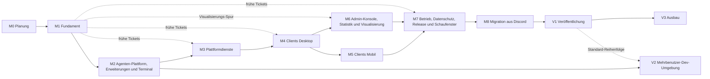

# Plan: Etappen und Bau-Tickets

Status: Entwurf M0. Dieser Plan legt die Bau-Reihenfolge fest: Etappen, ihre Exit-Kriterien,
Teststrategie, Red-Team-Prüfung und die Bau-Tickets. Was gebaut wird, sagen die Kapitel der
[Spezifikation](SPEC.md); bei Widerspruch gilt das Kapitel, und der Plan wird in derselben Änderung
angepasst. Die Briefs der Etappe M1 mit Wellen und Abhängigkeitsgraph stehen im
[Brief-Index](briefs/README.md).

Schreibweise: Verweise auf Kapitel nennen Nummer und Abschnittstitel in Anführungszeichen, zum
Beispiel 02 "Request-Pfad", weil sich Abschnittsnummern ändern können. Test-IDs stammen aus den
Kapiteln: `AZ-*` aus 07, `ID-T*` aus 08, `SEC-T*` aus 19, `BR-*` aus 10, `AG-*` aus 09, `DEV-T*`
aus 21, `DP-T*` aus 20, `TM-T*` aus 24, `VZ-T*` aus 25, `G1` bis `G10` aus 06. Grenzen und Schwellen stehen nur als Name; ihre Werte
stehen in den Kapiteltabellen und in der [Konfigurationsreferenz](operations/configuration.md).
`B1` bis `B13` und `I1` bis `I6` sind die Grundsatzentscheidungen und Invarianten, `L1` bis `L24`
die Entscheidungen der Leitung zu Team-Abweichungen, `T1` bis `T11` die Rulings der Leitung zum
Nachtrag vom 2026-10-10 (Terminal, Visualisierung, Schaufenster); alle stehen in
[DECISIONS.md](DECISIONS.md).
Entscheidungen dieses Plans tragen die Nummern `P-01` und folgende (Abschnitt 19), bekannte
Widersprüche der Spezifikation die Nummern `W1` und folgende (Abschnitt 7).

## 1. Grundsätze

1. **Kein MVP.** Etappen sind nur die Bau-Reihenfolge. Jede Etappe endet in Produktionsqualität
   (Abschnitt 4): Was sie baut, ist fertig, getestet, dokumentiert und vom Red Team geprüft.
   Spätere Etappen erweitern, sie bauen nicht um.
2. **Bestehendes läuft weiter.** Ein bestehender Chat mit Agenten-Betrieb, der zu Bothy umzieht,
   bleibt bis zum Umschalten unverändert. Kein Ticket ändert ihn. Adapter-Tests laufen gegen gepinnte
   öffentliche Versionen in Wegwerf-Ordnern, nie gegen eine produktive Laufzeit. Umgeschaltet wird
   erst in M8, Kanal für Kanal.
3. **Spezifikation zuerst.** Ändert ein Ticket Verhalten, API, Ereignis, Recht oder Konfiguration,
   ändert es zuerst das Kapitel bzw. `docs/api/` in derselben Änderung. Der Kern-Vertrag (00, 03,
   04, 05) ist normativ. Fehlt dort etwas, das ein Ticket braucht, endet das Ticket mit `BLOCKED`
   und Bericht, statt eine Abweichung zu bauen (P-11).
4. **Erst rot, dann grün.** Jede Verhaltensänderung hat einen Test, der vor der Änderung rot war.
5. **Keine Termine.** Der Plan nennt keine Kalenderdaten und keine Aufwandsschätzungen; beides ist
   nicht belegbar. Fortschritt heißt gemergte Tickets und grüne Exit-Kriterien.

## 2. Schnitt der Etappen

Der Schnitt folgt den Verträgen, nicht den Bildschirmen. M1 baut den Server-Kern, an dem alles
andere hängt: Rechte, Identität, Ereignis-Log und Sync, gebaut hinter Gates, die ab dem ersten
Code-Commit greifen. Danach entstehen die Server-Teile, die Clients brauchen (M2 Agenten-Plattform
und Erweiterungen, M3 Plattformdienste); so bauen die Apps gegen eine getestete API statt gegen
Annahmen. Die Apps teilen sich in Desktop (M4) und Mobil (M5), weil Mobil native Erweiterungen
(Notification Service Extension, Teilen, Push-Dienst) mitbringt, die den Push-Versand aus M3 und
die Client-Grundlage aus M4 voraussetzen. Die Web-Konsole (M6) nutzt dieselben Verwaltungs-Pakete
wie der Desktop und folgt ihm. Betrieb, Datenschutz und Release (M7) stehen vor der Migration,
weil echte Daten Sicherung, geprüfte Wiederherstellung, Löschkonzept und signierte Apps verlangen.
Die Migration (M8) beendet die Produkt-Etappen. Danach folgen Schritte, die erst mit einem genutzten
Produkt Sinn haben: die Veröffentlichung (V1) als eigener Schritt mit Checkliste, die
Mehrbenutzer-Dev-Umgebung (V2), sobald eine weitere Person Dev-Zugang braucht, und der Ausbau der
Funktionen, die 01 als "später" führt (V3). Etappen überlappen: Ein Ticket beginnt, sobald seine
Abhängigkeiten gemergt sind; die letzte Spalte nennt, was schon nach M1 beginnen kann (P-01).

Nachtrag vom 2026-10-10: Das Terminal ist Kern ab M2 neben den Agenten. M2 baut Server-Modul,
Host-Dienst, Ende-zu-Ende-Strom, Rechte mit I6 und die Konformitäts- und Chaos-Tests; die Ansichten
folgen den Clients in M4 (Desktop), M5 (Mobil) und M6 (Konsole), jede Etappe mit Red Team für das
Terminal (P-20). Die Visualisierungen beginnen als Spur nach M1: Tokens, Paket `bothy_viz`,
Fixtures und Harness entstehen gegen Fixtures und den Schein-Server, sobald die frühen Tickets aus
M4 stehen; eigene Messung, Live-Strom und Ansichten in Apps und Konsole schließen in M6, das
Grafana-Panel-Plugin in M7 (P-21). Das Schaufenster (Demo-Instanz, Bilder, Video, Startseiten,
Release-Vorlage) ist der letzte Schritt von M7 vor V1 (P-22).

| Etappe | Ziel | Abschluss braucht | Tickets, die nach M1 beginnen können |
|---|---|---|---|
| M0 Planung | Spezifikation, Entscheidungen, Werkzeugkette, Plan und M1-Briefs | | |
| M1 Fundament | Werkzeugkette und Server-Kern mit Rechten: Identität, Geräte, Freigaben, `authorize`, I1, Audit, Struktur, Nachrichten, Ereignis-Log, Sync, Gateway, Observability-Grundlage, Server-Image | M0 | |
| M2 Agenten-Plattform, Erweiterungen und Terminal | Läufe mit Live-Box, Aufruf-Marke, Adapter-Vertrag, Nachträge, Komponenten, Befehle, Sitzungen, Backend-Richtlinie mit Kosten, Apps, Webhooks, SDKs, Referenz-Adapter; Terminal mit Host-Dienst, Kopplung, Ende-zu-Ende-Strom, Rechten und I6 | M1 | alle |
| M3 Plattformdienste | Dateien mit Scan, Bilder, Sprachnachrichten, Suche, Benachrichtigungen und Push-Versand | M1, M2 | M3-01 bis M3-06, M3-10, M3-11, M3-13 bis M3-18 |
| M4 Clients Desktop | Design-System, Client-Grundlage, Desktop-App für macOS und Windows mit Verwaltung und Terminal-Ansicht | M1, M2, M3 | M4-01 bis M4-20, M4-25 bis M4-27, M4-29, M4-31 |
| M5 Clients Mobil | iOS und Android mit Push-Empfang, Teilen, Sprachaufnahme, App-Sperre, Notfall-Aktionen und Terminal mit Sondertasten-Leiste | M3, M4 | keine |
| M6 Admin-Konsole, Statistik und Visualisierung | Web-Konsole mit BFF-Sitzung und strenger CSP, Statistik, Verwaltung und Terminal; eigene Messung, Live-Strom und Visualisierungen in Apps und Konsole | M1 bis M4 | M6-01; Visualisierungs-Spur M6-10 bis M6-12 |
| M7 Betrieb, Datenschutz, Release und Schaufenster | Sicherung, Wiederherstellung, Sync-Epoche, DSGVO-Abläufe, Wartungsmodus, Statusseite, Release-Kette mit Host-Dienst, App-Verteilung, Portabilität, Mehrknoten-Betrieb, Grafana-Panel-Plugin, Demo-Instanz und Schaufenster | M1 bis M6 | M7-01 bis M7-04, M7-10, M7-11, M7-15, M7-16, M7-19, M7-24 |
| M8 Migration aus Discord | Import, Lese-Spiegel, Umschalten je Kanal und Durchführung | M1 bis M3, M5 bis M7 | M8-01, M8-02 |
| V1 Veröffentlichung | Repository öffentlich nach der Checkliste | M6, M7, Bau-Tickets von M8 (P-15) | keine |
| V2 Mehrbenutzer-Dev-Umgebung | Abgeschottete Dev-Umgebungen je Person | M2; Standard nach V1 | keine |
| V3 Ausbau | Funktionen, die 01 als "später" führt | V1 | keine |

Abhängigkeiten der Etappen (durchgezogen: der Abschluss braucht die Etappe; gestrichelt: frühe
Tickets beginnen schon nach M1 bzw. Standard-Reihenfolge):

## 3. Arbeitsweise je Ticket

Für jedes Ticket gilt, auch wenn sein Brief es nicht wiederholt:

1. **Start.** Alle Abhängigkeiten sind im Ausgangsbranch gemergt; der Arbeitsbaum ist sauber.
2. **Worktree je Ticket.** Ein eigener Git-Worktree auf einem Branch `feat/<ticket-id>-<slug>`
   (`fix/` bzw. `docs/` nach Art). Ein Schreiber je Worktree. Parallele Tickets laufen in eigenen
   Worktrees; keines wird zurückgehalten, weil es sich mit einem anderen überschneiden könnte.
   Konflikte löst der Merge.
3. **TDD.** Erst der Test, der rot ist (Ausgabe im Bericht), dann der Code bis grün, dann aufräumen.
4. **Spezifikation zuerst** (Grundsatz 3).
5. **Saubere Tests.** Tests binden nur `127.0.0.1` und Port 0 (P-10). PostgreSQL und andere Dienste
   laufen als Wegwerf-Container auf Zufallsports (P-09). Temp-Ordner nur über `mktemp`, am Ende
   gelöscht. Nur selbst gestartete Prozesse werden beendet, per PID. Keine Netzaufrufe außer
   Paket-Downloads gepinnter Werkzeuge. Echte Modellaufrufe nur hinter einem ausdrücklichen
   Schalter, weil sie Geld kosten. Geheimnisse werden nie gelesen oder ausgegeben.
6. **Gates.** `make check` ist grün, lokal identisch zu CI (ADR 0038). Berührt das Ticket ein
   Leistungsziel, zusätzlich `make perf` (P-07). Kein Ticket senkt eine Schwelle, schaltet ein
   Gate ab oder löscht einen Test, außer sein Brief nennt es ausdrücklich.
7. **Doku-Pflicht.** README des Moduls aktuell (Status, Ports, Tabellen, Aktionen, Jobs);
   Doc-Kommentar an jedem öffentlichen Symbol (Zweck, Parameter, Rückgabe, Fehler, Beispiel, wo
   nützlich), geprüft durch das Doku-Gate der Sprache (23 "Doku im Code"); Kommentare erklären das
   Warum. Eine ADR bei jeder Architekturentscheidung; fehlt eine
   ADR aus der Liste der Leitung, schreibt das umsetzende Ticket sie (P-12). CHANGELOG-Eintrag unter
   "Unreleased" der Komponente. Erzeugte Referenzen (Konfiguration, API-Tabellen) sind neu erzeugt.
8. **Commits.** Conventional Commits mit Modul oder Komponente als Scope und DCO-Sign-off; vor dem
   Merge zu sinnvollen Commits zusammengefasst ([Push-Disziplin](quality/push-discipline.md)).
9. **Review.** Lokales Review (`make review` und ein Code-Review über den Diff), danach das
   [Red-Team-Gate](quality/red-team-gate.md) über den Diff mit Urteil `JA` oder `NEIN`; der Bericht
   liegt als `.review/<sha>.md` des zu mergenden Commits vor, letzte Zeile `Urteil: JA` (der
   pre-push-Hook verlangt ihn, D-W-32). Bei `NEIN`: beheben, je Befund ein Test, Delta erneut prüfen.
   Kommt dasselbe `NEIN` erneut, entscheidet der Owner.
10. **Merge.** Lokal in den Ausgangsbranch, nur mit sauberem Review, Urteil `JA` und grünem
    `make check`; danach `git worktree remove`.
11. **Push.** Push, Tag und Pull Request nur nach Freigabe durch den Owner.
12. **Bericht.** Erste Zeile `Verdict: DONE` oder `Verdict: BLOCKED <Grund>`; dann Commits,
    Dateien mit Zeilenzahl, Tests mit Zahlen, was nicht bewiesen ist, und nur echte
    Owner-Entscheidungen mit Empfehlung. Ein Befund im eigenen Diff wird im Ticket behoben, nicht
    berichtet.

## 4. Abschluss einer Etappe

Eine Etappe ist fertig, wenn alles gilt:

1. Alle Tickets der Etappe sind gemergt, und `make check` ist auf dem Ausgangsbranch grün.
2. Jedes Exit-Kriterium der Etappe ist mit dem genannten Test oder Befehl belegt.
3. `make perf` erreicht die Leistungsziele der Etappe auf `perf.reference_profile`, im Modus
   `match` oder `emulated` (ADR 0063).
4. Das Red-Team-Gate prüft den ganzen Diff seit dem Abschluss der vorigen Etappe mit Urteil `JA`.
   Zusätzlich prüft es, was der Abschnitt "Red Team" der Etappe nennt, nach Stufe P1 aus 19
   "Penetrationstest-Plan".
5. Das [Bedrohungsmodell](security/threat-model.md) trägt "Stand Etappe" mit dem Namen der Etappe: neue Komponenten,
   Datenflüsse und Grenzen sind eingetragen; jede Bedrohung mit Wahrscheinlichkeit `mittel` oder
   `hoch` hat einen Test oder ein begründetes Restrisiko (Abschnitt "Pflegeregel").
6. [RISKS.md](RISKS.md) ist für die Risiken der Etappe nachgezogen, und die
   [Roadmap](roadmap.md) zeigt den Status.
7. Die CHANGELOG-Einträge aller betroffenen Komponenten sind vollständig.

## 5. Teststrategie

| Stufe | Was | Werkzeug | Läuft |
|---|---|---|---|
| Unit | reine Domänen-Funktionen, Zustandsmaschinen, Parser | `go test`, `pytest`, `dart test` | `make check` |
| Integration Server | Anwendungsfälle gegen PostgreSQL 18 im Wegwerf-Container; fremde Module über ihre Ports als Fakes, im Integrationstest echt | `go test` mit der Testhilfe aus M1-12 | `make check` |
| Testdoppel | Fake-IdP (M1-41), virtueller WebAuthn-Authentifikator (M1-40), Fake-Agent und FakeServer (M2-29, M2-31), Fake-Hermes und Fake-Claude (M2-33, M2-34), Fake-GitHub- und Fake-Jira-API (M2-49, M2-50), Fake-Host und Go-Testgerät für das Terminal (M2-44, M2-48), Host-Dienst im Linux-Container (M2-48), Fake-`claude` für `doctor` (M2-42), Fake-APNs und Fake-FCM (M3-20, M3-21), clamd- und SeaweedFS-Container (M3-02, M3-04), Dart-Fake-Server (M4-17), Fixtures und Harness von `bothy_viz` (M6-11) | nach 09 "Testdoppel" und den Fachkapiteln | mit ihren Tests |
| Vertrag | G1 bis G10 aus 06 "Vertragstests und Gate" | Redocly, Prüfskripte, Generatoren, Schemathesis, Mitschnitt der Gateway-Rahmen | alle in `make check`: G1 bis G6 als eigene Gates, G7 als `make contract-test`, G8 bis G10 in den Integrationstests |
| Ende zu Ende | Compose-Rauchtest (M1), Terminal mit echtem Host-Dienst (M2-48), Desktop (M4), Geräte (M5), Konsole (M6), Portabilität mit Grafana-Plugin (M7) | `make portability`, `integration_test`, `patrol` | je Etappe, vor Releases |
| Last, Dauer, Chaos | Leistungsziele aus 02 "Leistungsziele", 14, 15 und 25; Chaos der Ereignis-Kette und des Terminals (TM-T16) | `make perf`, `test/chaos` | Etappenabschluss und Release (P-07) |
| Sicherheit | SEC-T01 bis SEC-T19, Rechte-Matrix und Pflicht-Tests aus 07, ID-T01 bis ID-T29, TM-T01 bis TM-T29, VZ-T01 bis VZ-T16, Go-Fuzzing der Parser (auch Noise-Rahmen und Sitzungs-Marke) | wie oben | `make check` |
| Golden | Komponenten, Ansichten von `bothy_viz` und Terminal-Ansicht nach 15 "Teststrategie" | `alchemist` | `make check` |
| Barrierefreiheit | Prüfliste mit VoiceOver, TalkBack und Narrator | von Hand mit Prüfliste | vor jedem App-Release |

## 6. M0 Planung (Abschluss)

**Ziel.** Der Planungsstand ist vollständig, widerspruchsfrei und durch Gates gehalten; M1 kann
ohne Rückfragen beginnen.

**Stand.** Spezifikation, Kern-Vertrag, ADRs, Design-Tokens, Werkzeugkette, Gates und CI-Workflows
liegen im Repository. M0-01 ist umgesetzt (`make tokens` erzeugt neu, vergleicht und prüft Kontraste
und Palette; die Fälle der Akzeptanz prüft `tools/design-tokens/tests/test_gate.py`); offen bis zum Abschluss
sind die übrigen Tickets unten.

**Exit-Kriterien.**

1. `make check` ist auf dem zusammengeführten Stand grün (M0-01, M0-02); bis M0-04 gelten nur die
   Verweise auf die Abschlussdokumente aus M0-04 als offen.
2. Die Revision des Kern-Vertrags ist gemergt (M0-03); jede Ergänzung aus "M1: Voraussetzungen aus
   dem Kern-Vertrag" ist übernommen oder als Owner-Frage geführt.
3. `make docs` und `make linkcheck` sind grün (M0-04).
4. Für jedes M1-Ticket liegt ein Brief vor (M0-05).
5. Das Red Team urteilt `JA` über den Planungsstand (M0-06).
6. Der lokale SonarQube läuft mit Profil und Gate (M0-07); ohne ihn scheitert `make sonar` ab dem
   ersten Produkt-Code (M1-05).

M0-09 braucht das Go des Owners; die Commit-Identität für M0-08 ist entschieden (D-W-06). Beide
sind Voraussetzung für den ersten Push, nicht für den Bau. Stand (D-W-93): Der erste Push ist ein
Commit ohne Eltern; M0-08 ist nur nötig, wenn doch eine Historie veröffentlicht werden soll.

| ID | Titel | Ziel | Dateien und Module | Akzeptanztests | Abhängig von |
|---|---|---|---|---|---|
| M0-01 | Token-Gate verdrahten | `make tokens` baut die Design-Tokens in einem Temp-Ordner neu, vergleicht mit `design/build` und prüft die Kontraste. | `tools/design-tokens/Makefile` (Ziel `check`), `tools/design-tokens` | `make tokens` grün; eine geänderte Token-Datei ohne Neuerzeugung lässt `make tokens` scheitern; eine Kontrast-Paarung unter AA lässt es scheitern | keine |
| M0-02 | Integration der Team-Stände | Alle Team-Worktrees sind zusammengeführt, und `make check` ist auf dem Planungsstand grün. | alle Planungsdateien; `docs/api/openapi.yaml` (Beispielwerte mit `EXAMPLE`), `mkdocs.yml`, `docs/adr/README.md` | `make check` grün bis auf Verweise auf die Abschlussdokumente aus M0-04, auch `make denylist` ohne Fund; `make gitleaks GITLEAKS_LOG_OPTS=--all` ohne Fund; `make docs` und `make linkcheck` melden nur diese Verweise; `make diagrams` rendert alle Diagramme | M0-01 |
| M0-03 | Kern-Vertrag nach Revision übernehmen | Die Revision von 00, 03, 04 und 05 aus den Kern-Vertrag-Problemen der Teams ist gemergt, und jedes Kapitel verweist auf den neuen Stand. | `docs/spec/00-glossar.md`, `03-datenmodell.md`, `04-sync-protokoll.md`, `05-aktionen.md`; Vermerke "(Kern-Vertrag: Ergänzung beantragt)" in den Kapiteln | `make check` grün bis auf die Verweise auf die Abschlussdokumente, die M0-04 schließt; Liste der übernommenen und abgelehnten Ergänzungen in DECISIONS.md; jede abgelehnte Ergänzung, die ein Ticket braucht, steht in OPEN-QUESTIONS.md | M0-02 |
| M0-04 | Abschlussdokumente | SPEC.md, DECISIONS.md, OPEN-QUESTIONS.md, RISKS.md, README.md und die Navigation sind vollständig. | `docs/SPEC.md`, `docs/DECISIONS.md`, `docs/OPEN-QUESTIONS.md`, `docs/RISKS.md`, `README.md`, `mkdocs.yml`, `CHANGELOG.md` | `make docs` (strikt) und `make linkcheck` grün | M0-03 |
| M0-05 | Bau-Briefs der Etappe M1 | Für jedes M1-Ticket liegt ein Brief nach der Brief-Vorlage in `docs/briefs/` mit dem Namen aus dem Brief-Index. | `docs/briefs/M1-*.md`, `docs/briefs/README.md` | je M1-Ticket genau eine Datei mit dem Namen aus dem Index; `make check` grün; keine Lücke zwischen Brief und Kapitel (Rückmeldungen `spec_gaps` der Brief-Schreiber sind behoben oder als Owner-Frage geführt) | M0-04 |
| M0-06 | Red Team über den Planungsstand | Ein unabhängiger, nur lesender Prüfer bewertet den ganzen Planungsstand nach red-team-gate.md. | Bericht (Ops-Repo), Befunde als Änderungen im Produkt-Repo | Urteil `JA`; jeder Befund behoben oder mit Grund in DECISIONS.md | M0-05 |
| M0-07 | Lokaler SonarQube in Betrieb | Der lokale SonarQube Community Build läuft mit dem Profil und Gate "Bothy way", bevor der erste Produkt-Code entsteht. | `tools/sonarqube/compose.yaml`, `quality/sonar/*` | `make sonar-up` meldet UP; `make sonar-config` und `make sonar-config-check` grün; Dart und Swift als übersprungen gemeldet | M0-02 |
| M0-08 | Historie vor dem ersten Push bereinigen | Stand: entfällt, solange der erste Push ein Commit ohne Eltern ist (D-W-93); gilt nur, wenn eine Historie veröffentlicht wird. Die vom Owner gewählte Commit-Identität bleibt und steht in `allow-authors.txt` der privaten Liste (D-W-06); Autoren werden nicht umgeschrieben. Vor dem ersten Push entfernt ein Lauf `git filter-repo` über alle Refs zwei Arten von Funden: die alten Beispielwerte, die `.gitleaks.toml` als Ausnahme für die Historie führt (danach wird die Ausnahme gelöscht), und jeden Fund von `make denylist-history`. Je Fundstelle ein eigenes Werkzeug, alle im selben Lauf (D-W-48): Text in alten Datei-Versionen mit `--replace-text`; Commit- und Tag-Nachrichten mit `--replace-message` (`--replace-text` ändert nur Blobs); Pfade mit `--paths-from-file` und Zeilen `alt==>neu` (nur Umbenennungen, darum bleiben alle anderen Pfade); Binär-Blobs mit Fund (NUL in den ersten 8 KiB, die `--replace-text` überspringt) mit `--strip-blobs-with-ids`; dazu `--prune-empty never`, damit kein Commit wegfällt. Ein Treffer im aktuellen Baum oder in einem Ref-Namen wird vorher mit einem normalen Commit beziehungsweise durch Umbenennen der Ref beseitigt. Stand 2026-10-11 meldet der Historien-Scan mit der privaten Liste und der Erlaubnisliste der Autoren Funde aus der privaten Liste und aus den generischen Regeln, alle in alten Versionen von Planungsdateien, keinen im aktuellen Baum und keinen in Identitäten (D-W-36); maßgeblich ist der Lauf im Ticket, nicht dieser Stand. Die Eingaben entstehen aus einer neuen Scanner-Option `--replacements-out <ordner>`, die drei Dateien schreibt: `text.txt` mit je getroffenem Text einer Zeile `<text>==>REDACTED` (für `--replace-text` und `--replace-message`), `paths.txt` mit `<alter Pfad>==><Pfad mit REDACTED>` und `blobs.txt` mit den IDs der Binär-Blobs mit Fund; alle mit Dateirechten nur für den Benutzer und nur außerhalb des Repositorys; sie gibt keinen Begriff auf der Konsole aus, und der Ordner wird nach dem Lauf gelöscht. | `tools/denylist/denylist_scan.py` (Option mit Test), private Deny-Liste (Ops-Repo), `.gitleaks.toml`, Historie | Test: `--replacements-out` schreibt jeden Treffer genau einmal in die passende Datei, verweigert einen Pfad im Repository und gibt keinen Treffer aus; Fixture-Repository mit je einem Treffer in Datei-Inhalt, Pfad, Commit-Nachricht, Tag-Nachricht und PNG-Text-Chunk: nach dem dokumentierten Lauf meldet der Scanner mit `--history` 0 Funde bei gleicher Commit-Zahl; danach `make denylist-history` mit 0 Funden und `make gitleaks GITLEAKS_LOG_OPTS=--all` grün, ohne Ausnahme für die alten Beispielwerte; `git log --all` zeigt dieselbe Zahl Commits wie vorher | M0-06 |
| M0-09 | Remote und Labels (Owner) | Nach dem Go des Owners existiert das Remote mit Labels und der Umgebung `denylist` mit Zugriff für Pull Requests und `main`; das Repository ist ab dem ersten Push öffentlich, alle Jobs laufen auf GitHub-gehosteten Runnern (ADR 0039, public-switch.md). | `.github/labels.yml`, Runbook im Ops-Repo | `make labels-check` grün und `make labels-sync` legt alle Labels an; Probe-Pull-Request: alle Jobs auf GitHub-gehosteten Runnern; nach dem Probe-Merge läuft `denylist-main.yml` grün | M0-08 |

## 7. M1 Fundament: Werkzeugkette und Server-Kern mit Rechten

### Ziel

Ein Server, der Menschen sicher anmeldet, Geräte bindet, Rechte bei jeder Anfrage und jeder
Zustellung prüft, I1 bei jeder Rechte-Änderung erzwingt, Bereiche, Kanäle, Threads und Nachrichten
verwaltet und jedes Ereignis lückenlos, geordnet und nur an Berechtigte zustellt. Die Gates greifen
ab dem ersten Code-Commit.

### Umfang

- Werkzeugkette für Server und Verträge: Gates, Aktionskatalog als Datenquelle, API- und
  Register-Prüfungen, Betriebs-Konfigurationen (Block A; 23, 06 "Vertragstests und Gate").
- Gerüst und Plattform: Module, Konfiguration, Geheimnisse, Telemetrie-Grundlage, Lebenszyklus,
  PostgreSQL, Unit of Work, Jobs, Ereignis-Log, HTTP-Kette, Rate-Limits, Idempotenz, Transport,
  Egress, Server-Image (Block B; 02, 04 "Globale, commit-geordnete Sequenz", 16, 17, 19).
- Audit und Rechte-Kern: Hash-Kette, Freigabe-Modell, `authorize`, I1 und SR8, Ablauf (Block C; 05,
  07, 10 "I1 transaktional", 19 "Lieferkette, Sicherungen und Audit-Integrität").
- Identität vollständig: OIDC, Proxy-Header, lokale Konten, Passkeys, Geräte mit DPoP, Sitzungen,
  Step-up, API-Tokens, Sperren (Block D; 08).
- Instanz und Verwaltung der Rechte über die API: Einstellungen, Branding, Discovery,
  Feature-Flags, Signierschlüssel, Gruppen, Freigaben, Erklärung, Vorschau, "Als Person ansehen",
  Audit-Prüfung (Block E; 07 "Anforderungen an die Admin-Oberfläche", 16 "Umgebungen und
  Feature-Flags").
- Agenten als Datensätze mit Backend-Richtlinie und Zugangsdaten-Inhaber, ohne Laufzeit (P-02);
  Bereiche, Kanäle, Bediener, Threads, Nachrichten (Block F; 01 "Funktionsliste", 09 "Agenten als
  Prinzipale", 10 "Invarianten").
- Sync und Gateway: persönliche Sync-Daten, Nachholen, Momentaufnahme, WebSocket mit Hub, Entzug,
  Fokus und Tippen (Block G; 04).
- Abschluss: Metriken, Kanarie, Lecktests, Vertragstests, Lasttests, Compose-Rauchtest, CodeQL
  (Block H).

### Nicht-Umfang

Agenten-Laufzeit, Läufe, Live-Box, Aufruf-Marke, Agenten-Verbraucher, Kanal-Verhalten und
Projektbindung (M2); Apps und Webhooks (M2); Dateien, Avatare, Logo, Suche, Benachrichtigungen und
Push (M3); Clients und Konsole (M4 bis M6); Sicherung, Wiederherstellung, DSGVO-Abläufe,
Statusseite, Wartungsmodus, Release-Kette und Mehrknoten-Betrieb (M7); Direktnachrichten (V3). Das
Installations-Compose mit `bothy-postgres` und Sicherungsdienst wird erst in M7 startbar; M1 prüft
das Server-Image mit dem Test-Overlay aus P-06.

### Voraussetzungen aus dem Kern-Vertrag

M1 baut gegen den Kern-Vertrag nach der Revision aus M0-03. Diese beantragten Ergänzungen braucht
M1; ist eine davon nicht übernommen, endet das betroffene Ticket mit `BLOCKED` (P-11).

| Ergänzung (Quelle) | Tickets |
|---|---|
| Präfix `/api/v1` für REST und Gateway (06 "Weitere Punkte" K1) | M1-17, M1-64 |
| kein JSON-`null` im Umschlag (06 K2, ADR 0053); `412` mit If-Match statt `409` (06 K4) | M1-16, M1-18, M1-58 |
| `403 device_pending` für wartende Geräte (06 K13) | M1-33, M1-38 |
| Aktionen `instance.settings.read`, `identity.read`, `self.read`, `agent.enable`, `local_credential.set` (06 "Neue Aktionen für 05"); `health.read` entfällt (L2) | M1-17, M1-31, M1-36, M1-39, M1-46, M1-51 |
| Tabellen `local_credentials`, `enrollment_codes`, `auth_login_flows` (08 K-ID-1 bis K-ID-3) | M1-37, M1-39, M1-41 |
| `device_keys.purpose`; Spalten an `auth_sessions`; `refresh_token_families.dpop_jkt`; Nachsicht beim Refresh (08 K-ID-4 bis K-ID-6, 06 K10) | M1-33, M1-34 |
| Systemaktion `instance.bootstrap`; `user.enable` aus `pending` (08 K-ID-7); `auth.dpop_nonce_ttl` nach 08 (K-ID-8) | M1-31, M1-37, M1-08 |
| Zusatzrechte von Agenten und Apps nur `upload`; Bediener-Regel (07 K-RE-1, K-RE-2) | M1-27, M1-28, M1-54 |
| SR8 bei `user.disable`; Grenzen von `grant.revoke` mit `manage`; Owner-Rechte nur mit Sitzung (07 K-RE-5, K-RE-6, K-RE-10) | M1-29, M1-44, M1-45, M1-48 |
| `access.preview`; Ablauf mit `grant.expire`, `group.member.expire`, `access.expiring`, `expiry_reminded_at`; Grund-Codes für `deny_reason` (07 K-RE-7 bis K-RE-9) | M1-24, M1-30, M1-49 |
| Zweck `audit_checkpoint` und Prüfpunkte, Kanonisierung nach RFC 8785; IP nur als `ip_hmac` (19 "Audit-Integrität", 20 K-DP-2) | M1-24, M1-50 |
| `instance.min_server_version` (16 "Upgrade"); `correlation_id` als Trace-ID und `trace_context` im Umschlag (17 "Signale") | M1-15, M1-16 |
| Token-Format mit Präfix und Prüfsumme (08 "API-Tokens für Agenten, Apps und Werkzeuge") | M1-44 |
| Rechte-Cache folgt Struktur-Ereignissen; Kopien beim Thread-Verschieben; `agent.read` für den Agenten selbst; Module ohne Tabellen; River-Tabellen (02 "Ergänzungen am Kern-Vertrag" Punkte 2, 4, 6, 10, 11) | M1-05, M1-14, M1-51, M1-53, M1-62, M1-63, M1-65 |
| persönliche Vorlagen ohne Kanal (06 K15); maschinenlesbarer Aktionskatalog (ADR 0049) | M1-02, M1-60 |
| Nachtrag vom 2026-10-10: Ziel `host` mit Zusatzrecht `terminal` und Spalte `target_host_id` in `grants` (03, R-DM-35), Aktionen 4.14 mit Step-up `frisch`, Ops `stats.subscribe` und `stats.unsubscribe`, Ops der Terminal-Kanäle (05 Abschnitt 7), Zweck `terminal` der Signierschlüssel, `auth_sessions.step_up_consumed_at`; gebaut wird davon in M1 nur, was Katalog, Tabellen und Listen vollständig hält, die Terminal-Aktionen bleiben bis M2 aufgeschoben (P-24); M1-32 und M1-34 legen Zweck und Spalte mit ihren Tabellen nach 03 an, ohne sie zu nutzen | M1-02, M1-03, M1-05, M1-06, M1-25, M1-27, M1-28, M1-32, M1-34, M1-64 |

### Bekannte Widersprüche, die M1 auflöst

Jedes Ticket löst seinen Widerspruch in derselben Änderung, die den Code baut, und trägt die
Entscheidung in DECISIONS.md ein. Die Spalte "Empfehlung" ist die Voreinstellung des Plans.

| Nr | Widerspruch | Empfehlung | Ticket |
|---|---|---|---|
| W1 | Konfigurationsnamen: Synonyme und Doppelungen zwischen Kapiteln (Tabelle unten) | Regel P-08; ein Name je Begriff | M1-08 |
| W2 | Health: 02 nennt `live` und `ready` auf `http.ops_listen_addr`, 16 nennt `/healthz` und `/readyz` auf dem internen Listener, openapi.yaml führt `getLiveness` und `getReadiness` | L2: 16 gilt; die Operationen und die beantragte Aktion `health.read` entfallen; 02 passt sich an | M1-11, M1-17 |
| W3 | Unterbefehle: 08 nennt `bothy admin bootstrap-owner` und `issue-enrollment-code`; L1 nennt `setup`; 16 und Compose nutzen zusätzlich `secrets`, `healthcheck`, `restore` | `bothy setup bootstrap-owner` und `bothy setup issue-enrollment-code`; L1 um `secrets`, `healthcheck`, `restore` erweitern | M1-09, M1-11, M1-37 |
| W4 | Header-Treiber ohne Loopback: 08 lässt den Start scheitern, 16 lässt den Treiber aus und meldet den Fehler über `/readyz` | 16 gilt, weil der Treiber eine Laufzeit-Einstellung des Owners ist: Treiber bleibt aus, `/readyz` meldet `trusted_header_requires_loopback`, `identity_provider.manage` lehnt das Einschalten ab; ID-T08 und SEC-T01 entsprechend | M1-43; Spec umgesetzt (08 2.4 und ID-T08, 16 4.3, 19 SEC-T01) |
| W5 | Einladung und Kopplung: 08 lässt einen Einladungs-Code das erste Gerät ohne Passkey bestätigen und kennt die Geräte-Kopplung; openapi.yaml verlangt beim Einlösen einen Passkey und hat keine Kopplungs-Endpunkte | Spezifikation zuerst ergänzen: Einlösen mit Geräteschlüsseln ohne Passkey, Kopplungs-Endpunkte mit Aktion und Rate-Limit-Klasse | M1-37, M1-38; Spec umgesetzt (`redeemEnrollmentCode`, Kopplungs-Endpunkte, 08 3.2 und 5.3) |
| W6 | Pfad-Präfix: 04 nennt `/v1/...`, 06 nennt `/api/v1` | 06 gilt (Revision des Kern-Vertrags) | M1-17 |
| W7 | Unbekannte Anfragefelder: 06 lässt den Server sie ignorieren (R-API-04), 19 verlangt `additionalProperties: false` für schreibende Schemas (SEC-IN-1) | 19 gilt: ein still verworfenes Feld verschluckt bei älteren Servern eine Absicht; Clients prüfen neue Fähigkeiten über `features` der Discovery. R-API-04 gilt weiter für Antworten und Ereignisse | M1-18 |
| W8 | Paketname der Telemetrie: 02 nennt `platform/otel`, ein Betriebs-Ticket `platform/telemetry` | 02 gilt | M1-10 |
| W9 | Der Egress-Client aus 19 fehlt im Code-Layout von 02 und im Modulregister | `platform/egress` nachtragen | M1-22 |

Konfigurationsnamen (W1):

| Begriff | Namen heute | Auflösung |
|---|---|---|
| öffentlicher Listener | `http.listen_addr` (02), `server.listen_addr` (16) | `server.listen_addr` mit Standard aus 16 |
| interner Listener | `http.ops_listen_addr` (02), `server.internal_listen_addr` (16) | `server.internal_listen_addr` |
| vertraute Proxys | `api.trusted_proxy_cidrs` (06), `server.trusted_proxies` (16), `net.trusted_proxies` (08, 19) | `server.trusted_proxies` mit Standard aus 19 |
| größter JSON-Körper | `http.max_json_body_bytes` (02), `api.max_json_body_bytes` (06), `http.max_body_bytes` (19) | `http.max_json_body_bytes` (02); in M0 aufgelöst, die Kapitel nutzen nur diesen Namen |
| HTTP-Fristen und Kopfzeilen | `http.read_header_timeout` mit verschiedenen Standards, `http.idle_timeout`, `http.max_header_bytes` (02 und 19) | in 02 geführt, Standard nach P-08 der strengere; 19 verweist |
| Datenbank | `db.*` (02), `database.*` (16) mit verschiedenen Standards für Pool und Fristen | Präfix `database.*`; Verbindung als Einzelwerte nach 16; Fristen aus 02 unter `database.*`; `database.statement_timeout` gilt im Anfragepfad, Jobs und Migrationen haben eigene Namen |
| Herunterfahren | `shutdown.*` (02), `server.shutdown_grace` (16) | `shutdown.*` aus 02; `server.shutdown_grace` entfällt; `shutdown.total_timeout` mindestens die Summe der Schritt-Budgets, Compose `stop_grace_period` länger (beides in M0 gesetzt, der Check D8 aus M1-08 hält es) |
| Gültigkeit Einladungs-Code | `auth.enrollment_code_ttl` in 06 und 08 mit verschiedenen Standards | 08 führt den Wert, 06 streicht die Zeile |
| doppelte Zeilen gleichen Werts | `auth.local_password_enabled`, `file.upload_part_bytes`, `file.upload_session_ttl` (06 und Fachkapitel), `command.autocomplete_timeout` (06 und 09), `server.role` (02 und 16) | nur das Fachkapitel führt den Wert (Betrieb für `server.role`) |
| Bilder | `file.image.max_pixels` (12), `upload.image_max_pixels` und `upload.strip_image_metadata` (19) | `file.image.*` in 12; 19 verweist |

### Exit-Kriterien

1. Alle M1-Tickets sind gemergt; `make check` ist grün.
2. Rechte: AZ-M01 bis AZ-M14, AZ-M18, AZ-M21 bis AZ-M29, AZ-M31 bis AZ-M41, AZ-M46, AZ-M47, AZ-M50,
   AZ-M52 sowie AZ-P1 bis AZ-P5, AZ-P7 bis AZ-P10, AZ-P12, AZ-P13 sind grün (`make test`, Testnamen
   tragen die ID). Die übrigen IDs gehören zu M2, M3 und V2.
3. Backend-Richtlinie: BR-01 bis BR-03 sind mit allen echten Quellen grün (M1-54).
4. Identität: ID-T01 bis ID-T27 sind grün, außer ID-T19 (Konsole, M6).
5. Sicherheit: SEC-T01 bis SEC-T04, SEC-T06, SEC-T07, SEC-T09 bis SEC-T12, SEC-T16, SEC-T17 sind
   grün.
6. Verträge: G1 bis G3, G7 bis G9 sind grün; die Freischalt-Liste enthält genau die Operationen
   der M1-Tickets (P-04).
7. `make perf` erreicht `perf.event_commit_min_per_s`, `perf.message_create_p99`,
   `perf.fanout_local_p99`, `perf.catchup_page_p99`, `perf.authorize_cached_p99`,
   `perf.ws_connections_per_node`, `perf.ws_idle_conn_mem_max`, `perf.idle_rss_max` und
   `perf.startup_ready_max`.
8. `make portability` ist mit dem Rauchtest aus M1-73 grün.
9. `make config-doc-check` ist grün und meldet keinen Widerspruch aus W1; ADR 0049, 0050, 0052,
   0053, 0061, 0063 und 0064 liegen vor.
10. Das Red Team urteilt `JA`; das Bedrohungsmodell trägt "Stand Etappe M1".

### Teststrategie

- Unit und Integration gegen PostgreSQL 18. `authz` wird mit Fake-Quellen getestet, die
  Integrationstests der Struktur (M1-54) nutzen alle echten Quellen.
- Fake-IdP für OIDC (M1-41) und ein virtueller WebAuthn-Authentifikator (M1-40).
- Kein Fake-Agent und kein Fake-Hermes: M1 hat keine Agenten-Laufzeit; diese Testdoppel entstehen
  in M2.
- Verträge: G1 bis G3 im Gate, G7 und G8 in M1-71, G9 in M1-67. G4 und G5 folgen mit den
  SDK-Clients (M2, M4), G6 mit der ersten Veröffentlichung (M7), G10 mit den Webhooks (M2).
- Ende zu Ende: Compose-Rauchtest (M1-73). Geräte-Tests gibt es erst mit den Apps.
- Last, Dauer und Chaos: M1-16, M1-28, M1-72.
- Fuzzing: DPoP- und JWS-Parser (M1-33), Schema-Fuzzing aller Routen (M1-71).

### Red Team

Zusätzlich zur allgemeinen Prüfung:

1. Jede freigeschaltete Route, Op und jeder Ereignistyp läuft durch `authorize` mit Katalog-Aktion,
   und der Laufzeit-Nachweis wirkt (AZ-P1 bis AZ-P3, `authz_not_checked`).
2. Kein Weg verrät Fremdes: 404 statt 403, Zähler, Momentaufnahme, Nachholen, Gateway,
   Fehlerkörper und Antwortzeit.
3. Keine Folge von Rechte-, Gruppen-, Owner-, Bediener- und Richtlinien-Änderungen umgeht I1 oder
   SR8, auch nicht parallel.
4. Anmeldung: Übernahme bei der Erstinstallation, gefälschte Proxy-Kopfzeilen, Zuordnung über
   E-Mail, Wiederverwendung von DPoP-Beweisen, Refresh-Tokens und Codes, Step-up mit Token ohne
   Sitzung, persönliches Token mit Owner-Rechten.
5. Entzug und Widerruf wirken sofort, über Prozesse (AZ-P9) und auf offene Verbindungen.
6. SSRF über OIDC-Discovery und JWKS; Geheimnisse und Inhalte in Logs, Telemetrie, Audit und
   Fehlern.
7. Audit: Änderung und Neuschreiben der Kette werden erkannt.
8. Lieferkette: neue Abhängigkeiten gepinnt und mit erlaubter Lizenz; kein abgeschwächtes Gate.

Bedrohungsmodell: Gateway, Identitätsanbieter, Egress-Client und Rauchtest-Stack sind eingetragen;
T-AZ-01 bis T-AZ-05, T-OW-01, T-ID-01 bis T-ID-06, T-TK-01 bis T-TK-04, T-NW-01, T-NW-02, T-LG-01,
T-IN-01, T-DB-01 und T-DS-01 nennen ihre M1-Tests. Prüfliste nach OWASP ASVS 5.0 Stufe 2 für die
Server-Teile der Etappe (19 "Penetrationstest-Plan", Stufe P1).

### Abhängigkeiten

M0-01 bis M0-07. Keine Entscheidung des Owners nötig: Der Modulpfad nutzt den Platzhalter aus P-05.

### Risiken

Verweise auf [RISKS.md](RISKS.md):

- Durchsatz am Zähler `event_seq`: gemessen ab M1-16, Gate über `make perf`.
- Rechte-Cache veraltet nach Strukturänderung oder Ablauf: M1-28 (Differenztest AZ-P8), M1-30 und M1-53 (Integrationstest mit echten Kanälen).
- Ergänzungen des Kern-Vertrags nicht oder anders übernommen: betroffenes Ticket endet `BLOCKED`.
- OpenAPI 3.1 ist in oapi-codegen neu; ein Update kann brechen: gepinnte Version, Drift-Check.
- River ist 0.x: nur in `platform/jobs` (M1-14).
- Konfigurationsnamen mehrerer Kapitel überschneiden sich: W1, M1-08.
- Volles `make check` vor jedem Push dauert: gewollt (ADR 0038); `--no-verify` ist ein
  Prozessfehler.

### Tickets

Für jedes Ticket gilt zusätzlich: `make check` grün und die Arbeitsweise aus Abschnitt 3.
Abhängigkeiten sind minimal angegeben; was transitiv folgt, steht nicht doppelt. Wellen und
Abhängigkeitsgraph: [Brief-Index](briefs/README.md).

#### Block A: Werkzeugkette

| ID | Titel | Ziel | Dateien und Module | Akzeptanztests | Abhängig von |
|---|---|---|---|---|---|
| M1-01 | Server-Gates im Make-Vertrag | Die Gates für Go-Code (Architektur-Regeln, erzeugter Code ohne Drift, Migrationsregeln, Leistungsziele) sind im Makefile verdrahtet und greifen automatisch mit dem ersten `services/server/go.mod`. | `Makefile` (Ziele `arch`, `codegen-check`, `migrations-lint` in `gates`; Ziel `perf` als Rahmen), `tools/bin/tools.lock.json` (go-arch-lint, sqlc), `tools/ci/migrations_lint.py` mit Tests, `docs/quality/gates.md`, `docs/quality/toolchain.md`, `CONTRIBUTING.md` (Go und Docker-Laufzeit als Voraussetzung) | `pytest tools/ci/tests/test_migrations_lint.py`: Zeitstempel-Version, doppelte Nummer, geänderte bestehende Migration und `GENERATED ALWAYS AS` ohne `STORED` scheitern, eine saubere Folge besteht; `pytest tools/docs/tests/test_toolchain_doc.py` grün mit den neuen Pins; ohne Go-Modul melden die neuen Ziele `SKIP`; mit Go-Modul scheitern sie, wenn `go`, die Docker-Laufzeit oder ein Pin fehlt (R-QA-02); die Go-Abdeckung zählt `test/**` und `perf/**` nicht mit (23 "Komponenten-Vertrag") | keine |
| M1-02 | Aktionskatalog als Datenquelle (ADR 0049) | `docs/spec/actions.yaml` ist die einzige Quelle für Aktionen (mit Wirkung `read` oder `write` nach 05 "Wirkung"), Rate-Limit-Klassen, Ereignistypen mit Empfangs-Aktion und Angabe zu `resource.version` (04 "Zustellgarantie") und WebSocket-Ops; die Tabellen in 05 und die Aktionslisten in `docs/api/redocly.yaml` entstehen daraus. | `docs/spec/actions.yaml`, `tools/catalog/` (Generator, Check, Tests), `docs/spec/05-aktionen.md` (erzeugte Blöcke), `docs/api/redocly.yaml`, `Makefile` (`catalog-check` in `gates`), ADR 0049 (Confirmation ergänzen) | `pytest tools/catalog/tests`: doppelte Aktions-ID, unbekannte Rate-Limit-Klasse, Ereignistyp ohne Empfangs-Aktion, Op ohne Aktion und ein abweichender Tabellenblock scheitern; ein Test gegen eine eingefrorene Kopie der Tabellen in 05 belegt, dass der Generator dieselben Zeilen erzeugt (einmaliger Abgleich des Umbaus, danach Diff mit nur Markierungszeilen); `make catalog-check` und `make api-lint` grün; erneutes Erzeugen ergibt keinen Diff | keine |
| M1-03 | API-Vertragsprüfungen im Gate (G2, G3) | Die Kopien zwischen 04, 05, 06, `openapi.yaml`, `asyncapi.yaml` und `webhooks.md` werden im Gate gegen ihre Quelle geprüft. | `tools/api-checks/` (Python, nur PyYAML) mit Negativ-Fixtures, `Makefile` (`api-checks` in `gates`), erzeugte Blöcke in `docs/spec/06-api.md` und `docs/api/webhooks.md` | Regel `api-catalogue-sync`: `x-authz-action` und `x-rate-limit-class` gleich actions.yaml; Ops, Ereignisse und `x-receive-action` in asyncapi.yaml gleich actions.yaml; Schließ-Codes gleich 04 "Schließ-Codes"; POST und PATCH ohne `Idempotency-Key` gleich 06 "Idempotenz"; `x-sunset` mindestens `api.deprecation_min_notice` nach `x-deprecated-since`. Regel `api-tables` erzeugt die Blöcke `BEGIN/END GENERATED` neu und scheitert bei Abweichung. `pytest tools/api-checks/tests`: je Regel ein Negativ-Fixture rot; `make api-checks` grün | M1-02 |
| M1-04 | Betriebs-Konfigurationen im Gate | Collector-, Prometheus-, Alertmanager-, Loki-, Tempo-, Sloth- und OpenTofu-Dateien werden im Gate validiert, und abgeleitete Werte stimmen mit ihren Quellen überein. | `tools/opscheck/` mit Tests, `Makefile` (`ops-check` in `gates`), Pins der Prüfwerkzeuge (Binärdatei mit Prüfsumme oder Image per Digest), `docs/quality/gates.md`, `docs/quality/toolchain.md` | `make ops-check` grün; je Prüfung scheitert ein absichtlich falsches Fixture (`pytest tools/opscheck/tests`): `otelcol-contrib validate` für Basis, jedes Overlay und Paare, `promtool check config`, `promtool check rules`, `promtool test rules` für handgeschriebene Alarme, `amtool check-config`, `loki -verify-config`, `tempo -config.verify`, Sloth-Erzeugung ohne Diff, SLO-Tabelle in `docs/observability/slos.md` gleich den Sloth-Dateien, Collector-Allowlist gleich Signalkatalog, Alarm-Schwellen gleich Konfigurationswerten, `tofu validate` je Modul | M1-01 |

#### Block B: Gerüst und Plattform

| ID | Titel | Ziel | Dateien und Module | Akzeptanztests | Abhängig von |
|---|---|---|---|---|---|
| M1-05 | Server-Gerüst, Modulregister und Architektur-Gate (ADR 0008, 0050) | Ein baubares Go-Modul `services/server` mit allen Modulen aus 02 als Ports, den Querschnitts-Ports in `internal/kernel`, dem Modulregister und einem daraus erzeugten Architektur-Gate. | `services/server/go.mod` (Modulpfad nach P-05), `VERSION`, `CHANGELOG.md`, `cmd/bothy`, `internal/kernel/*`, `internal/<modul>/` (Port, README), `internal/wire`, `architecture/modules.yaml`, `tools/archgen` (erzeugt `.go-arch-lint.yml`), `.golangci.yml`, `sonar-project.properties` (Go-Quellen, Ausschluss erzeugten Codes, Abdeckung) | `make arch` (go-arch-lint, Exitcode 0) und `make codegen-check` grün; Doku im Code (23): `.golangci.yml` aktiviert `revive` mit `exported` und `package-comments`, `make lint` ist damit sauber; `go test ./tools/archgen/...` mit Fixture-Modulen für die Verstoßarten aus 02 "go-arch-lint" (Domain importiert Treiber, App importiert fremden Port, App importiert fremde App, Paket ohne Komponente) scheitert erwartet; die Komponente `testsupport` (`test/**`, `perf/**`) darf alles und wird von keiner Produktions-Komponente genutzt (Generator-Test); Unit-Tests `kernel/ids` (UUIDv7 nach RFC 9562, andere Versionen abgelehnt) und `kernel/errs` (jede Fehlerart ergibt den Status aus 02 "Fehlerarten"); `make sonar` mit Gate "Bothy way" grün | M1-01 |
| M1-06 | Register-Abgleich mit Kern-Vertrag und Kapitel 02 | Ein Check hält Modulregister, Tabellen aus 03, Aktionen und Ereignistypen aus actions.yaml sowie die Tabellen und das Komponenten-Diagramm in 02 gleich. | `tools/doccheck/` mit Tests, `Makefile` (`register-check` in `gates`), erzeugte Blöcke in `docs/spec/02-architektur.md`, falls gewählt | `make register-check` grün; `pytest tools/doccheck/tests`: Tabelle aus 03 ohne Modul, Tabelle in zwei Modulen, Aktion doppelt oder ohne Modul, Ereignistyp ohne Erzeuger, Modulkante ohne Kante in `c4-3-komponenten-server.mmd` und jede Abweichung der Tabellen "Modulliste", "Erlaubte Abhängigkeiten" und "Aktionen je Modul" scheitern | M1-02, M1-05 |
| M1-07 | Konfigurationsschema und Lader (ADR 0011) | `platform/config` mit Schema (Typ, Standard, Doku je Schlüssel), lädt Standard < Datei < Umgebung < Flags und bricht bei unbekannten Schlüsseln, Typ- und Querfehlern ab; ein Schlüssel kommt mit dem Ticket ins Schema, das seinen ersten Nutzer baut (02 "Konfigurationsladen" Punkt 5). | `internal/platform/config`, Bindung über Struktur-Tags (die `Config`-Strukturen liegen im nutzenden Paket, `internal/wire` bindet sie), `cmd/bothy` (`config check`, `config print --redacted`) | Unit-Tests: Namensregel `a.b_c` zu `BOTHY_A__B_C` umkehrbar; Dauer mit `d`; Listen aus Komma und YAML; unbekannte `BOTHY_`-Variable und unbekannter Datei-Schlüssel brechen ab und die Meldung nennt Schlüssel und Quelle; Vorrang Datei < Umgebung < Flag; Querbedingungen aus 02 "Konfigurationsladen" (interner ungleich öffentlicher Listener mit Ausnahme Port 0, JSON-Grenze echt größer als `message.max_content_bytes`); `BOTHY_CONFIG_FILE` und von `env:` genannte Variablen gelten nicht als unbekannt; `bothy config print --redacted` zeigt die Quelle je Schlüssel und für `*_ref` nur den Verweis | M1-05 |
| M1-08 | Konfigurationsreferenz aus dem Schema und Namensbereinigung (L4) | `docs/operations/configuration.md` entsteht aus dem Schema und den Kapiteltabellen, kein Name ist doppelt, und die Konfigurations-Widersprüche W1 sind aufgelöst. | `tools/configdoc/` mit Tests, `docs/operations/configuration.md`, Tabellen "Konfigurationswerte dieses Kapitels" in 02, 06, 08, 09, 12, 16, 19, `Makefile` (`config-doc-check` in `gates`), Einträge in DECISIONS.md | `make config-doc-check` grün und die Datei entsteht ohne Diff; `pytest tools/configdoc/tests`: Name in zwei Kapiteln, Standard im Schema anders als im Kapitel und Schema-Schlüssel ohne Kapitelzeile scheitern; Kapitel-Schlüssel ohne Schema-Eintrag erscheinen in der Referenz als "geplant" mit Etappe; ein Test zählt null Doppelungen und null Synonym-Paare aus W1 | M1-07 |
| M1-09 | Secret-Provider und `bothy secrets` | Geheimnisse kommen nur über Verweise aus den Treibern `file` und `env`; `bothy secrets init` erzeugt fehlende Geheimnisse idempotent je Dienst, `bothy secrets export` verschlüsselt das Bündel mit age. | `internal/platform/secrets` (Treiber, Cache `secrets.cache_ttl`, Typ für Geheimnisse mit redigierter Ausgabe), `cmd/bothy` (`secrets init`, `secrets export`) | Tests in `mktemp`-Ordnern: zweiter `init`-Lauf ändert nichts; Datei mit Modus `0644` bricht ab (SEC-T11); der Pseudonym-Schlüssel der Telemetrie hat mindestens 32 Byte; ein Kanarienwert erscheint in keinem Log, keiner Fehlermeldung und keiner Ausgabe von `config print` (SEC-T12); das Exportbündel lässt sich mit einem Test-Schlüssel entschlüsseln; eine geänderte Datei wirkt nach `secrets.cache_ttl` | M1-07 |
| M1-10 | Logs und Telemetrie-Grundlage (ADR 0034) | Strukturierte Logs mit Kopfzeilen-Erlaubnisliste und Routen-Mustern, OpenTelemetry mit asynchronem, verwerfendem Export, Pseudonym-HMAC und gekapseltem `gen_ai`-Paket. | `internal/platform/otel` (Name nach 02, W8; Ressource, Sampler, Exporter, Logs `otlp`, `stdout`, `both`), `internal/platform/otel/genai`, `internal/platform/buildinfo` (18 "Komponenten" Regel 5), Log-Aufbau in `cmd/bothy`, Befehl `bothy telemetry pseudonym` | ein nicht erreichbarer Collector verzögert keine Anfrage und erhöht `bothy.telemetry.dropped`; Pseudonym stabil je Schlüssel und anders nach Schlüsselwechsel; Snapshot-Test der `gen_ai`-Schlüssel; Log-Test: `Authorization`, `DPoP`, `Cookie`, Query-Strings und rohe Pfade erscheinen nie (SEC-LOG-2, SEC-LOG-3); ein eingehender `traceparent` wird nur Span-Link, außer mit `telemetry.traces.trust_remote_parent`; jede Anfrage hat eine Trace-ID, auch mit `telemetry.enabled = false` | M1-09 |
| M1-11 | Lebenszyklus, Listener, Health und Shutdown | `bothy serve` startet mit `--role=api`, `--role=worker` oder `--role=all` in der Reihenfolge aus 02, meldet `/healthz` und `/readyz` nur auf dem internen Listener (L2) und fährt je Rolle in den Zeitbudgets herunter. | `internal/platform/lifecycle`, `internal/platform/health`, Listener in `internal/platform/httpserver`, `cmd/bothy` (`serve`, `healthcheck`), `internal/wire`; Health-Abschnitte in 02 an 16 angleichen (W2) | Integrationstest auf Port 0: `/readyz` erst nach dem Start bereit und während des Herunterfahrens `503`; Health auf dem öffentlichen Listener `404`; SIGTERM endet innerhalb `shutdown.total_timeout` mit Exitcode 0, ein zweites Signal beendet sofort; `bothy healthcheck` liefert 0 bzw. 1 und nutzt den Loopback-Client von `platform/egress`; der Start scheitert, wenn die Schritt-Budgets `shutdown.total_timeout` übersteigen | M1-10, M1-12, M1-22 |
| M1-12 | PostgreSQL-Zugang, Migrationen und Schema-Version (ADR 0006, 0007) | pgx-Pool mit Fristen, eingebettete goose-Migrationen über `bothy migrate` (`up`, `status`, `validate`, Option `--bootstrap`) mit Rollen, Startprüfung der Schema-Version und eine Testhilfe mit PostgreSQL 18. | `internal/platform/pg` (Pool, `SET LOCAL`-Fristen), `internal/platform/pg/pgtest` (Wegwerf-Container, Image per Digest), `migrations/`, `cmd/bothy` (`migrate`) | Tests gegen PostgreSQL 18: eine leere Datenbank wird migriert, ein zweiter Lauf ändert nichts; `--bootstrap` legt `bothy_owner`, `bothy_app`, `bothy_maint` und `bothy_monitor` idempotent an; Start gegen ein zu altes Schema bricht mit Hinweis auf `bothy migrate up` ab; ohne Docker-Laufzeit scheitert der Test mit klarer Meldung, statt zu überspringen; der Container lauscht nur auf einem Zufallsport; `make migrations-lint` grün | M1-09 |
| M1-13 | Unit of Work mit Phasen-Hooks und In-Tx-Ereignissen | `kernel/txn` und `platform/pg` setzen ambiente Transaktionen, die feste Hook-Reihenfolge `authz`, `sync`, `audit`, synchrone In-Tx-Ereignisse und die Wiederholung bei Deadlock und Sperr-Zeitüberschreitung durch. | `internal/kernel/txn`, `internal/platform/pg` (Unit of Work), `internal/wire` (Registrierung, Golden-Datei der Abonnements) | Tests gegen PostgreSQL 18: Hook-Reihenfolge protokolliert; das Veto eines Abonnenten rollt Domänenzeilen und gepufferte Ereignisse zurück; simuliertes `40P01` und `55P03` wird höchstens so oft wiederholt, wie der Konfigurationswert erlaubt; ein verschachtelter Aufruf tritt der Transaktion bei; ein Abonnement in Gegenrichtung (tieferes Modul abonniert höheres) lässt den Golden-Test scheitern | M1-06, M1-08, M1-12 |
| M1-14 | Hintergrundjobs mit River | `platform/jobs` ist der einzige River-Zugang: Einfügen in der Transaktion, Ausführen nur in der Rolle `worker`, Warteschlangen aus 02, weicher und harter Stopp, River-Tabellen im eigenen Schema. | `internal/platform/jobs`, `bothy migrate` (rivermigrate), Shutdown-Schritt in `internal/platform/lifecycle`, `internal/wire` | ein mit `InsertTx` eingefügter Job ist erst nach dem Commit sichtbar; die Rolle `api` führt keine Jobs aus; ein laufender Job wird nach `shutdown.jobs_soft_timeout` abgebrochen und danach wiederholt; go-arch-lint lehnt River außerhalb `platform/jobs` ab (Fixture); Job-Argumente enthalten nur IDs (Typprüfung im Test) | M1-11, M1-13 |
| M1-15 | Zähler und Instanz-Datensatz | Die Tabellen `instance` und `sequence_counters` mit dem Port `Counters` für die Phasen-Hooks, der Einrichtungszustand und die Prüfung von `instance.min_server_version` beim Start. | `internal/instance` (domain, app, adapters/postgres), Migration | nebenläufige Erhöhungen sind lückenlos und folgen der Commit-Reihenfolge; ein Start mit `min_server_version` über der eigenen Version wird nicht bereit und `/readyz` nennt `schema_requires_newer_server`; nur die Phasen-Hooks nutzen `Counters` (Phasen-Wächter und statischer Test, 02 "Weitere Prüfungen im Gate"); `migrate up` legt die Zeile `instance` an | M1-11, M1-13 |
| M1-16 | Ereignis-Log mit commit-geordneter Sequenz (ADR 0009, 0052, 0053, 0063) | Der `sync`-Hook vergibt commit-geordnete Sequenzen, schreibt `event_log` (partitioniert) mit einheitlichem Umschlag, sendet `pg_notify`, und der Log-Tail liest lückenlos. | `internal/sync` (Appender, Tail, Partitionen), Migration `event_log`, Job `sync.partition_maintenance`, `perf/event_commit`, Ziel `make perf` | Nebenläufigkeitstest mit vielen Schreibern, zufälligen Verzögerungen und Rollbacks: der Tail sieht lückenlos steigende `seq`; der Abbruch der `LISTEN`-Verbindung verliert nichts; Partitionen werden im Voraus angelegt (auch von `migrate up`) und nach `sync.event_retention` abgehängt, nie die Partition mit dem Kopf; Umschläge enthalten kein JSON-`null`, `correlation_id` ist die Trace-ID; `make perf` misst `perf.event_commit_min_per_s` auf `perf.reference_profile` mit `fsync` und `synchronous_commit` an (Testoption `pgtest.Durable()`) und scheitert bei Unterschreitung | M1-14, M1-15 |
| M1-17 | Server-Schnittstelle aus openapi.yaml und Freischalt-Liste (ADR 0013) | oapi-codegen erzeugt Typen und das Strict-Server-Interface für die freigeschalteten Operationen, eine erzeugte Tabelle ordnet jeder Operation Aktion und Rate-Limit-Klasse zu, und der Start bricht bei unbekannter Aktion ab. | `api/rest` (erzeugt), `api/routes` (Generator), `api/operations.yaml` (Freischalt-Liste, P-04), `internal/wire`; Health-Operationen aus `docs/api/openapi.yaml` entfernen, falls noch vorhanden (L2) | `make codegen-check` ohne Diff; ein Test zählt registrierte Routen gleich der Freischalt-Liste, jede mit bekannter Aktion (AZ-P1); ein Start mit einer Route ohne bekannte Aktion bricht ab; Test der `Event`-Union mit unbekanntem Typ; Gate-Check: jede Operation der Liste existiert in openapi.yaml; Gateway- und Ereignis-Schemas werden mit erzeugt | M1-03, M1-05 |
| M1-18 | HTTP-Kette und Problem-Format (ADR 0015, 0053) | Jede Route läuft durch die Kette aus 02 "Request-Pfad": Panic, Korrelation, Span, Grenzen, Fristen, Authentisierung über `kernel/actor`, Aktion, Dekodierung, Problem-Format und Nachweis der `authorize`-Prüfung. | `internal/platform/httpserver` (mit dem Cursor-Codec aller Listen, 06 "Paginierung"), Prüfprotokoll in `internal/kernel/authorize`, `internal/kernel/reqmeta`, JSON-Kodierer ohne `null`, Wächter für 2^53, ETag- und If-Match-Helfer, Client-IP aus vertrauten Proxys, Kopfzeilen SEC-HDR-1 ohne HSTS (M1-21) und SEC-HDR-2 | eine Test-Route ohne `authorize` liefert `500 internal_error` (Ursache `authz_not_checked` nur in Log und Metrik) und erhöht `bothy.authz.errors`; jede Fehlerart ergibt Status und Problem-Körper nach 06 "Fehler"; ein Eigenschaftstest findet kein JSON-`null` in Antworten; fehlendes If-Match ergibt `428`, falsches `412` mit `current`; Weiterleitungs-Kopfzeilen wirken nur von vertrauten Absendern (ID-T25); SEC-T03 für API- und Fehlerantworten; SEC-T04; doppelte JSON-Schlüssel und ungültiges UTF-8 abgelehnt (SEC-IN-2); unbekannte Anfragefelder nach Entscheidung W7 | M1-11, M1-17 |
| M1-19 | Rate-Limits je Klasse | Token-Buckets je Rate-Limit-Klasse und Schlüssel laufen vor `authorize`, mit RateLimit-Kopfzeilen und `429` samt `Retry-After`. | `internal/platform/ratelimit`, Einbindung in `internal/platform/httpserver` | `429 rate_limited` mit `Retry-After` nach einem Burst; Kopfzeilen nach 06 "Rate-Limits"; Schlüssel je Klasse (Client-IP mit IPv6 je /64, Prinzipal, Gerät, Verbindung) nach 05 "Rate-Limit-Klassen"; gescheiterte Anmeldedaten zählen gegen `rl.public_auth` (02 "Kette im api-Knoten"); Werte aus `ratelimit.<klasse>.*`; der Speicher je Prozess bleibt unter `ratelimit.max_tracked_keys` (Test mit vielen Schlüsseln, Eimer verfallen) | M1-18 |
| M1-20 | Idempotenz-Schlüssel | `Idempotency-Key` wirkt im selben Unit of Work wie die Operation, speichert nur endgültige Antworten und wird nach `sync.idempotency_key_ttl` aufgeräumt. | `internal/sync` (Speicher `idempotency_keys`), `internal/kernel/idempotency`, Middleware in `internal/platform/httpserver`, Job `sync.idempotency_cleanup`, Migration | eine Wiederholung liefert die gespeicherte Antwort mit `Idempotent-Replay: true`; ein anderer Körper ergibt `422 idempotency_key_reuse`; eine laufende Erstanfrage ergibt `409 request_in_progress`; `401`, `429` und `5xx` werden nicht gespeichert; eine als einmaliges Geheimnis markierte Antwort wird nie gespeichert, ihre Wiederholung ergibt `409` mit `reason: one_time_secret` (06 R-API-26); die Wiederholung nach Step-up wirkt; parallele gleiche Schlüssel haben genau eine Wirkung; der Schlüssel gilt je Prinzipal | M1-16, M1-18, M1-26 |
| M1-21 | Transport-Schutz | Klartext nur von Loopback und vertrauten Proxys, TLS-Grenzen, wo der Server selbst TLS beendet, und HSTS. | Listener in `internal/platform/httpserver`, `internal/platform/lifecycle` | SEC-T01 (Klartext von nicht vertrauter Gegenstelle abgewiesen); SEC-T17 (TLS unter 1.2 abgewiesen); HSTS mit dem Konfigurationswert aus 19; SEC-T03 für alle Antwortarten des Servers | M1-18 |
| M1-22 | Egress-Client und SSRF-Lint | Ein HTTP-Client für alle ausgehenden Verbindungen prüft Ziel-Erlaubnisliste und IP beim Verbindungsaufbau; ein Lint verbietet andere Clients und abgeschaltete Zertifikatsprüfung. | `internal/platform/egress` (in 02 "Code-Layout" und im Modulregister nachtragen, W9), Semgrep- oder golangci-Regel mit Fixture | SEC-T09 (je eine Adresse aus jedem gesperrten Bereich in IPv4 und IPv6, die Metadaten-Adresse, ein DNS-Name mit privater Antwort und eine Weiterleitung auf eine private Adresse werden abgewiesen); SEC-T02 (der Lint findet `http.DefaultClient`, `http.Get` und `InsecureSkipVerify` im Fixture); Fristen und Größengrenzen aus `egress.*` | M1-07 |
| M1-23 | Server-Image (ADR 0012) | Ein Image `bothy-server` für `linux/amd64` und `linux/arm64` ohne Shell, das als unprivilegierter Benutzer läuft und `bothy healthcheck` enthält. | `services/server/Dockerfile`, `services/server/Dockerfile.dockerignore`, Makefile-Ziel `image`, Build-Argumente und ohne QEMU in `.github/workflows/release.yml` (18 "Server-Images" Regel 2) | `docker buildx build --platform linux/amd64,linux/arm64` gelingt; der Container läuft als Nicht-Root mit nur lesendem Dateisystem; das Basis-Image ist per Digest gepinnt; `make trivy` und `make trivy-image IMAGE=<lokales Image>` grün | M1-11 |

#### Block C: Audit, Prinzipale und Rechte-Kern

| ID | Titel | Ziel | Dateien und Module | Akzeptanztests | Abhängig von |
|---|---|---|---|---|---|
| M1-24 | Audit: Hash-Kette, Recorder und Zusammenfassung (ADR 0021) | Auditpflichtige Entscheidungen landen in derselben Transaktion oder nach einem Rollback in einer eigenen in `audit_events`; gleiche Ablehnungen werden je Fenster zusammengefasst; die Anwendungsrolle darf nur einfügen und lesen. | `internal/audit` (Kanonisierung nach RFC 8785, Kette, Recorder), `internal/kernel/auditing`, Migration (Tabelle, `REVOKE UPDATE, DELETE` für `bothy_app`), IP nur als HMAC mit Schlüssel-ID (20 "Audit-Log und IP-Adressen"), Tabelle `audit_ip_keys`, Schema `audit_details.v1` und kanonische Form nach 19 SEC-AUD-4 und SEC-AUD-5 | die Kette bleibt unter Nebenläufigkeit lückenlos (`audit_seq`); `UPDATE` und `DELETE` mit der Anwendungsrolle werden verweigert (SEC-T16, Teil Anwendungsrolle); gleiche Ablehnungen ergeben je `audit.deny_aggregate_window` einen Eintrag mit Zähler (AZ-P13); ein Ablehnungs-Eintrag bleibt nach dem Rollback der Fachtransaktion erhalten; IP-Felder nur als `ip_hmac` mit `ip_key_id`; offene Zusammenfassungen höchstens `audit.deny_aggregate_max_keys` | M1-15, M1-18, M1-26 |
| M1-25 | authz: Aktionskatalog im Code und Registrierungszwang (ADR 0017) | Aktions-Konstanten aus actions.yaml, ein geschlossener Katalog in `authz`, und Routen, Ops oder Ereignistypen ohne Eintrag verhindern den Start. | `internal/kernel/authorize` (erzeugte Konstanten, Generator), `internal/authz` (Katalog), Register der Ops und Ereignistypen | AZ-P1, AZ-P2, AZ-P3 grün; der Generator ergibt ohne Diff dieselben Konstanten (`make codegen-check`) | M1-18 |
| M1-26 | identity: Prinzipal-Tabellen und Verzeichnis | Die Tabellen `principals`, `users` und `owners` mit dem Port `Directory` und der Quelle `authz.PrincipalSource`, damit `authz` Status und Owner-Rolle eines Prinzipals kennt. | `internal/identity` (domain, app, adapters/postgres), Migration | Handle-Regeln (`principal.handle_max_chars`, eindeutig ohne Rücksicht auf Groß- und Kleinschreibung); Anzeigenamen mit Steuer- oder Bidi-Zeichen abgelehnt (SEC-T07, Teil Menschen); `PrincipalSource` liefert Status, Art und Owner-Rolle; Tests gegen PostgreSQL 18 | M1-13 |
| M1-27 | authz: Freigabe-Modell im Speicher (ADR 0018) | Die Tabellen `groups`, `group_memberships` und `grants` mit den Checks aus 03 und 07 und den Regeln für Gültigkeit und Delegation als reine Funktionen. | `internal/authz` (domain, adapters/postgres, sqlc-Abfragen), Migration | Datenbank-Checks: Agenten und Apps nie `trigger` und nur `upload` als Zusatzrecht; Freigaben unveränderlich (Änderung ist Widerruf plus neue Zeile); Gruppen nur mit Menschen; Tabellentests der reinen Funktionen für Gültigkeit (Widerruf, Ablauf genau an der Grenze) und Delegation (R-AZ-05) | M1-26 |
| M1-28 | authz: Rechte-Stand, Cache und `authorize` | `authorize` nach 07 "Ablauf" mit Rechte-Stand je Prinzipal und Rechte-Version, Cache mit `valid_until`, Sichtbarkeit, Bediener-Regel, Owner und DM-Regel; Quellen anderer Module als Ports mit Fakes in den Tests. | `internal/authz` (snapshot, authorize, cache, Scope für Listen), Ports `PrincipalSource`, `CredentialSource`, `StructureSource`, `AgentPolicySource` (bis zu ihren Tickets leere Quellen, fail closed; 02 "Erlaubte Abhängigkeiten"), Port `instance.Versions` (Rechte-Version ohne Sperre lesen) | Testmatrix aus 07 mit Fake-Quellen: AZ-M01 bis AZ-M14, AZ-M18, AZ-M27 bis AZ-M29, AZ-M31 bis AZ-M34, AZ-M40, AZ-M41, AZ-M50; Differenztest gegen eine langsame Referenz in zufälligen Welten, auch mit Kanälen, Bereichen und DMs, die nach dem Rechte-Stand entstehen (AZ-P8); ein nach dem Stand angelegter Kanal ist ohne neue Rechte-Version sichtbar und steht in `Scope` (07 7.2, Fake-`StructureSource`); Ablauf ohne Job mit steuerbarer Uhr (AZ-P10); `BenchmarkAuthorizeCached` liefert einen Messwert für `perf.authorize_cached_p99`; `authorize` übergibt jede Ablehnung an den Recorder, AZ-P13 von der Route bis zur Zeile in `audit_events` | M1-24, M1-25, M1-27 |
| M1-29 | authz: Rechte-Änderungen, `access.changed`, I1 und SR8 | Rechte-Änderungen laufen mit dem Phasen-Hook: `permission_version` zuerst, Betroffene direkt oder aus einem Ziel bestimmt (02 "Ablauf" der Unit of Work), Unterschied der sichtbaren Ziele, `access.changed` je Betroffenem, I1 und letzter Owner in derselben Transaktion, Ablehnung mit Audit in eigener Transaktion. | `internal/authz` (Admin-Port: Gruppen, Mitglieder, Freigaben; Phasen-Hook; `VerifyInvariants`), Veröffentlichung von `AccessChanged` (Abonnenten kommen mit M2) | AZ-P7 (je Aktion aus 05 "Verbindliche Regeln" Punkt 6 ein Fall, der I1 verletzt, mit Fake-Quellen; für Aktionen, die nur verkleinern, aus einer schon verletzten Ausgangswelt), AZ-M21 bis AZ-M26; die Ablehnung lässt keine Teiländerung zurück; parallele Rechte-Änderungen, die nur zusammen I1 verletzen, scheitern einzeln (BR-03); `access.changed` enthält `added`, `removed` und `changed` nach 04 "Was beim Ändern passiert"; eine Änderung mit Ziel statt Prinzipalen findet Freigabe-Subjekte auf Ziel und Vorfahren, Gruppenmitglieder, Owner und Bediener (Fake-Quellen) | M1-16, M1-28 |
| M1-30 | authz: Ablauf von Freigaben und Mitgliedschaften | Die Jobs `authz.expiry_sweep` und `authz.expiry_reminder` melden Abläufe mit `access.changed` und erinnern vorher genau einmal; die Entscheidung selbst hängt nie am Job. | `internal/authz` (Jobs, Systemaktionen für den Ablauf), Migration (`expiry_reminded_at`, `expiry_reported_at`, Index auf `group_memberships`), `group.changed` mit `member_expired` | `access.changed` nach Ablauf innerhalb `authz.expiry_sweep_interval`; Erinnerung genau einmal, `authz.expiry_reminder_lead` vor dem Ablauf; bei abgeschaltetem Job wirkt ein Ablauf trotzdem (AZ-P10); Tests mit steuerbarer Uhr | M1-29 |

#### Block D: Identität

| ID | Titel | Ziel | Dateien und Module | Akzeptanztests | Abhängig von |
|---|---|---|---|---|---|
| M1-31 | identity: Menschen verwalten, Owner und eigenes Profil | Menschen anlegen, ändern, entsperren und lesen, Owner ernennen und entziehen mit I1 und SR8, eigenes Profil pflegen. | `internal/identity` (app, adapters/httpapi), Operationen `listUsers`, `createUser`, `getUser`, `updateUser`, `enableUser`, `listOwners`, `addOwner`, `revokeOwner`, `getMe`, `updateMyProfile` | kein Selbst-Registrieren; `user.create`, `user.update`, `owner.add` und `owner.remove` nur durch Owner mit Step-up (Test-Authentisierer); `owner.add` bei einem Agenten mit `personal` ergibt `409 i1_violation` (AZ-M23 mit Fake-Quelle der Agenten); der letzte Owner bleibt (`409 last_owner`); `user.enable` deckt `pending` nach `active` ab und prüft I1; Ereignis `user.updated`; jede Antwort passt zum Schema (Antwort-Validierung im Test-Build) | M1-20, M1-29 |
| M1-32 | instance: Signierschlüssel, JWKS und Rotation | Server-Signierschlüssel je Zweck mit privatem Teil nur im Secret-Provider, den Zuständen `next`, `active`, `retiring`, `retired`, planmäßiger und Notfall-Rotation und öffentlicher JWKS. | `internal/instance` (Port `Keys`, Signer je Zweck), Schlüsselspeicher `secrets.signing_key_dir` mit `Put` des Datei-Treibers (ADR 0066), Migration `server_signing_keys`, Job `instance.key_rotation` mit Systemaktion `signing_key.transition`, Operationen `getJwks`, `rotateSigningKey` (`mode`) | planmäßige Rotation: in jedem Zustand bleibt jede noch gültige Signatur prüfbar; Notfall-Rotation entzieht den alten Schlüssel sofort; `rotateSigningKey` nur Owner mit Step-up; die JWKS enthält nur öffentliche Teile; ein privater Schlüssel erscheint nie in Datenbank, Log oder Antwort (Kanarie) | M1-20, M1-23, M1-28 |
| M1-33 | identity: Geräte, Geräteschlüssel und DPoP-Prüfung (ADR 0020, 0067) | Geräte mit zwei Schlüsseln (`dpop`, `step_up`) und die DPoP-Prüfung nach RFC 9449 mit Server-Nonce und `jti`-Speicher. | `internal/identity` (devices, dpop, Geräte-Teil von `authz.CredentialSource`), `internal/kernel/jose` (JWS-Profil mit der Standardbibliothek, ADR 0067), Testhilfen `internal/identity/adapters/identitytest`, Migrationen `devices`, `device_keys`, Operationen `listMyDevices`, `listUserDevices`, `getDevice` | ID-T14 ohne den Bearer-Fall (falsches `htm`, `htu` oder `ath`, alter `iat`, wiederholte `jti`, fehlender oder alter Nonce ergeben `401` mit passendem Code); Go-Fuzz-Test des DPoP- und JWS-Parsers mit Seed-Korpus im normalen Testlauf; Thumbprint nach RFC 7638; je Gerät höchstens ein aktiver Schlüssel je Zweck; ein `cli`-Gerät mit Step-up-Schlüssel ergibt `400 validation_failed` (ID-T29, 08 "Werkzeuge auf der Kommandozeile") | M1-28 |
| M1-34 | identity: Sitzungen, Zugriffstoken, Refresh-Familien und Abmelden | Sitzungen mit Zugriffstoken als JWS mit `cnf.jkt` und `sid`, rotierende Refresh-Tokens in Familien mit Wiederverwendungs-Erkennung, Kind-Sitzungen für Erweiterungen und `kernel/actor.Authenticator` für die HTTP-Kette. | `internal/identity` (sessions, tokens, refresh, authenticator, Sitzungs-Teil von `authz.CredentialSource`), Migrationen `auth_sessions`, `refresh_token_families`, `refresh_tokens`, Operationen `refreshToken`, `logout`, `listMySessions`, `listUserSessions`, `createExtensionSession` | ID-T14 (Bearer statt DPoP abgelehnt), ID-T15 (wiederverwendeter Refresh widerruft Familie und Sitzung, Audit), ID-T16 (gleichzeitige Erneuerung von App und Erweiterung ohne Fehlalarm), ID-T17 (Refresh mit anderem Schlüssel abgelehnt); Nachsicht `auth.refresh_reuse_grace` mit demselben Schlüssel; Zugriffstoken ohne Rechte-Claims, geprüft mit `active`- und `retiring`-Schlüsseln und `auth.clock_leeway` | M1-32, M1-33 |
| M1-35 | identity: Step-up mit dem Geräteschlüssel | Step-up über eine einmalige Herausforderung, die der Step-up-Schlüssel nach Nutzerbestätigung signiert; `step_up_at` der Sitzung gilt `auth.step_up_max_age`. | `internal/identity` (stepup), Migration `auth_challenges`, Job `identity.auth_cleanup` (`auth.cleanup_interval`), Operationen `createStepUpChallenge`, `completeStepUpWithDeviceKey` | ID-T18 (fehlender, zu alter Step-up, Agenten-Token und falscher Schlüssel ergeben `401` bzw. `403` wie in 07); AZ-M36; Fehlversuche über `auth.step_up_fail_limit` widerrufen die Sitzung; eine Herausforderung gilt einmal und `auth.step_up_challenge_ttl` lang; eine `cli`-Sitzung bekommt weder Herausforderung noch Step-up (`403`, ID-T29) | M1-34 |
| M1-36 | identity: Anbieter-Port und Anbieter-Verwaltung (ADR 0019) | Der Port der Anmelde-Treiber mit `ExternalIdentity`, die Tabellen `identity_providers` und `user_identities`, die Zuordnung nur über `(issuer, subject)` und die Verwaltung der Anbieter. | `internal/identity` (providers), Migrationen mit den Fremdschlüsseln `auth_sessions.identity_id` und `groups.provider_id`, Operationen `listIdentityProviders`, `createIdentityProvider`, `getIdentityProvider`, `updateIdentityProvider`, `deleteIdentityProvider`, `getMyCredentials`, `getUserCredentials`, `unlinkIdentity` | ID-T04 (bekannte E-Mail ohne bekanntes Subjekt ergibt keine Zuordnung); höchstens ein `trusted_header`- und ein `local`-Treiber je Instanz; Anbieter-Verwaltung nur Owner mit Step-up; `identity.unlink` scheitert, wenn danach kein Anmeldeweg bleibt; Client-Geheimnisse nur als `secret_ref` | M1-31, M1-35 |
| M1-37 | identity: Erstinstallation, Einladungs-Codes und Setup-Sperre | Bis zur Einrichtung antwortet der Server nur mit Health und Discovery; der erste Owner entsteht per `bothy setup bootstrap-owner`; Einladungs-Codes bestätigen das erste Gerät. | `internal/identity` (enrollment), Migration `enrollment_codes`, `cmd/bothy` (`setup bootstrap-owner`, `setup issue-enrollment-code`, W3), Operationen `createEnrollmentCode` (einmaliges Geheimnis, 06 "Idempotenz"), `redeemEnrollmentCode` (Einlösen mit Geräteschlüsseln ohne Passkey, W5); Systemaktion `owner.recover` für `setup issue-enrollment-code`; Zweig `local_account` von `createUser` (ersetzt die Übergangsregel aus M1-31); `bootstrap-owner` ruft `Keys.EnsureActive` (ADR 0066) | ID-T06 (`503 setup_required` vor der Einrichtung), ID-T07 (zweites `bootstrap-owner` bricht ohne Änderung ab), ID-T11 (Code zweimal, abgelaufen, nach zu vielen Fehlversuchen abgelehnt), ID-T27 (Zufall aus dem kryptografischen Generator mit den Längen aus 08); Audit mit Systemaktion `instance.bootstrap`; eine Wiederholung von `createEnrollmentCode` mit demselben `Idempotency-Key` ergibt `409` mit `reason: one_time_secret` | M1-19, M1-36 |
| M1-38 | identity: Geräte bestätigen und koppeln | Neue Geräte warten auf Bestätigung mit eingetipptem Code durch die Person oder einen Owner; ein aktives Gerät koppelt ein neues über einen Kopplungs-Code. | `internal/identity` (approval, pairing), Operationen `approveDevice` und Kopplung (Spec zuerst, W5) | ID-T12 (wartendes Gerät bekommt Tokens, aber außer der Selbstauskunft keinen Zugriff), ID-T13 (falscher Bestätigungs-Code widerruft das Gerät); Systemaktion `device.expire` im Job `identity.auth_cleanup` widerruft wartende Geräte nach `auth.device_pending_ttl` und nie abgeholte gekoppelte Geräte; Kopplungs-Code gilt `auth.pairing_code_ttl`, ein unpassender Code beendet den Step-up der bestätigenden Sitzung (08 5.3); Rate-Limit je Code und IP | M1-37 |
| M1-39 | identity: Lokale Konten mit Passwort und TOTP | Lokale Anmeldedaten mit Argon2id und TOTP als abschaltbarer Rückfall, mit Sperre nur des Passwortwegs und gleicher Antwort für unbekannte Namen. | `internal/identity` (local), Migration `local_credentials`, Operationen `setMyLocalCredential`, `loginWithPassword` | ID-T20 (gleicher TOTP-Code im selben Schritt nur einmal), ID-T21 (kein messbarer Zeitunterschied innerhalb `authz.not_found_timing_tolerance`), ID-T24 (Argon2id-Werte unter der OWASP-Untergrenze verhindern den Start); `auth.local_password_enabled = false` ergibt `404`; Sperre nach `auth.login_fail_limit` je `auth.login_fail_window` betrifft nur den Passwortweg; TOTP-Geheimnis nur verschlüsselt mit Schlüssel aus dem Secret-Provider | M1-37 |
| M1-40 | identity: Passkeys (WebAuthn) | Passkeys für Anmeldung, Einladung, Registrierung und Step-up mit go-webauthn (gepinnt), für die Web-Konsole und Instanzen mit öffentlicher Domain. | `internal/identity` (passkeys), Migration `passkey_credentials`, Operationen `beginPasskeyLogin`, `completePasskeyLogin`, `beginPasskeyRegistration`, `completePasskeyRegistration`, `revokePasskey`, `completeStepUpWithPasskey`, `beginEnrollment`, `completeEnrollment` (Einladung mit Passkey), Zwecke `passkey_*` in `auth_challenges` | `userVerification = required`, `attestation = none`, RP-ID und erlaubte Origins aus der Konfiguration; ein Rückschritt von `sign_count` erzeugt einen Audit-Eintrag; `passkey.register` verlangt Step-up, sobald schon ein Passkey existiert; Tests mit einem virtuellen Authentifikator | M1-37 |
| M1-41 | identity: OIDC-Anmeldung mit PKCE | Der Server als vertraulicher OIDC-Client mit PKCE auf beiden Strecken, einmaligem `login_code` für die App, Verknüpfung über Einladungs-Code und Bereitstellung als `pending`. | `internal/identity` (OIDC in `domain`, `app` und `adapters/oidc`, 02 "Code-Layout"), Migration `auth_login_flows`, Operationen `beginOidcLogin`, `handleOidcCallback`, `completeOidcLogin`, `beginIdentityLink`, `completeIdentityLink`; Abruf von Discovery und JWKS nur über den Egress-Client; Entra-Beispielkonfiguration | ID-T01 bis ID-T05 gegen einen lokalen OIDC-Testanbieter (kein echter Anbieter); JWKS-Cache `auth.oidc_jwks_cache_ttl`; Zuordnung, Verknüpfung und Bereitstellung erst beim Abschluss (R-DM-30); `allow_provisioning` legt Menschen als `pending` ohne Freigaben an, die bis zur Freigabe `403 device_pending` bekommen; neue Anmeldung spätestens nach `auth.idp_recheck_interval` | M1-37 |
| M1-42 | identity: Gruppen aus OIDC-Claims | Gruppen mit Quelle `oidc_claim` werden bei jeder Anmeldung abgeglichen; neue Mitgliedschaften laufen nach `auth.group_claim_max_age` ab. | `internal/identity` (Abgleich beim Abschluss), Systemaktion `group.member.sync` über den Admin-Port von `authz` | fehlende Mitgliedschaften werden entfernt, neue und bestehende bekommen den Ablauf `auth.group_claim_max_age` ab dieser Anmeldung; Claim-Gruppen sind an ihren Anbieter gebunden (`groups.provider_id`); jede Änderung ist eine Rechte-Änderung mit `access.changed`; verletzt der Abgleich I1, scheitert die Anmeldung mit Hinweis an den Owner und nichts ändert sich | M1-41 |
| M1-43 | identity: Anmeldung über den Proxy-Header | Der Treiber `trusted_header` wertet die Kopfzeile nur bei reinen Loopback-Listenern und nur von vertrauten Gegenstellen aus, nur zur Anmeldung und optional je Anfrage gebunden. | `internal/identity` (header), Prüfung beim Start und bei `identity_provider.manage` (W4), Operation `loginWithTrustedHeader` | ID-T08 nach Entscheidung W4, ID-T09 (fehlende Login-Kopfzeile ergibt `401`), ID-T10 (abweichender Login bei Bindung je Anfrage ergibt `401`, Sitzung widerrufen, Audit); RFC 2047 vor dem Vergleich dekodiert; SEC-T01 für den Treiber | M1-21, M1-37 |
| M1-44 | identity: API-Tokens mit Präfix und Prüfsumme (ADR 0061) | API-Tokens für Agenten, Apps und persönliche Werkzeuge im Format aus 08 "API-Tokens", nur als HMAC gespeichert, für Agenten DPoP-gebunden, mit Pflicht-Ablauf und einer gitleaks-Regel. | `internal/identity` (apitokens, Authentisierung per Token, Token-Teil von `authz.CredentialSource`), Migration `api_tokens`, Operationen `listTokens`, `createToken`, `revokeToken`, `.gitleaks.toml`, `tools/ci/tests/test_gitleaks_rules.py` | ID-T23 (nur Hash gespeichert, einmal angezeigt, falsche Prüfsumme und abgelaufene Tokens abgelehnt, DPoP-pflichtiges Agenten-Token ohne Beweis abgelehnt); ein persönliches Token eines Owners hat keine Owner-Rechte und erbringt kein Step-up (AZ-M35, SR5); `tokens.personal_enabled` aus ergibt `403 feature_disabled`; persönliche Tokens nur für sich selbst; App-Tokens `409 conflict` mit `reason` `app_not_installed` bis M2-24; eine Wiederholung von `createToken` ergibt `409` mit `reason: one_time_secret`; die gitleaks-Regel erkennt ein zur Laufzeit gebautes Test-Token | M1-29, M1-35 |
| M1-45 | identity: Person sperren, Gerät widerrufen, Sitzung beenden | `user.disable`, `device.revoke` und `session.revoke` in der festen Reihenfolge aus 08 in einer Transaktion, mit `session.revoked` für das Gateway. | `internal/identity` (lifecycle), Operationen `disableUser`, `revokeDevice`, `revokeSession` | ID-T22 (jeder Schritt aus 08 "Person sperren" im Zustand nachweisbar, letzter Owner abgelehnt, AZ-M26), ID-T26 (Schlüssel, Sitzungen und Familien widerrufen, Audit; Push-Registrierungen ergänzt M3); AZ-M40 und AZ-M41 mit echter Authentisierung; persönliche Tokens der Person widerrufen; Geräte ohne Kontakt nach `auth.device_inactive_revoke_after` widerruft der Job `identity.auth_cleanup` mit derselben Folge (Systemaktion `device.expire`, Grund `inactive`); Sperren eines Gesperrten und Widerruf eines Widerrufenen gelingen ohne Wirkung (06 "Ohne Wirkung") | M1-44 |

#### Block E: Instanz und Verwaltung der Rechte

| ID | Titel | Ziel | Dateien und Module | Akzeptanztests | Abhängig von |
|---|---|---|---|---|---|
| M1-46 | instance: Einstellungen, Branding und Discovery | Instanz-Einstellungen mit Schema, Branding mit Namen und Akzent aus der Palette, Discovery und Problem-Typen. | `internal/instance` (settings, discovery), Migration `instance_settings`, Port `instance.LoginOptionsSource` (umgesetzt von `identity`), `internal/kernel/designkeys` (erzeugte Kategorie-Farben und Liste `space-icons` aus `design/build/tokens.resolved.json`, Akzent-Liste nach ADR 0044) mit Gate-Check, Test der Stellen mit dem Produktnamen (02 "Code-Layout"), Operationen `getDiscovery`, `getInstance`, `listInstanceSettings`, `putInstanceSetting`, `updateBranding`, `getProblemType`; `createUser` übernimmt `locale.default` als Sprache neuer Menschen | Hex-Werte und Emoji als Akzent abgelehnt, Schlüssel aus der Palette angenommen; die erzeugte Liste ist aktuell (`make codegen-check`); Discovery nennt `setup_required`, `api_versions`, `spec_version`, `features` und Mindestversionen je Plattform; `instance.updated` nennt nur geänderte Schlüssel; Änderungen nur Owner mit Step-up und Audit | M1-36 |
| M1-47 | instance: Feature-Flags mit Registrierung und Aufräum-Gate (ADR 0064) | Flags sind im Code registriert (Art, Beschreibung, Standard, `remove_by`), werden je Prinzipal mit Rollout ausgewertet, und ein Gate-Check erzwingt das Entfernen. | `internal/instance` (Flags in `domain`, `app` und `adapters`; Ports `FlagUserSource`, `FlagGroupSource`), Migration `feature_flags`, `tools/flagcheck`, `Makefile` (`flag-check` in `gates`), Operationen `listFeatureFlags`, `putFeatureFlag`, ausgewertete Flags in `getInstance` | Auswertung global, je Person und je Gruppe mit abgelaufener Mitgliedschaft; unbekannte Schlüssel sind aus; `tokens.personal_enabled` läuft über diese Auswertung; `make flag-check` scheitert, wenn `VERSION` `remove_by` eines registrierten `release`-Flags erreicht; Änderungen nur Owner mit Step-up und Audit | M1-44, M1-46 |
| M1-48 | authz: Gruppen und Freigaben über die API | Gruppen, Mitglieder und Freigaben sind über die API verwaltbar, mit Step-up, Delegationsgrenzen und den Ereignissen `grant.changed` und `group.changed`. | `internal/authz/adapters/httpapi`, Operationen `listGroups`, `createGroup`, `getGroup`, `updateGroup`, `deleteGroup`, `listGroupMembers`, `addGroupMember`, `removeGroupMember`, `listGrants`, `createGrant`, `getGrant`, `revokeGrant` | AZ-M31, AZ-M35 bis AZ-M39 mit echter Authentisierung; Freigaben an Agenten und Apps nur durch Owner; `grant.read` nur Owner oder `manage`, mit `manage` nur im eigenen Bereich (07 2.6); Mitglieder von Claim-Gruppen nicht von Hand änderbar (`409`, `claim_managed_group`); jede Änderung erzeugt `access.changed` für alle Betroffenen und einen Audit-Eintrag | M1-31, M1-44 |
| M1-49 | authz: Wer hat Zugriff, Vorschau und Als Person ansehen | "Wer hat Zugriff?" mit Herkunft, Vorschau jeder Rechte-Änderung als Trockenlauf mit Klartext und "Als Person ansehen" nur lesend. | `internal/authz` (explain, preview, view_as), Klartext-Vorlagen de und en, Operationen `explainSpaceAccess`, `explainChannelAccess`, `previewGrant`, `viewAsUser` | das Beispiel aus 07 "Vorschau in Klartext" ist reproduzierbar; die Vorschau läuft in der echten Transaktion mit Rollback; AZ-M46 und AZ-M47; "Als Person ansehen" endet nach `authz.view_as_max_duration` und jede Nutzung steht im Audit; der Hinweis H1 erscheint in Vorschau und Erklärung | M1-48 |
| M1-50 | audit: Prüfung, Prüfpunkte und Abfrage | `audit.verify` rechnet die Kette nach und vergleicht mit signierten Prüfpunkten außerhalb der Datenbank; Owner lesen, exportieren und prüfen über die API. | `internal/audit` (verify, Prüfpunkte mit Port und Dateisystem-Ziel), Job `audit.chain_verify`, Operationen `listAuditEvents`, `exportAuditEvents`, `verifyAuditChain` | SEC-T16 vollständig (Änderung über die Wartungsrolle und Neuschreiben der ganzen Kette werden über die Prüfpunkte erkannt); der Job `audit.chain_verify` rechnet nach und signiert erst dann den nächsten Prüfpunkt (Format 19 SEC-AUD-7); `audit.checkpoint_sink` nur leer oder `file://`; ohne Ablageziel trägt jedes Prüfergebnis die Warnung `checkpoint_sink_not_configured`; Lesen, Export und Prüfung nur Owner mit Step-up | M1-35 |

#### Block F: Agenten-Datensätze, Struktur und Nachrichten

| ID | Titel | Ziel | Dateien und Module | Akzeptanztests | Abhängig von |
|---|---|---|---|---|---|
| M1-51 | agents: Agenten-Datensätze, Backend-Richtlinie und Zugangsdaten-Inhaber (ADR 0024) | Agenten als Prinzipale mit Soll-Richtlinie `personal` oder `organization` und Zugangsdaten-Inhaber, mit I1 bei jeder Änderung und der Quelle `authz.AgentPolicySource`; ohne Laufzeit-Teile. | `internal/agents` (domain, app, adapters, `authz.AgentPolicySource` statt der leeren Quelle), Migration `agents`, Operationen `listAgents`, `createAgent`, `getAgent`, `updateAgent`, `disableAgent`, `enableAgent`, `setAgentBillingMode`, `setAllAgentsBillingMode`, `setCredentialHolder`, `setAgentToolClass` | BR-01 für Umschalten, Inhaber ändern und Entsperren; BR-08 (`set_all` auf `personal` mit einem verletzenden Agenten ändert gar nichts); AZ-M22 mit Fake-Quelle der Struktur; Umschalten nur mit Grund, Owner und Step-up, Audit; `agent.read` auch für den Agenten selbst; `agent.updated` trägt den Wechsel des Abzeichens; Sperren widerruft die Tokens des Agenten; I1 prüft nur aktive Agenten (10 5.1) | M1-31, M1-44 |
| M1-52 | chat: Bereiche und Seitenleiste | Bereiche mit globaler Reihenfolge (Bruchindex), Farbe und Icon aus der Palette, Archivieren, persönlichem Einklappen und eigener Reihenfolge, als Teil von `authz.StructureSource`. | `internal/chat` (spaces, sidebar, Bereichs-Teil von `authz.StructureSource` statt der leeren Quelle), Migrationen `spaces`, `user_space_states`, Fremdschlüssel `grants.target_space_id`, Operationen `listSpaces`, `createSpace`, `getSpace`, `updateSpace`, `moveSpace`, `archiveSpace`, `putMySidebarSpace` | Verschieben ändert genau eine Zeile; `updateSpace` verlangt If-Match; Hex-Werte und Emoji als Farbe oder Icon abgelehnt, Icons nur aus `space-icons` (`kernel/designkeys`); Namen bis `space.name_max_chars`; `space.read` gilt auch bei `read` auf nur einem Kanal; `space.archive` ist eine Rechte-Änderung mit `access.changed` und macht den Bereich nur lesbar (07 "Archivierte Bereiche und Kanäle"); Ereignisse `space.created`, `space.updated`, `space.archived`, `sidebar.updated`; Namen mit Steuer- oder Bidi-Zeichen abgelehnt | M1-46, M1-51 |
| M1-53 | chat: Kanäle und Forum-Tags | Text- und Forum-Kanäle mit Hauptverlauf für Text-Kanäle, Reihenfolge, Archivieren und Forum-Tags; der Rechte-Cache folgt neuen Kanälen in sichtbaren Bereichen. | `internal/chat` (channels, forum_tags, Kanal-Teil von `authz.StructureSource`), Migrationen `channels`, `forum_tags`, `threads` (der Hauptverlauf entsteht mit dem Kanal, R-DM-11), Fremdschlüssel `grants.target_channel_id`, `channel_skill_bindings` (Tabelle nach 03, Verhalten folgt in M2), Operationen `listSpaceChannels`, `createChannel`, `getChannel`, `updateChannel`, `moveChannel`, `archiveChannel`, `listForumTags`, `createForumTag`, `updateForumTag`, `moveForumTag`, `deleteForumTag` | jeder Text-Kanal hat genau einen Thread `kind = main` (R-DM-11); ein neuer Kanal in einem sichtbaren Bereich ist ohne neue Rechte-Version sichtbar und nachholbar (02 "Ergänzungen am Kern-Vertrag" Punkt 4); `channel.archive` mit Step-up und `access.changed`, danach nur lesbar (`403 channel_read_only` mit `reason: channel_archived`); Tags mit `restricted` brauchen `manage`; jede Tag-Änderung (auch Reihenfolge und `clear_color`) erhöht die Kanal-Version und schreibt `channel.updated`; Name und Thema bis `channel.name_max_chars` bzw. `channel.topic_max_chars`; Ereignisse `channel.*` | M1-52 |
| M1-54 | chat: Bediener setzen mit Invariante I1 | Standard-Bediener je Bereich und Bediener je Kanal (Erbe, keiner, Agent) setzen nur Owner mit Step-up; die Bediener-Regel gibt dem wirksamen Bediener implizit `write`. | `internal/chat` (operators, `StructureSource` für bediente Ziele), Operationen `setSpaceOperator`, `setChannelOperator` | AZ-M24, AZ-M29; BR-01 für Bediener-Aktionen und BR-02 (erledigter Thread mit festem persönlichem Bediener in einem Kanal mit anderem Bediener); Integrationstest mit allen echten Quellen statt Fakes: AZ-M21 bis AZ-M25 und BR-03, dazu Erklärung, Vorschau und "Als Person ansehen" (M1-49) mit echten Bereichen, Kanälen und Agenten; ein Bereich mit persönlichem Standard-Bediener ohne Kanal ist ein I1-Ziel (03 6.4); `thread.updated` und `channel.updated` nennen den Bediener | M1-49, M1-53 |
| M1-55 | chat: Threads | Threads mit fester ID, Thread-Sequenz, Titel mit Quelle, Erledigt und Wiederöffnen, Forum-Beiträgen und Tags; der Bediener wird bei der Anlage festgehalten. | `internal/chat` (threads, Thread-Teil von `authz.StructureSource`), Migration `thread_tags`, Port `Threads.Create` ohne eigene Rechteprüfung für `messaging` (Aktion und Route `createThread` baut M1-56, weil ihr Körper eine erste Nachricht trägt, 02 4.6), Operationen `listChannelThreads`, `getThread`, `setThreadTitle`, `closeThread`, `reopenThread`, `setThreadTags` | ein manueller Titel setzt `title_source = manual`; `threads.operator_agent_id` bleibt nach einem Bedienerwechsel am Kanal gleich (R-DM-12); Erledigt und Wiederöffnen erzeugen `thread.closed` und `thread.reopened`; Forum-Liste mit Erledigt-Bereich und Tag-Filter; Titel mit Steuer- oder Bidi-Zeichen abgelehnt; höchstens `thread.max_tags` Tags, Tags mit `restricted` auch beim Anlegen nur mit `manage`; ein automatischer Titelvorschlag nach einem manuellen Titel ergibt `409 title_manual`; Schließen des Hauptverlaufs ergibt `409 invalid_state_transition` | M1-53 |
| M1-56 | messaging: Nachrichten senden | Nachrichten mit `client_msg_id`, Thread-Sequenz, Herkunft, Antwort mit Zitat und Erwähnungen senden, auch als neuen Thread aus einer Nachricht; ein erledigter Thread öffnet sich wieder. | `internal/messaging` (domain, app, adapters), Migrationen `messages`, `mentions` und der aufgeschobene Fremdschlüssel `threads.parent_message_id`, Operationen `createMessage`, `createThread`, In-Tx-Ereignis `MessagePosted`, Ereignis `message.created` | Wiederholung mit gleicher `client_msg_id` liefert das Original mit `200` und `Idempotent-Replay`, anderer Inhalt `422 idempotency_key_reuse`, zwei gleichzeitige Anfragen ergeben eine Nachricht (04 "Nachrichten: `client_msg_id`"); `message.max_content_bytes` wird durchgesetzt; große Nutzlasten im Ereignis mit `truncated` (04); Erwähnungen nach dem Inhaltsformat (03 `messages`) und 07 "Erwähnungen auflösen", höchstens `message.max_mentions`, keine Sammel-Erwähnungen; Felder späterer Etappen (Anhänge, Komponenten, `run_id`, `kind` `voice` und `card`) ergeben `400` mit `not_enabled`; das Wiederöffnen schreibt eine Systemzeile (`kind = system`, `system_code = thread.reopened`); Sequenzdiagramm 04 "Nachricht senden, online" als Integrationstest | M1-55 |
| M1-57 | messaging: Verlauf lesen | Verlauf eines Threads über `before_seq`, `after_seq` und `around_seq` mit erkennbaren Lücken und das Nachladen gekürzter Nachrichten. | `internal/messaging` (Abfragen), Operationen `listThreadMessages`, `getMessage` | Löschmarken behalten ihre `thread_seq`; `around_seq` teilt die Seite nach 06 "Paginierung" und kürzt Inhalte über `message.list_content_max_bytes`; Seiten sind stabil gegen neue Nachrichten; fremde und unbekannte IDs ergeben dieselbe `404`; jede Abfrage auf Inhaltstabellen trägt das Prädikat der sichtbaren Kanäle (Vorbereitung AZ-P12) | M1-56 |
| M1-58 | messaging: Bearbeiten, Löschen und Fassungen | Eigene Nachrichten mit If-Match bearbeiten und mit Fassungen nachvollziehen; Löschen hinterlässt eine Löschmarke und schwärzt die Nutzlasten im Ereignis-Log. | `internal/messaging` (edit, delete, revisions), Migration `message_revisions`, Schwärzen über den Kernel-Port `kernel/eventlog.Redactor` (umgesetzt von `sync`), Nachrichtenzahl über `chat.Threads`, Operationen `updateMessage`, `deleteMessage`, `listMessageRevisions` | falsches If-Match ergibt `412` mit `current`, fehlendes `428`; Bearbeiten einer gelöschten Nachricht `410 message_deleted`; Löschen ist idempotent (`204`); fremde Nachrichten nur mit `manage` und Audit; nach dem Löschen sind Inhalt, Fassungen und Ereignis-Nutzlasten leer (Formen in 04 2.2), der Umschlag bleibt (R-DM-18, DP-T01 Teil Nachrichten) | M1-56 |
| M1-59 | messaging: Reaktionen und Anheften | Reaktionen mit freiem Unicode-Zeichen und Anheften als Moderation mit `manage`. | `internal/messaging` (reactions, pins), Migrationen `reactions`, `pins`, Operationen `addReaction`, `removeReaction`, `listReactions`, `pinMessage`, `unpinMessage`, `listPins` | eine Reaktion ist kein Status und hat keine Wirkung auf `trigger_state`; doppelte Reaktion derselben Person ist idempotent; Anheften ohne `manage` ergibt `403`; Reaktionen und Anheften erhöhen `messages.version` nicht; Grenzen `reaction.emoji_max_bytes`, `reaction.max_distinct_per_message`, `pin.max_per_thread`; `410` an gelöschten Nachrichten; das Löschen einer Nachricht entfernt ihre Reaktionen und ihre Anheftung; Ereignisse `reaction.added`, `reaction.removed`, `pin.added`, `pin.removed` | M1-58 |
| M1-60 | messaging: Erwähnungen und Vorlagen | Die Liste der eigenen Erwähnungen, berechnete Zähler ungelesener Erwähnungen und Vorlagen je Person und je Kanal. | `internal/messaging` (mentions, templates), Migration `message_templates`, Operationen `listMyMentions`, `listMyTemplates`, `listTemplates`, `createPersonalTemplate`, `createChannelTemplate`, `updateTemplate`, `deleteTemplate` | die Erwähnungsliste filtert über `message.read`; persönliche Vorlagen ohne Kanal (06 "Weitere Punkte" K15), Kanal-Vorlagen mit `manage`; Zähler werden beim Lesen berechnet (R-DM-32) und liefern nur sichtbare Kanäle; Grenzen `template.name_max_chars` und `template.max_per_scope` | M1-56 |

#### Block G: Sync und Gateway

| ID | Titel | Ziel | Dateien und Module | Akzeptanztests | Abhängig von |
|---|---|---|---|---|---|
| M1-61 | sync: Gelesen-Stand, Entwürfe und persönliche Einstellungen | Gelesen-Stand monoton mit ausdrücklichem Zurücksetzen, Entwürfe mit `base_version` und `overwrote_newer`, Einstellungen je Schlüssel, jeweils als persönliche Ereignisse. | `internal/sync` (read_states, drafts, user_settings), Migrationen, Abonnement `MessagePosted` (nur Entwurf leeren), Zähler ungelesener Erwähnungen über `messaging.Mentions.CountUnread` (M1-60, nie gespeichert), Operationen `listMyReadStates`, `putReadState`, `markThreadUnread`, `putThreadDraft`, `deleteThreadDraft`, `putChannelDraft`, `deleteChannelDraft`, `listMyDrafts`, `listMySettings`, `putMySetting`, `deleteMySetting`, `getMySidebar` | `last_read_seq` steigt nur, Zurücksetzen nur mit If-Match; zwei Geräte überschreiben Entwürfe nach Server-Reihenfolge mit Hinweis; Senden mit `clear_draft` löscht den Entwurf in derselben Transaktion; Einstellungs-Schlüssel und Werte aus 01 "Einstellungen der Person", unbekannte Schlüssel abgelehnt; DP-T10 (fremder Gelesen-Stand nicht abrufbar); Echo am `updated_by_device_id` erkennbar | M1-60 |
| M1-62 | chat: Threads verschieben | Threads wandern nur zwischen Kanälen mit gleichem wirksamem Bediener; Nachrichten, Gelesen-Stand und Entwürfe ziehen mit, die Thread-ID bleibt. | `internal/chat` (move), In-Tx-Ereignis `ThreadMoved` mit Abonnenten in `messaging` und `sync`, Operation `moveThread` | anderer Bediener im Ziel ergibt `409 operator_mismatch`; `manage` auf Quelle und Ziel nötig, Audit; `thread.moved` an Leser des Ziels und `thread.moved_out` an Leser der Quelle; `messages.channel_id`, `read_states.channel_id` und `drafts.channel_id` folgen (02 "Ergänzungen am Kern-Vertrag" Punkt 6); der Hauptverlauf wird nie verschoben; Tags fallen bei jedem Kanalwechsel weg; `manage` auf dem Ziel prüft `authorize` über das zweite Ziel im Ressourcen-Verweis (07 "Ablauf"). Den Rechte-Cache auf `thread.moved` stellt M1-65 um | M1-54, M1-61 |
| M1-63 | sync: Nachholen über REST und Momentaufnahme | `GET /api/v1/events` liefert sichtbare Ereignisse ab einem Cursor mit `authorize` je Ereignis, und die Momentaufnahme liefert Struktur, Zähler und Versionen ohne Inhalte. | `internal/sync` (catch-up, snapshot), Operationen `listEvents`, `getSnapshot` | der Cursor ist "zuletzt geprüft" und überspringt nicht sichtbare Ereignisse; `410 resync_required` mit den Gründen `epoch_changed` (Parameter `epoch`, 04 "Sync-Epoche"), `retention`, `too_far_behind`, `cursor_ahead`; Ereignisse persönlicher Zielgruppe nur an den Prinzipal; die Momentaufnahme enthält sichtbare Bereiche und Kanäle mit Versionen, Seitenleiste, Ungelesen- und Erwähnungszähler; Zähler und Momentaufnahme berücksichtigen keinen Kanal ohne Leserecht (AZ-P5, Teil Momentaufnahme) | M1-61 |
| M1-64 | gateway: Verbindung, Anmeldung und Sitzung | Der WebSocket-Endpunkt mit `hello`, `identify` (DPoP mit Server-Nonce bzw. API-Token), `ready` mit Momentaufnahme, Heartbeat, `reauth`, `resume` und allen Schließ-Codes aus 04. | `internal/gateway` (Endpunkt, Sitzungen im Speicher), `github.com/coder/websocket` nur in `gateway/adapters`, Herkunftsprüfung, `rl.gateway_connect` | fremde `Origin` ergibt `403` vor dem Upgrade (SEC-CORS-3); je Schließ-Code aus 04 "Schließ-Codes" ein Test (`4001` bis `4009`, `4011`, `4017`) und die Zuordnung der Ursachen beim Verbindungsaufbau; `resume` innerhalb `sync.resume_window`, danach `4006`; wartendes Gerät abgelehnt; Rahmen über `sync.ws_max_frame_bytes` abgelehnt; der Server toleriert den ersten Heartbeat mit Zufallsanteil, der Test-Client sendet ihn so; Agenten und Apps schließen am Ablauf des API-Tokens mit `4011`; die Verbindung meldet sich vor dem Lesen von `head_seq` bei der Zustellung an; Abschnitt `gateway_ops` der Freischalt-Liste (P-04) | M1-19, M1-21, M1-63 |
| M1-65 | gateway: Hub, Zustellung, Nachholen und Entzug | Log-Tail, Rechte-Cache und Hub stellen jedes Ereignis nach `authorize` mit Empfangs-Aktion zu, holen über die Verbindung nach und setzen Entzug und Widerruf sofort durch. | `internal/gateway` (Hub, Indizes, Warteschlangen), `Authorizer.Observe` in `internal/authz`, Shutdown-Schritt (`4013`) | Nachholen in Seiten mit `cursor`-Rahmen, Pufferung der Live-Ereignisse und `catchup.complete` in `seq`-Reihenfolge; ein langsamer Leser wird mit `4014` geschlossen, ohne andere zu blockieren; nach `access.changed` kommt nichts mehr aus entfernten Zielen; der Rechte-Cache wendet Strukturänderungen (`channel.created`, `channel.updated`, `channel.archived`, `space.archived`, `thread.moved`) in Log-Reihenfolge an; Filter der Zustellung schreiben kein Audit; Widerruf von Sitzung, Gerät, Prinzipal oder Token schließt mit `4012`; AZ-P9 mit zwei Prozessen; Sequenzdiagramme 04 "Wiederverbinden mit Nachholen" und "Entzug während offener Verbindung" als Integrationstests; Shutdown schließt mit `4013` | M1-45, M1-64 |
| M1-66 | gateway: Fokus und Tippen | Die Op `focus` begrenzt kurzlebige Ereignisse auf sichtbare Threads, und Tippen läuft als kurzlebiges Ereignis an fokussierte Leser. | `internal/gateway` (focus, typing, `EphemeralPublisher`), Verschieben von `focus`, `typing.start`, `typing.stop` nach `gateway_ops.enabled` (P-04) | höchstens `sync.max_focused_threads` Threads, mehr ergeben `error` mit `validation_failed` und der alte Fokus bleibt, nicht lesbare werden still ignoriert; `typing.start` nur von Menschen, höchstens je `sync.typing_min_interval` und mit `rl.typing`, über dem Limit `error` mit `rate_limited`; `typing.started` nur an Verbindungen mit Fokus und Leserecht außer denen des Tippenden und endet nach `sync.typing_ttl`; `typing.stop` sendet nichts und setzt die Drossel zurück; kurzlebige Rahmen fallen bei voller Warteschlange weg und kommen nie vor `catchup.complete` | M1-65 |
| M1-67 | gateway: Rahmen-Konformität (G9) | Jeder gesendete Gateway-Rahmen passt zu asyncapi.yaml und den Schemas in openapi.yaml, und das Register der Ops und Ereignistypen entspricht actions.yaml. | Test-Harness in den Gateway-Integrationstests (Mitschnitt, Schema-Prüfung je Rahmen), Registertest | alle Rahmen der Integrationssuite validiert; ein neu registrierter Ereignistyp ohne Eintrag in actions.yaml und asyncapi.yaml lässt den Test scheitern | M1-62, M1-66 |

#### Block H: Abschluss der Etappe

| ID | Titel | Ziel | Dateien und Module | Akzeptanztests | Abhängig von |
|---|---|---|---|---|---|
| M1-68 | Metriken des Server-Kerns nach Katalog | Die Instrumente aus `docs/observability/signals.md` für REST, Zustellung, Gateway, Nachholen, Fan-out-Verzug, Zähler-Sperre, Jobs und Pool, mit festen Bucket-Grenzen. | Ports `internal/<modul>/app/metrics.go` mit Adapter `adapters/otelmetrics`, Plattform-Pakete über `platform/otel` (02 "Schichten im Modul", Regel 5), `tools/signalcheck` mit Tests, `Makefile` (`signal-check` in `gates`) | ein Kardinalitätstest scheitert bei einem offenen Attribut; Bibliotheks-Instrumente laufen durch Views mit Attribut-Erlaubnisliste; `bothy.delivery.duration` deckt dauerhafte und kurzlebige Zustellung; `bothy.event.fanout.lag` ist `0` im Leerlauf und wächst bei hängendem Hub; jede in Dashboards, Regeln und SLOs genutzte Metrik steht im Katalog; jede SLO-Schwelle ist eine Bucket-Grenze; jeder PromQL-Ausdruck der Dashboards ist gültig (als temporäre Regeldatei durch das gepinnte `promtool check rules` aus M1-04); keine Personen-Attribute an Metriken | M1-04, M1-50, M1-66 |
| M1-69 | Kanarien-Test über alle Ausgänge (SEC-T10) | Kanarienwerte der Wege aus M1 (Token, Nachrichtentext, Anzeigename, E-Mail, IP; Dateiname, Prompt, Suchbegriff, Push-Token und Formularwert ergänzen die Tickets, die diese Wege bauen) laufen durch alle Wege des Server-Kerns und erscheinen in keinem Log, Trace, Metrik, Audit-Detail, Fehlerantwort oder fremden Ereignis. | `test/canary` mit In-Prozess-Exportern und Log-Mitschnitt auf dem gemeinsamen Test-Harness (M1-71) | ein absichtlich eingebautes Log mit Inhalt lässt den Test scheitern; der saubere Stand besteht; DP-T09 für die Wege aus M1 | M1-68, M1-71 |
| M1-70 | Lecktests und 404-Gleichheit | Kein lesender Weg verrät fremde Kanäle über Status, Körper, Kopfzeilen, Zähler oder Antwortzeit. | `test/leak`, Lint auf sqlc-Abfragen mit Ausnahmeliste in `tools/lint` | AZ-P4 für alle lesenden Routen der Freischalt-Liste (Median-Abweichung innerhalb `authz.not_found_timing_tolerance`); AZ-P5 als Eigenschaftstest in zufälligen Welten für Listen, Zähler und Momentaufnahme; AZ-P12 (lesende Abfrage auf Inhaltstabellen ohne `= ANY($visible)` und ohne Ausnahme scheitert); AZ-M52; gemeinsamer Test-Harness aus M1-71 | M1-65, M1-71 |
| M1-71 | Vertragstests mit Schemathesis (G7, G8) | Schemathesis prüft jede freigeschaltete Operation gegen die Spec, und eine Antwort-Validierung läuft in allen Integrationstests. | `test/contract` mit Schemathesis-Konfiguration und Python-Hook für DPoP-Beweise, eigene Prüfungen, Antwort-Validierung im Test-Build, Makefile-Ziel `contract-test` in `gates`, gemeinsamer Test-Harness `test/harness` (echter Server mit Wegwerf-PostgreSQL, Einrichtung, Geräteschlüssel und DPoP, Welt aus 07 "Beispiele"; M1-69, M1-70 und M1-72 erweitern ihn) | jede Operation der Freischalt-Liste wird aufgerufen; eigene Prüfungen: Problem-Format, `Correlation-Id`, kein `null`, 404-Gleichheit; ein absichtlich falsches Antwortfeld lässt G8 scheitern; Fehler liefern reproduzierbare `curl`-Befehle; SEC-T06 (keine unerwarteten `5xx`, doppelte JSON-Schlüssel mit `400 malformed_request` abgelehnt) | M1-50, M1-62, M1-63 |
| M1-72 | Lasttests und Leistungs-Gate des Server-Kerns (ADR 0063) | Lasttests für die Leistungsziele des Server-Kerns und Chaos-Tests der Ereignis-Kette laufen mit `make perf`. | `perf/` (`load_messages`, `gateway_fanout`, `catchup` auch mit vielen sichtbaren Kanälen, `ws_soak`, `startup`), `test/chaos`, Erweiterung des Test-Harness (M1-71) um einen Server als eigenen Prozess | `make perf` misst `perf.message_create_p99` bei `perf.sustained_messages_per_s`, `perf.fanout_local_p99`, `perf.catchup_page_p99`, `perf.authorize_cached_p99`, `perf.ws_connections_per_node`, `perf.ws_idle_conn_mem_max`, `perf.idle_rss_max`, `perf.startup_ready_max` und schreibt je Ziel Messwert, Schwelle und Modus der Umgebung (ADR 0063); jede Mess- und Chaos-Datenbank läuft mit `pgtest.Durable()`, ein Lauf mit `fsync` oder `synchronous_commit` aus endet nicht grün; `database.max_conns` ist mit Messwerten bestätigt oder geändert (16 "Kapazität und Ressourcen"); Chaos: Verlust der `LISTEN`-Verbindung, Neustart der Datenbank während des Tails und SIGKILL während eines Commits hinterlassen keine Lücke und keine Teiländerung | M1-57, M1-65, M1-71 |
| M1-73 | Compose-Rauchtest | `make portability` startet den Server-Kern aus dem Image mit dem Test-Overlay (P-06) und prüft den Weg vom Einrichten bis zur Zustellung über WebSocket. | `infra/compose/smoke.sh`, `infra/compose/test/compose.smoke.yaml` (offizielles PostgreSQL-18-Image per Digest, ohne Dienst `backup`, ohne Schlüssel späterer Etappen, mit dem Volume `signing-keys`; der Prüfer teilt den Netz-Namespace von `api` und braucht darum keinen Eintrag in `server.trusted_proxies`), Collector-Overlay `infra/compose/test/otel/file.yaml` (nicht im Release-Bündel), Go-Client für den Rauchtest mit Geräteschlüsseln und DPoP | `make portability` grün: `secrets init`, `migrate up --bootstrap`, `setup bootstrap-owner` (Code als einzige Zeile der Standardausgabe), Einladungs-Code mit Geräteschlüsseln einlösen (`redeemEnrollmentCode`), Bereich, Kanal, Thread und Nachricht anlegen, Empfang über WebSocket in Reihenfolge, Wiederverbinden mit Nachholen, Gerät widerrufen ergibt `4012`; ohne Image klarer Fehler; Collector mit Overlay `file` findet keinen Kanarienwert | M1-37, M1-69 |
| M1-74 | CodeQL für Go | CodeQL analysiert Go, solange das Repository öffentlich ist (ADR 0039 Regel 1). | `.github/workflows/codeql.yml` (Matrix mit Go) | `make runners-check`, actionlint und zizmor grün; der Job läuft nur mit der Öffentlich-Bedingung aus ADR 0039 | M1-05 |

## 8. M2 Agenten-Plattform, Erweiterungen und Terminal

### Ziel

Jeder Thread kann eine Agenten-Sitzung sein: Agenten außerhalb des Servers verbinden sich als
Verbraucher, starten Läufe nur mit gültiger Aufruf-Marke und passendem Ist-Modus, zeigen die
Live-Box und nehmen Nachträge, Komponenten und Befehle an. Apps und Webhooks nutzen dieselbe
öffentliche API (P-18). Ein Terminal öffnet sich nur für einen berechtigten Menschen mit frischem
Step-up auf einem gekoppelten Rechner, läuft Ende-zu-Ende verschlüsselt durch das Relais des
Servers und endet sofort bei Entzug; I6 hält persönliche LLM-Anmeldungen bei ihrem Inhaber.

### Umfang

09 ohne Dev-Abschottung; 10 mit I2 bis I4 und I6, Soll und Ist, Kosten und Abgleich; 11; Webhooks
aus 06 und `docs/api/webhooks.md`; ADR 0016, 0022 bis 0026, 0051, 0054, 0055; Referenz-Adapter für
Hermes Agent und den Claude-Code-Runner; SDKs für Python und TypeScript; Leitfaden für eigene
Agenten; Referenz-Apps für Code-Hosting und Ticketsystem (11, Abschnitt 10). Terminal nach 24 ohne die Ansichten der Clients: Modul `terminal`, Host-Dienst
`services/host` mit PTY für macOS, Linux und Windows, `doctor` und Profilen, Noise und
Sitzungs-Marke, Paket `bothy_noise` (Dart, ohne Oberfläche), Rechte mit SR10 und I6, Mehrknoten-Relais,
Konformitäts- und Chaos-Tests; ADR 0068.

### Nicht-Umfang

Dateien in Agenten-Aufrufen und Sprachnachrichten (M3); SR3 und Dev-Umgebungen (V2); Fencing über
mehrere Knoten (M7); Oberfläche (M4). Terminal-Ansichten (M4 bis M6), Release-Kette des
Host-Dienstes (M7), Terminal in Dev-Umgebungen (V2), Übernahme eines Runner-Threads ins Terminal
und Dateiübertragung über den Terminal-Kanal (V3).

### Exit-Kriterien

1. AG-01 bis AG-30 laufen in `make check` grün (M2-31).
2. BR-04 bis BR-13 sind grün; BR-01 bis BR-03 bleiben grün.
3. AZ-M19, AZ-M20, AZ-M30, AZ-M42 bis AZ-M45, AZ-M49, AZ-M51, AZ-M53, AZ-P6 und AZ-P11 sind grün.
4. G4 und G5 für TypeScript und Python (`make api-clients`, M2-23) sowie G10 (M2-26) sind grün.
5. Die Szenarien mit Fake-Hermes (M2-33) und Fake-Claude (M2-34, M2-35) sind grün; die gepinnte
   Hermes-Version ist vor und nach dem Test unverändert.
6. `make perf` erreicht `perf.invocation_delivery_p99` und `perf.run_patch_fanout_p99`.
7. Der Leitfaden-Prüflauf ist grün (M2-37).
8. Terminal (M2-48): TM-T01 bis TM-T13, TM-T15 bis TM-T17, TM-T19 bis TM-T24, TM-T28, TM-T29,
   AZ-M54 bis AZ-M61 und ID-T28 ohne den Teil der Konsole sind grün; `bothy-host doctor` verweigert den Start auf
   macOS, Linux und Windows bei jedem Verstoß gegen HD1 bis HD3 und HD9 und bei einem Verstoß gegen HD11 an einem Ort für alle, und unter Windows 10 und Windows 11 mit Standardrechten besteht HD11 nach `bothy-host install` mit Bestätigung (TM-T29 (i)); die PTY-Tests laufen auf allen
   drei Systemen; das Bedrohungsmodell, Abschnitt 6.7, nennt für jede Bedrohung ihren Test.
9. Die Referenz-Apps M2-49 und M2-50 bestehen ihre Tests gegen den echten Server und die
   Fake-APIs; der Cron-Weg aus M2-27 ist grün.
10. Das Red Team urteilt `JA`, auch über die Terminal-Punkte unten.

### Teststrategie

Fake-Agent in der Konformitätssuite, FakeServer im SDK, Fake-Hermes mit gepinnter Version und
Fake-Modell (keine Kosten), Fake-Claude mit aufgezeichneten Stream-Fixtures, Fake-APIs für GitHub
und Jira mit Webhook-Fixtures aus der Doku der Anbieter; Verträge G4, G5, G10;
Last auf dem Agenten-Pfad; Chaos: Absturz des Adapters nach der Zusage, doppelte Zustellung,
Neustart des Servers mit offenen Bestätigungen (AG-09, AG-10). Terminal: Noise mit den öffentlichen
Testvektoren und Kreuztest Go gegen Dart; Fake-Host im Server-Test; Go-Testgerät mit dem
Noise-Paket des Host-Dienstes als Gegenstelle; echter Host-Dienst im Linux-Container; PTY-Tests auf
macOS und Windows auf eigenen Rechnern (kein gehosteter Runner); Fake-`claude` für die Prüfung der
LLM-Anmeldung; Chaos: Neustart des Servers, Netzabbruch von Gerät und Host-Dienst, Neustart des Host-Dienstes (TM-T16); zwei
api-Knoten mit und ohne Hash-Routing (TM-T15).

### Red Team

T-AI-01 bis T-AI-09, T-TK-02, T-TK-05 und T-PL-01 nach OWASP Top 10 für LLM-Anwendungen. Geprüft:
Marke fälschen oder wiederverwenden; Ist-Modus vortäuschen; persönliches Abo durch eine andere
Person auslösen über alle Wege (Nachricht, Nachtrag, Befehl, Interaktion, Sitzungswechsel,
Autovervollständigung); Confused Deputy über die Server-API; Kartenkopf nachahmen; Webhooks an
private Ziele; Scopes einer App überschreiten. Bedrohungsmodell: Adapter, Laufzeiten, Apps und
Webhook-Ziele als Grenzen.

Terminal (Bedrohungsmodell, Abschnitt 6.7): T-TM-01 bis T-TM-06, T-TM-08, T-TM-09 und T-TM-11
bis T-TM-14.
Geprüft: Inhalt in Relais, Proxy, Logs, Audit, Telemetrie, Ereignis-Log und Sicherung (TM-T06);
Wiedereinspielen der ersten Nachricht und Tausch der Marke am Relais; Öffnen ohne frischen oder mit
verbrauchtem Step-up, über Gruppen-Freigaben auf einem Rechner mit `personal`, durch einen zweiten
Owner bei I6, auf dem Server-Host durch Nicht-Owner, auf fremden Rechnern trotz Freigabe (SR10),
ohne eigenen Sitzungsbenutzer oder mit dem Sitzungsbenutzer einer anderen Person (SR12, T12),
durch Agenten-, App- und persönliche Tokens; Profil oder Befehlszeile vom Client einschleusen;
Rechteausweitung aus der Shell auf dem Rechner und Umgehen von `doctor`; Ersetzen oder Anzapfen des
PTY-Helfers (HD10); Hooks, `apiKeyHelper` oder `CLAUDE.md` einer anderen Person im Arbeitsordner
oder in einem Ordner darüber, ein lesbarer `CLAUDE_CONFIG_DIR`, ein Index außerhalb der eigenen
Liste (`wdi`), ein Programm eines Profils im Besitz eines anderen Kontos, ein Verweis in den Ordner
einer anderen Person, eine Laufwerkswurzel unter Windows (T13, HD11); Stillstand des
Rechners durch eine Abo-Anmeldung (HD6) oder eine Kettendatei in einem gemeinsamen Ordner auf dem
Weg (HD11) und sein Ende über die Betreiberschritte aus 16 Abschnitt 4.4; Sitzung nach jeder Art von Entzug; Kopplung mit abgefangenem oder erratenem Code; Fehlrouting über mehrere Knoten. Restrisiko
"bösartiger Server-Betreiber" (T-TM-01) bleibt ehrlich dokumentiert. Bedrohungsmodell: Host-Dienst,
Relais und Rechner als Grenzen.

### Abhängigkeiten

M1. M2-32 (Mitschnitt) und M2-38 (Noise-Kern) hängen an keinem Ticket der Etappe und können
jederzeit laufen.

### Risiken

Verweise auf [RISKS.md](RISKS.md): Interna von Hermes Agent sind keine zugesagte Plugin-API (M2-32
misst vor dem Bau); die Claude-Code-CLI ändert Stream-Nachrichten; der Beleg des Ist-Modus bei
Hermes Agent hängt an einer nicht öffentlichen Oberfläche (fail closed bei `unknown`);
Prompt-Injection; der Python-Generator wirft bei unbekannten Werten (Handschicht, G5);
Kostenschätzung weicht von der Rechnung ab (Kennzeichnung "Schätzung" in M2-22, Abgleich in M2-28).
Terminal: die Go-Bibliothek für Noise wird wenig gepflegt (Testvektoren halten sie, M2-38); die
Ausgabe von `claude auth status` kann sich ändern (Fake-`claude` mit gepinnter Fassung, `doctor`
fail closed, M2-42); die Dateien, die der Coding-Agent aus den Ordnern über dem Arbeitsordner
lädt, können sich ändern (M2-42 prüft die Liste der Kettendateien gegen die Doku, RK-88); der Weg der langlebigen Anmeldung für Dienst-Benutzer ist nicht belegt
(M2-45 prüft ihn vor dem Bau gegen die aktuelle Doku); ConPTY verhält sich anders als Unix-PTY
(eigene Tests auf Windows); ein bösartiger Server-Betreiber bleibt ein Restrisiko (T-TM-01).

### Tickets

#### Block Agenten und Erweiterungen

| ID | Titel | Ziel | Dateien und Module | Akzeptanztests | Abhängig von |
|---|---|---|---|---|---|
| M2-01 | Worker-Verbraucher des Ereignis-Logs (ADR 0051) | Verbraucher im worker lesen das Log mit eigenem Cursor und fügen Jobs in derselben Transaktion ein; erster Nutzer sind die ausgehenden Webhooks. | `internal/sync` (Verbraucher-Rahmen), Migration `event_consumer_cursors` | zwei worker parallel: jedes Ereignis erzeugt genau einmal Jobs; Absturz mitten in einer Runde erzeugt keine Doppel; `NOTIFY` und Poll wecken (02 "Worker-Verbraucher"); Kennzahl des Rückstands je Verbraucher (`head_seq` minus `last_seq`) in signals.md mit Alarm in alerting.md, der auslöst, bevor der Rückstand das Fenster `sync.event_retention` erreicht | M1-16 |
| M2-02 | Kanal-Verhalten und Agenten-Konfiguration | Prompt, Skills, Erwähnungsregeln, `auto_thread` und Backfill je Kanal mit eigener Version; der Bediener liest seine Konfiguration. | `internal/chat` (behavior), Operationen `getChannelBehavior`, `putChannelBehavior`, `listServedChannels`, `getServedChannelConfig`, Ereignisse `channel.settings_changed`, `agent.config_changed` | Prompt nur mit `manage` lesbar und nie in Ereignissen (R-AZ-09); `settings_version` steigt je Änderung; Step-up und Audit bei Änderung; der Agent liest nur Kanäle, die er bedient; das Kanarien-Szenario (SEC-T10) enthält den Prompt | M1-54 |
| M2-03 | Projektbindung und Bereitschaft | Foren werden an ein Projekt gebunden, und Auslösen geht nur bei bereiter Bindung. | `internal/chat` (project_bindings), Operationen `putProjectBinding`, `deleteProjectBinding` | nur Owner mit Step-up; `project_not_ready` bei nicht bereiter Bindung (05 "Agenten-Aufruf" Punkt 6) | M2-02 |
| M2-04 | Auslöse-Entscheidung als reine Funktion | Die Regeln aus 09 "Bediener und Auslöse-Regeln" sind eine seiteneffektfreie Funktion mit Entscheidungstabelle. | `internal/runs/domain` | AG-01 bis AG-06 und die Gast-Regel als Tabellentests; jede Zeile der Ablehnungstabelle in 09 hat einen Testfall | M1-56, M2-02 |
| M2-05 | Lauf, Zustandsmaschine und Auslöser-Status (ADR 0025) | Läufe mit Übergängen per Compare-and-swap, Gründen und der Abbildung auf `trigger_state`; Lesen von Läufen und "Läuft gerade". | `internal/runs`, Migrationen `runs`, `run_steps`, Operationen `listThreadRuns`, `getRun`, `listRunSteps`, `listActiveRuns` | jeder nicht erlaubte Übergang abgelehnt; Wettlauf zweier Starts ergibt einen; `trigger_state` je Endzustand; unbekannter Adaptergrund wird `adapter_error`; höchstens ein aktiver Lauf je Thread (R-DM-14); die Momentaufnahme nennt laufende Läufe über den Port, den M1-63 bis dahin leer verdrahtet | M2-04 |
| M2-06 | Aufruf-Marke mit EdDSA und JWKS (ADR 0023, L24) | Aufruf-Marken als JWS mit den Claims aus 09 "Aufruf-Marke", signiert mit dem Zweck `invocation` und rotierbar. | `internal/runs` (Marke), Schlüssel aus M1-32 | Schema-Test der Claims; AG-22 (planmäßige Rotation ohne fehlgeschlagene Läufe); Marke mit anderem `alg` oder `typ` vom Referenz-Prüfer abgelehnt | M2-05 |
| M2-07 | Agenten-Verbraucher am Gateway und per REST | Je Agent und Verbrauchername ein dauerhafter Cursor mit Bestätigung, begrenzten offenen Ereignissen und erneuter Zustellung; der neueste Verbraucher gewinnt. | `internal/agents` (Migration `agent_consumer_cursors`), `internal/gateway`, Operationen `getConsumerState`, `pollAgentEvents`, `ackAgentEvents` | erste Verbindung beginnt bei `head_seq`; `agent.max_inflight_events`; ohne `ack` nach `agent.ack_timeout` erneut mit `redelivered`; zweites `identify` desselben Verbrauchers schließt das alte mit `4015` | M1-65 |
| M2-08 | Zustellung mit I2, Schutzregeln und frischer Marke | Vor jeder Zustellung eines Aufrufs laufen `agent.invoke`, I2, SR2 und SR4 mit aktuellen Rechten, und jede Zustellung bekommt eine frische Marke. | `internal/runs` (Port `Delivery`), Ereignisse `agent.invocation`, `agent.followup`, `interaction.created`, `command.invoked`; Werkzeugklasse nach Kern-Vertrag | AG-07, AG-09, AG-27; AZ-M19, AZ-M20, AZ-M30, AZ-M51; BR-04; Audit bei jeder Ablehnung vor der Zustellung; `trigger_state = queued` bei erster erfolgreicher Zustellung | M2-06, M2-07 |
| M2-09 | Lauf starten, beenden, abbrechen und Verwaisung | Start mit Markenprüfung und Soll/Ist, Wiederholung derselben Marke, Warten auf Eingabe, Ende, Abbruch mit Frist und Erkennung verwaister Läufe. | `internal/runs`, Operationen `startRun`, `resumeRun`, `renewInvocationToken`, `awaitRunInput`, `finishRun`, `cancelRun`, Jobs `runs.cancel_timeout`, `runs.stall_check` | AG-10, AG-11 (Serverteil), AG-14, AG-28 und AG-29 (Serverteil), AG-30 (Serverteil: `tool_class_used` über `tool_class` ergibt `409 tool_class_mismatch`), AG-31 und AG-32 (verbrauchte Start-Marke, verlorene Antwort von `run.token.renew`, `runs.renewed_from_jti`); ersetzt die Deferred-Einträge `run.start` und `run.token.renew` aus M1-28 und nimmt sie aus der Golden-Liste; jeder Fehler der Marke ergibt `403 invocation_token_invalid` mit `reason` `expired`, `superseded` oder `invalid` (09 "Aufruf-Marke"); BR-06; Wiederholung mit derselben Marke liefert `200` (06 "Idempotenz"); Entzug bricht Läufe des Auslösers ab (R-SY-11) | M2-08 |
| M2-10 | Lauf-Dokument, Patches und Live-Box | `run_document.v1` mit Patches nach RFC 6902 auf erlaubten Pfaden; kurzlebige `run.updated` nur an fokussierte Threads, zusammengefasst. | `internal/runs` (Dokument, Patch), Gateway-Op `run.update`, Operation `patchRun` | AG-12; dauerhafte Ereignisse je Lauf unabhängig von der Patch-Rate (Lasttest); beim Fokussieren einmal das ganze Dokument; volle Warteschlange ergibt `snapshot` | M2-09, M1-66 |
| M2-11 | Nachträge mit `steer` und `queue` | Nachrichten während eines Laufs werden Nachträge mit Zuständen bis `absorbed`; Offenes am Laufende startet einen neuen Lauf. | `internal/runs` (Migration `run_followups`) | AG-13 inklusive Stopp mit offenen Nachträgen und Antwort auf `waiting_input`; `followup_delivered` am Auslöser-Status | M2-09 |
| M2-12 | Agenten-Sitzungen je Thread | Neue Sitzung, frühere Sitzungen, Umbinden mit Versionsprüfung und Meldung der externen Referenz durch den Adapter. | `internal/agents` (Migration `agent_sessions`), Operationen `listAgentSessions`, `resetAgentSession`, `bindAgentSession`, `reportAgentSession` | AG-17, AG-18; zwei gleichzeitige Meldungen ergeben genau einen Erfolg; eine externe Sitzung gehört höchstens einem Thread | M2-09 |
| M2-13 | Kontext eines Laufs mit Herkunft und Vertrauen (ADR 0054) | Der Adapter liest den Kontext mit Rolle, Herkunft und Vertrauensstufe je Inhalt und mit Größengrenzen. | `internal/runs` (Kontext), Aktion `run.context.read` | AG-20, AG-21; der Auslöser wird nie gekürzt; SEC-AI-1 | M2-09 |
| M2-14 | Auftragsbindung (SR9) | Ein Agent im Lauf hat höchstens die Rechte des auslösenden Menschen. | `internal/authz` (`acting_for` in `Authorize` und `Scope`), Authentisierung mit Aufruf-Marke in der Anfrage | AZ-M44, AZ-M45, AZ-P11; Ausnahmen aus 07 "SR9" gelten nur für den eigenen Thread und Lauf; `Scope` liefert für einen Agenten im Lauf nur Kanäle, die auch der Auslöser lesen darf (Test über jede Liste mit `Scope`, auch Ungelesen-Zähler) | M2-09 |
| M2-15 | Komponenten und Interaktionen | Knöpfe, Auswahl und Formulare mit Einmal-Regel je Nachricht, `restricted_to`, `required_capability` und Freigabe-Karten. | `internal/runs` (Migrationen `message_components`, `interactions`), Operationen `createInteraction`, `updateComponent`, `respondToInteraction` | AG-15, AG-16, AZ-M42, AZ-M43; Formularwerte gegen die Definition geprüft; Kartenkopf aus Server-Feldern (SEC-OUT-4); `MessageCreate.components` und `kind = card` sind freigeschaltet (bis dahin `400 validation_failed` mit `errors[].code` `not_enabled`, M1-56); das Kanarien-Szenario enthält einen Formularwert | M2-09 |
| M2-16 | Slash-Befehle | Register, Sichtbarkeit, reservierte Namen, Steuer- und Modell-Befehle und ihre Ausführung. | `internal/agents` (Migration `commands`), `internal/runs` (Ausführung), Operationen `registerCommand`, `updateCommand`, `removeCommand`, `getCommand`, `listChannelCommands`, `invokeCommand` | AG-24; Modell-Befehl während eines Laufs ergibt `run_active`; Steuerbefehle gehen nie an das Modell; Audit je Änderung | M2-08 |
| M2-17 | Autovervollständigung | Vorschläge für Befehlsoptionen vom Eigentümer des Befehls mit Frist. | `internal/runs`, kurzlebiges Ereignis `command.autocomplete_requested`, Operationen `autocompleteCommand`, `answerAutocomplete` | AG-23; I2 gilt auch hier; leere Liste nach `command.autocomplete_timeout` | M2-16 |
| M2-18 | Auto-Titel und Platzhalter-Erkennung | Titelquelle nach 09 "Auto-Titel" mit Wortlisten je Sprache als Daten. | `internal/chat` (title), Datendateien de und en | AG-19; Platzhalter mit Zahl erkannt; geschützte kurze Namen nicht als Platzhalter; ein menschlicher Titel wird `manual` | M2-09 |
| M2-19 | Antworten und Meldungen von Agenten | Agenten schreiben Antworten im Lauf und Meldungen ohne Auslöser nur mit Freigabe oder als Bediener; ihre Nachrichten lösen nie aus. | `internal/messaging` (Herkunft `agent`), `internal/runs` | AG-01 für `origin = agent`, AG-26; Agenten-Nachrichten tragen das Herkunfts-Abzeichen; `MessageCreate.run_id` ist freigeschaltet (bis dahin `400 validation_failed` mit `errors[].code` `not_enabled`, M1-56) | M2-09 |
| M2-20 | Heartbeat, Präsenz und Soll/Ist | Heartbeat mit Ist-Modus und Belegen, Präsenz als kurzlebiges Ereignis, Warnung und Alarm bei Abweichung. | `internal/agents`, Operation `sendHeartbeat`, Ereignis `agent.presence_changed`, Präsenz in der Momentaufnahme | BR-05 (Serverteil); `offline` nach `agent.presence_timeout`; Audit bei Änderung des Ist-Modus; Alarm nach `billing.mismatch_alert_after` im lokalen Stack sichtbar | M2-07 |
| M2-21 | Umschalten und geführter Ablauf (I4) | Umschalten einzeln und für alle mit Grund, und der geführte Ablauf "Person freigeben in persönlichem Bereich" in einer Transaktion. | `internal/agents`, `internal/authz` (Feld `resolve_i1`), Feld `resolve_i1` in den Anfrage-Schemas `OwnerAdd`, `GroupMemberAdd`, `GrantCreate` und `OperatorSet` (`docs/api/openapi.yaml`) und in den Anwendungsfällen von `identity` (`owner.add`), `authz` (`grant.create`, `group.member.add`) und `chat` (`space.operator.set`, `channel.operator.set`); bis dahin lehnt der Server das Feld als unbekannt ab (06 "Unbekanntes", 05 Regel 1.6) | BR-07, BR-08; zwei Audit-Einträge mit gleicher `correlation_id`; `resolve_i1` an jeder dieser Aktionen schaltet zuerst um und führt dann die Änderung in einer Transaktion aus | M1-54, M2-20 |
| M2-22 | Kosten: Buchung, Preistabelle und Anzeige | Kosten je Lauf als `computed`, `adapter_reported` oder `unpriced`, Summen je Ebene ohne Umrechnung, keine Beträge bei `personal`. | `internal/billing` (Migrationen `price_table`, `cost_entries`), Operationen `getThreadCosts`, `listPrices`, `createPrice`, `closePrice` | BR-09, BR-11; jede Preiszeile der Startdatei hat Quelle und Abrufdatum (Test) | M2-09 |
| M2-23 | Generierte Clients TypeScript und Python als Gate (G4, G5) | Die Clients werden im Gate aus der Spec erzeugt, kompiliert und vertragen unbekannte Werte. | `sdk/typescript`, `sdk/python` (Ziel `generate-check`), Generator-Pins, Toleranz-Fixtures | `make api-clients` grün; eine Spec-Änderung ohne Neuerzeugung scheitert; je SDK dekodiert ein Test unbekanntes Feld, unbekannten Enum-Wert und unbekannten Ereignistyp ohne Ausnahme | M1-17 |
| M2-24 | App-Manifest, Installation und Scopes (ADR 0022) | Apps mit geprüftem Manifest, Zustimmung, Installation in einer Transaktion, Upgrade mit Diff, Abschalten und Deinstallation; Scopes wirken in `authz`. | `internal/apps` (Migrationen `apps`, `app_installations`), Operationen `listApps`, `installApp`, `validateManifest`, `getApp`, `upgradeAppManifest`, `setAppScopes`, `uninstallApp` | ungültige Manifeste (unbekanntes Feld, `manage`, fremder Host) abgelehnt; Token nur einmal angezeigt; `createToken` für Apps ersetzt die Antwort `409 conflict` mit `reason` `app_not_installed` aus M1-44 durch Tokens mit Scopes aus der Installation (08 12); neue Scopes ohne Zustimmung bleiben inaktiv; AZ-M32 bis AZ-M34 mit echter App | M1-44 |
| M2-25 | Befehle und Interaktionen für Apps | Apps besitzen Befehle und Komponenten wie Agenten, ohne Agenten auszulösen. | `internal/apps`, `internal/runs` | persönliche Ereignisse `command.invoked` und `interaction.created` erreichen die App; App-Befehle prüfen kein I2, weil sie keinen Agenten auslösen | M2-24, M2-16, M2-15 |
| M2-26 | Ausgehende Webhooks nach Standard Webhooks (ADR 0016) | Zustellung aus dem Log mit Signatur `v1a` und optional `v1`, Wiederholung, Abschalten, SSRF-Schutz und Prüfung `webhook_out.deliver` je Versuch. | `internal/apps` (Migrationen `webhook_subscriptions`, `webhook_deliveries`), Job `apps.webhook_deliver`, Operationen der Gruppe Webhooks (ausgehend), `getWebhookKeys` | G10 (Testvektoren mit Referenzbibliothek und Ed25519 der Standardbibliothek); `410` schaltet ab; `429` und `503` beachten `Retry-After`; private Zieladresse abgelehnt; AZ-M49; Rechteentzug ergibt `dead` ohne Anfrage | M2-01, M2-24 |
| M2-27 | Eingehende Webhooks `native` und `alertmanager` | Eingangs-Webhooks mit Token im Pfad oder als Bearer, zwei Formaten und Ziel-Thread-Regeln; sie lösen nie Agenten aus. | `internal/apps` (Migration `incoming_webhooks`), Operationen `listIncomingWebhooks`, `createIncomingWebhook`, `revokeIncomingWebhook`, `postIncomingWebhook` | AZ-M53; Beispiel-Nutzlast von Alertmanager ergibt die erwartete Nachricht; Cron-Weg aus 11, Abschnitt 10.4: ein Testjob sendet `native` mit `client_msg_id` je Lauf, eine Wiederholung desselben Laufs erzeugt keine zweite Nachricht, ein neuer Lauf eine neue; das Pfad-Token erscheint im Zugriffsprotokoll und in `Problem.instance` nur als Muster (06 "Fehler"); `rl.webhook_in` | M2-24 |
| M2-28 | Kostenabgleich als eigene App (ADR 0055) | Ein Abgleich mit der Abrechnung läuft als App mit eigenem Scope; der Admin-Schlüssel des Anbieters liegt nie im Server. | `plugins/` (Abgleich-App), `internal/billing` (Job `billing.reconcile`), Aktionen `cost.reconcile` und `cost.reconcile.submit`, Operationen `reconcileCosts` und `submitCostReconciliation` | BR-10; der Server speichert keinen Anbieter-Schlüssel (Kanarie); beide Wege wenden die Einträge über denselben Job `billing.reconcile` an; `cost.reconcile` verlangt Step-up, ein App-Token wird dort abgelehnt (R-AZ-03) | M2-22, M2-24 |
| M2-29 | Python-SDK mit Handschicht und FakeServer (ADR 0026) | Generierter Kern plus Handschicht für Gateway, Aufruf, Läufe, Komponenten, Befehle, Ausgangsfach, Wiederholung, Heartbeat und Testdoppel. | `sdk/python`, `mkdocs.yml` (Referenz-Seite) | AG-08 (Adapterseite), AG-09, AG-12, AG-28 (Bestätigung nach Annahme ins Eingangsfach, Erneuern der Marke, neuere Marke einer erneuten Zustellung ersetzt die gespeicherte) gegen FakeServer und echten Server; Lizenz-Gate grün; AZ-P6 für das SDK; eine Funktion der Handschicht setzt den Kontext mit Vertrauensmarken als markierte Datenblöcke zusammen (ADR 0054), mit Test für Dateiinhalte und Transkripte; Doku im Code (23): ruff `D` mit Konvention `google` aktiv, eine öffentliche Funktion ohne Docstring lässt `make lint` scheitern; die API-Referenz entsteht in `make docs` aus den Docstrings (mkdocstrings, gepinnt in `tools/uv.lock`) und erscheint in der Doku-Site | M2-23, M2-10 |
| M2-30 | TypeScript-SDK mit Webhook-Prüfer | Dieselben Module wie das Python-SDK plus Prüfung der Webhook-Signaturen. | `sdk/typescript`, `mkdocs.yml` (Referenz-Seite) | dieselben Szenarien wie M2-29; Signaturprüfung gegen die Testvektoren aus M2-26; Doku im Code (23): typedoc meldet einen undokumentierten Export als Fehler und lässt das Skript `lint` scheitern (Test mit einem absichtlich undokumentierten Export); die typedoc-Referenz entsteht im Build und ist in der Doku-Site verlinkt | M2-29, M2-26 |
| M2-31 | Konformitätssuite mit Fake-Agent | Die Szenarien AG-01 bis AG-30 laufen datengetrieben gegen den echten Server. | `services/server/test/agents`, `sdk/python/testing` | die Suite läuft in `make check`; jedes Szenario war vor seiner Umsetzung rot (Nachweis im Bericht des umsetzenden Tickets) | M2-29, M2-11, M2-12, M2-13, M2-15, M2-17, M2-18, M2-19, M2-20 |
| M2-32 | Mitschnitt von Hermes Agent vor dem Bau | Die offenen Punkte aus 09 "Zu prüfen vor dem Bau" werden gegen eine gepinnte öffentliche Version mit Fake-Modell gemessen. | `plugins/hermes-adapter/tests` (Mitschnitt-Fixtures) | jeder Punkt aus 09 ist mit Beleg beantwortet oder die Abbildung angepasst; die gepinnte Version liegt in einem Wegwerf-Ordner und bleibt unverändert | keine |
| M2-33 | Referenz-Adapter für Hermes Agent (L7, L8) | Ein Plattform-Plugin, das Lauf-Schritte über `format_tool_event` anlegt, den Ist-Modus meldet und nie ohne passende Marke startet. | `plugins/hermes-adapter` | Fake-Hermes-Szenarien AG-08, AG-11, AG-13, AG-15, AG-20 grün; unbekannter Ist-Modus ergibt `billing_mode_mismatch`; Leck-Test ohne Schlüsselwerte (BR-13) | M2-29, M2-32 |
| M2-34 | Claude-Code-Runner: Kern | Prozessvertrag, Umgebung als Erlaubnisliste, Vorab-Prüfung der Anmeldung, Stream-Leser und Kosten-Differenz je Lauf. | `plugins/claude-code-runner` | Fake-Claude-Szenarien grün, darunter AG-20 (Vertrauensmarken, ADR 0054); BR-12 (kein Rückfall auf ein Abo ohne Schlüssel); AG-30 (Runnerseite); die Befehlszeile je Werkzeugklasse entspricht der Tabelle in 09 "Prozessvertrag" (`chat`, `scoped`, `host`), `tool_class_used` in `run.start` ist die konfigurierte Klasse; Test gegen die installierte CLI nur hinter ausdrücklichem Schalter | M2-29, M2-03 |
| M2-35 | Claude-Code-Runner: Nachträge, Stopp und Fehlerpfade | Nachträge über stdin, Stopp mit Eskalation, einmaliges Kompaktieren und fehlende Sitzung mit fail open. | `plugins/claude-code-runner` | je Fehlerpfad aus 09 "Fehlerpfade" ein Szenario grün | M2-34 |
| M2-36 | Leistungsziele des Agenten-Pfads | Lasttests für Zustellung und Live-Box-Patches. | `perf/invocation`, `perf/run_patch` | `make perf` misst `perf.invocation_delivery_p99` und `perf.run_patch_fanout_p99` und scheitert bei Überschreitung | M2-31 |
| M2-37 | Leitfaden "eigenen Agenten anbinden" mit Prüflauf | Die Schritte aus 11 "Leitfaden: eigenen Agenten anbinden" laufen als automatischer Test gegen einen frischen Server. | `docs/` (Leitfaden), `sdk/python/examples`, Test | der Test führt jeden Schritt aus und scheitert, wenn ein Schritt vom Text abweicht | M2-30, M2-31 |

#### Block Terminal

Normativ: [24-terminal.md](spec/24-terminal.md), ADR 0068, Rulings T1 bis T6, T9, T10. Reihenfolge:
Noise-Kern, Datensätze, Rechte, Kopplung, Host-Dienst, Steuerverbindung, Sitzungen, PTY, Entzug,
Mehrknoten, Konformität.

| ID | Titel | Ziel | Dateien und Module | Akzeptanztests | Abhängig von |
|---|---|---|---|---|---|
| M2-38 | Host-Dienst-Modul und Noise-Kern in Go und Dart (ADR 0068) | Das Go-Modul des Host-Dienstes und das Dart-Paket `bothy_noise` setzen `Noise_NK_25519_ChaChaPoly_SHA256` mit Prolog, Transport-Zuständen, Rahmen und Fingerabdruck aus 24 "Ende-zu-Ende-Strom" und "Fingerabdruck" gleich um. | `services/host` (`go.mod`, `VERSION`, `CHANGELOG.md`, `Makefile` mit `release-build`, `internal/noise`, `internal/frame`, `internal/fingerprint`), `packages/bothy_noise` (eigenes `pubspec.yaml`; M4-01 nimmt es in den Workspace), Mitschnitte unter `testdata/noise` | TM-T01 in Go und Dart (gleiche Bytes); TM-T02 als Kreuztest über eingecheckte Mitschnitte in beide Richtungen; unbekannter Rahmentyp und Nachricht über der Grenze der Spezifikation abgelehnt; Fingerabdruck in Go und Dart gleich; Go-Fuzzing des Rahmen-Parsers; Lizenz-Gate grün für `github.com/flynn/noise` und `cryptography`, Stand und offene Sicherheitsmeldungen beider im Bericht | M1-01 |
| M2-39 | terminal: Rechner-Datensätze und Ziel `host` | Das Modul `terminal` mit `hosts`, `host_session_users` und `terminal_sessions`, dem Lebenszyklus aus 24 "Zustände", der Quelle `authz.HostSource` und dem Ziel `host` im Rechte-Stand (Atome für Inhaber und `terminal`, Sichtbarkeit), lesen und verwalten durch Owner. | `internal/terminal` (Port, `domain`, `app`, `adapters/postgres`, `adapters/httpapi`), `internal/authz` (Rechte-Stand je Rechner, Einträge `host.read` und `host.manage` statt aufgeschoben, Sichtbarkeit `host`), Migrationen `hosts`, `host_session_users`, `terminal_sessions` und Fremdschlüssel `grants.target_host_id` (aus M1-27 aufgeschoben), Zweck `terminal` in `EnsureActive` (M1-32), Operationen `listHosts`, `createHost`, `getHost`, `updateHost`, `setHostState`, Ereignis `host.updated` | jeder Übergang aus 24 "Zustände" erlaubt, jeder andere abgelehnt; ein Übergang aus `active` beendet alle Sitzungen des Rechners und erhöht `permission_version` in derselben Transaktion; `host.read`: Owner alle, Inhaber den eigenen, Freigabe `terminal` den Rechner, sonst `404`; AZ-M60 (Instanz-Freigabe gibt keinen Rechner); jede Änderung mit Step-up, Grund und Audit; `host.updated` nie mit Schlüsseln; das Kanarien-Szenario (SEC-T10) enthält einen Rechnernamen; `host_session_users`: Name je Rechner eindeutig über alle Zeilen ohne Groß- und Kleinschreibung, höchstens eine gültige Zuordnung je Person, beendete Zeilen bleiben (Migrationstest), `updateHost` mit `add_session_users` und `revoke_session_users` ergibt bei einem vergebenen Namen `409 conflict` mit `reason: session_user_taken`, das Ende einer Zuordnung beendet die Sitzungen der Person in derselben Transaktion; `terminal_sessions` mit einem `host_session_user_id` eines anderen Rechners oder einer anderen Person scheitert am zusammengesetzten Fremdschlüssel (Migrationstest, R-DM-40); `updateHost` mit einem Namen, den der Rechner nicht meldet, ergibt `400 validation_failed` mit `errors[].code = session_user_not_on_host` (TM-T28 (e)) | M1-29, M1-32, M1-48 |
| M2-40 | authz: Terminal-Rechte, SR10, I6, SR12 und frischer Step-up | `terminal.*` nach 07 "Rechner und Zusatzrecht `terminal`" mit SR10, SR11 und SR12, I6 transaktional bei `grant.create` auf `host` und bei der Erklärung der LLM-Anmeldung, Step-up `frisch` mit Verbrauch in der öffnenden Transaktion. | `internal/authz` (Einträge `terminal.open`, `terminal.attach`, `terminal.stream`, `terminal.read_own`, `terminal.close` statt aufgeschoben; Schutzregeln SR10, SR11, SR12; Prüfung I6; Zuordnungen aus `host_session_users` und die gemeldeten Namen aus `hosts.reported_session_users` im Rechte-Stand), `internal/identity` (Step-up `frisch`, `auth_sessions.step_up_consumed_at`), `internal/terminal` (Erklärung), Operation `setHostLlmCredentials`, Hinweis `terminal_not_effective` in `access.preview` | AZ-M54 bis AZ-M59 und AZ-M61; TM-T08, TM-T09 und TM-T28 (a) als Entscheidungen von `authorize`; eine Zuordnung, deren Name der Rechner nicht mehr meldet, ergibt `terminal_no_session_user`, und eine Änderung der Meldung erhöht die Rechte-Version; ID-T28 ohne den Teil der Konsole (gleichzeitige Öffnungen mit einer Bestätigung ergeben genau eine Erlaubnis); Wechsel auf `personal` mit Freigaben an andere ergibt `409 i6_violation`; Wechsel des Inhabers beendet fremde Sitzungen in derselben Transaktion; die Vorschau einer Freigabe an einen Nicht-Inhaber sagt "wirkt nicht" | M2-39, M1-35, M1-49 |
| M2-41 | terminal: Kopplung und Fingerabdruck | Kopplungs-Code im Token-Format (ADR 0061, Art `hpc`), Einlösen durch den Host-Dienst, Bestätigung durch Eintippen des Fingerabdrucks mit Erklärung der LLM-Anmeldung und des Server-Hosts und der Zuordnung der Sitzungsbenutzer (`session_users`, T12), Neukopplung mit neuer Schlüssel-Generation. | `internal/terminal` (pairing), Operationen `issueHostPairingCode`, `pairHost`, `confirmHost`; Token-Erzeugung aus M1-44 um die Art `hpc` erweitert | TM-T19, TM-T20; TM-T28 (b) und (e) über `confirmHost`; `pairHost` speichert die gemeldeten Namen der Sitzungsbenutzer in `hosts.reported_session_users`; falscher Fingerabdruck `409 fingerprint_mismatch`; nur der HMAC des Codes gespeichert; Neukopplung verwirft die Schlüssel sofort, beendet Sitzungen mit `host_rekeyed`, Audit mit altem und neuem Fingerabdruck, `host.updated` mit `key_changed` an alle Owner; `make gitleaks` erkennt einen erzeugten Code im Testlauf | M2-40, M1-44 |
| M2-42 | bothy-host: Installation, Zustand, `doctor` und `pair` | Der Host-Dienst richtet Dienstbenutzer und je Person einen Sitzungsbenutzer mit eigenem PTY-Helfer ohne Administratorrechte ein (T12) (24 "Host-Dienst `bothy-host`"), legt seine Schlüssel nach 24 "Ablage auf dem Rechner" ab, prüft HD1 bis HD11 vor jedem Start und koppelt sich mit `pair`. | `services/host/cmd/bothy-host` (`install` mit `--session-user` und `--drive-root`, `session-user add`, `session-user remove`, `restart`, `pair`, `doctor`, `run`, `pty-helper`), `internal/doctor`, `internal/localchan` (lokaler Kanal mit Prüfung der Gegenstelle), `internal/state` (Datei `0600`, unter Windows DPAPI), Dienst-Definitionen für launchd, systemd und Windows-Dienst, `docs/spec/16-betrieb.md` (Installation, Abschnitt 4.4), Fake-`claude` in `testdata` | TM-T13, TM-T22, TM-T24, TM-T26 und TM-T27 auf macOS, Linux und Windows; von TM-T29 die Teile ohne Sitzung: (a) bis zum Ergebnis von `doctor`, (b), (d), (e), (f), (h), (i) und (j), (c) mit der Meldung bei `pair`; HD11 prüft jeden konfigurierten Pfad samt Ordnerkette und Kettendateien mit einer Regel, Programme samt Ordnerkette im Besitz eines vertrauenswürdigen Besitzers (Ruling T13, D-W-68); HD7, HD10 und HD11 benutzen die Begriffe je Plattform aus 24 "Host-Dienst `bothy-host`" Punkt 6: vertrauenswürdige Besitzer, "schreibbar" mit dem Anlegen von Einträgen, "schreibbar" auch mit Anhängen und Attributen (D-W-86), Prüfung nach vollständiger Auflösung samt Verweisen, Orte eines Sitzungsbenutzers aufgelöst von seinem PTY-Helfer, Vergleich der Arbeitsordner nach der Identität, die jeder Helfer meldet (unter Windows 128-Bit-Datei-ID aus `FILE_ID_INFO`), ein Pfad, der sich nicht auflösen lässt, gilt als nicht vorhanden (D-W-80, D-W-83, D-W-84); unter Windows entfernt `install` nach Bestätigung nur den Eintrag `Authenticated Users:(AD)` an der Laufwerkswurzel, mit `SetFileSecurityW` ohne Weitergabe an die Ordner darunter (D-W-87), sonst meldet HD11 `drive_root_writable` (TM-T29 (i)); Besitzer und ACL von `C:\`, `C:\Users`, `C:\Program Files` und `C:\Windows\System32` auf Windows 10 und Windows 11 mit Standardrechten sind gemessen (`icacls`, Bericht), und weicht ein Ergebnis von 24 ab, ist die Spezifikation vor dem Bau angepasst; `host_service.claude_workdirs` je Sitzungsbenutzer und nur beim Start gelesen, ein Ordner bei zwei Sitzungsbenutzern fällt aus beiden Listen (D-W-69), der `CLAUDE_CONFIG_DIR` des Profils `claude` im Home des Sitzungsbenutzers; die Liste der Kettendateien ist vor dem Bau gegen die aktuelle Doku des Coding-Agenten geprüft (Bericht); `doctor` meldet bei HD6 und HD11 je betroffenem Sitzungsbenutzer einen eigenen Eintrag (D-W-70); `doctor` gibt auf dem Rechner je Prüfung Ergebnis und Code aus, bei HD6 und HD11 mit den Namen, bei HD9 mit dem Benutzer und bei `drive_root_writable` mit dem Laufwerk, und endet mit einem Exit-Code ungleich 0, sobald eine Prüfung nicht besteht; auf Befehl läuft der volle Lauf im laufenden Dienst; verweigert `doctor` den Start, meldet der Host-Dienst das Ergebnis vorher mit `report` und beendet sich ohne Sitzung mit eigenem Exit-Code, nach dem ihn die Dienst-Definition je Plattform nicht neu startet (TM-T21 (g), D-W-91); die Prüfung der Einträge von HD11 läuft je Sitzungsbenutzer in seinem Helfer, nur er wartet auf sie, `host_service.entry_scan_timeout` begrenzt sie, und ihren Fund hebt nur ein voller Lauf auf (TM-T29 (e), D-W-89); die Dauer dieser Prüfung auf einem großen Home ist je Plattform gemessen (Bericht), und der Standardwert von `host_service.entry_scan_timeout` ist danach angepasst (RK-90); `session-user remove` streicht den Namen samt Eintrag in `host_service.claude_workdirs`, entfernt den Helfer-Dienst, schließt das Home des Benutzers und startet den Host-Dienst neu, und `session-user add` mit einem gebundenen Namen scheitert (D-W-67, D-W-88); `session-user add` legt den Benutzer mit einem Home nur für ihn an und startet den Host-Dienst neu, und danach steht der Name ohne weiteren Schritt in `reported_session_users` (TM-T21 (f)); `restart` startet den Host-Dienst neu, damit eine geänderte Konfiguration wirkt (D-W-90); der PTY-Helfer läuft als Systemdienst unter dem Sitzungsbenutzer ohne setuid, Binärdatei, Dienst-Definition und Kanal-Endpunkt sind für ihn nicht schreibbar, und `bothy-host` prüft die Gegenstelle über Benutzer und Prozess-ID des Dienstverwalters (24 "Host-Dienst `bothy-host`", HD10), je Plattform belegt; HD1 mit leerem `host_service.session_users` und mit doppeltem Namen nicht bestanden; HD9 nur gegen Home-Ordner von Benutzern, die keine Sitzungsbenutzer sind, mit Start verweigert, und ein offenes Home eines Sitzungsbenutzers über HD11 mit Sperre nur dieses Sitzungsbenutzers und seinem Namen (TM-T24, D-W-88); HD6 läuft in jedem Sitzungsbenutzer als Zusatzprüfung und erkennt eine Abo-Anmeldung über `authMethod` (nur über `host_service.claude_bin` mit fester Suchliste, nie über den `PATH` des Sitzungsbenutzers; HD10 prüft Datei, Ordnerkette, jeden Ordner der Suchliste und den Interpreter eines Skripts; ohne Interpreter in der Suchliste gilt der Wert für HD6 und das Profil als leer, D-W-85) und die Anmeldeorte aus 24 "Durchsetzung auf dem Rechner" mit Fake-`claude` und verweigert den Start bei `none` oder `organization`; `doctor` meldet nur Codes, nie Pfade oder Werte (Test über die Meldung); `pair` gegen den echten Server zeigt den Fingerabdruck und legt beide Schlüssel nur lokal ab | M2-38, M2-41 |
| M2-43 | Steuerverbindung zwischen Host-Dienst und Server | Die Steuerverbindung `/hosts/connect` mit Anmeldung über den Ed25519-Schlüssel, Heartbeat, Meldungen von Profilen, Namen der Sitzungsbenutzer, Prüfergebnissen und Server-Host, Präsenz und Versionsprüfung; der Server schließt sie bei Sperre, Rückzug und Neukopplung. | `internal/terminal/adapters/wsrelay` (Steuerung), `services/host/internal/control`, Ereignis `host.presence_changed`, Kanal `hostControl` aus asyncapi.yaml | Anmeldung nur mit gültiger Signatur über die Herausforderung aus `hello` und innerhalb `terminal.host_auth_timeout`; fehlende Heartbeats nach `terminal.host_heartbeat_miss_limit` schließen; `identify` nennt auf der Steuerverbindung `live_sessions`, und der Server beendet jede andere Sitzung des Rechners in `active` oder `detached` mit `host_restarted` (24 "Trennen und Wiederanhängen", TM-T16, D-W-90); nach einem verweigerten Start kommt genau ein `report`, danach schließt der Host-Dienst die Verbindung (D-W-91); nach `ready` kommt `report` vor jedem `session.open`, und `report` schreibt `hosts.reported_session_users` mit den Listen nach HD7 (24 "Host-Dienst `bothy-host`" Punkt 5, TM-T29 (c)) und `hosts.reported_doctor` mit einem Eintrag je betroffenem Sitzungsbenutzer; Audit von `host.connect` nur bei Ablehnung, bei Wechsel von Server-Host, Prüfergebnis oder gemeldeten Sitzungsbenutzern und bei einer zweiten Steuerverbindung; TM-T23 (zweite lebende Verbindung sperrt den Rechner, tote ältere wird ersetzt); ein Host-Dienst unter der Mindestversion bekommt `4114` (18 "Host-Dienst und Server"); Schließ-Codes `4110` bis `4114` mit je einem Test nach 24 Abschnitt 13; Rahmen gegen asyncapi.yaml geprüft | M2-42, M2-39 |
| M2-44 | terminal: Sitzungen, Sitzungs-Marke und Relais | Öffnen, Anhängen, Lesen und Schließen von Sitzungen mit Sitzungs-Marke (JWS, Zweck `terminal`, ADR 0067), Anweisung `session.open` an den Host-Dienst und Relais beider Datenverbindungen im Speicher eines Knotens. | `internal/terminal` (sessions, token, `adapters/wsrelay` für `/terminal/sessions/{id}/stream` und `/hosts/sessions/{id}/stream`), Operationen `openTerminalSession`, `attachTerminalSession`, `listTerminalSessions`, `getTerminalSession`, `closeTerminalSession`, Ereignis `terminal_session.changed`, Fake-Host in `test/terminal/fakehost` | TM-T07 ohne den Teil der Konsole, TM-T12; Marke mit den Claims aus 24 "Sitzungs-Marke" (Schema-Test), `osu` aus der Zuordnung der Person (`terminal_sessions.host_session_user_id`), eine Zuordnung mit einem Namen, den der Rechner nicht meldet, ergibt `403 terminal_denied` mit `reason: no_session_user` statt `4104`, der Index des Arbeitsordners zählt nur in der Liste des eigenen Sitzungsbenutzers und steht als `wdi` in der Marke (TM-T29 (g)), `pin_changed` im Audit; das Relais leitet Binärrahmen unverändert weiter und schreibt nur Länge, Zeit und Sitzungs-ID; volle Puffer schließen mit `4014`, fehlende Gegenseite nach `terminal.open_timeout` ergibt `open_failed`; ein zweites Gerät schließt das ältere mit `4103`; Textrahmen nach `identify` ergeben `4002` | M2-40, M2-43 |
| M2-45 | bothy-host: Sitzungen, PTY und Profile | Der Host-Dienst prüft die Marke in der festen Reihenfolge aus 24 "Sitzungs-Marke", führt den Handshake, startet die PTY erst nach `start`, bedient die Profile `shell`, `claude` und `command` und hält den Rückblick nur im Speicher. | `services/host/internal/session`, `internal/pty` (Unix-PTY für macOS und Linux, ConPTY für Windows), `internal/profiles`, `internal/confirm` (`host_service.require_local_confirm`) | TM-T03, TM-T04, TM-T05 (mit den Schließ-Codes `4101` und `4104` nach 24 "Sitzungs-Marke"), TM-T21, TM-T28 (c) und (d), TM-T29 (a) und (g) mit Marke, (c) mit dem Öffnen über den gemeldeten Index, (k) und (l); das Profil `claude` startet bei `organization` genau den aufgelösten Pfad von `host_service.claude_bin` und fehlt ohne ihn oder ohne Interpreter des Skripts in der Suchliste, bei `personal` nur mit einem `CLAUDE_CONFIG_DIR`, der sich auflösen lässt und im Home liegt (24 "Durchsetzung auf dem Rechner", D-W-81, D-W-82, D-W-84, D-W-85); die PTY startet nur im Helfer des Sitzungsbenutzers aus `osu`, das Profil `claude` nur im Arbeitsordner `wdi` aus der gemeldeten Liste von `osu` nach HD7, die Bindung `osu` an `sub` liegt im Zustandsordner; HD6 und HD11 vor jeder PTY und alle `host_service.credential_check_interval`, ein Verstoß von HD11 an einem Ort für alle beendet im Betrieb alle Sitzungen mit `shared_location` (TM-T29 (f), D-W-89); jeder PTY-Helfer beendet seine PTYs samt Prozessbaum, sobald sein Kanal zum Host-Dienst abbricht (D-W-90); jede Sitzung in eigener Prozessgruppe, cgroup bzw. Job Object nach 24 "Ende einer Sitzung auf dem Rechner"; die Umgebung jedes Profils ist eine Erlaubnisliste plus `TERM`; das Profil `claude` baut seine Umgebung nach 24 "Durchsetzung auf dem Rechner" (Test je Erklärung, ohne echten Modellaufruf); TM-T25 (bei `personal` öffnet der Dienstbenutzer keine Anmeldedatei, und keine Abo-Anmeldung liegt im Zustandsordner oder im lokalen Kanal); der Weg der eigenen Anmeldung des Inhabers im Konto des Sitzungsbenutzers ist vor dem Bau gegen die aktuelle Doku belegt (OQ-03) oder das Profil fällt bei `personal` mit Hinweis weg; Wiederanhängen spielt den Rückblick zwischen `replay_begin` und `replay_end` ein; PTY-Tests auf macOS, Linux und Windows | M2-42, M2-44 |
| M2-46 | terminal: Entzug, Grenzen, Audit und Kennzahlen | Jede Art von Entzug aus 24 "Entzug" beendet Sitzungen sofort, alle Grenzen aus 24 "Grenzen" wirken auch ohne Mitwirkung des Host-Dienstes, und Audit und Telemetrie tragen nie Inhalte. | `internal/terminal` (Abonnent von `authorize.AccessChanged`, `identity.DeviceRevoked`, `identity.SessionEnded`; Leerlauf- und Dauer-Prüfung im Relais), Kennzahlen `bothy.terminal.*` nach signals.md, Aufbewahrungsklasse `security` für `terminal_sessions` | TM-T06, TM-T10, TM-T11; `close_reason` und `close_detail` nur aus den Listen in 24 "Gründe für das Ende"; `terminal.max_sessions_per_person` und `terminal.max_sessions_per_host` ergeben `terminal_session_limit`; Rate-Limits `rl.terminal` und `rl.host`; das Kanarien-Szenario (SEC-T10) enthält eine Terminal-Eingabe und eine Ausgabe | M2-44, M2-45 |
| M2-47 | Terminal-Relais über mehrere Knoten (T6) | Mit `cluster.mode = multi` erreicht `session.open` den Knoten der Steuerverbindung über `NOTIFY ephemeral`, und der Rand leitet beide Strom-Pfade einer Sitzung per Hash auf denselben Knoten. | `internal/terminal/adapters/wsrelay`, Beispiel-Konfiguration des Rands mit Hash-Routing in `infra/compose` (Overlay mit zwei api-Knoten), `docs/spec/16-betrieb.md` (4.4) | TM-T15; ohne Hash-Routing schließt die einzelne Seite nach `terminal.open_timeout` mit `4102`, `bothy.terminal.relay.unpaired` steigt, `/readyz` bleibt bereit | M2-44 |
| M2-48 | Konformitäts- und Chaos-Suite des Terminals | Die Tests aus 24 "Tests" laufen datengetrieben gegen den echten Server, einen echten Host-Dienst im Linux-Container und ein Go-Testgerät; die PTY-Tests laufen zusätzlich auf macOS und Windows. | `services/server/test/terminal` (Suite, Testgerät), `test/chaos` (TM-T16), Compose-Overlay mit Host-Dienst, Liste der Plattform-Läufe im Bericht | TM-T01 bis TM-T13, TM-T15 bis TM-T17, TM-T19 bis TM-T24, TM-T28 und TM-T29 in `make check` grün; TM-T16 in `make perf` (Chaos); jedes Szenario war vor seiner Umsetzung rot (Nachweis im Bericht des umsetzenden Tickets); das Bedrohungsmodell 6.7 nennt je Bedrohung ihren Test | M2-46, M2-47 |

#### Block Referenz-Integrationen

Normativ: [11-erweiterungen.md](spec/11-erweiterungen.md), Abschnitt 10. Die vier Integrationen aus
Anforderung 19 sind gebaut und getestet: Code-Hosting (M2-49) und Ticketsystem (M2-50) als eigene
Apps unter `plugins/`, Cron-Meldungen über den Eingangs-Webhook (M2-27), Monitoring-Alarme über das
Format `alertmanager` (M2-27, M7-20). Keine Integration ruft in Tests einen echten Dienst auf; die
Gegenstellen sind Fakes mit Fixtures aus der öffentlichen Doku des Anbieters.

| ID | Titel | Ziel | Dateien und Module | Akzeptanztests | Abhängig von |
|---|---|---|---|---|---|
| M2-49 | Referenz-App Code-Hosting (GitHub) | Die App aus 11, Abschnitt 10.1: GitHub-Webhooks an die eigene Adresse der App, ein Thread je Ticket oder Pull-Request im Forum, Befehl `/issue` mit Formular. | `plugins/github-app` (TypeScript auf dem SDK aus M2-30, Manifest, `VERSION`, `CHANGELOG.md`, `README.md`, Tests mit Fake-GitHub-API) | Signaturprüfung `X-Hub-Signature-256` mit den Testwerten der GitHub-Doku (URL in 11, 10.1) und mit falscher, fehlender und abgeschnittener Signatur, Vergleich in konstanter Zeit; ein Ereignis zu einem bekannten Ticket landet im selben Thread, ein neues legt einen Thread an; `/issue` mit Formular legt über die Fake-API ein Ticket an und antwortet im Thread; eigene Nachrichten der App werden nie zurückgespiegelt (Schleifenschutz); die Installation verlangt genau die Scopes aus 10.1, ein fehlender Scope ergibt `403 scope_missing`; Lizenz-Gate für npm grün; kein Aufruf eines echten GitHub-Dienstes im Test | M2-24, M2-25, M2-30 |
| M2-50 | Referenz-App Ticketsystem (Jira) | Die App aus 11, Abschnitt 10.2 nach dem Muster von M2-49, mit der Kopfzeile `X-Hub-Signature` im Format `method=signature`. | `plugins/jira-app` (Python auf dem SDK aus M2-29, Manifest, `VERSION`, `CHANGELOG.md`, `README.md`, Tests mit Fake-Jira-API) | Signatur mit `sha256` gültig, unbekannte Methode abgelehnt statt SHA-256 angenommen (11, 10.2), falsche und fehlende Signatur abgelehnt; `jira:issue_created`, `jira:issue_updated` und `comment_created` aus Fixtures ergeben Thread und Nachrichten wie in M2-49; Schleifenschutz; Formular gegen die Fake-API; Lizenz-Gate für Python grün; kein Aufruf eines echten Jira-Dienstes im Test | M2-24, M2-25, M2-29, M2-49 |

## 9. M3 Plattformdienste

### Ziel

Dateien, Bilder und Sprachnachrichten erreichen Menschen und Agenten nur geprüft; die Suche findet
nur Sichtbares; Benachrichtigungen und Push tragen nie Inhalt.

### Umfang

12, 13, 14; ADR 0010, 0031, 0032, 0033, 0047, 0048; Avatar und Logo; Kanal-Export; Antwort-Anhänge
des Runners.

### Nicht-Umfang

Empfang und Darstellung auf Geräten (M4, M5); Push über WNS, Wiedergabe-Variante, Tika (V3).

### Exit-Kriterien

1. Die Tests aus 12 "Tests", 13 "Tests" und 14 "Tests" sind grün.
2. SEC-T08, AZ-M06, AZ-M48 und AZ-P5 für Suche und Push sind grün; DP-T01 ist vollständig grün.
3. `make perf` erreicht `search.p95_target` bei `search.benchmark_messages` und
   `perf.push_handoff_p95`.
4. Das Red Team urteilt `JA`.

### Teststrategie

clamd-Container mit EICAR, Konformitätsreihe gegen Dateisystem und SeaweedFS, Fake-APNs (HTTP/2
mit TLS), Fake-FCM, Golden-Tabelle der Benachrichtigungs-Entscheidung, Fuzzing der Such-Eingabe,
Dekompressions-Bomben und Archiv-Grenzen.

### Red Team

T-UP-01, T-NW-01, T-PU-01, T-AZ-02 für Suche, Zähler und Push, T-AI-03. Geprüft: Inhalt in
Push-Nutzlasten; Datei über Bereichsgrenzen im Kontext eines anderen Agenten (SEC-UP-9);
Abruf-Tickets nach Entzug; Metadaten in Bildern; Zeit-Seitenkanal der Suche.

### Abhängigkeiten

M1; aus M2 für M3-07, M3-09, M3-12 und M3-19.

### Risiken

Verweise auf [RISKS.md](RISKS.md): Erweiterungen erreichen einen Server im privaten Netz nicht
(Platzhalter bleibt); Neukodieren verliert Farbtreue; eine Änderung der Suchvektoren schreibt die
Tabelle neu; ein langer Ausfall von clamd hält Aufrufe mit Anhängen bis `file.invocation_hold_max`
zurück; presigned Uploads binden die Teil-Länge eventuell nicht (Modus `direct` ist Standard).

### Tickets

| ID | Titel | Ziel | Dateien und Module | Akzeptanztests | Abhängig von |
|---|---|---|---|---|---|
| M3-01 | Objektspeicher-Port mit Dateisystem-Treiber (ADR 0010) | Port aus 12 "Objektspeicher" mit Dateisystem-Treiber und Konformitätsreihe. | `internal/files` (Port, `adapters/fs`, Konformitätstests) | Konformität grün (Put, Get mit Bereich, Head, Löschen fehlender Objekte, Multipart mit Abbruch); kein Schlüssel enthält Kanal-ID, Bereichs-ID oder Namen (Eigenschaftstest); Schlüssel mit `..` abgelehnt | M1-07 |
| M3-02 | S3-Treiber gegen SeaweedFS | Kern-S3 über eine schmale Schnittstelle, Zugangsdaten aus dem Secret-Provider. | `internal/files/adapters/s3`, Architektur-Regel | dieselbe Konformitätsreihe gegen SeaweedFS im Wegwerf-Container; S3-SDK nur im Adapter; kein `DeleteObjects` | M3-01 |
| M3-03 | Upload-Sitzungen, Teile und Abschluss | Uploads als Sitzung aus Teilen mit Prüfsummen, Grenzen und Kontingent im Modus `direct`. | `internal/files` (Migrationen `files`, `file_upload_sessions`, `file_upload_parts`, Fremdschlüssel `principals.avatar_file_id` nach 03), Operationen `createUpload`, `uploadPart`, `completeUpload`, `abortUpload`, `getFile` | Teil mit gleichem Digest `200`, anderem `409 conflict` mit `reason` `part_conflict`; falsche Länge abgelehnt; fehlende Teile `409`; Abbruch löscht die Teile; das Kanarien-Szenario enthält einen Dateinamen | M3-01, M1-55 |
| M3-04 | Prüfdurchlauf mit clamd (ADR 0033) | Ein Lesedurchlauf für SHA-256, Größe, Typ-Erkennung und Scan; fail closed. | `internal/files/adapters/clamd`, Job `files.scan` | EICAR wird `infected`, nie auslieferbar, Audit; gestoppter clamd lässt Dateien `pending`; Archiv über `MaxRecursion` wird `error`; Start scheitert bei inkonsistenten Grenzen (12 "Tests"); clamd nur über den Unix-Socket (19 SEC-TLS-5), `infra/compose/compose.yaml` teilt den Socket über ein Volume statt `tcp://clamav:3310` | M3-03 |
| M3-05 | Datei-Abruf mit Abruf-Tickets (ADR 0048) | Abruf nur über den Server mit Kopfzeilen aus 12 "Abruf", Bereichen und kurzlebigen Tickets. | `internal/files/adapters/httpapi`, Operationen `downloadFile`, `downloadThumbnail`, `getTranscript` | HTML und SVG als Anhang mit `nosniff` und Sandbox-CSP (SEC-T03 Teil Dateien); `206` mit `Range`; Ticket nur im Query-Parameter `ticket` (Schema `fileTicket`), nach Entzug, Sitzungswiderruf oder Ablauf `404`; Prüfung läuft `409 file_not_ready` mit `Retry-After`, blockierte Datei `409 file_blocked`; fremde und unbekannte IDs gleiche `404` | M3-04 |
| M3-06 | Bilder: Metadaten entfernen und Vorschaubilder (ADR 0047) | Metadaten bei JPEG und PNG verlustfrei entfernen, GIF und unbewegtes WebP neu kodieren und Vorschau-Varianten erzeugen, mit Schutz vor Bomben (12 7.1). | `internal/files` (Job `files.thumbnail`, EXIF- und ISOBMFF-Leser) | JPEG mit GPS-EXIF, XMP und Orientierung 6 ergibt ein Original mit genau einem `APP1` (nur "Orientation" = 6), `APP2` nur `ICC_PROFILE`, Scan-Daten Byte für Byte gleich und nichts nach dem ersten `EOI`; abgeschnittenes JPEG ergibt `upload_state = 'failed'`; Vorschaubilder mit angewendeter Orientierung und gleichem Farbprofil (12 Abschnitt 15, ADR 0047); Bild über `upload.image_max_pixels` wird nicht dekodiert; SEC-T08 | M3-04 |
| M3-07 | Anhänge und Freigabe des Agenten-Aufrufs | Dateien hängen an genau einer Nachricht ihres Kanals; Agenten-Aufrufe mit Anhängen warten auf deren endgültigen Zustand. | `internal/files` (Migration `message_attachments`), `internal/runs` (`ReleaseInvocation`) | zweites Anhängen `409 conflict` mit `reason` `file_not_attachable`; Aufruf mit Anhang bei gestopptem clamd erst nach `clean` oder nach `file.invocation_hold_max` mit Zustand `pending`; `trigger_state` bleibt bis dahin `received`; `MessageCreate.attachment_file_ids` ist freigeschaltet (bis dahin `400 validation_failed` mit `errors[].code` `not_enabled`, M1-56) | M3-04, M2-08 |
| M3-08 | Aufräumen und Löschen von Dateien | Abgelaufene Sitzungen, nie angehängte Dateien und gelöschte Objekte werden entfernt; Entwürfe schützen die Dateien ihres Verfassers (12 "Aufbewahrung"). | Jobs `files.cleanup_pending`, `files.purge_objects` | Nachricht löschen entfernt die Objekte; nie angehängte Datei verschwindet nach der Frist, Datei im Entwurf des Hochladenden bleibt, eine fremde Datei-ID in einem Entwurf schützt nichts; DP-T01 Teil Dateien | M3-07 |
| M3-09 | Sprachnachrichten und Transkript | Sprachnachrichten mit Format- und Dauerprüfung, Transkript durch den Bediener-Agenten oder einen Dienst-Port, Routing nach 09 "Sprachnachrichten". | `internal/files`, `internal/runs`, Operationen `requestTranscription`, `submitTranscript` | AG-25; anderes Format `400 validation_failed` mit `errors[].code` `voice_format_unsupported`; Transkript eines fremden Agenten `404`; Modus `service` mit Fake-Dienst meldet über `file.updated`; `MessageCreate.kind = voice` ist freigeschaltet (bis dahin `400 validation_failed` mit `errors[].code` `not_enabled`, M1-56) | M3-06, M3-07, M2-09 |
| M3-10 | Avatar und Logo | Avatare und das Instanz-Logo als Dateien mit Zweck und Lese-Regel. | `internal/files` (`files.purpose`), Operationen `setMyAvatar`, `deleteMyAvatar`, `uploadBrandingLogo`, `getBrandingLogo`, `deleteBrandingLogo` | Bilder neu kodiert ohne Metadaten; Logo öffentlich lesbar nur über `getBrandingLogo`; Avatar nur für berechtigte Leser | M3-06 |
| M3-11 | Kanal-Export | Export des Verlaufs eines Kanals als NDJSON mit Zusatzrecht `export` und Step-up. | `internal/messaging` (Export), Operation `exportChannel` | ohne `export` `403`; Export enthält nur sichtbare Inhalte; Audit; `rl.export` | M3-05, M1-57 |
| M3-12 | Claude-Code-Runner: Antwort-Anhänge | Der Runner lädt Dateien nach den Regeln aus 09 "Datei-Regeln für Antwort-Anhänge" hoch. | `plugins/claude-code-runner` | Symlink-Ausbruch und Geheimnis-Muster abgelehnt; alle oder keine Anhänge | M3-07, M2-35 |
| M3-13 | Suchvektoren und `search_tsquery` (ADR 0032) | Gewichtete Vektoren mit Sprach-Stämmen und `simple` sowie `threads.search_language`; die Migrationen bestehen den vorhandenen Migrations-Lint aus M1-01 (Regel gegen generierte Spalten ohne `STORED`). | Migrationen, Plattform-Funktion `search_tsquery` | die Sprachtests aus 14 "Tests" grün auf PostgreSQL 18; `make migrations-lint` grün | M1-56 |
| M3-14 | Such-Koordinator und Präfix-Suche | `search` mit Lese-Ports der Module, Rechtefilter, Filtern, Ranking, Segment-Hervorhebung, Cursor und Präfix-Suche für den Schnellwechsel. | `internal/search`, Lese-Ports in `messaging`, `chat`, `files`, Operation `search` | AZ-M06; zwei Prinzipale bekommen nur Treffer aus ihren Kanälen; keine Treffer aus fremden DMs für Owner; Entzug zwischen Kanalmenge und Abfrage gefiltert; ein Agent im Lauf von Alex bekommt bei `search.query` dieselbe Antwort wie Alex, mit gleichem `candidates_capped` und Cursor (14 "Rechtefilter", SR9); Cursor mit anderer Anfrage `400`; Fuzzing ergibt nie `500`; das Kanarien-Szenario enthält einen Suchbegriff | M3-13 |
| M3-15 | Dateitext-Extraktion | Text aus Text-, HTML-, OOXML- und ODF-Dateien mit Grenzen für die Suche. | `internal/files/adapters/extract`, Migration `file_text_extracts` | DOCX über Inhaltswörter auffindbar; Zip-Bombe und XML mit externer Entität ergeben `failed` ohne Nachladen; neue Extraktor-Version extrahiert neu | M3-14, M3-04 |
| M3-16 | Such-Lasttest | Synthetischer Korpus und Benchmark der Such- und Präfix-Endpunkte. | `tools/bench-search`, Makefile-Ziel | `make perf` zeigt p95 gegen `search.p95_target` bei `search.benchmark_messages` und scheitert beim Verfehlen | M3-14 |
| M3-17 | Benachrichtigungs-Entscheidung als reine Funktion | Art, wirksame Stufe, Stummschaltung, Ruhezeiten mit Zeitzone, Aktivität und Bündelfenster als Tabelle. | `internal/notify/domain` | Golden-Tabellentest aller Kombinationen; Ruhezeiten in `Europe/Berlin` an beiden Umstellungstagen und über Mitternacht; `input_needed` bei `mute` leise in der Ruhezeit | M1-05 |
| M3-18 | Benachrichtigungs-Einstellungen und Ruhezeiten | Stufen je Bereich, Kanal und Thread, Kanal-Voreinstellung und Ruhezeiten mit persönlichen Ereignissen. | `internal/notify` (Migrationen `notification_preferences`, `quiet_hours`), Operationen der Gruppe Preferences für Benachrichtigung und Ruhezeiten | Reihenfolge der wirksamen Stufe nach 13 "Wirksame Stufe"; Ereignisse `notification_pref.updated`, `quiet_hours.updated`; Aufräumen beim Archivieren | M3-17, M1-61 |
| M3-19 | Hinweis-Job, automatisches Folgen und Bündeln | Hinweis-Jobs entstehen im Worker-Verbraucher `push` mit Cursor aus dem Ereignis-Log (ADR 0051, 13 "Ausführung im Server"); Empfänger über `authz`; Folgen beim Schreiben; Bündel je Thread. | `internal/notify/app` (Verbraucher `push` im Rahmen aus M2-01), Aufruf aus `messaging` nur für das Folgen beim Schreiben | zehn Nachrichten in einem Fenster ergeben höchstens zwei Hinweise; ein Lauf mit drei Agenten-Nachrichten ergibt genau ein `run_done`; Erwähnung ohne Leserecht ergibt nichts (AZ-M48); ein Neustart des worker mitten in einer Runde erzeugt keinen Hinweis doppelt und verliert keinen | M3-18, M2-09, M2-01 |
| M3-20 | APNs-Adapter mit Fake-APNs | HTTP/2-Client mit Token-Authentisierung, Nutzlast nur mit IDs und Fehlertabelle aus 13. | `internal/notify/adapters/apns` | jede Antwort aus 13 "APNs" löst die erwartete Folge aus; höchstens ein JWT je `push.apns.jwt_refresh_interval`; Nutzlast-Erlaubnisliste und Größe unter der Apple-Grenze | M3-19 |
| M3-21 | FCM-Adapter mit Fake-FCM | HTTP-v1-Versand als Datennachricht nur mit IDs und Fehlertabelle aus 13. | `internal/notify/adapters/fcm` | jede Antwort aus 13 "FCM" löst die erwartete Folge aus, `Retry-After` beachtet; Nutzlast-Erlaubnisliste | M3-19 |
| M3-22 | Push-Registrierung und Vorschau-Endpunkt (ADR 0031) | Registrierungen an Sitzung und Gerät gebunden, Vorschau-Token je Registrierung, Vorschau-Endpunkt mit Rechteprüfung. | `internal/notify` (Migration `push_registrations`), Operationen `registerPush`, `unregisterPush`, Vorschau-Endpunkt | Entzug zwischen Versand und Abruf ergibt `404`; nach Abmelden, Gerätesperre oder Personensperre ist das Token wertlos und es kommen keine Pushes; `preview_mode none` liefert keine Namen; das Kanarien-Szenario enthält ein Push-Token | M3-20, M3-21, M3-05 |
| M3-23 | Desktop-Hinweise über das Gateway | Kurzlebiges `notification.created` an Live-Verbindungen und Fokus mit `idle` statt Push auf das Telefon. | `internal/notify`, `internal/gateway` | Thread im Fokus auf dem Desktop ergibt keinen Push aufs Telefon; Nachricht auf dem aktiven Desktop vor Ablauf der Verzögerung gelesen ergibt keinen Push | M3-19, M1-66 |
| M3-24 | Leistungsziel Push-Übergabe | Messung vom Commit bis zur Übergabe an den Push-Dienst. | `perf/push_handoff` | `make perf` misst `perf.push_handoff_p95` gegen Fake-APNs und scheitert bei Überschreitung | M3-20 |

## 10. M4 Clients Desktop

### Ziel

Eine Desktop-App für macOS und Windows mit Design-System, offline-fähiger Sync-Engine, Live-Box,
Dateien, Suche, Tastenkürzeln, Verwaltung und Terminal-Ansicht, gebaut auf Paketen, die Mobil und
Konsole wiederverwenden.

### Umfang

15; aus 01 die Desktop-Screens, "Interaktionsregeln", "Tastenkürzel", "Barrierefreiheit",
"Sprachen" und "Einstellungen der Person"; `docs/design/`; ADR 0027, 0029, 0030, 0057. Terminal:
15 "Terminal-Ansicht", 24 "Clients" für den Desktop, Screens D11 und A8, Paket `terminal_ui`.

### Nicht-Umfang

iOS, Android, Notification Service Extension und Teilen (M5); Konsole (M6); Verteilung und
Auto-Update (M7); mehrere Fenster (V3). Terminal mobil (M5) und in der Konsole (M6); Live-Ansichten
der Statistik (M6).

### Exit-Kriterien

1. Architekturtest der Pakete, Gate `tokens` mit allen Akzenten und die Golden-Matrix sind grün.
2. Die Integrationstests gegen den Fake-Server decken alle Abläufe aus 04 "Sequenzdiagramme" ab.
3. Desktop-E2E gegen den Compose-Stack ist grün, und die Ziele `client.perf.*` für Desktop sind
   erreicht (M4-34).
4. Die Prüfliste Barrierefreiheit mit VoiceOver und Narrator ist vollständig (M4-32), auch für die
   Terminal-Ansicht.
5. Terminal am Desktop: TM-T14 und TM-T18 sind grün; das Terminal-E2E ist grün, und
   `client.perf.terminal_frame_to_paint_p95` und `client.perf.terminal_throughput_min` sind am
   Desktop erreicht (M4-38).
6. SEC-T13 und SEC-T14 sind grün; das Red Team urteilt `JA`, auch über die Terminal-Punkte unten.

### Teststrategie

Unit, Vertrag, Widget, Golden, Migration und Integration nach 15 "Teststrategie"; Dart-Fake-Server
mit Fehler-Einspielung; E2E auf macOS mit `patrol` und auf Windows mit `integration_test`;
Leistung mit Profil-Builds. Terminal: Widget-Tests der Sperren und der Pin-Warnung, Integration
gegen einen Host-Dienst im Container und den Fake-Server, Ausgabe-Generator für die Leistungsziele.

### Red Team

T-DV-01 (lokaler Cache, Löschen bei Widerruf), T-AI-05 und T-AI-06 (Kartenkopf, keine fremden
Ressourcen); Geräteschlüssel nicht exportierbar; Tokens nie in Logs und Absturzberichten.

Terminal: T-TM-10 (Escape-Sequenzen: Zwischenablage, Hyperlinks, Abfragen), T-TM-01 aus Sicht des
Geräts (Pinning, Warnung bei Schlüsselwechsel, `pin_changed` im Audit), T-TM-03 (gestohlene
Sitzung ohne Step-up). Geprüft: Terminal-Inhalte in lokaler Datenbank, Logs, Absturzberichten und
Client-Kennzahlen; Einfügen mehrzeiliger Texte ohne Rückfrage; Kürzel der App, die Eingaben der
Shell verschlucken; Speichern des ephemeren Schlüssels.

### Abhängigkeiten

M1; aus M2 und M3 für die Funktions-Tickets M4-21 bis M4-23, M4-28, M4-30, M4-33 und das Terminal
(M4-35 bis M4-38).

### Risiken

Verweise auf [RISKS.md](RISKS.md): Barrierefreiheit von Flutter auf macOS; Windows ohne TPM 2.0
oder ohne P-256; Lizenz und FTS5 der Verschlüsselungs-Bibliothek der lokalen Datenbank;
Windows-E2E ohne `patrol` deckt Systemdialoge nicht ab. Terminal: Der Renderer `xterm` wurde lange
nicht veröffentlicht (24 "Clients"; M4-35 prüft Stand und Sicherheitsmeldungen und hält die
Sperren mit eigenen Tests); seine Semantik für Screenreader ist nicht belegt.

### Tickets

| ID | Titel | Ziel | Dateien und Module | Akzeptanztests | Abhängig von |
|---|---|---|---|---|---|
| M4-01 | Workspace und Architekturtest der Apps | Pub-Workspace mit allen Paketen und Apps aus 15 und ein Test der Abhängigkeitsregeln. | `pubspec.yaml`, `packages/*`, `apps/*`, `tools/arch-check`, `analysis_options.yaml` | `dart pub get` im Wurzelordner; der Test scheitert bei einem verbotenen Import (z. B. `package:flutter` in `domain`, `sync_engine` in `console`); Doku im Code (23): Lint `public_member_api_docs` in jedem Paket aktiv (erzeugter Code ausgenommen), ein öffentliches Symbol ohne Doc-Kommentar lässt `make lint` scheitern; `dart doc` läuft je Paket ohne Warnung, und `make docs` übernimmt das Ergebnis in die Doku-Site | M1-01 |
| M4-02 | Dart-API-Client als Gate | `packages/api_client` wird im Gate aus der Spec erzeugt und kompiliert. | `packages/api_client` (Ziel `generate-check`) | `make api-clients` grün; Toleranz-Test G5 für Dart; eine Spec-Änderung ohne Neuerzeugung scheitert | M4-01, M1-17 |
| M4-03 | Akzent-Varianten im Token-Generator | Für jeden erlaubten Akzent die Rollen ableiten und im Kontrast-Gate prüfen. | `tools/design-tokens`, `design/design-rules.json` | `make tokens` prüft alle Akzente hell und dunkel; `contrast.md` listet sie; Unit-Test der Ableitung | M0-01 |
| M4-04 | Design-System mit Tokens, Theme und Schriften (ADR 0030) | Erzeugte Tokens, Theme mit Dichte und Bewegung, gepinnte Schrift mit Lizenz. | `packages/design_system` | `flutter analyze` sauber; Widget-Test schaltet hell, dunkel, Dichte und Bewegung; Golden einer Musterseite | M4-01, M4-03 |
| M4-05 | Icons im Design-System | Glyphen der gepinnten Icon-Quelle als Schrift oder Vektoren mit semantischem Mapping. | `packages/design_system`, `tools/design-tokens` | Golden aller semantischen Icons in beiden Gewichten; Asset-Größe gemessen und dokumentiert | M4-04 |
| M4-06 | Lokalisierung mit ARB-Lint | Texte de und en mit Begriffstabelle aus 01 "Sprachen". | `packages/l10n` | Build bricht bei fehlender Übersetzung; Test findet absichtlich eingefügtes U+2014 und Emoji | M4-01 |
| M4-07 | Kern-Komponenten mit Goldens | Nachricht, Live-Box, Werkzeug-Chip, Auslöser-Status, Thread-Zeile, Kanalbaum, Komponenten-Knöpfe, Eingabe und Abzeichen nach `components.md`. | `packages/design_system` | Golden-Matrix hell und dunkel, Dichten, Textskalierung 1 und 2, de und en; Richtlinien für Kontrast, Trefferfläche und Labels | M4-05, M4-06 |
| M4-08 | Domänen-Paket | Entitäten, Wertobjekte und reine Regeln ohne Flutter. | `packages/domain` | `dart test` grün; kein Import von `package:flutter` (Architekturtest) | M4-01 |
| M4-09 | Anmeldung: DPoP, Refresh und Step-up | DPoP-Beweise über einen Signer-Port, Nonce-Übernahme, Refresh unter Sperre und Step-up-Abläufe. | `packages/auth` | Tests mit Fake-Signer gegen die Struktur aus RFC 9449; paralleler Refresh nur einmal ausgeführt | M4-02, M4-08 |
| M4-10 | Geräteschlüssel für macOS und iOS | Pigeon-Schnittstelle und Secure Enclave mit P-256, Rückfall ohne Enclave mit Kennzeichnung. | `packages/device_key` (ios, macos) | XCTest auf einem Mac mit Apple-Chip; Simulator-Rückfall getestet; zwei Schlüssel je Gerät (L10) | M4-01 |
| M4-11 | Geräteschlüssel für Windows | CNG Platform Crypto Provider mit Prüfung des Algorithmus und Software-Rückfall. | `packages/device_key` (windows) | Test auf einem Rechner mit und ohne TPM; Rückfall gekennzeichnet | M4-10 |
| M4-12 | Lokale Datenbank Schema v1 (ADR 0029) | drift-Schema-Spiegel und lokale Tabellen mit Verschlüsselung und Migrationen. | `packages/local_store` | Tests mit SQLite im Speicher; erzeugter Migrationstest; FTS5 und Lizenz der Verschlüsselungs-Bibliothek geprüft und notiert | M4-08 |
| M4-13 | Sync-Engine: Verbindung und Sitzung | Zustandsmaschine aus 15 "Verbindungszustände" mit Heartbeat, Backoff und Schließ-Codes. | `packages/sync_engine` | je Schließ-Code aus 04 ein Unit-Test mit Fake-Transport und Fake-Uhr | M4-09, M4-12 |
| M4-14 | Sync-Engine: Nachholen, Abgleich und Entzug | Seiten anwenden, Cursor in derselben Transaktion, Versionsregel, `resync_required`, Löschen bei Entzug. | `packages/sync_engine` | Tests für Doppel, Lücken, `cursor_ahead` und Entzug mitten im Nachholen | M4-13 |
| M4-15 | Sync-Engine: Ausgangsfach | Je Thread FIFO, Fehlerklassen, Echo-Abgleich, Uploads vor Nachrichten. | `packages/sync_engine` | `5xx` und `429` mit gleicher ID wiederholt, `4xx` endgültig; das Ausgangsfach überlebt einen Neustart | M4-12 |
| M4-16 | Sync-Engine: Lauf-Dokumente | Lauf-Dokumente mit der Patch-Teilmenge und der Client-Regel aus 04 "Vom Server zu den Clients". | `packages/sync_engine` | Tests für gleiche, veraltete und lückenhafte `base_version` mit Nachladen sowie `snapshot` | M4-08 |
| M4-17 | Fake-Server für Integrationstests | Dart-Fake für Gateway und REST-Teilmenge mit Fehler-Einspielung. | `apps/client/integration_test/fake_server` | die Szenarien aus 04 "Sequenzdiagramme" laufen gegen die App grün | M4-14 |
| M4-18 | App-Hülle Desktop | Spalten-Layout, Router, Deep Links, Anmeldung und Gerätebestätigung auf macOS und Windows mit den Einstiegs-Screens E1 bis E7 aus 01, Abschnitt 5.6. | `apps/client` (lib, macos, windows) | Integrationstest: Anmeldung, wartendes Gerät, Bestätigung, Abmelden löscht lokale Daten (R-SY-14); Widget- und Golden-Tests von E1 bis E7 in hell und dunkel mit Textskalierung 1 und 2; E1 mit `setup_required`, ungültigem Zertifikat und Mindestversion; E2 zeigt nur die Wege aus `getDiscovery`; Codes werden Zeichen für Zeichen vorgelesen; E4 und E5 mit Bestätigung, Ablehnung und Ablauf gegen den Fake-Server | M4-07, M4-14 |
| M4-19 | Seitenleiste, Bereiche, Kanäle und Beitragsliste | Einklappbare und sortierbare Bereiche, Kanäle, Forum-Liste mit Erledigt-Bereich und Tags, Ungelesen- und Erwähnungszähler. | `apps/client/lib` | Widget- und Integrationstests mit Fake-Server; persönliche Reihenfolge geräteübergreifend | M4-18 |
| M4-20 | Thread-Ansicht, Eingabe und Nachrichten-Aktionen | Verlauf, Eingabe, Bearbeiten, Löschen, Antworten mit Zitat, Reaktionen, Anheften, lange Antworten, Offline-Zustände. | `apps/client/lib` | Integrationstests der Abläufe aus 01 "Interaktionsregeln"; Senden offline mit Warteschlange; SEC-T13 | M4-19, M4-15 |
| M4-21 | Live-Box, Auslöser-Status, Nachträge, Komponenten und Befehle | Die Agenten-Oberfläche aus 01 "Agenten" am Desktop. | `apps/client/lib`, `packages/design_system` | Integrationstests mit Fake-Server für Lauf, Nachtrag, Karte, Befehl mit Vorschlägen; SEC-T14; Tipp-Anzeige des Agenten aus dem Laufzustand (L9) | M4-20, M4-16, M2-31 |
| M4-22 | Dateien, Bilder und Sprachnachrichten am Desktop | Upload, Vorschau, Download und Abspielen am Desktop. | `apps/client/lib` | Integrationstests für Upload im Ausgangsfach, `file_not_ready`, Vorschau nur aus Server-Dateien (SEC-OUT-2) | M4-20, M3-05 |
| M4-23 | Suche, Schnellwechsel, Erwähnungen und Läuft gerade | Querschnitts-Ansichten aus 01 "Benachrichtigung, Suche, Navigation". | `apps/client/lib` | Integrationstests; Offline-Suche löscht nach Entzug (14 "Tests", Client) | M4-20, M3-14 |
| M4-24 | Tastenkürzel und Fokus-Reihenfolge | Alle Kürzel aus 01 "Tastenkürzel" und F6 zwischen Spalten. | `apps/client/lib` | Integrationstest Tastatur-Durchlauf; kein Kürzel löst eine Freigabe aus (R-PR-04) | M4-23 |
| M4-25 | Einstellungen, Geräte und Sitzungen am Desktop | Persönliche Einstellungen aus 01, eigene Geräte und Sitzungen, Step-up. | `apps/client/lib`, `packages/admin_ui` | Integrationstests; Einstellungen synchron über zwei simulierte Geräte | M4-18 |
| M4-26 | Verwaltung: Personen, Gruppen und Geräte | Verwaltungs-Screens aus 01 "Verwaltung" A1 im Paket `admin_ui`. | `packages/admin_ui` | Widget-Tests; jede Aktion verlangt Step-up laut 05 | M4-25 |
| M4-27 | Verwaltung: Freigabe-Assistent, Wer hat Zugriff, Als Person ansehen | A2 bis A4 aus 01 mit Klartext-Vorschau und Hinweis H1. | `packages/admin_ui` | Widget- und Integrationstests mit dem Beispiel aus 07 "Vorschau in Klartext" | M4-26 |
| M4-28 | Verwaltung: Agenten, Backend-Schalter, Kosten und Tokens | A5 aus 01 mit Ist neben Soll und geführtem Ablauf. | `packages/admin_ui` | Integrationstest des geführten Ablaufs (BR-07 aus Sicht der Oberfläche); Abzeichen "Persönlich" und "Organisation" | M4-26, M2-21 |
| M4-29 | Verwaltung: Audit-Ansicht | A6 aus 01 mit Filter und Kettenprüfung. | `packages/admin_ui` | Widget-Tests; Ergebnis der Kettenprüfung sichtbar | M4-26 |
| M4-30 | Windows: Infobereich und lokale Hinweise | Die App im Infobereich hält die Verbindung und zeigt lokale Hinweise mit Paket-Identität. | `apps/client/windows` | Integrationstest auf Windows: Hinweis bei laufender App, keiner bei beendeter (R-Push) | M4-18, M3-23 |
| M4-31 | Client-Kennzahlen und Absturzberichte (ADR 0057) | Kennzahlen ohne Inhalte über einen Server-Endpunkt und bereinigte Absturzberichte nur mit konfiguriertem Ziel. | `apps/client`, Server-Endpunkt `client_metrics.submit` (Kern-Vertrag) | Kanarien-Test der Client-Pfade; Bericht ohne Nachrichtentexte und URLs mit Parametern; ein Eintrag mit unbekanntem Namen oder unpassendem `kind` wird einzeln verworfen, der Rest des Stapels mit `202` angenommen (signals.md 4.6a) | M4-18 |
| M4-32 | Barrierefreiheit am Desktop | Prüfung mit VoiceOver unter macOS und Narrator unter Windows nach 01 "Barrierefreiheit". | `apps/client`, `packages/design_system` | Prüfliste vollständig; jede gefundene Lücke als behobener Test | M4-21 |
| M4-33 | Kanal-Menü: Benachrichtigungsstufe und Export | Benachrichtigungsstufe je Bereich, Kanal und Thread sowie der Kanal-Export aus dem Menü der Seitenleiste. | `apps/client/lib` | Integrationstests: Stufe wirkt nach 13 "Wirksame Stufe"; Export nur mit Zusatzrecht `export` und Step-up | M4-19, M3-11, M3-18 |
| M4-34 | Desktop-E2E und Leistungsziele | E2E gegen den Compose-Stack und die Ziele `client.perf.*` für Desktop. | `apps/client/integration_test` | `integration_test` auf Windows und `patrol` auf macOS grün; Ziele aus 15 "Leistungsziele" für Desktop erreicht | M4-21, M4-22, M4-24, M4-30, M4-33 |
| M4-35 | Paket `terminal_ui` und Terminal-Ansicht | Das Terminal-Widget aus 15 "Terminal-Ansicht" mit Renderer, Ports für Strom, Pin-Speicher, Step-up und Ereignisse, Öffnen, Trennen und Wiederanhängen, Pinning und den Sperren der Escape-Sequenzen. | `packages/terminal_ui`, `packages/bothy_noise` (in den Workspace aufgenommen), `packages/domain` (Fingerabdruck-Anzeige) | TM-T14; TM-T18 als Widget-Test mit `pin_changed`; Goldens hell und dunkel mit Warnung, getrennt und Sondertasten-Leiste nach `docs/design/components.md`, Abschnitt 12; Farben des Bildschirms nur aus `color.terminal.*` (Theme des Renderers aus den Tokens erzeugt, kein Farbwert im Code); Semantik der Zeile am Cursor; Stand und offene Sicherheitsmeldungen von `xterm` im Bericht, Lizenz-Gate grün; kein Import von `sync_engine` oder `local_store` (Architekturtest) | M4-07, M4-09, M2-38, M2-44 |
| M4-36 | Terminal am Desktop | Die Desktop-App zeigt die Gruppe "Rechner", öffnet Sitzungen nach Screen D11 mit Step-up über den Step-up-Schlüssel (Arbeitsordner des Profils `claude` nur aus dem eigenen Eintrag in `reported_session_users`), hält Pins in der lokalen Datenbank und folgt den Ereignissen der Rechner und Sitzungen. | `apps/client/lib`, `packages/local_store` (Tabelle `host_key_pins`), `packages/sync_engine` (`host.updated`, `host.presence_changed`, `terminal_session.changed`), `packages/auth` (Identify des Stroms mit DPoP) | Integrationstests gegen einen Host-Dienst im Container und den Fake-Server: Öffnen, Trennen, Wiederanhängen mit Rückblick, Entzug (`4100`), anderes Gerät (`4103`), geänderter Schlüssel mit Warnung; Kürzel aus 01 "Tastenkürzel" im Terminal, kein Kürzel verschluckt Strg+C; Kanarie einer Terminal-Ausgabe weder in `local_store` noch in Logs, Absturzberichten oder Client-Kennzahlen; `host_key_pins` überlebt Migration und Aufräumen | M4-35, M4-24, M4-14 |
| M4-37 | Verwaltung: Rechner, Kopplung und Freigabe `terminal` | Screen A8 aus 01 im Paket `admin_ui`: Rechner anlegen, Kopplungs-Code mit Befehl, Fingerabdruck bestätigen, LLM-Anmeldung und Server-Host erklären, Sitzungsbenutzer je Person aus den Namen zuordnen, die der Rechner meldet, und beenden, Prüfergebnisse mit jedem genannten Sitzungsbenutzer bei HD6 und HD11, Sperren, Neukoppeln, Zurückziehen; Freigabe-Assistent für das Ziel Rechner. | `packages/admin_ui` | Widget- und Integrationstests: falscher Fingerabdruck zeigt `fingerprint_mismatch` mit verbleibenden Versuchen; eine I6-Verletzung wird erklärt, nicht nur abgelehnt; die Vorschau einer Freigabe an einen Nicht-Inhaber sagt "wirkt nicht" (SR10); eine Person mit Freigabe, aber ohne Sitzungsbenutzer, zeigt "wirkt nicht: kein Sitzungsbenutzer" (SR12); ein vergebener Name zeigt `session_user_taken` mit Erklärung; jede Änderung verlangt Step-up | M4-27, M2-41 |
| M4-38 | Terminal-E2E und Leistungsziele am Desktop | E2E gegen den Compose-Stack mit Host-Dienst-Container und die Leistungsziele des Terminals am Desktop. | `apps/client/integration_test`, Compose-Overlay mit Host-Dienst und Ausgabe-Generator | `patrol` auf macOS und `integration_test` auf Windows: Rechner koppeln, Terminal öffnen, Befehl ausführen, trennen, wiederanhängen, beenden; `client.perf.terminal_frame_to_paint_p95` und `client.perf.terminal_throughput_min` erreicht | M4-36, M4-37, M4-34 |

## 11. M5 Clients Mobil

### Ziel

iPhone- und Android-App mit Push ohne Inhalt, Teilen aus anderen Apps, Sprachaufnahme, App-Sperre,
Notfall-Aktionen der Verwaltung und Terminal mit Sondertasten-Leiste.

### Umfang

Aus 15 "Hintergrundverhalten und Push", "Teilen aus anderen Apps", "Sprachaufnahme",
"Terminal-Ansicht"; aus 01 "iPhone", "Android", "Benachrichtigungen" und die Screens M8 und M9; 08
"App-Sperre"; ADR 0056.

### Nicht-Umfang

iPad-Layout (V3); Verteilung über TestFlight und Testkanal (M7).

### Exit-Kriterien

1. Geräte-E2E mit `patrol` gegen den Compose-Stack ist grün (M5-11).
2. ID-T16 ist mit der echten Share Extension grün; Push zeigt Text bei erreichbarem Server, sonst
   den Platzhalter, und die Notification Service Extension erneuert nie Tokens.
3. Die Ziele `client.perf.*` für Mobil sind erreicht; die Prüfliste mit VoiceOver und TalkBack ist
   vollständig.
4. Terminal mobil: Sondertasten-Leiste, Trennen im Hintergrund, verdecktes App-Umschalter-Bild und
   Wiederanhängen nach `terminal.quick_reattach_window` sind auf iOS und Android grün (M5-13).
5. Das Red Team urteilt `JA`, auch über die Terminal-Punkte unten.

### Teststrategie

XCTest für ClientKit, instrumentierte Android-Tests, `patrol` auf Geräten für Systemdialoge,
Mitteilungen und Teilen, Leistung mit Profil-Builds. Terminal: Widget-Tests der Sondertasten,
Gerätetests für Hintergrund, App-Umschalter und Netzabbruch gegen einen Host-Dienst im Container.

### Red Team

T-DV-01, T-PU-01; geteilte Keychain; getrennte Refresh-Familie der Share Extension (ID-T16);
Notification Service Extension nur mit Vorschau-Token; Erweiterungs-Sitzungen; Teilen in nicht
sichtbare Ziele; Umgehen der App-Sperre.

Terminal: T-TM-03 mit einem entsperrten, gestohlenen Telefon (Wiederanhängen ohne Step-up nur im
Fenster `terminal.quick_reattach_window` und nur nach App-Sperre), T-TM-10 auf mobilen Renderern;
Terminal-Inhalt im App-Umschalter-Bild, in Tastatur-Vorschlägen und in Bildschirmaufnahmen des
Systems; Hardware-Tastaturen mit eigenen Kürzeln.

### Abhängigkeiten

M3 (Push-Versand, Uploads, Sprache) und M4 (Client-Grundlage, Terminal-Ansicht aus M4-36).

### Risiken

Verweise auf [RISKS.md](RISKS.md): Erweiterung ohne Netz zum Server; Refresh zwischen App und
Share Extension (gelöst über Kind-Sitzungen aus M1-34; die NSE nutzt das Vorschau-Token).

### Tickets

| ID | Titel | Ziel | Dateien und Module | Akzeptanztests | Abhängig von |
|---|---|---|---|---|---|
| M5-01 | Geräteschlüssel für Android | Keystore mit StrongBox und Rückfall. | `packages/device_key` (android) | instrumentierte Tests auf Android; Rückfall gekennzeichnet | M4-10 |
| M5-02 | iPhone-Layout und Navigation | Screens aus 01 "iPhone" und die Einstiegs-Screens E1 bis E7 (01, Abschnitt 5.6) in Telefon-Form. | `apps/client/lib`, `apps/client/ios` | Widget- und Integrationstests mit Fake-Server; Textskalierung bis 200 Prozent; E6 verdeckt den Inhalt im App-Umschalter; Autofill für Einmalcodes in E2 | M4-21 |
| M5-03 | Android-Layout, Navigation und Mitteilungskanäle | Screens aus 01 "Android" und die Kanäle aus 01 "Benachrichtigungen". | `apps/client/lib`, `apps/client/android` | Integrationstests; Mitteilungskanäle in den Systemeinstellungen sichtbar | M4-21, M5-01 |
| M5-04 | ClientKit und Notification Service Extension (ADR 0056) | Swift-Bibliothek für geteilte Keychain, DPoP und Vorschau-Abruf; Erweiterung für iOS und macOS ohne Flutter-Engine, die nie Tokens erneuert. | `apps/client/ios`, `apps/client/macos` | XCTest der Bibliothek; Gerätetest: Text erscheint bei erreichbarem Server, sonst Platzhalter; mit `notify.preview_mode = none` wird nichts geholt; die Erweiterung nutzt nur das Vorschau-Token (13, 6.4) | M3-22, M4-09 |
| M5-05 | Android-Push-Dienst ohne Flutter-Engine | FCM-Datennachricht holt die Vorschau selbst. | `apps/client/android` | instrumentierter Test mit Fake-FCM-Nutzlast; Platzhalter ohne Netz | M3-22, M5-03 |
| M5-06 | Teilen aus anderen Apps | Share Extension für iOS und macOS und Share Target für Android in ein gewähltes Ziel. | `apps/client/ios`, `apps/client/macos`, `apps/client/android` | Gerätetest mit `patrol`: Bild aus einer anderen App landet im gewählten Thread; zuletzt genutzte Ziele `client.share.recent_targets`; ID-T16 mit der echten Share Extension | M5-02, M5-03, M3-03 |
| M5-07 | Sprachaufnahme, Kamera und Foto | Aufnahme in AAC mit Grenze `voice.max_duration`, Foto und Kamera. | `apps/client` | Gerätetest; Aufnahme über der Grenze stoppt mit Hinweis | M5-02, M3-09 |
| M5-08 | App-Sperre | Sperre nach `client.app_lock_after` und beim Start, instanzweit erzwingbar. | `apps/client` | Gerätetest; lokale Datenbank nur mit Schlüssel aus dem sicheren Speicher lesbar | M5-02 |
| M5-09 | Notfall-Aktionen mobil | Gerät sperren, Freigabe widerrufen, Person sperren und Lauf stoppen auf dem Telefon. | `packages/admin_ui`, `apps/client` | Integrationstests mit Step-up am Gerät | M4-26, M5-02 |
| M5-10 | Barrierefreiheit mobil | Prüfung mit VoiceOver und TalkBack. | `apps/client` | Prüfliste vollständig; Lücken als behobene Tests | M5-02, M5-03 |
| M5-11 | Geräte-E2E und Leistungsziele mobil | E2E auf Geräten gegen den Compose-Stack mit Anmeldung, Push-Erlaubnis, Antippen einer Mitteilung, Teilen und Offline-Senden. | `apps/client/integration_test` | `patrol` auf iOS und Android grün; Ziele `client.perf.*` mobil erreicht | M5-04, M5-05, M5-06, M5-07, M5-08, M5-09 |
| M5-12 | Terminal mobil mit Sondertasten-Leiste | Screens M8 und M9 aus 01: Sondertasten-Leiste mit einmal wirkenden und gehaltenen Modifikatoren, Hardware-Tastatur, Trennen im Hintergrund mit verdecktem App-Umschalter-Bild, Wiederanhängen mit Biometrie. | `packages/terminal_ui` (Sondertasten-Leiste), `apps/client/lib`, `apps/client/ios`, `apps/client/android` (Schutz des App-Umschalter-Bilds) | Widget-Tests: Ctrl einmal und gehalten, Alt, Pfeile, Zeichen der Leiste; Goldens M8 hell und dunkel, Textskalierung 1 und 2; Integrationstest: Hintergrund trennt, Vordergrund innerhalb `terminal.quick_reattach_window` ohne Step-up, danach mit; System-Zurück trennt auf Android | M4-36, M5-02, M5-03 |
| M5-13 | Terminal-E2E mobil | E2E auf Geräten gegen den Compose-Stack mit Host-Dienst-Container. | `apps/client/integration_test` | `patrol` auf iOS und Android: Öffnen mit Biometrie, Strg+C über die Leiste beendet einen laufenden Befehl, Netzabbruch und Wiederanhängen mit Rückblick, App-Umschalter-Bild ohne Terminal-Inhalt; Prüfliste VoiceOver und TalkBack für M8 vollständig | M5-12, M5-11 |

## 12. M6 Admin-Konsole, Statistik und Visualisierung

### Ziel

Verwaltung, Statistik und Terminal im Browser, ohne Chat, mit BFF-Sitzung, strenger CSP und
denselben Screens wie am Desktop; Statistik ohne Leistungskontrolle einzelner Menschen. Die
Visualisierungen aus 25 laufen nativ in Desktop-App, mobiler App und Konsole (TV-Modus ohne mobil) und
lesen nur die eigene Messung des Servers, nie den Telemetrie-Stack.

### Umfang

ADR 0028, 0069, 0070; 08 "Web-Konsole: Sitzung nach dem Backend-for-Frontend-Muster"; 19 "Content
Security Policy der Web-Konsole"; `docs/observability/admin-statistics.md`; 01 "Web-Konsole" und
die Screens D12 und D13; 25 ohne das Grafana-Plugin (eigene Messung, `stats_minutes`, Live-Strom
`stats.live`, Paket `bothy_viz` mit Fixtures und Harness, Ansichten, optionale Einbettung in der
Konsole); 24 "Clients" für die Konsole.

### Nicht-Umfang

Chat im Browser (nie, ADR 0028); tiefe technische Dashboards bleiben im Telemetrie-Backend;
Grafana-Panel-Plugin und Token-Ausgabe für TypeScript (M7); iframes oder WebViews in den Apps (nie,
ADR 0069).

### Exit-Kriterien

1. ID-T19, SEC-T05 und DP-T11 sind grün.
2. Die `patrol`-Web-Tests aller Verwaltungs-Abläufe der Konsole sind grün.
3. Visualisierung: VZ-T01 bis VZ-T12 und VZ-T14 bis VZ-T16 sowie DP-T12 sind grün; die Goldens
   jeder Ansicht mit jeder Fixture sind grün; `viz.perf.frame_build_p95` ist erreicht.
4. Terminal in der Konsole: ID-T28 und TM-T07 für die Konsole sind grün; SEC-T05 läuft mit
   geöffnetem Terminal ohne Verletzung; SEC-T19 ist für die Konsole grün (M6-17, M6-18).
5. Das Red Team urteilt `JA`, auch über die Punkte zu Terminal und Visualisierung unten.

### Teststrategie

Server-Tests für Sitzung und Statistik, Headless-Browser mit erzwungener CSP, `patrol` für Web.
Visualisierung: gesteuerte Uhr und zwei Prozesse für die eigene Messung, Fixtures gegen die
OpenAPI-Schemas, Harness und Goldens ohne Server, Leistungstest der Live-Topologie, Lasttest mit
vielen Abos. Terminal in der Konsole: Headless-Browser mit virtuellem WebAuthn-Authentifikator
(Nutzerprüfung an und aus) und einem Host-Dienst im Container.

### Red Team

T-AC-01, T-AC-02, T-OW-01: XSS, CSRF, Clickjacking, Sitzungsdiebstahl, "Als Person ansehen",
Statistik als Überwachungswerkzeug (Mindestgruppe).

Terminal in der Konsole: T-TM-07 (XSS und Browser-Erweiterungen), Cross-Site WebSocket Hijacking
des Strom-Pfads (Origin-Prüfung beim Upgrade), Step-up ohne Passkey oder ohne Nutzerprüfung,
gepinnte Schlüssel nach Abmelden, CSP mit geöffnetem Terminal. Visualisierung: T-VZ-01 bis
T-VZ-04 und T-VZ-06: Clickjacking über die Einbettung, Abfluss über den Live-Strom an
Bereichsverwalter, Inhalte oder Personen in Rahmen, Timeline und `stats_minutes`, TV-Bildschirm
ohne Aufsicht, Überlast durch viele Zuschauer.

### Abhängigkeiten

M1 (Identität), M2 (Kosten, Terminal), M3 (Logo, Push-Messung), M4 (Verwaltungs-Pakete, Terminal-
Ansicht). Die Visualisierungs-Spur M6-10 bis M6-12 braucht nur frühe Tickets aus M4 und beginnt nach
M1 (P-21).

### Risiken

Verweise auf [RISKS.md](RISKS.md): Flutter Web ist mit Trusted Types, Nonce und COEP nicht sofort
verträglich (M6-03 belegt es mit dem Headless-Test). Terminal: `xterm` und `cryptography` unter
Flutter Web (Canvas-Rendering, Web Crypto) sind für diesen Zweck nicht belegt (M6-18 misst es);
eine bösartige Browser-Erweiterung bleibt ein Restrisiko (T-TM-07). Visualisierung: eigene
Grundformen mit `CustomPainter` kosten mehr als eine Bibliothek (R-VZ-10); die eigene Messung
weicht von Prometheus ab und heißt darum "eigene Messung".

### Tickets

| ID | Titel | Ziel | Dateien und Module | Akzeptanztests | Abhängig von |
|---|---|---|---|---|---|
| M6-01 | Konsolen-Sitzung nach BFF-Muster | Cookie-Sitzung mit `__Host-`-Präfix, CSRF-Kopfzeile, Origin-Prüfung und Step-up direkt nach der Anmeldung; Spec zuerst: Name und Wert der CSRF-Kopfzeile, Step-up mit Passwort und TOTP sowie mit erneuter OIDC-Anmeldung (08 6.2) und der Zustand "Als Person ansehen" an der Konsolen-Sitzung mit Start und Ende (07 9.2). | `internal/identity` (Konsolen-Sitzung in `domain`, `app` und `adapters`), Operationen der Konsolen-Sitzung und des Step-up | ID-T19; Cookie-Wert als HMAC gespeichert und nach Step-up neu | M1-40, M1-41 |
| M6-02 | Konsolen-App und Auslieferung durch den Server (ADR 0028) | Flutter Web nur für Verwaltung und Statistik, ausgeliefert vom Server-Image; Anmeldung nach E2 und E7 aus 01, Abschnitt 5.6, ohne Geräte-Screens. | `apps/console`, Auslieferung im Server | Architekturtest: `console` hängt nicht von `sync_engine` und `local_store` ab; Version der Konsole gleich der API | M4-07, M6-01 |
| M6-03 | Content Security Policy mit Headless-Test | CSP aus 19 "Content Security Policy" mit Nonce, eigenen Assets und COOP/COEP. | Konsole, Server-Auslieferung, E2E-Test | SEC-T05: null Verletzungen, kein fremder Origin, WebSocket funktioniert; Liste der Trusted-Types-Namen belegt | M6-02 |
| M6-04 | Verwaltung in der Konsole | A1 bis A6 aus 01 aus `admin_ui` in der Konsole. | `apps/console` | `patrol`-Web-Tests der Abläufe | M6-02, M4-27, M4-28, M4-29 |
| M6-05 | Statistik im Server | Abfragen aus `admin-statistics.md` mit Rechtefilter, Mindestgruppe und Cache. | `internal/stats`, Operationen `getUsageStats`, `getRunStats`, `getToolCallStats`, `getErrorStats`, `getCostStats` | Bereichsverwalter sehen keine Zahlen fremder Kanäle; Zähler unter `stats.min_group_size` als "weniger als"; keine Gruppierung nach Person; DP-T11 | M2-22 |
| M6-06 | Statistik-Ansichten | A7 aus 01 in Konsole und Desktop. | `packages/admin_ui` | Widget-Tests; Link zum Telemetrie-Backend nur mit `telemetry.dashboard_url` | M6-05, M6-02 |
| M6-07 | Rechte-Hinweise und Ablauf-Übersicht | Liste der Hinweise H1 und bald ablaufender Freigaben und Tokens. | `packages/admin_ui`, Server-Abfragen in `authz` | Integrationstest mit einem Agenten, dessen Lesehorizont größer ist als die Rechte eines Auslösers | M6-04 |
| M6-08 | Apps, Webhooks und Eingangs-Webhooks verwalten | Installation mit Zustimmung zu Scopes, Abos, Zustellungen und Eingangs-Webhooks in Desktop und Konsole. | `packages/admin_ui` | Widget- und `patrol`-Web-Tests; das Token eines Eingangs-Webhooks erscheint genau einmal | M2-26, M2-27, M6-04 |
| M6-09 | Instanz, Branding, Anmelde-Anbieter und Feature-Flags verwalten | Einstellungen, Branding mit Logo und Akzent, Anbieter und Flags in Desktop und Konsole. | `packages/admin_ui` | Widget- und `patrol`-Web-Tests; Akzent nur aus der Palette wählbar; jede Änderung verlangt Step-up | M1-47, M3-10, M6-04 |

#### Block Visualisierung

Normativ: [25-visualisierung.md](spec/25-visualisierung.md), ADR 0069, Rulings T7, T8. M6-10 bis
M6-12 sind die Visualisierungs-Spur: Sie brauchen nur frühe Tickets aus M4 und laufen gegen
Fixtures und den Schein-Server, bevor der Server misst (P-21).

| ID | Titel | Ziel | Dateien und Module | Akzeptanztests | Abhängig von |
|---|---|---|---|---|---|
| M6-10 | Design-Tokens für Diagramme: Prüfung auf Farbschwäche | Die Rollen `color.viz.*` aus 25 "Gemeinsame Designsprache" stehen seit M0 mit Paarungen im Kontrast-Gate; dieses Ticket ergänzt das Gate um die Simulation von Farbschwäche und passt die Serien an, wo sie scheitern. | `tools/design-tokens` (Prüfung mit Tests), `design/tokens`, `design/design-rules.json`, `docs/design/contrast.md`, `docs/design/previews/viz-*.png` (neu mit `tokens.py previews --view viz`) | `make tokens` grün; jede Serie erreicht den Kontrast `ui` gegen die Fläche in beiden Themes; eine Prüfung mit simulierter Rot-Grün-Schwäche (Protanopie, Deuteranopie) und Tritanopie unterscheidet benachbarte Serien mit einem Mindestabstand als benanntem Wert in `design/design-rules.json`, sonst scheitert das Gate; Unit-Test der Simulation gegen Referenzwerte der gewählten Methode mit Quelle; die Ampel nutzt nur die vorhandenen Zustandsrollen | M4-03 |
| M6-11 | `bothy_viz`: Grundformen, Modelle, Fixtures und Harness | Das Paket aus 25 "Paket `packages/bothy_viz`" mit Ansichtsmodellen aus dem erzeugten Client, Ports für Live-Strom und Abfragen, Grundformen, Fixtures mit Schema-Prüfung im Gate, Harness und dem Generator der SLO-Grenzen; jedes SLO bekommt das Label `bothy_sli_metric` nach slos.md Abschnitt 2, die Prometheus-Regeln werden neu erzeugt. | `packages/bothy_viz` (`lib/src/model`, `sources`, `marks`, `slo`, `fixtures`, `harness`), `tools/observability/sli_bounds.py` mit Gate-Check, `services/server/internal/stats/domain/slibounds.gen.go`, `infra/observability/slo/*.yaml` (Labels), `infra/observability/prometheus/rules/slo-*.yaml` (neu erzeugt) | VZ-T03; VZ-T11 (Fixtures gegen die OpenAPI-Schemas; eine Schemaänderung ohne angepasste Fixture scheitert); Goldens jeder Grundform; kein Import von `sync_engine` oder `local_store` (Architekturtest); der Harness startet ohne Server | M4-02, M4-04, M4-06, M4-08, M6-10 |
| M6-12 | `bothy_viz`: sechs Ansichten | Live-Topologie, Backend-Ansicht, Zustellung und Sync live, Executive-Seite, abspielbare Timeline und TV-Modus nach 25 "Ansichten", je mit Tabellenansicht. | `packages/bothy_viz` (`lib/src/views`) | Goldens jeder Ansicht mit jeder Fixture in hell und dunkel, `comfortable`, `compact` und `touch`, Textskalierung 1 und 2, de und en; Widget-Tests für Semantik, Tabellenansicht und reduzierte Bewegung; Leistungstest der Live-Topologie mit `stats.live_max_runs` Läufen gegen `viz.perf.frame_build_p95`; keine Kosten ohne Kostenfelder in der Fixture | M6-11 |
| M6-13 | stats: eigene Messung | Der Port `kernel/measure` mit Zählern im Speicher, Messpunkten aller Metriken aus 25 "Metriken", Flush in `stats_minutes` mit additivem Upsert, verworfenem Rückstau, Aufbewahrung und Prüfung der Frist. | `internal/kernel/measure`, `internal/stats` (Recorder, Flush, Job `stats.retention`), Migration `stats_minutes` (nach Tag partitioniert), Messpunkte in `messaging`, `runs`, `billing`, `agents`, `notify`, `gateway`, `platform/httpserver`, `bothy config check` | VZ-T01, VZ-T02, VZ-T04, VZ-T14, VZ-T15; Messpunkte schreiben nie in die Datenbank (Test mit gesperrter Datenbank im Fachpfad); geordnetes Herunterfahren schreibt einmal; der zweite Check aus 25 "Grenzen aus den Sloth-Dateien" vergleicht SLOs und `sli.*`-Werte | M6-11, M2-21, M2-22, M3-20, M3-21 |
| M6-14 | stats: Timeline, SLO-Ampel und Backend-Ansicht | Die Abfragen für Timeline, Ampel "eigene Messung" und Backend-Ansicht mit den Rechten aus 25 "Rechte und Datenschutz" und das Heartbeat-Feld `rate_limit`. | `internal/stats`, Operationen `getStatsTimeline`, `getStatsSlo`, `getStatsBackends`, `sendHeartbeat` (Feld `rate_limit`), Handschicht der SDKs (Python, TypeScript) | VZ-T05 für REST; VZ-T09; Zeitraum über `stats.timeline_max_range` oder außerhalb `retention.stats_minutes` ergibt `400`; Kostenfelder fehlen ohne `cost.read.aggregate`; die Backend-Ansicht nennt keine Laufzeit-Namen einer Instanz (Ruling T8) | M6-13, M6-05, M2-30 |
| M6-15 | stats: Live-Strom `stats.live` | Abo über das Gateway, ein Basis-Rahmen je Knoten und Intervall, Filter je Verbindung im Zustellmodus von `authorize`, Ende bei Entzug und `getStatsLive` aus dem zuletzt gebauten Rahmen. | `internal/stats` (Live), `internal/gateway` (Ops `stats.subscribe`, `stats.unsubscribe` aus `gateway_ops.later` freigeschaltet), Operation `getStatsLive` | VZ-T05 für den Strom, VZ-T06, VZ-T07, VZ-T08, VZ-T10; DP-T12; mehr als `stats.live_max_subscribers` Abos je Knoten ergibt `error` `rate_limited`; ohne Abo baut der Knoten keinen Rahmen (Zähler im Test) | M6-13, M1-65 |
| M6-16 | Visualisierungen in Desktop-App, Konsole und mobil | Die Ansichten aus `bothy_viz` in der Desktop-App und der mobilen App (Live-Strom über `sync_engine`, mobil nur im Vordergrund, Screen M10 aus 01) und in der Konsole (Abfrage von `getStatsLive`); TV-Modus in Desktop-App und Konsole; Link "In Grafana öffnen" nur mit `telemetry.dashboard_url`. | `apps/client/lib`, `apps/console`, `packages/sync_engine` (Abo), `packages/admin_ui` (Navigation "Live") | VZ-T16 (keine WebView, kein iframe in `apps/client`); Integrationstests mit Fake-Server und Fixtures; `patrol`-Web-Test der Konsole; `patrol`-Test auf iOS und Android für alle Ansichten aus M10 mit Tabellenansicht und Trennen im Hintergrund; TV-Modus endet mit Taste oder Klick und zeigt Kosten nur mit `viz.tv_show_costs`; "veraltet" nach `viz.stale_after` ohne Rahmen | M6-12, M6-14, M6-15, M6-06, M5-02 |
| M6-17 | Optionale Grafana-Einbettung in der Konsole | Mit gesetzter `console.grafana_embed_url` bettet die Konsole ein Dashboard nach 25 "Web-Konsole (optional, Standard aus)" ein; ohne Wert gibt es keine Einbettung und keine Lockerung der CSP. | `apps/console`, Server-Auslieferung der CSP, `bothy config check` (Warnung bei fremder Site), Beispiel des Auth-Proxys in `docs/operations/` | VZ-T12; SEC-T19 für die Konsole mit einem Test-Proxy; SEC-T05 mit eingebettetem Dashboard ohne Verletzung; nur Owner sehen die Einbettung, beschriftet "Betrieb (Grafana)" | M6-03, M6-16 |

#### Block Terminal in der Konsole

| ID | Titel | Ziel | Dateien und Module | Akzeptanztests | Abhängig von |
|---|---|---|---|---|---|
| M6-18 | Terminal in der Konsole (ADR 0070) | Die Konsole öffnet Terminals mit `terminal_ui`, nur nach Step-up per Passkey mit `userVerification = required`, meldet den Strom über die Cookie-Sitzung mit Origin-Prüfung an und pinnt Rechner-Schlüssel im Speicher des Origins bis zum Abmelden; A8 in der Konsole. | `apps/console` (Ports `TerminalTransport`, `HostKeyPinStore` mit IndexedDB, `StepUpPrompt`), `internal/terminal/adapters/wsrelay` (Anmeldung des Stroms über die Konsolen-Sitzung nach `TerminalStreamIdentify`), `internal/identity` (Passkey-Pflicht für `terminal.open` und `terminal.attach` in der Konsole) | ID-T28 und TM-T07 für die Konsole (Passwort-Step-up und Passkey ohne Nutzerprüfung ergeben `401 step_up_required` mit `passkey_required`); TM-T12 für die Konsole (Wiederanhängen innerhalb von `terminal.quick_reattach_window` ohne Passkey ergibt `401` mit `passkey_required`); die Ansicht behauptet keinen Schutz durch Pinning gegen den Server (24 "Schutzziel"); SEC-T05 mit geöffnetem Terminal ohne Verletzung; ein Upgrade mit fremdem `Origin` wird abgelehnt; ein `identify` ohne Token aus einer anderen als der Konsolen-Sitzung ergibt `4004`; nach Abmelden sind die Pins gelöscht; `patrol`-Web-Test öffnet, trennt und hängt wieder an | M4-35, M4-37, M6-03, M6-04 |

## 13. M7 Betrieb, Datenschutz, Release und Schaufenster

### Ziel

Eine Instanz kann echte Daten tragen: gesichert, mit geprüfter Wiederherstellung, DSGVO-fähig,
wartbar, beobachtbar und mit signierten Artefakten auf jeden Host umziehbar. Der Betrieb sieht die
Live-Ansichten im eigenen Grafana, der Host-Dienst kommt signiert auf jeden Rechner, und wer das
Projekt zum ersten Mal sieht, versteht in einer Minute, was es kann (Schaufenster).

### Umfang

16, 18, 20; 17 "SLOs und Alarme"; `docs/operations/`; ADR 0011, 0012, 0035 bis 0037, 0058 bis
0060, 0062, 0065. 25 "Ebene b: Grafana-Panel-Plugin" und "Gemeinsame Designsprache" (Ausgabe für
TypeScript); Release-Komponenten `host` und `grafana-bothy-live` aus 18; Demo-Instanz und
Schaufenster (Bildschirmfotos, Video, README- und Doku-Startseite, Release-Vorlage);
Einrichtungsassistent `install.sh` (16, Abschnitt 3.1).

### Nicht-Umfang

Helm-Chart und Treiber für Key Vault und Secrets Manager (V3); Live-Tests in Clouds ohne Freigabe
des Owners (Kosten).

### Exit-Kriterien

1. Der Wiederherstellungstest erkennt jede eingebaute Manipulation und bleibt unter
   `dr.rto_target` (M7-03).
2. SEC-T15 sowie DP-T01 bis DP-T08 sind grün.
3. Der Portabilitätstest ist in CI auf amd64 und arm64 grün (M7-14), gestartet nach dem
   erfolgreichen Release eines Produkt-Tags; er installiert mit genau den dokumentierten Optionen
   des Einrichtungsassistenten, das Skript aus der Quelle der Phase (16 3.1, M7-29).
4. Das Probe-Release ist mit Signatur, SBOM und Prüfsummen geprüft (M7-10); ein Beta-Build ersetzt
   ältere Desktop-Builds (M7-12); die Mindestversion wirkt (M7-13).
5. Der Mehrknoten-Test erreicht `perf.fanout_cross_node_p99` ohne doppelte Lauf-Ausführung
   (M7-17).
6. Ein Testalarm erreicht den Meldungskanal der Instanz (M7-20).
7. Das Probe-Release des Host-Dienstes ist auf allen Zielen mit Signatur, SBOM und Prüfsummen
   geprüft (M7-23); VZ-T13 ist im Portabilitätstest grün (M7-26).
8. Das Schaufenster ist aus der Demo-Instanz neu erzeugt und ohne Fund der Deny-Liste (M7-27,
   M7-28).
9. Das Red Team urteilt `JA`.

### Teststrategie

Wegwerf-Datenbanken und lokale Ziele für Sicherung und Wiederherstellung, manipulierte Kopien,
gesteuerte Uhr für Aufbewahrung, Test-Herausgeber für Signaturen, frische Runner für Portabilität,
lokale VM für OpenTofu, zwei api-Knoten für den Mehrknoten-Betrieb.

### Red Team

T-BK-01, T-BK-02, T-SC-01 bis T-SC-04, T-DB-01, T-LG-01: Gelöschtes nach Wiederherstellung,
Geheimnisse in Sicherungen, Release-Signaturen und Update-Feeds, Fencing über Knoten. Dazu T-VZ-05
(Lieferkette und Freigabe des unsignierten Plugins nur mit seiner ID) und die Signaturen der
Binärdateien des Host-Dienstes; Firmen- oder Personendaten in Demo-Daten, Bildern und Video.

### Abhängigkeiten

M1 bis M6 (die frühen Tickets nach M1 siehe Abschnitt 2).

### Risiken

Verweise auf [RISKS.md](RISKS.md): Das unsignierte Grafana-Plugin erzeugt Warnungen und läuft nicht
in Grafana Cloud (25 "Verteilung"); Bildschirmfotos und Video der Mac- und iPhone-Apps entstehen
nur auf einem Mac (M7-28); pgBackRest mit TLS und eigenem Image ist aufwendig;
Wiederherstellung bringt Gelöschtes zurück (Lösch-Journal, M7-07); das Herausgeber-Modell verlangt
Konten und Signatur je Organisation; SmartScreen warnt anfangs; die Tag-Form für das Go-Modul unter
`services/server` weicht von der Begründung in 18 "Komponenten" ab: Go nimmt für ein Modul in einem
Unterordner den Ordnerpfad als Präfix der Versions-Tags (https://go.dev/ref/mod, Abschnitt "Module
paths", abgerufen 2026-10-10) [belegt], hier also `services/server/`; weil das Modul nicht von außen
importiert wird, klärt M7-10 die Form und korrigiert die Begründung.

### Tickets

| ID | Titel | Ziel | Dateien und Module | Akzeptanztests | Abhängig von |
|---|---|---|---|---|---|
| M7-01 | Image `bothy-postgres` mit pgBackRest | `postgres:18` plus pgBackRest ab der sicheren Version und `bothy-backupd`, multi-arch, Archivierung per TLS an den Repository-Host. | `images/bothy-postgres` | Integrationstest mit zwei Containern: `archive-push`, Vollsicherung, PITR-Restore, `pgbackrest verify` auf amd64 und arm64; Datenbank-Container ohne Ausgang | M1-23 |
| M7-02 | Sicherungsdienst: Pläne, Manifest und Kennzahlen (ADR 0058) | Pläne aus `backup.*`, logische Sicherung, Objektsicherung, Manifest je Lauf, `backup_runs` und die Sicherungspflicht von `migrate`. | `backupd/`, Migration `backup_runs`, `migrate.require_recent_backup` | Test gegen Wegwerf-Datenbank und lokales Ziel: alle Arten laufen, Manifest vollständig, Kennzahlen im Collector; Off-site nur anhängend | M7-01 |
| M7-03 | Automatischer Wiederherstellungstest | Restore in einen eigenen Bereich mit den Prüfungen aus 16 "Automatischer Wiederherstellungstest". | `backupd/drill` | eine manipulierte Kopie (Lücke im Ereignis-Log, falscher Audit-Hash, geänderte Datei) fällt je mit der richtigen Prüfung durch; eine saubere Kopie besteht; Dauer gegen `dr.rto_target` | M7-02 |
| M7-04 | `bothy restore finalize` und Sync-Epoche (ADR 0059) | Neue Epoche nach jeder Wiederherstellung durch `restore finalize`, Cursor von Agenten und Webhooks auf den Kopf, Erkennung einer Wiederherstellung ohne `restore finalize`. Die Epoche in `hello`, `ready`, `resumed` und `/events` und ihr Vergleich sind seit M1-63 und M1-64 vorhanden. | `internal/sync`, `internal/instance`, `cmd/bothy` (`restore`) | ein Client mit Cursor aus alter Zeitlinie bekommt `resync_required` mit `epoch_changed`, auch wenn `head_seq` den Cursor überholt hat; ein Umzug ohne Restore ändert die Epoche nicht; ausgehende Webhooks tragen `sync_epoch` (04, 2.2); ein Start nach einer Wiederherstellung ohne `restore finalize` wird am Wechsel der Zeitlinie der Datenbank erkannt und wird nicht bereit | M7-02, M1-65 |
| M7-05 | Aufbewahrung je Klasse | Aufbewahrungsjobs je Klasse aus 20 mit gesteuerter Uhr; Warnung bei Inhalten ohne Frist und ohne Grund. | Jobs `retention.<klasse>` in den besitzenden Modulen; Prüfung `retention.content_none_reason` in `bothy config check` und im Startlog | DP-T05; DP-T13; DP-T06 (IP-Pseudonym nach Schlüsselvernichtung nicht mehr zuordenbar, Kette gültig) | M3-08 |
| M7-06 | Auskunft, Export, Kontolöschung und Berichtigung | DSGVO-Aufträge mit Teilnehmern je Modul, Exportpaket und Kontolöschung nach 20. | `internal/privacy`, `kernel/personaldata` je Modul, Operationen der Gruppe Privacy für Aufträge | DP-T02, DP-T03, DP-T04; Audit-Kette prüft nach Pseudonymisierung weiter | M7-05 |
| M7-07 | Lösch-Journal und Wiederherstellung | Ein Journal außerhalb der Datenbank verhindert, dass eine Wiederherstellung Gelöschtes zurückbringt. | `internal/privacy`, `bothy restore` | SEC-T15, DP-T07, DP-T08 | M7-04, M7-06 |
| M7-08 | Wartungsmodus `read_only` (ADR 0065) | Schreibende Anfragen bekommen `503` mit Code `maintenance`, laufende Läufe dürfen enden. | `internal/platform/httpserver` (Schicht vor `authorize`), `internal/platform/pg` (lesende Transaktionen), `internal/identity` (Erneuerung ohne Rotation), `internal/runs` (Ausnahmen für laufende Läufe), Warteschlangen und Verbraucher des `worker` | Nachricht ergibt `503` mit `Retry-After`; ein laufender Lauf kann enden; neue Läufe entstehen nicht; die Statusseite zeigt Wartung; Tabellen-Test über den Katalog: jede Aktion mit `effect: write` ohne Ausnahme ergibt `503 maintenance`, keine mit `effect: read` (05, Abschnitt 2.7); Erneuerung liefert dasselbe Refresh-Token ohne Schreibvorgang; Notfall-Widerruf wirkt; im `worker` laufen nur Zustellungen und `runs.cancel_timeout`; ein nicht eingeordneter Schreibversuch scheitert an der lesenden Transaktion mit `503` | M2-01, M7-09 |
| M7-09 | Statusseite mit automatischen Prüfungen | Komponenten, Zustände aus internen Prüfungen, automatische Störungen und Owner-Texte. | `internal/status`, Operationen der Gruppe Status | `degraded` nach `status.degrade_after`, `major_outage`, automatische Störung und Auflösung mit simulierten Ausfällen; Owner-Texte bleiben | M2-20, M3-20, M1-68 |
| M7-10 | Release-Kette Server mit Probe-Release (ADR 0036, 0060, 0062) | Build je Architektur, Multi-Arch-Manifest, SBOM, Signatur, Prüfsummen, Tag nach Scan und ScanCode-Lauf; dazu `make release-prep` nach ADR 0060. | `.github/workflows/release.yml`, Komponenten-Makefiles (`release-build`), `tools/ci/release_prep.py` mit Tests, `Makefile` (Ziel `release-prep`), git-cliff als gepinnte Binärdatei (`tools/bin/tools.lock.json`, `docs/quality/toolchain.md`) | `cosign verify` und `sha256sum --check` gegen ein Probe-Release grün; fehlende SBOM bricht ab; `VERSION` gleich Tag; ScanCode-Bericht als Artefakt; das Probe-Release veröffentlicht jedes Image, das `infra/compose/compose.yaml` mit `${BOTHY_VERSION}` nennt, unter genau diesem Tag (`bothy-server:<version>`, `bothy-postgres:pg18-<version>`, 18 Abschnitte 2.1 und 7); `make release-prep` besteht die Tests aus ADR 0060 "Confirmation" gegen ein Fixture-Repository (Version je Komponente für Patch, Minor und Bruch vor und nach 1.0.0, Beta-Zähler, Commits anderer Komponenten zählen nicht, ein Commit ohne Änderung am `CHANGELOG.md` steht in der Prüfliste) | M7-01 |
| M7-11 | Bruch-Prüfung der API gegen die letzte Veröffentlichung (G6) | Das Gate erkennt Brüche nach 06 "Versionierung" gegen den letzten Release-Tag. | Gate-Schritt, Eintrag in DECISIONS.md | Mutations-Fixtures (Feld entfernen, Pflichtparameter hinzufügen, Enum-Wert entfernen, Typ ändern) erkannt, additive nicht; ist das Werkzeug ungeeignet, ist eine belegte Alternative eingebaut | M7-10 |
| M7-12 | App-Verteilung Desktop (ADR 0037) | Vorlage `distribution.yaml`, Developer ID, Notarisierung, Sparkle-Kanäle und MSIX mit `.appinstaller` je Kanal. | `apps/distribution`, Release-Workflows | mit Test-Herausgeber ersetzt ein Beta-Build einen älteren automatisch; `spctl` und `signtool verify` grün | M4-34, M7-10 |
| M7-13 | App-Verteilung mobil und Mindestversion | TestFlight, Android-Testkanal und Mindest- sowie empfohlene Version je Plattform. | `apps/client`, `internal/instance` (Discovery) | eine App unter der Mindestversion verbindet nicht und zeigt den Update-Weg; `4007` zeigt einen Hinweis statt eines Fehlers | M5-11, M7-10 |
| M7-14 | Portabilitätstest in CI mit vollem Stack | Frischer Linux-Runner amd64 und arm64, Images per Digest, alle Profile und Sicherung mit Wiederherstellungstest. | `.github/workflows/portability.yml`, `tests/portability`, `Makefile` (Ziel `portability`) | Status-Check am Release-Kandidaten grün; `release.yml` ruft den Test nur für Produkt-Tags und erst nach erfolgreichem `publish` auf, von Hand per `workflow_dispatch` mit einem Produkt-Tag (16 11.1); die Installation läuft auf dem frischen Runner ohne Terminal mit genau den dokumentierten Optionen aus 16 3.1 (M7-29), das Skript aus der Quelle der Phase (`PORTABILITY_INSTALL_SOURCE`: privat `gh release download` und `--bundle`, öffentlich der dokumentierte `curl`-Befehl; M7-14 belegt den privaten Weg, den öffentlichen belegt public-switch.md Schritt 21); `make portability` folgt der Schnittstelle in 16 11.1 (`PORTABILITY_TAG`, `PORTABILITY_INSTALL_SOURCE`, `PORTABILITY_RELEASE_DIR`; Optionen nur aus `tests/portability/install-options`; URL der Quelle `url` aus `GITHUB_REPOSITORY` und Tag; ein ungültiger Wert bricht vor der Installation ab und nennt die Variable; ohne `PORTABILITY_TAG` bleibt der Rauchtest aus M1-73 grün), einmal mit `--storage fs` und einmal mit `--storage s3`, danach ist `/readyz` grün und `GET /api/v1/instance/discovery` antwortet über den veröffentlichten Port mit `200`, ohne weiteren Handgriff; EICAR wird `infected`; im Tailnet-Test antwortet nur der freigegebene Port; Kanarie nicht gefunden; das Installations-Compose setzt nur Schlüssel, die das Schema der Etappe kennt (16 "Konfiguration (ADR 0011)", Punkt 3); der Schritt "Logs im Fehlerfall" in `portability.yml` liest den Projektnamen aus `smoke.sh`; der Job meldet sich nur in der privaten Phase an der Registry an, in der öffentlichen zieht er die Images ohne Anmeldung (16 11.1 Schritt 1) | M7-03, M7-10, M3-04, M7-29 |
| M7-15 | OpenTofu-Modul `generic-vm` | Host-Einrichtung per cloud-init mit signiertem Compose-Bündel. | `infra/tofu/modules/generic-vm` | `tofu validate` grün; Test auf lokaler VM ohne Cloud-Kosten startet den Stack und besteht den Rauchtest | M7-10 |
| M7-16 | OpenTofu-Module `hetzner`, `aws`, `azure` | Netz, Host, optionale verwaltete Datenbank und Speicher, Off-site mit Object Lock, Aufruf von `generic-vm`. | `infra/tofu/modules/{hetzner,aws,azure}` | `tofu validate` grün; Live-Test nur nach Freigabe des Owners (Kosten) mit Portabilitätstest; Verfügbarkeit von PostgreSQL 18 je Anbieter belegt | M7-15 |
| M7-17 | Mehrknoten-Betrieb (Stufe 2) | `cluster.mode = multi` mit `NOTIFY ephemeral` und Fencing der Agenten-Verbraucher; ein gemeinsamer Schlüsselspeicher für alle Knoten (gemeinsames Volume oder beschreibbarer Treiber, ADR 0066). | `internal/gateway`, `internal/runs`, `internal/agents`, Migration `holder_session_id`, `secrets.signing_key_dir` je Ziel | zwei api-Knoten: Tippen und Live-Box erreichen Clients am anderen Knoten innerhalb `perf.fanout_cross_node_p99`; zweites `identify` desselben Verbrauchers schließt mit `4015`; zweites `identify` desselben Geräts an einem anderen Knoten schließt die ältere Verbindung mit `4017`; keine doppelte Lauf-Ausführung | M2-10 |
| M7-18 | Kapazitäts-Lasttest | Durchsatz und Sperrzeit am Zähler unter Last messen und die Kapazitätstabelle in 16 mit Zahlen aus dem Test füllen. | `tests/load`, `docs/spec/16-betrieb.md` | reproduzierbarer Lauf mit Bericht; Gate für den Mindestdurchsatz | M7-14 |
| M7-19 | API-Referenz in der Doku-Site | REST- und Gateway-Referenz entstehen beim Doku-Build ohne Laufzeit-Skripte fremder Server. | `Makefile` (`docs`), `mkdocs.yml` | `make docs` erzeugt beide Referenzen; die Seite lädt keine externen Skripte | M1-17 |
| M7-20 | Alarme in die Instanz und nach außen | Alertmanager meldet über einen Eingangs-Webhook in einen Kanal der Instanz und für `page` an einen externen Kanal; ein Watchdog meldet einen toten Alarmweg. | `infra/observability/alertmanager`, Einrichtung des Meldungskanals | `promtool test rules` und `amtool` grün; Integrationstest: ein Testalarm erscheint als Nachricht im Meldungskanal | M2-27, M1-04 |
| M7-21 | Statusseite in Apps und Konsole | Komponenten, Störungen und Wartung in Desktop, Mobil und Konsole; öffentlich nur mit `status.public_enabled`. | `apps/client`, `packages/admin_ui` | Widget-Tests; Agenten-Komponenten nur mit `agent.read` sichtbar; "Server nicht erreichbar" bei Ausfall | M7-09, M6-02, M5-02 |
| M7-22 | Prüfpunkte des Audit-Logs im Objektspeicher | `audit.checkpoint_sink` bekommt neben `file://` ein Ziel im Objektspeicher mit Aufbewahrungssperre, das empfohlene Ziel für Produktion (19 SEC-AUD-2). | `internal/audit` (Ablageziel-Port, neuer Adapter), Schema in 19 "Konfigurationswerte", `bothy config check` | Konformitätsreihe des Ablageziels gegen `file://` und den Objektspeicher-Testdienst: Ablegen, Lesen in `seq`-Reihenfolge, Überschreiben abgelehnt; `audit.verify` erkennt eine neu geschriebene Kette über die Prüfpunkte im Objektspeicher; ein Ziel ohne wirksame Aufbewahrungssperre lässt `bothy config check` scheitern | M1-50, M3-02 |
| M7-23 | Release-Kette des Host-Dienstes | Binärdateien `bothy-host` für macOS (arm64, amd64), Linux (amd64, arm64) und Windows (amd64) mit Signatur, SBOM, Prüfsummen und Installationspaketen der Dienste; Tags `host/v<version>` (18). | `services/host` (`release-build`), `.github/workflows/release.yml`, `infra/host/` (Dienst-Definitionen der Pakete) | Probe-Release: `cosign verify`, `codesign`/`spctl` auf macOS und `signtool verify` auf Windows mit Test-Herausgeber grün; fehlende SBOM bricht ab; `VERSION` gleich Tag; ein Host-Dienst unter der Mindestversion zeigt den Update-Weg (18 "Host-Dienst und Server") | M7-10, M7-12, M2-48 |
| M7-24 | Token-Ausgabe für TypeScript | `tools/design-tokens` erzeugt `design/build/ts/tokens.gen.ts` (Farben je Theme, Schriften, Größen, Radien) und kopiert die Schriftdateien mit Lizenz nach `design/build/ts/fonts/` (25 "Gemeinsame Designsprache"). | `tools/design-tokens`, `design/build/ts` | `make tokens` erzeugt und vergleicht die neue Ausgabe; eine geänderte Token-Datei ohne Neuerzeugung scheitert; die OFL-Lizenz liegt neben den Schriften | M6-10 |
| M7-25 | Grafana-Panel-Plugin "Bothy Live" | Das Panel aus 25 "Ebene b" mit `@grafana/create-plugin` (gepinnt), den Ansichten aus Metriken, Abfragen aus `queries.yaml` als erzeugte Datei, Theme aus den Tokens und dem Dashboard `bothy-live`. | `plugins/grafana-bothy-live` (`queries.yaml`, `src/queries.gen.ts`, Ansichten, Tests), `infra/observability/grafana/dashboards/bothy-live.json`, `CHANGELOG.md` und `VERSION` der Komponente | Unit-Tests der Ansichten; der Namens-Test aus 17 "Tests, die diese Regeln halten" prüft jede Metrik in `queries.yaml` gegen den Katalog; eine geänderte `queries.yaml` ohne Neuerzeugung scheitert; Farben nur aus `tokens.gen.ts` (Lint gegen Farbwerte im Code); Lizenz-Gate für npm grün; der Kiosk-Weg des TV-Modus ist gegen die Doku der gepinnten Grafana-Version belegt | M7-24, M1-68 |
| M7-26 | Plugin im Compose-Stack, Portabilität und Release | Der Compose-Stack provisioniert den Build unsigniert nur mit seiner ID; das Release liefert ein ZIP mit SBOM (18, Komponente `grafana-bothy-live`). | `infra/compose` (Grafana-Dienst, `GF_PLUGINS_ALLOW_LOADING_UNSIGNED_PLUGINS=bothy-live-panel`), `infra/observability/grafana/provisioning`, `.github/workflows/portability.yml`, Release-Workflow | VZ-T13 im Portabilitätstest; ein Gate-Check lehnt jede andere ID, Platzhalter oder Liste in der Freigabe ab (SEC-VZ-5); Probe-Release mit SBOM und Prüfsumme | M7-25, M7-14, M7-10 |
| M7-27 | Demo-Instanz mit erfundenen Daten (`bothy setup --demo`) | Eine Instanz zeigt mit einem Befehl alles Sichtbare mit erfundenen, white-label Daten: Menschen Alex, Sam, Robin, Bereiche Support, Marketing, Engineering, Research, Agenten mit laufenden Läufen über das Testdoppel des SDK, Kosten, Statistik-Verlauf und einen Rechner mit Host-Dienst im Container. Spezifikation zuerst: neuer Abschnitt "Demo-Instanz" in 16. | `cmd/bothy` (`setup --demo`), `infra/compose/demo.yaml` (Demo-Agent aus `sdk/python/testing`, Host-Dienst-Container), Datensatz `infra/demo/`, `docs/spec/16-betrieb.md` | Lauf auf leerer Instanz gelingt und ist mit gleichem Startwert wiederholbar; auf einer Instanz mit Daten bricht er ohne Schreiben ab; alle Daten entstehen über öffentliche Anwendungsfälle mit `authorize` und Audit, nie über SQL; `make denylist` und `make gitleaks` über den Datensatz ohne Fund; die Demo zeigt jede Ansicht aus 25 und ein Terminal ohne echten Modellaufruf | M7-14, M6-15, M2-48, M2-29 |
| M7-28 | Schaufenster: Bilder, Video, Startseiten und Release-Vorlage | Bildschirmfotos aller Apps (Desktop macOS und Windows, iPhone, Android, Konsole, TV-Modus, Terminal, Grafana-Plugin) in beiden Themes und ein kurzes Video eines Ablaufs (Thread, Live-Box, Freigabe, Terminal, Live-Topologie) entstehen per Skript aus der Demo-Instanz; README-Startseite (Nutzen in einem Satz mit der Produktbeschreibung aus 01, Bilder, Schnellstart mit dem Befehl aus M7-29, Leseweg), Doku-Startseite, Vorlage der Release-Seiten, Changelog mit lesbarer Zusammenfassung je Release und Architektur-Grafiken, die auf der Doku-Site in hell und dunkel lesbar sind. | `tools/showcase/` (Skripte und Manifest), `docs/assets/showcase/`, `README.md`, `docs/index.md`, `.github/release-template.md`, `CHANGELOG.md` und Changelogs der Komponenten (Vorlage), `docs/architecture/` (Darstellung hell und dunkel), `docs/quality/push-discipline.md` (Verweis) | `make showcase` erzeugt alle Bilder neu; jeder Release-Abschnitt jedes Changelogs beginnt mit einer Zusammenfassung für Nutzer vor den technischen Einträgen (Check in `make check`, ein Abschnitt ohne Zusammenfassung scheitert); jede Grafik unter `docs/architecture/` rendert mit `make diagrams` und ist auf der Doku-Site im hellen und im dunklen Theme lesbar (Bildschirmfoto beider Themes im Bericht, Kontrast der Linien und Texte gegen den Hintergrund mit dem Kontrast-Gate aus M4-03); Ein-Minuten-Probe: ein frischer, nur lesender Prüfer ohne Vorwissen liest nur README und Doku-Startseite und beantwortet drei feste Fragen (Was ist das? Für wen? Wie starte ich es?) richtig, Fragen, Antworten und Zeit im Bericht; ein Manifest nennt je Bild Skript, Commit und Demo-Startwert; Bilder ohne Metadaten (EXIF, Text-Chunks); `make docs` und `make linkcheck` grün; die README nennt keine Firma, Person außer Alex, Sam, Robin, keinen Host (Deny-Liste); Video und Bilder der Apple-Apps entstehen auf einem Mac gegen die Demo-Instanz, nie gegen echte Daten | M7-27, M7-25, M6-16, M6-18, M5-13, M4-38, M7-29 |
| M7-29 | Einrichtungsassistent `install.sh` (Installation in einem Befehl) | Fremde installieren eine Instanz mit genau einem dokumentierten Befehl nach 16, Abschnitt 3.1: Vorprüfung, Bündel mit Prüfsumme (Download oder `--bundle <datei>`), Fragen oder Optionen (auch `--storage fs\|s3`), `.env` und `secrets/`, beim Rand `direct` das Gateway des Compose-Netzes in `BOTHY_TRUSTED_PROXIES`, Start, Bereitschaft, Prüfung über den veröffentlichten Port, erster Owner, Hinweise. Das Bündel trägt die gepinnte Server-Version und die Registry (18, Abschnitt 2.1). | `infra/compose/install.sh`, Tests `infra/compose/test/install/` (bats oder Shell-Tests im Container), Release-Workflow (Datei `install.sh` mit eingesetzter Version und Prüfsumme, signiert wie jedes Artefakt; Anmeldung an `ghcr.io` auch für die Komponente `bothy`, damit `release-build` die Images prüft), `Makefile` (Ziel `release-build` der Komponente `bothy`, 18 2.1), `tools/ci/release_prep.py` (Option `SERVER_VERSION` für `bothy`), `infra/compose/.env.example`, `README.md` und `docs/operations/install-compose.md` (Befehl mit Version), `tests/portability/install-options` (einzige Stelle der Optionen für den Portabilitätstest, 16 11.1), ShellCheck im Gate | ShellCheck ohne Befund; Tests mit Docker-Attrappe: fehlendes oder zu altes Docker bricht vor jedem Schreiben ab; falsche Prüfsumme des Bündels bricht ab, auch bei `--bundle`; ohne Terminal und ohne Pflichtwert Abbruch mit Nennung der Option; zweiter Lauf überschreibt weder `.env` noch `secrets/`; `.env` hat Modus `0600` und enthält kein Geheimnis außer `TS_AUTHKEY`; der Einladungs-Code erscheint nur auf dem Terminal, in keiner Datei des Zielordners; kein Aufruf von `sudo` (Test mit Attrappe); `--storage s3` setzt das Profil `s3` und `BOTHY_STORAGE_DRIVER=s3`; beim Rand `direct` steht das Gateway aus der Attrappe als `/32` in `BOTHY_TRUSTED_PROXIES`, ein zweiter Lauf lässt einen vom Betreiber gesetzten Wert stehen, und antwortet `/api/v1/instance/discovery` über den veröffentlichten Port nicht mit `200`, bricht das Skript mit Hinweis auf `BOTHY_TRUSTED_PROXIES` ab; die Version im dokumentierten Befehl in README und Anleitung ist gleich `VERSION`, und der Portabilitätstest übergibt genau die Optionen nach `sh -s --` aus 16 3.1: `tests/portability/install-options` (einzige Stelle, 16 11.1 Schnittstelle Regel 2) enthält sie, nur `--storage` und `--bundle` dürfen abweichen; der Check vergleicht die Optionen, nicht die Quelle des Skripts (beides Check in `make check`); `BOTHY_VERSION` und `BOTHY_REGISTRY` in `.env` sind die Werte aus `.env.example` des Bündels, nicht die Version von `install.sh` (16 3.1 Schritt 4); `make release-build` der Komponente `bothy` nach 18 2.1, getestet gegen ein Fixture-Repository und eine Registry-Attrappe: im Bündel ist `BOTHY_VERSION` der Wert des Commits und `BOTHY_REGISTRY` gleich `ghcr.io/<owner>` in Kleinbuchstaben aus `GITHUB_REPOSITORY_OWNER`, jede andere Datei gleicht dem Commit; je ein Fall ohne Bündel und mit Nennung des Werts bei `0.0.0-placeholder`, bei einer Version ohne SemVer-Form, bei einer Server-Vorabversion in einem stabilen Produkt, ohne `GITHUB_REPOSITORY_OWNER`, bei `OWNER` im Ergebnis und bei einem fehlenden Image aus `compose.yaml`; `make release-prep COMPONENT=bothy SERVER_VERSION=<version>` schreibt die Zeile `BOTHY_VERSION=` und bricht ohne Tag `server/v<version>` ab; `test_release_bundle_excludes_smoke_overlay` aus M1-73 läuft gegen das Fixture-Repository weiter grün; Ende zu Ende im Portabilitätstest (M7-14) | M7-10, M1-73 |

## 14. M8 Migration aus Discord

### Ziel

Ein bestehender Chat mit Agenten-Betrieb zieht Kanal für Kanal um, ohne Verlust, ohne Doppel und
ohne Big Bang. Bis ein Kanal umgeschaltet ist, führen dort der bestehende Chat und sein
Agenten-Betrieb unverändert.

### Umfang

22; ADR 0043; Import-Schnittstelle, Werkzeug, Lese-Spiegel, Sitzungsbindung, Umschalten und
Rückweg je Kanal, Import-Übersicht, Durchführung.

### Nicht-Umfang

Schreiben in die Quelle (nie); Übernahme von Rollen als Freigaben (nie); Zulip-Import (V3).

### Exit-Kriterien

1. Die Tests aus 22 "Tests, die dieses Kapitel halten" sind grün.
2. Durchführung (M8-09): Trockenlauf über die ganze Quelle ohne Abbrüche; Pilot-Kanäle
   umgeschaltet; Parallelbetrieb mit Stichproben gegen die Quelle; am Ende alle Kanäle mit
   `lead = bothy` und die Quelle `completed`.
3. Das Red Team urteilt `JA`.

### Ablauf der Durchführung

Trockenlauf; Pilot mit wenigen Kanälen und Lese-Spiegel; Parallelbetrieb, in dem die Quelle führt
und Bothy schreibgeschützt ist; Umschalten Kanal für Kanal; Rückweg je Kanal jederzeit möglich;
Abschluss erst, wenn alle Kanäle umgeschaltet sind. Instanzspezifische Schritte (Zuordnungsdatei,
Export der Sitzungs-Referenzen, Runbook) gehören zur jeweiligen Installation und stehen nicht im
Produkt-Repository.

### Teststrategie

Fake-Discord und Fake-Server mit Zählung der Methoden, Absturztests zwischen Stapel und Cursor,
Tabellentests der Ruhe-Regel, Integrationstest von Umschalten und Rückweg.

### Red Team

Nur-GET-Garantie, Schutz des Quell-Tokens, CDN-Grenzen, Import löst nie aus, Platzhalter-Personen
(DSGVO), Schreibschutz im Spiegel.

### Abhängigkeiten

M1 bis M3, M5 bis M7.

### Risiken

Verweise auf [RISKS.md](RISKS.md): fehlendes Inhalts-Intent ergibt leere Nachrichten
(Vorabprüfung); halbfertige Agenten-Ausgaben werden kopiert (Ruhe-Regel); Kosten übernommener
Sitzungen doppelt gebucht (Kosten-Basis); Sperre der Quelle nach vielen Fehlern
(Rate-Limit-Wächter).

### Tickets

| ID | Titel | Ziel | Dateien und Module | Akzeptanztests | Abhängig von |
|---|---|---|---|---|---|
| M8-01 | Discord-Lese-Client mit reinem GET | Go-Paket für das Import-Werkzeug mit den Endpunkten aus 22 "Endpunkte", Rate-Limit-Wächter und Token-Schutz. | `cli/import/discord` | statischer Test: keine exportierte Methode mit anderem Verb als GET; `429` wartet `retry_after`; Wartezeit über `max_rate_wait` bricht ab; `401` und `403` nie wiederholt; Token in keinem Fehlertext | M1-05 |
| M8-02 | CDN-Abruf mit Host-Erlaubnisliste | Anhänge nur über `https`, erlaubte Hosts, ohne Weiterleitung und ohne Token laden. | `cli/import/discord/cdn.go` | fremder Host, `http`, Weiterleitung und Übergröße abgelehnt; Fehler zeigen nur Schema, Host und Pfad | M8-01 |
| M8-03 | Import-Schnittstelle im Server | Owner-Routen für Quellen, Start, Pause, Abbruch und Stapel je Thread als eine Transaktion mit `pending` und `posted`; schreibgeschützte Kanäle. | `internal/importer`, Operationen der Gruppe Import, Aktion `import.apply`, Spalte `channels.read_only` | Stapel-Wiederholung liefert dieselben Ziele ohne Ereignisse; "gespeichert, dann 502" ohne Doppel; `origin = import` erzeugt nie einen Lauf; Schreibschutz lehnt `message.create` eines Owners ab, `import.apply` gelingt | M3-07 |
| M8-04 | Import-Werkzeug: Trockenlauf, Anwenden, Bericht | `bothy import discord` mit Zuordnungsdatei, Vorabprüfung, Zuordnung, Bericht und Exit-Codes. | `cli/import` | Trockenlauf: Fakes sehen nur GET, keine Datei im Arbeits- oder Temp-Ordner; unbekannte `--only-thread` bricht vor jedem Schreiben ab; Absturz zwischen Stapel und Cursor: jedes Objekt genau einmal, Reihenfolge je Thread gleich der Quelle; `--config` liest verschachteltes YAML mit `import.*` (22 Abschnitt 19), lehnt flache Punkt-Schlüssel und Schlüssel außerhalb von `import.*` ab, Umgebung `BOTHY_IMPORT__...` gilt vor der Datei | M8-02, M8-03 |
| M8-05 | Lese-Spiegel mit Ruhe-Regel | Neue Nachrichten der Quelle laufen nach, nur in diese Richtung, mit Ruhe-Regel und Eigentumsliste. | `cli/import/follow.go` | Tabellentest der Ruhe-Regel; eine fehlgeschlagene Runde wartet und beendet die Schleife nicht; ein trockener Spiegel-Lauf schreibt nichts | M8-04 |
| M8-06 | Bindung importierter Sitzungs-Referenzen | Serverseite von 22 "Bindung an frühere Agenten-Sitzungen" mit fail open und Kosten-Basis. | `internal/agents`, `internal/runs` | zwei gleichzeitige erste Auslösungen binden genau einmal; fehlende alte Sitzung ergibt eine neue Sitzung und genau eine Systemnachricht; ein späteres Zurücksetzen bindet nie wieder | M8-03, M2-12 |
| M8-07 | Umschalten und Rückweg je Kanal | `switch` und `revert` nach 22 "Migrationsablauf je Kanal" mit Abbruch bei unruhigen Nachrichten. | `cli/import`, `internal/importer` | Integrationstest: Spiegel, Umschalten, Probe-Auslösung, Rückweg; nie führen zwei Orte gleichzeitig | M8-05, M8-06 |
| M8-08 | Import-Übersicht in der Konsole | Quellen, Fortschritt, Fehler und Kanal-Zustände (Spiegel, Bothy führt) in der Konsole. | `packages/admin_ui` | Widget- und `patrol`-Web-Tests mit `import.progress`; Start, Pause und Abbruch verlangen Step-up | M8-03, M6-04 |
| M8-09 | Migration einer bestehenden Installation durchführen (Owner-Go) | Trockenlauf über die ganze Quelle, Pilot, Parallelbetrieb und Umschalten Kanal für Kanal nach 22. | Runbook der Installation (nicht im Produkt-Repository), Prüfberichte | Prüfbericht ohne Abbrüche; je Kanal Probe-Auslösung bestanden; am Ende alle Kanäle mit `lead = bothy` und Quelle `completed` | M8-07, M8-08, M7-14, M7-21, M5-11 |

## 15. V1 Veröffentlichung

### Ziel

Das Produkt-Repository wird öffentlich, nachdem die Checkliste
[public-switch.md](quality/public-switch.md) vollständig mit Beleg abgearbeitet ist.
Stand (D-W-92): Der Owner hat das Go gegeben; das Repository wird mit dem Stand aus M0 und M1-01
veröffentlicht. Die Teile A bis D der Checkliste laufen damit vor dem weiteren Bau, V1-03
(Platzhalter) folgt als eigener Pull Request (public-switch.md, Schritt 22).

### Umfang

public-switch.md; ADR 0002, 0003, 0039, 0040, 0042, 0044; externer Penetrationstest (Stufe P2 aus
19 "Penetrationstest-Plan").

### Exit-Kriterien

1. Jeder Punkt von public-switch.md ist mit Beleg im Ops-Repository abgearbeitet.
2. Der externe Test hat keinen offenen Befund mit Schwere "hoch" oder "kritisch".
3. Die Freischalt-Liste ist vollständig (V1-01).
4. Das Schaufenster aus M7-28 ist auf dem Stand des Umschaltens neu erzeugt: README-Startseite,
   Doku-Startseite, Bilder und Video zeigen den veröffentlichten Stand.
5. Das Red Team urteilt `JA` über den ganzen Stand.

### Teststrategie

V1 baut kaum Funktionen; geprüft wird der Stand. Gate-Checks halten die Freischalt-Liste (V1-01) und
die namensgebundenen Stellen aus ADR 0044 (V1-06). Über den ganzen Verlauf laufen
`make denylist-history`, `make gitleaks GITLEAKS_LOG_OPTS=--all` und ScanCode (V1-04). Probe-Pull-Requests
aus einem Fork und aus dem Repository belegen die öffentlichen Workflows (V1-05). Der externe Test
läuft auf einer Test-Instanz mit synthetischen Daten (V1-02). `make check` und `make perf` laufen auf
dem Stand des Umschaltens.

### Red Team

Ganzer Stand nach Stufe P2 aus 19 "Penetrationstest-Plan". Dazu: Firmen- und Personendaten in
Verlauf, Bildern und Video (Anforderung 22); verbliebene Platzhalter `OWNER`; Geheimnisse im
Verlauf; Workflows, die Code aus Forks mit Geheimnissen ausführen könnten; Release-Signaturen nach
dem Wechsel des Repository-Orts.

### Owner

Go zum Umschalten; Ort des Repositorys und Name; Kosten des externen Tests. Die Commit-Identität ist entschieden (D-W-06).

### Risiken

Verweise auf [RISKS.md](RISKS.md): Identitäten in Commit-Metadaten (M0-08, V1-04); Name und Marke;
verbliebene Platzhalter `OWNER` (V1-03).

### Tickets

| ID | Titel | Ziel | Dateien und Module | Akzeptanztests | Abhängig von |
|---|---|---|---|---|---|
| V1-01 | Freischalt-Liste vollständig | Jede Operation aus openapi.yaml und jede Gateway-Op aus asyncapi.yaml ist gebaut und freigeschaltet oder mit Etappe als später markiert (P-04). | `services/server/api/operations.yaml`, Gate-Check | Gate-Check: jede Operation der Spec ist freigeschaltet oder steht im Abschnitt `later` mit Etappe und Grund; `later` enthält nur Operationen von Funktionen, die 01 als "später" führt | M8-08, M7-21, M6-09, M7-07 |
| V1-02 | Externer Penetrationstest (P2, Owner) | Ein externer Test nach 19 "Penetrationstest-Plan" auf einer Test-Instanz mit synthetischen Daten. | Scope und Regeln, Befunde als Tickets | kein offener Befund mit Schwere "hoch" oder "kritisch"; Bedrohungsregister nachgezogen | V1-01 |
| V1-03 | Modulpfad und Platzhalter ersetzen | `OWNER` und der vorläufige Go-Modulpfad werden durch den vom Owner gewählten Ort ersetzt. | `go.mod`, Importe, `CODEOWNERS`, `mkdocs.yml`, Community-Dateien | `grep -rn OWNER` ohne Treffer außer in public-switch.md; `make check` grün | V1-01 |
| V1-04 | Checkliste Veröffentlichen, Teil A | Prüfen und Bereinigen vor dem ersten Push nach public-switch.md Teil A. | Belege im Ops-Repo | `make denylist-history` und `make gitleaks GITLEAKS_LOG_OPTS=--all` grün; ScanCode ohne unerwartete Lizenz; Red Team `JA` | V1-02, V1-03 |
| V1-05 | Push, Öffentlich-Schalten und öffentliche Dienste (Owner-Go) | Teile B bis E von public-switch.md nach dem Go des Owners. | Repository-Einstellungen, Belege im Ops-Repo | alle Punkte von public-switch.md mit Beleg; Probe-Pull-Requests aus Fork und Repository grün; DCO-Probe scheitert erwartet | V1-04 |
| V1-06 | Name und Marke (Owner) | Endgültiger Produktname nach Markenprüfung; bei einem Wechsel ändern sich nur die Stellen aus ADR 0044. | Stellen aus ADR 0044 | Liste der namensgebundenen Stellen per Test gleich ADR 0044; `make check` grün | V1-01 |

## 16. V2 Mehrbenutzer-Dev-Umgebung

### Ziel

Eine weitere Person bekommt Dev-Zugang nur in einer abgeschotteten Umgebung mit Hypervisor-Grenze,
eigenem LLM-Zugang, eigenem Git-Zugang und Egress-Erlaubnisliste (L20).

### Umfang

21; ADR 0046; 07 "SR3 Dev-Abschottung".

### Exit-Kriterien

1. DEV-T01 bis DEV-T08 sowie AZ-M15 bis AZ-M17 sind grün.
2. Das Red Team P3 ist je Umgebungsart bestanden (21 "Red Team").
3. Der Owner gibt jede Umgebungsart mit Step-up frei.

### Teststrategie

Im Gate laufen nur Tests ohne echte VM: simulierter Runner und gemeldete Prüfungen D1 bis D10
(V2-01), Rechte-Tests AZ-M15 bis AZ-M17 und DEV-T01 bis DEV-T08 mit Fakes (V2-02, V2-03, V2-07).
Der Selbsttest der Referenz-Umgebung läuft außerhalb des Gates auf einer Wegwerf-VM (V2-04). Das
Red Team P3 je Umgebungsart (V2-05) ist der Beleg für die Abschottung; Tests mit Fakes ersetzen ihn
nicht.

### Red Team

Die Aufgaben aus 21 "Red Team" je Kombination aus Isolationsart und Abbild (V2-05), dazu SR10 im
Terminal einer Dev-Umgebung (V2-07): kein Zugriff auf fremde Umgebungen, Rechner oder
Zugangsdaten des Owners.

### Owner

Ort der Umgebungen; persönliches Abo je Umgebung (V2-06 entsteht nur nach dieser Entscheidung).

### Risiken

Verweise auf [RISKS.md](RISKS.md): Ein eigener Benutzer im selben Betriebssystem reicht nicht;
Mengengrenzen für macOS-VMs.

### Tickets

| ID | Titel | Ziel | Dateien und Module | Akzeptanztests | Abhängig von |
|---|---|---|---|---|---|
| V2-01 | Datensatz der Dev-Umgebungen und Bereitschaftsprüfung | Tabelle, Zustände und Meldung der Prüfungen D1 bis D10 aus 21. | `internal/agents` (dev_environments), Aktionen nach Kern-Vertrag K-DV-1 | DEV-T03, DEV-T04, DEV-T06, DEV-T07 mit simuliertem Runner; kein echter VM-Start im Gate | M2-08 |
| V2-02 | SR3 im Agenten-Aufruf | Läufe von Nicht-Ownern nur in der eigenen bereiten Umgebung; Threads bleiben an ihre Umgebung gebunden. | `internal/authz` (Schutzregel), `internal/runs` (Marke) | AZ-M15, AZ-M16, AZ-M17; DEV-T01, DEV-T02 | V2-01 |
| V2-03 | Runner wählt und prüft die Umgebung | Der Runner startet nur in der Umgebung aus der Marke. | `plugins/claude-code-runner` | DEV-T05 | V2-02, M2-35 |
| V2-04 | Referenz-Umgebung Linux-VM | Abbild, Egress-Erlaubnisliste und Grenzen aus `dev.*` als Werkzeug und Anleitung. | `infra/dev-env`, Doku | Selbsttest der Umgebung meldet D1 bis D10 grün | V2-01 |
| V2-05 | Red Team P3 je Umgebungsart | Die Aufgaben aus 21 "Red Team" je Kombination aus Isolationsart und Abbild. | Bericht, `red_team_passed_at` | 1 bis 5, 8 und 9 unmöglich; 6 und 7 begrenzt, protokolliert und mit dokumentiertem Restrisiko | V2-03, V2-04 |
| V2-06 | Backend-Richtlinie je Dev-Umgebung (nur nach Owner-Entscheidung) | `personal` je Umgebung mit I1 je Umgebung, gesichert durch SR3 (K-DV-2). | `internal/authz`, `internal/agents` | BR-Tests je Umgebung; ohne Entscheidung des Owners nicht gebaut | V2-05 |
| V2-07 | Terminal in der eigenen Dev-Umgebung | Eine Dev-Umgebung ist ein Rechner mit `hosts.dev_environment_id`; SR10 erlaubt Nicht-Ownern das Terminal nur in ihrer eigenen bereiten Umgebung; das Abbild der Referenz-Umgebung enthält den Host-Dienst; die Bereitstellung legt den Sitzungsbenutzer der Person an, und der Owner ordnet ihn bei der Bestätigung des Rechners mit `host.manage` zu (SR12, 21 Abschnitt 7.1 Punkt 3; keine Systemaktion). | `internal/authz` (SR10 mit Dev-Umgebung), `internal/terminal`, `infra/dev-env` | DEV-T08; eine Umgebung mit `personal` erfüllt I6 nur für ihre Person; der Host-Dienst besteht `doctor` im Abbild | V2-02, V2-04, M2-48 |

## 17. V3 Ausbau

### Ziel

Die Funktionen, die 01 als "später" führt, und vorgemerkte Erweiterungen. Jedes Ticket startet mit
eigener Begründung und, wo es eine Architekturentscheidung trifft, mit eigener ADR.

### Umfang

Die Zeilen von 01 mit Etappe "später" und die Tickets unten. V3 ist keine geschlossene Etappe:
jedes Ticket wird einzeln geplant, gebaut und gemergt, sobald seine Abhängigkeit erfüllt ist.

### Exit-Kriterien

Je Ticket; jedes Ticket durchläuft das Red-Team-Gate vor dem Merge.

### Teststrategie

Wie in Abschnitt 5; jedes Ticket nennt seine Tests in der Spalte "Akzeptanztests". Neue Fremddienste
(WNS, Key Vault, Secrets Manager, Identitätsanbieter, Grafana-Katalog) werden im Gate nur über
Fakes geprüft; Tests gegen echte Dienste laufen außerhalb des Gates nach Go des Owners.

### Red Team

Je Ticket über seinen Diff nach Stufe P1 aus 19 "Penetrationstest-Plan". Schwerpunkte: neue
Rechte-Pfade (V3-01, V3-15), neue ausgehende Verbindungen (V3-02, V3-04, V3-12), neue Rahmentypen
im Terminal-Kanal (V3-16).

### Tickets

| ID | Titel | Ziel | Dateien und Module | Akzeptanztests | Abhängig von |
|---|---|---|---|---|---|
| V3-01 | Direktnachrichten | DMs zwischen Menschen ohne Agent mit Schalter `dm.enabled`. | `internal/chat` (Migration `dm_participants`), Operationen `listMyDms`, `createDm`, `leaveDm`, Clients | AZ-M02 mit echter DM; SR6; DM-Teilnehmer `write` und `upload` | V1-05 |
| V3-02 | Link-Vorschau im Client mit Opt-in | Vorschau nur nach Zustimmung je Person; der Server lädt weiter nichts. | `apps/client` | ohne Opt-in keine Anfrage an fremde Server (Test mit Netz-Mitschnitt) | V1-05 |
| V3-03 | Teilen auf Windows | Share Target mit Paket-Identität. | `apps/client/windows` | Integrationstest auf Windows | V1-05 |
| V3-04 | Windows-Push über WNS | Hinweise ohne laufende App. | `internal/notify/adapters/wns`, `apps/client/windows` | Fake-WNS-Tests nach dem Muster von APNs und FCM | V1-05 |
| V3-05 | Mehrere Fenster am Desktop | Thread als eigenes Fenster, sobald Flutter es stabil kann. | `apps/client` | Integrationstest; Fokus-Op deckt alle Fenster ab | V1-05 |
| V3-06 | iPad-Layout | Spalten-Layout auf dem iPad. | `apps/client` | Golden- und Integrationstests | V1-05 |
| V3-07 | Zulip-Import | `bothy import zulip` mit eigener Zuordnung. | `cli/import` | dieselben Garantien wie M8-04 | V1-05 |
| V3-08 | Kontosperren aus dem Identitätsanbieter (SCIM oder Shared Signals) | Sperren im Anbieter wirken ohne Warten auf `auth.idp_recheck_interval`. | `internal/identity` | eigene ADR; Test mit Fake-Anbieter | V1-05 |
| V3-09 | Pflicht zur Schlüssel-Attestierung | `auth.require_key_attestation` prüft Plattform-Attestierungen. | `internal/identity`, Clients | Tests je Plattform | V1-05 |
| V3-10 | Identitätstreiber über die Schnittstelle des Netz-Agenten | Identität ohne Kopfzeilen-Vertrauen. | `internal/identity` | eigene ADR; Test mit Fake-Schnittstelle | V1-05 |
| V3-11 | Wiedergabe-Variante für Audio und Video | Variante `playback` nach Transkodierung. | `internal/files` | Tests nach 12 "Transkodierung" | V1-05 |
| V3-12 | Secret-Treiber für Key Vault und Secrets Manager | Schemata `azkv` und `awssm` im Secret-Provider. | `internal/platform/secrets` | Tests mit Fakes der Dienste; Rotation ohne Neustart | V1-05 |
| V3-13 | Helm-Chart | Optionale Installation auf Kubernetes (B12). | `infra/helm` | `helm lint` und Trivy grün; Portabilitätstest auf einem Wegwerf-Cluster | V1-05 |
| V3-14 | Wechsel des Doku-Generators | Wechsel nach den Kriterien aus ADR 0045, sobald sie erfüllt sind. | Doku-Build | `make docs` mit dem neuen Generator ohne Warnung | V1-05 |
| V3-15 | Thread eines Runners im Terminal übernehmen | Eine Claude-Code-Sitzung eines Runner-Threads im Terminal fortsetzen, wenn Runner und Host-Dienst in einer Dev-Umgebung als derselbe Benutzer laufen (24 "Claude-Code-Sitzungen", Ruling T5). | `plugins/claude-code-runner`, `services/host`, `internal/terminal` | eigene ADR; Sitzungssperre des Runners bleibt wirksam; Test mit Fake-Claude | V2-07 |
| V3-16 | Dateiübertragung und Zwischenablage über den Terminal-Kanal | Neue Rahmentypen mit eigener Rechteprüfung und Grenzen; OSC 52 bleibt gesperrt. | `services/host`, `packages/bothy_noise`, `packages/terminal_ui`, 24 | eigene ADR; Konformitätstests in Go und Dart; Kanarie in keiner Telemetrie | V1-05 |
| V3-17 | Grafana-Plugin als Community-Plugin signieren (Owner-Konto) | Signatur und Antrag im Katalog von Grafana nach 25 "Verteilung", nach der endgültigen Namenswahl. | `plugins/grafana-bothy-live`, Release-Workflow | Grafana lädt das Plugin ohne Freigabe für unsignierte Plugins; `allow_loading_unsigned_plugins` entfällt im Compose-Stack | V1-06 |

## 18. Abdeckung

### 18.1 Anforderungen des Owners

Die nummerierten Anforderungen des Owners, sinngemäß und ohne instanzspezifische Angaben:

| Nr | Anforderung | Kapitel | Etappe und Tickets |
|---|---|---|---|
| 1 | Eigener Code für Server und Apps; kein bestehendes Chat-Produkt als Grundlage; übliche Bibliotheken erlaubt | 02, 15, ADR 0004, 0005, 0027 | M1-05, M4-01, M5; Lizenz-Gate in jedem Ticket |
| 2 | Native Apps für iPhone, macOS und Windows (Android ergänzt durch 16); kein Chat im Browser; signierte Verteilung über TestFlight und einen signierten Windows-Installer; Erreichbarkeit im privaten Netz ist eine Option (durch 21 gelockert) | 15, 18, ADR 0027, 0028, 0037, `operations/tailscale.md` | M4, M5, M7-12, M7-13, M1-43 |
| 3 | Aufbau und Bedienung wie Discord, nur die genutzten Funktionen: einklappbare und sortierbare Bereiche, Foren mit Beiträgen als Threads, Erledigt, Live-Box, Werkzeug- und Statuszeilen, Reaktionen, Dateien, lange Antworten, Slash-Befehle, Nachträge, eine Agenten-Sitzung je Thread | 01, 09, `docs/design/` | M1-52 bis M1-60, M2-05 bis M2-17, M3-03 bis M3-07, M4-19 bis M4-21 |
| 4 | Freigaben je Person für einzelne Bereiche ab der ersten Etappe: Stufen Lesen, Schreiben, Auslösen, optionaler Ablauf, Verwaltung in der App, Prüfung bei jedem Zugriff und jedem Agenten-Aufruf, Audit | 05, 07, ADR 0017, 0018, 0021 | M1-24 bis M1-30, M1-48 bis M1-50, M2-08, M4-26 bis M4-29 |
| 5 | Backend-Richtlinie: persönliches Abo als Standard, Umschalter je Agent und global auf einen Organisations-Schlüssel; sobald eine andere Person auslösen kann, nur Organisationsmodus; Anzeige, Kosten je Bereich, Audit; nichts, was Anbieterbedingungen umgeht | 10, ADR 0023, 0024, 0055 | M1-29, M1-51, M1-54, M2-06, M2-08, M2-09, M2-20 bis M2-22, M2-28, M4-28 |
| 6 | Mehrbenutzer-Dev-Umgebung später, mit Abschottung vor jedem weiteren Dev-Zugang | 21, ADR 0046 | V2 |
| 7 | Bestehende Systeme laufen während des Baus weiter; Migration aus Discord am Ende mit Import, Parallelbetrieb und Umschalten je Kanal, kein Big Bang | 22, ADR 0043 | Grundsatz 2, M8 |
| 8 | Erweiterbarkeit: Plugin-System, öffentliche versionierte APIs (REST, WebSocket, Webhooks, OpenAPI, AsyncAPI, SDK), Isolation und Rechte je Plugin, Versionierung und Deprecation | 06, 11, ADR 0013 bis 0016, 0022, 0026 | M1-03, M1-17, M2-23 bis M2-30, M2-37, M7-11 |
| 9 | Architektur: klare Grenzen, begründete Wahl zwischen Monolith und Microservices, hexagonale Module, typisierte Verträge, Migrationen, Observability, Health-Checks, Sicherungen | 02, ADR 0004, 0007, 0008 | M1-05, M1-06, M1-10 bis M1-13, M7-01 bis M7-03 |
| 10 | Qualitäts- und Sicherheitskette ab dem ersten Tag, lokal: SonarQube, SAST, Abhängigkeits-, Secret- und Container-Scans, Hooks, CI, SBOM, signierte Releases, Renovate; unabhängiges Review vor jedem Push und Red-Team-Gate je Etappe; Bedrohungsmodell im Repository | 19, 23, `docs/quality/` | M0, M1-01 bis M1-04, M1-74, M7-10; Abschnitt 4 |
| 11 | Repository und Doku: Monorepo, Conventional Commits, SemVer mit `VERSION`, CHANGELOG je Komponente, Release-Prozess, Community-Dateien, ADRs, Diagramme, Doku-Site | 18, 23, `docs/adr/` | M0, M1-05, M7-10, M7-19; Abschnitt 3 |
| 12 | Cloud-Portabilität: OCI-Images für mehrere Architekturen, IaC, 12-Factor, keine Mac-Abhängigkeit, Speicher hinter Schnittstellen, Secret-Provider, Netz, Umzugs-Runbook, Portabilitätstest in CI | 16, ADR 0010 bis 0012 | M1-07, M1-09, M1-23, M1-73, M3-01, M3-02, M7-08, M7-14 bis M7-16 |
| 13 | Observability und Statistik als Produktfunktion: OpenTelemetry über einen Collector, Backends per Konfiguration, lokaler Standard-Stack, Dashboards als Code, SLOs, Alarme in die App und nach außen, Admin-Statistik, Audit getrennt, Datenschutz in der Telemetrie | 17, `docs/observability/`, ADR 0034, 0035 | M1-04, M1-10, M1-68, M1-69, M4-31, M6-05, M6-06, M7-20 |
| 14 | Qualitätsanspruch: präzise, begründet, ohne Füllsätze; Konfigurationen laufen | 23, ADR 0001 | Abschnitte 3 und 4; Red Team je Etappe |
| 15 | CI: lokal zuerst mit einem Befehl identisch zu CI; nur GitHub-gehostete Runner mit festem Label, das Repository ist ab dem ersten Push öffentlich (Owner, 2026-10-11); Check gegen jeden anderen Runner | ADR 0038, 0039, R-QA-03, D-W-92 | M0 (Gate `runners-check`), M0-09 |
| 16 | Android, Sprachnachrichten, Teilen aus anderen Apps, Anmeldung über Entra ID (OIDC) | 01, 08, 12, 15 | M5-01 bis M5-07, M3-09, M1-41 |
| 17 | Web nur für die Verwaltungs- und Statistik-Konsole | ADR 0028, 15 | M6 |
| 18 | Visuelles Design: modern, farbig, eigenständig, hell und dunkel; kein generischer Look; Design-System mit Tokens aus einer Quelle und Vorschauen | `docs/design/`, ADR 0030 | M0-01, M4-03 bis M4-07 |
| 19a | Offline-Modus mit Cache, Entwürfen und Warteschlange; geräteübergreifende Synchronisation | 04, 15 | M1-61, M1-63 bis M1-65, M4-12 bis M4-15, M4-20 |
| 19b | Volltextsuche über Nachrichten, Threads und Dateien mit Rechtefilter | 14 | M3-13 bis M3-16, M4-23 |
| 19c | Benachrichtigungen je Kanal und Thread, Ruhezeiten | 13 | M3-17 bis M3-23, M4-25, M4-33 |
| 19d | Knöpfe, Auswahl, Formulare, Slash-Befehle mit Vorschlägen | 09 | M2-15 bis M2-17, M4-21 |
| 19e | Tastenkürzel, Barrierefreiheit, Deutsch und Englisch | 01 | M4-06, M4-24, M4-32, M5-10 |
| 19f | Auto-Update mit Kanälen stable und beta; TestFlight | 18, ADR 0037 | M7-12, M7-13 |
| 19g | Umgebungen dev, staging, prod und Feature-Flags | 16 | M1-47, M7-14 |
| 19h | Testpyramide mit Vertrags-, E2E-, Last-, Dauer- und Chaos-Tests | 23, Abschnitt 5 | M1-71, M1-72, M1-73, M4-34, M5-11 |
| 19i | Rate- und Größenlimits, Malware-Scan, zweiter Faktor für Verwaltung | 05, 12, 08 | M1-19, M1-18, M3-04, M1-35, M1-40 |
| 19j | DSGVO: Löschkonzept, Fristen, Auskunft und Export, Verarbeitungsverzeichnis | 20, `docs/compliance/` | M7-05 bis M7-07 |
| 19k | Lizenzprüfung aller Abhängigkeiten und SBOM | `docs/quality/licenses.md` | M0 (Gate `licenses`), M7-10 |
| 19l | Sicherungen mit regelmäßigen Wiederherstellungstests und Notfall-Runbook | 16, `docs/operations/` | M7-01 bis M7-04 |
| 19m | Integrationen über Webhooks und Plugins: GitHub, Jira, Monitoring-Alarme, Cron-Meldungen | 11, Abschnitt 10 | M2-24 bis M2-27 (Cron-Weg in M2-27), M2-49 (GitHub), M2-50 (Jira), M7-20 (Alarme) |
| 19n | Statusseite für Server und Agenten | 16 | M7-09, M7-21 |
| 20 | Trennung Produkt- und Ops-Repository; Scan gegen interne Kennungen vor jedem Push und in CI; Regeln für öffentliche CI; CodeRabbit und SonarQube Cloud; Sichtbarkeit nur nach Go | ADR 0002, 0039, 0040, 0042, `docs/quality/public-switch.md` | M0, V1 |
| 21 | Öffentliches Open-Source-Projekt: generisch, generischer Agenten-Adapter, Selbst-Hosting mit einem Befehl, Konfigurationsreferenz, Upgrade-Leitfaden, sichere Standards, keine Tailscale-Pflicht, Community-Dateien, Apache-2.0 mit DCO, öffentliche Roadmap, Triage, Namensprüfung | 11, 16, ADR 0003, 0044 | M1-08, M1-21, M1-43, M2-29, M2-37, M7-14, M7-29, V1-06 |
| 22 | White Label: nichts Instanzspezifisches; Branding je Instanz als Konfiguration; gleicher Scan vor jedem Push und in CI mit Liste aus dem Ops-Repository; Scan nach jedem Merge auf `main` (`denylist-main.yml`); Scan der ganzen Historie vor dem Öffentlich-Schalten; Autor-Identität nach Owner-Entscheidung | ADR 0042, 0044, 23 "White Label", R-QA-15 | M0 (Gate `denylist`), M0-08, M1-46, V1-04 |
| 23 | Push-Disziplin: lokal fertig, `make check` identisch zu CI, lokales unabhängiges Review vor jedem Push mit Nachweis im pre-push-Hook (R-QA-13), Commits zusammengefasst, geschütztes `main`, ein Pull Request je Feature, Nachbesserung nach dem Push als Prozessfehler | `docs/quality/push-discipline.md`, ADR 0038 | Abschnitt 3; V1-05 (Rulesets) |
| 24 | Nachtrag vom 2026-10-10: Terminal als Pflichtbestandteil (Shell und Claude-Code-Sitzungen auf angebundenen Rechnern) in Desktop, Handy mit Sondertasten und Web-Konsole; Recht `terminal` je Rechner, Passkey-Bestätigung beim Öffnen, privates Netz oder Ende-zu-Ende-Tunnel, Audit, Leerlauf-Abbruch, eigener Benutzer ohne Admin-Rechte, eigenes Bedrohungsmodell und Red Team; Kern ab M2 | 24, 07, 10 (I6), ADR 0068, 0070 | M2-38 bis M2-48, M4-35 bis M4-38, M5-12, M5-13, M6-18, M7-23, V2-07 |
| 25 | Nachtrag vom 2026-10-10: Visualisierung auf zwei Ebenen in einer Designsprache: native Ansichten in Apps und Konsole aus der eigenen Statistik, Grafana-Panel-Plugin für den Betrieb, keine iframes in Apps, Einbettung nur optional in der Konsole; Spur ab M1, Kit und Ansichten in M6, Plugin in M7 | 25, 17, ADR 0069 | M6-10 bis M6-17, M7-24 bis M7-26, V3-17 |
| 26 | Nachtrag vom 2026-10-10: Schaufenster-Anspruch für alles Sichtbare (README mit Bildern und Video, Schnellstart in einem Befehl, Doku-Site, Architektur-Grafiken, Changelog, Release-Seiten; in einer Minute verständlich); nichts wird abgespeckt; Produktbeschreibung "Kommandozentrale für KI-Agenten in Chat-Form" | 01 "Vision", 16 Abschnitt 3.1 | M7-27, M7-28, M7-29, V1 Exit-Kriterium 4 |

### 18.2 Grundsatzentscheidungen und Invarianten

| Entscheidung | Tickets |
|---|---|
| B1 Modularer Monolith mit Rollen | M1-05, M1-11, M1-14, M7-17 |
| B2 Go, spec-first, typisierte SQL, Migrationen | M1-05, M1-12, M1-17, M2-23, M4-02 |
| B3 PostgreSQL ab dem ersten Tag | M1-12 |
| B4 Objektspeicher hinter S3-Schnittstelle | M3-01, M3-02 |
| B5 Flutter, Web nur für die Konsole | M4-01, M6-02 |
| B6 Plugins und Bots nie im Server-Prozess | M2-24, M2-29, M2-30, M2-33, M2-34 |
| B7 Eine Autorisierungsfunktion, 404 statt 403, Registrierungszwang | M1-17, M1-18, M1-25, M1-28, M1-70 |
| B8 Commit-geordnetes Ereignis-Log, Client-IDs | M1-16, M1-20, M1-56, M1-63, M1-65 |
| B9 Identität mit drei Treibern, DPoP, Step-up | M1-33 bis M1-43 |
| B10 Agenten-Laufzeit außerhalb, keine Abo-Zugangsdaten im Server | M1-51, M2-05 bis M2-09, M2-28 |
| B11 OpenTelemetry über Collector, Audit getrennt | M1-04, M1-10, M1-24, M1-68, M1-69 |
| B12 OCI-Images, Compose, OpenTofu, 12-Factor, Secret-Provider | M1-07, M1-09, M1-23, M1-73, M7-01, M7-14 bis M7-16 |
| B13 Eine Instanz je Organisation | M1-15, M1-37 |
| I1 transaktional | M1-29, M1-31, M1-51, M1-54 |
| I2 vor jedem Aufruf | M2-08 |
| I3 signierte Aufruf-Marke, Prüfung im Adapter | M2-06, M2-09, M2-29, M2-33, M2-34 |
| I4 Umschalten mit Step-up, Grund und Audit | M1-51, M2-21 |
| I5 keine Zugangsdaten im Server | M1-51, M2-28, M2-33, M2-34, M2-45 |
| I6 Terminal und persönliche LLM-Anmeldung | M2-40, M2-41, M2-42 (HD6), M2-44, M2-45 |
| Terminal-Inhalte nie im Server, in Telemetrie oder Audit (SEC-TERM-1) | M2-38, M2-44, M2-46, M4-36 |
| Anzeige der Richtlinie und der Kosten | M2-22, M4-21, M4-28 |

### 18.3 Funktionsliste aus 01

Funktionen der Etappe "Kern" und "später". Funktionen mit "nie" bekommen kein Ticket; wo ein Test
den Ausschluss hält, nennt ihn das Kapitel.

| Bereich in 01 | Funktion | Tickets |
|---|---|---|
| Struktur und Gespräche | Bereiche einklappbar, persönliche Reihenfolge, geräteübergreifend | M1-52, M1-61, M4-19 |
| | Text-Kanäle mit Hauptverlauf und Threads aus Nachrichten | M1-53, M1-56, M4-20 |
| | Forum-Kanäle mit Beitragsliste, Tags, Erledigt-Bereich | M1-53, M1-55, M4-19 |
| | Dev-Forum mit Projektbindung und Runner-Agent | M2-03, M2-34, M2-35, M3-12 |
| | Knopf "Neuer Beitrag" bzw. "Neuer Chat" | M1-55, M4-19 |
| | Feste Thread-ID, Auto-Titel mit Quelle, Titel bearbeiten | M1-55, M2-18, M4-20 |
| | Erledigt setzen, neue Nachricht öffnet wieder | M1-55, M1-56, M4-20 |
| | Thread verschieben | M1-62, M4-20 |
| | Direktnachrichten (später) | V3-01 |
| Agenten | Bediener im Kanal-Kopf | M1-54, M4-19 |
| | Live-Box laufend, eingeklappt, mit Stopp | M2-09, M2-10, M4-21 |
| | Auslöser-Status als Icons | M2-05, M4-07, M4-21 |
| | Nachträge während eines Laufs | M2-11, M4-21 |
| | Knöpfe, Auswahl, Formulare | M2-15, M4-21 |
| | Slash-Befehle mit Vorschlägen | M2-16, M2-17, M4-21 |
| | Agenten-Sitzung je Thread, neu beginnen, fortsetzen | M2-12, M4-21 |
| | Abzeichen der Backend-Richtlinie | M1-51, M4-07, M4-28 |
| | Kosten je Lauf und Thread | M2-22, M4-21 |
| | Läuft gerade | M2-05, M4-23 |
| | Tippen-Anzeige | M1-66, M4-20, M4-21 |
| | Präsenz von Agenten | M2-20, M4-19 |
| Nachrichten | Markdown, Code-Blöcke, lange Antworten | M1-56, M4-20 |
| | Bearbeiten, Löschen, Fassungen | M1-58, M4-20 |
| | Antworten mit Zitat, Erwähnungen | M1-56, M1-60, M4-20 |
| | Reaktionen, Anheften | M1-59, M4-20 |
| | Vorlagen | M1-60, M4-20 |
| | Entwürfe geräteübergreifend | M1-61, M4-15, M4-20 |
| | Link-Vorschau im Client mit Opt-in (später) | V3-02 |
| Dateien und Sprache | Dateien und Bilder mit Vorschau | M3-03 bis M3-07, M4-22 |
| | Foto, Kamera, Datei auf dem iPhone | M5-07 |
| | Sprachnachricht aufnehmen, abspielen, Transkript | M3-09, M4-22, M5-07 |
| | Teilen aus anderen Apps | M5-06 |
| | Teilen auf Windows (später) | V3-03 |
| | Export eines Kanals | M3-11, M4-33 |
| Benachrichtigung, Suche, Navigation | Ungelesen- und Erwähnungszähler | M1-60, M1-61, M1-63, M4-19 |
| | Ansicht "Erwähnungen" | M1-60, M4-23 |
| | Benachrichtigung je Bereich, Kanal, Thread und Ruhezeiten | M3-18, M4-25, M4-33 |
| | Push ohne Inhalt | M3-19 bis M3-22, M5-04, M5-05 |
| | Push über WNS (später) | V3-04 |
| | Volltextsuche mit Rechtefilter, Schnellwechsel | M3-14, M4-23 |
| | Tastenkürzel | M4-24 |
| | Mehrere Fenster (später), iPad-Layout (später) | V3-05, V3-06 |
| Offline, Sync, Geräte | Offline lesen, Senden mit Warteschlange | M4-12 bis M4-15, M4-20 |
| | Gelesen-Stand, Entwürfe, Einstellungen, Seitenleiste synchron | M1-61, M4-14, M4-25 |
| | Gerät freigeben und sperren, Sitzungen beenden | M1-38, M1-45, M4-25, M5-09 |
| Verwaltung, Betrieb, Integration | Personen anlegen und sperren, Gruppen | M1-31, M1-45, M1-48, M4-26, M6-04 |
| | Freigabe-Assistent mit Vorschau und I1 | M1-48, M1-49, M4-27 |
| | "Wer hat Zugriff?", "Als Person ansehen" | M1-49, M4-27 |
| | Agenten mit Backend-Schalter, Kosten, Tokens, Befehlen | M1-44, M1-51, M2-21, M2-22, M4-28 |
| | Audit filtern, Kette prüfen | M1-50, M4-29 |
| | Statistik | M6-05, M6-06 |
| | Statusseite | M7-09, M7-21 |
| | Import aus Discord | M8-03 bis M8-08 |
| | Apps installieren, Webhooks | M2-24 bis M2-27, M2-49, M2-50, M6-08 |
| | Notfall-Aktionen auf dem Telefon | M5-09 |
| | Live-Topologie, Backend-Ansicht, Zustellung live, Timeline (Desktop, mobil, Konsole) | M6-10 bis M6-16 |
| | Executive-Seite mit SLO-Ampel "eigene Messung" | M6-13, M6-14, M6-16 |
| | TV-Modus | M6-12, M6-16 |
| | Grafana-Panel-Plugin | M7-24 bis M7-26; Signatur V3-17 |
| | Grafana-Einbettung nur in der Konsole, optional | M6-17 |
| Terminal | Terminal öffnen (Shell) | M2-38 bis M2-48, M4-35, M4-36, M5-12, M6-18 |
| | Claude-Code-Sitzung im Terminal | M2-42, M2-45 |
| | Sitzungsliste, Trennen und Wiederanhängen, Beenden | M2-44, M4-36, M5-12, M6-18 |
| | Sondertasten-Leiste mobil | M5-12 |
| | Fingerabdruck und Schlüssel-Pinning | M2-41, M4-35, M4-36, M6-18 |
| | Rechner koppeln und verwalten, Freigabe `terminal` | M2-39 bis M2-41, M4-37 |
| | Thread eines Runners im Terminal übernehmen (später) | V3-15 |
| | Dateiübertragung und Zwischenablage (später) | V3-16 |

## 19. Entscheidungen dieses Plans

| Nr | Entscheidung | Grund |
|---|---|---|
| P-01 | Etappen M0 bis M8, danach V1 bis V3, mit Überlappung nach Abhängigkeiten (Abschnitt 2). | Server-Verträge vor Oberflächen; Betrieb vor echten Daten; Schritte nach der Migration erst mit genutztem Produkt. |
| P-02 | Agenten als Datensätze mit Backend-Richtlinie, Zugangsdaten-Inhaber und Bedienern gehören zu M1; Laufzeit, Läufe und Aufruf-Marke zu M2. | I1 ist eine Rechte-Invariante; ohne Agenten-Daten wäre der Rechte-Kern unvollständig und BR-01 bis BR-03 nicht prüfbar. |
| P-03 | Passkeys entstehen im Server in M1 (M1-40), die Cookie-Sitzung der Konsole in M6 (M6-01). | Identität ist mit M1 vollständig; die Konsole ist der erste Nutzer der Cookie-Sitzung. |
| P-04 | Freischalt-Liste `services/server/api/operations.yaml`: Der erzeugte Server registriert nur gebaute Operationen; Operationen späterer Funktionen stehen im Abschnitt `later` mit Etappe; V1 verlangt eine vollständige Liste. Dasselbe gilt für Gateway-Ops im Abschnitt `gateway_ops` (`enabled`, `later`): M1-64 legt ihn an, das Gateway registriert nur freigeschaltete Ops, eine Op aus `later` ist unbekannt (`4001`). Nennt keine Ticket-Zeile eine Operation, ordnet M1-17 sie nach ihrem Fachkapitel einer Etappe zu; danach ist die Freischalt-Liste die Quelle, und das Ticket, das die Operation baut, verschiebt sie aus `later`. Ob oapi-codegen nach Operationen filtern kann, prüft M1-17; sonst filtert der Generator-Schritt. | Sonst bräuchte jede nicht gebaute Operation einen Platzhalter mit `501`; eine Route ohne Wirkung ist toter Code und eine zusätzliche Angriffsfläche. |
| P-05 | Der Go-Modulpfad lautet bis V1 `github.com/OWNER/bothy/services/server`. | Folgt der Repo-Konvention `OWNER` (public-switch.md, Schritt 22); kein persönlicher Name im Produkt; die Ersetzung ist mechanisch (V1-03). Ein Hauptmodul, das nie als Abhängigkeit geladen wird, darf jeden gültigen Pfad tragen (https://go.dev/ref/mod, Abschnitt "Module paths", abgerufen 2026-10-10) [belegt]. |
| P-06 | Der Rauchtest in M1 nutzt ein Test-Overlay mit dem offiziellen PostgreSQL-18-Image per Digest und ohne Sicherungsdienst; das Installations-Compose bleibt unverändert und wird in M7 startbar. | Sicherung braucht `bothy-postgres` und den Sicherungsdienst (M7); das Server-Image wird trotzdem ab M1 aus dem echten Image geprüft. |
| P-07 | Leistungs-Gate `make perf` am Etappenabschluss und im Release, nicht im Pre-Push. | Messwerte gelten nur auf `perf.reference_profile`; auf beliebiger Hardware wären sie nicht reproduzierbar (ADR 0063). |
| P-08 | Regel für Konfigurationsnamen (W1): Prozess-Schlüssel nach 16 und der Konfigurationsreferenz (`server.*`, `database.*`, `shutdown.*`), API-Konventionen nach 06 (`api.*`), Sicherheits-Standardwerte nach 19, Fachgrenzen im Fachkapitel; bei verschiedenen Standards gilt der strengere, bis das führende Kapitel entscheidet. | L4 verlangt eine Quelle je Wert; Compose und Referenz nutzen schon `server.*` und `database.*`. |
| P-09 | Integrationstests brauchen eine Docker-kompatible Laufzeit; fehlt sie, scheitert der Test, statt zu überspringen. | R-QA-02: ein übersprungener Test wäre ein grünes Gate ohne Prüfung. |
| P-10 | Tests binden nur `127.0.0.1` und Port 0. | Keine Kollision mit Diensten des Hosts; parallele Worktrees stören sich nicht. |
| P-11 | Fehlt im Kern-Vertrag etwas, endet ein Ticket mit `BLOCKED`. | Eine still gebaute Abweichung wäre eine zweite Wahrheit. |
| P-12 | Fehlt eine ADR aus der Liste der Leitung, schreibt das umsetzende Ticket sie. | Die Entscheidung steht fest; die ADR gehört zur Änderung, die sie umsetzt. |
| P-13 | Worker-Verbraucher (ADR 0051) kommen mit dem ersten Verbraucher (M2-01 für Webhooks), nicht in M1. | Kein Code ohne Nutzer. |
| P-14 | DSGVO-Abläufe gehören zu M7, zusammen mit Sicherung und Lösch-Journal. | Löschen und Wiederherstellen müssen gemeinsam geprüft werden (SEC-T15); Exportpakete brauchen Dateien (M3). |
| P-15 | V1 hängt an den Bau-Tickets von M8, nicht an der Durchführung (M8-09); Standard ist, zuerst umzuziehen. | Die vollständige Freischalt-Liste braucht die Import-API; echte Nutzung vor der Öffentlichkeit liefert Belege. Der Owner kann V1 vor M8-09 ziehen. |
| P-16 | Der Brief-Index ist Englisch. | Briefs sind Englisch (Planungsgrundlage, Abschnitt 7), und der Index wird von Bau-Sitzungen gelesen. |
| P-17 | Statusseite und Wartungsmodus gehören zu M7. | Beide gehören zum Betrieb mit echten Daten; die Statusseite braucht Präsenz und Push-Kennzahlen aus M2 und M3. |
| P-18 | Apps und Webhooks gehören mit den Agenten zu M2. | Beides sind Prinzipale außerhalb des Servers mit derselben API, denselben SDKs und denselben Signaturschlüsseln. |
| P-19 | Ticket-IDs `<Etappe>-<zweistellige Nummer>`; die Nummer ist nur ein Name. Die Bau-Reihenfolge legt die Spalte "Abhängig von" fest, für M1 zusammengefasst in den Wellen von [docs/briefs/README.md](briefs/README.md#waves). Abhängigkeiten zeigen auf dieselbe oder eine frühere Etappe, nie auf eine spätere, und bilden keinen Zyklus. | Ein Umnummerieren nach jeder neuen Abhängigkeit bräche die Namen der Briefs und viele Verweise; die Wellen zeigen die Reihenfolge ohnehin vollständig. |
| P-20 | Das Terminal ist ein eigener Block in M2 (Server, Host-Dienst, Protokoll, Rechte, Mehrknoten-Relais, Konformität); seine Ansichten kommen mit den Clients in M4, M5 und M6, je mit Red Team. | Vorgabe des Owners "Kern ab M2"; die Apps bauen gegen einen geprüften Vertrag statt gegen Annahmen. |
| P-21 | Die Visualisierungs-Spur (M6-10 bis M6-12) trägt M6-Nummern, braucht aber nur frühe M4-Tickets und läuft gegen Fixtures, bevor der Server misst. | Vorgabe des Owners "Spur parallel gegen Schein-Server und Fixtures"; die Reihenfolge folgt den Abhängigkeiten (P-19). |
| P-22 | Das Schaufenster ist M7-27 und M7-28 statt ein V1-Ticket; V1 prüft nur, dass es zum Stand des Umschaltens passt. | Es muss vor V1 fertig sein, und M7 ist Voraussetzung von V1. |
| P-23 | Zusätzlich zu `bothy_viz` und `bothy_noise` gibt es das Paket `terminal_ui`. | Desktop-App und Konsole brauchen dieselbe Terminal-Ansicht; `admin_ui` ist Verwaltung, und die Konsole darf weder Gateway noch lokale Datenbank nutzen (15 "Abhängigkeitsregeln"). |
| P-24 | Die M1-Briefs M1-02, M1-03, M1-05, M1-06, M1-25, M1-27, M1-28 und M1-64 sind nur so weit angeglichen, dass Katalog, Modulregister (Modul `terminal` mit Tabellen und Listen, nur `doc.go` und Eintrag), Freigabe-Tabelle und Gateway-Liste die Einträge des Nachtrags kennen; die Terminal-Aktionen bleiben aufgeschoben, bis M2 sie baut. | Der Kern-Vertrag ist normativ; ohne Angleichung endeten diese Tickets mit `BLOCKED` (P-11). Mehr in M1 zu bauen hieße Code ohne Nutzer (P-13). |
| P-25 | Das Mehrknoten-Relais des Terminals kommt in M2 (M2-47), unabhängig vom übrigen Mehrknoten-Betrieb in M7. | Ruling T6; ohne Prüfung mit zwei Knoten wäre der Terminal-Vertrag halb geprüft, und das Relais ist im Server-Teil des Terminals enthalten. |
| P-26 | Demo-Daten entstehen nur über öffentliche Anwendungsfälle mit `authorize` und Audit; Läufe kommen vom Testdoppel des SDK, das Terminal von einem Host-Dienst im Container. | Bilder und Video zeigen echtes Verhalten; ein zweiter Schreibweg am Rechte-Modell vorbei wäre ein Risiko und eine zweite Wahrheit. |

## 20. Voreinstellungen für Fragen an den Owner

Die Fragen selbst stehen in [OPEN-QUESTIONS.md](OPEN-QUESTIONS.md). Der Plan arbeitet mit diesen
Voreinstellungen:

| Frage | Voreinstellung im Plan | Spätestens bis |
|---|---|---|
| Ort des Repositorys und Go-Modulpfad | Platzhalter `OWNER` (P-05) | V1-03 |
| Zweiter Owner bei persönlichen Agenten | strenge I1 ohne Ausnahme (L22) | gilt ab M1 |
| Direktnachrichten für Owner unsichtbar | ja (L21) | V3-01 |
| Mehrknoten-Betrieb | in M7 (M7-17), der Code bleibt ab M1 knotenneutral | M7 |
| Konten für Signieren und Verteilen | bis zur Entscheidung nur Test-Herausgeber | M7-12, M7-13 |
| Live-Tests in Clouds | nur `tofu validate` und lokale VM | M7-16 |
| Reihenfolge von Migration und Veröffentlichung | Migration zuerst (P-15) | M8-09 |
| Externer Penetrationstest | vor der Veröffentlichung beauftragen | V1-02 |
| Name und Marke | Bothy bleibt Arbeitsname | V1-06 |
| Persönliches Abo in Dev-Umgebungen | nein; V2-06 entfällt ohne Entscheidung | V2 |
| Aufzeichnung von Terminal-Inhalten für Nachweispflichten | nein, nur Metadaten (24 "Datenschutz") | M2-46 |
| Grafana-Cloud-Konto für die Signatur des Plugins | unsigniert und lokal provisioniert bis V1; Konto bei der Veröffentlichung (Ruling T11) | V3-17 |
