# Specification: entry point

Status: draft M0, no product code yet. This document is the entry point to
the specification of Bothy (working name). It says what the product is, which rules must never
break and where to find what. It does not repeat the chapters; the rules themselves are in the
chapters under [spec/](spec/00-glossary.md).

## 1. Purpose and readers

Readers are build agents and people who build, review, operate or extend Bothy. After this
document a reader knows which chapter is authoritative for their question and in which order
to read (section 11).

The specification is an entry point with chapters instead of one single large file, because this
way every topic has exactly one source, the docs site shows every chapter as its own page and a
review checks exactly the changed chapter.

## 2. The product in one paragraph

Bothy is a **command center for AI agents in chat form**: chat, live view, grants,
terminal, costs and statistics in one self-hosted, open-source app (the owner's wording,
[01](spec/01-product.md) "Vision", R-PR-13). Structure and controls follow Discord. Agents such as
Hermes Agent, Claude Code and others are full participants and connect through the public
API. Every thread can be an agent session, with a live box, questions and approval buttons.
A terminal opens shells and sessions of a coding agent on connected hosts. Native
views show what the agents do, what they run on and what it costs. Each person sees and
controls only what has been granted to them. An instance belongs to exactly one organization (B13).

## 3. Goals

| Goal | How it shows | Chapter |
|---|---|---|
| Work with agents like with people in a chat | Threads as agent sessions, live box, follow-ups, components, slash commands | [09](spec/09-agents.md), [01](spec/01-product.md) |
| Permissions apply everywhere | one single decision point for every request, delivery, search, push and file download | [05](spec/05-actions.md), [07](spec/07-permissions.md) |
| Nothing gets lost, nothing arrives twice | commit-ordered event log, cursor, idempotent write requests, offline outbox | [04](spec/04-sync-protocol.md), [15](spec/15-client-architecture.md) |
| Costs and billing mode are visible and enforced | backend policy per agent with invariants I1 to I6 | [10](spec/10-backend-policy.md) |
| Terminal as a core function with built-in security | a separate permission per host, step-up per opening, end-to-end stream, I6 | [24](spec/24-terminal.md) |
| Statistics that people understand | own measurement, live topology, TV mode, Grafana panel plugin in the same design language | [25](spec/25-visualization.md) |
| Own instance on your own hardware or in your own cloud | one binary, PostgreSQL, object storage, Compose installation, the same images everywhere | [02](spec/02-architecture.md), [16](spec/16-operations.md) |
| Openly extensible | public, versioned API; SDKs; apps and webhooks outside the server | [06](spec/06-api.md), [11](spec/11-extensions.md) |
| Showcase standard | anyone who sees the README or the docs site for the first time understands in one minute what Bothy can do | [01](spec/01-product.md) "Vision", [PLAN](PLAN.md) M7 |

## 4. Non-goals

Features that Bothy deliberately never offers. The complete list with a reason per row is in
[01](spec/01-product.md) "Feature list" (milestone "never").

- Voice and video channels, screen sharing.
- Several servers in one instance, server bar, public invite links (B13).
- A role hierarchy like Discord; grants with levels replace it ([ADR 0018](adr/0018-grant-model-levels-capabilities-inheritance-no-deny.md)).
- Threads in threads, polls, stickers, GIF search, @everyone and @here.
- Presence and read receipts of people (R-PR-02, R-PR-03).
- Email notifications and link previews from the server.
- End-to-end encryption of chat content, because agents must read along.
- Chat in the browser; the web target is only the console ([ADR 0028](adr/0028-web-target-only-for-the-admin-and-statistics-console.md), [ADR 0070](adr/0070-terminal-in-the-web-console.md)).
- A marketplace for bots of third-party vendors.
- Recording of terminal content, and a terminal for agents or apps.

## 5. Anti-goals

Properties that Bothy must never get, not even as a side effect. Every change that allows one of
them is a defect, even if it brings a feature.

| Anti-goal | What prevents it |
|---|---|
| A way around the permission model, also through the terminal, an adapter or an app | B7, [07](spec/07-permissions.md) "Protection rules that no grant overrides", [24](spec/24-terminal.md) "Purpose and limits" |
| The server stores, collects or brokers credentials of an AI subscription | B10, I5, [10](spec/10-backend-policy.md) "Rationale from the Anthropic terms" |
| A way to use the personal subscription of another person | I1 to I3, I6 |
| Agent, plugin or app code in the server process | B6, [ADR 0022](adr/0022-agents-and-plugins-outside-the-server-process.md) |
| A specific agent framework as the core; Hermes Agent is one adapter among several | [09](spec/09-agents.md) "Principles" |
| Message content in telemetry; terminal content in the server, in telemetry, audit, search, push or in the context of an agent | B11, [17](spec/17-observability.md), [24](spec/24-terminal.md) |
| In-app statistics that depend on the telemetry stack | [17](spec/17-observability.md) "In-app statistics", [25](spec/25-visualization.md) "Own measurement" |
| Third-party web pages (iframes) in the native apps | [ADR 0069](adr/0069-visualization-on-two-levels-without-iframes-in-apps.md) |
| Anything instance-specific in the product repo | White label (section 6.4) |
| Reduced convenience for other instance operators (setup, SDK, docs, DE and EN, accessibility) | The owner's requirement on the showcase standard |

## 6. Hard invariants

These rules apply in every milestone. The linked chapter names where each rule is checked and its test. A change that weakens an invariant needs a new ADR.

### 6.1 Authorization

- One single decision point: `authorize(principal, action, resource) -> Decision` in the module
  `authz`. Every route, every WebSocket op, every delivery, every push, every search, every file
  download, every agent invocation and every terminal opening goes through it (B7,
  [05](spec/05-actions.md) "Binding rules").
- Mandatory registration: every operation in `openapi.yaml` carries exactly one action from the
  action catalogue; lint, the start check and a count test fail on a route without an action
  ([ADR 0017](adr/0017-one-authorization-function-404-instead-of-403-mandatory-registration.md)).
- No view permission results in `404`, not `403`. Lists, counters and search filter in the query.
- Fail closed: every error in `authz` results in "no". Permissions apply at the moment of delivery;
  a revocation takes effect immediately and aborts ongoing runs and terminal sessions (L23).
- No grant overrides the guard rules SR1 to SR12, among them: only people trigger agents,
  administration only with step-up, direct messages only for participants, not even for owners
  ([07](spec/07-permissions.md) "Protection rules that no grant overrides").

### 6.2 Backend policy and terminal (I1 to I6)

Wording and enforcement points: [10](spec/10-backend-policy.md) "Invariants". Summary:

| No. | Rule |
|---|---|
| I1 | An agent with `billing_mode = personal` has exactly one triggering person: its `credential_holder`. The server rejects every change to grants, groups, the owner list, operator or policy that would violate this. No owner exception (L22). |
| I2 | Immediately before every agent invocation, the dispatch path checks I1 again; otherwise no invocation, and an audit entry. |
| I3 | Every invocation carries a signed, short-lived invocation token (EdDSA with JWKS, L24). The adapter starts no run if the token or the reported mode does not match. |
| I4 | Switching the policy is an admin action with step-up, reason and audit; to `personal` only if I1 holds afterwards. |
| I5 | The server knows no credentials. API keys stay with the adapter, the personal subscription stays in the runtime of the person. |
| I6 | On a host with `llm_credentials = personal`, only the holder of the login opens a terminal, not even another owner ([24](spec/24-terminal.md) "LLM login and invariant I6"). |

In addition, ruling T12: one session user per person and host, never shared; without an assignment
no terminal ([07](spec/07-permissions.md) SR12). Ruling T13 adds: no place on the host connects
these accounts again (working directory and `CLAUDE_CONFIG_DIR` per session user, check HD11 for
every configured path). A subscription login thus never reaches the session of another person;
[24](spec/24-terminal.md) section 2.2 names the limits.

### 6.3 Sync guarantees

Normative in [04](spec/04-sync-protocol.md):

- A client that comes back gets everything it may see, or the clear instruction to resync.
  Durable events arrive at least once; the client discards duplicates via the cursor.
- The global sequence is commit-ordered: the order of the numbers equals the order of the commits
  ([ADR 0009](adr/0009-commit-ordered-event-log-with-a-global-sequence.md)).
- The order within a thread is the same for all recipients. Timestamps never order anything.
- Every write request carries a client ID and can be repeated; a repetition returns the
  original.
- An agent adapter is a normal client with a durable cursor: it misses nothing and starts
  nothing twice.

### 6.4 White label

- The product repo contains nothing that applies only to a specific instance: no companies, people,
  host names, domains other than `example.com` and `example.org`, no internal system names.
  Whatever concerns only one instance is in the private repo of its instance operator
  ([ADR 0002](adr/0002-two-repos-public-product-private-ops-repo.md)).
- The displayed name is configuration (`branding.product_name`); the working name appears in code
  only at listed places ([ADR 0044](adr/0044-working-name-and-branding-as-configuration.md)).
- A deny-list scanner checks contents, file names, commits, branches and tags and runs in
  `make check` ([23](spec/23-quality.md) "White label",
  [ADR 0042](adr/0042-deny-list-scanner-with-the-list-from-the-ops-repo.md)).

### 6.5 Privacy

Normative in [20](spec/20-privacy.md):

- No message content, prompts, file names, search terms or secrets in telemetry (B11).
  The audit log is separate from telemetry ([ADR 0021](adr/0021-hash-chained-audit-log-separate-from-telemetry.md)).
- Push carries only IDs and a neutral placeholder; the app fetches the content itself
  ([ADR 0031](adr/0031-push-without-content-the-app-fetches-the-content.md)).
- Every table has a retention class with a named period; deletion, access and export per
  person are built-in flows ([20](spec/20-privacy.md) "Retention and deletion",
  "Access, export, rectification").
- For JPEG and PNG, the server removes metadata such as location and device already on upload ([ADR 0047](adr/0047-remove-image-metadata-losslessly.md)).
- Terminal content travels end-to-end encrypted between device and host; only the metadata of
  the session is stored ([24](spec/24-terminal.md) "Audit, events, privacy").

## 7. System overview

One binary `bothy` runs in the roles `api` and `worker`. PostgreSQL and an object storage are
the only state; there is no broker and no cache service. Apps, web console,
agent adapters, integrations and the host service `bothy-host` speak only the public API.
Agent runtimes and the host service run outside the server. Telemetry goes only through an
OTel Collector. Details: [02](spec/02-architecture.md) "Containers (C4 level 2)" and all
diagrams in the [architecture index](architecture/README.md).

## 8. Chapters

Column "Normative for": what the chapter is the authoritative source for. If chapters contradict
each other, the core contract (00, 03, 04, 05) applies, because all other chapters build on it; for
the shape of the API the YAML files apply (section 9). A contradiction is a defect and is fixed in
the change that finds it.

| Chapter | Content | Normative for |
|---|---|---|
| [00 Glossary](spec/00-glossary.md) | All terms with their name, English code name and definition. Part of the core contract. | Terms and code names in API, database and code |
| [01 Product](spec/01-product.md) | Vision, personas, feature list with milestone, screens as ASCII wireframes, interactions, keyboard shortcuts, accessibility, languages. Every control names its action; the chapter does not define permissions. | Feature scope and controls |
| [02 Architecture](spec/02-architecture.md) | Modular monolith with hexagonal modules, containers, request and event path, jobs, error and timeout strategy, scaling path. Plus the automatic check of the module boundaries. | Structure of `services/server/` |
| [03 Data model](spec/03-data-model.md) | All tables in PostgreSQL with columns, checks, indexes, retention class and ERD. Transaction rules for the invariants. Part of the core contract. | Migrations, sqlc queries, repository ports |
| [04 Sync protocol](spec/04-sync-protocol.md) | Events, global and thread sequence, gateway, catch-up, visibility on permission changes, offline and live box streaming. Part of the core contract. | Gateway, catch-up interface, clients, adapters |
| [05 Actions](spec/05-actions.md) | The closed action catalogue with level, capability and rate-limit class per action. Plus agent invocation, event types and WebSocket ops. Part of the core contract. | every check by `authorize` |
| [06 API](spec/06-api.md) | Conventions of the public API: authentication per principal, errors per RFC 9457, pagination, idempotency, versioning. List of the endpoints and contract tests. | Conventions of the API (shapes: section 9) |
| [07 Permissions](spec/07-permissions.md) | Grant model with levels, capabilities and inheritance, the function `authorize` and the guard rules SR1 to SR12. Plus permission cache, delivery filter and requirements for the admin interface. | Module `authz` |
| [08 Identity](spec/08-identity.md) | Identity providers (OIDC, proxy header, local accounts), devices with key and DPoP, step-up, token model. Plus disabling and API tokens. | Module `identity`, login |
| [09 Agents](spec/09-agents.md) | Agents as principals, operator, adapter contract, run and live box, follow-ups, slash commands, components. Plus the reference adapters for Hermes Agent and the Claude Code runner. | Modules `agents` and `runs`, every adapter |
| [10 Backend policy](spec/10-backend-policy.md) | Billing mode `personal` or `organization` per agent with the invariants I1 to I6 and their enforcement points. Plus switching, costs and display. | Modules `agents`, `authz`, `billing` |
| [11 Extensions](spec/11-extensions.md) | Apps with manifest and scopes, outgoing and incoming webhooks, SDK design. Plus a guide for connecting your own agent. | Module `apps`, SDKs |
| [12 Files](spec/12-files.md) | Chunked upload, object storage port, malware scan, images without metadata, voice messages. Download only through the server with short-lived tickets. | Module `files` |
| [13 Push and notifications](spec/13-push-notifications.md) | Kinds of notifications, settings per channel and thread, quiet hours, push without content per platform. Plus delivery measurement. | Module `notify`, push adapters |
| [14 Search](spec/14-search.md) | Full-text search in PostgreSQL with a permission filter in SQL, languages, ranking, file text and offline search in the client. Plus performance targets. | Search in the server and in the client |
| [15 Client architecture](spec/15-client-architecture.md) | Flutter workspace, local database as the source of the interface, outbox, sync engine, device key, background and push. Plus auto-update, test strategy and the terminal view. | `apps/` and `packages/` |
| [16 Operations](spec/16-operations.md) | Building blocks and deployment targets, network, configuration and secrets, backup, restore, upgrade, relocation. Plus status page and capacity. | Deployment and operations |
| [17 Observability](spec/17-observability.md) | Rules for traces, metrics and logs, privacy of telemetry, collector, SLOs, alerts, in-app statistics. Details under [observability/](observability/signals.md). | Telemetry and the boundary to the audit |
| [18 Release](spec/18-release.md) | Components with their own version, changelogs, channels, signature, SBOM, provenance, app distribution. Plus compatibility between app and server, and rollback. | Versioning and releases |
| [19 Security](spec/19-security.md) | Controls with ID and test: transport, headers, CSP, inputs, uploads, SSRF ban, secrets, agents, terminal, visualization. The analysis is in the [threat model](security/threat-model.md). | Security controls |
| [20 Privacy](spec/20-privacy.md) | Roles under the GDPR, data categories per table, retention and deletion, access and export, LLM providers, information obligations. No legal advice, but mechanisms and templates. | Retention, deletion, export |
| [21 Dev isolation](spec/21-dev-isolation.md) | Why a runner as one OS user is unsafe for additional people and which isolation must apply before enabling. Later milestone. | Guard rule SR3, record `dev_environments` |
| [22 Import and migration](spec/22-import-migration.md) | Import from Discord read-only, with dry run, origin key, check report and read mirror. Plus switchover and the way back per channel. | Import tool and import interface |
| [23 Quality](spec/23-quality.md) | Gates behind `make check`, identical locally and in CI, component contract, push discipline, docs in code, white label, SonarQube, supply chain. Plus the independent review per push and the red-team gate per milestone. | Checks of every change |
| [24 Terminal](spec/24-terminal.md) | Terminal on connected hosts through the host service `bothy-host` with a Noise-encrypted stream. Plus pairing, sessions, permissions, invariant I6, multi-node operation and tests. | Module `terminal`, host service, terminal views |
| [25 Visualization](spec/25-visualization.md) | Own measurement of the server, live stream `stats.live`, native views in the package `bothy_viz` and the Grafana panel plugin "Bothy Live". Plus the optional embedding in the web console. | Statistics views and plugin |

## 9. Where the API is defined normatively

| What | File |
|---|---|
| REST (OpenAPI 3.1): paths, fields, types, action and rate-limit class per operation | [api/openapi.yaml](api/openapi.yaml) |
| Real-time gateway (AsyncAPI 3.0): channels, ops, event envelope | [api/asyncapi.yaml](api/asyncapi.yaml) |
| Webhooks per Standard Webhooks | [api/webhooks.md](api/webhooks.md) |
| Conventions and precedence on a contradiction | [06](spec/06-api.md) |

Spec first: server stubs and clients are generated from the YAML files, never the other way round
([ADR 0013](adr/0013-spec-first-openapi-31-and-asyncapi-30-normative.md)). A gate checks that the
generated code matches the specification.

## 10. Further documents

| Document | Purpose |
|---|---|
| [PLAN](PLAN.md) | Milestones, exit criteria, build tickets and their dependencies |
| [Build briefs](briefs/README.md) | one brief per ticket of the current milestone, for build sessions |
| [DECISIONS](DECISIONS.md) | Ruling log: every decision below an ADR with reason and location |
| [OPEN-QUESTIONS](OPEN-QUESTIONS.md) | Questions that only the owner can answer, with a default |
| [RISKS](RISKS.md) | Product risks with mitigation and the milestone of the check |
| [ADR index](adr/README.md) | Architecture decisions in the MADR 4 format |
| [Roadmap](roadmap.md) | public overview of the milestones |
| [Design](design/README.md) | Design system: colors, typography, components, preview images |
| [Quality](quality/README.md) | Gates, tools, push discipline, going public |
| [Operations](operations/configuration.md) | Configuration reference and guides for instance operators |
| [Lessons from the predecessors](REUSE.md) | what Bothy takes over from earlier projects and what it does not |

## 11. Reading paths

| Role | Order |
|---|---|
| Build agent | own brief under [briefs/](briefs/README.md), then the chapters named there; always [00](spec/00-glossary.md), [05](spec/05-actions.md) and [23](spec/23-quality.md); on a gap in the core contract stop instead of deviating ([PLAN](PLAN.md) "Principles") |
| Reviewer | this document (invariants), [DECISIONS](DECISIONS.md), the changed chapters and ADRs, [19](spec/19-security.md), [threat model](security/threat-model.md), [red-team gate](quality/red-team-gate.md) |
| Instance operator | [16](spec/16-operations.md), [installation with Compose](operations/install-compose.md), [configuration](operations/configuration.md), [08](spec/08-identity.md), [17](spec/17-observability.md), [20](spec/20-privacy.md), [18](spec/18-release.md); for the terminal [24](spec/24-terminal.md) |
| Bot developer | [11](spec/11-extensions.md) "Guide: connecting your own agent in ten steps", [09](spec/09-agents.md), [06](spec/06-api.md), [api/openapi.yaml](api/openapi.yaml), [api/asyncapi.yaml](api/asyncapi.yaml), [Webhooks](api/webhooks.md) |

## 12. Glossary

All terms are only in [00 Glossary](spec/00-glossary.md). Documents use the terms there in prose
and the code names in identifiers. A new term goes into the glossary first.

## 13. Change rule

1. The specification changes only by pull request. Every change of a rule carries a new
   or changed ADR (significant decision) or an entry in [DECISIONS](DECISIONS.md)
   (smaller ruling, [ADR 0001](adr/0001-adrs-in-madr-format-decisions-as-ruling-log.md)).
2. Specification first: if code changes behavior, API, an event, a permission or configuration,
   the same change first changes the chapter or the file under [api/](api/README.md).
3. Limits, periods and thresholds exist only as named configuration values in the table
   "Configuration values of this chapter"; the [configuration reference](operations/configuration.md)
   is generated from it (L4).
4. IDs are stable: rulings, tests, guard rules, invariants and ADR numbers are never
   reassigned. Anything replaced stays in place with a reference to its successor.
5. A contradiction between two documents is fixed in the change that finds it.
