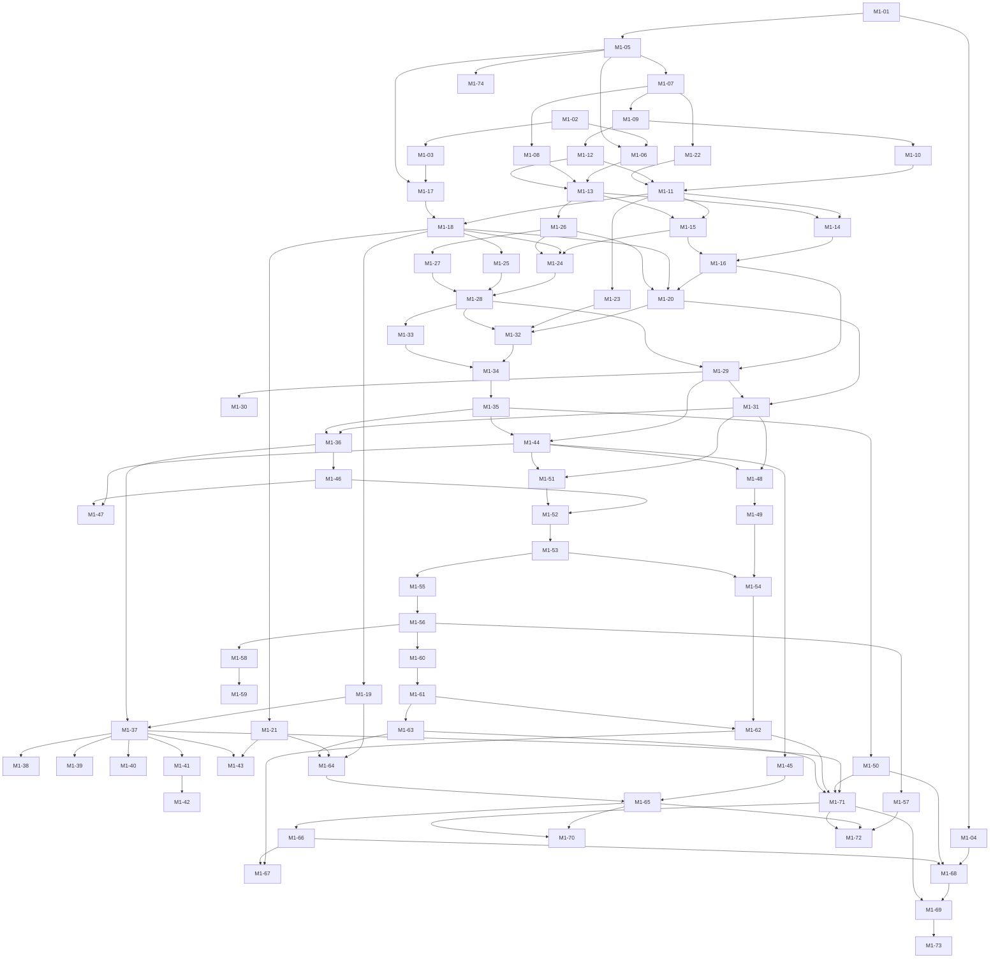
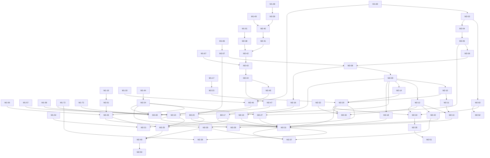
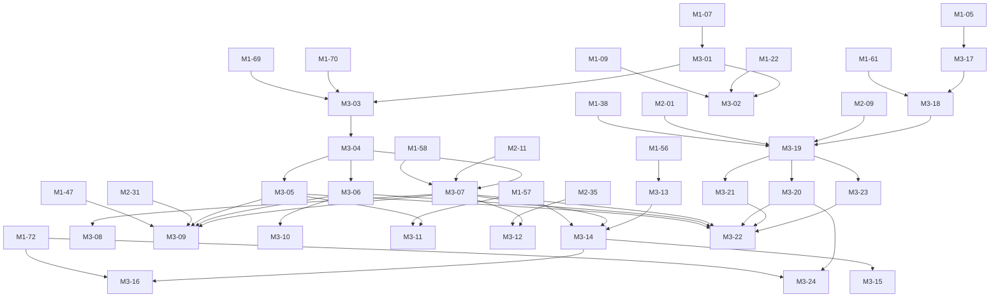
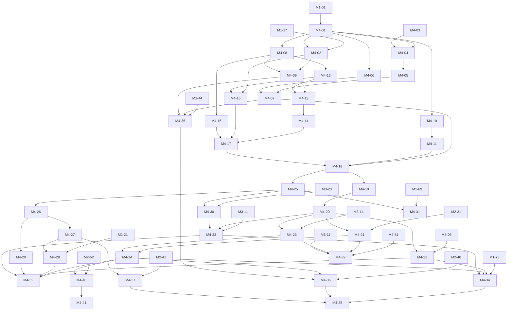
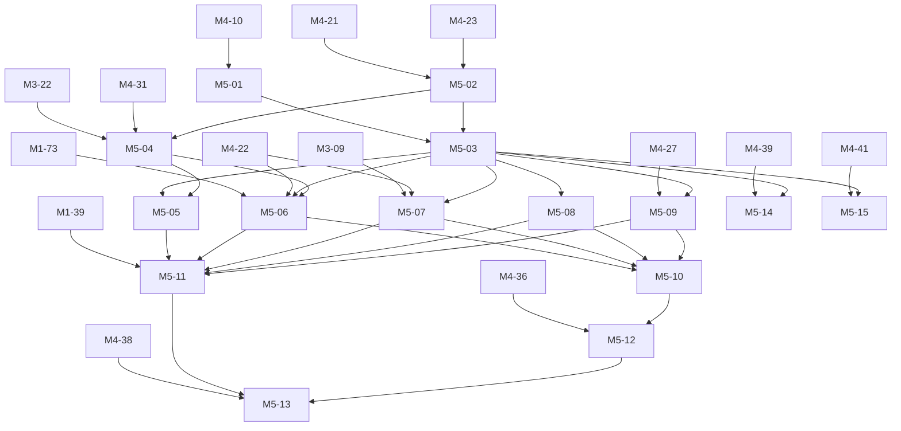
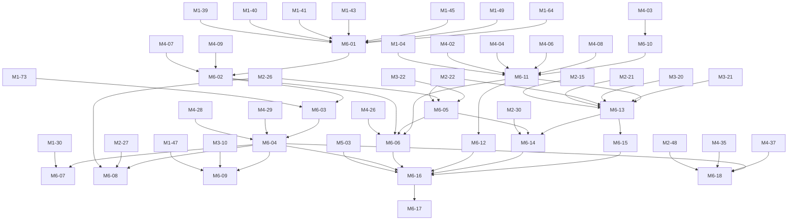
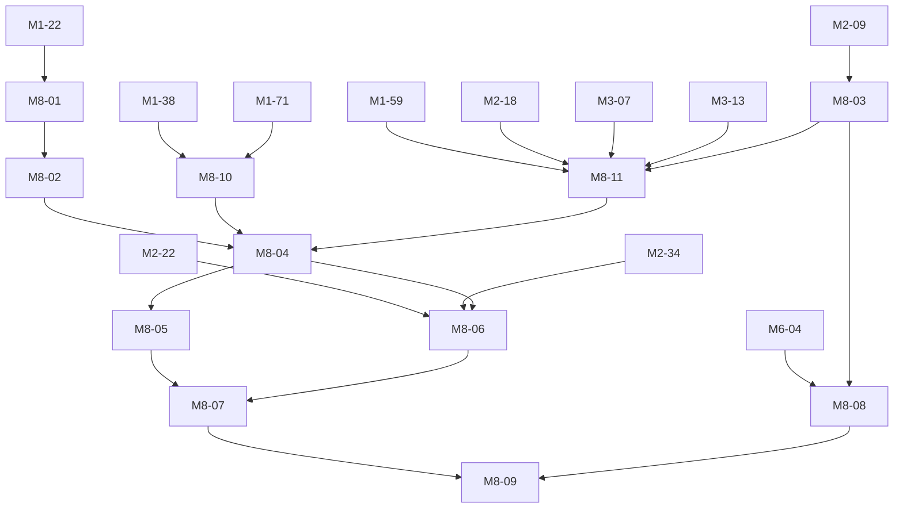

# Build briefs

This folder holds the build briefs: one English file per ticket, written so that an unattended
build session can finish the ticket with a green `make check` without asking anything. Each brief
names its goal, the chapters and ADRs to read, the fixed build rules, scope and boundaries, the
tests to write first, the acceptance criteria and the report format. Order and dependencies come
from the [plan](../PLAN.md) (section "Tickets" of each milestone); this index repeats them for
the launcher.

Briefs exist for milestone M1 (plan ticket M0-05) and for the milestones M2 to M8. By the
owner's decisions of 2026-10-11, 2026-10-13 and 2026-10-14 the briefs of M2 to M8 are written
before M1 closes, so that builds do not run out of work (D-W-100, D-W-114, D-W-120, D-W-124 and D-W-125 in
[DECISIONS.md](../DECISIONS.md)): they name interfaces of earlier milestones as those briefs and
the merged code name them, and each carries the boundary that a build session follows merged
code that differs only in names and stops with `Verdict: BLOCKED` where it behaves differently
from the specification. Briefs of the milestones after these are written when the owner asks for
them or when the milestone before them closes.

## How a brief runs

1. The launcher starts a brief only when every ticket in "Depends on" is merged into the base
   branch and milestone M0 is closed (plan, section "M0 Planning"). A brief of a later milestone
   does not wait for the milestone before it to close: its "Depends on" names every ticket it
   builds on (plan P-01). A local SonarQube with the "Bothy way" gate must be running from M1-05
   on (ticket M0-07).
2. The launcher fills the placeholders `{{REPORT_PATH}}` and `{{DONE_PATH}}` and passes its host
   rules (ports, machine rules); a brief never contains instance-specific values.
3. Each brief runs in its own git worktree on the branch `feat/<ticket-id>-<slug>`. Tickets of the
   same wave share no dependency and may run in parallel; overlapping files are resolved at merge.
4. The working rules of the plan (section "Way of working per ticket") apply to every brief: test
   first, specification first, `make check` green, review and red team before the merge, which goes
   through a pull request as `AGENTS.md` describes ("How work lands on `main`"; it takes precedence
   over the local merge that the plan names). The red team report is stored as `.review/<sha>.md` of the
   commit to merge, last line `Urteil: JA` (PLAN 3.9, D-W-32).
5. A brief that finds a gap in the core contract (chapters 00, 03, 04, 05) stops with
   `Verdict: BLOCKED` instead of building a deviation.
   Every brief has the title line `# <ticket>: <title>`, the status line
   `Status: ready | Depends on: ... | Milestone: <milestone>`, the eleven sections of the existing
   briefs in their order (Goal to Report) and a report with the placeholders of item 2;
   `tools/docs/tests/test_brief_format.py` fails on any other shape and on a brief file that the
   index does not list.
6. The owner's fixed build rules 1 to 5 stand in every brief byte for byte as in the section
   "Fixed build rules" below: a literal English translation of the owner's wording, nothing
   added or left out. `tools/docs/tests/test_brief_rules.py` fails on any other wording. Rule 3 ("API documentation is generated from code (OpenAPI from the routes, ...)")
   means one source in this repository:
   `docs/api/openapi.yaml` is normative (ADR 0013, spec first), routes, handler interfaces and
   clients are generated from it, and `make codegen-check` keeps them equal. No session generates
   OpenAPI from handler code.

    Which gate enforces the doc comments per language and where the API documentation comes
    from: [chapter 23, "Documentation in code"](../spec/23-quality.md#documentation-in-code).

## Fixed build rules

<!-- BEGIN FIXED BUILD RULES -->
```text
1. No MVP. New from scratch and directly in the final state; stages are only the order.
2. Strictly modular: clear module and service boundaries, dependencies only through defined
   interfaces, no cross access.
3. Documentation in code: every public module, class, function and interface with a docstring/doc
   comment (purpose, parameters, return value, errors, example where useful); comments explain the
   why, not the what. API documentation is generated from code (OpenAPI from the routes, dartdoc,
   Python API docs in MkDocs).
4. Documentation in the repo: README per module/service, ADR for every architecture decision,
   CHANGELOG per release, keep the documentation site current. A change without matching
   documentation is not done.
5. Quality gates (SonarQube, linters, type checking, security scanners, test coverage) block the
   merge.
```
<!-- END FIXED BUILD RULES -->

A brief may add a note on a rule after this block (for example "Note on rule 3"), never inside it.

Note on rules 1 and 3: "stages" are the milestones M1, M2 and so on of the plan. "MkDocs" is the
docs site of ADR 0045 (MkDocs with Material today); after the planned switch to Zensical, which
reads the same `mkdocs.yml`, rule 3 means that site (D-W-54).

## Waves

A wave is the longest chain of dependencies before a ticket. All tickets of a wave can start once
the waves before it are merged; many can start earlier, as soon as their own dependencies are in.

| Wave | Tickets that may run in parallel |
|---|---|
| 1 | M1-01, M1-02, M2-32, M4-03 |
| 2 | M1-03, M1-04, M1-05, M2-38, M4-01, M6-10 |
| 3 | M1-06, M1-07, M1-17, M1-74, M3-17, M4-04, M4-06, M4-08, M4-10, M7-24 |
| 4 | M1-08, M1-09, M1-22, M2-23, M3-01, M4-02, M4-05, M4-11, M4-12, M4-16, M5-01, M7-19 |
| 5 | M1-10, M1-12, M3-02, M4-07, M4-09, M4-15, M6-11, M8-01 |
| 6 | M1-11, M1-13, M4-13, M6-12, M8-02 |
| 7 | M1-14, M1-15, M1-18, M1-23, M1-26, M4-14 |
| 8 | M1-16, M1-19, M1-21, M1-24, M1-25, M1-27, M4-17, M7-01 |
| 9 | M1-20, M1-28, M2-01, M4-18, M7-10 |
| 10 | M1-29, M1-32, M1-33, M4-19, M4-25, M7-11 |
| 11 | M1-30, M1-31, M1-34, M4-20, M4-26 |
| 12 | M1-35, M4-27, M4-29 |
| 13 | M1-36, M1-44, M1-50 |
| 14 | M1-37, M1-45, M1-46, M1-48, M1-51, M2-24, M7-22 |
| 15 | M1-38, M1-39, M1-40, M1-41, M1-43, M1-47, M1-49, M1-52, M2-39 |
| 16 | M1-42, M1-53, M2-40 |
| 17 | M1-54, M1-55, M2-41 |
| 18 | M1-56, M2-42, M4-37 |
| 19 | M1-57, M1-58, M1-60, M2-26, M3-13 |
| 20 | M1-59, M1-61 |
| 21 | M1-62, M1-63, M3-18 |
| 22 | M1-64, M1-71 |
| 23 | M1-65, M6-01, M8-10 |
| 24 | M1-66, M1-70, M1-72, M2-07, M6-02 |
| 25 | M1-67, M1-68, M2-20 |
| 26 | M1-69, M2-21, M2-43, M7-25 |
| 27 | M1-73, M2-02, M2-44, M3-03, M4-28, M4-31 |
| 28 | M2-03, M2-04, M2-45, M2-47, M3-04, M4-35, M6-03, M7-02, M7-29 |
| 29 | M2-05, M2-46, M2-52, M3-05, M3-06, M6-04, M7-03, M7-04, M7-15 |
| 30 | M2-06, M2-27, M2-48, M3-10, M3-11, M4-22, M6-07, M7-16 |
| 31 | M2-08, M6-08, M6-09, M6-18, M7-20 |
| 32 | M2-09, M2-16 |
| 33 | M2-10, M2-12, M2-14, M2-15, M2-17, M2-18, M2-19, M3-19, M8-03 |
| 34 | M2-11, M2-22, M2-25, M2-29, M3-20, M3-21, M3-23, M8-08 |
| 35 | M2-13, M2-28, M2-30, M2-33, M2-34, M3-07, M3-24, M4-30, M6-13, M7-17 |
| 36 | M2-31, M2-35, M2-49, M3-08, M3-14, M3-22, M4-33, M6-15, M8-11 |
| 37 | M2-36, M2-37, M2-50, M2-51, M3-09, M3-12, M3-15, M3-16, M4-21, M4-23, M6-05, M8-04 |
| 38 | M4-24, M4-39, M5-02, M6-06, M6-14, M7-05, M8-05, M8-06 |
| 39 | M4-32, M4-34, M4-36, M4-40, M5-03, M5-04, M7-06, M7-09, M8-07 |
| 40 | M4-38, M4-41, M5-05, M5-06, M5-07, M5-08, M5-09, M5-14, M6-16, M7-07, M7-08, M7-12, M7-14, M8-09 |
| 41 | M5-10, M5-11, M5-15, M6-17, M7-18, M7-21, M7-23, M7-26, M7-27 |
| 42 | M5-12, M7-13 |
| 43 | M5-13 |
| 44 | M7-28 |

## Index

Dependencies are minimal: a ticket implied through another dependency is not repeated. Brief files
are added by the brief-writing steps (plan ticket M0-05 for M1, D-W-100 for M2 and M3, D-W-114 for
M4, D-W-120 for M5 and M6, D-W-125 for M7, D-W-124 for M8) under the
names listed here.

| Wave | ID | Title | Brief file | Depends on |
|---|---|---|---|---|
| 1 | M1-01 | Server gates in the make contract | `M1-01-server-gates.md` | none (M0 closed) |
| 1 | M1-02 | Action catalogue as the single data source | `M1-02-action-catalogue-source.md` | none (M0 closed) |
| 2 | M1-03 | API contract checks in the gate | `M1-03-api-contract-checks.md` | M1-02 |
| 2 | M1-04 | Operations configuration checks in the gate | `M1-04-ops-config-checks.md` | M1-01 |
| 2 | M1-05 | Server skeleton, module register and architecture gate | `M1-05-server-skeleton.md` | M1-01 |
| 3 | M1-06 | Module register checked against the core contract | `M1-06-module-register-check.md` | M1-02, M1-05 |
| 3 | M1-07 | Configuration schema and loader | `M1-07-config-schema-loader.md` | M1-05 |
| 4 | M1-08 | Configuration reference generated from the schema | `M1-08-config-reference.md` | M1-07 |
| 4 | M1-09 | Secret provider and secrets commands | `M1-09-secret-provider.md` | M1-07 |
| 5 | M1-10 | Logging and telemetry foundation | `M1-10-telemetry-foundation.md` | M1-09 |
| 6 | M1-11 | Lifecycle, listeners, health and shutdown | `M1-11-lifecycle-health.md` | M1-10, M1-12, M1-22 |
| 5 | M1-12 | PostgreSQL access, migrations and schema version | `M1-12-postgres-migrations.md` | M1-09 |
| 6 | M1-13 | Unit of work with phase hooks and in-transaction events | `M1-13-unit-of-work.md` | M1-06, M1-08, M1-12 |
| 7 | M1-14 | Background jobs with River | `M1-14-background-jobs.md` | M1-11, M1-13 |
| 7 | M1-15 | Sequence counters and instance record | `M1-15-instance-counters.md` | M1-11, M1-13 |
| 8 | M1-16 | Event log with commit-ordered sequence | `M1-16-event-log.md` | M1-14, M1-15 |
| 3 | M1-17 | Server interface generated from openapi.yaml | `M1-17-api-server-stubs.md` | M1-03, M1-05 |
| 7 | M1-18 | HTTP middleware chain and problem details | `M1-18-http-chain.md` | M1-11, M1-17 |
| 8 | M1-19 | Rate limits per class | `M1-19-rate-limits.md` | M1-18 |
| 9 | M1-20 | Idempotency keys | `M1-20-idempotency-keys.md` | M1-16, M1-18, M1-26 |
| 8 | M1-21 | Transport protection | `M1-21-transport-protection.md` | M1-18 |
| 4 | M1-22 | Egress client and SSRF lint | `M1-22-egress-client.md` | M1-07 |
| 7 | M1-23 | Server container image | `M1-23-server-image.md` | M1-11 |
| 8 | M1-24 | Audit hash chain and recorder | `M1-24-audit-chain.md` | M1-15, M1-18, M1-26 |
| 8 | M1-25 | Action catalogue in code and registration duty | `M1-25-authz-catalogue.md` | M1-18 |
| 7 | M1-26 | Principal tables and directory | `M1-26-identity-principals.md` | M1-13 |
| 8 | M1-27 | Grant model storage | `M1-27-authz-grant-store.md` | M1-26 |
| 9 | M1-28 | Permission snapshot, cache and authorize | `M1-28-authz-core.md` | M1-24, M1-25, M1-27 |
| 10 | M1-29 | Permission changes, access.changed and invariants I1 and SR8 | `M1-29-authz-invariants.md` | M1-16, M1-28 |
| 11 | M1-30 | Expiry of grants and memberships | `M1-30-authz-expiry.md` | M1-29 |
| 11 | M1-31 | People, owners and own profile | `M1-31-identity-people.md` | M1-20, M1-29 |
| 10 | M1-32 | Signing keys, JWKS and rotation | `M1-32-signing-keys.md` | M1-20, M1-23, M1-28 |
| 10 | M1-33 | Devices, device keys and DPoP verification | `M1-33-identity-devices-dpop.md` | M1-28 |
| 11 | M1-34 | Sessions, access tokens, refresh families and logout | `M1-34-identity-sessions.md` | M1-32, M1-33 |
| 12 | M1-35 | Step-up with the device key | `M1-35-identity-step-up.md` | M1-34 |
| 13 | M1-36 | Identity provider port and provider management | `M1-36-identity-providers.md` | M1-31, M1-35 |
| 14 | M1-37 | First setup, enrollment codes and setup lock | `M1-37-identity-bootstrap.md` | M1-19, M1-36 |
| 15 | M1-38 | Device approval and pairing | `M1-38-identity-device-approval.md` | M1-37 |
| 15 | M1-39 | Local accounts with password and TOTP | `M1-39-identity-local-accounts.md` | M1-37 |
| 15 | M1-40 | Passkeys | `M1-40-identity-passkeys.md` | M1-37 |
| 15 | M1-41 | OIDC login with PKCE | `M1-41-identity-oidc.md` | M1-37 |
| 16 | M1-42 | Groups from OIDC claims | `M1-42-identity-oidc-groups.md` | M1-41 |
| 15 | M1-43 | Trusted proxy header login | `M1-43-identity-trusted-header.md` | M1-21, M1-37 |
| 13 | M1-44 | API tokens with prefix and checksum | `M1-44-identity-api-tokens.md` | M1-29, M1-35 |
| 14 | M1-45 | Disable a person, revoke a device, end a session | `M1-45-identity-revocation.md` | M1-44 |
| 14 | M1-46 | Instance settings, branding and discovery | `M1-46-instance-settings.md` | M1-36 |
| 15 | M1-47 | Feature flags with registration and cleanup gate | `M1-47-feature-flags.md` | M1-44, M1-46 |
| 14 | M1-48 | Groups and grants over the API | `M1-48-authz-api.md` | M1-31, M1-44 |
| 15 | M1-49 | Who has access, preview and view as | `M1-49-authz-explain.md` | M1-48 |
| 13 | M1-50 | Audit verification, checkpoints and queries | `M1-50-audit-verify.md` | M1-35 |
| 14 | M1-51 | Agent records, backend policy and credential holder | `M1-51-agents-records.md` | M1-31, M1-44 |
| 15 | M1-52 | Spaces and sidebar | `M1-52-chat-spaces.md` | M1-46, M1-51 |
| 16 | M1-53 | Channels and forum tags | `M1-53-chat-channels.md` | M1-52 |
| 17 | M1-54 | Operators with invariant I1 | `M1-54-chat-operators.md` | M1-49, M1-53 |
| 17 | M1-55 | Threads | `M1-55-chat-threads.md` | M1-53 |
| 18 | M1-56 | Sending messages | `M1-56-messaging-send.md` | M1-55 |
| 19 | M1-57 | Reading history | `M1-57-messaging-history.md` | M1-56 |
| 19 | M1-58 | Editing, deleting and revisions | `M1-58-messaging-edit-delete.md` | M1-56 |
| 20 | M1-59 | Reactions and pins | `M1-59-messaging-reactions-pins.md` | M1-58 |
| 19 | M1-60 | Mentions and templates | `M1-60-messaging-mentions-templates.md` | M1-56 |
| 20 | M1-61 | Read state, drafts and personal settings | `M1-61-sync-personal-data.md` | M1-60 |
| 21 | M1-62 | Moving threads | `M1-62-chat-thread-move.md` | M1-54, M1-61 |
| 21 | M1-63 | Catch-up over REST and snapshot | `M1-63-sync-catch-up.md` | M1-61 |
| 22 | M1-64 | Gateway connection and session | `M1-64-gateway-connection.md` | M1-19, M1-21, M1-63 |
| 23 | M1-65 | Gateway hub, delivery and revocation | `M1-65-gateway-delivery.md` | M1-45, M1-64 |
| 24 | M1-66 | Focus and typing | `M1-66-gateway-focus-typing.md` | M1-65 |
| 25 | M1-67 | Gateway frame conformance | `M1-67-gateway-conformance.md` | M1-62, M1-66 |
| 25 | M1-68 | Server core metrics per catalogue | `M1-68-core-metrics.md` | M1-04, M1-50, M1-66 |
| 26 | M1-69 | Canary test across all outputs | `M1-69-canary-test.md` | M1-68, M1-71 |
| 24 | M1-70 | Leak tests and 404 equality | `M1-70-leak-tests.md` | M1-65, M1-71 |
| 22 | M1-71 | Contract tests with Schemathesis | `M1-71-contract-tests.md` | M1-37, M1-50, M1-62, M1-63 |
| 24 | M1-72 | Load tests and performance gate | `M1-72-performance-gate.md` | M1-57, M1-65, M1-71 |
| 27 | M1-73 | Compose smoke test | `M1-73-compose-smoke.md` | M1-69 |
| 3 | M1-74 | CodeQL for Go | `M1-74-codeql-go.md` | M1-05 |
| 9 | M2-01 | Worker consumers of the event log | `M2-01-worker-event-consumers.md` | M1-16 |
| 27 | M2-02 | Channel behaviour and agent configuration | `M2-02-channel-behavior-config.md` | M1-69 |
| 28 | M2-03 | Project binding and readiness | `M2-03-project-binding.md` | M2-02 |
| 28 | M2-04 | Trigger decision as a pure function | `M2-04-trigger-decision.md` | M2-02 |
| 29 | M2-05 | Runs, state machine and trigger state | `M2-05-runs-state-machine.md` | M2-04 |
| 30 | M2-06 | Invocation token with EdDSA and JWKS | `M2-06-invocation-token.md` | M2-05 |
| 24 | M2-07 | Agent consumers over the gateway and REST | `M2-07-agent-consumers.md` | M1-65 |
| 31 | M2-08 | Delivery with I2, guard rules and a fresh token | `M2-08-invocation-delivery.md` | M2-06, M2-07 |
| 32 | M2-09 | Starting, finishing and cancelling runs, orphaned runs | `M2-09-run-lifecycle.md` | M2-08 |
| 33 | M2-10 | Run document, patches and live box | `M2-10-run-document-live-box.md` | M2-09 |
| 34 | M2-11 | Follow-ups with steer and queue | `M2-11-run-followups.md` | M2-10 |
| 33 | M2-12 | Agent sessions per thread | `M2-12-agent-sessions.md` | M2-09 |
| 35 | M2-13 | Run context with origin and trust | `M2-13-run-context.md` | M2-11, M2-12 |
| 33 | M2-14 | Acting-for binding (SR9) | `M2-14-acting-for.md` | M2-09 |
| 33 | M2-15 | Components and interactions | `M2-15-components-interactions.md` | M1-57, M1-58, M2-09 |
| 32 | M2-16 | Slash commands | `M2-16-slash-commands.md` | M2-08 |
| 33 | M2-17 | Command autocomplete | `M2-17-command-autocomplete.md` | M2-16 |
| 33 | M2-18 | Auto title and placeholder detection | `M2-18-auto-title.md` | M2-09 |
| 33 | M2-19 | Agent replies and announcements | `M2-19-agent-messages.md` | M2-09 |
| 25 | M2-20 | Heartbeat, presence and desired versus actual mode | `M2-20-heartbeat-presence.md` | M2-07 |
| 26 | M2-21 | Switching and guided flow (I4) | `M2-21-billing-switch-i4.md` | M1-54, M2-20 |
| 34 | M2-22 | Costs: booking, price table and display | `M2-22-costs.md` | M2-12 |
| 4 | M2-23 | Generated TypeScript and Python clients as a gate (G4, G5) | `M2-23-generated-clients.md` | M1-17 |
| 14 | M2-24 | App manifest, installation and scopes | `M2-24-apps-install.md` | M1-44 |
| 34 | M2-25 | Commands and interactions for apps | `M2-25-app-commands.md` | M2-15, M2-17, M2-26 |
| 19 | M2-26 | Outgoing webhooks after Standard Webhooks | `M2-26-webhooks-outgoing.md` | M1-56, M2-01, M2-24 |
| 30 | M2-27 | Incoming webhooks native and alertmanager | `M2-27-webhooks-incoming.md` | M2-05, M2-24 |
| 35 | M2-28 | Cost reconciliation as its own app | `M2-28-cost-reconciliation.md` | M2-22, M2-24 |
| 34 | M2-29 | Python SDK with hand layer and FakeServer (ADR 0026) | `M2-29-python-sdk.md` | M2-10, M2-14, M2-23 |
| 35 | M2-30 | TypeScript SDK with webhook verifier | `M2-30-typescript-sdk.md` | M2-26, M2-29 |
| 36 | M2-31 | Conformance suite with the Fake-Agent | `M2-31-agent-conformance-suite.md` | M2-13, M2-15, M2-17, M2-18, M2-19, M2-20, M2-27, M2-29 |
| 1 | M2-32 | Recording Hermes Agent before the build | `M2-32-hermes-recording.md` | none |
| 35 | M2-33 | Reference adapter for Hermes Agent (L7, L8) | `M2-33-hermes-adapter.md` | M2-12, M2-29, M2-32 |
| 35 | M2-34 | Claude Code runner core | `M2-34-claude-code-runner-core.md` | M2-03, M2-12, M2-29 |
| 36 | M2-35 | Claude Code runner: follow-ups, stop and error paths | `M2-35-claude-code-runner-paths.md` | M2-34 |
| 37 | M2-36 | Performance targets of the agent path | `M2-36-agent-path-perf.md` | M1-72, M2-31 |
| 37 | M2-37 | Guide "connect your own agent" with a check run | `M2-37-agent-guide.md` | M2-22, M2-30, M2-31 |
| 2 | M2-38 | Host service module and Noise core in Go and Dart | `M2-38-noise-core.md` | M1-01 |
| 15 | M2-39 | Host records and the target `host` | `M2-39-terminal-hosts.md` | M1-48 |
| 16 | M2-40 | Terminal rights, SR10, I6, SR12 and fresh step-up | `M2-40-terminal-authz.md` | M1-49, M2-39 |
| 17 | M2-41 | Host pairing and fingerprint | `M2-41-host-pairing.md` | M2-40 |
| 18 | M2-42 | bothy-host: installation, state, doctor and pair | `M2-42-host-install-doctor.md` | M2-38, M2-41 |
| 26 | M2-43 | Control connection between host service and server | `M2-43-host-control.md` | M1-67, M2-42 |
| 27 | M2-44 | Terminal sessions, session token and relay | `M2-44-terminal-sessions-relay.md` | M2-43 |
| 28 | M2-45 | bothy-host: sessions, PTY and profiles | `M2-45-host-pty-profiles.md` | M2-44 |
| 29 | M2-46 | Terminal revocation, limits, audit and metrics | `M2-46-terminal-revocation-limits.md` | M1-30, M1-69, M2-45 |
| 28 | M2-47 | Terminal relay across several nodes (T6) | `M2-47-terminal-multi-node.md` | M2-44 |
| 30 | M2-48 | Conformance and chaos suite of the terminal | `M2-48-terminal-conformance.md` | M1-72, M1-73, M2-24, M2-46, M2-47 |
| 36 | M2-49 | Reference app for code hosting (GitHub) | `M2-49-github-app.md` | M2-25, M2-30 |
| 37 | M2-50 | Reference app for ticket systems (Jira) | `M2-50-jira-app.md` | M2-49 |
| 37 | M2-51 | Run graph data and stall detection | `M2-51-run-graph-data.md` | M2-35 |
| 29 | M2-52 | Active threads in the snapshot and the project mark of a forum | `M2-52-snapshot-active-threads.md` | M2-03 |
| 4 | M3-01 | Object storage port with file system driver | `M3-01-object-storage-fs.md` | M1-07 |
| 5 | M3-02 | S3 driver against SeaweedFS | `M3-02-object-storage-s3.md` | M1-09, M1-22, M3-01 |
| 27 | M3-03 | Upload sessions, parts and completion | `M3-03-upload-sessions.md` | M1-69, M1-70, M3-01 |
| 28 | M3-04 | Scan pass with clamd | `M3-04-clamd-scan.md` | M3-03 |
| 29 | M3-05 | File download with download tickets | `M3-05-file-download.md` | M3-04 |
| 29 | M3-06 | Images: removing metadata and thumbnails | `M3-06-image-metadata-thumbnails.md` | M3-04 |
| 35 | M3-07 | Attachments and release of the agent invocation | `M3-07-attachments-invocation.md` | M1-58, M2-11, M3-04 |
| 36 | M3-08 | Cleanup and deletion of files | `M3-08-file-cleanup.md` | M3-07 |
| 37 | M3-09 | Voice messages and transcript | `M3-09-voice-transcript.md` | M1-47, M2-31, M3-05, M3-06, M3-07 |
| 30 | M3-10 | Avatar and logo | `M3-10-avatar-logo.md` | M3-06 |
| 30 | M3-11 | Channel export | `M3-11-channel-export.md` | M1-57, M3-05 |
| 37 | M3-12 | Claude Code runner: answer attachments | `M3-12-runner-attachments.md` | M2-35, M3-07 |
| 19 | M3-13 | Search vectors and search_tsquery | `M3-13-search-vectors.md` | M1-56 |
| 36 | M3-14 | Search coordinator and prefix search | `M3-14-search-coordinator.md` | M1-57, M3-07, M3-13 |
| 37 | M3-15 | File text extraction | `M3-15-file-text-extraction.md` | M3-14 |
| 37 | M3-16 | Search load test | `M3-16-search-load-test.md` | M1-72, M3-14 |
| 3 | M3-17 | Notification decision as a pure function | `M3-17-notify-decision.md` | M1-05 |
| 21 | M3-18 | Notification preferences and quiet hours | `M3-18-notify-preferences.md` | M1-61, M3-17 |
| 33 | M3-19 | Hint jobs, automatic following and bundling | `M3-19-notify-jobs.md` | M1-38, M2-01, M2-09, M3-18 |
| 34 | M3-20 | APNs adapter with Fake-APNs | `M3-20-apns-adapter.md` | M3-19 |
| 34 | M3-21 | FCM adapter with Fake-FCM | `M3-21-fcm-adapter.md` | M3-19 |
| 36 | M3-22 | Push registration and preview endpoint (ADR 0031) | `M3-22-push-registration.md` | M3-05, M3-06, M3-07, M3-20, M3-21, M3-23 |
| 34 | M3-23 | Desktop hints over the gateway | `M3-23-desktop-notices.md` | M3-19 |
| 35 | M3-24 | Push handoff performance target | `M3-24-push-handoff-perf.md` | M1-72, M3-20 |
| 2 | M4-01 | Workspace and architecture test of the apps | `M4-01-workspace-arch.md` | M1-01 |
| 4 | M4-02 | Dart API client as a gate | `M4-02-dart-api-client.md` | M4-01, M1-17 |
| 1 | M4-03 | Accent variants in the token generator | `M4-03-accent-variants.md` | none (M0 closed) |
| 3 | M4-04 | Design system with tokens, theme and fonts (ADR 0030) | `M4-04-design-system-theme.md` | M4-01, M4-03 |
| 4 | M4-05 | Icons in the design system | `M4-05-design-icons.md` | M4-04 |
| 3 | M4-06 | Localization with ARB lint | `M4-06-l10n.md` | M4-01 |
| 5 | M4-07 | Core components with goldens | `M4-07-core-components.md` | M4-05, M4-06 |
| 3 | M4-08 | Domain package | `M4-08-domain.md` | M4-01 |
| 5 | M4-09 | Login: DPoP, refresh and step-up | `M4-09-auth-dpop.md` | M4-02, M4-08 |
| 3 | M4-10 | Device key for macOS and iOS | `M4-10-device-key-apple.md` | M4-01 |
| 4 | M4-11 | Device key for Windows | `M4-11-device-key-windows.md` | M4-10 |
| 4 | M4-12 | Local database schema v1 (ADR 0029) | `M4-12-local-store.md` | M4-08 |
| 6 | M4-13 | Sync engine: connection and session | `M4-13-sync-connection.md` | M4-09, M4-12 |
| 7 | M4-14 | Sync engine: catch-up, reconciliation and revocation | `M4-14-sync-catch-up.md` | M4-13 |
| 5 | M4-15 | Sync engine: outbox | `M4-15-sync-outbox.md` | M4-02, M4-12 |
| 4 | M4-16 | Sync engine: run documents | `M4-16-sync-run-documents.md` | M4-08 |
| 8 | M4-17 | Fake server for integration tests | `M4-17-fake-server.md` | M4-14, M4-15, M4-16 |
| 9 | M4-18 | Desktop app shell | `M4-18-desktop-shell.md` | M4-07, M4-11, M4-17 |
| 10 | M4-19 | Sidebar, spaces, channels and post list | `M4-19-sidebar-post-list.md` | M4-18 |
| 11 | M4-20 | Thread view, input and message actions | `M4-20-thread-view.md` | M4-19 |
| 37 | M4-21 | Live box, trigger state, follow-ups, components and commands | `M4-21-agent-interface.md` | M4-20, M2-31 |
| 30 | M4-22 | Files, images and voice messages on the desktop | `M4-22-files-desktop.md` | M4-20, M3-05 |
| 37 | M4-23 | Search, quick switcher, mentions and Running now | `M4-23-search-switcher.md` | M4-20, M3-14 |
| 38 | M4-24 | Keyboard shortcuts and focus order | `M4-24-shortcuts-focus.md` | M4-21, M4-23 |
| 10 | M4-25 | Settings, devices and sessions on the desktop | `M4-25-settings-devices.md` | M4-18 |
| 11 | M4-26 | Administration: people, groups and devices | `M4-26-admin-people.md` | M4-25 |
| 12 | M4-27 | Administration: grant wizard, Who has access, View as person | `M4-27-admin-grants.md` | M4-26 |
| 27 | M4-28 | Administration: agents, backend switch, costs and tokens | `M4-28-admin-agents.md` | M4-27, M2-21 |
| 12 | M4-29 | Administration: audit view | `M4-29-admin-audit.md` | M4-26 |
| 35 | M4-30 | Windows: notification area and local notifications | `M4-30-windows-tray-notifications.md` | M4-25, M3-23 |
| 27 | M4-31 | Client metrics and crash reports (ADR 0057) | `M4-31-client-metrics.md` | M4-25, M1-69 |
| 39 | M4-32 | Accessibility on the desktop | `M4-32-desktop-accessibility.md` | M4-22, M4-24, M4-28, M4-29, M4-33 |
| 36 | M4-33 | Channel menu: notification level and export | `M4-33-channel-menu.md` | M4-20, M4-30, M3-11 |
| 39 | M4-34 | Desktop E2E and performance targets | `M4-34-desktop-e2e-perf.md` | M4-22, M4-24, M4-33, M1-73 |
| 28 | M4-35 | Package `terminal_ui` and terminal view | `M4-35-terminal-ui.md` | M4-07, M4-09, M2-44 |
| 39 | M4-36 | Terminal on the desktop | `M4-36-terminal-desktop.md` | M4-35, M4-24, M2-48 |
| 18 | M4-37 | Administration: hosts, pairing and grant `terminal` | `M4-37-admin-hosts.md` | M4-27, M2-41 |
| 40 | M4-38 | Terminal E2E and performance targets on the desktop | `M4-38-terminal-e2e-perf.md` | M4-34, M4-36, M4-37 |
| 38 | M4-39 | Run graph and control room on the desktop | `M4-39-run-graph-desktop.md` | M2-51, M4-21, M4-23, M6-11 |
| 39 | M4-40 | Threads in the sidebar and the forum overview on the desktop | `M4-40-sidebar-threads.md` | M2-52, M4-24 |
| 40 | M4-41 | New chat from the sidebar on the desktop | `M4-41-sidebar-new-chat.md` | M4-40 |
| 23 | M6-01 | Console session following the BFF pattern | `M6-01-console-session.md` | M1-39, M1-40, M1-41, M1-43, M1-45, M1-49, M1-64 |
| 37 | M6-05 | Statistics in the server | `M6-05-stats-server.md` | M2-22, M2-26, M3-22 |
| 2 | M6-10 | Design tokens for charts: check for color vision deficiency | `M6-10-viz-cvd-check.md` | M4-03 |
| 5 | M6-11 | `bothy_viz`: primitives, models, fixtures and harness | `M6-11-viz-package.md` | M1-04, M4-02, M4-04, M4-06, M4-08, M6-10 |
| 6 | M6-12 | `bothy_viz`: six views | `M6-12-viz-views.md` | M6-11 |
| 35 | M6-13 | stats: own measurement | `M6-13-stats-measure.md` | M2-15, M2-21, M2-22, M3-20, M3-21, M6-11 |
| 38 | M6-14 | stats: timeline, SLO traffic light and backend view | `M6-14-stats-queries.md` | M2-30, M6-05, M6-13 |
| 36 | M6-15 | stats: live stream `stats.live` | `M6-15-stats-live.md` | M6-13 |
| 4 | M5-01 | Device key for Android | `M5-01-device-key-android.md` | M4-10 |
| 38 | M5-02 | iPhone layout and navigation | `M5-02-iphone-layout.md` | M4-21, M4-23 |
| 39 | M5-03 | Android layout, navigation and notification channels | `M5-03-android-layout.md` | M5-01, M5-02 |
| 39 | M5-04 | ClientKit and Notification Service Extension (ADR 0056) | `M5-04-clientkit-nse.md` | M3-22, M4-31, M5-02 |
| 40 | M5-05 | Android push service without the Flutter engine | `M5-05-android-push.md` | M5-03, M5-04 |
| 40 | M5-06 | Sharing from other apps | `M5-06-sharing.md` | M1-73, M4-22, M5-03, M5-04 |
| 40 | M5-07 | Voice recording, camera and photo | `M5-07-voice-camera.md` | M3-09, M4-22, M5-03 |
| 40 | M5-08 | App lock | `M5-08-app-lock.md` | M5-03 |
| 40 | M5-09 | Emergency actions on mobile | `M5-09-mobile-emergency.md` | M4-27, M5-03 |
| 41 | M5-10 | Accessibility on mobile | `M5-10-mobile-a11y.md` | M5-06, M5-07, M5-08, M5-09 |
| 41 | M5-11 | Device E2E and performance targets on mobile | `M5-11-mobile-e2e-perf.md` | M1-39, M5-05, M5-06, M5-07, M5-08, M5-09 |
| 42 | M5-12 | Terminal on mobile with extra keys bar | `M5-12-mobile-terminal.md` | M4-36, M5-10 |
| 43 | M5-13 | Terminal E2E on mobile | `M5-13-mobile-terminal-e2e.md` | M4-38, M5-11, M5-12 |
| 40 | M5-14 | Run graph and control room on iPhone and Android | `M5-14-run-graph-mobile.md` | M4-39, M5-03 |
| 41 | M5-15 | Threads in the sidebar and new chat on iPhone and Android | `M5-15-sidebar-threads-mobile.md` | M4-41, M5-03 |
| 24 | M6-02 | Console app and serving by the server (ADR 0028) | `M6-02-console-app.md` | M4-07, M4-09, M6-01 |
| 28 | M6-03 | Content Security Policy with a headless test | `M6-03-console-csp.md` | M1-73, M6-02 |
| 29 | M6-04 | Administration in the console | `M6-04-console-admin.md` | M4-28, M4-29, M6-03 |
| 38 | M6-06 | Statistics views | `M6-06-stats-views.md` | M4-26, M6-02, M6-05, M6-11 |
| 30 | M6-07 | Permission hints and expiry overview | `M6-07-permission-hints.md` | M1-30, M6-04 |
| 31 | M6-08 | Manage apps, webhooks and incoming webhooks | `M6-08-apps-webhooks-admin.md` | M2-26, M2-27, M6-04 |
| 31 | M6-09 | Manage instance, branding, login providers and feature flags | `M6-09-instance-admin.md` | M1-47, M3-10, M6-04 |
| 40 | M6-16 | Visualizations in the desktop app, console and mobile | `M6-16-viz-in-apps.md` | M5-03, M6-04, M6-06, M6-12, M6-14, M6-15 |
| 41 | M6-17 | Optional Grafana embedding in the console | `M6-17-console-grafana-embed.md` | M6-16 |
| 31 | M6-18 | Terminal in the console (ADR 0070) | `M6-18-console-terminal.md` | M2-48, M4-35, M4-37, M6-04 |
| 8 | M7-01 | Image `bothy-postgres` with pgBackRest | `M7-01-postgres-image.md` | M1-08, M1-23 |
| 28 | M7-02 | Backup service: schedules, manifest and metrics (ADR 0058) | `M7-02-backup-service.md` | M3-02, M3-03, M7-01 |
| 29 | M7-03 | Automatic restore test | `M7-03-restore-test.md` | M7-02 |
| 29 | M7-04 | `bothy restore finalize` and sync epoch (ADR 0059) | `M7-04-restore-finalize-epoch.md` | M2-07, M2-26, M7-02 |
| 38 | M7-05 | Retention per class | `M7-05-retention-per-class.md` | M1-39, M1-40, M1-59, M2-15, M2-22, M2-26, M2-46, M3-08, M3-15, M3-22 |
| 39 | M7-06 | Access, export, account deletion and rectification | `M7-06-privacy-requests.md` | M7-05 |
| 40 | M7-07 | Deletion journal and restore | `M7-07-deletion-journal.md` | M7-04, M7-06 |
| 40 | M7-08 | Maintenance mode `read_only` (ADR 0065) | `M7-08-maintenance-mode.md` | M7-09 |
| 39 | M7-09 | Status page with automatic checks | `M7-09-status-page.md` | M6-13, M7-02, M7-05 |
| 14 | M7-22 | Audit log checkpoints in object storage | `M7-22-audit-checkpoints-s3.md` | M1-50, M3-02 |
| 9 | M7-10 | Server release chain with a trial release (ADR 0036, 0060, 0062) | `M7-10-server-release-chain.md` | M7-01 |
| 10 | M7-11 | Breaking-change check of the API against the last publication (G6) | `M7-11-api-breaking-check.md` | M1-03, M7-10 |
| 40 | M7-12 | Desktop app distribution (ADR 0037) | `M7-12-desktop-distribution.md` | M4-34, M7-10 |
| 42 | M7-13 | Mobile app distribution and minimum version | `M7-13-mobile-distribution.md` | M5-11, M7-12 |
| 40 | M7-14 | Portability test in CI with the full stack | `M7-14-portability-test.md` | M2-29, M7-03, M7-09, M7-29 |
| 29 | M7-15 | OpenTofu module `generic-vm` | `M7-15-tofu-generic-vm.md` | M7-29 |
| 35 | M7-17 | Multi-node operation (level 2) | `M7-17-multi-node.md` | M1-72, M2-10, M2-47, M3-23 |
| 41 | M7-18 | Capacity load test | `M7-18-capacity-load-test.md` | M7-14 |
| 4 | M7-19 | API reference in the docs site | `M7-19-api-reference-docs.md` | M1-17 |
| 31 | M7-20 | Alerts into the instance and to the outside | `M7-20-alert-routing.md` | M1-73, M2-27 |
| 41 | M7-21 | Status page in apps and console | `M7-21-status-views.md` | M5-03, M6-04, M7-08 |
| 3 | M7-24 | Token output for TypeScript | `M7-24-tokens-typescript.md` | M6-10 |
| 26 | M7-25 | Grafana panel plugin "Bothy Live" | `M7-25-grafana-plugin.md` | M1-68, M7-24 |
| 41 | M7-26 | Plugin in the Compose stack, portability and release | `M7-26-plugin-release.md` | M7-14, M7-25 |
| 41 | M7-27 | Demo instance with made-up data (`bothy setup --demo`) | `M7-27-demo-instance.md` | M2-48, M6-14, M6-15, M7-14 |
| 44 | M7-28 | Showcase: images, video, landing pages and release template | `M7-28-showcase.md` | M5-13, M6-16, M6-18, M7-25, M7-27 |
| 30 | M7-16 | OpenTofu modules `hetzner`, `aws`, `azure` | `M7-16-tofu-cloud-modules.md` | M7-15 |
| 41 | M7-23 | Release chain of the host service | `M7-23-host-release-chain.md` | M2-48, M7-12 |
| 28 | M7-29 | Setup wizard `install.sh` (installation in one command) | `M7-29-setup-wizard.md` | M1-73, M7-10 |
| 5 | M8-01 | Discord read client with pure GET | `M8-01-discord-read-client.md` | M1-22 |
| 6 | M8-02 | CDN fetch with host allow list | `M8-02-cdn-fetch.md` | M8-01 |
| 33 | M8-03 | Import interface in the server | `M8-03-import-server.md` | M2-09 |
| 37 | M8-04 | Import tool: dry run, apply, report | `M8-04-import-tool.md` | M8-02, M8-10, M8-11 |
| 38 | M8-05 | Read mirror with settle rule | `M8-05-read-mirror.md` | M8-04 |
| 38 | M8-06 | Binding of imported session references | `M8-06-session-binding-import.md` | M2-22, M2-34, M8-04 |
| 39 | M8-07 | Switchover and revert per channel | `M8-07-switch-revert.md` | M8-05, M8-06 |
| 34 | M8-08 | Import overview in the console | `M8-08-import-console.md` | M6-04, M8-03 |
| 40 | M8-09 | Carry out the migration of an existing installation (owner go) | `M8-09-migration-execution.md` | M8-07, M8-08 |
| 23 | M8-10 | Login and API client of the import tool | `M8-10-import-login-client.md` | M1-38, M1-71 |
| 36 | M8-11 | Thread, message, pin and file items of the import interface | `M8-11-import-content-items.md` | M1-59, M2-18, M3-07, M3-13, M8-03 |

## Make targets created by tickets

A brief may call a `make` target only if the Makefile already has it or the ticket that creates it
is the brief itself or in its dependency closure; otherwise the target could be missing when the
launcher starts the brief. `tools/docs/brief_deps.py` (part of `make docs`) checks this table, the
waves, the graph and the column "Depends on" of the plan against the index.

| Target | Created by |
|---|---|
| `arch` | M1-01 |
| `codegen-check` | M1-01 |
| `migrations-lint` | M1-01 |
| `migrations-lock` | M1-01 |
| `perf` | M1-01 |
| `catalog` | M1-02 |
| `catalog-check` | M1-02 |
| `api-checks` | M1-03 |
| `api-tables` | M1-03 |
| `ops-check` | M1-04 |
| `register-check` | M1-06 |
| `config-doc-check` | M1-08 |
| `image` | M1-23 |
| `image-test` | M1-23 |
| `flag-check` | M1-47 |
| `signal-check` | M1-68 |
| `sql-visibility` | M1-70 |
| `contract-test` | M1-71 |
| `bench-search` | M3-16 |
| `apps-platform` | M4-01 |
| `e2e-desktop` | M4-34 |
| `perf-desktop` | M4-34 |
| `terminal-stack` | M4-36 |
| `e2e-mobile` | M5-11 |
| `console-e2e` | M6-03 |
| `postgres-image` | M7-01 |
| `postgres-image-test` | M7-01 |
| `release-prep` | M7-10 |
| `release-trial` | M7-10 |
| `api-breaking` | M7-11 |
| `portability-trial` | M7-14 |
| `tofu-check` | M7-15 |
| `tofu-vm-test` | M7-15 |
| `showcase` | M7-28 |

To change a dependency, edit the column "Depends on" of the index and the row in the plan, then
run `uv run --project tools --locked --quiet python tools/docs/brief_deps.py --write`; it
regenerates the wave column, the table "Waves" and the graph edges.

## Dependency graph

Edges point from a dependency to the ticket that needs it (transitive reduction of the index).
There is one diagram per milestone of the dependent tickets, because Mermaid renders only a
limited number of edges per diagram (`MAX_GRAPH_EDGES` in `tools/docs/brief_deps.py`).

Tickets of M1:



Tickets of M2:



Tickets of M3:



Tickets of M4:



Tickets of M5:



Tickets of M6:



Tickets of M7:

```mermaid
flowchart TB
  M1_03["M1-03"]
  M1_08["M1-08"]
  M1_17["M1-17"]
  M1_23["M1-23"]
  M1_39["M1-39"]
  M1_40["M1-40"]
  M1_50["M1-50"]
  M1_59["M1-59"]
  M1_68["M1-68"]
  M1_72["M1-72"]
  M1_73["M1-73"]
  M2_07["M2-07"]
  M2_10["M2-10"]
  M2_15["M2-15"]
  M2_22["M2-22"]
  M2_26["M2-26"]
  M2_27["M2-27"]
  M2_29["M2-29"]
  M2_46["M2-46"]
  M2_47["M2-47"]
  M2_48["M2-48"]
  M3_02["M3-02"]
  M3_03["M3-03"]
  M3_08["M3-08"]
  M3_15["M3-15"]
  M3_22["M3-22"]
  M3_23["M3-23"]
  M4_34["M4-34"]
  M5_03["M5-03"]
  M5_11["M5-11"]
  M5_13["M5-13"]
  M6_04["M6-04"]
  M6_10["M6-10"]
  M6_13["M6-13"]
  M6_14["M6-14"]
  M6_15["M6-15"]
  M6_16["M6-16"]
  M6_18["M6-18"]
  M7_01["M7-01"]
  M7_02["M7-02"]
  M7_03["M7-03"]
  M7_04["M7-04"]
  M7_05["M7-05"]
  M7_06["M7-06"]
  M7_07["M7-07"]
  M7_08["M7-08"]
  M7_09["M7-09"]
  M7_10["M7-10"]
  M7_11["M7-11"]
  M7_12["M7-12"]
  M7_13["M7-13"]
  M7_14["M7-14"]
  M7_15["M7-15"]
  M7_16["M7-16"]
  M7_17["M7-17"]
  M7_18["M7-18"]
  M7_19["M7-19"]
  M7_20["M7-20"]
  M7_21["M7-21"]
  M7_22["M7-22"]
  M7_23["M7-23"]
  M7_24["M7-24"]
  M7_25["M7-25"]
  M7_26["M7-26"]
  M7_27["M7-27"]
  M7_28["M7-28"]
  M7_29["M7-29"]
  M1_08 --> M7_01
  M1_23 --> M7_01
  M3_02 --> M7_02
  M3_03 --> M7_02
  M7_01 --> M7_02
  M7_02 --> M7_03
  M2_07 --> M7_04
  M2_26 --> M7_04
  M7_02 --> M7_04
  M1_39 --> M7_05
  M1_40 --> M7_05
  M1_59 --> M7_05
  M2_15 --> M7_05
  M2_22 --> M7_05
  M2_26 --> M7_05
  M2_46 --> M7_05
  M3_08 --> M7_05
  M3_15 --> M7_05
  M3_22 --> M7_05
  M7_05 --> M7_06
  M7_04 --> M7_07
  M7_06 --> M7_07
  M7_09 --> M7_08
  M6_13 --> M7_09
  M7_02 --> M7_09
  M7_05 --> M7_09
  M7_01 --> M7_10
  M1_03 --> M7_11
  M7_10 --> M7_11
  M4_34 --> M7_12
  M7_10 --> M7_12
  M5_11 --> M7_13
  M7_12 --> M7_13
  M2_29 --> M7_14
  M7_03 --> M7_14
  M7_09 --> M7_14
  M7_29 --> M7_14
  M7_29 --> M7_15
  M7_15 --> M7_16
  M1_72 --> M7_17
  M2_10 --> M7_17
  M2_47 --> M7_17
  M3_23 --> M7_17
  M7_14 --> M7_18
  M1_17 --> M7_19
  M1_73 --> M7_20
  M2_27 --> M7_20
  M5_03 --> M7_21
  M6_04 --> M7_21
  M7_08 --> M7_21
  M1_50 --> M7_22
  M3_02 --> M7_22
  M2_48 --> M7_23
  M7_12 --> M7_23
  M6_10 --> M7_24
  M1_68 --> M7_25
  M7_24 --> M7_25
  M7_14 --> M7_26
  M7_25 --> M7_26
  M2_48 --> M7_27
  M6_14 --> M7_27
  M6_15 --> M7_27
  M7_14 --> M7_27
  M5_13 --> M7_28
  M6_16 --> M7_28
  M6_18 --> M7_28
  M7_25 --> M7_28
  M7_27 --> M7_28
  M1_73 --> M7_29
  M7_10 --> M7_29
```



Tickets of M8:


