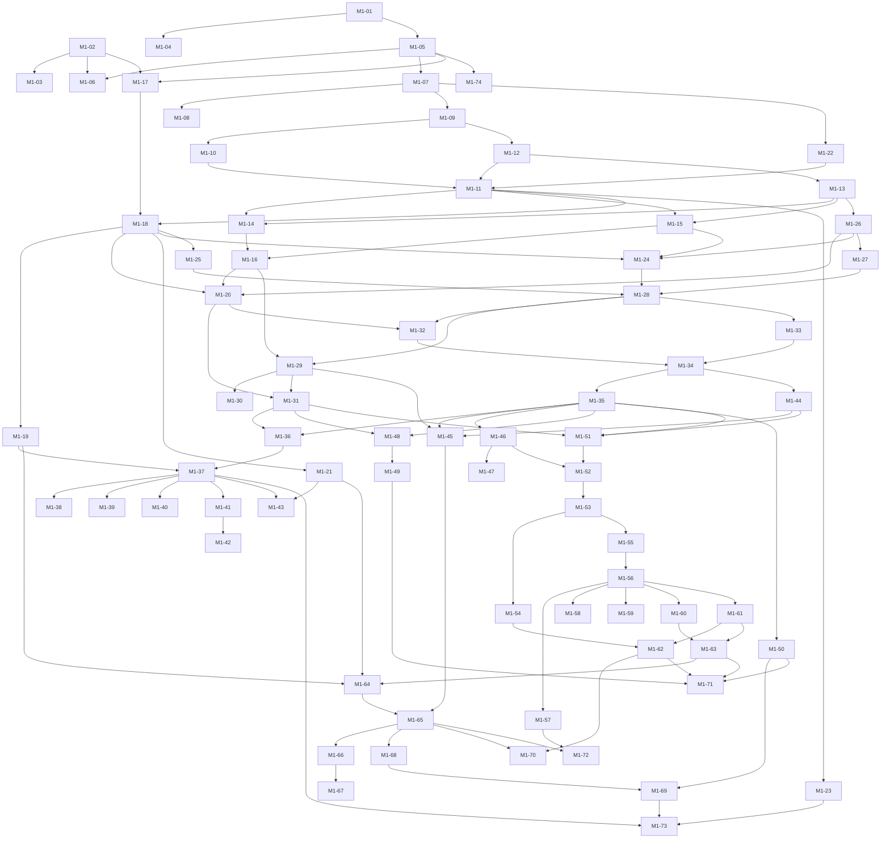

# Build briefs

This folder holds the build briefs: one English file per ticket, written so that an unattended
build session can finish the ticket with a green `make check` without asking anything. Each brief
names its goal, the chapters and ADRs to read, the fixed build rules, scope and boundaries, the
tests to write first, the acceptance criteria and the report format. Order and dependencies come
from the [plan](../PLAN.md) (Etappe M1, "Tickets"); this index repeats them for the launcher.

Briefs are written for Etappe M1 (plan ticket M0-05). Briefs of a later etappe are written when the
etappe before it closes, because their tickets build on what that etappe actually delivered.

## How a brief runs

1. The launcher starts a brief only when every ticket in "Depends on" is merged into the base
   branch and Etappe M0 is closed (plan, section "M0 Planung"). A local SonarQube with the
   "Bothy way" gate must be running from M1-05 on (ticket M0-07).
2. The launcher fills the placeholders `{{REPORT_PATH}}` and `{{DONE_PATH}}` and passes its host
   rules (ports, machine rules); a brief never contains instance-specific values.
3. Each brief runs in its own git worktree on the branch `feat/<ticket-id>-<slug>`. Tickets of the
   same wave share no dependency and may run in parallel; overlapping files are resolved at merge.
4. The working rules of the plan (section "Arbeitsweise je Ticket") apply to every brief: test
   first, specification first, `make check` green, review and red team before the local merge, no
   push without the owner's approval.
5. A brief that finds a gap in the core contract (chapters 00, 03, 04, 05) stops with
   `Verdict: BLOCKED` instead of building a deviation.
6. The owner's fixed build rule 3 is quoted verbatim in every brief ("API documentation is
   generated from code (OpenAPI from the routes, ...)"). In this repository it means one source:
   `docs/api/openapi.yaml` is normative (ADR 0013, spec first), routes, handler interfaces and
   clients are generated from it, and `make codegen-check` keeps them equal. No session generates
   OpenAPI from handler code.

## Waves

A wave is the longest chain of dependencies before a ticket. All tickets of a wave can start once
the waves before it are merged; many can start earlier, as soon as their own dependencies are in.

| Wave | Tickets that may run in parallel |
|---|---|
| 1 | M1-01, M1-02 |
| 2 | M1-03, M1-04, M1-05 |
| 3 | M1-06, M1-07, M1-17, M1-74 |
| 4 | M1-08, M1-09, M1-22 |
| 5 | M1-10, M1-12 |
| 6 | M1-11, M1-13 |
| 7 | M1-14, M1-15, M1-18, M1-23, M1-26 |
| 8 | M1-16, M1-19, M1-21, M1-24, M1-25, M1-27 |
| 9 | M1-20, M1-28 |
| 10 | M1-29, M1-32, M1-33 |
| 11 | M1-30, M1-31, M1-34 |
| 12 | M1-35, M1-44 |
| 13 | M1-36, M1-45, M1-46, M1-48, M1-50, M1-51 |
| 14 | M1-37, M1-47, M1-49, M1-52 |
| 15 | M1-38, M1-39, M1-40, M1-41, M1-43, M1-53 |
| 16 | M1-42, M1-54, M1-55 |
| 17 | M1-56 |
| 18 | M1-57, M1-58, M1-59, M1-60, M1-61 |
| 19 | M1-62, M1-63 |
| 20 | M1-64, M1-71 |
| 21 | M1-65 |
| 22 | M1-66, M1-68, M1-70, M1-72 |
| 23 | M1-67, M1-69 |
| 24 | M1-73 |

## Index

Dependencies are minimal: a ticket implied through another dependency is not repeated. Brief files
are added by the brief-writing step (plan ticket M0-05) under the names listed here.

| Wave | ID | Title | Brief file | Depends on |
|---|---|---|---|---|
| 1 | M1-01 | Server gates in the make contract | `M1-01-server-gates.md` | none (M0 closed) |
| 1 | M1-02 | Action catalogue as the single data source | `M1-02-action-catalogue-source.md` | none (M0 closed) |
| 2 | M1-03 | API contract checks in the gate | `M1-03-api-contract-checks.md` | M1-02 |
| 2 | M1-04 | Operations configuration checks in the gate | `M1-04-ops-config-checks.md` | M1-01 |
| 2 | M1-05 | Server skeleton, module register and architecture gate | `M1-05-server-skeleton.md` | M1-01 |
| 3 | M1-06 | Module register checked against the core contract | `M1-06-module-register-check.md` | M1-02, M1-05 |
| 3 | M1-07 | Configuration schema and loader | `M1-07-config-schema-loader.md` | M1-05 |
| 4 | M1-08 | Configuration reference generated from the schema | `M1-08-config-reference.md` | M1-07 |
| 4 | M1-09 | Secret provider and secrets commands | `M1-09-secret-provider.md` | M1-07 |
| 5 | M1-10 | Logging and telemetry foundation | `M1-10-telemetry-foundation.md` | M1-09 |
| 6 | M1-11 | Lifecycle, listeners, health and shutdown | `M1-11-lifecycle-health.md` | M1-10, M1-12, M1-22 |
| 5 | M1-12 | PostgreSQL access, migrations and schema version | `M1-12-postgres-migrations.md` | M1-09 |
| 6 | M1-13 | Unit of work with phase hooks and in-transaction events | `M1-13-unit-of-work.md` | M1-12 |
| 7 | M1-14 | Background jobs with River | `M1-14-background-jobs.md` | M1-11, M1-13 |
| 7 | M1-15 | Sequence counters and instance record | `M1-15-instance-counters.md` | M1-11, M1-13 |
| 8 | M1-16 | Event log with commit-ordered sequence | `M1-16-event-log.md` | M1-14, M1-15 |
| 3 | M1-17 | Server interface generated from openapi.yaml | `M1-17-api-server-stubs.md` | M1-02, M1-05 |
| 7 | M1-18 | HTTP middleware chain and problem details | `M1-18-http-chain.md` | M1-11, M1-17 |
| 8 | M1-19 | Rate limits per class | `M1-19-rate-limits.md` | M1-18 |
| 9 | M1-20 | Idempotency keys | `M1-20-idempotency-keys.md` | M1-16, M1-18, M1-26 |
| 8 | M1-21 | Transport protection | `M1-21-transport-protection.md` | M1-18 |
| 4 | M1-22 | Egress client and SSRF lint | `M1-22-egress-client.md` | M1-07 |
| 7 | M1-23 | Server container image | `M1-23-server-image.md` | M1-11 |
| 8 | M1-24 | Audit hash chain and recorder | `M1-24-audit-chain.md` | M1-15, M1-18, M1-26 |
| 8 | M1-25 | Action catalogue in code and registration duty | `M1-25-authz-catalogue.md` | M1-18 |
| 7 | M1-26 | Principal tables and directory | `M1-26-identity-principals.md` | M1-13 |
| 8 | M1-27 | Grant model storage | `M1-27-authz-grant-store.md` | M1-26 |
| 9 | M1-28 | Rights snapshot, cache and authorize | `M1-28-authz-core.md` | M1-24, M1-25, M1-27 |
| 10 | M1-29 | Rights changes, access.changed and invariants I1 and SR8 | `M1-29-authz-invariants.md` | M1-16, M1-28 |
| 11 | M1-30 | Expiry of grants and memberships | `M1-30-authz-expiry.md` | M1-29 |
| 11 | M1-31 | People, owners and own profile | `M1-31-identity-people.md` | M1-20, M1-29 |
| 10 | M1-32 | Signing keys, JWKS and rotation | `M1-32-signing-keys.md` | M1-20, M1-28 |
| 10 | M1-33 | Devices, device keys and DPoP verification | `M1-33-identity-devices-dpop.md` | M1-28 |
| 11 | M1-34 | Sessions, access tokens, refresh families and logout | `M1-34-identity-sessions.md` | M1-32, M1-33 |
| 12 | M1-35 | Step-up with the device key | `M1-35-identity-step-up.md` | M1-34 |
| 13 | M1-36 | Identity provider port and provider management | `M1-36-identity-providers.md` | M1-31, M1-35 |
| 14 | M1-37 | First setup, enrollment codes and setup lock | `M1-37-identity-bootstrap.md` | M1-19, M1-36 |
| 15 | M1-38 | Device approval and pairing | `M1-38-identity-device-approval.md` | M1-37 |
| 15 | M1-39 | Local accounts with password and TOTP | `M1-39-identity-local-accounts.md` | M1-37 |
| 15 | M1-40 | Passkeys | `M1-40-identity-passkeys.md` | M1-37 |
| 15 | M1-41 | OIDC login with PKCE | `M1-41-identity-oidc.md` | M1-37 |
| 16 | M1-42 | Groups from OIDC claims | `M1-42-identity-oidc-groups.md` | M1-41 |
| 15 | M1-43 | Trusted proxy header login | `M1-43-identity-trusted-header.md` | M1-21, M1-37 |
| 12 | M1-44 | API tokens with prefix and checksum | `M1-44-identity-api-tokens.md` | M1-34 |
| 13 | M1-45 | Disable a person, revoke a device, end a session | `M1-45-identity-revocation.md` | M1-29, M1-35, M1-44 |
| 13 | M1-46 | Instance settings, branding and discovery | `M1-46-instance-settings.md` | M1-35 |
| 14 | M1-47 | Feature flags with registration and cleanup gate | `M1-47-feature-flags.md` | M1-46 |
| 13 | M1-48 | Groups and grants over the API | `M1-48-authz-api.md` | M1-31, M1-35 |
| 14 | M1-49 | Who has access, preview and view as | `M1-49-authz-explain.md` | M1-48 |
| 13 | M1-50 | Audit verification, checkpoints and queries | `M1-50-audit-verify.md` | M1-35 |
| 13 | M1-51 | Agent records, backend policy and credential holder | `M1-51-agents-records.md` | M1-31, M1-35, M1-44 |
| 14 | M1-52 | Spaces and sidebar | `M1-52-chat-spaces.md` | M1-46, M1-51 |
| 15 | M1-53 | Channels and forum tags | `M1-53-chat-channels.md` | M1-52 |
| 16 | M1-54 | Operators with invariant I1 | `M1-54-chat-operators.md` | M1-53 |
| 16 | M1-55 | Threads | `M1-55-chat-threads.md` | M1-53 |
| 17 | M1-56 | Sending messages | `M1-56-messaging-send.md` | M1-55 |
| 18 | M1-57 | Reading history | `M1-57-messaging-history.md` | M1-56 |
| 18 | M1-58 | Editing, deleting and revisions | `M1-58-messaging-edit-delete.md` | M1-56 |
| 18 | M1-59 | Reactions and pins | `M1-59-messaging-reactions-pins.md` | M1-56 |
| 18 | M1-60 | Mentions and templates | `M1-60-messaging-mentions-templates.md` | M1-56 |
| 18 | M1-61 | Read state, drafts and personal settings | `M1-61-sync-personal-data.md` | M1-56 |
| 19 | M1-62 | Moving threads | `M1-62-chat-thread-move.md` | M1-54, M1-61 |
| 19 | M1-63 | Catch-up over REST and snapshot | `M1-63-sync-catch-up.md` | M1-60, M1-61 |
| 20 | M1-64 | Gateway connection and session | `M1-64-gateway-connection.md` | M1-19, M1-21, M1-63 |
| 21 | M1-65 | Gateway hub, delivery and revocation | `M1-65-gateway-delivery.md` | M1-45, M1-64 |
| 22 | M1-66 | Focus and typing | `M1-66-gateway-focus-typing.md` | M1-65 |
| 23 | M1-67 | Gateway frame conformance | `M1-67-gateway-conformance.md` | M1-66 |
| 22 | M1-68 | Server core metrics per catalogue | `M1-68-core-metrics.md` | M1-65 |
| 23 | M1-69 | Canary test across all outputs | `M1-69-canary-test.md` | M1-50, M1-68 |
| 22 | M1-70 | Leak tests and 404 equality | `M1-70-leak-tests.md` | M1-62, M1-65 |
| 20 | M1-71 | Contract tests with Schemathesis | `M1-71-contract-tests.md` | M1-49, M1-50, M1-62, M1-63 |
| 22 | M1-72 | Load tests and performance gate | `M1-72-performance-gate.md` | M1-57, M1-65 |
| 24 | M1-73 | Compose smoke test | `M1-73-compose-smoke.md` | M1-23, M1-37, M1-69 |
| 3 | M1-74 | CodeQL for Go | `M1-74-codeql-go.md` | M1-05 |

## Dependency graph

Edges point from a dependency to the ticket that needs it (transitive reduction of the index).

