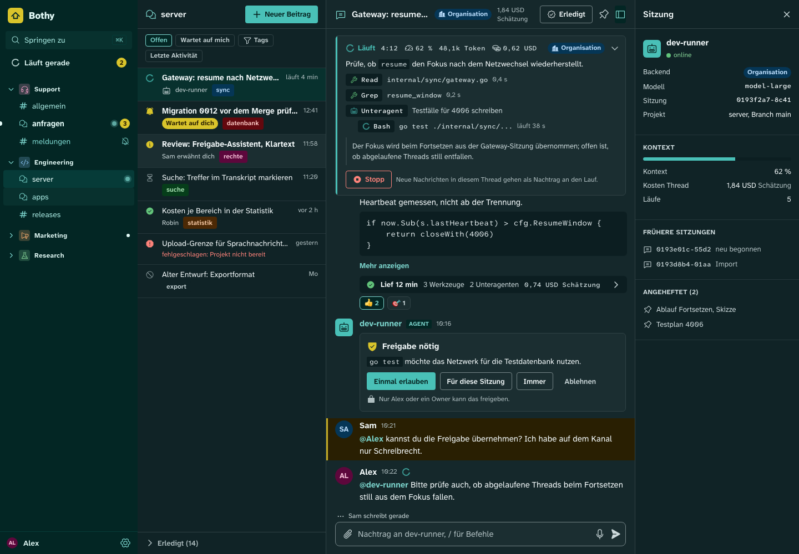
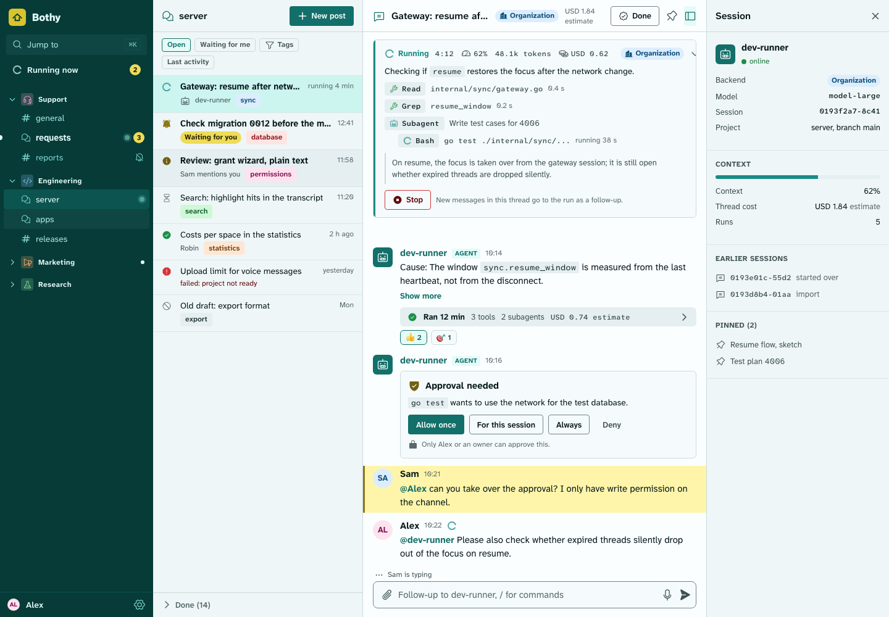

# Design system

Status: draft M0. Source of all values: `design/tokens/` (W3C DTCG format 2025.10). Generated with
`uv run tools/design-tokens/tokens.py build`; checked with `... check`. Decision: ADR 0030.
Components: [components.md](components.md). Product view: [01-product.md](../spec/01-product.md).

More images: [Components light](previews/components-light.png),
[Components dark](previews/components-dark.png), [Mobile light](previews/mobile-light.png),
[Mobile dark](previews/mobile-dark.png), [Palette light](previews/palette-light.png),
[Palette dark](previews/palette-dark.png), [Terminal light](previews/terminal-light.png),
[Terminal dark](previews/terminal-dark.png), [Statistics light](previews/viz-light.png),
[Statistics dark](previews/viz-dark.png). All images are generated from `design/build/preview.html`
(`uv run tools/design-tokens/tokens.py previews`, single views with `--view`); the page
itself is self-contained and has switches for theme, density and motion.

## Principles

1. **Layout like Discord, a face of its own.** Columns, density, collapsible spaces and forums
   with a post list follow Discord, because users know it. Color, font, icons, logo and
   shapes are our own. Reason: brand and license (Study B), and the requirement "unmistakable".
2. **Color carries meaning.** Every color is a role: brand, state of a run,
   trigger state, category of a space, backend policy badge. No color is decoration.
   This way the interface is colorful without being loud.
3. **The sidebar is brand surface.** The column with spaces and channels is deep spruce green in
   both themes. This makes the product recognizable at a glance and clearly separates
   navigation from content.
4. **Agent work visible, but calm.** The live box shows state, metrics and steps.
   Its spine on the left carries the state color; numbers are set in mono; motion exists only for
   "running" and can be turned off.
5. **Readability first.** Font Atkinson Hyperlegible (designed for people with
   low vision), contrast AA as a hard test, dynamic type size up to 200 percent.
6. **Dense like a tool.** Tight radii, lines instead of shadows, three densities
   (comfortable, compact, touch). Agents deliver long texts; the space belongs to the content.
7. **One source, many outputs.** Values live only in `design/tokens/`. CSS, Dart, docs and
   preview are generated from them. Whoever changes a color changes JSON and runs the tests.

## Ban list

The requirements forbid the generic AI look. What can be measured, the tool checks on every
`build` and `check`; the rest is part of the review list in [components.md](components.md).

| Ban | Reason | Enforcement |
|---|---|---|
| Discord Blurple `#5865F2` (https://discord.com/branding, retrieved 2026-10-10 [verified]) and colors close to it | third-party brand | Guard in `design/design-rules.json`: OKLab distance of every palette color to Blurple; brand and accent with a larger distance |
| Discord font, Discord icons, Discord logo | third-party brand, license | Font token `font.family.*`, icon set Phosphor, our own mark |
| Default grays (gray without a color cast) | generic look | Guard: minimum chroma for `palette.granite.*`, `color.surface.*`, `color.border.*` |
| Beige, warm sand, cream | generic look, closeness to well-known AI palettes | Guard: forbidden warm hue range for neutrals and surfaces; plus a guard for all tinted backgrounds (`*.subtle`, `*.chip-bg`): in the warm hue range only with a clearly visible hue, otherwise they look like cream |
| Terracotta or orange on beige as brand (similar to Claude or Anthropic) | confusion | Guard: forbidden hue range orange to sand for brand and accent |
| Purple as accent, gradients from purple to blue | generic look (Study B, requirement 18) | Guard: forbidden hue range purple for brand and accent; the tool knows no type `gradient` and rejects it |
| Glassmorphism, glow, neon | generic look | no token for blur or glow; shadows only in `elevation.*`; review |
| Emoji as icons | requirement 18 | Icons only from `icon.tokens.json`; a test over the ARB files rejects emoji in UI texts (ticket in 15-client-architecture.md) |
| En and em dashes in UI texts | rule | the same ARB test rejects U+2013 and U+2014 |
| Status as a reaction, status as an emoji | Study B: status emoji were the old workaround | Trigger state is a field (`trigger_state`) with its own icons |
| Floating cards, welcome banners, terminal look in chat and administration (mono font as a style, text on a black surface), brutalism | Study B | Review; the terminal view itself is a separate component with its own roles ([components.md](components.md), section 12) |

Guard scope of the instance accent (M4-03): the guard "Brand and accent" (scope `palette.spruce.`,
`color.accent.`) protects the product's own brand and checks the base roles only. The accent
variants of an instance are not checked against it, because chapter 01 section 12 deliberately
allows `heather`, `rowan` and `amber` as the instance owner's choice from the checked palette,
while the product brand stays spruce; contrast applies to the variants in full. The guard "No
closeness to Discord anywhere in the palette" covers every scale and so every variant.

## Origin of the name

The working name **Bothy** is the Scottish word for a simple, open shelter that anyone may use
free of charge ("A bothy is a basic shelter, usually left unlocked and available
for anyone to use free of charge", https://en.wikipedia.org/wiki/Bothy, retrieved 2026-10-10
[verified]). The image fits: a place where people and agents find shelter and work; "bot"
is in the word. Research and alternatives: [naming.md](naming.md). The name is configuration
(ADR 0044); the design does not depend on it.

The palette takes up the image: colors of the Highland landscape around a hut.

| Name | Meaning | Role |
|---|---|---|
| `spruce` | spruce | brand, accent, sidebar, running agent |
| `gorse` | gorse | signal: mention, "waiting for you", approval needed |
| `moss` | moss | success, done |
| `rowan` | rowan berry | error, destructive action |
| `amber` | amber | warning, stall |
| `loch` | lake | information, follow-up delivered |
| `heather` | heather | category only (spaces, tags) and badge "Personal" |
| `granite` | granite | neutrals with a cool cast |

The mark is a gable (roof and walls of a hut) in gorse on spruce. It is deliberately
simple so that it works as an app icon, in the sidebar and as the favicon of the console.

## Why these colors

- **Spruce as brand.** A green-tinted petrol is rarely taken in the field of team chats
  (Discord Blurple, other products violet, aubergine or blue) and is far from the forbidden purple
  and terracotta. It works in light and dark: as a deep surface (sidebar) and as a
  light accent color in the dark theme.
- **Gorse as counterpart.** Yellow is the only warm signal color. It stands for everything that
  waits for a person. The dark steps drift toward gold so that text does not look olive.
- **Granite instead of gray.** The neutrals have a cool cast (hue 210). In the dark theme
  it is visible and gives the product its base tone; in the light theme it keeps white fresh.
- **Categories.** Spaces and tags get one of eight colors (`category.*`). The server
  stores only the key (`heather`, `loch`, ...), never a free color value; so every
  combination stays in the contrast test.
- **OKLCH as source.** The tonal scales are written in OKLCH, because equal lightness steps there
  look equally light. The generator computes sRGB and rejects colors outside the sRGB gamut.

## Files

| Path | Content |
|---|---|
| `design/tokens/theme.resolver.json` | Entry point (DTCG Resolver Module 2025.10): base plus modifiers `theme`, `density`, `motion` |
| `design/tokens/color.palette.tokens.json` | primitive tonal scales (OKLCH) |
| `design/tokens/color.light.tokens.json`, `color.dark.tokens.json` | semantic color roles per theme, same keys |
| `design/tokens/typography.tokens.json` | fonts and type roles |
| `design/tokens/space.tokens.json` | spacing, radii, borders, column widths, fixed sizes |
| `design/tokens/elevation.tokens.json` | shadows for menu and dialog |
| `design/tokens/motion.full.tokens.json`, `motion.reduced.tokens.json` | durations and curves; reduced motion |
| `design/tokens/density.*.tokens.json` | density comfortable, compact, touch |
| `design/tokens/icon.tokens.json` | icon sizes and mapping of semantic names to Phosphor glyphs |
| `design/design-rules.json` | contrast pairings and palette guards |
| `design/build/` | generated, do not edit: CSS, Dart, resolved JSON, preview |
| `tools/design-tokens/` | generator, tests, embedded fonts and icons |
| [palette.md](palette.md), [contrast.md](contrast.md), [tokens.md](tokens.md) | generated |
| [typography.md](typography.md), [spacing-radii-elevation-motion.md](spacing-radii-elevation-motion.md), [icons.md](icons.md), [components.md](components.md), [naming.md](naming.md) | by hand |

## Process for a change

1. Change the value in `design/tokens/` (never in `design/build/`).
2. `uv run tools/design-tokens/tokens.py build`: checks contrast and guards, writes all
   outputs. Aborts when a pairing falls below AA.
3. `uv run tools/design-tokens/tokens.py previews` and look at the images. If the change affects
   only one view, `--view <name>` renders only its images; the other images stay
   byte-identical (pixels differ per machine).
4. Commit everything together. The gate `uv run tools/design-tokens/tokens.py check` fails
   when a generated file does not match the source.

New pairing in a component: first add it to `design/design-rules.json`, then build.
New icon: add it to `icon.tokens.json` and run `tokens.py vendor` with the pinned package
(see [tools/design-tokens/README.md](../../tools/design-tokens/README.md)).

## Runtime branding

An instance can set the product name, logo and accent (`branding.*`, ADR 0044). The accent is
not a free color value but a key from `category.*` (default `spruce`), because only these
combinations pass the contrast test. If an instance chooses a different accent, the app swaps
the roles `color.accent.*`, `color.text.link`, `color.focus.ring` and `color.run.running` for
the equally light steps of the chosen scale.

The generator builds these variants (M4-03). The member `accent_variants` of
`design/design-rules.json` names the allowed accents (`spruce`, `loch`, `heather`, `rowan`,
`amber`, `gorse`, `moss`; default `spruce`) and the swapped roles. Per theme a role is swapped only
where it aliases a step of `palette.spruce`; it then takes the same step of the chosen scale, or
the nearest step by number when the scale lacks it (a tie goes darker in light, lighter in dark).
Every other role keeps its value: in dark, `color.focus.ring` aliases `gorse` and stays, and so do
the sidebar, the text on the accent and the category colours. If a variant fails a contrast
pairing of the rules file, it moves one step at a time along its scale towards more contrast until
every pairing passes; if no step passes, `build` and `check` fail. Every pairing that contains a
swapped role is checked for every accent in light and dark and listed in
[contrast.md](contrast.md), moved steps marked. The outputs: the Dart extension `DsAccent` (one
constant per theme and accent, `DsAccent.of(key, brightness)`, an unknown key gives `spruce`),
blocks `[data-accent="<key>"]` in `tokens.css` (on the same element as `data-theme`) and the member
`accents` of `tokens.resolved.json`. The default accent equals the base roles exactly. The preview
shows the default accent only.
