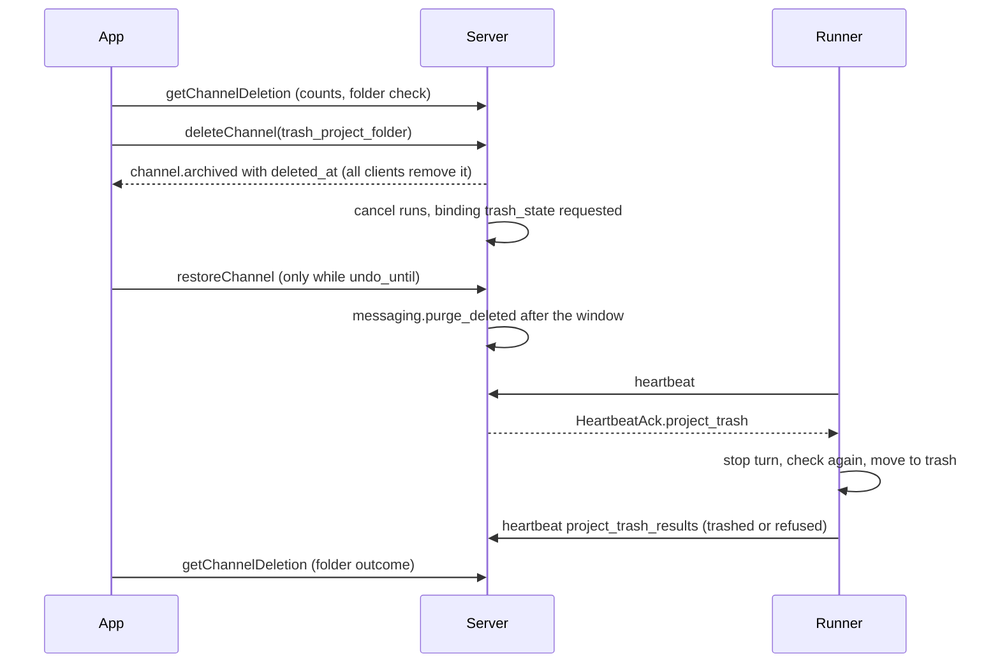

# Deleting spaces, channels, projects and chats

Status: design of 2026-11-01 after an owner request, built by the ticket FEAT-delete-spaces-chats.
This note explains and justifies; the normative text is in the chapters it changes
([01-product.md](../spec/01-product.md) 6.18, R-PR-33; [03-data-model.md](../spec/03-data-model.md)
`spaces`, `channels`, `threads`, `project_bindings`, R-DM-57; [05-actions.md](../spec/05-actions.md)
section 4.5 and 4.6; [07-permissions.md](../spec/07-permissions.md) 4.5a;
[09-agents.md](../spec/09-agents.md) 18.15, R-AG-38; [20-privacy.md](../spec/20-privacy.md) 4.2a;
[openapi.yaml](../api/openapi.yaml)). Rulings:
[decisions.d/FEAT-delete-spaces-chats.md](../decisions.d/FEAT-delete-spaces-chats.md)
(`D-DEL-1` to `D-DEL-16`).

## 1. Goal

Owner request (2026-11-01, translated): nothing can be deleted in the app, neither a space, a
channel, a chat nor a project; marking as read exists, deleting does not. Wanted:

1. "Delete" in the context menu and in the "More" menu of projects, channels, chats and spaces,
   on every client.
2. A confirmation that names exactly what goes away: messages, files, sessions.
3. For a project, an unchecked box "Also move the project folder to the trash". When checked, the
   runner moves the folder to the trash of its host, never removes it for good, and refuses with
   a reason when the folder is outside its projects root, a link to a place outside it, a Git
   work tree of another repository, or holds uncommitted changes or unpushed commits; the dialog
   shows a refusal before the person confirms. Running sessions of the project stop first.
4. The separate sidebar entry for a new chat is no longer wanted, because "+" exists.

Done means: the three delete actions and their undo work on the server with authorization, audit
and live events; every client removes a deleted item at once and brings it back on undo; the
runner moves a project folder to the trash only under the rules above; each behaviour has a test.

## 2. What exists

| Part | Today | Gap |
|---|---|---|
| Archive (`space.archive`, `channel.archive`, 07 4.5) | final, read only for everyone, leaves the sidebar lists, rights change with `access.changed` | content stays readable; no undo; no client entry |
| Message deletion (20 4.2, `messaging` deletion path, `retention.content`) | tombstone, revisions, mentions, reactions, pin, attachments, event redaction, `message.deleted` | only one message at a time, never a whole thread |
| Principle 7 of 03 | spaces, channels, threads and messages are never hard deleted; content is cleared on deletion | threads have no deletion state |
| Removed targets in the client (04 8.3) | the sync engine deletes a target's local content and closes its views | used for access loss and `thread.moved_out` only |
| Runner (09 18.1, 18.12) | resolves `workspace_ref` strictly under `runner.projects_root`, creates folders | never removes or moves a folder |

## 3. Decisions

**D-DEL-1 Soft delete with an undo window, then a purge.** A delete marks the item (`deleted_at`,
`deleted_by`) and hides it at once; for `chat.delete_undo_window` (default `30s`) the same person
or anyone with the same right may undo it. When the window has passed, the job
`messaging.purge_deleted` deletes the content for good through the message deletion path of 20 4.2
(tombstones, redaction, attachments to `files.purge_objects`), clears thread titles and channel
topics and sets `purged_at`. The rows stay (03 principle 7). Reason: the spec already decides that
rows stay and content goes; the owner wants a quick undo for a slip, and the retention class
`content` has no period by default (20 4.1), so "after retention" would keep the content forever.

**D-DEL-2 Spaces and channels are deleted through the archive state.** Deleting a space or a
channel sets `archived_at` (when it is not archived yet) together with `deleted_at` in the same
transaction, as the rights change of `space.delete` or `channel.delete`. Everything 07 4.5 says
about archived items applies: read only for everyone, out of the sidebar lists and of I1, runs end.
An undo clears `deleted_at` and also `archived_at` when the delete set it (equal time stamps); an
item archived before stays archived. Reason: archiving already removes the item from every list and
every write path with one well tested rule; a second hidden state would have to repeat it in every
query and in `authorize`.

**D-DEL-3 Threads get their own deletion state.** `threads.deleted_at`, `deleted_by`, `purged_at`.
A deleted thread leaves every thread list (sidebar groups, post list, unread candidates, served
targets of I1), its history and `getThread` answer `404 not_found`, and new messages, edits,
reactions and runs in it are refused with `404 not_found`. A main thread is never deleted alone
(`409 conflict`, reason `main_thread`); it goes with its channel. Reason: a chat is the unit the
owner deletes in a forum; the main thread is the channel itself.

**D-DEL-4 Who may delete.** `space.delete` and `space.restore`: owner with step-up, like
`space.archive`. `channel.delete` and `channel.restore`: `manage` on the channel with step-up, like
`channel.archive`. `thread.delete` and `thread.restore`: `write` and (creator or `manage`), without
step-up, audited; in an archived or read only channel nobody deletes a thread (the write rule of
07 4.5). Moving a project folder to the trash additionally needs `channel.project.bind` (owner with
step-up), because whoever may bind a folder may give it up. A member without the right gets
`403 forbidden`. Reason: deletion follows the right that creates and archives the item (R-AZ-06:
destructive structure changes with step-up; a person's own chat is like their own message).

**D-DEL-5 No new event types.** A deleted space or channel is published with its archive event
(`space.archived`, `channel.archived`), whose object now carries `deleted_at`; a deleted thread
with `thread.updated` carrying `deleted_at`. An undo publishes `space.updated`, `channel.updated` or
`thread.updated` without `deleted_at` and a higher version. Clients that see `deleted_at` remove
the item and its local content as a removed target (04 8.3 item 3) and close its views; a later
version without it brings the item back, and its history loads again from the server. The receive
actions stay `space.read`, `channel.read` and `thread.read`, so every reader gets the deletion.
Reason: the event payloads already carry the whole object; a member of the schema is additive for
every generated client, six new event types are not.

**D-DEL-6 What the confirmation names.** `getSpaceDeletion`, `getChannelDeletion` and
`getThreadDeletion` return `DeletionInfo`: the counts of channels, chats, messages, files and agent
sessions that go, and for a project the folder state of D-DEL-10. They are read with the read
action of the item; the folder part is shown to owners only. After a delete the same endpoint
reports the state (`pending` until `undo_until`, then `final`) and the folder outcome. Reason: the
dialog must name the numbers before the person confirms, and the person who deleted a project must
learn later whether the runner moved the folder.

**D-DEL-7 Sessions, runs, push.** A delete cancels the active runs of the item (as `channel.read_only.set`
does), so the runner stops the Claude Code process. Agent session rows stay with their thread
(retention `content`); the runner's own transcript files on the host are not touched. No push is
sent for a deletion; a deleted thread takes no new message, so no new hint arises, and the
check before every push (`push.deliver`) finds no readable content after the purge. Reason: the
owner wants sessions stopped; the host transcripts belong to the runtime, not to Bothy.

**D-DEL-8 Search, sidebar order, unseen dots, drafts.** The server's search vectors empty with the
tombstones; a deleted thread's title is cleared by the purge, and the thread list queries skip
deleted threads at once. The client removes the item from its local search index with the removed
target. The person's synced order rows (`user_space_states`, `user_channel_states`, post order) stay,
so an undo puts the item back in its place; while deleted, the lists simply do not contain it.
Status dots and unread marks go with the local content. Drafts of the item are deleted by the
purge. Reason: nothing new to store; an undo must restore the person's arrangement.

**D-DEL-9 Audit.** `space.delete`, `channel.delete`, `thread.delete` and the three restores write an
audit entry with the actor, the target and `trash_project_folder`; the purge has no actor and
writes none, as `retention.content` (20 4.1); the runner's folder outcome writes
`channel.project.trash` with the result code. Reason: who deleted what is the evidence an owner
needs; per message entries of a purge would only repeat the delete.

**D-DEL-10 The runner checks the folder before and again when it moves it.** Every runner reports,
per bound forum in its readiness entry, `trash_check`: `ok` true, or false with a reason code
(`outside_root`, `symlink`, `foreign_worktree`, `uncommitted_changes`, `unpushed_commits`,
`contains_other_project`, `workspace_missing`, `check_failed`). It computes the check at most every
`runner.trash_check_interval`. The server stores it on the binding; `DeletionInfo.project_folder`
shows it, and the dialog disables the box with the reason sentence when it is not ok or has never
been reported. A delete with `trash_project_folder` is refused with `409 conflict`, reason
`project_folder_refused`, unless the last check is ok. Reason: the owner wants to see a refusal before
confirming; the runner must not trust the server or an old check for its own file system, so it
checks again right before the move.

**D-DEL-11 The folder moves only when the deletion is final.** The server marks the binding
`trash_state = requested` with the serving runner and hands the request to that runner in the
heartbeat acknowledgement (`HeartbeatAck.project_trash`) only after the undo window, so an undo
never loses a folder. The runner stops a turn still running in that folder, checks again, moves the
folder and reports `trashed` or `refused` with the reason in its next heartbeat
(`Heartbeat.project_trash_results`); the server stores the outcome and audits it. Reason: an undo
must restore everything; the trash keeps the folder recoverable for the person anyway.

**D-DEL-12 Trash, never removal.** macOS: `~/.Trash`; Windows: `.bothy-trash` under the projects root (the
shell's recycle bin can delete for good without telling a process without a window); Linux and other systems: the freedesktop trash of the user
(`$XDG_DATA_HOME/Trash` with a `.trashinfo`). When that trash is on another file system than the
folder, the runner moves the folder into `.bothy-trash` directly under its projects root instead.
Always a rename on one file system, never a copy and never a recursive removal; an existing name
in the trash gets a suffix. Reason: the owner's wording; a rename is atomic and cannot half delete a
project.

**D-DEL-13 Refusal rules.** The runner refuses: a reference that does not resolve strictly under
the projects root (18.1), a bound path that is itself a symbolic link (also one inside the root,
because moving its target would move another folder), the projects root itself, a folder that
contains another bound project or the runner's state directory, a Git work tree whose common Git
directory lies outside the folder (a linked work tree or submodule of another repository), a work
tree with uncommitted or untracked changes or stashes, a repository with commits on a local branch
that no remote branch contains, a missing folder, and any Git error or time out. A folder without
Git has no Git rule. Reason: the owner's list, plus the cases where a move would take more than the
one project.

**D-DEL-14 Every client.** The menus of a space (sidebar), a channel or forum (sidebar and the "More"
button of its main history), a project forum (same, with the folder box) and a chat (sidebar, post
list, the "More" button of its history) get "Delete..." at the end, separated, for whoever has the
right; on the phone the same menus open with a long press. The chat client runs on macOS, Windows,
iOS and Android; the web console has no spaces, channels or chats, so it gets no entry. Reason:
one menu code for all four apps; the console administers the instance, not the conversation.

**D-DEL-15 Undo in the client.** After a delete the client shows a toast "Deleted <name>" with
"Undo" until `undo_until` minus the round trip, at most `ui.delete_undo_toast`; "Undo" calls the
restore action. When the window has passed and a folder was requested, the client asks
`getChannelDeletion` until the outcome is known (at most `ui.delete_folder_wait`) and shows it in one
sentence. Reason: a toast is the known pattern for a slip; the folder outcome arrives later.

**D-DEL-16 The separate new chat entry.** The code has no sidebar entry with the channel sign that
starts a new chat: the client builds a forum's "+", the forum menu entry "New chat in", Cmd+N
(Ctrl+N) and the draft row "New chat" (no sign), and the server and the import create no channel of
their own. Evidence in the code: the only client labels of that kind are `sidebarNewChatIn` (the "+"
of a forum row, the forum menu and the new chat view) and `sidebarNewChat` (the draft row and the
fallback for a blank thread title), and the server uses "New chat" only as a placeholder title. The
entry the owner saw is therefore a text channel in the instance's data, most likely the former helper
channel of the old setup (lesson L24 of [REUSE.md](../REUSE.md)), which "+" replaced (not verified
against the instance's data in this repository). With this feature the owner removes it by deleting
that channel, which takes it out of every client at once; "+", the forum menu entry and Cmd+N stay
the ways to start a chat. Reason: the entry is data, not code; the new delete removes it everywhere.

## 4. Flow

## 5. Out of scope

- Deleting direct messages (a person leaves a DM, `dm.leave`).
- A trash view in the app with a longer restore; the host trash keeps folders, the content goes.
- Removing the runtime's own session transcripts on the host.
