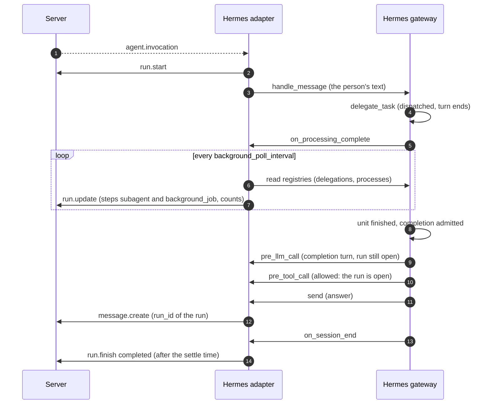

# Background work of a Hermes run

Status: design of 2026-11-06 for the ticket FIX-hermes-hidden-background, built by the same
ticket. This note explains the decisions; the normative text is in
[09-agents.md](../spec/09-agents.md) 17.12 (rule R-AG-44), 14, 17.3 and 17.9. Rulings:
[decisions.d/FIX-hermes-hidden-background.md](../decisions.d/FIX-hermes-hidden-background.md).

## 1. Goal

Owner rule of 2026-11-06: nothing an agent does may run without being visible in the app, and an
agent must not be able to work in the background without a visible run.

Done means:

1. A Hermes run whose turn started asynchronous delegations or background processes stays
   `running`, with its stop button, until that work is done; each delegation shows as a step
   `subagent` and each process as a step `background_job`.
2. The turn Hermes starts by itself when such work finishes (the completion turn) runs inside that
   run: its tool steps, its usage and its answer belong to the run.
3. Stop cancels the delegations and the processes of the run.
4. A turn of the thread without a run of the adapter can call no tool: no delegation, no
   scheduled job, no terminal.

## 2. What Hermes does (pinned `v0.22.5`, read and measured)

- Every top-level `delegate_task` runs in the background (`run_agent._dispatch_delegate_task`,
  `tools/async_delegation.py`): the tool returns a handle at once and tells the model to end its
  turn. The registry keeps a record per delegation unit with `session_key`, `goal`, `status`
  (`running`, `stalling`, `finalizing`, then `completed`, `error`, `interrupted` or `stalled`) and
  `dispatched_at` (`list_async_delegations`). `interrupt_for_session(session_key=...)` interrupts
  the live units of a session. The durable row (`get_durable_delegation`) has `delivery_state`
  `pending` until the gateway admitted the completion.
- `terminal(background=True)` registers a process in `tools.process_registry` with the
  `session_key` of the turn (`list_sessions(session_key=...)`, `kill_process`).
- When a unit or a notifying process finishes, the gateway builds an internal event and admits
  it through the session authority's queue (`gateway/run_notifications.py`,
  `gateway/session_automation.py`). That turn does not pass through the platform's
  `handle_message`, so neither `on_processing_start` nor `on_processing_complete` comes. Measured
  with the Fake-Hermes rig: after the run of the triggering turn ended, the completion turn
  reached the adapter only through the hook `pre_llm_call` (with the thread in the session
  variables), it called a tool, and its answer became a report without a run.
- Plugin hooks the adapter can use: `pre_llm_call` (a turn starts), `on_session_end` (a turn's
  agent loop ended), `pre_tool_call` (before every tool call, also of a subagent; a return value
  `{"action": "block", "message": ...}` refuses the call and gives the model the message).

## 3. Decisions

| No | Decision | Reason |
|---|---|---|
| 1 | The background work of a run is the set of delegation units and background processes of the thread's Hermes session that started after the run started: a unit while it is live or its completion is not admitted yet, a process while it runs. The adapter reads it from Hermes' registries every `hermes_adapter.background_poll_interval`. | The registries are the only source that knows when work ends; Hermes reports no end of a unit to a platform. Work of earlier runs is not counted, so an old process cannot hold every later run. |
| 2 | After the run's turn completes, the run stays `running` while the set is not empty. Each unit is a step `subagent` (title: the goal), each process a step `background_job` (title: the command), both with status `running` and then `completed`, `failed` or `cancelled`; `/metrics/subagents` and `/metrics/background_jobs` count the open ones; `/metrics/progress_events` rises once per `hermes_adapter.background_progress_interval` while work is open, so the stall notice of 5.5 does not fire. | Mirrors 18.5 of the runner; 5.4 already shows these steps and counts in the live box. |
| 3 | A turn Hermes starts in the thread while the run is held (the completion turn, a notice of a finished process) is a turn of the run: the adapter takes it from `pre_llm_call` until `on_session_end`, its status sentences become steps, its usage counts, and its answer is a message of the run. | Hermes gives the platform no other signal of such a turn (section 2). |
| 4 | The run finishes when the set is empty, no turn of the thread runs, and, for a run that saw background work, `hermes_adapter.background_settle` passed without a turn start, a tool call or an answer. A run without background work finishes at once, as before. | The gateway admits a completion a moment after the unit ended; the settle time keeps the run open for that turn and its answer. |
| 5 | A follow-up written while the run is held, and one the first turn did not take once the run is held, starts a turn of its own in the run, one after the other, with the person's text and the format rules and channel instructions on the user side; it is `delivered` at the start and `absorbed` when the turn completed. A follow-up with a file, and every follow-up of a run without background work, stays `queued` for the follow-on run, as before. | Otherwise the person waits for the background work before the agent reads the next message (18.5 does the same for the runner). |
| 6 | Stop (`run.cancel_requested`) interrupts the thread's turn as before, interrupts the session's live delegation units and kills the session's running processes (their output is consumed, so no completion turn follows a killed process). An early end of the run (a failed turn, an abort for a changed mode or a refused card) does the same. | A run must not end while work it covers goes on unseen. |
| 7 | Every tool call of a session of the adapter's platform is refused while its thread has no open run of the adapter (`pre_tool_call` returns a block with the reason); a session without a thread is refused too. | The rule of the brief; it covers the completion turn after a stop or a restart, a delegation's subagents after their run ended, and a turn Hermes might start in a later version. Fail closed: a call whose thread cannot be told is refused. |
| 8 | A turn of the thread that runs without a run (section 2: the adapter cannot keep Hermes from running it) can call no tool by 7; its text answer is posted as a report without a run, so nothing it says is hidden. | The pinned version gives a platform no veto on an injected turn: it never passes the platform's `handle_message`. Refusing what the turn can do is the strongest refusal the plugin surface allows. |
| 9 | No run of its own for a completion turn. | The server opens runs only for a message, a command or an interaction (03 `runs.trigger_kind`); a trigger kind for agent-started runs is a server change outside this ticket. Decision 3 makes it unnecessary while the run is held. |

## 4. Flow

## 5. Limits

- A process that never ends (a server started in the background) keeps its run `running` until a
  person stops it; that is the rule (visible, with a stop button), not a fault.
- A gateway or adapter restart ends the hold: the server ends the run `interrupted` or `stale`,
  Hermes may replay a completion later, and that turn runs without a run (decision 8).
- A turn of the thread whose `on_session_end` never comes keeps the run open until a stop.
- Hermes' memory and skill review after a turn runs in the turn's session; while no run is open
  its tool calls are refused by decision 7.
