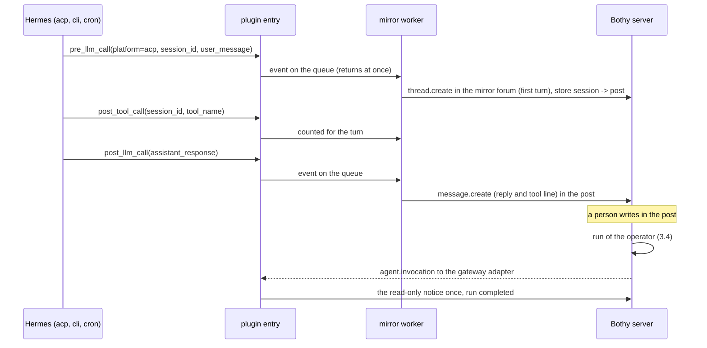

# Mirror of Hermes sessions outside Bothy

Status: design of 2026-11-07 for the ticket FEAT-hermes-mirror-sessions, built by the same
ticket. This note explains the decisions; the normative text is
[09-agents.md](../spec/09-agents.md) 17.13. Rulings:
[decisions.d/FEAT-hermes-mirror-sessions.md](../decisions.d/FEAT-hermes-mirror-sessions.md).

## 1. Goal

Owner goal of 2026-11-07: a Hermes session that is not started from Bothy (a session another
program drives over `hermes acp`, a `hermes` CLI session, a cron job) shows up in Bothy as a chat
of its own, so the owner sees every session of an agent. Until now the plugin entry dropped every
hook whose `platform` was not the adapter's platform key, so such sessions were invisible.

Done means:

1. A profile can turn on a mirror in its platform section: a forum channel and the list of foreign
   platform keys to mirror. Without both the mirror is off (the default).
2. The first turn of a mirrored session opens a new post in that forum, titled from the first
   prompt; the prompt is posted marked as the request, the agent's reply after it. Every further
   turn of the same Hermes session goes into the same post, also after a restart of the process
   or of the gateway and after a resume.
3. A person's message in a mirror post does not reach the foreign session; the person sees why.
4. The foreign session never waits for Bothy and never fails because of the mirror.
5. Nothing of a mirrored session goes anywhere but the configured forum.

## 2. What Hermes does (pinned `v0.22.5`, read in its source)

- Hermes loads the plugins of a profile in every process that runs an agent (`model_tools` calls
  `discover_plugins` at import), and the hooks fire in the process that runs the turn. In the
  pinned version the `hermes` CLI and `hermes acp` attach to the profile's gateway and run their
  turns there (`hermes_cli/gateway_client.py`, `acp_adapter/gateway_server.py`; measured with
  `hermes -z`: without a running gateway it tries to start one, which the test rig's sandbox
  refuses with `Gateway inaccessible`), and the gateway's
  scheduler runs the cron jobs; `hermes cron run` and an ACP server with its own session manager
  run turns in a process of their own, where only the plugin entry is loaded. The adapter's
  platform (`platform.py`) runs only in the gateway, so the mirror must not depend on it.
- The hooks carry the session and the platform of the agent: `pre_llm_call` (`session_id`,
  `parent_session_id`, `user_message`, `platform`) before a turn's model call, `post_llm_call`
  (`assistant_response`, `platform`) once per turn after the tool loop, `post_tool_call`
  (`session_id`, `tool_name`, `status`; no `platform`) after each tool call, `on_session_end`
  (`completed`, `failed`, `interrupted`, `platform`) at the end of `finalize_turn`. Error paths of
  the turn return without `post_llm_call` and without `on_session_end`.
- The platform values are `acp` (`acp_adapter/session.py`), `cli` and `cron`
  (`cron/scheduler.py`); a gateway platform uses its own key, a subagent `subagent`.
- An ACP `session/load` and a CLI `--resume` continue the same `session_id`; a compression moves a
  session to a new ID whose `parent_session_id` names the old one.
- One gateway can serve several profiles in one process (multiplex operation,
  `cron/scheduler.py`, `hermes_cli/gateway_client.py`); it keeps one plugin manager per profile
  home (`hermes_cli/plugins.py`) but imports the adapter module once, and resolves the profile
  home of a turn through a context-local override (`hermes_constants`).
- The hooks run on the agent's thread; a slow hook delays the turn.

## 3. Decisions

| No | Decision | Reason |
|---|---|---|
| 1 | Two keys in the platform section's `extra`: `hermes_adapter.mirror_channel` (the ID of a forum where the agent writes, as a rule its operator) and `hermes_adapter.mirror_platforms` (a list, or a comma separated text, of foreign platform keys such as `acp`, `cli`, `cron`). The mirror is on only with both; the adapter's own platform key is refused in the list. | Default off and explicit per profile; a key per platform keeps a profile that runs many cron jobs from mirroring them unless asked. |
| 2 | The mirror runs in the process that runs the foreign turn, the gateway or another one: the plugin entry passes the hooks of a listed platform to `bothy_hermes_adapter.mirror` (imported at the first such hook, never at load). It reads the platform section with Hermes' own reader once per profile home and process (the home Hermes resolves at the hook, since a gateway in multiplex operation runs the turns of several profiles in one process) and opens a client of its own (`User-Agent` adapter name `hermes-adapter-mirror`), like the standalone sender of 17.9. | One path for every process: a process without the gateway has no adapter loop, and the gateway's loop cannot see turns of another process. A mirror per process alone would send one profile's sessions to the forum of whichever profile hooked first. |
| 3 | The hooks only put an event on a bounded queue (`QUEUE_MAX` in `mirror.py`) and return; one worker thread with its own event loop posts the events in order. A full queue drops the event and logs a count. The hooks return nothing to Hermes. | The foreign session must never wait for Bothy (goal 4); one worker keeps the order of a session's messages. |
| 4 | The first turn of an unmapped session creates a forum post (`thread.create`) titled `<platform>: <first line of the prompt>` (at most `TITLE_CHARS` characters, cut at a word), its first message the request. The session ID and the post are stored in `<profile home>/<platform key>/mirror.sqlite3`; a turn of a session whose `parent_session_id` is mapped goes into the parent's post and maps its own ID there too. | The session title Hermes generates comes only after the first turn; the first prompt is there at once and names the task. The store survives every restart and is shared by the processes of the profile (SQLite with a busy timeout). |
| 5 | The request is a message of the agent that starts with the line `**Request** (<platform> session)` and the prompt as a quote; the reply is the agent's text. A turn's tool calls end the reply with one line `Tools: <name> x<count>, ...` (names and counts, never arguments or results); a turn that failed or was interrupted without a reply posts `The turn ended without an answer (<reason>).` | The agent cannot write as the person who sent the prompt; the marker tells request and answer apart. Tool arguments can hold secrets and paths. |
| 6 | A mirrored turn has no run and no steps; the tool line of 5 is its visible trace. | The server opens runs only for a person's message, a command or an interaction (03 `runs.trigger_kind`), and a run belongs to a person who triggered it (`runs.triggered_by`); there is no person here. Rule 7 of [hermes-background-work.md](hermes-background-work.md) (no tool without a run) covers the sessions of the adapter's own platform, where a person sees the run; a foreign session is driven by its own program, which the mirror only shows. A trigger kind for agent-started runs is a server change outside this ticket. |
| 7 | A mirror post is read-only. A person's message there triggers a run of the operator by the normal rules (3.4); the adapter answers it without Hermes: the first time per post with the notice `MIRROR_READ_ONLY` as the run's answer, later with no message; the run ends `completed`. A model command (skill) and a control command there run nothing either; a control command gets the same notice once. | A foreign session cannot take input from Bothy (an ACP client owns its prompts); a Hermes turn in the post would open a second, unrelated session there. One notice tells the person, more would be noise. No server change needed. |
| 8 | Fail open: a hook never raises and never blocks. A configuration that does not load turns the mirror off for the process (one error line). A refusal of `thread.create` with `403` or `404`, or a mirror channel that is no forum, turns it off for the process (one error line with the code). A refusal of a message in a mapped post with `404` or `410` forgets the mapping, so the next turn opens a new post. Any other refusal or an unreachable server after the client's retries drops that event (a line with the code or the error type); a session whose post could not be created is tried again at its next turn. Events are kept in memory only; at the exit of the process the worker gets `EXIT_FLUSH_S` seconds, the rest is dropped and counted. | The foreign session runs on unaffected (goal 4); a wrong channel must not cost a request per turn; a disk buffer would keep content of a session on the host longer than the session itself and replay stale prompts. |
| 9 | Nothing goes anywhere but the mirror forum and the posts the mirror opened there. Texts follow the path of messages without a run (09 14, 17.9): cut to `hermes_adapter.max_message_bytes` at a UTF-8 boundary with a closing `(cut)` line; attachments and media of a turn are not mirrored, a prompt with non-text parts says how many were left out. No log line holds a content. | A message without a run has no outbox and no upload session here; the same limits as a report keep the behavior known. |

## 4. Flow

## 5. Limits

- A turn that fails before `post_llm_call` and without `on_session_end` leaves the request
  without an answer in the post.
- The title stays the first prompt's; a later session title of Hermes does not rename the post.
- A process killed without its exit handlers loses the events still on the queue.
- The mirror reads `gateway.platforms.<key>.extra` of `config.yaml`; a root-level
  `<platform key>:` block that the gateway promotes into `extra` is not read by the mirror.
