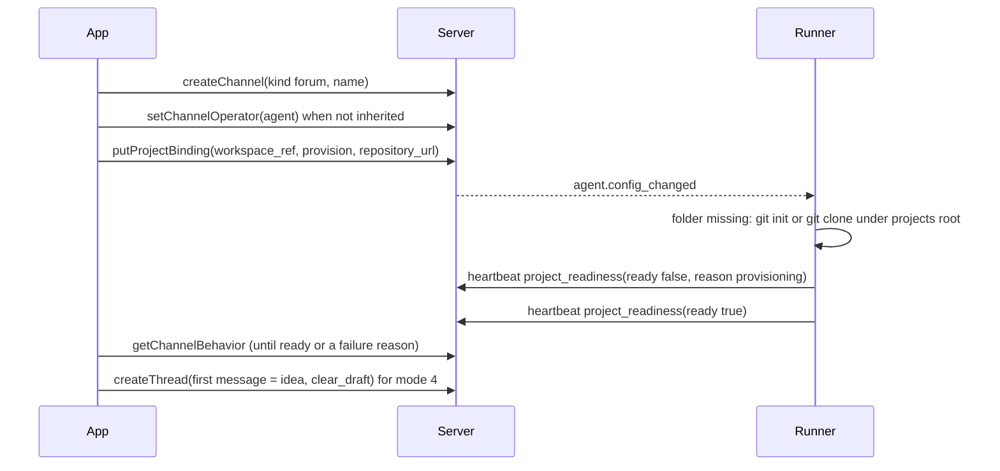

# New project from the app

Status: design of 2026-10-28 after owner feedback on the desktop app; a short design with the
decisions, then one build ticket (M4-43 in the [plan](../PLAN.md)). This note explains and
justifies; the normative text is in the chapters it changes
([01-product.md](../spec/01-product.md) 6.9, 13 R-PR-20, 14;
[03-data-model.md](../spec/03-data-model.md) `project_bindings`, R-DM-55;
[09-agents.md](../spec/09-agents.md) 4.8, 18.1, 18.12, 21; [openapi.yaml](../api/openapi.yaml)
`ProjectBinding`, `ProjectBindingPut`, `ProjectReadiness`). Rulings:
[decisions.d/M4-43.md](../decisions.d/M4-43.md) (`D-M4-43-1` to `D-M4-43-12`).

## 1. Goal

Owner feedback (2026-10-28, translated): in a space such as "Engineering" there is no way to add a
project. In his earlier chat setup a text channel "new project" in the development category did
this: he wrote what he wanted and an agent created it, in one of four ways:

1. a new empty project (a new folder with `git init`),
2. a clone of an existing repository by URL,
3. a binding of an existing folder on the machine,
4. just an idea: the project is created and its first chat starts with the idea, so the agent
   answers there at once.

The result is always one forum per project, bound to the project, where every post is its own
agent session (09 18.1).

Done means:

1. A space row in the desktop sidebar has the action "New project" (also in the space menu). It
   opens a short dialog with the four modes; the name is suggested from the URL or the idea and
   stays editable.
2. The dialog creates the forum, gives it the chosen runner, creates the project binding and, for
   modes 1, 2 and 4, has the runner create the folder under its projects root; for mode 4 the idea
   becomes the first post as soon as the folder is ready.
3. The person sees each step while it runs and, on a failure, which step failed, why in one
   sentence, what already exists and how to go on.
4. No path outside the runner's projects root is ever written; names and URLs are validated on the
   server and again in the runner; no shell is involved.

## 2. What exists

| Part | Today | Gap for the goal |
|---|---|---|
| Forum (`createChannel`, action `channel.create`, `manage`) | creates a text channel or forum in a space | no client UI creates channels |
| Operator (`setChannelOperator`, `channel.operator.set`, owner, step-up) | sets the agent that answers in a forum; a forum inherits the space's default operator | none |
| Project binding (`putProjectBinding`, `channel.project.bind`, owner, step-up; 03 `project_bindings`) | binds a forum to an opaque `workspace_ref`; the runner resolves it under `runner.projects_root` and reports readiness in its heartbeat | the folder must already exist; nobody creates it; a not ready binding says nothing about why |
| Runner (09 18.1) | resolves the reference, refuses everything outside the root, reports `ready` per forum | creates nothing; its reasons (`workspace_missing`, ...) stay in its own log |
| New post (`createThread`, `putChannelDraft`, 01 6.8 item 8) | the first message of a post, the person's draft of a new post per forum | none |
| Host service (24) | terminal sessions on connected hosts | does not own the projects root and runs no project work |

## 3. Decisions

**D-M4-43-1 The app composes existing actions; no new action.** The dialog runs, in order:
`createChannel` (kind `forum`), `setChannelOperator` when the chosen runner is not the space's
default operator, `putProjectBinding` with the new member `provision`, waiting for readiness
(`getChannelBehavior`), and for mode 4 the first post. Every step is an action that exists with its
permission, audit and step-up (05 4.5, 4.7). Reason: a composite server action would duplicate the
checks, audit and events of three actions and need its own permission; the steps are idempotent
or keyed, so a resumed dialog creates nothing twice (D-M4-43-8). The cost, a forum that can exist
without a binding when the app stops between steps, is visible (the forum shows as a plain forum)
and is resolved by the same dialog or by binding it later.

**D-M4-43-2 The runner creates the folder.** The binding carries `provision`: `none` (default,
the folder must exist: mode 3), `init` (create an empty folder with `git init`: modes 1 and 4) or
`clone` (clone `repository_url`: mode 2). The serving runner, which already owns
`runner.projects_root` and resolves every reference under it (09 18.1), creates the folder when it
finds it missing. Reason: the server never touches a file of a host and never fetches the
repository URL (03 principle 9, SEC-OUT-1); the host service owns terminals, not projects; the
runner runs as the user that later works in the folder, so ownership and rights fit.

**D-M4-43-3 Strict names and URLs, twice.** With `provision` `init` or `clone` the server accepts
only a `workspace_ref` of one segment matching `^[A-Za-z0-9][A-Za-z0-9._-]*$` (no slash, no leading
dot, so never a hidden folder and never a path), and `clone` needs a `repository_url` with scheme
`https` (the existing rule already refuses user information). The runner checks the same again,
resolves the target as in 18.1 and requires the root as its parent. It runs `git` from
`runner.git_bin` with an argument list, never a shell, with `--` before every operand,
`GIT_TERMINAL_PROMPT=0`, `GIT_ALLOW_PROTOCOL=https`, the environment allow list of 18.2 and the time
limit `runner.provision_timeout`. A clone goes into a fresh hidden folder in the root and is renamed
to the target only when complete; on any failure the runner removes only the folder it created
itself. Reason: one segment keeps the target directly under the root; checks on both sides because
the runner must not trust the server for its own file system (T-DEV-01).

**D-M4-43-4 An existing folder is never taken over by `init` or `clone`.** The runner records every
folder it created per forum in its state directory. A binding with `provision` `init` or `clone`
whose target exists but is not in that record is not ready with the reason `workspace_exists`; the
runner neither writes into it nor binds it silently. Binding an existing folder is mode 3
(`provision` `none`). Reason: the owner's former setup refused an existing folder for a new
project; a silent takeover would point a new project at someone else's work.

**D-M4-43-5 Readiness carries a reason.** The heartbeat entry `ProjectReadiness` gets the optional
`reason` (a code), the server stores it as `project_bindings.ready_reason` while `ready` is false,
and `ProjectBinding.ready_reason` shows it to readers of the binding. Codes: the existing
`outside_root`, `workspace_missing`, `not_a_git_worktree`, `not_writable` and the new
`provisioning`, `workspace_exists`, `clone_failed`, `init_failed`, `provision_timeout`,
`provision_refused` (09 18.12). A change of the reason alone is applied like a change of `ready`
(no event, no audit, no `settings_version`). Reason: the person must see why a project does not
start; the runner already knows the code, and a code carries no content or path.

**D-M4-43-6 One attempt per binding content.** A failed creation is not repeated for the same
binding (`workspace_ref`, `provision`, `repository_url`, `default_branch`) until
`runner.provision_retry_after` has passed, the binding changes or the runner restarts. Reason: a
wrong URL must not be cloned in a loop on every heartbeat, and a short network failure still heals
without the person.

**D-M4-43-7 Owners only, through the existing step-up.** "New project" shows only for an owner
(`getMe` `is_owner`), because `channel.project.bind` and `channel.operator.set` are owner actions
with step-up; the first step-up of the dialog covers the following steps within
`auth.step_up_max_age`. The audit trail is the one of the composed actions; the binding's audit
reason is "New project from the app". Reason: no new permission; whoever may bind a project may
create one.

**D-M4-43-8 Steps the person sees, and a resume.** The dialog shows a list of the steps (Create
forum, Assign runner, Bind project, Prepare folder with "Creating folder" or "Cloning", Post idea)
with the states waiting, running, done, failed. On a failure it names the step, explains the reason
in one sentence (a server problem code or the readiness reason) and offers "Try again", which
resumes at the failed step with the IDs and idempotency keys it already has, and "Close", which
keeps what exists. On success it opens the forum, for mode 4 the new post. If readiness does not
arrive within `ui.new_project_wait`, the dialog says that the runner has not finished yet and the
person may close it; the runner goes on and the forum becomes ready by itself. Reason: every step
can fail for its own reason (name taken, folder taken, step-up refused, runner offline, clone
refused), and the person must know what is left.

**D-M4-43-9 The idea waits as the forum's draft.** For mode 4 the dialog first stores the idea as
the person's draft of a new post in the new forum (03 `drafts`, `putChannelDraft` through the
outbox) and, once the binding is ready, sends it as the first post with `clear_draft` and an empty
title (the agent names the chat, 09 12). Reason: a post before readiness would be refused with
`project_not_ready` (09 3.5); when the person closes the dialog early the idea is not lost: "+" on
the forum opens it, as 01 6.8 item 8 already does.

**D-M4-43-10 Name suggestion.** The name is suggested from the last path segment of the URL
without `.git`, or from the first words of the idea, lowercased, other characters folded to
hyphens, at most `ui.new_project_name_max_chars` characters; it stays editable and is used for the
forum name and the folder name. After the runner refuses the folder (a folder that exists, or one
bound to another forum) the forum's name is fixed and the dialog shows the folder name to change
before "Try again". Reason: the owner's former agent chose such names; one name for
forum and folder keeps them recognisable.

**D-M4-43-11 Runner choice.** The dialog offers the active agents; the default is the space's
default operator when it is set. When the person chooses another agent, the dialog sets it as the
forum's operator. Reason: readiness counts only from the effective operator of the forum (09 18.1);
a space such as "Engineering" usually has its runner as default operator, so the field is mostly
already right.

**D-M4-43-12 Desktop only.** iPhone and Android keep binding projects out of scope; the phone shows
the new forum and its posts as any other. Reason: the owner asked on the Mac; creating projects is
rare and needs a keyboard for URLs and ideas.

## 4. Flow

## 5. Out of scope

- Browsing the runner's folders from the app; mode 3 takes a folder name under the projects root.
- Cloning over `ssh` or with credentials in the URL; a private repository needs a credential helper
  of the runner user (the runner's environment allow list keeps `HOME`).
- Deleting a project's folder; removing a binding keeps the folder (as today).
