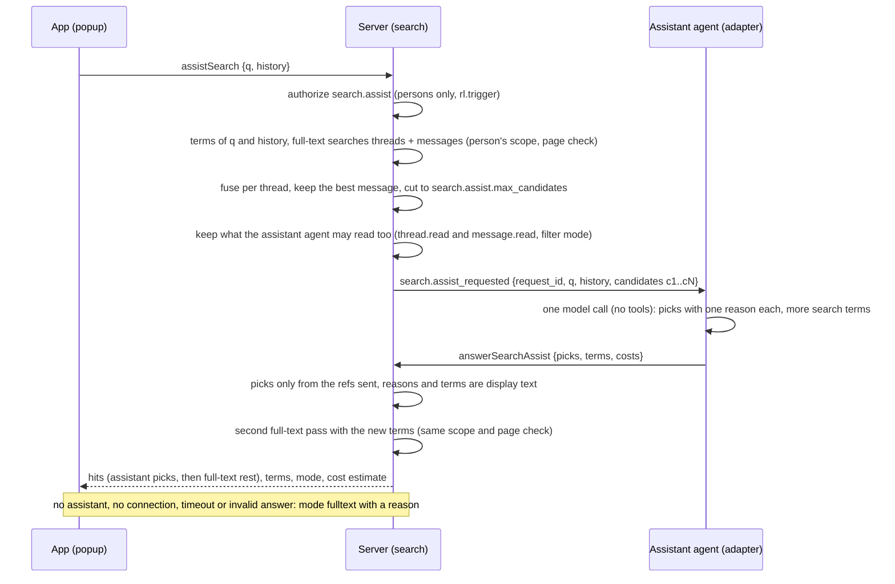

# Search assistant (smart search)

Status: design of 2026-11-04 for the ticket F-INTELLIGENTE-SUCHE, built by the same ticket. This
note explains the decisions; the normative text is in [14-search.md](../spec/14-search.md) 4.10,
[09-agents.md](../spec/09-agents.md) 10.6, [01-product.md](../spec/01-product.md) D6 and
[openapi.yaml](../api/openapi.yaml) (`assistSearch`, `answerSearchAssist`,
`search.assist_requested`). Decision: [ADR 0075](../adr/0075-search-assistant-through-an-agent-over-the-full-text-search.md).
Rulings: [decisions.d/F-INTELLIGENTE-SUCHE.md](../decisions.d/F-INTELLIGENTE-SUCHE.md).

## 1. Goal

Owner request of 2026-11-04 (translated and shortened): "I have very many projects and chats. A
search at the top, but not just over words: I type what I am looking for, a short-lived chat or
popup opens, I tell it what or which session I am looking for. That can be a chat session or a
development session. It searches everything, the whole history, code sessions and chat sessions,
and gives me the link to the session. When I say what I am looking for, I get a link, click it
and our chat opens." (Example in this note: the takeover of the steering session by a new tool.)

Done means:

1. From the top of the app (Cmd+K or Ctrl+K on the desktop, the search page on the phone) a person
   asks in their own words and gets a short list of sessions (threads of chat channels and of
   project forums) with a link and one sentence why; a click opens the thread at the matching
   message.
2. Follow-up questions in the same popup refine the list ("no, the older one"); closing the popup
   forgets the conversation.
3. A hit is only ever something the person may read; the model never sees anything the person or
   the assistant agent may not read.
4. Without a model (not configured, not connected, too slow, invalid answer) the person still gets
   the plain full-text hits of the same question.
5. Each assisted search shows its cost estimate, for information.

## 2. Pipeline

The server does the searching; the model only reads the candidates and chooses. The candidates come
from the existing full-text search (14 section 4), which already carries the permission filter in
SQL and the page check, so the assistant adds no second permission logic.

### 2.1 Terms and queries

The question is natural language ("I am looking for the takeover of the steering session by the new tool"). As a
`websearch_to_tsquery` text it would be an AND of every word and find nothing. The server therefore
turns it into terms: words of at least `search.prefix_min_chars` letters that are not on the stop
word list of the instance languages (German and English, a fixed data file of the module), at most
`search.assist.max_terms` of them. The query text is the terms joined with `or`
(`websearch_to_tsquery` syntax), so a session matches with any of them, and the ranking of 14 4.5
rewards the ones that match many and match in the title (weight A). Follow-ups add the terms of the
earlier questions of the same popup after the new ones, so "no, the older one" keeps the subject.

The model widens the terms: its answer may name up to `search.assist.max_terms` further search
terms (synonyms, the other language, names it recognizes; "move" brings "takeover" and
"migration"). The server runs the same searches once more with them and appends what is new after
the picks, as full-text hits. The response returns the terms of the question, and the popup sends
them back with the history, so a follow-up keeps them. This is the second query of each question;
the model is still called once.

Two searches run, each through the coordinator with its permission filter and page check: thread
titles and messages, each with `relevance` and a page of `search.assist.max_candidates`. Files stay
out (a file hit leads to its thread through its message, which the message search finds as well).

### 2.2 Fusion

Per thread the candidate gets a reciprocal rank fusion score `sum 1 / (60 + rank)` over the two
lists, plus the same again when the title list has it (a title hit names the session). The best
message of a thread becomes its excerpt and its jump target. Equal scores order the newer hit
first. This order is also the order of the full-text fallback.

### 2.3 The assistant

The assistant is one agent the instance operator names in `search.assist.agent_id` (empty: no
assistant, every search is full text). It gets the ephemeral event `search.assist_requested` on one
live gateway connection, exactly like `command.autocomplete_requested` (09 10.5): consumer
`default`, else the newest attached connection; nobody else gets it. The payload holds no IDs of
threads or messages: each candidate has a reference `c1` to `cN`, a title, channel and space name,
a date and a plain text excerpt of at most `search.assist.excerpt_max_chars`. The reference
adapter is the Claude Code runner (09 18.17): one `claude -p` call without tools on its own
account, with a fixed prompt that treats the candidates as data (ADR 0054), answering JSON with
picks and terms. The adapter answers with `answerSearchAssist`: picks (`ref`, `reason`), terms and
the usage of the call as `costs` (the `CostReport` list of `run.finish`). A question whose terms
find nothing still goes to the assistant with an empty candidate list, so its terms can find what
the person's words did not.

### 2.4 Answer rules

The first valid answer counts; open requests live in the memory of the api process until
`expires_at` plus `search.assist.timeout` (like autocomplete, D-M2-17-7). A pick with a reference
that was not sent, a duplicate, more picks than `max_picks`, more terms than
`search.assist.max_terms`, or a reason or term that is no display text answers `400
validation_failed` and the request stays open. The server keeps the picks in the model's order and
appends the remaining candidates of both passes as full-text hits, up to `search.assist.max_hits`.

## 3. Decisions

| Question | Decision | Reason |
|---|---|---|
| Who answers | Server pipeline (full text, fusion) plus one model call through an assistant agent | The server holds no model credentials (B10, I5, ADR 0022); permissions stay in SQL; the model only chooses among authorized candidates; one call per question bounds cost and time |
| Agent with tools instead | No | Needs a tool bridge into the runtime, several model calls per question and a run; slower and dearer, and every tool call would need the run binding of SR9 |
| Model call inside the server | No | Credentials in the server, a new paid service, against ADR 0022 |
| Embeddings | No | No local embedding model or vector extension is shipped; an external service needs an owner release and a processor contract. The model's reading of the candidates covers paraphrases |
| Rights | Person's scope with page check; the payload only with what the assistant agent may read too; picks only from the sent references | No agent sees content that is not its own to read: the person may read more than the agent, and the agent's operator may not see it |
| Who may ask | Persons (`search.assist`, right `human`), class `rl.trigger` | A question starts a model call on the assistant's account, like a trigger |
| Short-lived | Popup over the shell; the conversation lives only in the popup and goes with each request as `history`; nothing stored on the server | No thread, no forum entry, nothing to delete later |
| Audit and logs | An allowed question is not audited (like `search.query`); denials are audited by authz; logs and metrics carry no query text, no references and no reasons | Questions can contain anything; the hits are not new information |
| Result | Thread, message to jump to, channel or project forum, space, date, reason, source | A project forum is the project; a development session is a thread of it |
| Runs | A run is found through its thread (the agent's replies are messages); the run detail view of F-LAUFHISTORIE is linked once it is on main | The run history view is not on main yet; the thread already shows its runs |
| Cost | The estimate of the answer's `costs` is shown, for information; it is not booked in `cost_entries` | `cost_entries` belongs to a run (03, `run_id`, `thread_id`, `channel_id` are required); a question has no run. The model call runs on the assistant's account like its runs |
| Failures | `fulltext` with `fallback_reason`: `assistant_not_configured`, `assistant_unavailable`, `assistant_timeout`; no hit at all answers an empty list; a statement timeout is `503 unavailable` with reason `search_timeout` as for `search` | The person always gets the best the server has |
| Web console | Not offered | The console is the administration and statistics surface (ADR 0028); sessions open in the apps |

## 4. Client

- Desktop (macOS, Windows): the quick switcher (Cmd+K or Ctrl+K, and "Jump to" at the top of the
  sidebar) shows a last row "Ask the search assistant" for any typed text; Cmd+Enter or Ctrl+Enter
  takes it from anywhere in the switcher. It opens the assistant popup with the text as the first
  question.
- Phone (iOS, Android): the search page (the lens at the top of the spaces list) has an
  "Ask the search assistant" button in its header that opens the same popup as a full screen
  dialog.
- The popup shows the questions and, under each, its hits: title, place (space and channel or
  project forum), date, the reason, and a marker "Full text" for a hit without one. A hint names a
  fallback ("The search assistant is not available, these are full-text hits") and the estimate
  ("Estimate, for information"). A tap on a hit closes the popup and opens `/t/<thread>?m=<message>`.
- The popup state is local to its dialog; closing it forgets everything.

## 5. Limits

- One api node: an answer through REST that lands on another node of a multi-node cluster is `404`
  and the question falls back to full text after the timeout (same as autocomplete until 02 11.6).
- The model chooses only among what full text finds for the person's terms; hits that only its own
  terms find come after the picks without a reason. German compounds are not split (14 3.3).
- A model that ignores the prompt can still only return references of the sent candidates and
  short display texts.
