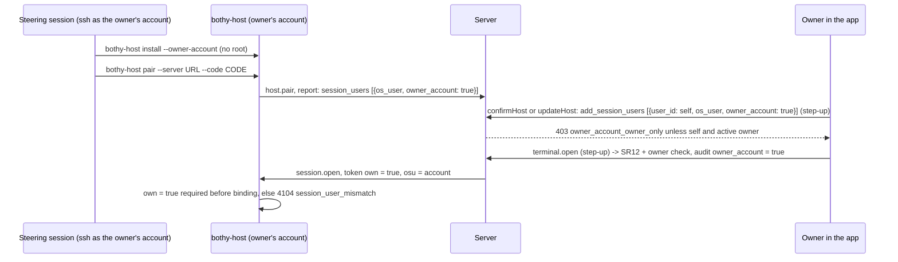

# Terminal in the owner's own account

Status: design of 2026-11-01 after an owner decision, built by the ticket FEAT-terminal-admin-user.
This note explains the build; the normative text is in [24-terminal.md](../spec/24-terminal.md)
section 2.4, [16-operations.md](../spec/16-operations.md) 4.4, [07-permissions.md](../spec/07-permissions.md)
SR12 and [openapi.yaml](../api/openapi.yaml). Decision:
[ADR 0073](../adr/0073-terminal-in-the-owners-own-account.md). Rulings:
[decisions.d/FEAT-terminal-admin-user.md](../decisions.d/FEAT-terminal-admin-user.md) (`D-OA-1` to
`D-OA-12`).

## 1. Goal

Owner decision of 2026-11-01 (translated): "but I want to run there as admin, I want to get things
done" and "from the app I want to work in the terminal on the server, that was the requirement,
that was the plan". He opens a terminal from the apps on his own server machine and works there as
his normal administrator account. He has no physical access to that machine, so the setup must be
completable remotely: no new local users, no root, no dialog, no step at the keyboard.

Done means: an owner can bind his own person to his existing administrator account on a host
(explicit opt-in), open a terminal there with step-up on every opening, and the opening is audited
with a distinct flag; a non-owner can never bind or open it; a host installed without the mode
behaves as before; the host service installs and runs in the mode without root; the self-checks
pass in the mode; HD6 does not block the owner's own subscription and still blocks it for anybody
else.

## 2. What exists and what refuses the mode

| Part | Today (ADR 0068) | In the owner account mode |
|---|---|---|
| Service user | hidden system user `bothy-host`, system service (root to install) | the owner's account, per-user service (LaunchAgent, systemd user unit) |
| Session users | one new hidden user per person, PTY helper as system service | exactly the owner's account; helper is a child process of the host service |
| HD1 | session user must differ from the service user | equal by design: warning `owner_account_mode`; fails `owner_account_mismatch` when the service does not run as the named account |
| HD2, HD3 | admin groups and passwordless `sudo` refuse the start | warnings with the same codes |
| HD6 | a subscription login with `none` or `organization` refuses the start | warning in the owner account (his own login) |
| HD8 | helper must not read the state directory | helper part not applicable (warning); the service part still keeps every other person account out |
| HD9 | foreign homes must not be listable | warning (an administrator can read them anyway) |
| HD10 | programs owned by `root`, peer check proven per platform | owner account counts as trusted owner; unproven peer check, `ptrace_scope`, codesign flags are warnings; the peer check itself still runs |
| HD11 | places for all owned by `root`, writable by no session user | owner account counts as trusted owner; still refused when another person account or everyone can write |
| Local confirmation | optional | refused (nobody sits at the machine) |
| SR12 | own assignment whose name the host reports | plus: the flag of the report equals the flag of the assignment, and the person is an active owner |

## 3. Flow

## 4. Why these limits

- **Windows not yet.** A background service of one user without logon needs a stored password
  (scheduled task "run whether the user is logged on or not") or an elevation; both need the person
  at the machine or a secret only the owner has. The config refuses the key on Windows.
- **One account per host.** The mode has no separation of people; mixing it with separate session
  users would need system services again and would put an administrator account next to people the
  separation is meant to protect. HD1 refuses any other name in `host_service.session_users`.
- **Opt-in at the assignment, not only in the host.** The host config alone must not be enough to
  hand an administrator shell to whoever the server assigns; the server stores the flag and checks
  it against the report, and the host enforces `own = true` itself.
