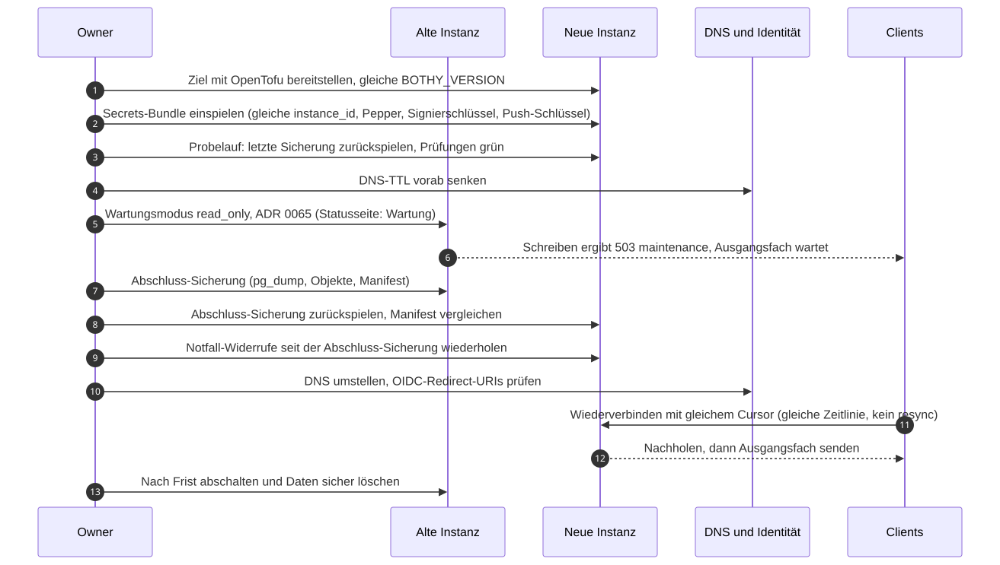

# Umzug auf ein anderes Ziel

Status: Entwurf M0. Runbook zu [16-betrieb.md](../spec/16-betrieb.md) 11. Gilt für jeden Umzug:
Mac zu Linux-VM, VM zu Cloud, Cloud zu Cloud, Container-Datenbank zu verwaltetem Dienst.

## 1. Grundsatz

Ein Umzug ist eine Wiederherstellung ohne Datenverlust: Die alte Instanz nimmt im Wartungsmodus
nichts mehr an, ihr letzter Stand zieht vollständig um. Darum bleibt die Sync-Epoche gleich, und
Clients setzen mit ihrem Cursor fort. `instance_id`, Token-Pepper und Signierschlüssel ziehen mit;
damit bleiben Tokens, Geräte und Aufruf-Marken gültig.

## 2. Vorbereitung (Tage vorher)

1. Ziel mit OpenTofu bereitstellen ([infra/tofu/README.md](../../infra/tofu/README.md)), gleiche
   `BOTHY_VERSION` wie die alte Instanz.
2. Secrets-Bündel einspielen. Push-Schlüssel und App-Identität bleiben gleich; Push-Registrierungen
   der Geräte bleiben darum gültig.
3. Probe: letzte Sicherung der alten Instanz auf dem Ziel zurückspielen
   ([backup-restore.md](backup-restore.md) 5.3), Wiederherstellungstest grün, Dauer messen. Die
   gemessene Dauer plus Puffer ist das Wartungsfenster.
4. DNS-TTL des Hostnamens senken, mindestens eine alte TTL vor dem Umzug.
5. Identität vorbereiten:
   - OIDC: Redirect-URIs des neuen Hosts beim Anbieter eintragen (zusätzlich, nicht statt).
   - Passkeys sind an die Domain gebunden (RP-ID). Gleiche Domain behält sie; eine neue Domain
     heißt: Passkeys neu registrieren, Geräteschlüssel bleiben gültig.
   - Tailscale: neues Gerät mit gleichem `TS_HOSTNAME` vorbereiten, aber noch nicht als Ziel des
     Namens.
6. Statusseite: Wartung ankündigen (`status_incidents.kind = maintenance`).

## 3. Umzug (im Wartungsfenster)

1. Alte Instanz: `server.maintenance_mode = read_only`, Neustart von `api` und `worker`.
   Schreibende Anfragen bekommen `503` mit Code `maintenance`; Apps halten ihr Ausgangsfach.
   Ausnahme: Für schon aktive Läufe nimmt der Server weiter `run.update` und `run.finish` des
   Adapters an, damit diese Läufe sauber enden. Neue Läufe entstehen nicht, weil Nachrichten
   nicht angenommen werden.
2. Warten, bis keine Läufe aktiv sind ("Läuft gerade" leer). Laufen sie zu lange, bricht der
   Owner sie ab (`run.cancel`); nach `agent.cancel_grace` setzt der Server sie selbst auf
   `cancelled`.
3. Abschluss-Sicherung: `pg_dump`, Objektsicherung, Manifest.
4. Ziel: Restore des logischen Abzugs und der Objekte; Manifest vergleichen (Zeilenzahlen,
   `head_seq`, Audit-Kopf, Dateizahl). Abweichung heißt: abbrechen, alte Instanz wieder schreibbar.
5. Ziel starten, Wiederherstellungstest von Hand, Smoke-Tests ([16-betrieb.md](../spec/16-betrieb.md) 11.1).
6. DNS bzw. Tailscale-Namen umstellen.
7. Alte Instanz stoppen (nicht löschen).

## 4. Nach dem Umzug

1. Clients verbinden neu, setzen mit ihrem Cursor fort und senden ihr Ausgangsfach.
2. Agenten-Adapter verbinden mit ihrem Verbraucher neu; ihr `acked_seq` ist mit umgezogen.
3. Prüfen: Statusseite grün, SLO-Dashboards ohne Einbruch, erste Sicherung auf dem Ziel und
   erster automatischer Wiederherstellungstest erfolgreich.
4. Alte Redirect-URIs beim OIDC-Anbieter entfernen.
5. Alte Instanz nach einer Frist, die der Owner festlegt, löschen (Volumes, Sicherungen des alten
   Ziels nach deren Frist).

## 5. Neuer Hostname

Ändert sich der Hostname, kennen die Apps die neue Adresse nicht. Bis Kapitel 06 einen Weg
festlegt, gilt: Die Menschen tragen die neue Adresse ein, die Anmeldung bleibt gültig, wenn
`instance_id` und Signierschlüssel gleich sind. Geplant ist ein Hinweis `moved_to` in
`instance.discovery.read` der alten Instanz, signiert mit dem Instanzschlüssel; die App übernimmt
ihn nur bei gleicher `instance_id` (Frage an Team B).

## 6. Wechsel zwischen Container-Datenbank und verwaltetem Dienst

1. Hin zum verwalteten Dienst: wie oben, Restore des logischen Abzugs in den Dienst. Rollen legt
   das OpenTofu-Modul an. `bothy-backupd` läuft danach ohne pgBackRest.
2. Zurück: wie oben in eine Container-Datenbank; danach sofort Vollsicherung mit pgBackRest.
