# Making a release

Status: draft M0. Procedure for [18-release.md](../spec/18-release.md). ADR 0038 and 0039 define
gates and runners (team H); this procedure names only the steps that belong to the release.



## 1. Prerequisites

1. Main branch green in all local gates and in CI.
2. Portability test ([16-operations.md](../spec/16-operations.md) 11.1) green, depending on the tag:
    - stable server `server/vX.Y.Z`: the test of the product beta whose bundle pins its last
      beta `X.Y.Z-beta.N`. Stable is built from the same commit as this beta
      ([18-release.md](../spec/18-release.md) 5, rule 2).
    - server beta `server/vX.Y.Z-beta.N`: no precondition from the test. A bundle can pin it
      only once its tag exists ([18-release.md](../spec/18-release.md) 2.1, rule 1), and for
      `beta.1` there is no earlier beta. It is checked by the test of the next product beta
      that pins it; that test runs after the release of this product beta (2.2, step 5;
      [environments-and-flags.md](environments-and-flags.md) 1.3, item 1). Only when it is green
      may the stable server version follow (item above).
    - product beta `vA.B.C-beta.M`: no precondition; `release.yml` starts its own test after
      `publish` (2.2, step 5).
    - stable product `vA.B.C` and every other component: the test of the last product beta,
      as soon as there is one.
3. `CHANGELOG.md` of the component has a reviewed section for the new version; release notes
   with the required sections ([18-release.md](../spec/18-release.md) 4).
4. For `server`: migrations fulfill M1 to M12 ([upgrade.md](upgrade.md) 4); the
   N-1 compatibility test is green.
5. Minimum app versions and deprecation dates in the release notes match ADR 0014.

## 2. Server and product

New installations with `install.sh` get the server version that the bundle of a
product release pins. Therefore a server release that new installations are to get is followed
by a product release; existing installations raise `BOTHY_VERSION` themselves
([upgrade.md](upgrade.md)).

### 2.1 Server

1. Once before the first tag of the private phase (owner step): create the key pair of the
   private phase (section 2.4), commit its public key as
   `quality/release/cosign-private-phase.pub`, and store the private key and its password as the
   secrets `COSIGN_PRIVATE_KEY` and `COSIGN_PASSWORD` of the environment `release`.
2. `make release-prep COMPONENT=server [CHANNEL=beta]` writes `services/server/VERSION`, renames
   the section "Unreleased" of `services/server/CHANGELOG.md` to `[X.Y.Z] - <date>` and prints
   the commits without a changelog entry as a checklist
   ([ADR 0060](../adr/0060-release-automation-in-the-monorepo.md)); review the section, add the
   mandatory parts of the release notes ([18-release.md](../spec/18-release.md) 4), commit
   `chore(release): server vX.Y.Z` and land it through a pull request.
3. `make release-trial COMPONENT=server` on the build host (section 2.3) with the release
   commit; it must pass.
4. Signed tag on the squash commit on `main`: `git tag -s server/vX.Y.Z <commit>` (beta:
   `server/vX.Y.Z-beta.N`), then push the tag.
5. `release.yml` resolves the tag (VERSION and changelog section), runs the gates, builds the
   binaries and both images by digest, scans the tree with ScanCode, joins, scans, writes the
   SBOMs, signs, verifies and only then sets the version tags; `publish` creates the release
   with binaries, SBOMs, signature bundles, `images.txt`, `SHA256SUMS` and the ScanCode report
   ([18-release.md](../spec/18-release.md) 6.1).
6. Check like an instance operator (section 5).
7. Beta: to `staging`; stable: mark the release as "latest release", inform the operators.

### 2.2 Product (component `bothy`)

1. The server version that the bundle is to install is published (section 2.1).
   A product beta may pin a server beta, a stable product only a stable
   server version ([18-release.md](../spec/18-release.md) 2.1).
2. `make release-prep COMPONENT=bothy SERVER_VERSION=<version> [CHANNEL=beta]` sets `VERSION`,
   closes the changelog section and writes the server version into the line
   `BOTHY_VERSION=` of `infra/compose/.env.example`. It aborts without a change if the tag
   `server/v<version>` does not exist or if without `CHANNEL=beta` the version carries a
   pre-release identifier. Commit on a branch, pull request to `main`; the diff shows the pinned
   server version. The gate `release-pins` checks the same rule in the pre-push of this branch
   and in the required check `ci-ok` of the pull request. The push of the tag alone starts no
   check ([18-release.md](../spec/18-release.md) 2.1, rule 1).
3. After the merge, set the signed tag on the squash commit on `main`: `vA.B.C` (beta:
   `vA.B.C-beta.M`). The numbers do not depend on the
   server version ([environments-and-flags.md](environments-and-flags.md) 1.3).
4. The release pipeline builds the bundle with `make release-build`: `BOTHY_VERSION` from the commit,
   `BOTHY_REGISTRY` from the owner of the repository. In addition `install.sh` with version,
   SHA-256 and download address of the bundle, the address from the name of the repository. It
   aborts without a bundle on a placeholder, a server pre-release in the stable product (second
   safeguard) or an image that is missing in the registry
   ([18-release.md](../spec/18-release.md) 2.1). Signatures, SBOM and checksums as for the server.
5. After `publish`, `release.yml` starts the portability test with the tag
   ([16-operations.md](../spec/16-operations.md) 11.1, [tests/portability/README.md](../../tests/portability/README.md));
   it must be green on both runners. Its log ends with the digests of the verified server images
   and the duration per storage run; on a failure it shows `docker compose ps --all` and the logs
   of its installation. Then check like an instance operator (section 5). Before the first product
   tag, `make portability-trial` proves the same test against the trial release on the build host.

### 2.3 Trial release

```
make release-trial COMPONENT=server [TRIAL_PLATFORMS=linux/amd64,linux/arm64]
```

Runs on the build host with Docker and buildx, never under GitHub Actions (the target refuses
when `GITHUB_ACTIONS` is set). It starts a registry container pinned by digest on `127.0.0.1`
with a random port, builds the binaries and both images for both platforms (no emulation: both
Dockerfiles build the target platform on the build platform), pushes them by digest, joins
`bothy-postgres`, generates a cosign key pair for this run only, writes SBOMs, signs with the
signing configuration of the private phase, writes and signs `SHA256SUMS`, verifies with the
commands of section 5 (private phase), sets the version tags, checks the images that
`infra/compose/compose.yaml` pulls, and runs three probes that must fail (changed file, unsigned
digest, missing SBOM). It prints the digests and `SHA256SUMS`. The registry, the buildx builder,
the key pair and the temporary directory are removed at the end, also after a failure. It needs
no account and costs nothing ([18-release.md](../spec/18-release.md) 6.2).

For the Grafana panel plugin:

```
make release-trial COMPONENT=grafana-bothy-live
```

builds `bothy-live-panel-<version>.zip` with `make -C plugins/grafana-bothy-live release-build`,
writes its SBOMs, signs the ZIP and `SHA256SUMS` with a throwaway key, verifies both and runs two
probes that must fail (changed ZIP, missing SBOM). It needs Node.js and npm, no registry
([18-release.md](../spec/18-release.md) 6.2).

### 2.4 Key pair of the private phase (owner)

```
COSIGN_PASSWORD='<new password>' cosign generate-key-pair
mv cosign.pub quality/release/cosign-private-phase.pub
```

with the pinned cosign (`uv run --project tools --locked python tools/bin/fetch_tools.py path
cosign`). Store the content of `cosign.key` as the secret `COSIGN_PRIVATE_KEY` and the password
as `COSIGN_PASSWORD` of the environment `release`, then delete `cosign.key` locally. A release
without the public key file stops at the verification, before any tag.

## 3. SDKs and adapters

1. `make release-prep COMPONENT=<component>`, commit, pull request to `main`, after the merge
   tag `<component>/vX.Y.Z` on the squash commit (names from
   `tools/ci/components.py`).
2. Build, SBOM, signature of the files (`cosign sign-blob`), publication on PyPI or npm via
   trusted publishing of the registry, where available [assumed: check the availability per
   registry in the ticket].
3. Beta: pre-release, npm tag `beta`.

## 4. Apps

The publisher builds the apps with their `distribution.yaml` ([18-release.md](../spec/18-release.md) 8).

| Platform | Steps |
|---|---|
| iOS | build with a build number, upload to App Store Connect, TestFlight group beta; once proven, group stable or submission |
| macOS | job `build-apple` (`make -C apps/client release-apple`): build, signature with Developer ID, `xcrun notarytool submit --wait`, `xcrun stapler staple`, `spctl --assess`, the archive signed with `sign_update` (EdDSA), `appcast.xml` with the entry in `sparkle:channel` beta; merge it into the published appcast (`appdist.py appcast-merge`); once proven, remove the element (`appdist.py promote-appcast`) |
| Windows | job `build-windows` (`tools/distribution/windows.py release`): build and sign the MSIX with a PFX (section 4.1 for certificates whose key stays in a key service), `signtool verify /pa`, `beta.appinstaller` to the new version; once proven, `stable.appinstaller` (`appdist.py promote-appinstaller`) |
| Android | build and sign the AAB, internal test track; once proven, the next track |
| Web console | with the server release (proposal, ADR 0028) |

Before the switch to stable: check the crash rate of the beta build (if a target for
crash reports is configured) and no open bugs of severity critical.

### 4.1 Publisher accounts and what the release jobs need

The desktop chain ([18-release.md](../spec/18-release.md) 8.1) runs with a test publisher until
the owner decides on the accounts (OQ-08); `make -C apps/client trial-apple` and `trial-windows`
prove it without any account. With real accounts the publisher sets, in the environment
`release-apple`:

| Name | Kind | Content |
|---|---|---|
| `DISTRIBUTION_YAML` | variable | the publisher's `distribution.yaml` ([apps/distribution](../../apps/distribution/README.md)) |
| `BRANDING_YAML` | variable | the build branding of the instance (`branding.yaml`, ADR 0044: name, URL scheme, default server) |
| `APPLE_DEVELOPER_ID_P12` | secret | base64 of the PKCS#12 export of the "Developer ID Application" certificate with its key and chain |
| `APPLE_DEVELOPER_ID_P12_PASSWORD` | secret | its password |
| `APPLE_PROVISIONING_PROFILE` | secret | base64 of the Developer ID provisioning profile of the app (push, App Group, keychain groups) |
| `APPLE_EXTENSION_PROVISIONING_PROFILE` | secret | base64 of the Developer ID provisioning profile of the Notification Service Extension |
| `APPLE_NOTARY_KEY` | secret | base64 of the App Store Connect API key (`.p8`) for `notarytool` |
| `APPLE_NOTARY_KEY_ID`, `APPLE_NOTARY_ISSUER_ID` | secret | its key ID and issuer ID |
| `SPARKLE_ED_PRIVATE_KEY` | secret | the private EdDSA key of Sparkle (base64 of the 32-byte seed) |

and in the environment `release-windows`:

| Name | Kind | Content |
|---|---|---|
| `DISTRIBUTION_YAML` | variable | the same `distribution.yaml` |
| `BRANDING_YAML` | variable | the same build branding |
| `WINDOWS_SIGNING_PFX` | secret | base64 of the PFX of a code signing certificate whose subject is `windows.publisher` and whose key may be exported |
| `WINDOWS_SIGNING_PFX_PASSWORD` | secret | its password |

A job without one of them stops before anything is signed and names what is missing; a
`distribution.yaml` with a value of the template stops it too. The owner's decisions behind the
accounts: Apple Developer Program (team, Developer ID certificate, profiles, API key), the
Windows signing path and the update host that serves the appcast, the archives and the
`.appinstaller` files. Public certificate authorities keep the keys of code signing certificates
in hardware (an HSM or their key service), so an OV certificate or Azure Artifact Signing cannot
be a PFX: `windows.py` then needs the signing call of the chosen service (`signtool` with its
`/dlib` or key provider) instead of `/f`, a change once the owner has chosen the path
(docs/decisions.d/M7-12.md).

## 5. Check like an instance operator

Download the release assets of the tag into one directory (`gh release download server/vX.Y.Z`),
take the digests from `images.txt`, and run the commands of the current phase. Every command
must succeed; `sha256sum --check` lists every file with `OK`.

Private phase ([ADR 0062](../adr/0062-release-signatures-while-the-repo-is-private.md),
cosign 3.1.3, key pair without a transparency log, so `--insecure-ignore-tlog`):

```
cosign verify --key quality/release/cosign-private-phase.pub --insecure-ignore-tlog \
  ghcr.io/<owner>/bothy-server@sha256:<digest>
cosign verify --key quality/release/cosign-private-phase.pub --insecure-ignore-tlog \
  ghcr.io/<owner>/bothy-postgres@sha256:<digest>
cosign verify-blob --key quality/release/cosign-private-phase.pub --insecure-ignore-tlog \
  --bundle SHA256SUMS.sigstore.json SHA256SUMS
cosign verify-blob --key quality/release/cosign-private-phase.pub --insecure-ignore-tlog \
  --bundle bothy_X.Y.Z_linux_amd64.sigstore.json bothy_X.Y.Z_linux_amd64
sha256sum --check --strict SHA256SUMS
```

Public phase (keyless with the identity of the release workflow, plus attestations):

```
cosign verify ghcr.io/<owner>/bothy-server@sha256:<digest> \
  --certificate-identity-regexp '^https://github\.com/<owner>/bothy/\.github/workflows/release\.yml@refs/tags/server/v' \
  --certificate-oidc-issuer https://token.actions.githubusercontent.com
gh attestation verify oci://ghcr.io/<owner>/bothy-server@sha256:<digest> --repo <owner>/bothy
cosign verify-blob SHA256SUMS --bundle SHA256SUMS.sigstore.json \
  --certificate-identity-regexp '^https://github\.com/<owner>/bothy/\.github/workflows/release\.yml@refs/tags/server/v' \
  --certificate-oidc-issuer https://token.actions.githubusercontent.com
sha256sum --check --strict SHA256SUMS
```

The same for `bothy-postgres` and each binary. The public path and the attestations run first
with the owner's first public release; the trial release proves the private path only. The
release workflow is `.github/workflows/release.yml`; the commands of both phases are those of
`tools/ci/release_chain.py verify`.

## 6. Recall

1. Server: mark the release as withdrawn, notice to the instance operators with the rollback
   ([upgrade.md](upgrade.md) 3), corrected patch version.
2. Apps: corrected build with a higher number; for security bugs, have `client.min_version.<platform>`
   set to the corrected version.
3. SDKs: withdraw the version (PyPI yank, npm deprecate), publish the fix.
