# Gates

`make check` führt alle Gates in fester Reihenfolge aus und bricht beim ersten Fehler ab.
CI führt dieselben Ziele aus: Job `gates` ruft `make gates`, Job `denylist` ruft
`make denylist`, Job `sonar` ruft `make sonar`; `check` ist genau `gates denylist sonar`
(Kapitel 23, R-QA-01). Schwellen stehen als Namen; ihre Standardwerte stehen nur in
Kapitel 23, Abschnitt 11.

Quelle des Diagramms: `docs/quality/pipeline.mmd`.

## Liste

| make-Ziel | Werkzeug | Prüft | Schwelle | Heute aktiv |
|---|---|---|---|---|
| `fmt-check` | ruff format, gofmt, dart format, Skript `format:check` der TypeScript-Projekte | Format ohne Änderungen; dart format reads the tracked hand-written `*.dart` files of the workspace members (generated files excluded, docs/DECISIONS.md D-M4-01-4) | | Werkzeuge |
| `codegen-check` | `tools/ci/codegen_check.py` mit sqlc und `go generate` (go-arch-lint und sqlc aus den Pins vorn im `PATH`; oapi-codegen als `tool` aus `services/server/go.mod`) | erzeugter Code (sqlc-Code, `.go-arch-lint.yml`, das exportierte Konfigurationsschema `architecture/config-schema.json`, API-Code) entspricht einer frischen Erzeugung; es zählen nur Änderungen durch den Generator, nicht Handänderungen im Arbeitsbaum | | ab erstem Go-Modul |
| `lint` | pre-commit-Hooks über alle Dateien (Text-Regeln, Leerzeichen, YAML/TOML/JSON, Merge-Marker, private Schlüssel, Dateigröße), ruff, bandit, Dockerfile pin check (`tools/ci/dockerfile_pins.py`: every image of `FROM`, `COPY --from`, `RUN --mount=from` and every `# syntax=` line pinned by `@sha256` digest, except `scratch` and stages; SEC-SC-4), check-jsonschema (Issue-Formulare, Renovate, CodeRabbit), actionlint, zizmor, go vet und golangci-lint, `flutter analyze --fatal-infos` once at the root of the Dart workspace (every member, `public_member_api_docs` as an error, generated code excluded from doc and style lint) und custom_lint per member that declares it, Skript `lint` (ESLint); ruff, bandit, Prettier and ESLint skip the generated code of the SDKs, bandit also the project's `.venv` | Stil, Fehlerquellen, Workflow-Sicherheit | `repo.max_file_kb` | ja |
| `typecheck` | mypy (strict), go build, tsc | Typen; mypy runs inside each Python project with its configuration, generated SDK code included | | Werkzeuge |
| `arch` | go-arch-lint mit `<modul>/.go-arch-lint.yml`, erzeugt aus `architecture/modules.yaml`; `tools/arch-check/arch_check.py` with `tools/arch-check/rules.yaml` for the Dart workspace | Modulgrenzen und erlaubte Fremdbibliotheken der Go-Module (Kapitel 02 "go-arch-lint"); keine symbolischen Links unterhalb eines Moduls, weil go-arch-lint einem verlinkten Verzeichnis nicht folgt und es nach dem Pfad des Links zuordnet, der Go-Compiler den Code dahinter aber baut. Dart: the dependency rules 1 to 9 of 15 3.1 for every member (manifests and every import and export, the reach of the diagram as an allow list, native code only in `device_key` and `apps/client`, every manifest a listed member; [README](../../tools/arch-check/README.md)) | | ab erstem Go-Modul; Dart part with the first Dart package (`SKIP arch-dart` otherwise) |
| `register-check` | `tools/doccheck/register_check.py` | Modulregister `services/server/architecture/modules.yaml` gleich dem Kern-Vertrag (Tabellen und ihre Module aus Kapitel 03, Aktionen, Ereignistypen und Ops aus `docs/spec/actions.yaml`) und gleich den Stellen, die es wiederholen: Tabellen "Modulliste", "Erlaubte Abhängigkeiten", "Querschnitts-Ports", "Aktionen je Modul" und "Ereignistypen und WebSocket-Ops je Modul" in Kapitel 02, Komponenten-Diagramm `c4-3-komponenten-server.mmd`, Modul-READMEs; eine Zeile je Abweichung mit Datei und Element (ADR 0050, Regeln C1 bis C12 im Docstring) | | ja |
| `migrations-lint` | `tools/ci/migrations_lint.py` | fortlaufende, lückenlose fünfstellige Nummern ohne Zeitstempel-Versionen, Prüfsummen gemergter Migrationen unverändert (`migrations.sha256`), `STORED` bei `GENERATED ALWAYS AS`, `-- +goose NO TRANSACTION` bei `CONCURRENTLY` (ADR 0007, Kapitel 14) | | ab erster Migration |
| `flag-check` | `services/server/tools/flagcheck` | Registrierung der Feature-Flags in `internal/instance` gültig (Schlüsselform, eindeutig, Art, Beschreibung, Modul aus `architecture/modules.yaml`, `remove_by` genau bei `release`); kein registriertes `release`-Flag, dessen `remove_by` die Version in `services/server/VERSION` erreicht hat; Tabelle in [configuration.md](../operations/configuration.md) 7 gleich der Registrierung in Schlüssel, Art und Standard ([ADR 0064](../adr/0064-feature-flag-registrierung-mit-aufraeum-gate.md)) | | sobald `services/server/go.mod` getrackt ist |
| `test` | pytest, go test -race, flutter test (one `flutter pub get --enforce-lockfile` at the workspace root, then `flutter test --coverage` per member), Skript `test` | Tests mit Abdeckungsdaten | | Werkzeuge |
| `coverage` | coverage, go tool cover, LCOV-Auswertung | Mindestabdeckung; Go ohne die Pakete unter `test/` und `perf/` (Testcode, Kapitel 23 "Komponenten-Vertrag") und ohne erzeugte Dateien `*.gen.go`; Dart per member without generated files (`tools/ci/lcov_filter.py`: `*.g.dart`, `*.freezed.dart`, `*.drift.dart`, `lib/src/generated/`, `build/`); Python and TypeScript projects without generated code, threshold in the project's own test configuration (pytest-cov `fail_under`, Vitest `coverage.thresholds`) | `quality.coverage.tools_min_percent`, `quality.coverage.go_min_percent`, `quality.coverage.dart_min_percent`, `quality.coverage.python_min_percent`, `quality.coverage.typescript_min_percent` | Werkzeuge |
| `commitlint` | `tools/hooks/commit_msg.py` | Conventional Commits und DCO der Commits, die noch nicht auf `origin/main` sind | `commit.header_max_length` | ab erstem Remote |
| `docs` | `tools/docs/adr_index.py`, `tools/docs/dart_api_docs.py` (`dart doc` per package into the ignored folder `docs/api/dart/`), MkDocs `--strict` mit den Hooks `tools/docs/mkdocs_repo_links.py` und `tools/docs/mkdocs_api_reference.py`, then `tools/docs/external_assets_check.py` | ADR-Index aktuell, Site baut ohne Warnung; Links auf vorhandene Dateien außerhalb von `docs/` zeigen in der Site auf das Repository, ein fehlendes Ziel bleibt ein Fehler. The REST, schema and gateway reference pages are rendered from `docs/api/openapi.yaml` and `docs/api/asyncapi.yaml` in every build (a committed copy, an unresolved `$ref` or a duplicate anchor fails); the built HTML and CSS reference no script, stylesheet or font of another origin (anchors to external pages stay allowed; requests a bundled script makes at run time are not covered); `dart doc` of every Dart package without a warning or an error, its pages in the site ([Dart API reference](../reference/dart-api.md)); built for every component selection, because the site links them | | ja |
| `config-doc-check` | `tools/configdoc/configdoc.py --check` | Konfigurationsreferenz (Ruling L4): kein Name doppelt, jeder Schlüssel des Schemas mit Zeile, Kapitel, Ort `Server` und gleichem Standard in seiner Kapiteltabelle, jeder geplante Server-Schlüssel mit Etappe in `tools/configdoc/planned.yaml` und keine veraltete Regel, kein abgelöster Name aus W1 (`tools/configdoc/retired.yaml`), Compose wartet länger als `shutdown.total_timeout`, keine zwei Namen mit derselben Umgebungsvariable, Abschnitt 4 aktuell (Regeln D1 bis D10 in [configuration.md](../operations/configuration.md) 10). Liest die committete Schema-Datei, braucht kein Go | | ja |
| `linkcheck` | lychee `--offline --include-fragments` | lokale Links und Anker aller getrackten Markdown-Dateien; builds the Dart API pages first when `docs/api/dart/` is missing, because `docs/reference/dart-api.md` links them | | ja |
| `diagrams` | `tools/docs/render_diagrams.py` mit mermaid-cli | jedes Mermaid-Diagramm rendert, jede `.mmd` hat ihre `.svg` | | ja |
| `catalog-check` | `tools/catalog/action_catalog.py` | `docs/spec/actions.yaml` gültig (Schema, eindeutige IDs, Rate-Limit-Klassen, Empfangs-Aktionen, Ops ohne Systemaktion), gleich mit den von Hand gepflegten Teilen von Kapitel 05 (Scopes für Apps, Wirkung, Konfigurationswerte der Klassen); die erzeugten Tabellen in 05 und Listen in `docs/api/redocly.yaml` sind aktuell ([ADR 0049](../adr/0049-maschinenlesbarer-aktionskatalog-als-einzige-quelle.md)) | | ja |
| `api-lint` | Redocly CLI mit `docs/api/redocly.yaml` | OpenAPI und AsyncAPI, Pflicht von `x-authz-action` | | sobald `docs/api/openapi.yaml` existiert |
| `api-checks` | `tools/api-checks/api_checks.py` | Kopien der API-Verträge gleich ihren Quellen (Kapitel 06, G2 und G3): `x-authz-action`, `x-rate-limit-class`, Ops, Ereignisse, Empfangs-Aktionen, Scopes (`AppScope`) und die Union `Event` in `openapi.yaml` und `asyncapi.yaml` gleich `docs/spec/actions.yaml`, Schließ-Codes gleich 04, `Idempotency-Key` oder `x-idempotency-exempt` mit bekanntem Grund an jedem POST und PATCH, Deprecation-Daten gegen `api.deprecation_min_notice`, `x-problem-codes` und `x-status` vollständig; die erzeugten Tabellen in 06 und `docs/api/webhooks.md` sind aktuell ([README](../../tools/api-checks/README.md)) | | ja |
| `ops-check` | `tools/opscheck/opscheck.py` mit den gepinnten Validatoren otelcol-contrib, promtool, amtool, loki, tempo, sloth und tofu ([README](../../tools/opscheck/README.md)) | Collector-Basis allein, mit jedem Overlay und mit jedem geordneten Paar zweier Overlays; Prometheus-Konfiguration, Regeln und Regel-Unit-Tests (jeder handgeschriebene Alarm hat einen); Alertmanager-Konfiguration und Routing; Loki; Tempo; OpenTofu-Module; erzeugte SLO-Regeln gleich einer frischen Sloth-Erzeugung; SLO-Tabelle gleich den Sloth-Dateien; Collector-Allowlist gleich dem Signal-Katalog; Alarm-Schwellen gleich ihren Konfigurationswerten; Validator-Versionen gleich den Image-Versionen des Compose-Stacks | | ja |
| `api-clients` | target `generate-check` of each client directory (`sdk/python`, `sdk/typescript`, `packages/api_client`): `tools/ci/codegen_check.py` with the pinned generator, then compileall and mypy or `tsc --noEmit`; for Dart `packages/api_client/tool/generate.sh check`: the pinned `dart-dio` image, `build_runner` and `dart format` in a temporary copy, a byte comparison of `lib/src/generated/` (missing, extra and changed files by path) and `dart analyze` (errors in generated code, any finding in hand-written code) | G4 (06 15): generated clients equal a fresh generation from `docs/api/openapi.yaml` and compile; a directory with a tracked manifest but without `generate-check` fails, a directory without a manifest or an unselected component gives `SKIP` | | ab erstem Client-Paket (today `sdk/python`, `sdk/typescript`, `packages/api_client`) |
| `tokens` | Ziel `check` in `tools/design-tokens/` | Tests des Generators; Design-Tokens bauen, Kontraste und Palettenwächter bestehen, erzeugte Dateien aktuell, eingebettete Dateien passen zu `vendor/MANIFEST.json` | | ja |
| `runners-check` | `tools/ci/check_runners.py` | Runner-Weiche, Trigger, SHA-Pinning, Timeouts, Rechte | | ja |
| `labels-check` | `tools/ci/labels.py` | Label-Datei gültig, Vorlagen und GOVERNANCE.md nutzen nur definierte Labels | | ja |
| `gitleaks` | gitleaks mit `.gitleaks.toml` | Secrets in jedem von `HEAD` erreichbaren Commit; vor dem Öffentlich-Schalten in allen Refs | | ja |
| `apps-platform` (not in `gates`) | `tools/ci/apps_platform.py` | the platform tests that a member lists in `platform-tests.json` (argument lists per system, no shell) for the host system, in the member folder; SKIP for the other system and without such a member; needs a desktop session, so CI runs it in the jobs `apps-macos` (`macos-15`) and `apps-windows` (`windows-2025`), which `ci-ok` accepts as `success` or `skipped` | | SKIP until the first member has platform tests (M4-10) |
| `semgrep` | Semgrep mit `.semgrep/` | Projektregeln und ihre Regel-Tests | | ja |
| `trivy` | Trivy `config` auf einer Kopie der getrackten und nicht ignorierten Dateien (`tools/ci/tracked_tree.py`) | Fehlkonfiguration in Dockerfiles, Kubernetes, Helm, Terraform | `HIGH`, `CRITICAL` | sobald solche Dateien existieren |
| `osv` | OSV-Scanner, govulncheck | bekannte Schwachstellen aller Lock-Dateien; erreichbare Go-Schwachstellen | | ja |
| `licenses` | `tools/ci/license_check.py`, OSV-Scanner `--licenses`, go-licenses | Lizenztext, SPDX-Kopfzeilen, Lizenzen ausgelieferter Abhängigkeiten; eine Liste ohne Lizenz ist ein Fehler (leer würden `--licenses=` und `--allowed_licenses=` die Lizenzen nicht mehr einschränken) | `quality/licenses/allowed.txt`, `license.spdx_header_lines` | ja (Abhängigkeiten ab erster Komponente) |
| `denylist` | `tools/denylist/denylist_scan.py` | White Label in Inhalten, Namen, Commits, Identitäten, Refs | | ja, braucht die private Liste |
| `sonar` | SonarScanner (npm) gegen den lokalen Server oder SonarQube Cloud | Gate "Bothy way" | `quality.sonar.*` | ab erstem Produkt-Code |

Release-Workflow zusätzlich: `trivy-image` (Schwachstellen im gebauten Image), SBOM
(Syft über `anchore/sbom-action`), Build-Provenance und SBOM-Attestation (öffentlich),
`portability` (ganzer Stack auf frischer Maschine).

Not gates, but meant for the release (M7) and the Compose smoke test (M1-73): `make image`
builds `bothy-server` from `services/server/Dockerfile` for `IMAGE_PLATFORMS` (default
`linux/amd64,linux/arm64`) into the OCI archive `IMAGE_OCI` and loads the host platform as
`IMAGE_NAME:IMAGE_TAG` (default `bothy-server:<VERSION>-local`, never `latest`); `make image-test`
checks that image with the structure tests in `services/server/test/image` (build tag
`imagetest`: user, health check equal to Compose, no shell, static binary, a run with a read-only
root file system and without capabilities, both platforms in the archive). Both need Docker with
buildx and a builder that builds several platforms (CONTRIBUTING.md); without Docker they fail
with a hint.

`make postgres-image` builds `bothy-postgres` (brief M7-01) from
`services/server/images/bothy-postgres/Dockerfile` the same way into `POSTGRES_IMAGE_OCI` and loads
the host platform as `POSTGRES_IMAGE_NAME:POSTGRES_IMAGE_TAG` (default
`bothy-postgres:pg18-<VERSION>-local`); no build step runs on the target platform, so both
platforms build without emulation. `make postgres-image-test` runs the two-container test of
`services/server/test/postgresimage` (build tag `imagetest`: archive-push over TLS, full backup,
point-in-time restore, `pgbackrest verify`, a foreign client certificate rejected, no egress of the
database container, labels, both platforms). Neither is part of `check`. The CI job
`postgres-image` runs both targets natively on `ubuntu-24.04` and `ubuntu-24.04-arm` when the plan
selects the component `server`; `ci-ok` requires it to pass or be skipped. It runs in the public
phase only, because the arm64 runner is GitHub-hosted (`tools/ci/check_runners.py` accepts a matrix
of hosted labels behind the public guard).

## Überspringen und Fehlschlagen

* Ein Gate schreibt `SKIP <name> <Grund>` und gilt als bestanden, wenn die Komponente
  keinen Code hat. Der Makefile entscheidet das aus `git ls-files`: ein Go-Modul ist ein
  getracktes `go.mod` unter `services/`, ein Dart-Paket ein `pubspec.yaml` unter `apps/`
  oder `packages/`, ein Python-Projekt ein `pyproject.toml` unter `sdk/python/` oder
  `plugins/`, ein TypeScript-Projekt ein `package.json` unter `sdk/typescript/` oder
  `plugins/`. Neue Dateien zählen erst nach `git add`.
* Ein fehlendes Werkzeug, eine fehlende Liste, ein fehlendes Token oder ein fehlender
  Teil des Komponenten-Vertrags (Kapitel 23, Abschnitt 3) ist ein Fehler. Ein Dart-Paket ohne
  `test/` scheitert in `make test`, eines ohne `coverage/lcov.info` nach den Tests in
  `make coverage`.
* CI installiert Go, sobald ein `services/*/go.mod` getrackt ist (Version aus dem `go.mod` des
  Servers, sonst des Host-Dienstes; alle Module haben dieselben Zeilen `go` und `toolchain`), und
  Flutter, sobald ein Dart-Paket getrackt ist (version from `environment.flutter` of the root
  `pubspec.yaml` of the Dart workspace; root and every member pin the same exact version).
  `tools/ci/tests/test_ci_toolchains.py` hält beides. Eine Änderung unter
  `services/host/testdata/noise/` wählt auch die Komponente `apps`, weil die Dart-Tests diese
  Testdaten lesen.
* Beitragende aus Forks schalten ausdrücklich ab, was sie nicht haben:
  `DENYLIST_FLAGS=--allow-missing` (nur öffentliche Regeln) und `SONAR_SKIP=1`. Beides
  steht sichtbar in der Ausgabe; CI behandelt Fork-Pull-Requests genauso (R-QA-02).
* `COMPONENTS=<liste>` beschränkt die Komponenten-Gates; CI setzt es aus den geänderten
  Pfaden. Lokal ist der Standard `all`.
* Server-Voraussetzungen: Sobald ein Go-Modul ausgewählt ist, prüfen alle Server-Gates
  (`codegen-check`, `arch`, `migrations-lint`, `perf`) und der Go-Teil von `test` zuerst
  `go` auf dem `PATH`, eine erreichbare Docker-kompatible Laufzeit (`docker info`) und die
  Pins von go-arch-lint und sqlc (`tools/ci/go_prereqs.py`, lädt fehlende Pins und prüft
  ihre sha256). Fehlt etwas, scheitert das Gate mit einer Zeile je fehlendem Teil; ein
  `SKIP` gibt es dafür nicht (R-QA-02, PLAN P-09). Docker ist für jedes Server-Gate
  Pflicht, nicht nur für die Tests, damit ein Rechner, der die Integrationstests nicht
  ausführen kann, nie einen halb grünen Server-Stand meldet.
* `migrations-lint` überspringt ein Go-Modul mit einer `SKIP`-Zeile, solange es weder
  `migrations/` noch `migrations.sha256` hat (keine Migration, nichts zu prüfen). Liegt nur
  noch die Prüfsummen-Datei da, scheitert es.

## Leistung (`make perf`)

`make perf` führt die Lasttests jedes Go-Moduls mit Leistungszielen aus (Liste `PERF_MODULES`
im Root-`Makefile`, heute nur `services/server`; der Host-Dienst hat keine Leistungsziele, 24):
`go test -tags perf -count=1` über `<modul>/perf/...`, mit dem Zeitlimit `quality.perf.timeout`
je Modul. Es läuft am
Abschluss jeder Etappe und im Release, nie in `gates` und nie im pre-push-Hook (PLAN P-07):
Die Leistungsziele aus Kapitel 02 "Leistungsziele" gelten nur auf `perf.reference_profile`,
auf beliebiger Hardware wären die Messwerte nicht vergleichbar (ADR 0063). Darum steht vor
jedem Modul der Hinweis auf `perf.reference_profile` in der Ausgabe.

Lasttests tragen das Build-Tag `perf`, damit `make test` sie nicht ausführt. Ihre Pakete
liegen unter `<modul>/perf/` und zählen nicht zur Abdeckung. Ohne Go-Modul meldet
`make perf` `SKIP`, ebenso ohne ausgewähltes Modul aus `PERF_MODULES`; ein Modul aus
`PERF_MODULES` ohne `perf/` ist ein Fehler. Wie die Server-Gates braucht
`make perf` go, eine Docker-kompatible Laufzeit und die Pins.

## Migrationen

Ablauf für die Migrationen eines Go-Moduls (ADR 0007, Gate `migrations-lint`):

1. Die nächste freie Nummer des Ausgangsbranchs nehmen: `migrations/NNNNN_<slug>.sql`
   (fünf Ziffern, Slug aus Kleinbuchstaben, Ziffern und einzelnen Unterstrichen) mit genau
   einer Zeile `-- +goose Up`.
2. `make migrations-lock` aufrufen. Es trägt die Prüfsumme jeder neuen Datei in
   `<modul>/migrations.sha256` ein und ändert oder entfernt nie eine bestehende Zeile.
3. Eine Migration, die im Ausgangsbranch gemergt ist, wird nie geändert oder gelöscht;
   eine Korrektur ist eine neue Migration.
4. Haben zwei Branches dieselbe Nummer gewählt, nummeriert der später gemergte Branch seine
   Datei um, entfernt seine eigene Zeile aus `migrations.sha256` und ruft
   `make migrations-lock` erneut auf, vor seinem letzten `make check`.
5. Ein Entwurf darf eine Zeitstempel-Version tragen. Das Gate lehnt sie in jedem Lauf ab,
   auch auf Feature-Branches, weil der lokale Merge erst nach einem grünen `make check`
   folgt.

Jede Spalte `GENERATED ALWAYS AS (...)` schreibt `STORED`, weil PostgreSQL 18 sonst eine
virtuelle Spalte anlegt (Kapitel 14 "Ausdrücke"). Eine Anweisung mit `CONCURRENTLY` (außer
`REFRESH MATERIALIZED VIEW CONCURRENTLY`) steht in einer eigenen Datei mit der Zeile
`-- +goose NO TRANSACTION` (ADR 0007, Regel 3). Kommentare, Zeichenketten und Bezeichner in
Anführungszeichen zählen für beide Regeln nicht. Die Prüfsummen-Datei hat das Format von
`shasum -a 256` (zwei Leerzeichen, nach Dateiname sortiert, Zeilenende am Schluss) und liegt
neben `migrations/`, damit weder das Einbettungsmuster `*.sql` noch sqlc sie liest.

## Hooks

`make bootstrap` installiert drei Hooks aus `.pre-commit-config.yaml`:

| Hook | Läuft | Inhalt |
|---|---|---|
| pre-commit | bei jedem Commit, auf den geänderten Dateien | Text-Regeln (keine Gedankenstriche), Datei-Hygiene, ruff für `tools/`, gitleaks auf den gestagten Änderungen |
| commit-msg | bei jedem Commit | Conventional Commits und DCO-Sign-off |
| pre-push | vor jedem Push | `make check` |

## Einzelne Gates

Jedes Gate läuft auch allein, zum Beispiel `make lint` oder `make diagrams`. Für die
Diagramme kann `MMDC_PUPPETEER_CONFIG` auf eine Puppeteer-Konfiguration zeigen, die auch die
Diagrammtests von `make test` nutzen; ein relativer Pfad gilt ab dem Repository-Stamm, auch
wenn ein Test aus `tools/` rendert. Nennt sie ein eigenes Chromium (`executablePath`), lädt
`make bootstrap` keinen Browser; sonst lädt es den zu Puppeteer passenden. CI setzt `tools/node/puppeteer-ci.json` (Chromium ohne Sandbox, weil Runner
Benutzer-Namensräume einschränken können; gerendert werden nur die eigenen Diagramme) in jedem
Schritt, der `make diagrams` oder `make test` erreicht, also für `make gates` und `make sonar`;
ein Test in `tools/doccheck` hält das.

Weitere Schalter: `COMMIT_RANGE` und `DENYLIST_RANGE` (Commit-Bereich statt
`origin/main..HEAD`), `GITLEAKS_LOG_OPTS` (Standard `HEAD`, alle Refs mit `--all`), `GITLEAKS_FLAGS` (zum
Beispiel ein JSON-Bericht), `DENYLIST_FLAGS` (zum Beispiel `--reveal` lokal).

## Was die Gates nicht abdecken

* Links ins Internet: `make linkcheck-external` bei Bedarf (R-QA-09).
* Ob eine `.svg` zum Stand ihrer `.mmd` passt: `make diagrams` prüft nur, dass die Quelle
  rendert und die `.svg` daneben liegt. Die Ausgabe von mermaid-cli hängt von der
  Browser-Version ab, ein Byte-Vergleich wäre auf jedem Rechner anders. Wer eine `.mmd`
  ändert, rendert die `.svg` im selben Commit neu.
* Shell-Code in Workflows prüft actionlint ohne shellcheck, weil shellcheck nicht gepinnt
  verfügbar ist; Workflows rufen darum nur kurze Befehle und make-Ziele auf.
* Die Gleichheit von lokalem SonarQube und Cloud prüft `make sonar-config-check`, nicht
  jeder Lauf (sonarqube-local.md).
* Ob eine Migration auf PostgreSQL läuft, prüft `migrations-lint` nicht; das zeigt der
  Integrationstest mit allen Migrationen auf leerem PostgreSQL 18 (ADR 0007,
  "Confirmation"). `goose validate` prüft die Dateien ohne Datenbank; es kommt mit
  `bothy migrate validate` (PLAN M1-12) und ist noch kein Teil von `migrations-lint`.
* `register-check` vergleicht nur Namen: die Maschinenspalten der Tabellen in 02, Knoten und
  Kanten des Diagramms, Listen der READMEs. Prosa ("Verantwortung", "Grund je Kante", die
  Tabelle "Ports, Ereignisse und Quellen je Modul", Zweck, Port-Texte und weitere Absätze der
  READMEs) bleibt Review. Einen Namen außerhalb eines Code-Spans meldet es nur, wenn eine
  Quelle ihn kennt; ein unbekanntes Wort (etwa ein Tippfehler) bleibt Review. Seine statische
  Lesart nähert Python-Markdown an (Setext-Überschriften liest es nicht); dass sie auf den
  echten Dateien der gerenderten Site gleicht, hält ein Test in `make test` (DECISIONS M1-06/11).
  Die READMEs rendert GitHub; was nur GitHub anders zeigt als Python-Markdown, sieht der Test
  nicht. Das Diagramm liest es über eine geschlossene Zeilengrammatik; dass sie Mermaid auf
  dem echten Diagramm gleicht, hält ein Test mit dem gepinnten mermaid-cli (braucht
  `make bootstrap`).
  Tabellenbesitz in SQL-Dateien und der Abgleich mit den Tabellen der Migrationen (ADR 0050)
  fehlen, solange es keine Migrationen und Abfragen gibt; sie kommen mit dem ersten Schema
  (PLAN M1-12).
* `migrations-lint` vergleicht gemergte Migrationen nur mit `migrations.sha256` im
  Arbeitsbaum, nicht mit dem Stand des Ausgangsbranchs. Wer eine Migration und ihre Zeile in
  der Prüfsummen-Datei zugleich von Hand ändert, die neueste Migration samt ihrer Zeile
  entfernt oder `migrations/` samt `migrations.sha256` löscht, besteht das Gate; das muss
  das Review des Diffs sehen.
* `ops-check` prüft die Dateien mit denselben Werkzeugen und Versionen wie die laufenden
  Komponenten, startet diese aber nicht. Was erst im Betrieb scheitert (ein Ziel ist nicht
  erreichbar, ein Geheimnis ist falsch, eine Komponente lehnt einen Wert erst beim Start ab), zeigt
  der Portabilitätstest. Grafana-Dashboards und ihr Provisioning prüft `ops-check` nicht: die
  Metrik-Namen und das PromQL der Dashboards prüft `signal-check` (PLAN M1-68), das Provisioning
  der Portabilitätstest.
* Ein OpenTofu-Modul mit Providern oder entfernten Modulquellen muss `tofu init` offline
  schaffen. `ops-check` gibt `tofu` als einzige Provider-Quelle einen leeren lokalen Mirror und
  jedem Validator einen geschlossenen Proxy, damit das Gate nichts aus dem Netz lädt; ein solches
  Modul scheitert, bis das Ticket mit dem ersten Provider einen gepinnten Weg ohne Netz festlegt.
* Dass kein Validator das Netz erreicht, beweist ein Test nur unter macOS
  (`test_no_validator_reaches_the_network` in `tools/opscheck/tests/`, mit `sandbox-exec`). Unter
  Linux, also in CI, gibt es keine gleichwertige Sperre im Test; dort wirken der geschlossene Proxy
  und `GCE_METADATA_HOST` ohne eigenen Nachweis.
* `otelcol-contrib validate` nimmt unbekannte Schlüssel unter manchen Exportern an (am 2026-10-11
  mit 0.162.0 gesehen: `otlp_http`); ein Tippfehler in einem optionalen Schlüssel eines solchen
  Exporters fällt erst im Betrieb auf.
