# Bedrohungsmodell

Status: Entwurf M0, Stand Etappe M0 (Planung), Nachtrag Terminal vom 2026-10-10; as of milestone M2 (terminal across several api nodes, M2-47, 2026-10-20). Lebendes Dokument; Pflegeregel in Abschnitt 9.
Kontrollen mit IDs `SEC-...`: [../spec/19-sicherheit.md](../spec/19-sicherheit.md). Rechte und
Schutzregeln `SR1` bis `SR11`: [../spec/07-rechte.md](../spec/07-rechte.md). Identität:
[../spec/08-identitaet.md](../spec/08-identitaet.md). Datenschutz:
[../spec/20-datenschutz.md](../spec/20-datenschutz.md). Dev-Abschottung:
[../spec/21-dev-isolation.md](../spec/21-dev-isolation.md). Terminal:
[../spec/24-terminal.md](../spec/24-terminal.md).

Methode: Systemgrenzen und Datenflüsse, Assets, Angreifer, STRIDE je Komponente, dann ein Register
der wichtigsten Bedrohungen mit Bewertung, Gegenmaßnahme, Test und Restrisiko. KI-spezifische
Bedrohungen folgen der Einteilung der OWASP Top 10 für LLM-Anwendungen 2025
(https://genai.owasp.org/llm-top-10/, abgerufen 2026-10-10 [belegt]).

## 1. Umfang

Im Modell: Server (alle Rollen), Datenhaltung, native Apps, Admin-Konsole, Agenten-Protokoll und
Referenz-Adapter, Apps und Webhooks, Push, Telemetrie, Sicherungen, Lieferkette, Mehrbenutzer-Dev-
Umgebung, Terminal (Kopplung, Relais, Host-Dienst, Terminal-Ansicht der Clients).

Nicht im Modell, mit Grund:

- Kompromittierter Server-Host oder Hypervisor: Annahme in 19, Abschnitt 1. Abhilfe ist
  Host-Härtung im Betrieb.
- Physische Angriffe auf Server-Hardware, Seitenkanäle in CPUs.
- Interner Missbrauch bei LLM-, Push- oder Telemetrie-Anbietern über die Verträge hinaus: rechtlich
  über Auftragsverarbeitung geregelt ([../compliance/processors-template.md](../compliance/processors-template.md)).
- Das innere Verhalten von Agenten-Laufzeiten (z. B. was Hermes Agent in seinem Gedächtnis behält):
  Das Produkt begrenzt nur, was die Laufzeit erreicht und auslöst.

## 2. Systemgrenzen

Quelle: [diagrams/trust-boundaries.mmd](diagrams/trust-boundaries.mmd). Neu rendern mit mermaid-cli
11 (`npx -y @mermaid-js/mermaid-cli@11 -i trust-boundaries.mmd -o trust-boundaries.svg`).

| Grenze | Zwischen | Was sie schützt | Kontrollen |
|---|---|---|---|
| TB1 | Endgerät und Netzrand | Tokens, Inhalte im Transport, Identität | TLS, DPoP, Konsole-Cookie, SEC-CORS-* |
| TB2 | Netzrand und Server-Prozess | Echtheit von Proxy-Kopfzeilen, Klartext nur intern | SEC-TLS-1, `server.trusted_proxies`, 08 Abschnitt 2.4 |
| TB3 | Server und Datenhaltung | Inhalte, Hashes, Audit-Integrität | Rollen in PostgreSQL, Unix-Socket, `verify-full`, ADR 0021 |
| TB4 | Server und Agenten-Adapter | wer welchen Agenten auslöst, was der Agent sieht | API-Token mit DPoP, Aufruf-Marke (I3), `authorize` bei Zustellung, SR9 |
| TB5 | Laufzeit und LLM-Anbieter bzw. Werkzeuge | Inhalte an Dritte, Wirkung von Werkzeugen | Werkzeugklasse (SR2), Backend-Richtlinie (SR1), Auftragsverarbeitung |
| TB6 | Server und Apps bzw. externe Systeme | Daten an Apps, Schreiben von außen | Scopes plus Freigaben, signierte Webhooks an erlaubte Ziele, Eingangs-Webhooks ohne Auslösung |
| TB7 | Server und externe Dienste | Identität, Push-Metadaten, Telemetrie, Objekt-Bytes zu einem S3-Dienst | Egress-Client `platform/egress` für jede ausgehende HTTP-Verbindung außer dem OTLP-Export an den Collector (Ziel-Erlaubnisliste, IP-Prüfung beim Verbindungsaufbau, TLS immer geprüft, Lint gegen andere Clients; SEC-NET-1 bis 5, SEC-TLS-4), OIDC-Prüfung, Push nur mit IDs, Telemetrie ohne Inhalte. S3 driver (M3-02): object bytes go to the S3 service only through the egress client (purpose `objectstore`, host policy of exactly the endpoint, `http` or private addresses only with an `allow_private` entry, no redirects), with access keys only from the secret provider (`file.s3.access_key_ref`, `file.s3.secret_key_ref`), never from the environment or the instance metadata service |
| TB8 | Betrieb und Lieferkette und Instanz | Vertrauenswurzel, Code-Integrität | Server-Befehl nur am Host, signierte Releases, gepinnte Actions |
| TB9 | Dev-Umgebung einer Person und Host des Runners | Host, Geheimnisse des Owners, andere Personen | VM-Grenze, Egress-Regeln, Bereitschaftsprüfung (21) |
| TB10 | Gerät, Server-Relais und Host-Dienst eines angebundenen Rechners | Terminal-Inhalte, Shell auf dem Rechner, LLM-Anmeldung des Rechners | Noise `NK` Ende-zu-Ende, Einmal-Marke, frischer Step-up, SR10, I6, Host-Dienst ohne Admin (24) |

## 3. Assets

| ID | Asset | Schutzziel |
|---|---|---|
| A1 | Nachrichten, Threads, Läufe, Agenten-Ausgaben | Vertraulichkeit, Integrität |
| A2 | Dateien, Transkripte | Vertraulichkeit, Integrität |
| A3 | Identitäten, Sitzungen, Geräteschlüssel, Tokens von Menschen | Vertraulichkeit, Echtheit |
| A4 | Private Signierschlüssel, Pepper | Vertraulichkeit |
| A5 | Agenten- und App-Tokens, URLs der Eingangs-Webhooks | Vertraulichkeit |
| A6 | Rechte-Konfiguration (Freigaben, Gruppen, Owner, Bediener, Backend-Richtlinie, Werkzeugklasse) | Integrität |
| A7 | Audit-Log | Integrität, Vollständigkeit |
| A8 | LLM-Zugänge (API-Schlüssel, persönliche Abos), außerhalb des Servers | Vertraulichkeit, Vertragskonformität |
| A9 | Hosts der Agenten-Laufzeiten mit ihren Geheimnissen | Integrität, Vertraulichkeit |
| A10 | Sicherungen | Vertraulichkeit |
| A11 | Push-Zugänge des Owners | Vertraulichkeit |
| A12 | Metadaten (wer, wann, mit wem, Geräte, IPs) | Vertraulichkeit, Datensparsamkeit |
| A13 | Verfügbarkeit von Chat und Agenten | Verfügbarkeit |
| A14 | Code, Abhängigkeiten, Releases | Integrität |
| A15 | Shell auf angebundenen Rechnern und ihre Terminal-Inhalte | Vertraulichkeit, Integrität |
| A16 | Schlüssel der Host-Dienste (Noise, Anmeldung) und gepinnte Schlüssel in den Geräten | Vertraulichkeit, Echtheit |

## 4. Angreifer

| ID | Angreifer | Fähigkeiten | Ziel |
|---|---|---|---|
| E1 | Außenstehender ohne Konto | erreicht den Netzrand | Übernahme, Daten, Störung |
| E2 | Mitglied mit wenig Rechten | gültiges Konto, eigene Geräte | fremde Bereiche lesen, Agenten missbrauchen |
| E3 | Inhalts-Angreifer | bringt Text, Dateien oder Links in einen Kanal (selbst, über einen Import, einen Webhook oder eine Person, die etwas weiterleitet) | Prompt-Injection gegen Agenten |
| E4 | Böswillige oder übernommene Agenten-Laufzeit | gültiges Agenten-Token, sieht, was der Agent sieht | Daten abziehen, in fremde Kanäle schreiben |
| E5 | Böswillige App | gültige Installation mit Scopes | Daten abziehen, Menschen täuschen |
| E6 | Dieb oder Finder eines Geräts | Gerät, vielleicht entsperrt | Inhalte, Sitzung |
| E7 | Owner mit Fehlbedienung oder Missbrauch | alle Owner-Rechte | zu weite Freigaben; Einblick in fremde Inhalte |
| E8 | Lieferketten-Angreifer | manipulierte Abhängigkeit, Action, Image | Code im Server, in CI oder in Apps |
| E9 | Netz-Angreifer | liest oder verändert Verkehr | Tokens, Inhalte |
| E10 | Dienstleister mit Einblick | sieht Push-, Telemetrie- oder LLM-Daten | Profilbildung |
| E11 | Dieb einer Sicherung | hat eine Sicherungsdatei | Inhalte, Hashes |
| E12 | Bösartiger Server-Betreiber | kontrolliert Server, Schlüsselverteilung und Relais | Terminal-Sitzungen mitlesen oder ohne Bediener öffnen |
| E13 | Angreifer auf einem angebundenen Rechner | Konto auf dem Rechner, ohne Rechte des Host-Dienstes | Rechte des Host-Dienstes erlangen, Schlüssel stehlen |

## 5. STRIDE je Komponente

S = Spoofing, T = Tampering, R = Repudiation, I = Information Disclosure, D = Denial of Service,
E = Elevation of Privilege. "Register" verweist auf Abschnitt 6.

### 5.1 Native App

| STRIDE | Bedrohung | Gegenmaßnahme | Register |
|---|---|---|---|
| S | Gestohlenes Token auf anderem Gerät benutzt | DPoP mit nicht exportierbarem Schlüssel (08, 7.3) | T-TK-01 |
| T | Manipulierte App umgeht Client-Prüfungen | keine Rechte-Logik im Client; Server prüft alles (07) | T-AZ-01 |
| R | Person bestreitet eine Freigabe | Step-up mit Biometrie, Audit mit Gerät und Sitzung | T-AZ-04 |
| I | Lokaler Cache auf verlorenem Gerät | verschlüsselte DB, App-Sperre, Löschen bei `4012` (08, 9 und 10) | T-DV-01 |
| D | Massenhaftes Wiederverbinden nach Neustart | Full-Jitter-Backoff (04, 6.5), `rl.gateway_connect` | T-DS-01 |
| E | Wartendes Gerät verschafft sich Zugriff | Tokens nur für die Selbstauskunft (`403 device_pending` für alles andere, kein Gateway), eingetippter Bestätigungs-Code (08, 5.2) | T-ID-05 |

### 5.2 Admin-Konsole im Browser

| STRIDE | Bedrohung | Gegenmaßnahme | Register |
|---|---|---|---|
| S | Phishing der Owner-Anmeldung | Passkeys sind an den Origin gebunden; Step-up per Passkey | T-AC-02 |
| T | CSRF auf Verwaltungsaktionen | `SameSite=Strict`, Pflicht-Kopfzeile, `Origin`-Prüfung (SEC-CORS-4) | T-AC-01 |
| R | Owner bestreitet eine Änderung | Audit mit Step-up-Zeitpunkt und Sitzung | T-AZ-04 |
| I | XSS liest Daten aus der Konsole | CSP ohne fremde Origins, Trusted Types, Flutter rendert ohne HTML aus Daten (19, 5) | T-AC-01 |
| D | Rate-Limit-Aussperrung des Owners | Sperre nur des Passwortwegs (08, 13) | T-ID-03 |
| E | Clickjacking auf Bestätigungsknöpfe | `frame-ancestors 'none'`, `X-Frame-Options: DENY` | T-AC-01 |

### 5.3 Netzrand und Proxy

| STRIDE | Bedrohung | Gegenmaßnahme | Register |
|---|---|---|---|
| S | Gefälschte Identitäts-Kopfzeile | nur Loopback, nur vertraute Proxys, Bindung je Anfrage (08, 2.4) | T-ID-02 |
| T | Gefälschtes `X-Forwarded-For` | IP nur aus vertrauten Proxys (SEC-TLS-1, 08, 13) | T-ID-03 |
| I | Mitlesen im Netz | TLS, HSTS | T-NW-02 |
| D | Verbindungsflut | Rate-Limits, Zeitgrenzen (SEC-IN-3) | T-DS-01 |
| E | Direkter Zugriff am Proxy vorbei | Klartext nur Loopback und vertraute Proxys | T-ID-02 |

### 5.4 API (REST)

| STRIDE | Bedrohung | Gegenmaßnahme | Register |
|---|---|---|---|
| S | Anfragen mit fremdem Token | Signatur, `aud`, DPoP, Sitzungsprüfung | T-TK-01 |
| T | Doppelte JSON-Schlüssel, unbekannte Felder | strenge Dekodierung (SEC-IN-1, SEC-IN-2) | T-IN-01 |
| R | Person bestreitet eine Verwaltungsaktion über die API | Audit nach Spalte "Audit" in 05 | T-AZ-04 |
| I | IDOR, Existenz über 403 oder Zeit verraten | eine Prüfstelle, 404 statt 403, Gleichheitstest (07, AZ-P1, AZ-P4) | T-AZ-01, T-AZ-02 |
| D | Große Körper, teure Suchen | Größengrenzen, `rl.search`, Seitenlimits | T-DS-01 |
| E | Route ohne Aktion, Verwaltung ohne Step-up | Registrierungszwang, Step-up (07, SR5) | T-AZ-01 |

### 5.5 Gateway (WebSocket)

| STRIDE | Bedrohung | Gegenmaßnahme | Register |
|---|---|---|---|
| S | Cross-Site-WebSocket-Hijacking mit Konsolen-Cookie | `Origin`-Prüfung beim Upgrade (SEC-CORS-3) | T-AC-01 |
| T | Wiedereinspielen von `identify` | DPoP mit Server-Nonce aus `hello` (04, R-SY-01) | T-TK-01 |
| I | Zustellung nach Entzug | Rechte zur Zustellzeit, `access.changed` in Log-Reihenfolge (07, 8.2) | T-AZ-03 |
| D | Langsamer Verbraucher | Ausgangspuffer-Grenze, `4014` (04) | T-DS-01 |
| D | Connections held open without `identify` until `sync.identify_timeout`, oversized or malformed frames | Close `4003` after `sync.identify_timeout`; the upgrade reads no database; frames above `sync.ws_max_frame_bytes` and frames failing the JSON guard or the schema close with `4002` before any use case runs (M1-64) | T-DS-01 |
| D | Draining the `rl.gateway_connect` bucket of a foreign device | The bucket counts only after the credentials of `identify` or `resume` are verified, keyed by the verified device or token (05, M1-64) | T-DS-01 |
| E | Fokus auf fremde Threads | `gateway.focus` prüft je Thread (05) | T-AZ-01 |

### 5.6 authz und identity

| STRIDE | Bedrohung | Gegenmaßnahme | Register |
|---|---|---|---|
| S | Kontoübernahme über E-Mail-Zuordnung | Zuordnung nur über `(issuer, subject)` oder Einladungs-Code (08, 3.1) | T-ID-01 |
| T | Veralteter Rechte-Cache | Versionszähler je Anfrage, `valid_until` (07, 7.3) | T-AZ-03 |
| R | Abtasten fremder Ressourcen bleibt unbemerkt | Ablehnungen im Audit, zusammengefasst je Fenster (R-AZ-04) | T-AZ-04 |
| I | Zähler und Suche zeigen fremde Kanäle | SQL-Filter plus `authorize` je Element (07, 7.4) | T-AZ-02 |
| D | Rechte-Neuberechnung bei vielen Änderungen | globaler Zähler, Neuberechnung nur bei Bedarf; Lasttest | T-DS-01 |
| E | Delegation über die eigene Stufe | R-AZ-05 präzisiert (07, 2.6) | T-AZ-05 |

### 5.7 PostgreSQL mit Ereignis-Log und Audit

| STRIDE | Bedrohung | Gegenmaßnahme | Register |
|---|---|---|---|
| T | Änderung des Audit-Logs | Anwendungsrolle nur `INSERT`/`SELECT`, Hash-Kette, exportierte Prüfpunkte (ADR 0021) | T-DB-01 |
| R | Nachweis einer Aktion wird nachträglich entfernt | Hash-Kette, Prüfpunkte außerhalb der Datenbank | T-DB-01 |
| I | Datenbank-Abzug | Tokens nur als HMAC, Geheimnisse nur als Verweis (03) | T-BK-01 |
| D | Sperr-Engpass am Sequenzzähler | Zähler-Schritt zuletzt (04, 3.2); Lasttest | T-DS-01 |
| E | SQL-Injection | nur sqlc mit Parametern (SEC-IN-5) | T-IN-01 |

### 5.8 Dateien, Objektspeicher, Virenscanner

| STRIDE | Bedrohung | Gegenmaßnahme | Register |
|---|---|---|---|
| S | Datei mit falschem Typ | Erkennung durch Server (SEC-UP-2) | T-UP-01 |
| T | Datei über Kanalgrenzen angehängt | `scope_channel_id` (SEC-UP-9) | T-AI-01 |
| I | Ortsdaten in Fotos, dauerhafte Links | Metadaten entfernen, keine Objekt-URLs an Clients (SEC-UP-10, 11) | T-UP-01 |
| D | Dekompressionsbombe, Scanner-Ausfall | Pixelgrenze, eigener Prozess, fail closed (SEC-UP-4 bis 6) | T-UP-01 |
| E | Schadcode in Parsern | Parser im eigenen Prozess, nur reines Go in M1 | T-UP-01 |
| I | Ticket URL reaches third parties (Open with, log of a player) | short validity `file.ticket_ttl`, binding to principal and session, `file.read` on every fetch, ticket never in logs | T-AZ-03, T-LG-01 |

### 5.9 Worker und Jobs

| STRIDE | Bedrohung | Gegenmaßnahme | Register |
|---|---|---|---|
| T | Job mit Systemrecht liest ohne Filter | geprüfte Ausnahmeliste für Abfragen ohne Rechtefilter (07, AZ-P12) | T-AZ-02 |
| R | Ablauf von Freigaben ohne Spur | Systemaktionen `grant.expire` im Audit (07, 8.3) | T-AZ-04 |
| I | Webhook an falsches Ziel | Allowlist, Prüfung beim Verbindungsaufbau (SEC-NET-*) | T-NW-01 |
| D | Stau der Warteschlange | getrennte Warteschlangen, Metriken ([17-observability.md](../spec/17-observability.md)) | T-DS-01 |
| I | A worker consumer reads the whole event log without a rights filter | jobs check `push.deliver` or `webhook_out.deliver` before sending (R-AZ-11); the reads are on the exception list of system reads (07, 7.4); logs and job arguments carry only the consumer name, sequence numbers and IDs (M2-01) | T-AZ-02 |
| D | A worker consumer stands still and events fall out of `sync.event_retention` | gauge `bothy.event.consumer.pending_age`, alarm `BothyEventConsumerLag` at `consumer.pending_alert_after`, held strictly below the retention by the start check (M2-01) | T-DS-01 |

### 5.10 Agenten-Adapter und Laufzeit

| STRIDE | Bedrohung | Gegenmaßnahme | Register |
|---|---|---|---|
| S | Gefälschter Aufruf an den Adapter | EdDSA-signierte Aufruf-Marke, `aud`, Ablauf (I3, R-SY-08) | T-TK-05 |
| T | Prompt-Injection über Inhalte | Herkunftskennzeichnung, Werkzeugklassen, Freigabe-Karten | T-AI-01, T-AI-03 |
| R | Wer hat den Agenten ausgelöst? | `runs.triggered_by`, Audit, Marke mit `sub` | T-AZ-04 |
| I | Agent liest für Auslöser fremde Kanäle | Auftragsbindung SR9, Lesehorizont-Hinweis | T-AI-02 |
| D | Schleifen, Kostenexplosion | Agenten lösen nie aus, Rate-Limits, Kostengrenzen | T-AI-07 |
| E | Person mit wenig Rechten nutzt Agenten mit Shell | SR2 Werkzeugklasse, SR3 Dev-Abschottung | T-AI-02, T-DEV-01 |
| S | Takeover of a consumer with a stolen agent token: an attacker identifies with the same consumer, takes the stream over, and the real adapter is closed with `4015` | DPoP binding of agent tokens (the token alone does not connect), revocation of the token and `agent.disable` close with `4012`, the takeover is logged with both gateway session ids, and `4015` tells the adapter not to reconnect, so the loss is visible (M2-07) | T-TK-02 |

### 5.11 Apps und Webhooks

| STRIDE | Bedrohung | Gegenmaßnahme | Register |
|---|---|---|---|
| S | Gefälschter ausgehender Webhook beim Empfänger | asymmetrische Signatur (ADR 0016) | T-PL-01 |
| T | Eingangs-Webhook als Auslöser | `origin = app`, nie Auslösung (SR4) | T-TK-03 |
| R | Unklar, wer einer App welche Scopes gab | Audit von Installation und Scope-Änderungen mit Step-up | T-PL-01 |
| I | App liest mehr als nötig | Scopes plus Freigaben (07, 2.10) | T-PL-01 |
| D | Webhook-Flut | `rl.webhook_in` | T-DS-01 |
| E | App bestätigt Freigabe-Karten | Apps nie `trigger`, nie `approve_actions` (SR4) | T-PL-01 |
| S | Forged or replayed webhook at the receiver | `v1a` always, `v1` per subscription, `webhook-timestamp` and `webhook-id` for freshness and duplicates, test vectors (G10; M2-26) | T-PL-01 |
| I | App receives events outside its grants or scopes | `webhook_out.deliver` before every attempt with current permissions, `dead` without a request (M2-26) | T-PL-01 |
| I | Webhook to a private target (DNS rebinding) | host list `webhook.allowed_hosts`, egress client with an address check at connection setup, no redirects (M2-26) | T-NW-01 |
| I | HMAC secret from the database or the idempotency store | derived, never stored, one-time response (M2-26) | T-TK-02 |
| D | Slow receiver congests deliveries | order per subscription, queue `delivery`, delivery quota, disabling (M2-26) | T-DS-01 |

### 5.12 Push

| STRIDE | Bedrohung | Gegenmaßnahme | Register |
|---|---|---|---|
| I | Push-Anbieter liest Inhalte | Push nur mit IDs und neutralem Platzhalter (ADR 0031) | T-PU-01 |
| D | Anbieter-Ausfall | App holt beim Öffnen nach (04) | T-DS-01 |
| E | Push nach Entzug | `push.deliver` je Push (07, 8.1) | T-AZ-03 |

### 5.13 Telemetrie und Logs

| STRIDE | Bedrohung | Gegenmaßnahme | Register |
|---|---|---|---|
| I | Geheimnisse oder Inhalte in Logs und Traces | Erlaubnislisten, Kanarien-Test (SEC-LOG-*, SEC-T10) | T-LG-01 |
| D | Telemetrie blockiert den Nachrichtenpfad | fail-open, Warteschlange (Baseline R-Telemetrie) | T-DS-01 |

### 5.14 Betrieb und Sicherungen

| STRIDE | Bedrohung | Gegenmaßnahme | Register |
|---|---|---|---|
| S | Erster Besucher wird Owner | erster Owner nur per Server-Befehl (08, 4) | T-ID-04 |
| I | Sicherung gestohlen | Verschlüsselung, Schlüssel getrennt (SEC-BAK-*) | T-BK-01 |
| T | Wiederherstellung bringt Gelöschtes zurück | Lösch-Journal (SEC-BAK-3) | T-BK-02 |
| T | The smoke test overlay or its settings end up in an installation (test images, `staging`, disabled backup, file export of telemetry) | overlay only under `infra/compose/test`, excluded from `make release-build`; own project name `bothy-smoke-<run ID>`; no published port; environment `staging` | T-OP-01 |

### 5.15 Lieferkette

| STRIDE | Bedrohung | Gegenmaßnahme | Register |
|---|---|---|---|
| T | Manipulierte Abhängigkeit, Action oder Image | Lockfiles, SHA-Pinning, Digests, Renovate mit Wartefrist (SEC-SC-*) | T-SC-01, T-SC-02 |
| E | Code aus fremdem PR auf eigenem Runner | keine self-hosted Runner für fremde PRs (SEC-SC-3) | T-SC-03 |
| S | Gefälschtes Release | Signatur, Provenance, SBOM (ADR 0036) | T-SC-04 |

### 5.16 Terminal

Kopplung, Relais, Host-Dienst und Terminal-Ansicht ([24-terminal.md](../spec/24-terminal.md)).

| Teil | STRIDE | Bedrohung | Gegenmaßnahme | Register |
|---|---|---|---|---|
| Kopplung | S | Fremder Rechner löst einen abgefangenen Kopplungs-Code ein | Code einmalig und kurzlebig, Owner tippt den Fingerabdruck ein, Fehlversuche begrenzt | T-TM-06 |
| Kopplung | T | Server tauscht den Schlüssel eines Rechners | Pinning je Gerät, harte Warnung, Audit jeder Neukopplung, Meldung an alle Owner | T-TM-01 |
| Relais | I | Relais, Proxy, Logs oder Datenbank-Abzug lesen Terminal-Inhalte | Noise `NK` Ende-zu-Ende; nur Länge und Zeit sichtbar | T-TM-01 |
| Relais | T | Relais spielt das erste Paket erneut ein oder setzt die Marke in einen eigenen Handshake | Einmal-Marke, `cek`, Prolog, PTY erst nach `start` | T-TM-02 |
| Relais | D | Flut von Öffnungen, langsames Ende | `rl.terminal`, `rl.host`, Sitzungsgrenzen, Puffergrenze mit `4014` | T-DS-01 |
| Host-Dienst | E | Shell eskaliert zu root oder Administrator auf dem Rechner | Benutzer ohne Admin und ohne Gruppen mit Rechten auf root-Niveau (z. B. `docker`), `doctor` verweigert den Start (HD1 bis HD3) | T-TM-04 |
| Host-Dienst | I | Person mit Terminal kopiert die Schlüssel des Host-Dienstes und vertritt den Rechner von anderswo | Sitzungen als eigener Sitzungsbenutzer ohne Leserecht auf die Schlüssel (HD8); zweite lebende Steuerverbindung sperrt den Rechner; Neukopplung | T-TM-05 |
| Host-Dienst | E | Hintergrundprozess oder Dauerläufer überlebt den Entzug | Prozessgruppe, cgroup bzw. Job Object je Sitzung; Hinweis zur Prüfung von Autostart nach Entzug | T-TM-11 |
| Relais | D | Edge without hash routing splits the stream paths of a session across two nodes (M2-47) | lone side closes after `terminal.open_timeout` with `4102`, metric, no broker, example edge (16 4.4) | T-TM-15 |
| Relais | E | End, revocation or second control connection on another node goes unnoticed (M2-47) | end and revocation through the log tail of every node, state transition as a signal in the transaction, reconciliation after reconnect, probe across nodes (24 3.4, 9) | T-TM-05, T-TM-11 |
| Host-Dienst | R | Wer hat wann auf welchem Rechner gearbeitet? | Audit je Öffnung, Anhängen und Ende mit Gerät und Grund | T-AZ-04 |
| Rechte | E | Person mit Freigabe öffnet einen fremden Rechner oder den Server-Host | SR10, Server-Host nur Owner, doppelt geprüft | T-TM-03 |
| Rechte | E | Zweite Person nutzt das persönliche Abo auf einem Rechner | I6 transaktional und bei jedem Öffnen; `doctor` HD6 | T-TM-08 |
| Rechte | E | Agent öffnet nach Prompt-Injection ein Terminal | Terminal nur für Menschen in einer Sitzung mit frischem Step-up | T-TM-09 |
| Gerät | S | Gestohlene Sitzung oder gestohlenes Gerät öffnet ein Terminal | Step-up `frisch` mit Biometrie oder Passkey je Öffnung | T-TM-03 |
| Gerät | T | Escape-Sequenzen schreiben in die Zwischenablage oder öffnen Links | SEC-TERM-6 | T-TM-10 |
| Konsole | I | Browser-Erweiterung liest eine geöffnete Sitzung | Passkey-Pflicht, CSP, Empfehlung eigenes Browser-Profil | T-TM-07 |
| Konsole | S | Fremde Seite öffnet den Strom-Pfad mit dem Cookie der Konsole (Cross-Site WebSocket Hijacking) | Origin-Prüfung beim Upgrade (08, Abschnitt 7.5), `SameSite=Strict`; ohne Sitzungs-Marke des Servers und Noise-Schlüssel des Tabs entsteht keine PTY | T-TM-07 |

## 6. Bedrohungsregister

### 6.1 Bewertung

- **W** (Wahrscheinlichkeit ohne die genannten Gegenmaßnahmen): `niedrig` braucht seltene
  Voraussetzungen oder Insider; `mittel` ist bei gezieltem Angriff oder Fehlbedienung plausibel;
  `hoch` ist ohne Gegenmaßnahme zu erwarten.
- **A** (Auswirkung): `niedrig` betrifft eine Person oder einen Thread und ist schnell behoben;
  `mittel` betrifft einen Bereich oder begrenzten Datenabfluss; `hoch` betrifft die Instanz, einen
  Host, alle Inhalte oder hat rechtliche Folgen.
- **Restrisiko** nach Gegenmaßnahmen: Stufe und was bleibt.

### 6.2 KI-spezifische Bedrohungen

| ID | Bedrohung | W | A | Gegenmaßnahmen | Tests | Restrisiko |
|---|---|---|---|---|---|---|
| T-AI-01 | **Prompt-Injection über Bereichsgrenzen.** Inhalt aus Bereich A erreicht einen Agenten in Bereich B: ein Agent bedient beide Bereiche, eine Datei wird weitergereicht, ein Thread wird verschoben, ein Import bringt fremde Texte, eine Laufzeit behält Wissen. (OWASP LLM01) | hoch | hoch | Agent je Publikum empfohlen, Lesehorizont-Hinweis H1 (07, 6); Dateien nur im eigenen Kanal (SEC-UP-9); Verschieben nur bei gleichem Bediener (03, `threads`); Herkunft jedes Inhalts im Aufruf (SEC-AI-1); Importe mit `origin = import` lösen nie aus (SR4); Vertrauensmarke je Inhalt im Kontext, Dateien immer als Daten ([ADR 0054](../adr/0054-herkunfts-und-vertrauensmarkierung-im-agenten-kontext.md)) | AZ-M44, AZ-M45, SEC-T08, Konformitätstest der Adapter (AZ-P6) | mittel: Injektion selbst ist nicht verhinderbar; Laufzeit-Gedächtnis liegt beim Betreiber |
| T-AI-02 | **Rechteausweitung über Agenten (Confused Deputy).** Eine Person mit wenig Rechten löst einen Agenten mit mächtigen Werkzeugen oder weitem Lesehorizont aus. (OWASP LLM06) | hoch | hoch | Werkzeugklasse `host` nur für Owner oder eigene bereite Dev-Umgebung (SR2); Auftragsbindung (SR9); I1 für persönliche Abos (SR1); Freigaben an Agenten nur durch den Owner (07, 2.6) | AZ-M20, AZ-M44, AZ-P11, AZ-P7 | mittel bei `scoped`: Werkzeuge mit eigenen Zugangsdaten wirken im Rahmen dieser Zugangsdaten; niedrig bei `chat` |
| T-AI-03 | **Datei- und Link-Inhalte als Injektionsquelle.** Ein PDF, ein Transkript oder eine Webseite, die ein Werkzeug lädt, enthält Anweisungen. | hoch | mittel | Server lädt keine URLs (SEC-NET-*); Dateien mit Herkunft "Datei" gekennzeichnet (SEC-AI-1); Wirkungen nach außen nur über Freigabe-Karten (`scoped`); Netzwerkzeuge nur in der Laufzeit mit Werkzeugklasse; Vertrauensmarke je Inhalt im Kontext, Dateien immer als Daten ([ADR 0054](../adr/0054-herkunfts-und-vertrauensmarkierung-im-agenten-kontext.md)) | SEC-T09, SEC-T14 | mittel: hängt an Disziplin der Laufzeit und an Menschen, die Karten lesen |
| T-AI-04 | **Agent schreibt in fremde Kanäle.** Eine übernommene oder getäuschte Laufzeit postet in Bereiche, die sie nicht bedient. | mittel | mittel | Agenten schreiben nur mit Freigabe oder als Bediener (07, 2.9); Auftragsbindung beim Schreiben außerhalb des eigenen Threads (SR9); `rl.agent_runtime` | AZ-M28, AZ-M29, AZ-P11 | niedrig |
| T-AI-05 | **Erschlichene Freigabe über Karten.** Agent baut eine Karte, die harmlos aussieht, oder ahmt einen Systemkopf nach. | mittel | hoch | Kartenkopf aus Server-Feldern (SEC-OUT-4); `approve_actions` nötig; standardmäßig nur der Auslöser des Laufs (SEC-AI-4); Audit jeder Bestätigung | SEC-T14, AZ-M42, AZ-M43 | mittel: ein Mensch kann trotzdem eine schlecht beschriebene Wirkung bestätigen |
| T-AI-06 | **Abfluss über Darstellung.** Agent-Ausgabe enthält Bild-URLs mit Daten im Pfad oder Links, die beim Laden Daten senden. (OWASP LLM05) | hoch | mittel | Clients laden keine fremden Ressourcen (SEC-OUT-2); Link-Ziel sichtbar (SEC-OUT-1) | SEC-T13 | niedrig: nur ein bewusster Klick auf einen Link bleibt |
| T-AI-07 | **Schleifen und Verbrauch.** Agenten lösen sich gegenseitig aus, oder eine Person startet massenhaft Läufe. (OWASP LLM10) | mittel | mittel | nur `origin = human` löst aus (SR4); `rl.trigger`; höchstens ein aktiver Lauf je Thread (R-DM-14); Kostengrenzen je Agent ([10-backend-richtlinie.md](../spec/10-backend-richtlinie.md)) | AZ-M30 | niedrig |
| T-AI-08 | **Missbrauch eines persönlichen Abos.** Eine zweite Person nutzt einen Agenten auf dem persönlichen Abo des Owners; Verstoß gegen Anbieterbedingungen, Sperre der Organisation möglich. | mittel | hoch | I1 transaktional, I2 vor jedem Aufruf, I3 Soll/Ist im Adapter (SR1); Abzeichen "Persönlich" in jeder Kopfzeile | AZ-M21 bis AZ-M25, AZ-P6, AZ-P7, AZ-M51 | niedrig im Server; ob eine Laufzeit im persönlichen Modus zulässig ist, verantwortet der Betreiber (Baseline R-Anthropic) |
| T-AI-09 | **Abfluss des Kanal-Prompts.** Agent gibt seinen Prompt wieder. (OWASP LLM07) | hoch | niedrig | Prompts nur mit `manage` lesbar, nie in Ereignissen (R-AZ-09); Hinweis "keine Geheimnisse im Prompt" (SEC-AI-8) | SEC-T10 | niedrig, solange Prompts keine Geheimnisse enthalten |

### 6.3 Tokens, Geräte, Identität

| ID | Bedrohung | W | A | Gegenmaßnahmen | Tests | Restrisiko |
|---|---|---|---|---|---|---|
| T-TK-01 | **Diebstahl eines Gerätetokens** (Schadcode, Log, Proxy). | mittel | hoch | DPoP mit nicht exportierbarem Schlüssel, Nonce, `jti`-Prüfung, kurze Lebensdauer (08, 7) | ID-T14, ID-T17 | niedrig; Schadcode, der den Schlüssel im Gerät benutzt, bleibt möglich, solange er läuft |
| T-TK-02 | **Diebstahl eines Agenten- oder App-Tokens** (Konfigurationsdatei, Repository). | mittel | mittel | nur Hash gespeichert, Präfix für Secret-Scanner, DPoP-Pflicht für Agenten, Scopes, höchstens `write`, kein Auslösen, Ablauf-Pflicht (08, 12) | ID-T23, SEC-SEC-4; M1-44: `TestAPITokens_Issue/TestIDT23_OnlyHashStored`, `TestAPITokens_Issue/TestIDT23_ShownOnce`, `TestIDT23_WrongChecksumRejectedWithoutLookup`, `TestAPITokens_Authenticate/TestIDT23_ExpiredRejected`, `TestAPITokens_Authenticate/TestIDT23_RevokedRejected`, `TestAPITokens_Authenticate/TestIDT23_DPoPBoundAgentTokenWithoutProof`, `TestAPITokens_Lifecycle/TestRevokeToken_Immediate`, `TestAPITokens_Lifecycle/TestAPIToken_NoReplayAfterRevocation`, `TestAPITokens_Authenticate/TestAPITokenNeverLogged`, `test_bothy_token_with_valid_checksum_is_detected`, `test_checksum_vectors_match_go`; M2-24: `TestCreateToken_AppShownOnce`, `TestAppToken_EffectiveScopes`, `TestCreateToken_AppScopes`, `TestAuthenticateAPIToken_AppInstallation`, `TestAppScope_TokenAndInstallation`, `TestUninstall`, `TestUninstall_RacesCreateToken` | mittel für App-Tokens ohne DPoP: Lesen und Schreiben im Rahmen der App bis zum Widerruf |
| T-TK-03 | **Diebstahl der URL eines Eingangs-Webhooks.** | mittel | niedrig | ein Kanal, schreibt als App, löst nie aus, `rl.webhook_in`, widerrufbar | AZ-M53, SEC-T10 (URL nicht im Log) | niedrig: Spam in einem Kanal bis zum Widerruf |
| T-TK-04 | **Diebstahl eines privaten Signierschlüssels.** | niedrig | hoch | nur im Schlüsselspeicher `secrets.signing_key_dir` (Modus `0700`, Dateien `0600`, [ADR 0066](../adr/0066-signierschluessel-im-beschreibbaren-schluesselspeicher.md)), private Datei gelöscht bei `retired`, planmäßige Rotation, Notfall-Rotation mit `mode = emergency` (19, 10) | SEC-T11, M1-32 (`TestEmergencyRotation_*`, Kanarie) | mittel: wer ihn hat, fälscht Tokens bis zur Rotation; Erkennung über Audit-Auffälligkeiten |
| T-TK-05 | **Wiederverwendung einer Aufruf-Marke.** | mittel | mittel | Ablauf `agent.invocation_token_ttl`, `aud`, `jti` einmalig über Compare-and-swap bei `run.start` (R-SY-10) | AZ-P6; M2-06: `TestReferenceVerifier_RejectsAlgAndTyp`, `TestReferenceVerifier_Points` (replay, expiry), `TestVerify_Reasons`, `TestInvocationToken_ForeignPurposeKey`, `TestAG22_EmergencyRotationTokenLevel` | niedrig |
| T-DV-01 | **Verlorenes oder gestohlenes Gerät.** | hoch | mittel | App-Sperre, verschlüsselter Cache, Widerruf mit `4012`, Löschen beim nächsten Kontakt, Push `revoked` (08, 9 und 10) | ID-T26, Client-Tests in [15-client-architektur.md](../spec/15-client-architektur.md) | mittel: Gerät ohne Kontakt behält den Cache; Schutz dann nur durch OS-Verschlüsselung |
| T-ID-01 | **Kontoübernahme über Identitätsanbieter** (Zuordnung per E-Mail, fremder Mandant, Mix-up). | mittel | hoch | Zuordnung nur über `(issuer, subject)`, `tid`-Liste, `iss`-Prüfung, PKCE (08, 2 und 3) | ID-T01 bis ID-T05; M1-41: `TestOIDC_Login/TestIDT01_PKCEDowngradeRejected`, `TestOIDC_IssParameter/TestIDT02_StateIssAndVerifier`, `TestOIDC_Login/TestIDT03_IDTokenRejected`, `TestOIDC_Login/TestIDT04_NoMappingByEmail`, `TestOIDC_Entra/TestIDT05_EntraTenantAllowList`, `TestOIDC_Login/TestOIDCLogin_LeakedAuthorizationURLCannotLink`, `TestIDTokenClaimValidation`, `TestOIDCEgress_PrivateTargetsRejected` | niedrig |
| T-ID-02 | **Gefälschte Proxy-Kopfzeile.** | mittel | hoch | Treiber nur mit Loopback-Listenern (sonst aus, `/readyz` meldet es, W4), nur vertraute Gegenstellen, Bindung je Anfrage (08, 2.4) | ID-T08 bis ID-T10, SEC-T01; Go tests `TestIDT08_DriverOffWithoutLoopback`, `TestTrustedHeaderLogin/TestIDT09_MissingLoginHeader401`, `TestTrustedHeaderLogin/TestIDT10_BindingMismatchRevokesSession`, `TestTrustedHeaderLogin/TestBinding_MissingHeaderRevokes`, `TestSECT01_HeaderFromUntrustedPeerIgnored`, `TestTrustedHeaderProvisioning/TestTrustedHeaderNeverLogged` (`internal/identity/adapters/httpapi`) | niedrig; Restrisiko bei falsch konfiguriertem Proxy |
| T-ID-03 | **Erraten von Passwörtern und Codes.** | mittel | mittel | Argon2id, Grenzen je Konto, Code und IP, echte Client-IP (08, 13) | ID-T11, ID-T20, ID-T21, ID-T25 | niedrig |
| T-ID-04 | **Übernahme bei der Erstinstallation.** | mittel | hoch | `503 setup_required` bis zum Server-Befehl (08, 4) | ID-T06, ID-T07 | niedrig |
| T-ID-05 | **Fremdes Gerät wird bestätigt** (Person drückt blind "Erlauben"). | mittel | hoch | eingetippter Bestätigungs-Code, Step-up beim Bestätigen (08, 5.2) | ID-T12, ID-T13 | niedrig |
| T-ID-06 | **Verzögerte Sperre nach Austritt** (Konto im Identitätsanbieter gesperrt, Sitzung läuft weiter). | mittel | mittel | `user.disable` sofort; neue Anmeldung spätestens nach `auth.idp_recheck_interval` (08, 3.5) | ID-T22 | mittel bis zur geplanten automatischen Übernahme von Sperren (ADR-Vorschlag SCIM) |

### 6.4 Rechte

| ID | Bedrohung | W | A | Gegenmaßnahmen | Tests | Restrisiko |
|---|---|---|---|---|---|---|
| T-AZ-01 | **Fehlende Prüfung an einer Route oder Op** (IDOR). | hoch | hoch | eine Prüfstelle, `x-authz-action` Pflicht, Startprüfung, Routen-Test (ADR 0017) | AZ-P1, AZ-P2, AZ-P3 | niedrig |
| T-AZ-02 | **Leck über Zähler, Suche, Vorschläge oder Antwortzeit.** | hoch | mittel | SQL-Prädikat plus `authorize` je Element, Lint, 404-Gleichheit (07, 7.4) | AZ-P4, AZ-P5, AZ-P12, AZ-M06 | niedrig |
| T-AZ-03 | **Verzögerter Entzug** (Cache, offene Verbindung, laufender Lauf, Push). | mittel | hoch | Version je Anfrage, Neubewertung bei `access.changed`, Abbruch der Läufe, I2 und `push.deliver` (07, 8.2) | AZ-P9, AZ-P10, AZ-M51; `TestGateway_AZP9TwoInstances`, `TestGateway_RevocationDuringOpenConnection`, `TestGateway_RevocationCloses4012`, `TestAuthzObserve_AccessChangedRaisesFloor`, `TestAuthzObserve_NewRightsVersionInvalidatesWithoutAccessChanged`, `TestAuthzObserve_StructureEventInvalidates`, `TestHub_UnauthenticatedDecisionCloses4012`, `TestQueue_BoundedAndPurgeByScope` | niedrig; Client-Cache wird bei Ablauf durch Zeit erst nach `authz.expiry_sweep_interval` geräumt |
| T-AZ-04 | **Abstreitbarkeit von Rechte-Änderungen und Ablehnungen.** | mittel | mittel | Audit nach 05, Hash-Kette, Step-up mit Gerät, Systemaktionen für Abläufe und Schlüsselwechsel | AZ-P13 | niedrig: Ein harter Absturz verliert die offenen Zusammenfassungen von Ablehnungen eines Fensters (`audit.deny_aggregate_window`, 19 SEC-AUD-6); Erlaubnisse und Rechte-Änderungen stehen in ihrer Transaktion |
| T-AZ-05 | **Rechte-Ausweitung über Delegation** (`manage` gibt mehr als es hat, widerruft Stärkeres). | mittel | mittel | Delegationsgrenzen (07, 2.6) | AZ-M37 bis AZ-M39 | niedrig |
| T-OW-01 | **Owner liest fremde DMs oder missbraucht "Als Person ansehen".** (Insider, E7) | niedrig | hoch | DMs nie für Owner (SR6), "Als Person ansehen" nur lesend, mit Step-up, Zeitgrenze und Audit (07, 9.2) | AZ-M02, AZ-M46, AZ-M47 | mittel: Owner haben mit Datenbankzugriff technisch alles; organisatorisch über Betriebsvereinbarung zu regeln (20, 9) |

### 6.5 Plattform, Netz, Daten

| ID | Bedrohung | W | A | Gegenmaßnahmen | Tests | Restrisiko |
|---|---|---|---|---|---|---|
| T-PL-01 | **Böswilliges Plugin oder App.** Liest alles im Rahmen seiner Scopes, täuscht Menschen mit Karten oder Nachrichten. | mittel | mittel | Apps nie im Server-Prozess (B6), Scopes plus Freigaben, höchstens `write`, keine Auslösung, Installation nur durch Owner mit Step-up, Abzeichen "App" (SEC-OUT-3), Webhooks nur an erlaubte Ziele | AZ-M32 bis AZ-M34, AZ-M49; M2-24: `TestAZM32_AppWritesWithGrantAndScope`, `TestAZM33_AppReadWithoutScope`, `TestAZM34_AppWithoutGrant`, `TestInstallApp_RejectsInvalidManifests`, `TestValidateManifest_Rules`, `TestInstallApp_OwnerStepUpAudit`, `TestUpgrade_NewScopesStayInactive`, `TestUpgrade_RemovedScopeActsAtOnce`, `TestSuspendResume`, `TestAppAccessChanged_SuspendResumeUninstall`, `TestAppAuditDetails_Shape`, `TestAppEventScope_AllCatalogueEvents` | mittel: was eine App lesen darf, kann sie abziehen; das ist Vertrauen in den Anbieter der App |
| T-UP-01 | **Bösartige Uploads** (Schadcode, Bomben, aktive Inhalte, Ortsdaten). | hoch | mittel | SEC-UP-1 bis SEC-UP-11 | SEC-T08 | niedrig; Virenscan erkennt nicht alles, darum keine Inline-Darstellung aktiver Formate |
| T-NW-01 | **SSRF.** | mittel | hoch | kein Laden fremder URLs, Egress-Client mit IP-Prüfung beim Verbindungsaufbau (SEC-NET-*) | SEC-T09 | niedrig |
| T-NW-02 | **Mitlesen oder Umleiten im Netz.** | mittel | hoch | TLS, HSTS, `verify-full`, keine abgeschaltete Zertifikatsprüfung | SEC-T01, SEC-T02, SEC-T17 | niedrig |
| T-PU-01 | **Push-Metadaten.** Push-Anbieter sehen Zeitpunkt, Gerät, App, Häufigkeit. | hoch | niedrig | nur IDs und neutraler Platzhalter (ADR 0031); IDs zufällig | Tests in [13-push-benachrichtigungen.md](../spec/13-push-benachrichtigungen.md) | niedrig: Metadaten bleiben sichtbar; Auftragsverarbeitung nach 20 |
| T-BK-01 | **Diebstahl einer Sicherung.** | mittel | hoch | Verschlüsselung, Schlüssel getrennt, keine Geheimnisse im Klartext (SEC-BAK-1, 2) | Wiederherstellungsprobe | niedrig, solange der Schlüssel getrennt bleibt |
| T-BK-02 | **Wiederherstellung bringt Gelöschtes zurück.** | mittel | mittel | Lösch-Journal (20, 4.6; SEC-BAK-3) | SEC-T15 | niedrig |
| T-OP-01 | **Test settings in an installation.** The overlay of the Compose smoke test (test images, a disabled `backup`, telemetry written to a file, environment `staging`) is copied into or combined with an installation. | niedrig | mittel | overlay only under `infra/compose/test` with a "test only" header, excluded from the release bundle (`release-build`), own project name per run, no published port, explicit `--env-file` so a real `.env` is never read | `test_release_bundle_excludes_smoke_overlay`, `test_overlay_publishes_no_ports` (M1-73) | niedrig: an operator can still copy the file by hand |
| T-DB-01 | **Änderung des Audit-Logs mit Datenbankzugriff.** | niedrig | hoch | Rechte der Anwendungsrolle, Hash-Kette, signierte und exportierte Prüfpunkte (ADR 0021) | SEC-T16; the application-role part is proven since M1-24 (`TestSECT16_AppRoleCannotUpdateOrDelete`, `TestAudit_TriggerBlocksOwnerUpdate` in `services/server/migrations`), the detection of a changed row and of a rewritten chain through the checkpoints of the sink is proven since M1-50 (`TestSECT16_ChangedRowIsDetected`, `TestSECT16_RewrittenChainIsDetectedByCheckpoint`, `TestVerifyIgnoresDatabaseCheckpoints` in `services/server/internal/audit/adapters/httpapi`) | mittel: Wer Datenbank und Exportziel kontrolliert, kann beides ändern |
| T-LG-01 | **Geheimnisse oder Inhalte in Logs und Telemetrie.** | hoch | mittel | Erlaubnislisten, Typ für Geheimnisse, Routen-Muster (SEC-LOG-*) | SEC-T10 | niedrig |
| T-IN-01 | **Eingabe-Angriffe** (Injection, Parser-Unterschiede, Bidi-Täuschung). | mittel | mittel | SEC-IN-1 bis SEC-IN-8 | SEC-T06, SEC-T07 | niedrig |
| T-DS-01 | **Überlastung** (Verbindungen, Suche, Uploads, Sequenzzähler). | mittel | mittel | Rate-Limits (05), Größen- und Zeitgrenzen, Lasttests ([23-qualitaet.md](../spec/23-qualitaet.md)) | Lasttests | mittel: ein Host trägt alles (Baseline B1, B13) |
| T-AC-01 | **Angriffe auf die Konsole** (XSS, CSRF, Clickjacking, Sitzungsdiebstahl). | mittel | hoch | BFF-Cookie, CSP, Trusted Types, Origin-Prüfung, kurze Sitzung, Step-up per Passkey (08, 7.5; 19, 5) | SEC-T03 bis SEC-T05, ID-T19 | niedrig; bösartige Browser-Erweiterungen bleiben (Empfehlung: eigenes Browser-Profil für die Verwaltung) |
| T-AC-02 | **Phishing des Owners.** | mittel | hoch | Passkeys sind an den Origin gebunden; OIDC über den Anbieter mit dessen MFA | | niedrig mit Passkeys, mittel mit reinem Passwort mit TOTP |

### 6.6 Lieferkette und Dev-Umgebung

| ID | Bedrohung | W | A | Gegenmaßnahmen | Tests | Restrisiko |
|---|---|---|---|---|---|---|
| T-SC-01 | **Manipulierte Abhängigkeit.** (OWASP LLM03 für Modell- und Agenten-Pakete) | mittel | hoch | Lockfiles mit Prüfsummen, Renovate mit Wartefrist, OSV-Scanner, Lizenz-Gate (SEC-SC-1) | Gates in 23 | mittel: eine neue, noch unbekannte Kompromittierung erkennt kein Scanner |
| T-SC-02 | **Manipulierte GitHub Action.** | mittel | hoch | volle SHA, zizmor, actionlint, minimale `permissions` (SEC-SC-2); Beispiel Trivy-Vorfall in Baseline R-Qualität | Gates in 23 | niedrig |
| T-SC-03 | **Self-hosted Runner führt fremden Code aus.** | hoch | hoch | keine self-hosted Runner für fremde PRs (SEC-SC-3, ADR 0039) | Workflow-Lint | niedrig |
| T-SC-04 | **Gefälschtes Release oder Update.** | niedrig | hoch | Signatur, Notarisierung, Sparkle-EdDSA, Provenance, SBOM (Baseline R-Desktop-Verteilung, ADR 0036) | Release-Prüfung in 18 | niedrig |
| T-DEV-01 | **Dev-Runner als Hintertür zum Host.** Ein Coding-Agent ohne Werkzeug-Rückfragen läuft mit den Rechten des Host-Benutzers; jede Person mit `trigger` und jede Injektion im Repository hat damit Shell auf dem Host. | hoch | hoch | SR2 und SR3: nur Owner, bis eine Umgebung je Person mit VM-Grenze bereit ist (21) | AZ-M15 bis AZ-M20, Red Team P3 | heute niedrig, weil nur Owner auslösen; nach Freischaltung mittel, abhängig von der Umgebung |

### 6.7 Terminal

| ID | Bedrohung | W | A | Gegenmaßnahmen | Tests | Restrisiko |
|---|---|---|---|---|---|---|
| T-TM-01 | **Mitlesen von Terminal-Inhalten im Server** (Relais, Proxy, Log, Datenbank-Abzug, Sicherung, Speicherabzug eines api-Prozesses). | mittel | hoch | Noise `NK` Ende-zu-Ende (SEC-TERM-1); keine Inhalte in Log, Audit, Telemetrie, Ereignis-Log | TM-T01, TM-T02, TM-T06, `TestRelay_ForwardsBytesUnchanged` (with the canary and counter checks of M2-44) | niedrig gegen diese Angreifer. **Nicht geschützt** gegen einen bösartigen Server-Betreiber (E12): Er kann einen eigenen Schlüssel verteilen und Sitzungen erlauben. Gegenmittel nur Pinning je Gerät (warnt erst bei Wechsel nach dem ersten Öffnen; in der Web-Konsole wirkungslos, weil der Server den Code der Konsole liefert), Audit der Neukopplung und `host_service.require_local_confirm`; Restrisiko mittel, ehrlich dokumentiert (Ruling T3) |
| T-TM-02 | **Wiedereinspielen und Tausch am Relais.** Das Relais wiederholt Nachricht 1 oder setzt eine fremde Marke ein, um eine PTY ohne Bediener zu starten. | mittel | hoch | Einmal-Marke mit `jti`, `cek` an den ephemeren Schlüssel gebunden, Prolog mit Sitzung und Rechner, PTY erst nach `start` (SEC-TERM-2) | TM-T03 bis TM-T05, `TestOpen_HappyPathShell` (claims), `TestAttach_TMT12` (new `jti` per grant), `TestRelay_HostRefusalCodes` (M2-44) | niedrig |
| T-TM-03 | **Unberechtigtes Öffnen** über gestohlene Sitzung, Delegation, fremden Rechner oder Server-Host. | mittel | hoch | Step-up `frisch` je Öffnung, Ziel `host` außerhalb des Baums, nur Owner vergeben, SR10, Server-Host nur Owner (SEC-TERM-3, 5, 10) | TM-T07, TM-T08, AZ-M54, AZ-M55, AZ-M58, AZ-M60, `TestOpen_TMT07_StepUp`, `TestAttach_TMT12`, `TestStream_IdentifyDecisions`, `TestOpen_DeniedOpensNothing` (M2-44) | niedrig |
| T-TM-04 | **Rechteausweitung auf dem Rechner.** Die Shell läuft als Benutzer mit Admin-Rechten, passwortlosem sudo oder in einer Gruppe mit Rechten auf root-Niveau (`docker`, `lxd`, `libvirt`, `disk`). | mittel | hoch | `doctor` HD1 bis HD3 verweigert den Start (feste Sperrliste der Gruppen plus `host_service.extra_forbidden_groups`, Docker-Socket); Installation mit eigenem Benutzer (16, 4.4) | TM-T13 | mittel: Lücken im Betriebssystem des Rechners und lokale Dienste bleiben; der Rechner gehört zum Vertrauensbereich seines Inhabers |
| T-TM-05 | **Diebstahl der Schlüssel des Host-Dienstes**, z. B. durch eine Person mit Terminal auf dem Rechner (auch nach ihrem Entzug) oder aus einer Sicherung des Zustandsordners. Mit beiden Schlüsseln meldet sich der Angreifer von anderswo als Rechner an, bekommt jedes `session.open`, besteht den Handshake und liest jede spätere Sitzung mit, auch die von Ownern samt eingegebener Passwörter. Ein Relais braucht er dafür nicht. | mittel | hoch | Sitzungen laufen als Sitzungsbenutzer ohne Leserecht auf den Zustandsordner (HD8, 24 Abschnitt 2.2); Datei `0600` bzw. DPAPI; eine zweite lebende Steuerverbindung sperrt den Rechner mit Audit und Meldung an alle Owner (24, Abschnitt 3.4); Neukopplung verwirft beide Schlüssel | TM-T18, TM-T22, TM-T23, `TestCrossNode_DuplicateControlConnection` (probe across nodes and probation, M2-47) | mittel: Wer auf dem Rechner zum Dienstbenutzer aufsteigt, hat die Schlüssel; ist der echte Rechner dann aus, empfängt der Angreifer Sitzungen, bis der echte Rechner zurückkommt und die Sperre auslöst. `host_service.require_local_confirm` schließt das für Rechner mit einer Person davor |
| T-TM-06 | **Kopplung eines fremden Rechners** mit abgefangenem Code. | niedrig | hoch | Code einmalig, kurzlebig, Format mit Prüfsumme und Secret-Scanner-Regel; Owner tippt den Fingerabdruck ein; Fehlversuche begrenzt | TM-T19, TM-T20 (`TestTMT19_FingerprintMaxAttempts`, `TestTMT20_PairingCodeRejections`, `TestTMT20_WrongChecksumNoDatabase`, `TestHostPairingCode_MatchesGitleaksRule`, `test_pairing_code_with_valid_checksum_is_detected`, M2-41) | niedrig |
| T-TM-07 | **Browser-Erweiterung oder XSS in der Konsole** liest oder steuert eine geöffnete Sitzung. | mittel | hoch | Passkey-Pflicht je Öffnung, CSP mit Trusted Types, kein HTML aus Ausgaben, Origin-Prüfung beim Upgrade des Strom-Pfads (SEC-TERM-7, ADR 0070) | SEC-T05, ID-T28, Origin-Test (PLAN M6-18) | mittel: eine bösartige Erweiterung mit Zugriff auf den Origin bleibt; Empfehlung eigenes Browser-Profil |
| T-TM-08 | **Missbrauch einer fremden LLM-Anmeldung** über das Terminal, auch durch eine Abo-Anmeldung, die jemand während einer Sitzung anlegt, oder durch Lesen des API-Schlüssels aus der Umgebung des Profils `claude`. | mittel | hoch | I6 mit Einzel-Freigabe, Prüfung bei jedem Öffnen; `doctor` HD6 verweigert den Start bei Widerspruch und läuft vor jeder PTY und periodisch (Treffer beendet alle Sitzungen); Schlüssel je Rechner mit Ausgabengrenze und neuer Schlüssel nach Entzug; Profil `claude` mit kontrollierter Umgebung (24, 7) | TM-T09, TM-T13, AZ-M56, AZ-M57 | mittel: Die Erklärung des Owners ist nicht prüfbar; eine falsche Erklärung `organization` mit verstecktem Abo erkennt `doctor` nur an bekannten Orten |
| T-TM-09 | **Prompt-Injection öffnet ein Terminal.** | hoch | hoch | Terminal-Aktionen nur für Menschen in einer Sitzung mit Step-up; Agenten- und App-Tokens abgelehnt | TM-T17, AZ-M59, `TestOpen_DeniedOpensNothing`, `TestClose_RightsAndRepeats` and `TestStream_IdentifyDecisions` with the agent token (M2-44) | niedrig |
| T-TM-10 | **Escape-Sequenzen** schreiben die Zwischenablage, öffnen Links oder fragen Daten ab. | mittel | mittel | SEC-TERM-6 | TM-T14 | niedrig |
| T-TM-11 | **Sitzung oder Prozesse bleiben nach Entzug.** Die Sitzung bleibt offen, oder Prozesse der Person laufen weiter (`nohup`, `setsid`, Kindprozesse außerhalb der ConPTY, Dauerläufer wie crontab, systemd-Dienste des Benutzers, LaunchAgent, geplante Aufgabe). | mittel | hoch | Entzug beendet Sitzungen in derselben Transaktion; der Server misst Leerlauf zusätzlich; jede Sitzung in eigener Prozessgruppe, cgroup bzw. Job Object, deren Ende den ganzen Baum beendet (24, 6.3, 6.5 und 8.3) | TM-T10, TM-T11, `TestCrossNode_CloseReachesRelayAndControl`, `TestCrossNode_ListenerLossReconciles` (ends and reconciliation across nodes, M2-47) | mittel: Dauerläufer, die als Sitzungsbenutzer eingerichtet wurden, beendet kein Sitzungsende; sie erreichen die Schlüssel nicht (HD8), können aber spätere Sitzungen desselben Sitzungsbenutzers auf dem Rechner beobachten. Die Konsole rät nach dem Entzug einer Person, die nicht Owner ist, Autostart und geplante Aufgaben zu prüfen oder die Umgebung neu aufzusetzen; Nicht-Owner arbeiten nur auf ihrem eigenen Rechner (SR10) |
| T-TM-15 | **Misrouting and lost signals across several nodes** (M2-47). An edge without hash routing sends the two stream paths of a session to two api nodes, or a signal between nodes (`NOTIFY ephemeral`) is lost, forged or late, so a lone side waits, bytes would have to cross nodes, or an end, a host transition or a second control connection on another node goes unnoticed. | niedrig | mittel | Lone side closes after `terminal.open_timeout` with `4102`, counted in `bothy.terminal.relay.unpaired`, `/readyz` stays ready, no broker, frames never leave the node; example edge with hash routing (16 4.4); end and revocation through the log tail of every node; state transition as a signal in the transaction; signals carry only kind and IDs and every receiver reads the state from the database; reconciliation after a listener reconnect; probe across nodes and probation of a new control connection (24 3.4, 9) | TM-T15 (`TestTMT15_TwoNodesWithHashRouting`, `TestTMT15_WithoutHashRouting`, `TestTMT15_WithoutHashRouting_Attach`), `TestCrossNode_DuplicateControlConnection`, `TestCrossNode_CloseReachesRelayAndControl`, `TestCrossNode_ListenerLossReconciles`, `TestCrossNode_HostTransitionsCloseEverywhere`, `TestCrossNode_SignalsCarryOnlyIDs`, `TestCrossNode_ForgedSignalOpensNothing` (M2-47) | niedrig: while a node's `LISTEN ephemeral` connection is down, its control connections of a host disabled or re-paired elsewhere stay open until the reconciliation after the reconnect (the sessions still end through the log tail), and opens through its control connections fail visibly with `open_failed` |

### 6.8 Visualisierung

Normativ zusammen mit [25-visualisierung.md](../spec/25-visualisierung.md); Kontrollen SEC-VZ-* in
[19-sicherheit.md](../spec/19-sicherheit.md), Abschnitt 11b.

| ID | Bedrohung | W | A | Gegenmaßnahmen | Tests | Restrisiko |
|---|---|---|---|---|---|---|
| T-VZ-01 | **Clickjacking über eine Grafana-Einbettung.** Mit `allow_embedding` sendet Grafana kein `X-Frame-Options` mehr; eine fremde Seite rahmt Grafana ein und lockt einen angemeldeten Owner zu Klicks. | niedrig | mittel | Einbettung standardmäßig aus; nur hinter Auth-Proxy, der `frame-ancestors` auf den Origin der Konsole setzt; `frame-src` der Konsole genau dieses Origins (SEC-VZ-2) | VZ-T12, SEC-T19 | niedrig, solange der Proxy richtig konfiguriert ist; die Konfiguration des Proxys liegt beim Betreiber |
| T-VZ-02 | **Abfluss über den Live-Strom.** Ein Bereichsverwalter sieht Läufe, Kosten oder Instanz-Werte außerhalb seiner Kanäle, oder Inhalte geraten in Rahmen. | mittel | mittel | Zustellmodus je Rahmen, Filter auf sichtbare Kanäle, Kosten nur mit `cost.read.aggregate`, Zeilen ohne Kanal nur für Owner, keine Titel und Details (SEC-VZ-3, SEC-VZ-4) | VZ-T05, VZ-T06, VZ-T07 | niedrig |
| T-VZ-03 | **Leistungsüberwachung einzelner Menschen** über Läufe in Kanälen mit nur einem Menschen. | mittel | mittel | keine Werte je Person, kein Auslöser, keine Zähler über Menschen; Live-Strom abschaltbar; Hinweis für die Mitbestimmung (20, Abschnitt 9) | DP-T12 | mittel: aus Läufen in einem Kanal mit einem Menschen lässt sich auf ihn schließen; der Owner kann ohnehin den Thread lesen |
| T-VZ-04 | **Unbeaufsichtigter TV-Bildschirm** zeigt Kosten oder Läufe Besuchern, oder die Sitzung dahinter wird missbraucht. | mittel | niedrig | TV-Modus ohne Bedienelemente, Kosten standardmäßig verborgen (`viz.tv_show_costs`), Verwaltungsaktionen brauchen Step-up, kein Kiosk-Token (R-VZ-09) | | mittel: die Sitzung am Bildschirm hat die Leserechte der angemeldeten Person; Empfehlung eine eigene Person mit nur `manage` auf den gezeigten Bereichen |
| T-VZ-05 | **Bösartiges oder verändertes Grafana-Plugin.** | niedrig | mittel | Plugin aus dem eigenen Repository mit Lieferkettenprüfung; unsigniert nur mit eigener ID freigegeben (SEC-VZ-5); Signatur nach V1 | VZ-T13 | niedrig |
| T-VZ-06 | **Überlast durch viele Zuschauer** des Live-Stroms. | mittel | niedrig | ein Basis-Rahmen je Knoten und Intervall, Höchstzahl Abos je Knoten, Rate-Limit `rl.read` für die REST-Abfrage, zwischengespeicherter Rahmen | VZ-T08 | niedrig |

## 7. Was offen bleibt

- Prompt-Injection ist ungelöst. Das Produkt verlässt sich nicht auf Erkennung, sondern auf
  Grenzen: wer auslöst, was der Agent erreicht, was nur mit Karte wirkt.
- Das Gedächtnis einer Laufzeit über Läufe hinweg sieht der Server nicht (T-AI-01, H1).
- Der Terminal-Strom schützt nicht gegen einen bösartigen Server-Betreiber (T-TM-01); das Produkt
  setzt den Server als vertrauenswürdig voraus.
- Dauerläufer, die eine Person als Sitzungsbenutzer auf einem Rechner einrichtet, überleben ihren
  Entzug (T-TM-11).
- Ein Host trägt alles (T-DS-01). Mehr Verfügbarkeit heißt mehrere Rollen auf mehreren Hosts
  (Baseline B1), nicht Teil von M1.

## 8. Verknüpfung mit Tests

Jede Bedrohung im Register nennt Tests aus 07, 08 oder 19. Eine Bedrohung ohne Test hat in der
Spalte "Tests" einen leeren Eintrag und muss im nächsten Red-Team-Gate entweder einen Test bekommen
oder ihr Restrisiko ausdrücklich begründen.

## 9. Pflegeregel

Das Bedrohungsmodell wird aktualisiert:

1. **Zu Beginn jeder Etappe:** neue Komponenten, Datenflüsse und Grenzen der Etappe eintragen.
2. **Vor jedem Red-Team-Gate** (Ende jeder Etappe, vor dem Merge nach `main`, vor jedem Release):
   Der Prüfer vergleicht den Diff mit dem Systemgrenzen-Diagramm. Ein neuer Datenfluss über eine
   Grenze, eine neue externe Abhängigkeit, eine neue Anmeldeart, eine neue Werkzeugklasse oder eine
   neue App-Fähigkeit ohne Eintrag hier ist ein Befund, der den Merge blockiert.
3. **Sofort** nach einem Sicherheitsvorfall, einem Befund aus einem Penetrationstest oder einer
   ADR, die eine Grenze aus Abschnitt 2 ändert.
4. Jede Änderung trägt die Etappe im Status-Kopf ("Stand Etappe ...") und geht als Pull Request
   mit Prüfung durch eine zweite Person bzw. ein frisches Red Team.
5. Wird eine Gegenmaßnahme entfernt oder abgeschwächt, steigt das Restrisiko des Eintrags in
   derselben Änderung; ein Eintrag behält nie eine Bewertung, deren Grundlage weg ist.
