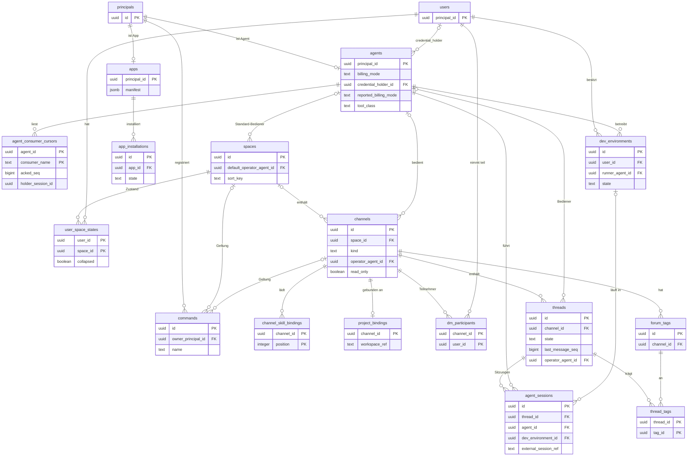

# 03 Datenmodell (PostgreSQL)

Status: Entwurf M0, nach den Rückmeldungen aller Kapitel integriert. Normativ für Migrationen,
sqlc-Abfragen und Repository-Ports.
Begriffe: siehe [00-glossar.md](00-glossar.md). Sync und Ereignisse: siehe
[04-sync-protokoll.md](04-sync-protokoll.md). Aktionen: siehe [05-aktionen.md](05-aktionen.md).
Aufbewahrung und Löschung: siehe [20-datenschutz.md](20-datenschutz.md). Suche: siehe
[14-suche.md](14-suche.md). Tabellen einer späteren Etappe tragen den Hinweis "Etappe"; ihre
Migration kommt mit dieser Etappe, der Vertrag gilt schon jetzt.

## 1. Grundsätze

1. **IDs.** Jede Tabelle mit eigener Identität hat `id uuid` als Primärschlüssel. Der Wert ist
   eine UUIDv7 (RFC 9562). Die Anwendung erzeugt sie, nicht die Datenbank. Grund: gleiche Logik
   auf jeder PostgreSQL-Version, und Clients können IDs vorab erzeugen (`client_msg_id`).
   UUIDv7 ist zeitlich sortiert und hält B-Tree-Indexe kompakt.
2. **Zeit.** Alle Zeitpunkte sind `timestamptz` in UTC. Dauern sind `bigint` in Millisekunden
   (Suffix `_ms`). Die Server-Uhr ist die einzige Zeitquelle für Reihenfolgen; Reihenfolge kommt
   aber nie aus Zeitstempeln, sondern aus Sequenznummern.
3. **Aufzählungen.** Als `text` mit `CHECK (... IN (...))`, nicht als PostgreSQL-`ENUM`.
   Grund: neue Werte sind eine additive Migration ohne Sperre des Typs.
4. **Geldbeträge.** `bigint` in Mikro-Einheiten der Währung (Suffix `_micros`) plus
   `currency text` (ISO 4217). Grund: exakt, schnell summierbar, kein Rundungsfehler.
5. **Sortierschlüssel.** Frei sortierbare Listen (Bereiche, Kanäle, Tags) nutzen
   `sort_key text COLLATE "C"` als Bruchindex (fractional index). Verschieben ändert genau eine
   Zeile.
6. **Groß- und Kleinschreibung.** Eindeutige Namen (Handles, Slugs) werden über einen
   eindeutigen Index auf `lower(...)` geschützt. Keine Erweiterung `citext` nötig.
7. **Löschen.** Prinzipale, Kanäle, Threads und Nachrichten werden nie hart gelöscht. Sie
   bekommen `deleted_at` bzw. `archived_at`; Inhalte werden bei Löschung sofort geleert
   (Tombstone). Grund: Sequenznummern, Audit-Kette und Autorenschaft bleiben konsistent. Harte
   Löschung gibt es nur für abhängige Detailzeilen (`ON DELETE CASCADE`) und durch die
   Aufbewahrungsjobs aus [20-datenschutz.md](20-datenschutz.md).
8. **JSON.** `jsonb` nur für Daten mit eigenem, versioniertem Schema (Manifest, Lauf-Kennzahlen,
   Komponenten-Definition, Ereignis-Nutzlast). Jedes solche Feld nennt sein Schema in der
   Spalte "Regeln". Felder, nach denen gefiltert oder verknüpft wird, sind nie nur in `jsonb`.
9. **Geheimnisse.** Keine Geheimnisse im Klartext. Tokens nur als Hash
   (HMAC-SHA-256 mit einem Server-Pepper aus dem Secret-Provider). Fremde Zugangsdaten
   (Webhook-Secrets, OIDC-Client-Secrets) nur als Verweis `secret_ref` auf den Secret-Provider.
   Claude.ai-Zugangsdaten oder Abo-Tokens gibt es im Modell nicht (B10, I5).
10. **Optimistische Sperre.** Änderbare, synchronisierte Objekte haben `version bigint`. Jede
    Änderung erhöht sie um eins. Schreibende Anfragen tragen die erwartete Version als HTTP-
    Vorbedingung `If-Match`; passt sie nicht, antwortet der Server `412 version_conflict`
    (RFC 9110, [06-api.md](06-api.md)).
11. **Isolationsstufe.** Schreibende Transaktionen laufen in `READ COMMITTED`. Die
    Zähler-Muster aus Abschnitt 6 setzen das voraus.
12. **Zugriff.** Nur das Modul, dem eine Tabelle gehört, schreibt sie. Andere Module lesen über
    dessen Port. Abfragen, die Rechte filtern, bekommen die Menge der sichtbaren Kanäle von
    `authz` und verknüpfen nie selbst mit `grants` (eine Wahrheit, B7). Den Tabellenbesitz hält
    das Modulregister fest, ein Gate prüft ihn ([ADR 0050](../adr/0050-modulregister-als-quelle-fuer-architektur-gate-und-tabellenbesitz.md)).
13. **Kein `null` nach außen.** Eine Spalte mit NULL erscheint in API und Ereignissen als
    fehlendes Feld, nie als JSON-`null` ([04-sync-protokoll.md](04-sync-protokoll.md),
    Abschnitt 2.2; [ADR 0053](../adr/0053-kein-json-null-in-api-und-ereignissen.md)). Grund: generierte Clients (dart-dio) kennen keinen Null-Typ.

## 2. Module

| Modul | Verantwortung | Tabellen |
|---|---|---|
| `instance` | Instanz, Einstellungen, Branding, Feature-Flags, Signierschlüssel, Zähler, Sync-Epoche | ja |
| `identity` | Prinzipale, Menschen, Identitäten, Passkeys, lokale Anmeldedaten, Einladungs-Codes, Anmeldevorgänge, Herausforderungen (Step-up, Passkeys), Geräte-Kopplung, Geräte, Sitzungen, Tokens, Owner | ja |
| `authz` | Gruppen, Freigaben, Rechte-Version, `authorize` | ja |
| `chat` | Bereiche, Kanäle, Threads, Tags, Projektbindung, Seitenleisten-Zustand | ja |
| `messaging` | Nachrichten, Revisionen, Erwähnungen, Reaktionen, Anheften, Vorlagen | ja |
| `files` | Dateien, Upload-Sitzungen, Vorschaubilder, Anhänge, Virenscan, Transkripte, Dateitext | ja |
| `agents` | Agenten, Agenten-Sitzungen, Verbraucher-Cursor der Agenten, Slash-Befehle, Dev-Umgebungen | ja |
| `runs` | Läufe, Schritte, Nachträge, Komponenten, Interaktionen | ja |
| `apps` | Apps, Installationen, Webhooks ein und aus | ja |
| `billing` | Kosteneinträge, Preistabelle | ja |
| `sync` | Ereignis-Log, Cursor der Worker-Verbraucher, Idempotenz-Schlüssel, Gelesen-Stand, Entwürfe, Einstellungen | ja |
| `notify` | Benachrichtigungs-Einstellungen, Ruhezeiten, Push-Registrierungen | ja |
| `audit` | Audit-Log, Prüfpunkte, Schlüssel der IP-Pseudonyme | ja |
| `privacy` | DSGVO-Aufträge | ja |
| `importer` | Import-Quellen und importierte Objekte | ja |
| `status` | Statusseite, Sicherungsläufe | ja |
| `gateway` | WebSocket-Endpunkt, Gateway-Sitzungen, Fokus, Tippen, kurzlebige Ereignisse | keine |
| `search` | Such-Koordinator über die Lese-Ports von `messaging`, `chat` und `files` ([14-suche.md](14-suche.md)) | keine |
| `stats` | Statistik der Konsole aus den Lese-Ports anderer Module | keine |

Die drei Module ohne Tabellen sind eigene Module, weil sie eigene Ports, Abhängigkeiten und
Leistungsziele haben ([02-architektur.md](02-architektur.md), Abschnitt 4). Technische Tabellen
außerhalb der Module stehen in Abschnitt 4.13. Die Zuordnung der Tabellen zu Modulen steht
maschinenlesbar im Modulregister ([ADR 0050](../adr/0050-modulregister-als-quelle-fuer-architektur-gate-und-tabellenbesitz.md)).

## 3. Aufbewahrungsklassen

Jede Tabelle nennt genau eine Klasse. Dauer, Löschweg und Ausnahmen (z. B. rechtliche
Aufbewahrung) legt [20-datenschutz.md](20-datenschutz.md) je Klasse fest. Dieses Kapitel legt
nur die Zuordnung fest.

| Klasse | Inhalt |
|---|---|
| `config` | Konfiguration der Instanz. Lebt, bis sie geändert wird. |
| `account` | Stammdaten von Prinzipalen und Gruppen. Lebt bis zur Löschung oder Pseudonymisierung. |
| `security` | Sitzungen, Tokens, Geräte, Schlüssel. Kurz nach Ablauf oder Widerruf löschbar. |
| `content` | Nutzerinhalte: Nachrichten, Dateien, Threads, Läufe. Löschung durch Nutzer, Admin oder DSGVO-Auftrag. |
| `personal_sync` | Persönliche Sync-Daten: Gelesen-Stand, Entwürfe, Einstellungen. Folgt dem Konto. |
| `event_log` | Ereignis-Log. Fenster `sync.event_retention`. |
| `transient` | Kurzlebige Technikdaten: Idempotenz-Schlüssel, Zustellversuche. |
| `audit` | Audit-Log. Eigene Frist, getrennt von Telemetrie (B11). |
| `cost` | Kosten und Preise. Frist für Abrechnungsbelege. |
| `import` | Import-Zustand. Löschbar nach Abschluss des Imports. |
| `privacy_job` | DSGVO-Aufträge und Exportpakete. |
| `ops` | Statusseite und Sicherungsläufe. |

## 4. Tabellen

Schreibweise: "Null" = `ja` heißt NULL erlaubt. "Standard" leer heißt kein Standardwert.
Fremdschlüssel nennen ihr `ON DELETE`-Verhalten. `RESTRICT` ist der Normalfall, weil
Prinzipale und Inhalte nicht hart gelöscht werden.

### 4.1 Instanz (`instance`)

#### `instance`

Zweck: genau eine Zeile mit der Identität dieser Installation. Modul: `instance`.

| Feld | Typ | Null | Standard | Regeln / Hinweise |
|---|---|---|---|---|
| `id` | `smallint` | nein | `1` | `CHECK (id = 1)`; erzwingt eine Zeile |
| `instance_id` | `uuid` | nein | | UUIDv7, beim ersten `bothy migrate up` erzeugt (die Zeile entsteht dort, über den Port von `instance`); Aussteller (`iss`) in Tokens |
| `setup_completed_at` | `timestamptz` | ja | | NULL bis der erste Owner per Server-Befehl angelegt ist |
| `schema_version` | `bigint` | nein | | letzte angewandte Migration, nur zur Anzeige |
| `min_server_version` | `text` | ja | | SemVer; kleinste Server-Version, die mit diesem Schema laufen darf; gesetzt von `bothy migrate`. Ein Server mit kleinerer Version meldet nicht bereit ([16-betrieb.md](16-betrieb.md), Abschnitt 10) |
| `sync_epoch` | `uuid` | nein | | UUIDv7 der aktuellen Zeitlinie des Ereignis-Logs; beim ersten `bothy migrate up` erzeugt, nach jeder Wiederherstellung neu (Abschnitt 6.7) |
| `created_at` | `timestamptz` | nein | `now()` | |

PK: `id`. FK: keine. Unique: `instance_id`. Indexe: keine weiteren.
Aufbewahrung: `config`. `bothy migrate up` legt die Zeile an, falls sie fehlt
(`INSERT ... ON CONFLICT (id) DO NOTHING`), und setzt danach `schema_version` und
`min_server_version`; `instance_id`, `sync_epoch` und `setup_completed_at` ändert es nie. Grund:
`migrate` ist der erste Schritt jeder Installation, und die Bereitschaftsprüfung braucht
`min_server_version`, bevor es einen Owner gibt.

#### `instance_settings`

Zweck: typisierte Einstellungen der Instanz, inklusive Branding, als Schlüssel-Wert-Paare.
Modul: `instance`.

| Feld | Typ | Null | Standard | Regeln / Hinweise |
|---|---|---|---|---|
| `key` | `text` | nein | | z. B. `branding.product_name`, `branding.accent_color`, `branding.logo_file_id`, `locale.default`; Schlüssel und Schema in der Konfigurationsreferenz ([../operations/configuration.md](../operations/configuration.md), Abschnitt 6). `branding.accent_color` ist ein Schlüssel der Kategorie-Farben des Design-Systems, kein freier Farbwert |
| `value` | `jsonb` | nein | | gegen das Schema des Schlüssels geprüft |
| `version` | `bigint` | nein | `1` | optimistische Sperre |
| `updated_by` | `uuid` | ja | | Prinzipal; NULL bei Einrichtung |
| `updated_at` | `timestamptz` | nein | `now()` | |

PK: `key`. FK: `updated_by` -> `principals(id)` ON DELETE RESTRICT. Unique: keine weiteren.
Indexe: keine weiteren (wenige Zeilen, voll im Cache). Aufbewahrung: `config`.

#### `server_signing_keys`

Zweck: öffentliche Teile der Server-Schlüssel für Zugriffstokens, Aufruf-Marken (I3),
ausgehende Webhooks und Audit-Prüfpunkte. Der private Teil liegt nur im Secret-Provider.
Modul: `instance`.

| Feld | Typ | Null | Standard | Regeln / Hinweise |
|---|---|---|---|---|
| `kid` | `text` | nein | | Schlüssel-ID im JWS-Kopf |
| `purpose` | `text` | nein | | `CHECK (purpose IN ('access_token','invocation','webhook_out','audit_checkpoint'))` |
| `alg` | `text` | nein | | `CHECK (alg IN ('EdDSA','ES256'))`; bei `purpose IN ('invocation','webhook_out')` nur `EdDSA` (Check), weil Aufruf-Marken genau einen Algorithmus erlauben und Standard Webhooks `v1a` nur Ed25519 kennt |
| `public_jwk` | `jsonb` | nein | | JWK nach RFC 7517, ohne privaten Teil |
| `private_key_ref` | `text` | nein | | Verweis auf den Secret-Provider |
| `state` | `text` | nein | `'active'` | `CHECK (state IN ('next','active','retiring','retired'))` |
| `created_at` | `timestamptz` | nein | `now()` | |
| `not_after` | `timestamptz` | ja | | nach diesem Zeitpunkt wird nicht mehr signiert |

PK: `kid`. FK: keine. Unique: Teilindex `(purpose) WHERE state = 'active'` (genau ein aktiver
Schlüssel je Zweck). Indexe: `(purpose, state)` für die JWKS-Ausgabe.
Aufbewahrung: `security`.

#### `feature_flags`

Zweck: Schalter für Funktionen, global oder für Gruppen und Personen. Modul: `instance`.

| Feld | Typ | Null | Standard | Regeln / Hinweise |
|---|---|---|---|---|
| `key` | `text` | nein | | z. B. `dm.enabled`, `voice.enabled` |
| `enabled` | `boolean` | nein | `false` | globaler Wert |
| `rollout` | `jsonb` | nein | `'{}'` | Schema `feature_flag_rollout.v1`: Listen von `user_ids` und `group_ids`, für die der Schalter abweichend gilt |
| `version` | `bigint` | nein | `1` | |
| `updated_by` | `uuid` | ja | | |
| `updated_at` | `timestamptz` | nein | `now()` | |

PK: `key`. FK: `updated_by` -> `principals(id)` ON DELETE RESTRICT. Indexe: keine weiteren.
Aufbewahrung: `config`. Art, Beschreibung, Standard, Modul und `remove_by` stehen in der
Registrierung im Code, nicht in der Tabelle ([ADR 0064](../adr/0064-feature-flag-registrierung-mit-aufraeum-gate.md)); ein registrierter Schlüssel ohne Zeile hat
seinen Standard und in der API die Version `0`, ein Schlüssel ohne Registrierung ist aus und
verwaist. Dasselbe gilt für `instance_settings`: Ein registrierter Schlüssel ohne Zeile hat seinen
Standardwert und die Version `0`.

#### `sequence_counters`

Zweck: Zähler-Zeilen, deren Zeilensperre die Commit-Reihenfolge erzwingt. Modul: `instance`
(gelesen und geschrieben nur über die Funktionen aus Abschnitt 6).

| Feld | Typ | Null | Standard | Regeln / Hinweise |
|---|---|---|---|---|
| `name` | `text` | nein | | `CHECK (name IN ('event_seq','audit_seq','permission_version'))` |
| `value` | `bigint` | nein | `0` | nur steigend |

PK: `name`. FK: keine. Indexe: keine weiteren. Aufbewahrung: `config`.

Die drei Zeilen werden in der ersten Migration angelegt. `permission_version` ist der
Rechte-Versionszähler (siehe 4.3 und [04-sync-protokoll.md](04-sync-protokoll.md)).

### 4.2 Identität (`identity`)

#### `principals`

Zweck: gemeinsame Identität aller handelnden Prinzipale (Mensch, Agent, App). Fremdschlüssel
auf "wer hat es getan" zeigen immer hierher. Modul: `identity`.

| Feld | Typ | Null | Standard | Regeln / Hinweise |
|---|---|---|---|---|
| `id` | `uuid` | nein | | UUIDv7 |
| `kind` | `text` | nein | | `CHECK (kind IN ('user','agent','app'))`; nie änderbar |
| `status` | `text` | nein | `'active'` | `CHECK (status IN ('pending','active','disabled','deleted'))` |
| `handle` | `text` | nein | | für Erwähnungen, `CHECK (handle ~ '^[a-z0-9][a-z0-9._-]*$')`, Länge bis `principal.handle_max_chars` |
| `display_name` | `text` | nein | | nicht leer und nicht nur Leerraum, höchstens `principal.display_name_max_chars` Zeichen, ohne Steuer- und Bidi-Zeichen ([19-sicherheit.md](19-sicherheit.md), SEC-IN-4); nach Löschung pseudonymisiert |
| `avatar_file_id` | `uuid` | ja | | |
| `created_at` | `timestamptz` | nein | `now()` | |
| `disabled_at` | `timestamptz` | ja | | |
| `deleted_at` | `timestamptz` | ja | | Pseudonymisierung durch DSGVO-Auftrag |

PK: `id`. FK: `avatar_file_id` -> `files(id)` ON DELETE SET NULL. Unique: `lower(handle)`.
Indexe: `(kind, status)` für Verzeichnislisten. Aufbewahrung: `account`.

#### `users`

Zweck: Zusatzdaten für Menschen. Modul: `identity`.

| Feld | Typ | Null | Standard | Regeln / Hinweise |
|---|---|---|---|---|
| `principal_id` | `uuid` | nein | | `kind = 'user'` per Trigger geprüft |
| `email` | `text` | ja | | nur zur Anzeige; nie für Zuordnung, Rechte oder Benachrichtigungen; nie aus Daten eines Anbieters gesetzt, weil der Wert eindeutig ist und ein Anbieter sonst Anmeldungen blockieren könnte ([08-identitaet.md](08-identitaet.md), Abschnitt 3.1) |
| `locale` | `text` | nein | `'de'` | BCP 47 |
| `time_zone` | `text` | nein | `'UTC'` | IANA-Name, für Ruhezeiten |
| `last_active_at` | `timestamptz` | ja | | grob, höchstens einmal je `identity.last_active_granularity` geschrieben |

PK: `principal_id`. FK: `principal_id` -> `principals(id)` ON DELETE RESTRICT.
Unique: `lower(email)` als Teilindex `WHERE email IS NOT NULL`. Indexe: keine weiteren.
Aufbewahrung: `account`.

#### `owners`

Zweck: Liste der Owner. Mindestens einer. Modul: `identity`.

| Feld | Typ | Null | Standard | Regeln / Hinweise |
|---|---|---|---|---|
| `id` | `uuid` | nein | | |
| `user_id` | `uuid` | nein | | nur Menschen |
| `granted_by` | `uuid` | ja | | NULL nur beim ersten Owner (Server-Befehl) |
| `granted_at` | `timestamptz` | nein | `now()` | |
| `revoked_at` | `timestamptz` | ja | | |
| `revoked_by` | `uuid` | ja | | |
| `reason` | `text` | nein | | Pflicht, steht im Audit |

PK: `id`. FK: `user_id` -> `users(principal_id)` ON DELETE RESTRICT; `granted_by`,
`revoked_by` -> `principals(id)` ON DELETE RESTRICT. Unique: Teilindex `(user_id) WHERE
revoked_at IS NULL`. Indexe: über den Teilindex. Aufbewahrung: `account`.
Invariante (SR8 in [07-rechte.md](07-rechte.md)): Eine Transaktion, die einen Owner widerruft
oder den Prinzipal eines Owners sperrt oder löscht (`owner.remove`, `user.disable`, DSGVO-Löschung),
prüft vor dem Commit, dass mindestens ein Owner mit `principals.status = 'active'` bleibt (Code
`last_owner`), und prüft I1 (Abschnitt 6.4).

#### `identity_providers`

Zweck: konfigurierte Anmelde-Treiber (B9). Modul: `identity`.

| Feld | Typ | Null | Standard | Regeln / Hinweise |
|---|---|---|---|---|
| `id` | `uuid` | nein | | |
| `kind` | `text` | nein | | `CHECK (kind IN ('oidc','trusted_header','local'))` |
| `name` | `text` | nein | | Anzeige, z. B. "Firmen-SSO" |
| `config` | `jsonb` | nein | | Schema `identity_provider.<kind>.v1` ([08-identitaet.md](08-identitaet.md), Abschnitt 2.6); Geheimnisse nur als Verweise (`client_secret_ref`, `client_key_ref`) |
| `enabled` | `boolean` | nein | `true` | |
| `allow_provisioning` | `boolean` | nein | `false` | `false`: unbekannte Subjekte bekommen keinen Zugang (kein Selbst-Registrieren) |
| `created_at` | `timestamptz` | nein | `now()` | |
| `updated_at` | `timestamptz` | nein | `now()` | |

PK: `id`. FK: keine. Unique: `lower(name)`; Teilindex `(kind) WHERE kind IN ('trusted_header',
'local')` (je einer). Indexe: keine weiteren. Aufbewahrung: `config`.

#### `user_identities`

Zweck: Verknüpfung eines Menschen mit einem Subjekt bei einem Anbieter. Modul: `identity`.

| Feld | Typ | Null | Standard | Regeln / Hinweise |
|---|---|---|---|---|
| `id` | `uuid` | nein | | |
| `user_id` | `uuid` | nein | | |
| `provider_id` | `uuid` | nein | | |
| `subject` | `text` | nein | | OIDC `sub` oder Header-Login oder lokaler Login-Name |
| `issuer` | `text` | ja | | OIDC `iss`, sonst NULL |
| `email_at_link` | `text` | ja | | Momentaufnahme, nur Anzeige |
| `linked_at` | `timestamptz` | nein | `now()` | |
| `last_login_at` | `timestamptz` | ja | | |
| `unlinked_at` | `timestamptz` | ja | | |

PK: `id`. FK: `user_id` -> `users(principal_id)` ON DELETE RESTRICT; `provider_id` ->
`identity_providers(id)` ON DELETE RESTRICT. Unique: Teilindex `(provider_id, subject) WHERE
unlinked_at IS NULL`. Indexe: `(user_id)` für die Kontoansicht. Aufbewahrung: `account`.

#### `passkey_credentials`

Zweck: WebAuthn-Passkeys für Anmeldung lokaler Konten und für Step-up. Modul: `identity`.

| Feld | Typ | Null | Standard | Regeln / Hinweise |
|---|---|---|---|---|
| `id` | `uuid` | nein | | |
| `user_id` | `uuid` | nein | | |
| `credential_id` | `bytea` | nein | | WebAuthn Credential ID |
| `public_key_cose` | `bytea` | nein | | öffentlicher Schlüssel (COSE) |
| `sign_count` | `bigint` | nein | `0` | Rückschritt wird geloggt und im Audit gemeldet |
| `aaguid` | `uuid` | ja | | |
| `transports` | `text[]` | nein | `'{}'` | |
| `backup_eligible` | `boolean` | nein | `false` | |
| `backup_state` | `boolean` | nein | `false` | |
| `name` | `text` | nein | | vom Menschen vergeben |
| `created_at` | `timestamptz` | nein | `now()` | |
| `last_used_at` | `timestamptz` | ja | | |
| `revoked_at` | `timestamptz` | ja | | |

PK: `id`. FK: `user_id` -> `users(principal_id)` ON DELETE RESTRICT. Unique: `credential_id`.
Indexe: `(user_id) WHERE revoked_at IS NULL` für die Anmelde-Challenge. Aufbewahrung: `security`.

#### `devices`

Zweck: ein installierter Client eines Menschen. Neue Geräte warten auf Bestätigung.
Modul: `identity`.

| Feld | Typ | Null | Standard | Regeln / Hinweise |
|---|---|---|---|---|
| `id` | `uuid` | nein | | vom Client bei der Registrierung erzeugt (UUIDv7) |
| `user_id` | `uuid` | nein | | |
| `name` | `text` | nein | | z. B. "Alex iPhone" |
| `platform` | `text` | nein | | `CHECK (platform IN ('ios','android','macos','windows','web','cli'))` |
| `state` | `text` | nein | `'pending'` | `CHECK (state IN ('pending','active','revoked'))` |
| `app_version` | `text` | ja | | |
| `approved_by` | `uuid` | ja | | |
| `approved_at` | `timestamptz` | ja | | |
| `revoked_by` | `uuid` | ja | | |
| `revoked_at` | `timestamptz` | ja | | |
| `revoke_reason` | `text` | ja | | `CHECK (revoke_reason IN ('revoked_by_self','revoked_by_owner','user_disabled','inactive','verification_failed','pending_expired','pairing_expired'))`; ein Code, nie Freitext; der Grund einer Anfrage steht nur im Audit |
| `created_at` | `timestamptz` | nein | `now()` | |
| `last_seen_at` | `timestamptz` | ja | | |

PK: `id`. FK: `user_id` -> `users(principal_id)` ON DELETE RESTRICT; `approved_by`,
`revoked_by` -> `principals(id)` ON DELETE RESTRICT. Unique: keine weiteren.
Indexe: `(user_id, state)` für Geräteliste; `(state) WHERE state = 'pending'` für die
Freigabe-Warteschlange der Admin-Konsole. Aufbewahrung: `security`. Checks: `(state = 'revoked') =
(revoked_at IS NOT NULL)`; `revoke_reason IS NULL OR state = 'revoked'`.

#### `device_keys`

Zweck: öffentliche Geräteschlüssel aus dem sicheren Speicher. Ein natives Gerät hat zwei: den
DPoP-Schlüssel (bindet Tokens, signiert ohne Nutzerbestätigung) und den Step-up-Schlüssel
(signiert nur nach Biometrie oder Geräte-PIN) ([08-identitaet.md](08-identitaet.md),
Abschnitt 6.1). Modul: `identity`.

| Feld | Typ | Null | Standard | Regeln / Hinweise |
|---|---|---|---|---|
| `id` | `uuid` | nein | | |
| `device_id` | `uuid` | nein | | |
| `purpose` | `text` | nein | | `CHECK (purpose IN ('dpop','step_up'))` |
| `jkt` | `text` | nein | | JWK-Thumbprint (RFC 7638); beim Zweck `dpop` steht er als `cnf.jkt` im Token |
| `public_jwk` | `jsonb` | nein | | |
| `alg` | `text` | nein | | `CHECK (alg IN ('ES256','EdDSA'))`; ob Windows Hello `ES256` liefert, ist offen ([08-identitaet.md](08-identitaet.md), Abschnitt 6.1); eine Erweiterung um `PS256` ist eine additive Migration |
| `attestation` | `jsonb` | ja | | Plattform-Attestierung, falls vorhanden |
| `created_at` | `timestamptz` | nein | `now()` | |
| `revoked_at` | `timestamptz` | ja | | Gerätesperre; einen Schlüsselwechsel am bestehenden Gerät gibt es nicht ([08-identitaet.md](08-identitaet.md), Abschnitt 5.4) |

PK: `id`. FK: `device_id` -> `devices(id)` ON DELETE CASCADE. Unique: `jkt`; Teilindex
`(device_id, purpose) WHERE revoked_at IS NULL` (ein aktiver Schlüssel je Gerät und Zweck).
Indexe: über die Unique-Indexe. Aufbewahrung: `security`.
Web-Konsole und Werkzeuge ohne sicheren Speicher haben keinen Step-up-Schlüssel; ihr Step-up
läuft über Passkey, erneute OIDC-Anmeldung oder Passwort mit TOTP.

#### `auth_sessions`

Zweck: Anmeldesitzung eines Menschen auf einem Gerät. Jeder Zugriffstoken trägt ihre ID als
`sid`; Widerruf wirkt dadurch sofort. Modul: `identity`.

| Feld | Typ | Null | Standard | Regeln / Hinweise |
|---|---|---|---|---|
| `id` | `uuid` | nein | | |
| `user_id` | `uuid` | nein | | |
| `device_id` | `uuid` | nein | | |
| `client_component` | `text` | nein | `'app'` | `CHECK (client_component IN ('app','share_ext','console'))`; die Share-Extension hat eine eigene Kind-Sitzung mit eigener Refresh-Familie; die Notification Service Extension hat keine Sitzung, sie nutzt das Vorschau-Token ([13-push-benachrichtigungen.md](13-push-benachrichtigungen.md), Abschnitt 6.4) |
| `parent_session_id` | `uuid` | ja | | gesetzt bei Kind-Sitzungen von Erweiterungen; Widerruf der Eltern-Sitzung widerruft alle Kinder mit demselben Grund |
| `identity_id` | `uuid` | ja | | womit angemeldet; NULL bei lokaler Anmeldung ohne Identität eines Anbieters |
| `auth_method` | `text` | nein | | `CHECK (auth_method IN ('oidc','trusted_header','passkey','password_totp','enrollment_code','device_pairing'))` |
| `cookie_hash` | `bytea` | ja | | nur Konsole (`client_component = 'console'`): HMAC-SHA-256 des Sitzungs-Cookies; neuer Wert bei Anmeldung und nach Step-up |
| `created_at` | `timestamptz` | nein | `now()` | |
| `expires_at` | `timestamptz` | nein | | absolutes Ende, `created_at + auth.session_max_age` (Konsole: `auth.console_session_max_age`) |
| `step_up_at` | `timestamptz` | ja | | letzte frische Bestätigung durch den Menschen; gültig für `auth.step_up_max_age` |
| `step_up_method` | `text` | ja | | `CHECK (step_up_method IN ('passkey','device_key','password_totp','oidc_reauth'))`; gesetzt mit `step_up_at` |
| `last_seen_at` | `timestamptz` | ja | | |
| `last_ip` | `inet` | ja | | nur für Sicherheitsansicht, Klasse `security` |
| `revoked_at` | `timestamptz` | ja | | |
| `revoke_reason` | `text` | ja | | `CHECK (revoke_reason IN ('logout','admin','device_revoked','refresh_reuse','user_disabled','expired','inactive','step_up_failed','trusted_header_mismatch'))`; `logout`, wenn die Person ihre eigene Sitzung beendet, `admin`, wenn ein anderer es tut |

PK: `id`. FK: `user_id` -> `users(principal_id)` ON DELETE RESTRICT; `device_id` ->
`devices(id)` ON DELETE RESTRICT; `identity_id` -> `user_identities(id)` ON DELETE SET NULL;
`parent_session_id` -> `auth_sessions(id)` ON DELETE CASCADE.
Checks: `(client_component = 'console') = (cookie_hash IS NOT NULL)`; `parent_session_id IS NULL OR
client_component = 'share_ext'`; `(step_up_at IS NULL) = (step_up_method IS
NULL)`. Unique: `cookie_hash` als Teilindex `WHERE cookie_hash IS NOT NULL`.
Indexe: `(user_id) WHERE revoked_at IS NULL` für "alle Sitzungen beenden"; `(device_id)`;
`(parent_session_id) WHERE parent_session_id IS NOT NULL`; `(expires_at)` für den Aufräumjob.
Aufbewahrung: `security`.

#### `refresh_token_families`

Zweck: Familie rotierender Refresh-Tokens einer Sitzung; Wiederverwendung sperrt die Familie.
Modul: `identity`.

| Feld | Typ | Null | Standard | Regeln / Hinweise |
|---|---|---|---|---|
| `id` | `uuid` | nein | | |
| `session_id` | `uuid` | nein | | |
| `dpop_jkt` | `text` | nein | | Thumbprint des DPoP-Schlüssels; jede Erneuerung verlangt einen DPoP-Beweis mit genau diesem Schlüssel (RFC 9449, Abschnitt 5) |
| `current_generation` | `integer` | nein | `0` | Nummer des einzigen gültigen Tokens |
| `rotated_at` | `timestamptz` | ja | | Zeitpunkt der letzten Rotation; Basis der Nachsicht `auth.refresh_reuse_grace` |
| `created_at` | `timestamptz` | nein | `now()` | |
| `revoked_at` | `timestamptz` | ja | | |
| `revoke_reason` | `text` | ja | | `CHECK (revoke_reason IN ('reuse_detected','logout','session_revoked','expired'))` |

PK: `id`. FK: `session_id` -> `auth_sessions(id)` ON DELETE CASCADE. Unique: Teilindex
`(session_id) WHERE revoked_at IS NULL`. Indexe: über den Unique-Index.
Aufbewahrung: `security`. Konsolen-Sitzungen haben keine Familie (Cookie statt Refresh-Token).

#### `refresh_tokens`

Zweck: einzelne Refresh-Tokens, nur als Hash. Modul: `identity`.

| Feld | Typ | Null | Standard | Regeln / Hinweise |
|---|---|---|---|---|
| `id` | `uuid` | nein | | |
| `family_id` | `uuid` | nein | | |
| `generation` | `integer` | nein | | |
| `token_hash` | `bytea` | nein | | HMAC-SHA-256 |
| `issued_at` | `timestamptz` | nein | `now()` | |
| `expires_at` | `timestamptz` | nein | | `issued_at + auth.refresh_token_ttl` |
| `used_at` | `timestamptz` | ja | | gesetzt bei Rotation |

PK: `id`. FK: `family_id` -> `refresh_token_families(id)` ON DELETE CASCADE.
Unique: `token_hash`; `(family_id, generation)`. Indexe: über die Unique-Indexe.
Aufbewahrung: `security`.
Rotation: In einer Transaktion `SELECT ... FOR UPDATE` auf die Familie, DPoP-Beweis mit
`dpop_jkt` vorausgesetzt.

1. Gilt `generation = current_generation` und `used_at IS NULL`: `used_at` setzen, neues Token
   mit `generation + 1` anlegen, `current_generation` erhöhen, `rotated_at = now()`.
2. Nachsicht: Ist das Token die unmittelbar vorige Generation (`generation = current_generation
   - 1`) und liegt `rotated_at` weniger als `auth.refresh_reuse_grace` zurück, rotiert der Server
   noch einmal wie in Punkt 1 (die nie empfangene Generation verfällt). Grund: Ein Absturz
   zwischen Server-Rotation und lokalem Speichern (App oder Erweiterung) darf nicht abmelden; der
   DPoP-Beweis zeigt, dass derselbe Geräteschlüssel fragt.
3. Sonst ist es Wiederverwendung: Familie und Sitzung werden widerrufen (`refresh_reuse`), ein
   Audit-Eintrag entsteht, die Anfrage scheitert.

#### `api_tokens`

Zweck: langlebige Tokens für Agenten, Apps und (per Feature-Flag) persönliche Werkzeuge.
Nur Hash und Präfix. Format `bothy_<art>_<zufall>_<prüfsumme>` mit Art `agt`, `app` oder
`pat` ([08-identitaet.md](08-identitaet.md), Abschnitt 12; [ADR 0061](../adr/0061-token-format-mit-festem-praefix-und-pruefsumme.md); Eingangs-Webhooks nutzen dasselbe
Format mit Art `whi` in `incoming_webhooks.token_hash`); das feste Präfix erlaubt die Regel
`bothy-api-token` im Secret-Scanner (`.gitleaks.toml`). Modul: `identity`.

| Feld | Typ | Null | Standard | Regeln / Hinweise |
|---|---|---|---|---|
| `id` | `uuid` | nein | | |
| `principal_id` | `uuid` | nein | | Inhaber des Tokens |
| `name` | `text` | nein | | |
| `token_prefix` | `text` | nein | | `bothy_<art>_` und die ersten 6 Zeichen des Zufallsteils, zum Wiedererkennen in der Konsole ([ADR 0061](../adr/0061-token-format-mit-festem-praefix-und-pruefsumme.md)) |
| `token_hash` | `bytea` | nein | | HMAC-SHA-256 |
| `scopes` | `text[]` | nein | `'{}'` | Teilmenge der Manifest-Scopes bzw. Agenten-Scopes |
| `dpop_jkt` | `text` | ja | | gesetzt: Anfragen müssen mit diesem Schlüssel DPoP-gebunden sein |
| `expires_at` | `timestamptz` | nein | | Pflicht, höchstens `auth.api_token_max_ttl` bzw. `auth.personal_token_max_ttl` nach der Anlage ([08-identitaet.md](08-identitaet.md), Abschnitt 12) |
| `created_by` | `uuid` | nein | | |
| `created_at` | `timestamptz` | nein | `now()` | |
| `last_used_at` | `timestamptz` | ja | | grob, höchstens einmal je `identity.last_active_granularity` |
| `revoked_at` | `timestamptz` | ja | | |
| `revoked_by` | `uuid` | ja | | |

PK: `id`. FK: `principal_id`, `created_by`, `revoked_by` -> `principals(id)` ON DELETE RESTRICT.
Unique: `token_hash`. Indexe: `(principal_id) WHERE revoked_at IS NULL` für die Token-Liste.
Aufbewahrung: `security`.

#### `local_credentials`

Zweck: Passwort mit TOTP als abschaltbarer Rückfall für lokale Konten (Baseline R-Passkeys,
`auth.local_password_enabled`). Eine Zeile je lokaler Identität. Modul: `identity`.

| Feld | Typ | Null | Standard | Regeln / Hinweise |
|---|---|---|---|---|
| `identity_id` | `uuid` | nein | | Identität beim Treiber `local` |
| `password_hash` | `text` | nein | | Argon2id im PHC-Format; Parameter aus `auth.argon2id_*` ([08-identitaet.md](08-identitaet.md)) |
| `password_changed_at` | `timestamptz` | nein | `now()` | |
| `totp_secret_ciphertext` | `bytea` | ja | | TOTP-Geheimnis, AEAD-verschlüsselt; NULL bis TOTP eingerichtet ist |
| `totp_key_ref` | `text` | ja | | Verweis auf den Schlüssel im Secret-Provider; gesetzt genau mit `totp_secret_ciphertext` |
| `totp_last_step` | `bigint` | ja | | zuletzt angenommener Zeitschritt; jede Ziffernfolge gilt nur einmal (RFC 6238, Abschnitt 5.2) |
| `totp_enabled_at` | `timestamptz` | ja | | |
| `failed_count` | `integer` | nein | `0` | Fehlversuche im laufenden Fenster `auth.login_fail_window` |
| `fail_window_started_at` | `timestamptz` | ja | | Beginn des laufenden Fensters; NULL ohne Fehlversuch. Ein Fehlversuch nach `fail_window_started_at + auth.login_fail_window` beginnt ein neues Fenster |
| `locked_until` | `timestamptz` | ja | | Sperre nur des Passwortwegs |

PK: `identity_id`. FK: `identity_id` -> `user_identities(id)` ON DELETE CASCADE.
Checks: `(totp_secret_ciphertext IS NULL) = (totp_key_ref IS NULL)`; `(failed_count = 0) = (fail_window_started_at IS NULL)`. Indexe: über den PK.
Aufbewahrung: `security`. Das TOTP-Geheimnis ist eine der zwei Ausnahmen von Grundsatz 9 (die
andere: `audit_ip_keys`): der Server braucht es zum Prüfen; darum liegt es verschlüsselt in der
Datenbank und der Schlüssel nur im Secret-Provider.

#### `enrollment_codes`

Zweck: einmalige Einladungs-Codes für das erste Gerät, das Verknüpfen einer Identität und die
Wiederherstellung ([08-identitaet.md](08-identitaet.md), Abschnitt 3.2). Modul: `identity`.

| Feld | Typ | Null | Standard | Regeln / Hinweise |
|---|---|---|---|---|
| `id` | `uuid` | nein | | |
| `user_id` | `uuid` | nein | | Mensch, für den der Code gilt |
| `purpose` | `text` | nein | | `CHECK (purpose IN ('first_login','identity_link','recovery'))` |
| `code_hash` | `bytea` | nein | | HMAC-SHA-256 des Codes; der Code erscheint genau einmal |
| `expires_at` | `timestamptz` | nein | | `created_at + auth.enrollment_code_ttl` |
| `attempts` | `integer` | nein | `0` | Fehlversuche mit diesem Code (eine abgelehnte Einlösung, deren Code passte); ab `auth.enrollment_code_max_attempts` ungültig |
| `created_by` | `uuid` | ja | | NULL bei Ausgabe per Server-Befehl |
| `created_at` | `timestamptz` | nein | `now()` | |
| `used_at` | `timestamptz` | ja | | |
| `used_by_device_id` | `uuid` | ja | | Gerät, das den Code eingelöst hat; es wird damit `active` |

PK: `id`. FK: `user_id` -> `users(principal_id)` ON DELETE CASCADE; `created_by` ->
`principals(id)` ON DELETE RESTRICT; `used_by_device_id` -> `devices(id)` ON DELETE SET NULL.
Unique: `code_hash`. Indexe: `(user_id) WHERE used_at IS NULL`; `(expires_at)` für den
Aufräumjob. Aufbewahrung: `security`. Je Person gilt höchstens ein Code: Das Ausstellen setzt
`expires_at = now()` an jedem anderen unbenutzten Code der Person ([08-identitaet.md](08-identitaet.md),
Abschnitt 3.2).

#### `auth_login_flows`

Zweck: Zustand eines OIDC-Anmelde- oder Verknüpfungsvorgangs zwischen Beginn, Rückleitung des
Anbieters und Einlösen des Server-Codes durch die App ([08-identitaet.md](08-identitaet.md),
Abschnitt 2.2). In der API heißt die ID `login_attempt_id`. Modul: `identity`.

| Feld | Typ | Null | Standard | Regeln / Hinweise |
|---|---|---|---|---|
| `id` | `uuid` | nein | | |
| `provider_id` | `uuid` | nein | | |
| `mode` | `text` | nein | | `CHECK (mode IN ('login','link'))` |
| `user_id` | `uuid` | ja | | gesetzt bei `link` (wer verknüpft) |
| `device_id` | `uuid` | ja | | Geräte-ID, falls die App sie schon beim Beginn nennt; das Gerät entsteht erst beim Einlösen |
| `oidc_state_hash` | `bytea` | nein | | HMAC des `state` an den Anbieter |
| `oidc_nonce_hash` | `bytea` | nein | | HMAC des `nonce` im ID-Token |
| `client_challenge` | `text` | nein | | `S256` des `client_verifier` der App; bindet den Server-Code an diese App-Instanz |
| `app_redirect_uri` | `text` | nein | | aus der festen Liste (Loopback oder privates Schema) |
| `login_code_hash` | `bytea` | ja | | HMAC des einmaligen Server-Codes (`login_code`) nach der Rückleitung |
| `login_code_expires_at` | `timestamptz` | ja | | `auth.server_code_ttl` nach der Rückleitung |
| `enrollment_code_id` | `uuid` | ja | | beim Beginn vorgelegter und geprüfter Einladungs-Code; eingelöst wird er erst beim Abschluss |
| `external_identity` | `jsonb` | ja | | Schema `external_identity.v1` ([08-identitaet.md](08-identitaet.md), Abschnitt 2.2): die beim Rückruf geprüfte Identität des Anbieters; gesetzt mit `status = 'code_issued'`, beim Abschluss oder Scheitern wieder NULL |
| `status` | `text` | nein | `'started'` | `CHECK (status IN ('started','code_issued','completed','failed'))` |
| `error` | `text` | ja | | Code ohne Inhalte |
| `created_at` | `timestamptz` | nein | `now()` | |
| `expires_at` | `timestamptz` | nein | | `created_at + auth.login_flow_ttl` |

PK: `id`. FK: `provider_id` -> `identity_providers(id)` ON DELETE CASCADE; `user_id` ->
`users(principal_id)` ON DELETE CASCADE; `enrollment_code_id` -> `enrollment_codes(id)` ON DELETE
SET NULL. Checks: `(status = 'code_issued') = (external_identity IS NOT NULL)`; `mode = 'link'`
hat keinen `enrollment_code_id`. Unique: `oidc_state_hash`; `login_code_hash` als Teilindex
`WHERE login_code_hash IS NOT NULL`. Indexe: `(expires_at)` für den Aufräumjob.
Aufbewahrung: `transient`. Der PKCE-Verifier des Servers gegenüber dem Anbieter wird nicht
gespeichert, sondern aus `id` und dem Token-Pepper abgeleitet (HMAC-SHA-256); so liegt kein
weiteres Geheimnis in der Tabelle. Der Rückruf ändert kein Konto: Zuordnung, Verknüpfung und
Bereitstellung geschehen erst beim Abschluss, den nur die App mit dem `client_verifier` auslösen
kann (R-DM-30).

#### `auth_challenges`

Zweck: einmalige Herausforderungen für Step-up (Geräteschlüssel und Passkey) und für die
WebAuthn-Zeremonien Anmeldung, erste Einrichtung mit Einladungs-Code und Registrierung
([08-identitaet.md](08-identitaet.md), Abschnitte 2.5 und 6.2). In der API heißt die ID
`challenge_id`. Modul: `identity`.

| Feld | Typ | Null | Standard | Regeln / Hinweise |
|---|---|---|---|---|
| `id` | `uuid` | nein | | UUIDv7 |
| `purpose` | `text` | nein | | `CHECK (purpose IN ('step_up','passkey_login','passkey_enroll','passkey_register'))` |
| `session_id` | `uuid` | ja | | Sitzung, für die sie gilt; gesetzt genau bei `step_up` und `passkey_register` |
| `enrollment_code_id` | `uuid` | ja | | geprüfter Einladungs-Code; gesetzt genau bei `passkey_enroll` |
| `challenge_hash` | `bytea` | nein | | HMAC-SHA-256 des Zufallswerts mit dem Token-Pepper; der Wert erscheint nur in der Antwort |
| `webauthn_session` | `jsonb` | ja | | Schema `webauthn_session.v1`: RP-ID, verlangte Nutzerbestätigung, erlaubte Credential-IDs, Benutzer-Handle; ohne Challenge und ohne Geheimnisse; NULL bei Step-up mit Geräteschlüssel |
| `status` | `text` | nein | `'issued'` | `CHECK (status IN ('issued','used','failed'))` |
| `created_at` | `timestamptz` | nein | `now()` | |
| `expires_at` | `timestamptz` | nein | | `created_at + auth.step_up_challenge_ttl` bei `step_up`, sonst `created_at + auth.login_flow_ttl` |
| `finished_at` | `timestamptz` | ja | | gesetzt mit `used` oder `failed` |

PK: `id`. FK: `session_id` -> `auth_sessions(id)` ON DELETE CASCADE; `enrollment_code_id` ->
`enrollment_codes(id)` ON DELETE CASCADE. Checks: `(status = 'issued') = (finished_at IS NULL)`;
`(session_id IS NOT NULL) = (purpose IN ('step_up','passkey_register'))`;
`(enrollment_code_id IS NOT NULL) = (purpose = 'passkey_enroll')`. Unique: `challenge_hash`.
Indexe: `(session_id, finished_at) WHERE status = 'failed'` für die Fehlversuche beim Step-up;
`(expires_at)` für den Aufräumjob. Aufbewahrung: `transient`.
Einlösen: In einer Transaktion `SELECT ... FOR UPDATE` auf die Zeile; nur `issued` und nicht
abgelaufen gilt, danach `used` bzw. bei falscher Bestätigung `failed`. Grund für eine Tabelle statt
abgeleiteter Werte: einmalige Nutzung und gezählte Fehlversuche gelten so auf jedem Knoten ohne
Abhängigkeit von synchronen Uhren (R-DM-31).

#### `device_pairings`

Zweck: Geräte-Kopplung ([08-identitaet.md](08-identitaet.md), Abschnitt 5.3). Das neue Gerät
meldet sich ohne Anmeldung mit seinen öffentlichen Schlüsseln an und zeigt einen Kopplungs-Code;
ein aktives Gerät derselben Person bestätigt mit diesem Code und Step-up. Modul: `identity`.

| Feld | Typ | Null | Standard | Regeln / Hinweise |
|---|---|---|---|---|
| `id` | `uuid` | nein | | in der API `pairing_id` |
| `pairing_code_hash` | `bytea` | nein | | HMAC-SHA-256 des Kopplungs-Codes; der Code erscheint nur auf dem neuen Gerät |
| `device_registration` | `jsonb` | nein | | Schema `device_registration.v1`: Name, Plattform, App-Version, öffentliche Schlüssel (`dpop`, optional `step_up`); keine Geheimnisse |
| `status` | `text` | nein | `'requested'` | `CHECK (status IN ('requested','approved','completed','rejected','expired'))` |
| `user_id` | `uuid` | ja | | Mensch, dessen aktives Gerät bestätigt hat |
| `approved_by_device_id` | `uuid` | ja | | bestätigendes Gerät |
| `device_id` | `uuid` | ja | | beim Abschluss angelegtes Gerät (`active`) |
| `created_at` | `timestamptz` | nein | `now()` | |
| `expires_at` | `timestamptz` | nein | | `created_at + auth.pairing_code_ttl` |
| `completed_at` | `timestamptz` | ja | | |

PK: `id`. FK: `user_id` -> `users(principal_id)` ON DELETE CASCADE; `approved_by_device_id`,
`device_id` -> `devices(id)` ON DELETE SET NULL. Checks: `status NOT IN ('approved','completed')
OR user_id IS NOT NULL`; `status <> 'completed' OR device_id IS NOT NULL`. Unique:
`pairing_code_hash` als Teilindex `WHERE status = 'requested'`. Indexe: `(expires_at)` für den
Aufräumjob. Aufbewahrung: `transient`. Der Abschluss verlangt einen DPoP-Beweis mit dem
angemeldeten `dpop`-Schlüssel; so kann nur das neue Gerät die Tokens abholen.

### 4.3 Rechte (`authz`)

#### `groups`

Zweck: benannte Menge von Menschen als Subjekt von Freigaben. Modul: `authz`.

| Feld | Typ | Null | Standard | Regeln / Hinweise |
|---|---|---|---|---|
| `id` | `uuid` | nein | | |
| `name` | `text` | nein | | z. B. "Support" |
| `description` | `text` | nein | `''` | |
| `source` | `text` | nein | `'local'` | `CHECK (source IN ('local','oidc_claim'))` |
| `provider_id` | `uuid` | ja | | OIDC-Anbieter, dessen Gruppen-Claim die Mitglieder bestimmt; gesetzt genau bei `oidc_claim` |
| `external_ref` | `text` | ja | | Claim-Wert bei `oidc_claim` |
| `created_by` | `uuid` | nein | | |
| `created_at` | `timestamptz` | nein | `now()` | |
| `deleted_at` | `timestamptz` | ja | | |

PK: `id`. FK: `created_by` -> `principals(id)` ON DELETE RESTRICT; `provider_id` ->
`identity_providers(id)` ON DELETE RESTRICT. Checks: `(source = 'oidc_claim') = (provider_id IS
NOT NULL)`; `(source = 'oidc_claim') = (external_ref IS NOT NULL)`. Unique: Teilindex `lower(name)
WHERE deleted_at IS NULL`; Teilindex `(provider_id, external_ref) WHERE source = 'oidc_claim' AND
deleted_at IS NULL`. Indexe: über die Unique-Indexe. Aufbewahrung: `account`. `name` höchstens
`group.name_max_chars`, `description` höchstens `group.description_max_chars` Zeichen, beide ohne
Steuer- und Bidi-Zeichen. Grund für `provider_id`: Ohne Bindung könnte ein zweiter Anbieter
Claim-Werte behaupten, die für den ersten gemeint sind.

#### `group_memberships`

Zweck: Mitgliedschaft eines Menschen in einer Gruppe, mit Verlauf. Modul: `authz`.

| Feld | Typ | Null | Standard | Regeln / Hinweise |
|---|---|---|---|---|
| `id` | `uuid` | nein | | |
| `group_id` | `uuid` | nein | | |
| `user_id` | `uuid` | nein | | nur Menschen (Entscheidung R-DM-07) |
| `added_by` | `uuid` | nein | | |
| `added_at` | `timestamptz` | nein | `now()` | |
| `expires_at` | `timestamptz` | ja | | bei jedem `authorize` geprüft |
| `expiry_reminded_at` | `timestamptz` | ja | | Erinnerung vor Ablauf geschrieben (`access.expiring`) |
| `expiry_reported_at` | `timestamptz` | ja | | Ablauf gemeldet (`access.changed`, Systemaktion `group.member.expire`); genau einmal je Mitgliedschaft |
| `removed_at` | `timestamptz` | ja | | |
| `removed_by` | `uuid` | ja | | |

PK: `id`. FK: `group_id` -> `groups(id)` ON DELETE RESTRICT; `user_id` ->
`users(principal_id)` ON DELETE RESTRICT; `added_by`, `removed_by` -> `principals(id)` ON DELETE
RESTRICT. Unique: Teilindex `(group_id, user_id) WHERE removed_at IS NULL`.
Indexe: `(user_id) WHERE removed_at IS NULL` für "Gruppen einer Person" beim Rechte-Aufbau;
`(expires_at) WHERE removed_at IS NULL AND expires_at IS NOT NULL` für Erinnerung und
Ablaufmeldung.
Aufbewahrung: `account`.
Mitgliedschaften in Gruppen mit `source = 'oidc_claim'` ändert nur der Abgleich bei der Anmeldung
(Systemaktion `group.member.sync`, [08-identitaet.md](08-identitaet.md), Abschnitt 3.4); dort sind
`added_by` und `removed_by` die Person, deren Anmeldung den Claim trug.

#### `grants`

Zweck: eine Freigabe: Subjekt x Ziel x Stufe x Zusatzrechte x Ablauf x Grund. Widerruf setzt
`revoked_at`, die Zeile bleibt. Modul: `authz`.

| Feld | Typ | Null | Standard | Regeln / Hinweise |
|---|---|---|---|---|
| `id` | `uuid` | nein | | |
| `subject_kind` | `text` | nein | | `CHECK (subject_kind IN ('user','group','agent','app'))` |
| `subject_principal_id` | `uuid` | ja | | gesetzt bei `user`, `agent`, `app` |
| `subject_group_id` | `uuid` | ja | | gesetzt bei `group` |
| `target_kind` | `text` | nein | | `CHECK (target_kind IN ('instance','space','channel'))` |
| `target_space_id` | `uuid` | ja | | gesetzt genau bei `space` |
| `target_channel_id` | `uuid` | ja | | gesetzt genau bei `channel` |
| `level` | `text` | nein | | `CHECK (level IN ('read','write','trigger'))` |
| `capabilities` | `text[]` | nein | `'{}'` | Teilmenge von `approve_actions`, `upload`, `export`, `manage` |
| `expires_at` | `timestamptz` | ja | | bei jedem `authorize` geprüft; der Job `authz.expiry_sweep` meldet den Ablauf nur (Abschnitt 6.4) |
| `expiry_reminded_at` | `timestamptz` | ja | | Erinnerung vor Ablauf geschrieben (`access.expiring`) |
| `expiry_reported_at` | `timestamptz` | ja | | Ablauf gemeldet (`access.changed`, Systemaktion `grant.expire`); genau einmal je Freigabe |
| `reason` | `text` | nein | | Pflicht |
| `granted_by` | `uuid` | nein | | |
| `granted_at` | `timestamptz` | nein | `now()` | |
| `revoked_at` | `timestamptz` | ja | | |
| `revoked_by` | `uuid` | ja | | |
| `revoke_reason` | `text` | ja | | |

PK: `id`.
FK: `subject_principal_id` -> `principals(id)` ON DELETE RESTRICT; `subject_group_id` ->
`groups(id)` ON DELETE RESTRICT; `target_space_id` -> `spaces(id)` ON DELETE RESTRICT;
`target_channel_id` -> `channels(id)` ON DELETE RESTRICT; `granted_by`, `revoked_by` ->
`principals(id)` ON DELETE RESTRICT.
Checks: genau eines von `subject_principal_id` und `subject_group_id` ist gesetzt, passend zu
`subject_kind`; Ziel-Spalten passend zu `target_kind`; `capabilities <@ ARRAY['approve_actions',
'upload','export','manage']`; bei `subject_kind IN ('agent','app')` gilt `level <> 'trigger' AND
capabilities <@ ARRAY['upload']` (R-DM-08, R-DM-20).
Unique: keine (mehrere Freigaben auf dasselbe Paar sind erlaubt; die höchste gültige gilt).
Indexe: `(subject_principal_id) WHERE revoked_at IS NULL` und `(subject_group_id) WHERE
revoked_at IS NULL` für den Rechte-Aufbau eines Prinzipals; `(target_space_id) WHERE revoked_at
IS NULL` und `(target_channel_id) WHERE revoked_at IS NULL` für "Wer hat Zugriff?" und die
I1-Prüfung; `(expires_at) WHERE revoked_at IS NULL AND expires_at IS NOT NULL` für Erinnerung und
Ablaufmeldung. Aufbewahrung: `account`.

Freigaben werden nie geändert, nur widerrufen und neu angelegt (R-DM-09). Erlaubte Updates sind
nur die Widerruf-Spalten und die Buchhaltung des Ablaufs (`expiry_reminded_at`,
`expiry_reported_at`). Der Job `authz.expiry_sweep` meldet jede abgelaufene, noch nicht gemeldete
Zeile (`expires_at <= now()` und `expiry_reported_at IS NULL`) und setzt die Spalte in derselben
Transaktion; so wird nach einem Ausfall des worker jeder Ablauf genau einmal gemeldet. Jede Transaktion,
die `grants`, `group_memberships`, `owners`, Bediener-Zuordnungen, `agents.billing_mode`,
`agents.credential_holder_id`, `agents.tool_class`, den Zustand einer Dev-Umgebung oder den Status
eines Prinzipals ändert, erhöht `sequence_counters.permission_version` (Abschnitt 6.3). Das gilt
auch für den Job `authz.expiry_sweep`, der abgelaufene Freigaben und Mitgliedschaften meldet.

### 4.4 Agenten und Apps (`agents`, `apps`)

#### `agents`

Zweck: Zusatzdaten für Agenten-Prinzipale: Betrieb, Backend-Richtlinie und gemeldeter Zustand.
Modul: `agents`.

| Feld | Typ | Null | Standard | Regeln / Hinweise |
|---|---|---|---|---|
| `principal_id` | `uuid` | nein | | `kind = 'agent'` per Trigger geprüft |
| `adapter_kind` | `text` | nein | | freier Bezeichner des Adapters, z. B. `hermes`, `code_runner`, `custom` |
| `description` | `text` | nein | `''` | |
| `operator_config` | `jsonb` | nein | `'{}'` | Schema `agent_operator_config.v1` ([09-agenten.md](09-agenten.md), Abschnitt 2.2): Standard-Modell (`default_model`) und erlaubte Fähigkeiten (`supports_followups`, `supports_components`, `supports_voice`, `supports_title`, `supports_files_out`); ein fehlender Schlüssel erlaubt; keine Geheimnisse. Wirksam ist eine Fähigkeit nur, wenn der Adapter sie auch meldet ([09-agenten.md](09-agenten.md), Abschnitt 2.2) |
| `billing_mode` | `text` | nein | `'organization'` | `CHECK (billing_mode IN ('personal','organization'))` |
| `credential_holder_id` | `uuid` | ja | | Pflicht bei `personal`, sonst NULL |
| `billing_mode_changed_at` | `timestamptz` | ja | | |
| `billing_mode_changed_by` | `uuid` | ja | | |
| `tool_class` | `text` | nein | `'chat'` | `CHECK (tool_class IN ('chat','scoped','host'))`; Soll der Werkzeugklasse, Reihenfolge `chat` < `scoped` < `host` ([07-rechte.md](07-rechte.md), Abschnitt 2.11) |
| `reported_tool_class` | `text` | ja | | Ist aus dem Heartbeat, gleiche Werte; `authorize` rechnet mit der höheren von Soll und Ist |
| `reported_runtime_state` | `text` | nein | `'unknown'` | `CHECK (reported_runtime_state IN ('unknown','online','degraded','offline'))` |
| `reported_billing_mode` | `text` | ja | | letzter Ist-Modus aus dem Heartbeat, `personal` oder `organization`; NULL ohne Heartbeat oder bei Adaptern, die je Lauf dem Soll folgen (dann nennt `reported_details.billing_modes_supported` die belegbaren Modi; bindend ist die Prüfung je Lauf) |
| `reported_runtime_version` | `text` | ja | | |
| `reported_details` | `jsonb` | nein | `'{}'` | Schema `agent_heartbeat.v1` ([09-agenten.md](09-agenten.md), Abschnitt 4.8): `capabilities`, `billing_modes_supported`, `billing_evidence` (`provider`, `key_type`, `method`, nie ein Wert), `active_runs`, `degraded_reasons`; ohne Geheimnisse und ohne Inhalte |
| `last_heartbeat_at` | `timestamptz` | ja | | |
| `version` | `bigint` | nein | `1` | |

PK: `principal_id`. FK: `principal_id` -> `principals(id)` ON DELETE RESTRICT;
`credential_holder_id` -> `users(principal_id)` ON DELETE RESTRICT; `billing_mode_changed_by` ->
`principals(id)` ON DELETE RESTRICT.
Checks: `(billing_mode = 'personal') = (credential_holder_id IS NOT NULL)`.
Indexe: `(credential_holder_id) WHERE billing_mode = 'personal'` für die I1-Prüfung bei
Änderungen an einer Person; `(last_heartbeat_at)` für die Präsenz-Auswertung.
Aufbewahrung: `account`.

Heartbeat-Felder werden höchstens einmal je `agent.heartbeat_persist_interval` geschrieben;
dazwischen hält der Server den Zustand im Speicher. Ausnahme: Ein Wechsel von
`reported_billing_mode` oder `reported_tool_class` wird sofort gespeichert und auditiert
(`agent.heartbeat`, [05-aktionen.md](05-aktionen.md)), weil der Ist-Modus der Beleg für I3 ist.

#### `agent_consumer_cursors`

Zweck: dauerhafter Lesestand eines Agenten-Adapters im Ereignis-Log. Modul: `agents`.

| Feld | Typ | Null | Standard | Regeln / Hinweise |
|---|---|---|---|---|
| `agent_id` | `uuid` | nein | | |
| `consumer_name` | `text` | nein | `'default'` | mehrere Verbraucher je Agent möglich |
| `acked_seq` | `bigint` | nein | | höchste bestätigte globale Sequenz |
| `holder_session_id` | `uuid` | ja | | Gateway-Sitzung, die den Verbraucher gerade hält (Fencing über Knoten, [04-sync-protokoll.md](04-sync-protokoll.md), Abschnitt 15.1) |
| `created_at` | `timestamptz` | nein | `now()` | Startpunkt; Nachholen nie vor diesem Zeitpunkt |
| `updated_at` | `timestamptz` | nein | `now()` | |

PK: `(agent_id, consumer_name)`. FK: `agent_id` -> `agents(principal_id)` ON DELETE CASCADE.
Indexe: über den PK. Aufbewahrung: `security`.
Speichern von `acked_seq` geschieht als `UPDATE ... WHERE holder_session_id = $eigene_sitzung`;
bekommt ein Knoten keine Zeile zurück, hat ein anderer den Verbraucher übernommen, und er schließt
seine Verbindung mit `4015`.

#### `dev_environments`

Zweck: abgeschottete Dev-Umgebung einer Person für einen Runner-Agenten
([21-dev-isolation.md](21-dev-isolation.md), Abschnitt 6). Etappe: Mehrbenutzer-Dev-Umgebung.
Modul: `agents`.

| Feld | Typ | Null | Standard | Regeln / Hinweise |
|---|---|---|---|---|
| `id` | `uuid` | nein | | |
| `user_id` | `uuid` | nein | | Person, der die Umgebung gehört |
| `runner_agent_id` | `uuid` | nein | | Runner, der die Umgebung betreibt |
| `isolation_kind` | `text` | nein | | `CHECK (isolation_kind IN ('macos_vm','linux_vm','cloud_vm'))` |
| `environment_ref` | `text` | nein | | undurchsichtiger Verweis, den der Runner auflöst; kein Pfad und kein Hostname des Servers |
| `image_ref` | `text` | nein | | Version des sauberen Abbilds |
| `billing_mode` | `text` | nein | `'organization'` | `CHECK (billing_mode IN ('organization'))`; eine persönliche Backend-Richtlinie je Umgebung braucht eine eigene Entscheidung zu I1 (R-DM-24) |
| `state` | `text` | nein | `'provisioning'` | `CHECK (state IN ('provisioning','verifying','ready','suspended','retired'))` |
| `checks` | `jsonb` | nein | `'{}'` | Schema `dev_environment_checks.v1`: Ergebnis und Zeit je Prüfung |
| `verified_at` | `timestamptz` | ja | | letzte vollständig bestandene Prüfung |
| `red_team_passed_at` | `timestamptz` | ja | | Red Team für Art und Abbild bestanden |
| `red_team_ref` | `text` | ja | | Verweis auf den Bericht |
| `approved_by` | `uuid` | ja | | Owner mit Step-up |
| `approved_at` | `timestamptz` | ja | | |
| `suspended_reason` | `text` | ja | | z. B. `check_failed`, `user_disabled`, `manual` |
| `created_at` | `timestamptz` | nein | `now()` | |
| `retired_at` | `timestamptz` | ja | | |
| `version` | `bigint` | nein | `1` | |

PK: `id`. FK: `user_id` -> `users(principal_id)`, `runner_agent_id` -> `agents(principal_id)`,
`approved_by` -> `principals(id)`, alle ON DELETE RESTRICT. Unique: Teilindex `(user_id,
runner_agent_id) WHERE state <> 'retired'`. Indexe: über den Unique-Index.
Aufbewahrung: `security`. Wann eine Umgebung bereit ist, legt
[21-dev-isolation.md](21-dev-isolation.md), Abschnitt 6.2 fest; geprüft wird bei jeder
Auslösung (Schutzregel SR3 in [07-rechte.md](07-rechte.md)).

#### `apps`

Zweck: Zusatzdaten für App-Prinzipale (Integrationen) mit Manifest. Modul: `apps`.

| Feld | Typ | Null | Standard | Regeln / Hinweise |
|---|---|---|---|---|
| `principal_id` | `uuid` | nein | | `kind = 'app'` per Trigger geprüft |
| `slug` | `text` | nein | | |
| `manifest` | `jsonb` | nein | | Schema `app_manifest.v1`: Scopes, Ereignis-Abos, Slash-Befehle, Komponenten, Webhook-URLs |
| `manifest_version` | `text` | nein | | SemVer des Manifests |
| `manifest_sha256` | `bytea` | nein | | |
| `publisher` | `text` | nein | `''` | |
| `homepage_url` | `text` | ja | | |
| `created_at` | `timestamptz` | nein | `now()` | |
| `updated_at` | `timestamptz` | nein | `now()` | |

PK: `principal_id`. FK: `principal_id` -> `principals(id)` ON DELETE RESTRICT.
Unique: `lower(slug)`. Indexe: über den Unique-Index. Aufbewahrung: `account`.

#### `app_installations`

Zweck: Installation einer App in dieser Instanz mit bewilligten Scopes. Modul: `apps`.

| Feld | Typ | Null | Standard | Regeln / Hinweise |
|---|---|---|---|---|
| `id` | `uuid` | nein | | |
| `app_id` | `uuid` | nein | | |
| `granted_scopes` | `text[]` | nein | `'{}'` | Teilmenge der Manifest-Scopes |
| `event_subscriptions` | `text[]` | nein | `'{}'` | Ereignistypen aus [05-aktionen.md](05-aktionen.md) |
| `state` | `text` | nein | `'active'` | `CHECK (state IN ('active','suspended','uninstalled'))`; `suspended` setzt `app.suspend` (Not-Aus ohne Verlust der Bewilligungen), zurück mit `app.resume` |
| `installed_by` | `uuid` | nein | | |
| `installed_at` | `timestamptz` | nein | `now()` | |
| `uninstalled_at` | `timestamptz` | ja | | |
| `uninstalled_by` | `uuid` | ja | | |

PK: `id`. FK: `app_id` -> `apps(principal_id)` ON DELETE RESTRICT; `installed_by`,
`uninstalled_by` -> `principals(id)` ON DELETE RESTRICT. Unique: Teilindex `(app_id) WHERE
state <> 'uninstalled'`. Indexe: über den Unique-Index. Aufbewahrung: `config`.

#### `commands`

Zweck: von Agenten oder Apps registrierte Slash-Befehle mit Optionen. Modul: `agents`.

| Feld | Typ | Null | Standard | Regeln / Hinweise |
|---|---|---|---|---|
| `id` | `uuid` | nein | | |
| `owner_principal_id` | `uuid` | nein | | Agent oder App |
| `name` | `text` | nein | | `CHECK (name ~ '^[a-z0-9][a-z0-9_-]*$')` |
| `description` | `text` | nein | | |
| `scope_kind` | `text` | nein | `'instance'` | `CHECK (scope_kind IN ('instance','space','channel'))` |
| `scope_space_id` | `uuid` | ja | | |
| `scope_channel_id` | `uuid` | ja | | |
| `options` | `jsonb` | nein | `'[]'` | Schema `command_options.v1`: Name, Typ (`string`, `integer`, `boolean`, `choice`, `user`, `file`), Pflicht, Auswahlwerte, `autocomplete` |
| `required_level` | `text` | nein | `'trigger'` | `CHECK (required_level IN ('write','trigger'))` |
| `control` | `boolean` | nein | `false` | `true`: Steuerbefehl (z. B. `stop`, `status`), geht nie als Prompt an das Modell |
| `version` | `bigint` | nein | `1` | |
| `created_at` | `timestamptz` | nein | `now()` | |
| `removed_at` | `timestamptz` | ja | | |

PK: `id`. FK: `owner_principal_id` -> `principals(id)` ON DELETE RESTRICT; `scope_space_id` ->
`spaces(id)` ON DELETE CASCADE; `scope_channel_id` -> `channels(id)` ON DELETE CASCADE.
Checks: Scope-Spalten passend zu `scope_kind`.
Unique: Teilindex `(owner_principal_id, lower(name), scope_kind, coalesce(scope_space_id,
scope_channel_id)) WHERE removed_at IS NULL`.
Indexe: `(owner_principal_id) WHERE removed_at IS NULL` für die Befehlsliste eines Agenten;
`lower(name) text_pattern_ops WHERE removed_at IS NULL` für die Vorschlagsliste beim Tippen.
Aufbewahrung: `config`.
Namenskonflikte zwischen Agenten löst die Anzeige: Befehle des Bedieners des Kanals stehen
zuerst; gleiche Namen anderer Agenten werden mit dem Agenten-Handle qualifiziert.

### 4.5 Struktur (`chat`)

#### `spaces`

Zweck: Bereich, oberste Gruppe der Seitenleiste. Modul: `chat`.

| Feld | Typ | Null | Standard | Regeln / Hinweise |
|---|---|---|---|---|
| `id` | `uuid` | nein | | |
| `name` | `text` | nein | | z. B. "Support"; höchstens `space.name_max_chars` Zeichen, ohne Steuer- und Bidi-Zeichen |
| `icon` | `text` | ja | | Glyphen-Name aus der Liste `space-icons` der Design-Tokens (`kernel/designkeys`), kein Emoji |
| `color` | `text` | ja | | Schlüssel einer Kategorie-Farbe des Design-Systems, kein Hex-Wert |
| `sort_key` | `text COLLATE "C"` | nein | | globale Reihenfolge durch Admin |
| `default_operator_agent_id` | `uuid` | ja | | Standard-Bediener; NULL = keiner |
| `created_by` | `uuid` | nein | | |
| `created_at` | `timestamptz` | nein | `now()` | |
| `archived_at` | `timestamptz` | ja | | |
| `version` | `bigint` | nein | `1` | |

PK: `id`. FK: `default_operator_agent_id` -> `agents(principal_id)` ON DELETE RESTRICT;
`created_by` -> `principals(id)` ON DELETE RESTRICT. Unique: Teilindex `lower(name) WHERE
archived_at IS NULL`. Indexe: `(sort_key) WHERE archived_at IS NULL` für die Seitenleiste;
`(default_operator_agent_id)` für die I1-Prüfung. Aufbewahrung: `content`.

#### `user_space_states`

Zweck: persönlicher Seitenleisten-Zustand je Bereich (eingeklappt, eigene Reihenfolge),
geräteübergreifend. Modul: `chat`.

| Feld | Typ | Null | Standard | Regeln / Hinweise |
|---|---|---|---|---|
| `user_id` | `uuid` | nein | | |
| `space_id` | `uuid` | nein | | |
| `collapsed` | `boolean` | nein | `false` | |
| `sort_key` | `text COLLATE "C"` | ja | | NULL = globale Reihenfolge |
| `version` | `bigint` | nein | `1` | Regel siehe [04-sync-protokoll.md](04-sync-protokoll.md) |
| `updated_by_device_id` | `uuid` | ja | | |
| `updated_at` | `timestamptz` | nein | `now()` | |

PK: `(user_id, space_id)`. FK: `user_id` -> `users(principal_id)` ON DELETE CASCADE;
`space_id` -> `spaces(id)` ON DELETE CASCADE; `updated_by_device_id` -> `devices(id)` ON DELETE
SET NULL. Indexe: über den PK. Aufbewahrung: `personal_sync`.

#### `channels`

Zweck: Kanal (Text, Forum oder Direktnachricht) mit Bediener und Verhalten. Modul: `chat`.

| Feld | Typ | Null | Standard | Regeln / Hinweise |
|---|---|---|---|---|
| `id` | `uuid` | nein | | |
| `space_id` | `uuid` | ja | | NULL genau bei `kind = 'dm'` (R-DM-10) |
| `kind` | `text` | nein | | `CHECK (kind IN ('text','forum','dm'))` |
| `name` | `text` | nein | | höchstens `channel.name_max_chars` Zeichen, ohne Steuer- und Bidi-Zeichen; bei `dm` leer, Anzeige aus Teilnehmern |
| `topic` | `text` | nein | `''` | höchstens `channel.topic_max_chars` Zeichen, ohne Steuer- und Bidi-Zeichen |
| `sort_key` | `text COLLATE "C"` | nein | | Reihenfolge im Bereich |
| `operator_inherit` | `boolean` | nein | `true` | `true`: Bediener = `spaces.default_operator_agent_id` |
| `operator_agent_id` | `uuid` | ja | | nur bei `operator_inherit = false`; NULL = kein Bediener |
| `require_mention` | `boolean` | nein | `true` | Hauptverlauf: Bediener nur bei Erwähnung |
| `thread_require_mention` | `boolean` | nein | `false` | in Threads: Bediener nur bei Erwähnung |
| `free_response` | `boolean` | nein | `false` | `true`: Bediener antwortet überall ohne Erwähnung; überstimmt beide Felder davor |
| `auto_thread` | `boolean` | nein | `true` | Auslösung im Hauptverlauf legt einen Thread an |
| `allow_mentioned_agents` | `boolean` | nein | `false` | weitere Agenten per Erwähnung erlaubt (nur wenn deren Freigaben passen) |
| `history_backfill_limit` | `integer` | nein | | Anzahl früherer Nachrichten als Kontext beim Thread-Start; Standard aus `channel.history_backfill_limit_default`; `CHECK (history_backfill_limit BETWEEN 0 AND channel.history_backfill_limit_max)` per Anwendung |
| `prompt` | `text` | nein | `''` | Kanal-Prompt für den Bediener; Länge bis `channel.prompt_max_bytes` |
| `forum_default_sort` | `text` | ja | | nur Forum: `CHECK (forum_default_sort IN ('last_activity','created'))` |
| `default_notification_level` | `text` | ja | | `CHECK (default_notification_level IN ('all','mentions','mute'))`; Voreinstellung des Kanals für Menschen ohne eigene Einstellung (Meldungskanäle); gesetzt mit `channel.update` |
| `read_only` | `boolean` | nein | `false` | schreibgeschützt für alle Prinzipale, auch Owner; nur `import.apply` schreibt ([05-aktionen.md](05-aktionen.md), Regel 1.8); gesetzt mit `channel.read_only.set` |
| `created_by` | `uuid` | nein | | |
| `created_at` | `timestamptz` | nein | `now()` | |
| `archived_at` | `timestamptz` | ja | | |
| `version` | `bigint` | nein | `1` | |
| `settings_version` | `bigint` | nein | `1` | eigener Zähler für Verhalten, Prompt, Skills, Projekt; Ereignisse nennen nur diese Zahl |

PK: `id`. FK: `space_id` -> `spaces(id)` ON DELETE RESTRICT; `operator_agent_id` ->
`agents(principal_id)` ON DELETE RESTRICT; `created_by` -> `principals(id)` ON DELETE RESTRICT.
Checks: `(kind = 'dm') = (space_id IS NULL)`; `NOT operator_inherit OR operator_agent_id IS
NULL`; bei `kind = 'dm'`: `operator_inherit = false AND operator_agent_id IS NULL AND NOT
read_only`.
Unique: Teilindex `(space_id, lower(name)) WHERE archived_at IS NULL AND kind <> 'dm'`.
Indexe: `(space_id, sort_key) WHERE archived_at IS NULL` für die Seitenleiste;
`(operator_agent_id) WHERE operator_agent_id IS NOT NULL` für "welche Kanäle bedient dieser
Agent" (I1). Aufbewahrung: `content`.

Wirksamer Bediener: `CASE WHEN operator_inherit THEN spaces.default_operator_agent_id ELSE
operator_agent_id END`. Erwähnungsregel: Der Bediener wird ausgelöst, wenn ein Bediener existiert
und gilt: `free_response` oder (Hauptverlauf und nicht `require_mention`) oder (Thread und nicht
`thread_require_mention`) oder der Bediener ist erwähnt. Alle weiteren Bedingungen stehen bei
`agent.invoke` in [05-aktionen.md](05-aktionen.md); die ganze Entscheidung je Nachricht steht in
[09-agenten.md](09-agenten.md), Abschnitt 3.4.

#### `channel_skill_bindings`

Zweck: geordnete Liste von Skills, die der Bediener in diesem Kanal lädt. Modul: `chat`.

| Feld | Typ | Null | Standard | Regeln / Hinweise |
|---|---|---|---|---|
| `channel_id` | `uuid` | nein | | |
| `position` | `integer` | nein | | 0, 1, 2 ... |
| `skill_ref` | `text` | nein | | Bezeichner, den der Adapter versteht; der Server deutet ihn nicht |

PK: `(channel_id, position)`. FK: `channel_id` -> `channels(id)` ON DELETE CASCADE.
Unique: `(channel_id, skill_ref)`. Indexe: über den PK. Aufbewahrung: `config`.

#### `project_bindings`

Zweck: Projektbindung eines Forums für Dev-Projekte (Runner-Agent als Bediener).
Modul: `chat`.

| Feld | Typ | Null | Standard | Regeln / Hinweise |
|---|---|---|---|---|
| `channel_id` | `uuid` | nein | | nur `kind = 'forum'` |
| `workspace_ref` | `text` | nein | | undurchsichtiger Verweis, den der Runner auflöst (z. B. Projektname); nie ein absoluter Pfad des Servers |
| `repository_url` | `text` | ja | | Anzeige; der Server lädt diese URL nie |
| `default_branch` | `text` | ja | | |
| `runner_config` | `jsonb` | nein | `'{}'` | Schema `project_runner_config.v1`: Modell, erlaubte Werkzeuge der Laufzeit innerhalb von `agents.tool_class`; keine Geheimnisse |
| `ready` | `boolean` | nein | `false` | vom Runner per Heartbeat gemeldet: Arbeitsumgebung bereit |
| `created_by` | `uuid` | nein | | |
| `created_at` | `timestamptz` | nein | `now()` | |
| `version` | `bigint` | nein | `1` | |

PK: `channel_id`. FK: `channel_id` -> `channels(id)` ON DELETE CASCADE; `created_by` ->
`principals(id)` ON DELETE RESTRICT. Unique: `lower(workspace_ref)`. Indexe: über PK und Unique.
Aufbewahrung: `config`.

#### `dm_participants`

Zweck: Teilnehmer eines Direktnachrichten-Kanals. Modul: `chat`.

| Feld | Typ | Null | Standard | Regeln / Hinweise |
|---|---|---|---|---|
| `channel_id` | `uuid` | nein | | nur `kind = 'dm'` |
| `user_id` | `uuid` | nein | | nur Menschen |
| `joined_at` | `timestamptz` | nein | `now()` | |
| `left_at` | `timestamptz` | ja | | |

PK: `(channel_id, user_id)`. FK: `channel_id` -> `channels(id)` ON DELETE CASCADE; `user_id`
-> `users(principal_id)` ON DELETE RESTRICT. Indexe: `(user_id) WHERE left_at IS NULL` für die
DM-Liste. Aufbewahrung: `content`.

#### `forum_tags`

Zweck: Tags eines Forums. Modul: `chat`.

| Feld | Typ | Null | Standard | Regeln / Hinweise |
|---|---|---|---|---|
| `id` | `uuid` | nein | | |
| `channel_id` | `uuid` | nein | | nur Forum |
| `name` | `text` | nein | | |
| `color` | `text` | ja | | Schlüssel einer Kategorie-Farbe des Design-Systems, kein Hex-Wert |
| `sort_key` | `text COLLATE "C"` | nein | | |
| `restricted` | `boolean` | nein | `false` | `true`: nur mit `manage` setzbar |
| `deleted_at` | `timestamptz` | ja | | |

PK: `id`. FK: `channel_id` -> `channels(id)` ON DELETE CASCADE. Unique: Teilindex
`(channel_id, lower(name)) WHERE deleted_at IS NULL`. Indexe: über den Unique-Index.
Aufbewahrung: `content`. `name` höchstens `forum_tag.name_max_chars` Zeichen. Jede Änderung an
Tags erhöht `channels.version` und schreibt `channel.updated`; Clients laden die Tags dann neu
(05, Abschnitt 6).

#### `threads`

Zweck: Gesprächseinheit und Agenten-Sitzungseinheit mit fester ID. Modul: `chat`.

| Feld | Typ | Null | Standard | Regeln / Hinweise |
|---|---|---|---|---|
| `id` | `uuid` | nein | | fest, ändert sich nie, auch nicht beim Verschieben |
| `channel_id` | `uuid` | nein | | |
| `kind` | `text` | nein | | `CHECK (kind IN ('main','thread'))`; `main` = durchgehender Verlauf eines Text- oder DM-Kanals (R-DM-11) |
| `parent_message_id` | `uuid` | ja | | Nachricht im Hauptverlauf, aus der der Thread entstand; bleibt beim Verschieben und zeigt dann in den Quellkanal (abrufbar nur mit Leserecht dort) |
| `title` | `text` | nein | `''` | Länge bis `thread.title_max_chars` |
| `title_source` | `text` | nein | `'auto'` | `CHECK (title_source IN ('auto','manual'))`; einmal `manual`, bleibt `manual` |
| `state` | `text` | nein | `'open'` | `CHECK (state IN ('open','closed'))` |
| `closed_at` | `timestamptz` | ja | | |
| `closed_by` | `uuid` | ja | | |
| `operator_agent_id` | `uuid` | ja | | nur `kind = 'thread'`: Bediener zum Zeitpunkt der Anlage, danach fest (R-DM-12); beim Import aus der Zuordnung des Owners ([22-import-migration.md](22-import-migration.md)). Beim Hauptverlauf immer NULL: dort gilt der wirksame Bediener des Kanals zur Zeit der Auslösung (R-DM-21) |
| `last_message_seq` | `bigint` | nein | `0` | Zähler der Thread-Sequenz |
| `unread_floor_seq` | `bigint` | nein | `0` | Nachrichten bis zu dieser `thread_seq` zählen für niemanden als ungelesen; der Import setzt sie am Ende jedes Stapels auf `last_message_seq` |
| `last_activity_at` | `timestamptz` | nein | `now()` | Sortierung der Beitragsliste; beim Import aus der Quelle |
| `message_count` | `integer` | nein | `0` | ohne gelöschte |
| `created_by` | `uuid` | nein | | |
| `created_at` | `timestamptz` | nein | `now()` | beim Import aus der Quelle |
| `moved_at` | `timestamptz` | ja | | letzte Verschiebung |
| `version` | `bigint` | nein | `1` | |
| `search_language` | `regconfig` | nein | `'simple'` | Textsuche-Konfiguration aus der Sprache des Erstellers; Wahl siehe [14-suche.md](14-suche.md) |
| `title_search` | `tsvector` | nein | generiert | siehe Abschnitt 5 |

PK: `id`. FK: `channel_id` -> `channels(id)` ON DELETE RESTRICT; `parent_message_id` ->
`messages(id)` ON DELETE RESTRICT (aufgeschoben, `DEFERRABLE INITIALLY DEFERRED`);
`operator_agent_id` -> `agents(principal_id)` ON DELETE RESTRICT; `closed_by`, `created_by` ->
`principals(id)` ON DELETE RESTRICT.
Checks: `(state = 'closed') = (closed_at IS NOT NULL)`; `kind = 'main'` hat weder
`parent_message_id` noch `operator_agent_id`.
Unique: Teilindex `(channel_id) WHERE kind = 'main'` (genau ein Hauptverlauf je Text- und
DM-Kanal); `(parent_message_id) WHERE parent_message_id IS NOT NULL` (eine Nachricht startet
höchstens einen Thread).
Indexe: `(channel_id, state, last_activity_at DESC)` für die Beitragsliste mit
Erledigt-Bereich; `(operator_agent_id, channel_id) WHERE operator_agent_id IS NOT NULL` für die
I1-Ziele, ohne Bedingung auf `state`, weil eine neue Nachricht einen erledigten Thread wieder
öffnet (Abschnitt 6.4); GIN `(title_search)` für die Suche. Aufbewahrung: `content`.

Verschieben ändert `channel_id`. Erlaubt nur für `kind = 'thread'` (der Hauptverlauf gehört fest
zu seinem Kanal, R-DM-11) und nur, wenn der wirksame Bediener des Zielkanals gleich
`operator_agent_id` ist (Baseline Abschnitt 4). Dieselbe Transaktion ändert die Kopien
`messages.channel_id`, `read_states.channel_id` und `drafts.channel_id` dieses Threads.
`cost_entries` und `event_log` behalten den Kanal zur Zeit der Buchung bzw. des Ereignisses.
Angehängte Dateien folgen ihrer Nachricht ([05-aktionen.md](05-aktionen.md), Abschnitt 2.2);
`files.scope_channel_id` gilt nur vor dem Anhängen und bleibt unverändert.

#### `thread_tags`

Zweck: Zuordnung von Forum-Tags zu Threads. Modul: `chat`.

| Feld | Typ | Null | Standard | Regeln / Hinweise |
|---|---|---|---|---|
| `thread_id` | `uuid` | nein | | |
| `tag_id` | `uuid` | nein | | Tag muss zum Kanal des Threads gehören (Anwendung) |
| `added_by` | `uuid` | nein | | |
| `added_at` | `timestamptz` | nein | `now()` | |

PK: `(thread_id, tag_id)`. FK: `thread_id` -> `threads(id)` ON DELETE CASCADE; `tag_id` ->
`forum_tags(id)` ON DELETE CASCADE; `added_by` -> `principals(id)` ON DELETE RESTRICT.
Indexe: `(tag_id)` für den Tag-Filter der Beitragsliste. Aufbewahrung: `content`.
Höchstens `thread.max_tags` Tags je Thread.

Beim Verschieben eines Threads in einen anderen Kanal werden seine Tags entfernt, weil ein Tag zum
Kanal des Threads gehört.

#### `agent_sessions`

Zweck: Zuordnung eines Threads zu einer externen Sitzung eines Agenten. Ältere Zeilen desselben
Threads sind die früheren Sitzungs-Referenzen. Modul: `agents`.

| Feld | Typ | Null | Standard | Regeln / Hinweise |
|---|---|---|---|---|
| `id` | `uuid` | nein | | |
| `thread_id` | `uuid` | nein | | |
| `agent_id` | `uuid` | nein | | |
| `external_session_ref` | `text` | nein | | z. B. Sitzungsschlüssel eines Adapters; der Server deutet ihn nicht |
| `is_current` | `boolean` | nein | `true` | |
| `started` | `boolean` | nein | `false` | `true` sobald die externe Sitzung existiert (vom Adapter mit `agent_session.report` gemeldet) |
| `model` | `text` | ja | | zuletzt gemeldetes Modell |
| `cumulative_cost_micros` | `bigint` | nein | `0` | Summe aus `cost_entries` dieser Sitzung |
| `cost_baseline_micros` | `bigint` | nein | `0` | kumulierter Betrag der externen Sitzung vor der Bindung (Import, Umbinden); meldet eine Laufzeit Summen je Sitzung, bucht der Server nur den Anteil darüber |
| `currency` | `text` | nein | `'USD'` | Währung beider Beträge |
| `cost_is_estimate` | `boolean` | nein | `true` | bis zum Abgleich |
| `dev_environment_id` | `uuid` | ja | | Dev-Umgebung, in der der erste Lauf der Sitzung lief; NULL außerhalb der Dev-Abschottung (Etappe, SR3) |
| `created_at` | `timestamptz` | nein | `now()` | |
| `ended_at` | `timestamptz` | ja | | gesetzt, wenn die Sitzung endet oder nie aktuell war |
| `end_reason` | `text` | ja | | `CHECK (end_reason IN ('reset','rebind','import','agent_changed'))`, Bedeutung unten |
| `version` | `bigint` | nein | `1` | Compare-and-swap beim Umbinden und bei `agent_session.report` |

PK: `id`. FK: `thread_id` -> `threads(id)` ON DELETE RESTRICT; `agent_id` ->
`agents(principal_id)` ON DELETE RESTRICT; `dev_environment_id` -> `dev_environments(id)` ON
DELETE RESTRICT.
Checks: `is_current = (ended_at IS NULL)`.
Unique: Teilindex `(thread_id) WHERE is_current` (eine aktuelle Sitzung je Thread); Teilindex
`(agent_id, external_session_ref) WHERE is_current` (eine externe Sitzung gehört höchstens
einem Thread).
Indexe: `(thread_id, created_at DESC)` für die Sitzungsgeschichte. Aufbewahrung: `content`.

Bedeutung von `end_reason`:

| Wert | Bedeutung |
|---|---|
| `reset` | neue Sitzung per `agent_session.reset` (`/new`) |
| `rebind` | abgelöst durch `agent_session.bind` oder weil das Fortsetzen einer gebundenen Sitzung scheiterte und der Adapter eine neue meldete |
| `import` | frühere Sitzungs-Referenz aus einem Import; war in diesem Produkt nie aktuell. Beim ersten Auslösen ohne aktuelle Sitzung bindet der Server sie genau einmal als neue aktuelle Zeile mit `started = true` ([22-import-migration.md](22-import-migration.md), Abschnitt 9) |
| `agent_changed` | Bedienerwechsel im Hauptverlauf; die Sitzung endet beim nächsten Lauf |

### 4.6 Nachrichten (`messaging`)

#### `messages`

Zweck: eine Nachricht in einem Thread, mit Thread-Sequenz und Idempotenz-Schlüssel.
Modul: `messaging`.

| Feld | Typ | Null | Standard | Regeln / Hinweise |
|---|---|---|---|---|
| `id` | `uuid` | nein | | vom Server erzeugt |
| `thread_id` | `uuid` | nein | | |
| `channel_id` | `uuid` | nein | | Kopie von `threads.channel_id` für Rechtefilter; beim Verschieben mitgeändert |
| `thread_seq` | `bigint` | nein | | aus `threads.last_message_seq`, lückenlos je Thread |
| `author_principal_id` | `uuid` | nein | | |
| `client_msg_id` | `uuid` | nein | | UUIDv7 vom Client; bei Server-Nachrichten vom Server erzeugt |
| `client_payload_sha256` | `bytea` | nein | | Hash der kanonischen Anfrage; erkennt Wiederverwendung mit anderem Inhalt |
| `origin` | `text` | nein | | `CHECK (origin IN ('human','agent','app','import','system'))`; nur `human` löst Agenten aus |
| `kind` | `text` | nein | `'text'` | `CHECK (kind IN ('text','voice','run','card','system'))`; `run` = Anker der Live-Box; `card` = Nachricht mit Komponenten (Rückfrage, Freigabe) |
| `system_code` | `text` | ja | | `CHECK (system_code IN ('thread.reopened'))`; gesetzt genau bei `kind = 'system'`; Clients bilden die Zeile in ihrer Sprache aus Code und Autor |
| `content_md` | `text` | nein | `''` | Markdown; Größe bis `message.max_content_bytes`; nach Löschung und bei Systemzeilen leer |
| `content_format` | `smallint` | nein | `1` | Version des Markdown-Dialekts |
| `reply_to_message_id` | `uuid` | ja | | Antwort mit Zitat; gleicher Thread |
| `run_id` | `uuid` | ja | | bei `kind = 'run'`: der Lauf, dessen Live-Box hier steht |
| `trigger_state` | `text` | ja | | `CHECK (trigger_state IN ('received','queued','working','done','failed','cancelled','followup_delivered'))`; NULL = keine auslösende Nachricht; Übergänge in [09-agenten.md](09-agenten.md), Abschnitt 6 |
| `trigger_state_reason` | `text` | ja | | Grund-Code bei `failed` und `cancelled`, z. B. `billing_mode_personal_not_holder`, `run_active_other_agent`, `user_cancelled`; gesetzt auch bei Ablehnung schon bei der Annahme, wenn kein Lauf entsteht |
| `trigger_state_at` | `timestamptz` | ja | | |
| `silent` | `boolean` | nein | `false` | keine Benachrichtigung (z. B. Import) |
| `import_item_id` | `uuid` | ja | | Herkunft beim Import |
| `version` | `bigint` | nein | `1` | steigt bei Bearbeiten, Löschen, Statuswechsel; Reaktionen und Anheften erhöhen sie nicht ([04-sync-protokoll.md](04-sync-protokoll.md), Abschnitt 9) |
| `edited_at` | `timestamptz` | ja | | |
| `deleted_at` | `timestamptz` | ja | | |
| `deleted_by` | `uuid` | ja | | |
| `created_at` | `timestamptz` | nein | `now()` | bei Import: Originalzeit |
| `search_language` | `regconfig` | nein | `'simple'` | Textsuche-Konfiguration; Wahl siehe [14-suche.md](14-suche.md) |
| `search_vector` | `tsvector` | nein | generiert | siehe Abschnitt 5 |

PK: `id`.
FK: `thread_id` -> `threads(id)` ON DELETE RESTRICT; `channel_id` -> `channels(id)` ON DELETE
RESTRICT; `author_principal_id`, `deleted_by` -> `principals(id)` ON DELETE RESTRICT;
`reply_to_message_id` -> `messages(id)` ON DELETE SET NULL; `run_id` -> `runs(id)` ON DELETE
SET NULL (aufgeschoben); `import_item_id` -> `import_items(id)` ON DELETE SET NULL.
Checks: `(kind = 'run') = (run_id IS NOT NULL)`; `trigger_state IS NULL OR origin = 'human'`;
`trigger_state_reason IS NULL OR trigger_state IN ('failed','cancelled')`;
`deleted_at IS NULL OR content_md = ''`; `(kind = 'system') = (system_code IS NOT NULL)`;
`kind <> 'system' OR (origin = 'system' AND silent AND content_md = '')`.
Unique: `(thread_id, thread_seq)`; `(author_principal_id, client_msg_id)`; Teilindex `(run_id)
WHERE run_id IS NOT NULL` (ein Live-Box-Anker je Lauf).
Indexe:
- `(thread_id, thread_seq DESC)` für das Laden des Verlaufs seitenweise (über den Unique-Index).
- `(channel_id, created_at DESC)` für "neueste Nachrichten eines Kanals" und Backfill-Kontext.
- `(author_principal_id, created_at DESC)` für DSGVO-Export und "eigene Nachrichten".
- `(trigger_state) WHERE trigger_state IN ('received','queued','working')` für Wiederaufnahme
  nach Neustart und "Läuft gerade".
- GIN `(search_vector)` für die Volltextsuche.

Aufbewahrung: `content`.
Löschen leert `content_md`, löscht Anhänge, Revisionen, Erwähnungen, Komponenten, Reaktionen und
die Anheftung und schwärzt die Nutzlast der zugehörigen Ereignisse (Abschnitt 6.5). Zeile und
`thread_seq` bleiben. Eine Systemzeile `thread.reopened` schreibt der Server, wenn eine Nachricht
einen erledigten Thread wieder öffnet; Autor ist die Person, deren Nachricht ihn öffnete.

Inhaltsformat `content_format = 1`: Markdown nach CommonMark 0.31.2
(https://spec.commonmark.org/0.31.2/, abgerufen 2026-10-10) [belegt], ohne rohes HTML
([19-sicherheit.md](19-sicherheit.md), SEC-OUT-1). Erweiterungen wie Tabellen bekommen ein neues
`content_format`, weil sie die Darstellung vorhandener Texte ändern. Erwähnungen stehen als Text im
Inhalt:

1. Ein Erwähnungs-Token ist `@` gefolgt von einem Handle (`[a-z0-9][a-z0-9._-]*`, Groß- und
   Kleinschreibung gleich). Vor dem `@` steht der Textanfang oder ein Zeichen, das weder Buchstabe
   noch Ziffer noch eines von `_ . - @ /` ist; `alex@example.com` ist darum keine Erwähnung.
   Abschließende `.`, `-` und `_` gehören nicht zum Handle (Satzende).
2. In Inline-Code und Code-Blöcken (eingezäunt und eingerückt, nach CommonMark) gibt es keine
   Erwähnungen.
3. Beim Senden und Bearbeiten löst der Server jedes verschiedene Handle einmal unter aktiven
   Prinzipalen der Art `user` oder `agent` auf. Wer erwähnt werden kann, regelt
   [07-rechte.md](07-rechte.md), Abschnitt 4.6; ein nicht auflösbares Token bleibt Text.
   `@everyone` und `@here` haben keine Sonderbedeutung.
4. Je aufgelöstem Prinzipal entsteht eine Zeile in `mentions`; `Message.mention_ids` nennt sie
   sortiert. Sendet der Client `mention_ids`, muss die Menge gleich der aufgelösten sein, sonst
   `400 validation_failed` mit Code `mention_mismatch`. Der Server ist die Quelle; Clients zeigen
   ein Token nur dann als Erwähnung, wenn sein Prinzipal in `mention_ids` steht.
5. Mehr als `message.max_mentions` verschiedene Handles ergeben `400 validation_failed` mit Code
   `too_many_mentions`. Grund: Die Auflösung ist eine Abfrage je Nachricht und bleibt begrenzt.

#### `message_revisions`

Zweck: frühere Fassungen bearbeiteter Nachrichten. Modul: `messaging`.

| Feld | Typ | Null | Standard | Regeln / Hinweise |
|---|---|---|---|---|
| `id` | `uuid` | nein | | |
| `message_id` | `uuid` | nein | | |
| `revision` | `integer` | nein | | 1 = Originalfassung |
| `content_md` | `text` | nein | | Fassung vor der Änderung |
| `edited_by` | `uuid` | nein | | |
| `created_at` | `timestamptz` | nein | `now()` | |

PK: `id`. FK: `message_id` -> `messages(id)` ON DELETE CASCADE; `edited_by` ->
`principals(id)` ON DELETE RESTRICT. Unique: `(message_id, revision)`. Indexe: über den
Unique-Index. Aufbewahrung: `content`.
Live-Box-Anker (`kind = 'run'`) erzeugen keine Revisionen; ihr Verlauf steht in `run_steps`.

#### `mentions`

Zweck: aufgelöste Erwähnungen von Menschen und Agenten (keine Rollen, kein @everyone).
Modul: `messaging`.

| Feld | Typ | Null | Standard | Regeln / Hinweise |
|---|---|---|---|---|
| `message_id` | `uuid` | nein | | |
| `principal_id` | `uuid` | nein | | Mensch oder Agent |
| `thread_id` | `uuid` | nein | | Kopie für Zähler |
| `created_at` | `timestamptz` | nein | `now()` | |

PK: `(message_id, principal_id)`. FK: `message_id` -> `messages(id)` ON DELETE CASCADE;
`principal_id` -> `principals(id)` ON DELETE RESTRICT; `thread_id` -> `threads(id)` ON DELETE
CASCADE. Indexe: `(principal_id, created_at DESC)` für "meine Erwähnungen"; `(principal_id,
thread_id)` für ungelesene Erwähnungen je Thread. Aufbewahrung: `content`. Bearbeiten ersetzt die
Zeilen einer Nachricht, Löschen entfernt sie; ein gespeicherter Zähler muss darum nicht folgen
(`read_states`, R-DM-32).
Eine Erwähnung eines Prinzipals ohne Leserecht wird gespeichert, erzeugt aber keine
Benachrichtigung und verrät nichts (P3).

#### `reactions`

Zweck: freie Unicode-Reaktionen. Status ist keine Reaktion. Modul: `messaging`.

| Feld | Typ | Null | Standard | Regeln / Hinweise |
|---|---|---|---|---|
| `message_id` | `uuid` | nein | | |
| `principal_id` | `uuid` | nein | | |
| `emoji` | `text` | nein | | genau ein Unicode-Graphem-Cluster, höchstens `reaction.emoji_max_bytes` Bytes, Prüfung in der Anwendung |
| `created_at` | `timestamptz` | nein | `now()` | |

PK: `(message_id, principal_id, emoji)`. FK: `message_id` -> `messages(id)` ON DELETE CASCADE;
`principal_id` -> `principals(id)` ON DELETE RESTRICT. Indexe: über den PK (Zählung je
Nachricht). Aufbewahrung: `content`. Je Nachricht höchstens `reaction.max_distinct_per_message`
verschiedene Emoji; ein weiteres neues Emoji ergibt `400 validation_failed` mit Code
`limit_reached`.

#### `pins`

Zweck: angeheftete Nachrichten je Thread. Modul: `messaging`.

| Feld | Typ | Null | Standard | Regeln / Hinweise |
|---|---|---|---|---|
| `message_id` | `uuid` | nein | | |
| `thread_id` | `uuid` | nein | | |
| `pinned_by` | `uuid` | nein | | |
| `pinned_at` | `timestamptz` | nein | `now()` | |

PK: `message_id`. FK: `message_id` -> `messages(id)` ON DELETE CASCADE; `thread_id` ->
`threads(id)` ON DELETE CASCADE; `pinned_by` -> `principals(id)` ON DELETE RESTRICT.
Indexe: `(thread_id, pinned_at DESC)` für die Liste angehefteter Nachrichten.
Aufbewahrung: `content`. Je Thread höchstens `pin.max_per_thread` Anheftungen (sonst `400
validation_failed`, Code `limit_reached`).

#### `message_templates`

Zweck: Vorlagen für häufige Eingaben, persönlich oder je Kanal. Modul: `messaging`.

| Feld | Typ | Null | Standard | Regeln / Hinweise |
|---|---|---|---|---|
| `id` | `uuid` | nein | | |
| `owner_user_id` | `uuid` | ja | | persönliche Vorlage |
| `channel_id` | `uuid` | ja | | Kanal-Vorlage |
| `name` | `text` | nein | | |
| `content_md` | `text` | nein | | |
| `created_by` | `uuid` | nein | | |
| `created_at` | `timestamptz` | nein | `now()` | |
| `deleted_at` | `timestamptz` | ja | | |
| `version` | `bigint` | nein | `1` | |

PK: `id`. FK: `owner_user_id` -> `users(principal_id)` ON DELETE CASCADE; `channel_id` ->
`channels(id)` ON DELETE CASCADE; `created_by` -> `principals(id)` ON DELETE RESTRICT.
Checks: genau eines von `owner_user_id` und `channel_id`. Indexe: `(owner_user_id) WHERE
deleted_at IS NULL`; `(channel_id) WHERE deleted_at IS NULL`. Aufbewahrung: `content`. `name`
höchstens `template.name_max_chars` Zeichen ohne Steuer- und Bidi-Zeichen; je Person bzw. je Kanal
höchstens `template.max_per_scope` Vorlagen (sonst `400 validation_failed`, Code `limit_reached`).
Rechte: persönliche Vorlagen über den Menschen (Ressource `user`, `self`), Kanal-Vorlagen über den
Kanal (`manage`), siehe `template.manage` in [05-aktionen.md](05-aktionen.md).

### 4.7 Dateien (`files`)

#### `files`

Zweck: eine hochgeladene Datei im Objektspeicher mit Prüfsumme, Scan und Transkript.
Modul: `files`.

| Feld | Typ | Null | Standard | Regeln / Hinweise |
|---|---|---|---|---|
| `id` | `uuid` | nein | | |
| `object_key` | `text` | nein | | Schlüssel im Objektspeicher (B4); enthält keine Namen oder IDs von Kanälen |
| `sha256` | `bytea` | nein | | über die gespeicherten Bytes |
| `size_bytes` | `bigint` | nein | | bis `file.max_upload_bytes` |
| `mime_type` | `text` | nein | | vom Server erkannt (Sniffing), nicht vom Client übernommen |
| `declared_mime_type` | `text` | ja | | Angabe des Clients, nur zur Diagnose |
| `original_name` | `text` | nein | | bereinigt |
| `uploaded_by` | `uuid` | nein | | |
| `purpose` | `text` | nein | `'attachment'` | `CHECK (purpose IN ('attachment','avatar','branding','gdpr_export'))`; bestimmt den Lese-Pfad ([05-aktionen.md](05-aktionen.md), Abschnitt 2.2) |
| `scope_channel_id` | `uuid` | ja | | nur `attachment`: Kanal, für den hochgeladen wurde; regelt den Zugriff vor dem Anhängen, danach gilt der Kanal der Nachricht |
| `upload_state` | `text` | nein | `'pending'` | `CHECK (upload_state IN ('pending','complete','failed'))` |
| `scan_status` | `text` | nein | `'pending'` | `CHECK (scan_status IN ('pending','clean','infected','error','skipped'))` |
| `scan_engine` | `text` | ja | | |
| `scanned_at` | `timestamptz` | ja | | |
| `width` | `integer` | ja | | Bilder und Videos |
| `height` | `integer` | ja | | |
| `duration_ms` | `bigint` | ja | | Audio und Video |
| `transcript_status` | `text` | nein | `'none'` | `CHECK (transcript_status IN ('none','pending','done','failed'))` |
| `transcript_text` | `text` | ja | | |
| `transcript_language` | `text` | ja | | BCP 47 |
| `transcript_source` | `text` | ja | | `CHECK (transcript_source IN ('agent','service'))` |
| `created_at` | `timestamptz` | nein | `now()` | |
| `deleted_at` | `timestamptz` | ja | | Objekt wird vom Aufräumjob entfernt |
| `search_vector` | `tsvector` | nein | generiert | Name und Transkript, siehe Abschnitt 5 |

PK: `id`. FK: `uploaded_by` -> `principals(id)` ON DELETE RESTRICT; `scope_channel_id` ->
`channels(id)` ON DELETE RESTRICT. Checks: `(purpose = 'attachment') = (scope_channel_id IS NOT
NULL)`. Unique: `object_key`. Indexe: `(uploaded_by, created_at DESC)` für Export und
Kontingent; `(scan_status) WHERE scan_status = 'pending'` für die Scan-Warteschlange;
`(upload_state, created_at) WHERE upload_state = 'pending'` für das Aufräumen abgebrochener
Uploads; GIN `(search_vector)`. Aufbewahrung: `content`.
Keine Deduplizierung über Dateien hinweg (R-DM-13). Download nur über den Server nach
`file.read`, auch für Medien-Player über kurzlebige Abruf-Tickets statt presigned GET
([12-dateien.md](12-dateien.md), Abschnitt 9;
[ADR 0048](../adr/0048-datei-abruf-nur-ueber-den-server-mit-kurzlebigen-tickets.md)); Auslieferung erst bei `scan_status IN
('clean','skipped')`. Bei JPEG und PNG beschreiben `sha256`, `size_bytes`, `width` und `height`
das gespeicherte Original nach der verlustfreien Entfernung der Metadaten
([12-dateien.md](12-dateien.md), Abschnitt 7).

#### `file_thumbnails`

Zweck: Vorschaubilder einer Datei. Modul: `files`.

| Feld | Typ | Null | Standard | Regeln / Hinweise |
|---|---|---|---|---|
| `file_id` | `uuid` | nein | | |
| `variant` | `text` | nein | | `CHECK (variant IN ('small','medium','large','poster'))` |
| `object_key` | `text` | nein | | |
| `mime_type` | `text` | nein | | |
| `width` | `integer` | nein | | |
| `height` | `integer` | nein | | |
| `size_bytes` | `bigint` | nein | | |

PK: `(file_id, variant)`. FK: `file_id` -> `files(id)` ON DELETE CASCADE. Unique:
`object_key`. Indexe: über den PK. Aufbewahrung: `content`.

#### `message_attachments`

Zweck: Anhänge einer Nachricht in fester Reihenfolge. Modul: `files`.

| Feld | Typ | Null | Standard | Regeln / Hinweise |
|---|---|---|---|---|
| `message_id` | `uuid` | nein | | |
| `file_id` | `uuid` | nein | | |
| `position` | `smallint` | nein | | bis `message.max_attachments` |

PK: `(message_id, position)`. FK: `message_id` -> `messages(id)` ON DELETE CASCADE; `file_id`
-> `files(id)` ON DELETE RESTRICT. Unique: `(file_id)` (eine Datei hängt an höchstens einer
Nachricht, R-DM-22); der Index dient auch "wo hängt diese Datei" bei `file.read`.
Aufbewahrung: `content`.
Eine Datei darf nur angehängt werden, wenn `purpose = 'attachment'`, ihr `scope_channel_id` der
Kanal der Nachricht ist und ihre Upload-Sitzung `completed` ist (Anwendung,
[12-dateien.md](12-dateien.md), Abschnitt 10).

#### `file_upload_sessions`

Zweck: fortsetzbarer Upload einer Datei in Teilen, gleich für beide Speicher-Treiber
([12-dateien.md](12-dateien.md), Abschnitt 3). Modul: `files`.

| Feld | Typ | Null | Standard | Regeln / Hinweise |
|---|---|---|---|---|
| `file_id` | `uuid` | nein | | eine Sitzung je Datei |
| `mode` | `text` | nein | `'direct'` | `CHECK (mode IN ('direct','presigned'))` |
| `state` | `text` | nein | `'open'` | `CHECK (state IN ('open','completed','aborted','expired'))` |
| `declared_size_bytes` | `bigint` | nein | | vom Client angemeldet |
| `declared_sha256` | `bytea` | nein | | vom Client angemeldet; bleibt nach dem Entfernen der Metadaten erhalten |
| `part_size_bytes` | `bigint` | nein | | `file.upload_part_bytes` |
| `part_count` | `integer` | nein | | aufgerundet `declared_size_bytes / part_size_bytes` |
| `storage_upload_id` | `text` | ja | | Multipart-Upload-ID beim S3-Treiber |
| `failure_reason` | `text` | ja | | Code ohne Inhalte |
| `created_at` | `timestamptz` | nein | `now()` | |
| `completed_at` | `timestamptz` | ja | | |
| `expires_at` | `timestamptz` | nein | | `created_at + file.upload_session_ttl` |

PK: `file_id`. FK: `file_id` -> `files(id)` ON DELETE CASCADE. Indexe: `(expires_at) WHERE state
= 'open'` für das Aufräumen. Aufbewahrung: `transient`.

#### `file_upload_parts`

Zweck: bestätigte Teile einer Upload-Sitzung. Modul: `files`.

| Feld | Typ | Null | Standard | Regeln / Hinweise |
|---|---|---|---|---|
| `file_id` | `uuid` | nein | | |
| `part_number` | `integer` | nein | | ab 1 |
| `size_bytes` | `bigint` | nein | | |
| `sha256` | `bytea` | nein | | aus `Content-Digest`; gleiche Nummer mit anderem Digest ist ein Konflikt |
| `etag` | `text` | ja | | ETag des S3-Teils |
| `received_at` | `timestamptz` | nein | `now()` | |

PK: `(file_id, part_number)`. FK: `file_id` -> `file_upload_sessions(file_id)` ON DELETE CASCADE.
Indexe: über den PK. Aufbewahrung: `transient`.

#### `file_text_extracts`

Zweck: aus einer Datei gewonnener Text für die Suche ([14-suche.md](14-suche.md), Abschnitt 5).
Modul: `files`.

| Feld | Typ | Null | Standard | Regeln / Hinweise |
|---|---|---|---|---|
| `file_id` | `uuid` | nein | | |
| `state` | `text` | nein | `'pending'` | `CHECK (state IN ('pending','done','failed','unsupported'))` |
| `extractor` | `text` | ja | | Name und Version des Extraktors |
| `text_content` | `text` | ja | | höchstens `search.extract.max_text_bytes` |
| `truncated` | `boolean` | nein | `false` | |
| `search_language` | `regconfig` | nein | `'simple'` | Sprache der Instanz |
| `extracted_at` | `timestamptz` | ja | | |
| `error` | `text` | ja | | Code ohne Inhalte |
| `search_vector` | `tsvector` | nein | generiert | siehe Abschnitt 5 |

PK: `file_id`. FK: `file_id` -> `files(id)` ON DELETE CASCADE. Indexe: GIN `(search_vector)`;
`(state) WHERE state = 'pending'` für den Job. Aufbewahrung: `content`.

### 4.8 Läufe und Interaktionen (`runs`)

#### `runs`

Zweck: ein Agenten-Turn; zugleich die Live-Box. Modul: `runs`.

| Feld | Typ | Null | Standard | Regeln / Hinweise |
|---|---|---|---|---|
| `id` | `uuid` | nein | | |
| `thread_id` | `uuid` | nein | | |
| `agent_id` | `uuid` | nein | | |
| `agent_session_id` | `uuid` | ja | | gesetzt beim Start oder bei der ersten `agent_session.report`; NULL bei Gast-Läufen |
| `trigger_kind` | `text` | nein | | `CHECK (trigger_kind IN ('message','command','interaction'))` |
| `triggering_message_id` | `uuid` | ja | | gesetzt bei `trigger_kind = 'message'`; bei einem Lauf aus zurückgestellten Nachträgen die erste dieser Nachrichten |
| `triggering_command_id` | `uuid` | ja | | gesetzt genau bei `trigger_kind = 'command'` |
| `triggering_interaction_id` | `uuid` | ja | | gesetzt genau bei `trigger_kind = 'interaction'` (Interaktion ohne wartenden Lauf) |
| `triggered_by` | `uuid` | nein | | Mensch, der ausgelöst hat |
| `state` | `text` | nein | `'queued'` | `CHECK (state IN ('queued','running','waiting_input','completed','failed','cancelled'))` |
| `state_reason` | `text` | ja | | Grund-Code aus [09-agenten.md](09-agenten.md), Abschnitt 5.2, z. B. `billing_mode_mismatch`, `access_revoked`, `stale`, `user_cancelled`, `channel_read_only` |
| `version` | `bigint` | nein | `1` | steigt bei jeder gespeicherten Änderung; Basis der Patches |
| `billing_mode_expected` | `text` | nein | | Soll aus `agents.billing_mode` zur letzten Zustellung; jede Zustellung setzt es neu |
| `billing_mode_used` | `text` | ja | | vom Adapter je Lauf gemeldeter Ist-Modus |
| `billing_evidence` | `jsonb` | nein | `'{}'` | Schema `billing_evidence.v1` aus `run.start`: `provider`, `key_type`, `method`; nie ein Wert, nie ein Präfix |
| `invocation_jti` | `uuid` | nein | | `jti` der zuletzt ausgestellten Marke einer Zustellung, die einen Start erlaubt (`agent.invocation`; bei `waiting_input` auch `agent.followup` und `interaction.created`); Zustellungen während `running` ändern es nicht |
| `started_jti` | `uuid` | ja | | `jti` der Marke des letzten erfolgreichen `run.start`; eine Wiederholung mit derselben Marke liefert das Ergebnis erneut statt `409` |
| `dev_environment_id` | `uuid` | ja | | Dev-Umgebung des Laufs (Etappe, SR3); steht auch in der Marke |
| `model` | `text` | ja | | |
| `status_line` | `text` | ja | | aktuelle Statuszeile |
| `last_text_excerpt` | `text` | ja | | letzter Text des Agenten, gekürzt auf `run.excerpt_max_chars` |
| `plan` | `jsonb` | nein | `'{}'` | Schema `run_plan.v1`: `items` (`id`, `text`, `status`) für die Live-Box |
| `metrics` | `jsonb` | nein | `'{}'` | Schema `run_metrics.v1`: `context_pct`, `tokens_in`, `tokens_out`, `tokens_cache_read`, `tokens_cache_write`, `tokens_cache_write_1h`, `subagents`, `background_jobs`, `api_retries`, `last_api_retry` (`attempt`, `max_retries`, `retry_delay_ms`, `error`) |
| `cost_micros` | `bigint` | nein | `0` | |
| `currency` | `text` | nein | `'USD'` | |
| `cost_is_estimate` | `boolean` | nein | `true` | |
| `summary` | `text` | ja | | eingeklappte Zeile nach Ende |
| `stall_warned_at` | `timestamptz` | ja | | Stillstandshinweis nach `run.stall_after` |
| `queued_at` | `timestamptz` | nein | `now()` | |
| `started_at` | `timestamptz` | ja | | |
| `finished_at` | `timestamptz` | ja | | |
| `duration_ms` | `bigint` | ja | | |

PK: `id`. FK: `thread_id` -> `threads(id)` ON DELETE RESTRICT; `agent_id` ->
`agents(principal_id)` ON DELETE RESTRICT; `agent_session_id` -> `agent_sessions(id)` ON DELETE
SET NULL; `triggering_message_id` -> `messages(id)` ON DELETE SET NULL;
`triggering_command_id` -> `commands(id)` ON DELETE SET NULL; `triggering_interaction_id` ->
`interactions(id)` ON DELETE SET NULL; `triggered_by` -> `principals(id)` ON DELETE RESTRICT;
`dev_environment_id` -> `dev_environments(id)` ON DELETE RESTRICT.
Checks: `billing_mode_expected IN ('personal','organization')`; Endzustände haben
`finished_at`; höchstens eine der drei Spalten `triggering_*` ist gesetzt, und nur die zu
`trigger_kind` passende (sie darf durch `ON DELETE SET NULL` später leer werden).
Unique: `invocation_jti`; Teilindex `(thread_id) WHERE state IN ('queued','running',
'waiting_input')` (höchstens ein aktiver Lauf je Thread, R-DM-14).
Indexe: `(thread_id, queued_at DESC)` für die Lauf-Geschichte; `(state, agent_id) WHERE state
IN ('queued','running','waiting_input')` für "Läuft gerade" und Wiederaufnahme;
`(agent_id, finished_at DESC)` für Statistik. Aufbewahrung: `content`.

Zustandsübergänge (alles andere wird abgelehnt): `queued -> running | failed | cancelled`;
`running -> waiting_input | completed | failed | cancelled`; `waiting_input -> running |
failed | cancelled`. Jeder Übergang ist ein Compare-and-swap auf `state` und `version`. Beide
Übergänge nach `running` sind `run.start` mit einer gültigen Marke
([04-sync-protokoll.md](04-sync-protokoll.md), Abschnitt 15.3).

#### `run_steps`

Zweck: geordnete Schritte eines Laufs (Werkzeug, Status, Unteragent, Workflow,
Hintergrundjob). Modul: `runs`.

| Feld | Typ | Null | Standard | Regeln / Hinweise |
|---|---|---|---|---|
| `id` | `uuid` | nein | | vom Adapter erzeugt (UUIDv7), damit Wiederholungen idempotent sind |
| `run_id` | `uuid` | nein | | |
| `ordinal` | `integer` | nein | | Reihenfolge im Lauf, vom Server vergeben |
| `parent_step_id` | `uuid` | ja | | Schachtelung (Werkzeug eines Unteragenten) |
| `kind` | `text` | nein | | `CHECK (kind IN ('tool_call','status','subagent','workflow','background_job'))` |
| `name` | `text` | nein | | z. B. Werkzeugname |
| `title` | `text` | nein | `''` | Kurzbeschreibung für die Zeile |
| `status` | `text` | nein | `'running'` | `CHECK (status IN ('pending','running','completed','failed','cancelled'))` |
| `detail` | `jsonb` | nein | `'{}'` | Schema `run_step_detail.v1`; gekürzt auf `run.step_detail_max_bytes` |
| `started_at` | `timestamptz` | nein | `now()` | |
| `finished_at` | `timestamptz` | ja | | |

PK: `id`. FK: `run_id` -> `runs(id)` ON DELETE CASCADE; `parent_step_id` -> `run_steps(id)` ON
DELETE CASCADE. Unique: `(run_id, ordinal)`. Indexe: über den Unique-Index (Laden in
Reihenfolge); `(run_id) WHERE status = 'running'` für offene Schritte. Aufbewahrung: `content`.
Höchstens `run.max_steps_persisted` Schritte je Lauf; danach fasst der Server ältere
abgeschlossene Schritte zu einem Status-Schritt zusammen.

#### `run_followups`

Zweck: Nachträge zu einem laufenden Lauf und ihr Zustellstand. Modul: `runs`.

| Feld | Typ | Null | Standard | Regeln / Hinweise |
|---|---|---|---|---|
| `run_id` | `uuid` | nein | | |
| `message_id` | `uuid` | nein | | |
| `state` | `text` | nein | `'queued'` | `CHECK (state IN ('queued','delivered','absorbed','deferred','discarded'))`; `deferred` = wird nächster Lauf |
| `created_at` | `timestamptz` | nein | `now()` | |
| `updated_at` | `timestamptz` | nein | `now()` | |

PK: `(run_id, message_id)`. FK: `run_id` -> `runs(id)` ON DELETE CASCADE; `message_id` ->
`messages(id)` ON DELETE CASCADE. Unique: `(message_id)` (ein Nachtrag gehört zu einem Lauf).
Indexe: `(run_id, state)` für offene Nachträge. Aufbewahrung: `content`.

#### `message_components`

Zweck: interaktive Elemente an einer Nachricht mit Zustand und Einmal-Regel. Modul: `runs`.

| Feld | Typ | Null | Standard | Regeln / Hinweise |
|---|---|---|---|---|
| `id` | `uuid` | nein | | |
| `message_id` | `uuid` | nein | | |
| `custom_id` | `text` | nein | | vom Agenten vergeben, kommt in der Interaktion zurück |
| `type` | `text` | nein | | `CHECK (type IN ('button','select','form'))` |
| `definition` | `jsonb` | nein | | Schema `component.v1` ([09-agenten.md](09-agenten.md), Abschnitt 11.1): Beschriftung, Stil, Optionen, Formularfelder. Knopf-Stil nur eine Rolle des Design-Systems (`primary`, `secondary`, `success`, `danger`, `ghost`), keine freie Farbe |
| `position` | `smallint` | nein | | Reihenfolge |
| `single_use` | `boolean` | nein | `true` | alle `single_use`-Komponenten einer Nachricht bilden eine Gruppe mit genau einer Entscheidung |
| `required_capability` | `text` | ja | | z. B. `approve_actions` |
| `restricted_to` | `text` | nein | `'any'` | `CHECK (restricted_to IN ('any','run_starter','owner'))`; `run_starter` = nur Auslöser des Laufs oder Owner; `owner` = nur Owner |
| `run_id` | `uuid` | ja | | Lauf, zu dem die Rückfrage gehört |
| `state` | `text` | nein | `'active'` | `CHECK (state IN ('active','used','expired','disabled'))` |
| `expires_at` | `timestamptz` | ja | | Standard `component.default_ttl` |
| `used_by` | `uuid` | ja | | |
| `used_at` | `timestamptz` | ja | | |
| `version` | `bigint` | nein | `1` | |

PK: `id`. FK: `message_id` -> `messages(id)` ON DELETE CASCADE; `run_id` -> `runs(id)` ON
DELETE SET NULL; `used_by` -> `principals(id)` ON DELETE RESTRICT. Unique: `(message_id,
custom_id)`. Indexe: `(expires_at) WHERE state = 'active'` für den Ablaufjob; `(run_id) WHERE
state = 'active'` zum Deaktivieren beim Laufende. Aufbewahrung: `content`.
Einmal-Regel je Nachricht: In einer Transaktion `SELECT ... FROM message_components WHERE
message_id = $m AND single_use AND state = 'active' ORDER BY id FOR UPDATE`. Ist die gewählte
Komponente dabei und nicht abgelaufen, wird sie `used` (`used_by`, `used_at`, `version + 1`), und
alle anderen gesperrten Zeilen werden `disabled`. Sonst `409 component_used`. Nur wer die
gewählte Komponente aktiv vorfindet, hat die Interaktion ausgelöst. Komponenten ohne
`single_use` bleiben aktiv.

#### `interactions`

Zweck: eine Bedienung einer Komponente durch einen Prinzipal. Modul: `runs`.

| Feld | Typ | Null | Standard | Regeln / Hinweise |
|---|---|---|---|---|
| `id` | `uuid` | nein | | |
| `component_id` | `uuid` | nein | | |
| `message_id` | `uuid` | nein | | |
| `principal_id` | `uuid` | nein | | |
| `client_interaction_id` | `uuid` | nein | | UUIDv7 vom Client, Idempotenz |
| `values` | `jsonb` | nein | `'{}'` | Auswahl oder Formularwerte, Schema aus der Komponente |
| `state` | `text` | nein | `'received'` | `CHECK (state IN ('received','dispatched','acknowledged','failed','rejected'))` |
| `response` | `jsonb` | ja | | Antwort des Agenten (z. B. Hinweistext) |
| `created_at` | `timestamptz` | nein | `now()` | |
| `updated_at` | `timestamptz` | nein | `now()` | |

PK: `id`. FK: `component_id` -> `message_components(id)` ON DELETE CASCADE; `message_id` ->
`messages(id)` ON DELETE CASCADE; `principal_id` -> `principals(id)` ON DELETE RESTRICT.
Unique: `(principal_id, client_interaction_id)`. Indexe: `(component_id)`; `(state) WHERE
state IN ('received','dispatched')` für die Zustellung. Aufbewahrung: `content`.

### 4.9 Kosten (`billing`)

#### `price_table`

Zweck: Preise je Anbieter und Modell mit Quelle und Abrufzeit. Modul: `billing`.

| Feld | Typ | Null | Standard | Regeln / Hinweise |
|---|---|---|---|---|
| `id` | `uuid` | nein | | |
| `provider` | `text` | nein | | |
| `model` | `text` | nein | | |
| `unit` | `text` | nein | | `CHECK (unit IN ('input_mtok','output_mtok','cache_read_mtok','cache_write_mtok','cache_write_1h_mtok','request'))`; `cache_write_mtok` ist Cache-Schreiben mit 5 Minuten, `cache_write_1h_mtok` mit 1 Stunde |
| `price_micros` | `bigint` | nein | | je Einheit |
| `currency` | `text` | nein | `'USD'` | |
| `valid_from` | `timestamptz` | nein | | |
| `valid_to` | `timestamptz` | ja | | |
| `source_url` | `text` | nein | | öffentliche Preisseite |
| `retrieved_at` | `timestamptz` | nein | | Zeitpunkt des Abrufs |
| `created_by` | `uuid` | nein | | |
| `created_at` | `timestamptz` | nein | `now()` | |

PK: `id`. FK: `created_by` -> `principals(id)` ON DELETE RESTRICT.
Unique: `(provider, model, unit, valid_from)`; zusätzlich Ausschluss-Constraint
`EXCLUDE USING gist (provider WITH =, model WITH =, unit WITH =, tstzrange(valid_from,
valid_to) WITH &&)` (Erweiterung `btree_gist`) gegen überlappende Gültigkeit.
Indexe: `(provider, model, unit, valid_from DESC)` für "Preis zum Zeitpunkt t".
Aufbewahrung: `cost`.
Eine Zeile wird nach ihrer ersten Verwendung in einer Buchung nicht mehr geändert; eine Korrektur
schließt sie mit `valid_to` und legt eine neue an. Damit ist jede Buchung `computed` aus
`provider`, `model` und `occurred_at` nachrechenbar (R-DM-23).

#### `cost_entries`

Zweck: Kostenbuchung je Lauf, als Schätzung oder abgeglichen. Modul: `billing`.

| Feld | Typ | Null | Standard | Regeln / Hinweise |
|---|---|---|---|---|
| `id` | `uuid` | nein | | |
| `run_id` | `uuid` | nein | | |
| `agent_id` | `uuid` | nein | | Kopie für Auswertung |
| `thread_id` | `uuid` | nein | | Kopie |
| `channel_id` | `uuid` | nein | | Kopie |
| `space_id` | `uuid` | ja | | Kopie; NULL bei DM |
| `agent_session_id` | `uuid` | ja | | |
| `billing_mode` | `text` | nein | | `CHECK (billing_mode IN ('personal','organization'))`; Ist-Modus des Laufs |
| `provider` | `text` | nein | | |
| `model` | `text` | nein | | |
| `tokens_in` | `bigint` | nein | `0` | |
| `tokens_out` | `bigint` | nein | `0` | |
| `tokens_cache_read` | `bigint` | nein | `0` | |
| `tokens_cache_write` | `bigint` | nein | `0` | Cache-Schreiben mit 5 Minuten (oder ohne Angabe der Dauer) |
| `tokens_cache_write_1h` | `bigint` | nein | `0` | Cache-Schreiben mit 1 Stunde, getrennt gezählt |
| `amount_micros` | `bigint` | nein | | `0` bei `unpriced` |
| `currency` | `text` | nein | `'USD'` | |
| `is_estimate` | `boolean` | nein | `true` | |
| `source` | `text` | nein | | `CHECK (source IN ('adapter_reported','computed','unpriced','reconciled'))`; `unpriced` = weder Preis noch Betrag des Adapters, Anzeige "Preis fehlt" |
| `occurred_at` | `timestamptz` | nein | | bei `computed` zugleich der Zeitpunkt, dessen Preiszeilen gelten |
| `reconciled_at` | `timestamptz` | ja | | |
| `supersedes_id` | `uuid` | ja | | Korrekturbuchung ersetzt eine frühere |

PK: `id`. FK: `run_id` -> `runs(id)` ON DELETE RESTRICT; `agent_id` -> `agents(principal_id)`
ON DELETE RESTRICT; `thread_id`, `channel_id`, `space_id`, `agent_session_id` -> jeweilige
Tabelle ON DELETE RESTRICT; `supersedes_id` -> `cost_entries(id)` ON DELETE RESTRICT.
Eine Berechnung nutzt bis zu fünf Preiszeilen (Eingabe, Ausgabe, Cache lesen, Cache schreiben
mit 5 Minuten und mit 1 Stunde); darum verweist die Buchung nicht auf eine einzelne Zeile, sondern
auf den Preissatz zu `provider`, `model` und `occurred_at` (siehe `price_table`).
Unique: Teilindex `(supersedes_id) WHERE supersedes_id IS NOT NULL`.
Indexe: `(space_id, occurred_at)`, `(agent_id, occurred_at)`, `(thread_id)`, `(run_id)` für
Kosten je Bereich, Agent, Thread und Lauf; `(is_estimate, occurred_at) WHERE is_estimate` für
den Abgleich. Aufbewahrung: `cost`.
Gültige Summe = Einträge ohne Nachfolger (kein anderer Eintrag zeigt per `supersedes_id` auf
sie). Bei `billing_mode = 'personal'` sind Beträge nur Information, nie Rechnung.

### 4.10 Sync und persönliche Daten (`sync`, `notify`)

#### `event_log`

Zweck: dauerhafte Ereignisse mit globaler, commit-geordneter Sequenz (B8). Modul: `sync`.

| Feld | Typ | Null | Standard | Regeln / Hinweise |
|---|---|---|---|---|
| `seq` | `bigint` | nein | | aus `sequence_counters('event_seq')`, lückenlos |
| `id` | `uuid` | nein | | UUIDv7, Dedupe-Schlüssel für Clients |
| `type` | `text` | nein | | Ereignistyp aus [05-aktionen.md](05-aktionen.md) |
| `schema_version` | `smallint` | nein | `1` | Version der Nutzlast dieses Typs |
| `occurred_at` | `timestamptz` | nein | `now()` | Zeit der Transaktion |
| `actor_kind` | `text` | ja | | `CHECK (actor_kind IN ('user','agent','app','system'))`; Umschlag `actor.kind`. NULL: kein Akteur (Job ohne Prinzipal) |
| `actor_principal_id` | `uuid` | ja | | gesetzt genau dann, wenn `actor_kind` `user`, `agent` oder `app` ist; NULL bei `system` (Systemaktion ohne Prinzipal, z. B. `grant.expire`) und ohne Akteur |
| `space_id` | `uuid` | ja | | Geltungsbereich für den Filter |
| `channel_id` | `uuid` | ja | | |
| `thread_id` | `uuid` | ja | | |
| `resource_kind` | `text` | nein | | z. B. `message`, `thread`, `run` |
| `resource_id` | `uuid` | ja | | |
| `resource_version` | `bigint` | ja | | Version des Objekts nach der Änderung |
| `audience_principal_id` | `uuid` | ja | | gesetzt: persönliches Ereignis, nur für diesen Prinzipal |
| `receive_action` | `text` | nein | | Aktion, die ein Empfänger auf die Ressource braucht ([05-aktionen.md](05-aktionen.md), Abschnitt 6). Persönliche Ereignisse: `self`, wenn 05 nur "self" nennt; nennt 05 zusätzlich eine Aktion, steht genau diese (z. B. `agent.events.consume` bei `agent.invocation`, `interaction.created` und `command.invoked`, `agent.config.read` bei `agent.config_changed`). Ist der Empfänger eine App, prüft die Zustellung statt `agent.events.consume` den Scope `events:subscribe` (05, Abschnitt 6). Ein Wert je Typ; die Quelle ist der Aktionskatalog ([ADR 0049](../adr/0049-maschinenlesbarer-aktionskatalog-als-einzige-quelle.md)) |
| `payload` | `jsonb` | nein | | Schema `<type>.v<schema_version>`; Größe bis `sync.event_payload_max_bytes` |
| `truncated` | `boolean` | nein | `false` | Umschlag `truncated`: der Erzeuger hat eine verkleinerte Nutzlast gebaut, weil das Objekt `sync.event_payload_max_bytes` überschreitet; der Client lädt per REST nach |
| `redacted_at` | `timestamptz` | ja | | Nutzlast geschwärzt (Löschung) |
| `correlation_id` | `uuid` | ja | | W3C-Trace-ID der auslösenden Anfrage (16 Byte, als UUID geschrieben); hat eine Anfrage keinen `traceparent`, erzeugt der Server eine. NULL nur bei Jobs ohne Anfrage-Bezug |
| `trace_context` | `text` | ja | | W3C `traceparent` der auslösenden Anfrage, nur wenn sie aufgezeichnet wurde; geht an Adapter, damit ihr Span ein Kind der Anfrage wird ([17-observability.md](17-observability.md)) |
| `client_msg_id` | `uuid` | ja | | Echo für den Absender |
| `permission_version` | `bigint` | nein | | Rechte-Version zur Zeit des Commits |

PK: `seq`. Partitionierung: `PARTITION BY RANGE (seq)`, je Partition
`sync.event_log_partition_size` Nummern (R-DM-15), keine Standard-Partition. FK: keine (bewusst;
das Log überdauert gelöschte Objekte und darf Partitionen frei abhängen). Unique: `(id, seq)`
(muss den Partitionsschlüssel enthalten). Check: `COALESCE(actor_kind IN ('user','agent','app'), false) =
(actor_principal_id IS NOT NULL)` als Tabellen-Check, damit ein Prinzipal nie ohne Art und
`system` nie mit Prinzipal steht (R-DM-29); `receive_action <> 'self' OR audience_principal_id IS
NOT NULL`. Der Anhänger lehnt eine zu große Nutzlast ab; kürzen
kann nur der Erzeuger, weil JSON nicht allgemein kürzbar ist.
Indexe:
- `(channel_id, seq)` für Nachholen gefiltert nach Kanälen.
- `(space_id, seq)` für Nachholen gefiltert nach vollständig sichtbaren Bereichen
  ([04-sync-protokoll.md](04-sync-protokoll.md), Abschnitt 7.2).
- `(audience_principal_id, seq) WHERE audience_principal_id IS NOT NULL` für persönliche
  Ereignisse.
- `(resource_kind, resource_id)` für das Schwärzen bei Löschung.
- BRIN `(occurred_at)` für die Aufbewahrung je Partition.

Aufbewahrung: `event_log` (Fenster `sync.event_retention`). Eine Partition wird abgehängt und
gelöscht, wenn ihr größtes `occurred_at` älter als das Fenster ist, außer der Partition mit dem
aktuellen Kopf (`max(seq)`): sie bleibt immer. Grund: Sonst wäre auf einer ruhenden Instanz
`max(seq)` nicht mehr der Zählerstand, und Lückenerkennung und `min_retained_seq`
([04-sync-protokoll.md](04-sync-protokoll.md), Abschnitt 7.3) brächen. Partitionen legt der Job
`sync.partition_maintenance` im Voraus an ([02-architektur.md](02-architektur.md), Abschnitt
12.3); `bothy migrate up` ruft dieselbe idempotente Routine, damit eine frische Datenbank vor dem
ersten `serve` Partitionen hat. Weil `bothy_app` nur DML darf, laufen Anlegen, Anhängen und
Abhängen über zwei `SECURITY DEFINER`-Funktionen von `bothy_owner` ([16-betrieb.md](16-betrieb.md),
Abschnitt 7.1).
Kurzlebige Ereignisse (Tippen, Live-Box-Patches, Präsenz, Hinweise, Anfragen zur
Autovervollständigung) stehen nie in dieser Tabelle. Zustellfelder (Aufruf-Marke,
`redelivered`) entstehen je Zustellung und werden nie gespeichert.

#### `event_consumer_cursors`

Zweck: dauerhafter Lesestand der Verbraucher im `worker`, die aus dem Ereignis-Log Folgen nach
außen erzeugen (Push, ausgehende Webhooks; [02-architektur.md](02-architektur.md),
Abschnitt 11.5). Modul: `sync`.

| Feld | Typ | Null | Standard | Regeln / Hinweise |
|---|---|---|---|---|
| `name` | `text` | nein | | `CHECK (name IN ('push','webhooks'))`; neue Verbraucher sind eine additive Migration |
| `last_seq` | `bigint` | nein | `0` | höchste verarbeitete globale Sequenz |
| `updated_at` | `timestamptz` | nein | `now()` | |

PK: `name`. FK: keine. Indexe: über den PK. Aufbewahrung: `config`.
Eine Runde sperrt die Zeile mit `FOR UPDATE SKIP LOCKED`, liest ab `last_seq`, legt die Jobs mit
`InsertTx` an und rückt `last_seq` in derselben Transaktion vor. Damit entstehen Jobs genau einmal,
auch mit mehreren `worker`.

#### `idempotency_keys`

Zweck: Idempotenz für schreibende Anfragen ohne eigenen Client-Schlüssel (alles außer
Nachrichten und Interaktionen). Modul: `sync`.

| Feld | Typ | Null | Standard | Regeln / Hinweise |
|---|---|---|---|---|
| `principal_id` | `uuid` | nein | | |
| `key` | `uuid` | nein | | Kopfzeile `Idempotency-Key`, UUIDv7 |
| `action` | `text` | nein | | `x-authz-action` der Route |
| `request_sha256` | `bytea` | nein | | Hash von Methode, Pfad und kanonischem Körper |
| `state` | `text` | nein | `'in_progress'` | `CHECK (state IN ('in_progress','completed'))` |
| `response_status` | `smallint` | ja | | |
| `response_body` | `jsonb` | ja | | |
| `resource_id` | `uuid` | ja | | |
| `created_at` | `timestamptz` | nein | `now()` | |
| `expires_at` | `timestamptz` | nein | | `created_at + sync.idempotency_key_ttl` |

PK: `(principal_id, key)`. FK: `principal_id` -> `principals(id)` ON DELETE CASCADE.
Indexe: `(expires_at)` für den Aufräumjob. Aufbewahrung: `transient`.
Gleicher Schlüssel mit anderem `request_sha256` ergibt `422 idempotency_key_reuse`.
`in_progress` bei einer Wiederholung ergibt `409 request_in_progress`.

#### `read_states`

Zweck: Gelesen-Stand je Mensch und Thread. Modul: `sync`.

| Feld | Typ | Null | Standard | Regeln / Hinweise |
|---|---|---|---|---|
| `user_id` | `uuid` | nein | | |
| `thread_id` | `uuid` | nein | | |
| `channel_id` | `uuid` | nein | | Kopie für Zähler je Kanal, beim Verschieben mitgeändert |
| `last_read_seq` | `bigint` | nein | `0` | höchste gelesene `thread_seq` |
| `version` | `bigint` | nein | `1` | |
| `updated_by_device_id` | `uuid` | ja | | |
| `updated_at` | `timestamptz` | nein | `now()` | |

PK: `(user_id, thread_id)`. FK: `user_id` -> `users(principal_id)` ON DELETE CASCADE;
`thread_id` -> `threads(id)` ON DELETE CASCADE; `channel_id` -> `channels(id)` ON DELETE
CASCADE; `updated_by_device_id` -> `devices(id)` ON DELETE SET NULL.
Indexe: `(user_id, channel_id)` für Ungelesen-Zähler je Kanal.
Aufbewahrung: `personal_sync`.
Ungelesen = `threads.last_message_seq - GREATEST(coalesce(last_read_seq, 0),
threads.unread_floor_seq)`, nur für sichtbare Threads. Ungelesene Erwähnungen = Zeilen in
`mentions` des Menschen, deren Nachricht nicht gelöscht ist und deren `thread_seq` über
`GREATEST(last_read_seq, threads.unread_floor_seq)` liegt. Beide Zähler berechnet der Leser
(Momentaufnahme, `listMyReadStates`, Ereignis `read_state.updated`, Badge); keiner wird gespeichert
(R-DM-32). Schreiber ist nur der Mensch selbst
(`read_state.update`, `read_state.mark_unread`). Damit Importiertes nicht als ungelesen
erscheint, setzt der Import `threads.unread_floor_seq` statt Zeilen für alle Leser anzulegen; das
kostet je Stapel eine Zeile statt einer je Mensch.

#### `drafts`

Zweck: Entwurf eines Menschen je Thread oder je Kanal (neuer Forum-Beitrag), versioniert.
Modul: `sync`.

| Feld | Typ | Null | Standard | Regeln / Hinweise |
|---|---|---|---|---|
| `id` | `uuid` | nein | | |
| `user_id` | `uuid` | nein | | |
| `thread_id` | `uuid` | ja | | NULL bei einem neuen Forum-Beitrag |
| `channel_id` | `uuid` | nein | | bei `thread_id` Kopie von `threads.channel_id`, beim Verschieben mitgeändert |
| `content_md` | `text` | nein | `''` | |
| `reply_to_message_id` | `uuid` | ja | | |
| `file_ids` | `uuid[]` | nein | `'{}'` | hochgeladene, noch nicht gesendete Anhänge |
| `version` | `bigint` | nein | `1` | |
| `updated_by_device_id` | `uuid` | ja | | |
| `updated_at` | `timestamptz` | nein | `now()` | |

PK: `id`. FK: `user_id` -> `users(principal_id)` ON DELETE CASCADE; `thread_id` ->
`threads(id)` ON DELETE CASCADE; `channel_id` -> `channels(id)` ON DELETE CASCADE;
`reply_to_message_id` -> `messages(id)` ON DELETE SET NULL; `updated_by_device_id` ->
`devices(id)` ON DELETE SET NULL. Unique: Teilindex `(user_id, thread_id) WHERE thread_id IS
NOT NULL`; Teilindex `(user_id, channel_id) WHERE thread_id IS NULL`. Indexe: über die
Unique-Indexe. Aufbewahrung: `personal_sync`. Ein leerer Entwurf wird gelöscht.

#### `user_settings`

Zweck: synchronisierte persönliche Einstellungen, je Schlüssel versioniert. Modul: `sync`.

| Feld | Typ | Null | Standard | Regeln / Hinweise |
|---|---|---|---|---|
| `user_id` | `uuid` | nein | | |
| `key` | `text` | nein | | z. B. `appearance.theme`, `composer.enter_sends`; Schlüssel, Werte und Standards stehen normativ in [01-produkt.md](01-produkt.md), Abschnitt 11, die Schlüssel `notify.*` in [13-push-benachrichtigungen.md](13-push-benachrichtigungen.md), Abschnitt 3.3; unbekannte Schlüssel lehnt der Server ab |
| `value` | `jsonb` | nein | | |
| `version` | `bigint` | nein | `1` | |
| `updated_by_device_id` | `uuid` | ja | | |
| `updated_at` | `timestamptz` | nein | `now()` | |

PK: `(user_id, key)`. FK: `user_id` -> `users(principal_id)` ON DELETE CASCADE;
`updated_by_device_id` -> `devices(id)` ON DELETE SET NULL. Indexe: über den PK.
Aufbewahrung: `personal_sync`.

#### `notification_preferences`

Zweck: Benachrichtigungsstufe je Bereich, Kanal oder Thread. Modul: `notify`.

| Feld | Typ | Null | Standard | Regeln / Hinweise |
|---|---|---|---|---|
| `user_id` | `uuid` | nein | | |
| `target_kind` | `text` | nein | | `CHECK (target_kind IN ('space','channel','thread'))` |
| `target_id` | `uuid` | nein | | polymorph; Prüfung in der Anwendung |
| `level` | `text` | nein | | `CHECK (level IN ('all','mentions','mute'))` |
| `muted_until` | `timestamptz` | ja | | zeitweise stumm |
| `version` | `bigint` | nein | `1` | |
| `updated_at` | `timestamptz` | nein | `now()` | |

PK: `(user_id, target_kind, target_id)`. FK: `user_id` -> `users(principal_id)` ON DELETE
CASCADE; Ziel polymorph ohne FK (R-DM-16). Indexe: `(target_kind, target_id)` für die
Empfängerermittlung beim Push. Aufbewahrung: `personal_sync`.
Wirksame Stufe, erster vorhandener Wert: eigene Einstellung für Thread, Kanal, Bereich; dann
`channels.default_notification_level`; bei DM-Kanälen `all`; dann
`user_settings['notify.default_level']`; dann `notify.user_default_level`
([13-push-benachrichtigungen.md](13-push-benachrichtigungen.md), Abschnitt 3.1).

#### `quiet_hours`

Zweck: Ruhezeiten eines Menschen. Modul: `notify`.

| Feld | Typ | Null | Standard | Regeln / Hinweise |
|---|---|---|---|---|
| `id` | `uuid` | nein | | |
| `user_id` | `uuid` | nein | | |
| `weekdays` | `smallint` | nein | | Bitmaske, Bit 0 = Montag |
| `start_local` | `time` | nein | | |
| `end_local` | `time` | nein | | darf kleiner als `start_local` sein (über Mitternacht) |
| `time_zone` | `text` | ja | | NULL = `users.time_zone` |
| `enabled` | `boolean` | nein | `true` | |
| `version` | `bigint` | nein | `1` | |

PK: `id`. FK: `user_id` -> `users(principal_id)` ON DELETE CASCADE. Checks: `weekdays BETWEEN 1
AND 127`. Indexe: `(user_id) WHERE enabled`. Aufbewahrung: `personal_sync`.

#### `push_registrations`

Zweck: Push-Ziel eines Geräts. Push trägt keinen Inhalt. Modul: `notify`.

| Feld | Typ | Null | Standard | Regeln / Hinweise |
|---|---|---|---|---|
| `id` | `uuid` | nein | | |
| `user_id` | `uuid` | nein | | |
| `device_id` | `uuid` | nein | | |
| `auth_session_id` | `uuid` | nein | | Sitzung, die registriert hat; Abmelden deaktiviert die Registrierung |
| `provider` | `text` | nein | | `CHECK (provider IN ('apns','fcm','unifiedpush','wns'))` |
| `token` | `text` | nein | | Push-Token bzw. Endpunkt des Anbieters |
| `environment` | `text` | nein | `'production'` | `CHECK (environment IN ('production','sandbox'))` |
| `app_id` | `text` | nein | | Bundle- bzw. Paket-ID |
| `preview_token_hash` | `bytea` | ja | | HMAC des Vorschau-Tokens der Notification Service Extension; bei jeder neuen Registrierung rotiert ([13-push-benachrichtigungen.md](13-push-benachrichtigungen.md), Abschnitt 6.4) |
| `created_at` | `timestamptz` | nein | `now()` | |
| `last_success_at` | `timestamptz` | ja | | |
| `failure_count` | `integer` | nein | `0` | ab `push.max_consecutive_failures` deaktiviert |
| `disabled_at` | `timestamptz` | ja | | |
| `disabled_reason` | `text` | ja | | `CHECK (disabled_reason IN ('token_invalid','device_revoked','logout','topic_mismatch','sender_mismatch','repeated_failures'))` |

PK: `id`. FK: `user_id` -> `users(principal_id)` ON DELETE CASCADE; `device_id` ->
`devices(id)` ON DELETE CASCADE; `auth_session_id` -> `auth_sessions(id)` ON DELETE CASCADE.
Checks: `(disabled_at IS NULL) = (disabled_reason IS NULL)`. Unique: `(provider, token)`;
`preview_token_hash` als Teilindex `WHERE preview_token_hash IS NOT NULL`. Indexe: `(user_id)
WHERE disabled_at IS NULL` für den Versand; `(auth_session_id)`. Aufbewahrung: `security`.

### 4.11 Integrationen (`apps`, `importer`)

#### `webhook_subscriptions`

Zweck: ausgehende Webhooks für abonnierte Ereignistypen, an eine App-Installation oder an einen
Agenten gebunden (Webhook als dritter Agenten-Transport, [09-agenten.md](09-agenten.md),
Abschnitt 4.2). Modul: `apps`.

| Feld | Typ | Null | Standard | Regeln / Hinweise |
|---|---|---|---|---|
| `id` | `uuid` | nein | | |
| `app_installation_id` | `uuid` | ja | | gesetzt bei Abos einer App |
| `agent_id` | `uuid` | ja | | gesetzt bei Abos eines Agenten; jede Zustellung trägt eine frische Aufruf-Marke, `2xx` gilt als Bestätigung bis zu dieser `seq` |
| `url` | `text` | nein | | nur `https`; Host muss in `webhook.allowed_hosts` stehen (R-DM-17) |
| `event_types` | `text[]` | nein | | bei Apps Teilmenge von `app_installations.event_subscriptions`; bei Agenten die persönlichen Ereignisse aus [04-sync-protokoll.md](04-sync-protokoll.md), Abschnitt 15.1, und die Ereignisse seiner Freigaben |
| `signing_key_kid` | `text` | nein | | Server-Schlüssel mit Zweck `webhook_out` (Signatur `v1a`, Ed25519) |
| `hmac_enabled` | `boolean` | nein | `false` | zusätzliche Signatur `v1` (HMAC); das Geheimnis wird nicht gespeichert, sondern aus einem Hauptschlüssel, `id` und `hmac_generation` abgeleitet ([../api/webhooks.md](../api/webhooks.md)) |
| `hmac_generation` | `integer` | nein | `0` | steigt bei jeder Rotation des HMAC-Geheimnisses |
| `hmac_rotated_at` | `timestamptz` | ja | | bis `webhook.secret_rotation_overlap` danach signiert der Server mit alter und neuer Generation |
| `state` | `text` | nein | `'active'` | `CHECK (state IN ('active','paused','disabled'))` |
| `consecutive_failures` | `integer` | nein | `0` | ab `webhook.max_consecutive_failures` `disabled` |
| `last_delivered_seq` | `bigint` | nein | `0` | höchste mit `2xx` angenommene globale Sequenz; das nächste Ereignis geht erst danach hinaus (streng geordnet je Abo, [11-erweiterungen.md](11-erweiterungen.md), Abschnitt 7); nach einer Wiederherstellung auf `head_seq` gesetzt (Abschnitt 6.7) |
| `created_by` | `uuid` | nein | | |
| `created_at` | `timestamptz` | nein | `now()` | |
| `disabled_at` | `timestamptz` | ja | | |

PK: `id`. FK: `app_installation_id` -> `app_installations(id)` ON DELETE CASCADE; `agent_id` ->
`agents(principal_id)` ON DELETE CASCADE; `signing_key_kid` -> `server_signing_keys(kid)` ON
DELETE RESTRICT; `created_by` -> `principals(id)` ON DELETE RESTRICT.
Checks: genau eines von `app_installation_id` und `agent_id` ist gesetzt; `hmac_enabled OR
hmac_generation = 0`. Indexe: `(state)` für den Zustell-Worker; `(agent_id) WHERE agent_id IS NOT
NULL`. Aufbewahrung: `config`.

#### `webhook_deliveries`

Zweck: Zustellversuche je Ereignis und Abo. Modul: `apps`.

| Feld | Typ | Null | Standard | Regeln / Hinweise |
|---|---|---|---|---|
| `id` | `uuid` | nein | | |
| `subscription_id` | `uuid` | nein | | |
| `event_seq` | `bigint` | nein | | |
| `event_id` | `uuid` | nein | | in der Kopfzeile, Dedupe beim Empfänger |
| `attempt` | `integer` | nein | `0` | |
| `status` | `text` | nein | `'pending'` | `CHECK (status IN ('pending','succeeded','failed','dead'))` |
| `response_code` | `smallint` | ja | | |
| `last_error` | `text` | ja | | ohne Antwortkörper |
| `next_attempt_at` | `timestamptz` | ja | | Backoff aus `webhook.retry_backoff_base` und `webhook.retry_backoff_cap` |
| `created_at` | `timestamptz` | nein | `now()` | |
| `delivered_at` | `timestamptz` | ja | | |

PK: `id`. FK: `subscription_id` -> `webhook_subscriptions(id)` ON DELETE CASCADE.
Unique: `(subscription_id, event_seq)`. Indexe: `(next_attempt_at) WHERE status = 'pending'`
für den Worker. Aufbewahrung: `transient`.

#### `incoming_webhooks`

Zweck: Eingangs-URL, über die ein externes System als App in einen Kanal schreibt.
Modul: `apps`.

| Feld | Typ | Null | Standard | Regeln / Hinweise |
|---|---|---|---|---|
| `id` | `uuid` | nein | | in der URL |
| `app_id` | `uuid` | nein | | schreibender Prinzipal; braucht `write` auf dem Kanal |
| `channel_id` | `uuid` | nein | | |
| `thread_id` | `uuid` | ja | | fester Thread, sonst neuer Thread bzw. Hauptverlauf |
| `name` | `text` | nein | | |
| `token_hash` | `bytea` | nein | | HMAC-SHA-256 |
| `created_by` | `uuid` | nein | | |
| `created_at` | `timestamptz` | nein | `now()` | |
| `last_used_at` | `timestamptz` | ja | | |
| `revoked_at` | `timestamptz` | ja | | |

PK: `id`. FK: `app_id` -> `apps(principal_id)` ON DELETE RESTRICT; `channel_id` ->
`channels(id)` ON DELETE RESTRICT; `thread_id` -> `threads(id)` ON DELETE RESTRICT;
`created_by` -> `principals(id)` ON DELETE RESTRICT. Unique: `token_hash`. Indexe:
`(channel_id) WHERE revoked_at IS NULL`. Aufbewahrung: `config`.
Nachrichten aus Eingangs-Webhooks haben `origin = 'app'` und lösen nie Agenten aus.

#### `import_sources`

Zweck: eine Importquelle (z. B. ein Discord-Server) mit Zustand. Modul: `importer`.

| Feld | Typ | Null | Standard | Regeln / Hinweise |
|---|---|---|---|---|
| `id` | `uuid` | nein | | |
| `kind` | `text` | nein | | `CHECK (kind IN ('discord','archive'))` |
| `name` | `text` | nein | | |
| `config` | `jsonb` | nein | | Schema `import_source.<kind>.v1`; Zugangsdaten nur als `secret_ref` |
| `state` | `text` | nein | `'draft'` | `CHECK (state IN ('draft','running','paused','completed','failed'))`; ein Trockenlauf schreibt nichts und ändert den Zustand nicht |
| `cursor` | `jsonb` | nein | `'{}'` | Fortschritt je Quellkanal |
| `stats` | `jsonb` | nein | `'{}'` | Zähler, ohne Inhalte |
| `created_by` | `uuid` | nein | | |
| `created_at` | `timestamptz` | nein | `now()` | |
| `started_at` | `timestamptz` | ja | | |
| `finished_at` | `timestamptz` | ja | | |

PK: `id`. FK: `created_by` -> `principals(id)` ON DELETE RESTRICT. Indexe: `(state)`.
Aufbewahrung: `import`.

#### `import_items`

Zweck: ein importiertes Objekt mit eindeutigem Herkunftsschlüssel. Modul: `importer`.

| Feld | Typ | Null | Standard | Regeln / Hinweise |
|---|---|---|---|---|
| `id` | `uuid` | nein | | |
| `source_id` | `uuid` | nein | | |
| `origin_key` | `text` | nein | | z. B. `message:<quell-id>:<teil>`; stabil über Läufe |
| `item_kind` | `text` | nein | | `CHECK (item_kind IN ('space','channel','forum_tag','thread','message','file','user','reaction','pin'))` |
| `target_kind` | `text` | ja | | |
| `target_id` | `uuid` | ja | | angelegtes Objekt |
| `state` | `text` | nein | `'pending'` | `CHECK (state IN ('pending','posted','skipped','failed'))` |
| `content_sha256` | `bytea` | ja | | erkennt Änderungen an der Quelle |
| `error` | `text` | ja | | ohne Inhalte und Geheimnisse |
| `created_at` | `timestamptz` | nein | `now()` | |
| `updated_at` | `timestamptz` | nein | `now()` | |

PK: `id`. FK: `source_id` -> `import_sources(id)` ON DELETE CASCADE.
Unique: `(source_id, origin_key)`. Indexe: `(source_id, state)` für Fortsetzen;
`(target_kind, target_id)` für "woher kommt dieses Objekt". Aufbewahrung: `import`.
`pending` wird vor dem Anlegen geschrieben, `posted` in derselben Transaktion wie das Zielobjekt.
Damit ist ein Neustart ohne Doppel möglich.

Was der Import abweichend von normalen Schreibvorgängen setzt (nur über `import.apply`, nur in
Kanälen der laufenden Quelle; [22-import-migration.md](22-import-migration.md)):

| Spalte | Wert beim Import |
|---|---|
| `messages.origin`, `messages.silent` | `import`, `true`; kein `trigger_state`, keine Erwähnungen |
| `messages.created_at`, `threads.created_at`, `threads.last_activity_at` | Zeiten aus der Quelle |
| `threads.operator_agent_id` | geplanter Bediener aus der Zuordnung des Owners, nicht der wirksame Bediener des (schreibgeschützten) Kanals |
| `agent_sessions` | frühere Referenzen mit `is_current = false`, `started = true`, `end_reason = 'import'`, optional `cost_baseline_micros` |
| `threads.unread_floor_seq` | Ende des Stapels; Importiertes zählt für niemanden als ungelesen |

### 4.12 Audit, Datenschutz, Status (`audit`, `privacy`, `status`)

#### `audit_events`

Zweck: nur anhängendes, hash-verkettetes Audit-Log (B11). Modul: `audit`.

| Feld | Typ | Null | Standard | Regeln / Hinweise |
|---|---|---|---|---|
| `seq` | `bigint` | nein | | aus `sequence_counters('audit_seq')`, lückenlos |
| `id` | `uuid` | nein | | |
| `occurred_at` | `timestamptz` | nein | `now()` | |
| `actor_principal_id` | `uuid` | ja | | NULL bei System und Server-Befehl |
| `actor_device_id` | `uuid` | ja | | |
| `actor_session_id` | `uuid` | ja | | |
| `action` | `text` | nein | | Aktions-ID aus [05-aktionen.md](05-aktionen.md) |
| `decision` | `text` | nein | | `CHECK (decision IN ('allow','deny','error'))` |
| `deny_reason` | `text` | ja | | Grund-Code aus der geschlossenen Liste in [07-rechte.md](07-rechte.md), Abschnitt 4.1, z. B. `no_grant`, `step_up_required`, `i1_violation`, `billing_mode_mismatch`, `malware_detected` |
| `resource_kind` | `text` | ja | | |
| `resource_id` | `uuid` | ja | | |
| `details` | `jsonb` | nein | `'{}'` | Schema `audit_details.v1` ([19-sicherheit.md](19-sicherheit.md), SEC-AUD-5); nie Inhalte, nie Geheimnisse; einziger Freitext ist der Pflichtgrund einer Verwaltungsaktion (`reason`); eine IP nur als `ip_hmac` mit `ip_key_id` (Schlüssel wechselt je `privacy.audit_ip_key_period`, [20-datenschutz.md](20-datenschutz.md)) |
| `correlation_id` | `uuid` | ja | | Trace-ID der auslösenden Anfrage, wie in `event_log` |
| `prev_hash` | `bytea` | nein | | `hash` der Zeile `seq - 1`; erste Zeile 32 Null-Bytes |
| `hash` | `bytea` | nein | | `SHA-256(prev_hash || canonical_json(Zeile ohne hash))`; `canonical_json` ist JCS nach RFC 8785 |

PK: `seq`. FK: keine (Audit überdauert alles; IDs bleiben Belege). Unique: `id`; `hash`.
Indexe: `(actor_principal_id, occurred_at DESC)`, `(resource_kind, resource_id)`, `(action,
occurred_at DESC)` für die filterbare Protokollansicht; BRIN `(occurred_at)` für Aufbewahrung.
Aufbewahrung: `audit`.
Rechte: Die Anwendungsrolle hat nur `INSERT` und `SELECT`; `UPDATE` und `DELETE` sind per
`REVOKE` und Trigger gesperrt. Kürzen am Ende der Frist läuft über eine eigene Wartungsrolle
und schreibt einen Anker-Eintrag (letzter gelöschter `seq` und `hash`), damit die Kette prüfbar
bleibt. `deny_reason` hat bewusst keinen `CHECK`: Ein Audit-Eintrag darf nie an einem neuen Code
scheitern. Die Liste hält ein Test gegen [07-rechte.md](07-rechte.md) geschlossen.

#### `audit_checkpoints`

Zweck: signierte Prüfpunkte der Hash-Kette, die zusätzlich außerhalb der Datenbank abgelegt
werden (ADR 0021, [19-sicherheit.md](19-sicherheit.md)). Modul: `audit`.

| Feld | Typ | Null | Standard | Regeln / Hinweise |
|---|---|---|---|---|
| `seq` | `bigint` | nein | | letzte erfasste `audit_events.seq` |
| `hash` | `bytea` | nein | | `audit_events.hash` dieser Zeile |
| `previous_checkpoint_hash` | `bytea` | ja | | SHA-256 der kanonischen Nutzlast des vorigen Prüfpunkts; NULL beim ersten |
| `signature` | `bytea` | nein | | die vollständige kompakte JWS (UTF-8) über die Nutzlast `{instance_id, seq, hash, occurred_at, previous_checkpoint_hash}` nach JCS; `occurred_at` ist die Zeit der erfassten Zeile `seq`; Kopf und Format in [19-sicherheit.md](19-sicherheit.md), Abschnitt 12 |
| `kid` | `text` | nein | | Server-Schlüssel mit Zweck `audit_checkpoint` |
| `created_at` | `timestamptz` | nein | `now()` | |
| `exported_at` | `timestamptz` | ja | | abgelegt an `audit.checkpoint_sink` |

PK: `seq`. FK: `kid` -> `server_signing_keys(kid)` ON DELETE RESTRICT. Indexe: `(exported_at)
WHERE exported_at IS NULL` für den Export. Aufbewahrung: `audit`. Rechte wie `audit_events`.

#### `audit_ip_keys`

Zweck: ein HMAC-Schlüssel je Zeitraum `privacy.audit_ip_key_period` für die IP-Pseudonyme im
Audit-Log (`audit_events.details.ip_hmac`, [20-datenschutz.md](20-datenschutz.md) Abschnitt 4.5).
Modul: `audit`.

| Feld | Typ | Null | Standard | Regeln / Hinweise |
|---|---|---|---|---|
| `id` | `uuid` | nein | | UUIDv7; steht als `ip_key_id` in `audit_events.details` |
| `valid_from` | `timestamptz` | nein | | Beginn des Zeitraums, auf `privacy.audit_ip_key_period` ausgerichtet |
| `valid_until` | `timestamptz` | nein | | `valid_from + privacy.audit_ip_key_period` |
| `key_ciphertext` | `bytea` | ja | | 32 zufällige Bytes, AEAD-verschlüsselt mit dem Schlüssel aus `key_ref`; NULL nach der Vernichtung |
| `key_ref` | `text` | nein | | Verweis auf den Verschlüsselungsschlüssel im Secret-Provider (`privacy.audit_ip_kek_ref` zur Zeit der Anlage) |
| `created_at` | `timestamptz` | nein | `now()` | |
| `destroyed_at` | `timestamptz` | ja | | gesetzt, sobald `valid_until + privacy.audit_ip_key_retention` vorbei ist |

PK: `id`. FK: keine. Unique: `valid_from`. Checks: `valid_until > valid_from`;
`(key_ciphertext IS NULL) = (destroyed_at IS NOT NULL)`. Indexe: über PK und Unique.
Aufbewahrung: `audit` (die Zeile bleibt als Beleg, nur der Schlüssel wird vernichtet).
Rechte: Die Anwendungsrolle darf `SELECT`, `INSERT` und `UPDATE` nur auf `key_ciphertext` und
`destroyed_at`. Der Server legt die Zeile eines Zeitraums beim ersten Bedarf an
(`ON CONFLICT (valid_from) DO NOTHING`, dann erneut lesen). Wie das TOTP-Geheimnis ist der Schlüssel
eine Ausnahme von Grundsatz 9: Er muss vernichtbar sein, der Datei-Treiber des Secret-Providers
kann aber keine Schlüssel je Zeitraum anlegen; darum liegt er verschlüsselt in der Datenbank und
der Schlüssel dafür nur im Secret-Provider.

#### `gdpr_requests`

Zweck: DSGVO-Aufträge (Export, Löschung, Berichtigung) als Jobs. Modul: `privacy`.

| Feld | Typ | Null | Standard | Regeln / Hinweise |
|---|---|---|---|---|
| `id` | `uuid` | nein | | |
| `subject_user_id` | `uuid` | nein | | betroffene Person |
| `kind` | `text` | nein | | `CHECK (kind IN ('export','deletion','rectification'))` |
| `state` | `text` | nein | `'requested'` | `CHECK (state IN ('requested','approved','running','completed','failed','rejected','cancelled'))` |
| `requested_by` | `uuid` | nein | | |
| `approved_by` | `uuid` | ja | | NULL bei `approved` heißt: vom System freigegeben (Export der eigenen Daten bei `privacy.export_requires_approval = false`) |
| `reason` | `text` | nein | | |
| `due_at` | `timestamptz` | nein | | gesetzliche Frist laut [20-datenschutz.md](20-datenschutz.md) |
| `result_file_id` | `uuid` | ja | | Exportpaket |
| `result_expires_at` | `timestamptz` | ja | | |
| `progress` | `jsonb` | nein | `'{}'` | Schritte und Zähler, ohne Inhalte |
| `error` | `text` | ja | | |
| `created_at` | `timestamptz` | nein | `now()` | |
| `completed_at` | `timestamptz` | ja | | |

PK: `id`. FK: `subject_user_id` -> `users(principal_id)` ON DELETE RESTRICT; `requested_by`,
`approved_by` -> `principals(id)` ON DELETE RESTRICT; `result_file_id` -> `files(id)` ON
DELETE SET NULL. Unique: Teilindex `(subject_user_id, kind) WHERE state IN ('requested',
'approved','running')`. Indexe: `(state, due_at)` für den Job-Worker und Fristwarnungen.
Aufbewahrung: `privacy_job`.

#### `status_components`

Zweck: Bestandteile der Statusseite. Modul: `status`.

| Feld | Typ | Null | Standard | Regeln / Hinweise |
|---|---|---|---|---|
| `id` | `uuid` | nein | | |
| `name` | `text` | nein | | z. B. "Nachrichten", "Push", "Agent Support" |
| `description` | `text` | nein | `''` | |
| `sort_key` | `text COLLATE "C"` | nein | | |
| `state` | `text` | nein | `'operational'` | `CHECK (state IN ('operational','degraded','partial_outage','major_outage','maintenance'))` |
| `health_source` | `text` | ja | | Schlüssel einer automatischen Prüfung; NULL = nur manuell |
| `agent_id` | `uuid` | ja | | Komponente für einen Agenten (Präsenz) |
| `updated_at` | `timestamptz` | nein | `now()` | |

PK: `id`. FK: `agent_id` -> `agents(principal_id)` ON DELETE SET NULL. Unique: `lower(name)`.
Indexe: `(sort_key)`. Aufbewahrung: `ops`.

#### `status_incidents`

Zweck: Störungen und Wartungen. Modul: `status`.

| Feld | Typ | Null | Standard | Regeln / Hinweise |
|---|---|---|---|---|
| `id` | `uuid` | nein | | |
| `title` | `text` | nein | | |
| `kind` | `text` | nein | `'incident'` | `CHECK (kind IN ('incident','maintenance'))` |
| `impact` | `text` | nein | | `CHECK (impact IN ('none','minor','major','critical'))` |
| `state` | `text` | nein | `'investigating'` | `CHECK (state IN ('scheduled','investigating','identified','monitoring','resolved'))` |
| `started_at` | `timestamptz` | nein | | |
| `resolved_at` | `timestamptz` | ja | | |
| `created_by` | `uuid` | ja | | NULL bei automatischer Anlage |

PK: `id`. FK: `created_by` -> `principals(id)` ON DELETE RESTRICT. Indexe: `(state,
started_at DESC)`. Aufbewahrung: `ops`.

#### `status_incident_updates`

Zweck: Verlauf einer Störung. Modul: `status`.

| Feld | Typ | Null | Standard | Regeln / Hinweise |
|---|---|---|---|---|
| `id` | `uuid` | nein | | |
| `incident_id` | `uuid` | nein | | |
| `state` | `text` | nein | | wie `status_incidents.state` |
| `body_md` | `text` | nein | | |
| `created_by` | `uuid` | ja | | |
| `created_at` | `timestamptz` | nein | `now()` | |

PK: `id`. FK: `incident_id` -> `status_incidents(id)` ON DELETE CASCADE; `created_by` ->
`principals(id)` ON DELETE RESTRICT. Indexe: `(incident_id, created_at)`. Aufbewahrung: `ops`.

#### `status_incident_components`

Zweck: betroffene Komponenten einer Störung. Modul: `status`.

| Feld | Typ | Null | Standard | Regeln / Hinweise |
|---|---|---|---|---|
| `incident_id` | `uuid` | nein | | |
| `component_id` | `uuid` | nein | | |

PK: `(incident_id, component_id)`. FK: `incident_id` -> `status_incidents(id)` ON DELETE
CASCADE; `component_id` -> `status_components(id)` ON DELETE CASCADE. Indexe:
`(component_id)`. Aufbewahrung: `ops`.

#### `backup_runs`

Zweck: Läufe von Sicherung und automatischem Wiederherstellungstest mit Ergebnis je Prüfung
([16-betrieb.md](16-betrieb.md), Abschnitt 8). Admin-Konsole, Statusseite und Alarme lesen sie.
Modul: `status`. Geschrieben vom Programm `bothy-backupd` über den Port des Moduls `status` mit
einer eigenen Datenbankrolle, die nur diese Tabelle schreiben darf.

| Feld | Typ | Null | Standard | Regeln / Hinweise |
|---|---|---|---|---|
| `id` | `uuid` | nein | | |
| `kind` | `text` | nein | | `CHECK (kind IN ('pg_full','pg_diff','logical','objects','restore_test'))` |
| `state` | `text` | nein | `'running'` | `CHECK (state IN ('running','succeeded','failed'))` |
| `started_at` | `timestamptz` | nein | `now()` | |
| `finished_at` | `timestamptz` | ja | | |
| `size_bytes` | `bigint` | ja | | |
| `manifest` | `jsonb` | nein | `'{}'` | Schema `backup_manifest.v1`: Zeilenzahl je Tabelle, `head_seq`, letzter Audit-`seq` und `hash`, Schema- und Server-Version, `sync_epoch`, Zahl und Summe der Dateigrößen; nie Inhalte |
| `checks` | `jsonb` | nein | `'{}'` | Schema `restore_test_checks.v1`: Ergebnis und Dauer je Prüfung (nur bei `restore_test`) |
| `error` | `text` | ja | | Code ohne Inhalte und Geheimnisse |

PK: `id`. FK: keine. Checks: `(state = 'running') = (finished_at IS NULL)`. Indexe: `(kind,
started_at DESC)` für "letzter erfolgreicher Lauf je Art". Aufbewahrung: `ops`.

### 4.13 Technische Tabellen

Diese Tabellen gehören keinem Fachmodul; ihr Schema legt das jeweilige Werkzeug fest.

| Tabellen | Eigentümer | Schema | Aufbewahrung | Grund |
|---|---|---|---|---|
| River (`river_migration`, `river_job`, `river_leader`, `river_queue` und weitere) | `internal/platform/jobs` | eigenes Schema `jobs.schema`, migriert mit `rivermigrate` | `transient` | Job-Argumente enthalten nur IDs ([02-architektur.md](02-architektur.md), Abschnitt 12) |
| Versionstabelle von goose | `bothy migrate` | Schema der Domänentabellen | `config` | Stand der Migrationen; `instance.schema_version` zeigt ihn an |

Fachmodule lesen und schreiben diese Tabellen nie direkt.

## 5. Suchvektoren

Volltextsuche nutzt PostgreSQL-`tsvector` als gespeicherte, generierte Spalten. Damit ist der
Vektor immer konsistent mit dem Inhalt, ohne Trigger und ohne Job. Jeder Vektor enthält Stämme der
Sprache und unveränderte Wörter (`simple`) mit eigenem Gewicht; eine GIN-Abfrage reicht
([14-suche.md](14-suche.md), Abschnitt 3.2).

| Tabelle | Spalte | Ausdruck |
|---|---|---|
| `messages` | `search_vector` | `GENERATED ALWAYS AS (setweight(to_tsvector(search_language, content_md), 'B') \|\| setweight(to_tsvector('simple'::regconfig, content_md), 'D')) STORED` |
| `threads` | `title_search` | `GENERATED ALWAYS AS (setweight(to_tsvector(search_language, title), 'A') \|\| setweight(to_tsvector('simple'::regconfig, title), 'A')) STORED` |
| `files` | `search_vector` | `GENERATED ALWAYS AS (setweight(to_tsvector('simple', original_name), 'A') \|\| setweight(to_tsvector('simple', coalesce(transcript_text, '')), 'B')) STORED` |
| `file_text_extracts` | `search_vector` | `GENERATED ALWAYS AS (setweight(to_tsvector(search_language, coalesce(text_content, '')), 'C') \|\| setweight(to_tsvector('simple'::regconfig, coalesce(text_content, '')), 'D')) STORED` |

`to_tsvector(regconfig, text)` ist `IMMUTABLE` und darf daher in generierten Spalten stehen.
PostgreSQL 18 legt generierte Spalten ohne `STORED` als virtuelle Spalten an; jede Migration
schreibt `STORED` ausdrücklich, ein Migrations-Lint prüft das.
Jede Spalte hat einen GIN-Index. Rechtefilter: Jede Suchabfrage verknüpft mit
`channel_id = ANY($visible)`; die Liste bildet `authz` je Anfrage (P2, [07-rechte.md](07-rechte.md) Abschnitt 7.4). Gelöschte
Nachrichten haben leeren Inhalt und damit einen leeren Vektor. Sprachwahl, Ranking,
Hervorhebung und mögliche weitere Indexe (z. B. Trigramme) legt [14-suche.md](14-suche.md) fest;
eine Änderung eines Ausdrucks ist eine Migration, die die Spalte neu erzeugt, und wird in dieser
Tabelle nachgezogen.

## 6. Transaktionsregeln

### 6.1 Globale Ereignis-Sequenz

Das genaue SQL-Muster und die Begründung stehen in
[04-sync-protokoll.md](04-sync-protokoll.md), Abschnitt 3. Kurz: Die Zeile
`sequence_counters('event_seq')` wird als letzter Schritt vor dem Commit per `UPDATE ...
RETURNING` gesperrt und erhöht; die Ereignisse bekommen diese Nummern. Das gilt gleich für
`audit_seq`.

### 6.2 Thread-Sequenz

`UPDATE threads SET last_message_seq = last_message_seq + 1, last_activity_at = now(),
message_count = message_count + 1, version = version + 1 WHERE id = $1 RETURNING
last_message_seq`. Die Zeilensperre auf dem Thread ordnet alle Nachrichten eines Threads
streng. Eine zurückgerollte Transaktion gibt die Nummer mit zurück; es entstehen keine Lücken.

### 6.3 Sperrreihenfolge

Jede schreibende Transaktion sperrt in dieser Reihenfolge, sonst drohen Deadlocks:

1. `sequence_counters('permission_version')`, nur bei Rechte-Änderungen, und dann als erstes.
2. Domänenzeilen, bei mehreren Zeilen derselben Tabelle in aufsteigender `id`.
3. `sequence_counters('event_seq')`.
4. `sequence_counters('audit_seq')`.

Rechte-Änderungen sind damit untereinander vollständig serialisiert. Das macht die I1-Prüfung
(6.4) ohne `SERIALIZABLE` korrekt.

### 6.4 I1-Prüfung

In jeder Transaktion, die die Rechte-Version erhöht, berechnet `authz` nach der Änderung und
vor dem Commit für jeden betroffenen aktiven Agenten (Prinzipal-Status `active`) mit
`billing_mode = 'personal'` die Menge der
Prinzipale mit wirksamer Stufe `trigger` auf irgendeinem Ziel, das der Agent bedient (inklusive
Owner, Gruppenmitglieder, Vererbung, nicht abgelaufener Freigaben). Ziele des Agenten A sind:

1. Kanäle, deren wirksamer Bediener A ist (Hauptverlauf und neue Threads),
2. Kanäle mit mindestens einem Thread mit `threads.operator_agent_id = A`, offen oder erledigt,
   auch wenn der Kanal inzwischen einen anderen Bediener hat; eine neue Nachricht öffnet einen
   erledigten Thread wieder, und dort löst weiter A aus (R-DM-12),
3. die Bereiche dieser Kanäle und jeder Bereich, dessen Standard-Bediener A ist, auch ohne Kanal;
   sonst machte `channel.create` (keine Aktion mit I1-Prüfung) A später zum Bediener eines Kanals,
   auf dessen Bereich schon ein anderer `trigger` hat,
4. die Instanz.

Gast-Kanäle (`allow_mentioned_agents`) zählen nicht dazu, weil ein Agent mit `personal` nie
Gast-Agent ist ([05-aktionen.md](05-aktionen.md), Abschnitt 5). Ist die Menge nicht genau
`{credential_holder_id}`, wird die Transaktion mit `409 invariant_violation` (Code
`i1_violation`) und dem Hinweis "zuerst auf organization umstellen" zurückgerollt, und ein
Audit-Eintrag mit `decision = 'deny'` entsteht in einer eigenen Transaktion. Betroffen sind: alle
Agenten mit `personal`, deren bediente Ziele im Pfad der geänderten Freigabe liegen, sowie bei
Owner- und Gruppenänderungen alle Agenten mit `personal`. Ablauf und Widerruf verkleinern die
Menge nur; die Prüfung läuft trotzdem, weil sie billig ist.

Folge: Ein Agent mit `personal` kann nicht Bediener eines Ziels sein, auf dem ein anderer
Prinzipal `trigger` hat. Weil jeder Owner überall `trigger` hat, geht `personal` nur, solange der
`credential_holder` der einzige Owner ist. Das ist gewollt (Baseline I1, Ruling L22): Es gibt
keine Owner-Ausnahme. Den geführten Ablauf "erst umstellen, dann freigeben" in einer Transaktion
beschreibt [05-aktionen.md](05-aktionen.md), Regel 1.6 (`resolve_i1`).

### 6.5 Schwärzen bei Löschung

Löschung einer Nachricht oder Datei schreibt in derselben Transaktion: Tombstone, ein
Ereignis `message.deleted`, und `UPDATE event_log SET payload = <geschwärzte Nutzlast>,
redacted_at = now() WHERE resource_kind = 'message' AND resource_id = $1`. Die Hüllfelder
bleiben. Ereignisse sind also im Umschlag nur anhängend, in der Nutzlast schwärzbar (R-DM-18).

### 6.6 Benachrichtigung der Gateway-Prozesse

Jede Transaktion mit neuen Ereignissen ruft `pg_notify('event_log', <höchste seq>)` auf.
PostgreSQL stellt die Benachrichtigung erst nach dem Commit zu. Jeder Prozess mit Rolle `api`
liest daraufhin `event_log WHERE seq > <eigener Stand> ORDER BY seq`. Kein weiterer Broker.

Mit mehreren api-Knoten (`cluster.mode = multi`, [02-architektur.md](02-architektur.md),
Abschnitt 11.6) verteilt ein zweiter Kanal `pg_notify('ephemeral', ...)` kurzlebige Ereignisse
zwischen den Knoten. Er trägt nur IDs und Versionen (Thread, Prinzipal, Lauf, Agent), nie
Inhalte; der empfangende Knoten liest Inhalte aus der Datenbank. Mit einem Knoten ist der Kanal
aus, weil jedes `NOTIFY` beim Commit eine instanzweite Sperre nimmt.

### 6.7 Sync-Epoche und Wiederherstellung

Entscheidung: [ADR 0059](../adr/0059-sync-epoche-nach-wiederherstellung.md).

Eine Wiederherstellung aus der Sicherung setzt die globale Sequenz zurück. Ohne Gegenmaßnahme
überholt die neue Zeitlinie nach den ersten Schreibvorgängen alte Cursor, und ein Client
übersprünge fremde Ereignisse mit gleichen Nummern still. Darum gilt:

1. `instance.sync_epoch` nennt die Zeitlinie. `bothy restore finalize` setzt nach jeder
   Wiederherstellung eine neue UUIDv7, setzt `agent_consumer_cursors.acked_seq`,
   `webhook_subscriptions.last_delivered_seq` und `event_consumer_cursors.last_seq` auf den neuen
   `head_seq` und schreibt einen Audit-Eintrag, alles in einer Transaktion.
2. Clients speichern die Epoche zusammen mit dem Cursor. Weicht sie ab, verlangt der Server neu zu
   laden ([04-sync-protokoll.md](04-sync-protokoll.md), Abschnitt 7.5).
3. Ein Umzug ohne Datenverlust ([16-betrieb.md](16-betrieb.md), Abschnitt 11) behält die Epoche.

## 7. ERD

Die Diagramme zeigen alle Tabellen der Abschnitte 4.1 bis 4.12 in vier Domänen. Beziehungen über
Domänen hinweg stehen in dem Diagramm, in dem die Kind-Tabelle liegt; die Eltern-Tabelle erscheint
dort nur mit Schlüssel. Die technischen Tabellen aus Abschnitt 4.13 fehlen bewusst.

### 7.1 Instanz, Identität, Rechte

```mermaid
erDiagram
    instance {
        smallint id PK
        uuid instance_id
        uuid sync_epoch
        text min_server_version
    }
    instance_settings {
        text key PK
        jsonb value
        bigint version
    }
    server_signing_keys {
        text kid PK
        text purpose
        text state
    }
    feature_flags {
        text key PK
        boolean enabled
    }
    sequence_counters {
        text name PK
        bigint value
    }
    principals {
        uuid id PK
        text kind
        text status
        text handle
    }
    users {
        uuid principal_id PK
        text email
    }
    owners {
        uuid id PK
        uuid user_id FK
    }
    identity_providers {
        uuid id PK
        text kind
    }
    user_identities {
        uuid id PK
        uuid user_id FK
        uuid provider_id FK
        text subject
    }
    local_credentials {
        uuid identity_id PK
        text password_hash
        bigint totp_last_step
    }
    enrollment_codes {
        uuid id PK
        uuid user_id FK
        text purpose
        bytea code_hash
    }
    auth_login_flows {
        uuid id PK
        uuid provider_id FK
        uuid user_id FK
        uuid enrollment_code_id FK
        text mode
    }
    auth_challenges {
        uuid id PK
        text purpose
        uuid session_id FK
        uuid enrollment_code_id FK
        text status
    }
    device_pairings {
        uuid id PK
        uuid user_id FK
        uuid approved_by_device_id FK
        uuid device_id FK
        text status
    }
    passkey_credentials {
        uuid id PK
        uuid user_id FK
        bytea credential_id
    }
    devices {
        uuid id PK
        uuid user_id FK
        text state
    }
    device_keys {
        uuid id PK
        uuid device_id FK
        text purpose
        text jkt
    }
    auth_sessions {
        uuid id PK
        uuid user_id FK
        uuid device_id FK
        uuid parent_session_id FK
        text client_component
    }
    refresh_token_families {
        uuid id PK
        uuid session_id FK
        text dpop_jkt
    }
    refresh_tokens {
        uuid id PK
        uuid family_id FK
        integer generation
    }
    api_tokens {
        uuid id PK
        uuid principal_id FK
        text token_prefix
    }
    groups {
        uuid id PK
        uuid provider_id FK
        text name
    }
    group_memberships {
        uuid id PK
        uuid group_id FK
        uuid user_id FK
    }
    grants {
        uuid id PK
        uuid subject_principal_id FK
        uuid subject_group_id FK
        uuid target_space_id FK
        uuid target_channel_id FK
        text level
    }
    spaces {
        uuid id PK
    }
    channels {
        uuid id PK
    }
    principals ||--o| users : "ist Mensch"
    users ||--o{ owners : "ist Owner"
    users ||--o{ user_identities : "hat"
    identity_providers ||--o{ user_identities : "liefert"
    user_identities ||--o| local_credentials : "lokal"
    users ||--o{ enrollment_codes : "eingeladen"
    devices |o--o{ enrollment_codes : "eingelöst von"
    identity_providers ||--o{ auth_login_flows : "Anmeldevorgang"
    users |o--o{ auth_login_flows : "verknüpft"
    enrollment_codes |o--o{ auth_login_flows : "vorgelegt"
    auth_sessions |o--o{ auth_challenges : "Step-up, Passkey"
    enrollment_codes |o--o{ auth_challenges : "Einrichtung mit Passkey"
    users |o--o{ device_pairings : "koppelt"
    devices |o--o{ device_pairings : "bestätigt, entsteht"
    users ||--o{ passkey_credentials : "hat"
    users ||--o{ devices : "hat"
    devices ||--o{ device_keys : "hat"
    users ||--o{ auth_sessions : "hat"
    devices ||--o{ auth_sessions : "trägt"
    user_identities |o--o{ auth_sessions : "meldet an"
    auth_sessions |o--o{ auth_sessions : "Kind-Sitzung"
    auth_sessions ||--o{ refresh_token_families : "hat"
    refresh_token_families ||--o{ refresh_tokens : "rotiert"
    principals ||--o{ api_tokens : "besitzt"
    identity_providers |o--o{ groups : "Claim-Gruppen"
    groups ||--o{ group_memberships : "hat"
    users ||--o{ group_memberships : "ist Mitglied"
    principals |o--o{ grants : "Subjekt"
    groups |o--o{ grants : "Subjekt"
    spaces |o--o{ grants : "Ziel"
    channels |o--o{ grants : "Ziel"
    principals ||--o{ instance_settings : "ändert"
    principals ||--o{ feature_flags : "ändert"
```

### 7.2 Struktur, Agenten, Apps

### 7.3 Nachrichten, Dateien, Läufe, Kosten

```mermaid
erDiagram
    principals {
        uuid id PK
    }
    threads {
        uuid id PK
    }
    channels {
        uuid id PK
    }
    agents {
        uuid principal_id PK
    }
    agent_sessions {
        uuid id PK
    }
    commands {
        uuid id PK
    }
    dev_environments {
        uuid id PK
    }
    import_items {
        uuid id PK
    }
    messages {
        uuid id PK
        uuid thread_id FK
        bigint thread_seq
        uuid author_principal_id FK
        uuid client_msg_id
        text origin
        text trigger_state
        uuid run_id FK
    }
    message_revisions {
        uuid id PK
        uuid message_id FK
        integer revision
    }
    mentions {
        uuid message_id PK
        uuid principal_id PK
    }
    reactions {
        uuid message_id PK
        uuid principal_id PK
        text emoji PK
    }
    pins {
        uuid message_id PK
        uuid thread_id FK
    }
    message_templates {
        uuid id PK
        uuid owner_user_id FK
        uuid channel_id FK
    }
    files {
        uuid id PK
        text object_key
        text purpose
        text scan_status
    }
    file_upload_sessions {
        uuid file_id PK
        text mode
        text state
    }
    file_upload_parts {
        uuid file_id PK
        integer part_number PK
    }
    file_thumbnails {
        uuid file_id PK
        text variant PK
    }
    file_text_extracts {
        uuid file_id PK
        text state
    }
    message_attachments {
        uuid message_id PK
        smallint position PK
        uuid file_id FK
    }
    runs {
        uuid id PK
        uuid thread_id FK
        uuid agent_id FK
        text state
        text trigger_kind
        bigint version
        uuid triggering_message_id FK
        uuid triggering_command_id FK
    }
    run_steps {
        uuid id PK
        uuid run_id FK
        integer ordinal
        uuid parent_step_id FK
    }
    run_followups {
        uuid run_id PK
        uuid message_id PK
        text state
    }
    message_components {
        uuid id PK
        uuid message_id FK
        text state
    }
    interactions {
        uuid id PK
        uuid component_id FK
        uuid principal_id FK
    }
    price_table {
        uuid id PK
        text provider
        text model
        text unit
    }
    cost_entries {
        uuid id PK
        uuid run_id FK
        text source
        bigint amount_micros
    }
    threads ||--o{ messages : "enthält"
    channels ||--o{ messages : "Filter"
    principals ||--o{ messages : "Autor"
    import_items |o--o{ messages : "Herkunft"
    messages |o--o{ messages : "Antwort auf"
    messages ||--o{ message_revisions : "Fassungen"
    messages ||--o{ mentions : "erwähnt"
    principals ||--o{ mentions : "wird erwähnt"
    messages ||--o{ reactions : "hat"
    messages ||--o| pins : "angeheftet"
    channels |o--o{ message_templates : "Vorlagen"
    principals ||--o{ files : "lädt hoch"
    channels |o--o{ files : "Upload-Ziel"
    files ||--o| file_upload_sessions : "Upload"
    file_upload_sessions ||--o{ file_upload_parts : "Teile"
    files ||--o{ file_thumbnails : "Vorschau"
    files ||--o| file_text_extracts : "Text"
    messages ||--o{ message_attachments : "Anhänge"
    files ||--o| message_attachments : "hängt an"
    threads ||--o{ runs : "Läufe"
    agents ||--o{ runs : "führt aus"
    agent_sessions |o--o{ runs : "in Sitzung"
    dev_environments |o--o{ runs : "läuft in"
    messages |o--o{ runs : "löst aus"
    commands |o--o{ runs : "löst aus"
    runs |o--o| messages : "Live-Box-Anker"
    runs ||--o{ run_steps : "Schritte"
    run_steps |o--o{ run_steps : "Unterschritt"
    runs ||--o{ run_followups : "Nachträge"
    messages ||--o| run_followups : "ist Nachtrag"
    messages ||--o{ message_components : "Komponenten"
    runs |o--o{ message_components : "Rückfrage"
    message_components ||--o{ interactions : "Bedienung"
    principals ||--o{ interactions : "bedient"
    interactions |o--o{ runs : "löst aus"
    runs ||--o{ cost_entries : "kostet"
    cost_entries |o--o| cost_entries : "ersetzt"
```

`price_table` hat keinen Fremdschlüssel zu `cost_entries`: Eine Buchung gilt für den Preissatz zu
`provider`, `model` und `occurred_at` (R-DM-23).

### 7.4 Sync, Benachrichtigung, Integrationen, Audit, Datenschutz, Status

```mermaid
erDiagram
    principals {
        uuid id PK
    }
    users {
        uuid principal_id PK
    }
    devices {
        uuid id PK
    }
    auth_sessions {
        uuid id PK
    }
    threads {
        uuid id PK
    }
    channels {
        uuid id PK
    }
    files {
        uuid id PK
    }
    apps {
        uuid principal_id PK
    }
    app_installations {
        uuid id PK
    }
    server_signing_keys {
        text kid PK
    }
    agents {
        uuid principal_id PK
    }
    event_log {
        bigint seq PK
        uuid id
        text type
        uuid space_id
        uuid channel_id
        uuid audience_principal_id
        jsonb payload
    }
    event_consumer_cursors {
        text name PK
        bigint last_seq
    }
    idempotency_keys {
        uuid principal_id PK
        uuid key PK
    }
    read_states {
        uuid user_id PK
        uuid thread_id PK
        bigint last_read_seq
    }
    drafts {
        uuid id PK
        uuid user_id FK
        uuid thread_id FK
        bigint version
    }
    user_settings {
        uuid user_id PK
        text key PK
        bigint version
    }
    notification_preferences {
        uuid user_id PK
        text target_kind PK
        uuid target_id PK
        text level
    }
    quiet_hours {
        uuid id PK
        uuid user_id FK
    }
    push_registrations {
        uuid id PK
        uuid device_id FK
        uuid auth_session_id FK
        text provider
    }
    webhook_subscriptions {
        uuid id PK
        uuid app_installation_id FK
        uuid agent_id FK
    }
    webhook_deliveries {
        uuid id PK
        uuid subscription_id FK
        bigint event_seq
    }
    incoming_webhooks {
        uuid id PK
        uuid app_id FK
        uuid channel_id FK
    }
    import_sources {
        uuid id PK
        text kind
    }
    import_items {
        uuid id PK
        uuid source_id FK
        text origin_key
    }
    audit_events {
        bigint seq PK
        text action
        bytea prev_hash
        bytea hash
    }
    audit_checkpoints {
        bigint seq PK
        bytea hash
        text kid FK
    }
    audit_ip_keys {
        uuid id PK
        timestamptz valid_from
        bytea key_ciphertext
    }
    gdpr_requests {
        uuid id PK
        uuid subject_user_id FK
        text kind
    }
    status_components {
        uuid id PK
        text state
    }
    status_incidents {
        uuid id PK
        text state
    }
    status_incident_updates {
        uuid id PK
        uuid incident_id FK
    }
    status_incident_components {
        uuid incident_id PK
        uuid component_id PK
    }
    backup_runs {
        uuid id PK
        text kind
        text state
    }
    principals ||--o{ idempotency_keys : "nutzt"
    users ||--o{ read_states : "hat"
    threads ||--o{ read_states : "gelesen"
    users ||--o{ drafts : "schreibt"
    threads |o--o{ drafts : "für"
    channels ||--o{ drafts : "in"
    users ||--o{ user_settings : "hat"
    users ||--o{ notification_preferences : "hat"
    users ||--o{ quiet_hours : "hat"
    devices ||--o{ push_registrations : "empfängt"
    auth_sessions ||--o{ push_registrations : "registriert"
    app_installations |o--o{ webhook_subscriptions : "abonniert"
    agents |o--o{ webhook_subscriptions : "abonniert"
    server_signing_keys ||--o{ webhook_subscriptions : "signiert"
    webhook_subscriptions ||--o{ webhook_deliveries : "Versuche"
    apps ||--o{ incoming_webhooks : "schreibt als"
    channels ||--o{ incoming_webhooks : "Ziel"
    import_sources ||--o{ import_items : "enthält"
    server_signing_keys ||--o{ audit_checkpoints : "signiert"
    users ||--o{ gdpr_requests : "betroffen"
    files |o--o{ gdpr_requests : "Exportpaket"
    status_incidents ||--o{ status_incident_updates : "Verlauf"
    status_incidents ||--o{ status_incident_components : "betrifft"
    status_components ||--o{ status_incident_components : "betroffen"
    agents |o--o{ status_components : "überwacht"
```

`event_log`, `event_consumer_cursors`, `audit_events`, `audit_ip_keys` und `backup_runs` haben
bewusst keine Fremdschlüssel; ihre ID-Felder sind Belege, keine Verknüpfungen.

## 8. Entscheidungen dieses Kapitels

| Nr | Entscheidung | Grund |
|---|---|---|
| R-DM-01 | UUIDv7 erzeugt die Anwendung, keine DB-Standardwerte für IDs. | Unabhängig von der PostgreSQL-Version; Clients erzeugen IDs offline. |
| R-DM-02 | Aufzählungen als `text` mit `CHECK`. | Additive Migrationen ohne Typ-Sperre. |
| R-DM-03 | Gemeinsame Tabelle `principals` für Mensch, Agent, App, mit Untertabellen. | Ein Fremdschlüssel für Autor, Freigabe-Subjekt und Audit-Akteur. |
| R-DM-04 | Geld als `bigint` Mikro-Einheiten plus Währung. | Exakt und schnell. |
| R-DM-05 | Zähler-Zeilen in einer Tabelle `sequence_counters` mit festen Namen. | Ein Muster für Ereignisse, Audit und Rechte-Version; feste Sperrreihenfolge. |
| R-DM-06 | Fremde Zugangsdaten nur als `secret_ref`, Tokens nur als HMAC. | B10, I5; ein DB-Abzug verrät keine nutzbaren Tokens. |
| R-DM-07 | Gruppen enthalten nur Menschen. | Agenten und Apps bekommen Freigaben direkt; hält I1 überschaubar. |
| R-DM-08 | Agenten und Apps bekommen höchstens `write`, nie `trigger`. | Bot-Nachrichten lösen nie Agenten aus (Studie B); verhindert Schleifen und hält die Trigger-Menge aus I1 menschlich. |
| R-DM-09 | Freigaben sind unveränderlich; Änderung = Widerruf plus neue Freigabe. | Lückenloser Verlauf ohne Revisionstabelle. |
| R-DM-10 | DM-Kanäle haben keinen Bereich und keine Freigaben; Zugriff nur über `dm_participants`. | Direktnachrichten gehören keinem Bereich; Freigaben auf Bereiche dürfen DMs nicht öffnen. |
| R-DM-11 | Jeder Text- und DM-Kanal hat genau einen Thread `kind = 'main'` als Hauptverlauf. | Jede Nachricht hat einen Thread; ein Sequenz-Mechanismus für alles. |
| R-DM-12 | `threads.operator_agent_id` wird bei Anlage eines Threads (`kind = 'thread'`) festgehalten. | Eine Agenten-Sitzung je Thread; ein Bedienerwechsel am Kanal wechselt keine laufende Sitzung. |
| R-DM-13 | Keine Datei-Deduplizierung über Dateien hinweg. | Löschung ist einfach; die Existenz eines Hashes verrät nichts. |
| R-DM-14 | Höchstens ein aktiver Lauf je Thread (Teilindex). | Weitere Nachrichten werden Nachträge; keine parallelen Läufe auf einer Sitzung. |
| R-DM-15 | `event_log` ist nach `seq` partitioniert. | Aufbewahrung durch Abhängen ganzer Partitionen statt teurer `DELETE`. |
| R-DM-16 | `notification_preferences` mit polymorphem Ziel ohne FK. | Drei Zieltypen in einer Tabelle; Aufräumen beim Archivieren übernimmt die Anwendung. |
| R-DM-17 | Ausgehende Webhooks nur an `https`-Hosts aus `webhook.allowed_hosts`. | Baseline verbietet serverseitiges Laden fremder URLs (SSRF); Webhooks sind nur an freigegebene Ziele erlaubt. |
| R-DM-18 | Ereignis-Nutzlasten sind schwärzbar, Umschläge nicht. | Löschung muss Inhalte entfernen; Reihenfolge und Nachholen bleiben intakt. |
| R-DM-19 | Keine Materialisierung wirksamer Rechte in der Datenbank. | `authz` hält einen Cache je Prinzipal und Rechte-Version; eine Wahrheit, keine zweite Rechtelogik in SQL. |
| R-DM-20 | Agenten und Apps bekommen als Zusatzrecht höchstens `upload` (Check in `grants`). | `approve_actions` hieße Selbstfreigabe, `manage` Rechte-Vergabe und Prompt-Lesen, `export` Massenabzug; keines braucht ein Bot ([07-rechte.md](07-rechte.md), Abschnitt 2.1). |
| R-DM-21 | Der Hauptverlauf hat keinen festen Bediener; es gilt der wirksame Bediener des Kanals zur Zeit der Auslösung. | Ein Hauptverlauf ist kein einzelnes Gespräch; ein eingefrorener Bediener würde einen Kanal nach dem Wechsel stumm schalten. |
| R-DM-22 | Eine Datei hängt an höchstens einer Nachricht (eindeutiger Index). | Löschen einer Nachricht löscht ihre Dateien eindeutig, ohne Referenzzählung; Weiterleiten erzeugt eine neue Datei. |
| R-DM-23 | Kostenbuchungen verweisen auf den Preissatz zu `provider`, `model` und `occurred_at`, nicht auf eine Preiszeile; benutzte Preiszeilen sind unveränderlich. | Eine Berechnung nutzt mehrere Einheiten; nachrechenbar bleibt sie nur mit unveränderten Zeilen. |
| R-DM-24 | Dev-Umgebungen laufen in dieser Etappe nur mit `billing_mode = 'organization'`. | Eine persönliche Backend-Richtlinie je Umgebung bräuchte I1 je Umgebung statt je Agent; das ist eine eigene Entscheidung der Etappe "Dev-Umgebung" (Ruling der Leitung). |
| R-DM-25 | Schreibgeschützte Kanäle (`channels.read_only`) als Spalte, nicht als Freigabe. | Owner haben überall `trigger`; nur ein Zustand am Kanal kann auch Owner am Schreiben hindern, wie der Lese-Spiegel eines Imports es braucht. |
| R-DM-26 | Sync-Epoche in `instance`, neu nach jeder Wiederherstellung ([ADR 0059](../adr/0059-sync-epoche-nach-wiederherstellung.md)). | Ein Cursor ist nur innerhalb einer Zeitlinie gültig; ohne Epoche überholt die neue Zeitlinie alte Cursor still. |
| R-DM-27 | Cursor der Worker-Verbraucher in einer eigenen Tabelle (`event_consumer_cursors`) statt Job-Einfügen im Schreibpfad. | Der Schreibpfad muss keine Folgen kennen; ein neuer Verbraucher ändert keinen Erzeuger ([ADR 0051](../adr/0051-worker-verbraucher-des-ereignis-logs-mit-cursor.md)). |
| R-DM-28 | `audit_events.deny_reason` ohne `CHECK`, Liste durch einen Test geschlossen. | Ein Audit-Eintrag darf nie an einem neuen Grund-Code scheitern. |
| R-DM-29 | `event_log.actor_kind` als eigene Spalte statt Ableitung aus `actor_principal_id`. | NULL kann `system` nicht von "kein Akteur" trennen, und `sync` darf `identity` nicht nach der Art fragen (02, Abschnitt 4.4). |
| R-DM-30 | Der OIDC-Rückruf speichert nur die geprüfte externe Identität im Anmeldevorgang (`auth_login_flows.external_identity`); Zuordnung, Verknüpfung über Einladungs-Code und Bereitstellung geschehen erst beim Abschluss. | Die `authorization_url` ist an keinen Browser gebunden; wer sie erhält, könnte sonst sein eigenes Anbieter-Konto mit dem Code eines anderen verknüpfen (Login-CSRF). Den Abschluss kann nur die App mit dem `client_verifier`. |
| R-DM-31 | Herausforderungen für Step-up und WebAuthn liegen in `auth_challenges` statt als abgeleitete Werte ohne Speicher. | Einmalige Nutzung und gezählte Fehlversuche gelten so auf jedem Knoten, ohne von synchronen Uhren abzuhängen; eine Tabelle braucht nur einen Aufräumjob. |
| R-DM-32 | Ungelesen- und Erwähnungszähler werden nie gespeichert, sondern beim Lesen berechnet. | Ein gespeicherter Zähler müsste jedem Bearbeiten, Löschen und Verschieben folgen und veraltet sonst still; `mentions` und `threads` tragen schon alles Nötige. |
| R-DM-33 | Gruppen aus Claims sind an ihren Anbieter gebunden (`groups.provider_id`). | Claim-Werte sind nur innerhalb eines Anbieters eindeutig; ohne Bindung bestimmte ein zweiter Anbieter Mitgliedschaften des ersten. |
| R-DM-34 | Systemzeilen tragen einen Code (`messages.system_code`) statt Text. | Clients zeigen sie in ihrer Sprache; ein Text im Inhalt wäre an eine Sprache gebunden und durchsuchbar. |

## 9. Konfigurationswerte dieses Kapitels

Die Werte sind Standardwerte. Andere Kapitel verweisen nur auf den Namen.

| Name | Standard | Bedeutung |
|---|---|---|
| `principal.handle_max_chars` | `32` | Länge eines Handles |
| `principal.display_name_max_chars` | `64` | Länge eines Anzeigenamens in Unicode-Zeichen |
| `branding.product_name_max_chars` | `64` | Länge des Produktnamens im Branding (`instance_settings`, `branding.product_name`) in Unicode-Zeichen |
| `group.name_max_chars` | `100` | Länge eines Gruppennamens in Unicode-Zeichen |
| `group.description_max_chars` | `500` | Länge einer Gruppenbeschreibung in Unicode-Zeichen |
| `space.name_max_chars` | `100` | Länge eines Bereichsnamens in Unicode-Zeichen |
| `channel.name_max_chars` | `100` | Länge eines Kanalnamens in Unicode-Zeichen |
| `channel.topic_max_chars` | `1024` | Länge eines Kanal-Themas in Unicode-Zeichen |
| `forum_tag.name_max_chars` | `50` | Länge eines Tag-Namens in Unicode-Zeichen |
| `identity.last_active_granularity` | `5m` | höchstens so oft wird `last_active_at` bzw. `last_used_at` geschrieben |
| `auth.session_max_age` | `30d` | absolutes Ende einer Anmeldesitzung |
| `auth.refresh_token_ttl` | `14d` | Lebensdauer eines Refresh-Tokens |
| `auth.step_up_max_age` | `5m` | so lange gilt eine Step-up-Bestätigung als frisch |
| `auth.refresh_reuse_grace` | `30s` | Nachsicht für die unmittelbar vorige Refresh-Generation mit demselben DPoP-Schlüssel |
| `agent.heartbeat_persist_interval` | `60s` | höchstens so oft werden Heartbeat-Felder gespeichert |
| `channel.history_backfill_limit_default` | `20` | Standard für `history_backfill_limit` |
| `channel.history_backfill_limit_max` | `200` | Obergrenze für `history_backfill_limit` |
| `channel.prompt_max_bytes` | `32768` | Größe eines Kanal-Prompts |
| `thread.title_max_chars` | `200` | Länge eines Thread-Titels |
| `thread.max_tags` | `5` | Forum-Tags je Thread |
| `message.max_content_bytes` | `262144` | Größe einer Nachricht (lange Antworten ohne Teilen) |
| `message.max_attachments` | `10` | Anhänge je Nachricht |
| `message.max_mentions` | `50` | verschiedene Erwähnungs-Handles je Nachricht (Inhaltsformat, `messages`) |
| `reaction.emoji_max_bytes` | `64` | größte Länge eines Reaktions-Emoji in Bytes (ein Graphem-Cluster hat sonst keine Grenze) |
| `reaction.max_distinct_per_message` | `20` | verschiedene Emoji je Nachricht; begrenzt `Message.reactions` und die Nutzlast der Ereignisse |
| `pin.max_per_thread` | `50` | Anheftungen je Thread; `listPins` ist nicht seitenweise |
| `template.name_max_chars` | `100` | Länge eines Vorlagennamens in Unicode-Zeichen |
| `template.max_per_scope` | `100` | Vorlagen je Person bzw. je Kanal; `listTemplates` ist nicht seitenweise |
| `file.max_upload_bytes` | `104857600` | Größe einer Datei |
| `run.excerpt_max_chars` | `500` | Länge von `last_text_excerpt` |
| `run.step_detail_max_bytes` | `16384` | Größe von `run_steps.detail` |
| `run.max_steps_persisted` | `2000` | gespeicherte Schritte je Lauf |
| `run.stall_after` | `10m` | ohne Fortschritt: Stillstandshinweis |
| `component.default_ttl` | `24h` | Ablauf einer Komponente ohne eigene Angabe |
| `push.max_consecutive_failures` | `5` | danach wird eine Push-Registrierung deaktiviert |
| `webhook.allowed_hosts` | leer | erlaubte Ziel-Hosts für ausgehende Webhooks |
| `webhook.max_consecutive_failures` | `20` | danach wird ein Abo deaktiviert |
| `webhook.retry_backoff_base` | `10s` | Basis des Backoffs |
| `webhook.retry_backoff_cap` | `1h` | größter Abstand |
| `sync.event_log_partition_size` | `1000000` | Sequenznummern je Partition |
