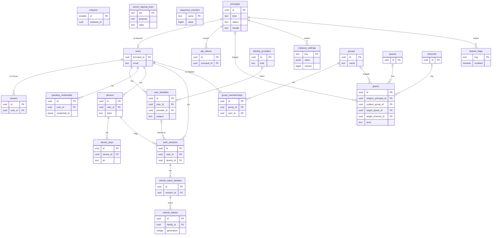
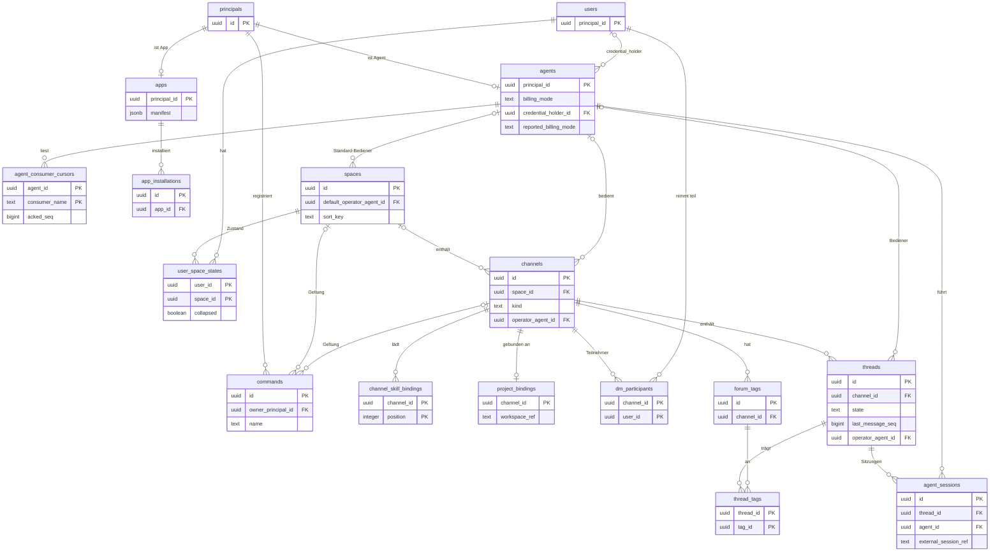
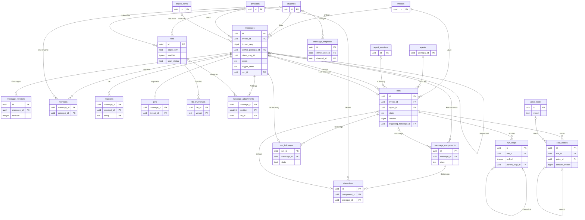

# 03 Datenmodell (PostgreSQL)

Status: Entwurf M0. Normativ für Migrationen, sqlc-Abfragen und Repository-Ports.
Begriffe: siehe [00-glossar.md](00-glossar.md). Sync und Ereignisse: siehe
[04-sync-protokoll.md](04-sync-protokoll.md). Aktionen: siehe [05-aktionen.md](05-aktionen.md).
Aufbewahrung und Löschung: siehe [20-datenschutz.md](20-datenschutz.md). Suche: siehe
[14-suche.md](14-suche.md).

## 1. Grundsätze

1. **IDs.** Jede Tabelle mit eigener Identität hat `id uuid` als Primärschlüssel. Der Wert ist
   eine UUIDv7 (RFC 9562). Die Anwendung erzeugt sie, nicht die Datenbank. Grund: gleiche Logik
   auf jeder PostgreSQL-Version, und Clients können IDs vorab erzeugen (`client_msg_id`).
   UUIDv7 ist zeitlich sortiert und hält B-Tree-Indexe kompakt.
2. **Zeit.** Alle Zeitpunkte sind `timestamptz` in UTC. Dauern sind `bigint` in Millisekunden
   (Suffix `_ms`). Die Server-Uhr ist die einzige Zeitquelle für Reihenfolgen; Reihenfolge kommt
   aber nie aus Zeitstempeln, sondern aus Sequenznummern.
3. **Aufzählungen.** Als `text` mit `CHECK (... IN (...))`, nicht als PostgreSQL-`ENUM`.
   Grund: neue Werte sind eine additive Migration ohne Sperre des Typs.
4. **Geldbeträge.** `bigint` in Mikro-Einheiten der Währung (Suffix `_micros`) plus
   `currency text` (ISO 4217). Grund: exakt, schnell summierbar, kein Rundungsfehler.
5. **Sortierschlüssel.** Frei sortierbare Listen (Bereiche, Kanäle, Tags) nutzen
   `sort_key text COLLATE "C"` als Bruchindex (fractional index). Verschieben ändert genau eine
   Zeile.
6. **Groß- und Kleinschreibung.** Eindeutige Namen (Handles, Slugs) werden über einen
   eindeutigen Index auf `lower(...)` geschützt. Keine Erweiterung `citext` nötig.
7. **Löschen.** Prinzipale, Kanäle, Threads und Nachrichten werden nie hart gelöscht. Sie
   bekommen `deleted_at` bzw. `archived_at`; Inhalte werden bei Löschung sofort geleert
   (Tombstone). Grund: Sequenznummern, Audit-Kette und Autorenschaft bleiben konsistent. Harte
   Löschung gibt es nur für abhängige Detailzeilen (`ON DELETE CASCADE`) und durch die
   Aufbewahrungsjobs aus [20-datenschutz.md](20-datenschutz.md).
8. **JSON.** `jsonb` nur für Daten mit eigenem, versioniertem Schema (Manifest, Lauf-Kennzahlen,
   Komponenten-Definition, Ereignis-Nutzlast). Jedes solche Feld nennt sein Schema in der
   Spalte "Regeln". Felder, nach denen gefiltert oder verknüpft wird, sind nie nur in `jsonb`.
9. **Geheimnisse.** Keine Geheimnisse im Klartext. Tokens nur als Hash
   (HMAC-SHA-256 mit einem Server-Pepper aus dem Secret-Provider). Fremde Zugangsdaten
   (Webhook-Secrets, OIDC-Client-Secrets) nur als Verweis `secret_ref` auf den Secret-Provider.
   Claude.ai-Zugangsdaten oder Abo-Tokens gibt es im Modell nicht (B10, I5).
10. **Optimistische Sperre.** Änderbare, synchronisierte Objekte haben `version bigint`. Jede
    Änderung erhöht sie um eins. Schreibende Anfragen tragen die erwartete Version.
11. **Isolationsstufe.** Schreibende Transaktionen laufen in `READ COMMITTED`. Die
    Zähler-Muster aus Abschnitt 6 setzen das voraus.
12. **Zugriff.** Nur das Modul, dem eine Tabelle gehört, schreibt sie. Andere Module lesen über
    dessen Port. Abfragen, die Rechte filtern, bekommen die Menge der sichtbaren Kanäle von
    `authz` und verknüpfen nie selbst mit `grants` (eine Wahrheit, B7).

## 2. Module

| Modul | Verantwortung |
|---|---|
| `instance` | Instanz, Einstellungen, Branding, Feature-Flags, Signierschlüssel, Zähler |
| `identity` | Prinzipale, Menschen, Identitäten, Passkeys, Geräte, Sitzungen, Tokens, Owner |
| `authz` | Gruppen, Freigaben, Rechte-Version, `authorize` |
| `chat` | Bereiche, Kanäle, Threads, Tags, Projektbindung, Seitenleisten-Zustand |
| `messaging` | Nachrichten, Revisionen, Erwähnungen, Reaktionen, Anheften, Vorlagen |
| `files` | Dateien, Vorschaubilder, Anhänge, Virenscan, Transkripte |
| `agents` | Agenten, Agenten-Sitzungen, Verbraucher-Cursor, Slash-Befehle |
| `runs` | Läufe, Schritte, Nachträge, Komponenten, Interaktionen |
| `apps` | Apps, Installationen, Webhooks ein und aus |
| `billing` | Kosteneinträge, Preistabelle |
| `sync` | Ereignis-Log, Idempotenz-Schlüssel, Gelesen-Stand, Entwürfe, Einstellungen |
| `notify` | Benachrichtigungs-Einstellungen, Ruhezeiten, Push-Registrierungen |
| `audit` | Audit-Log |
| `privacy` | DSGVO-Aufträge |
| `importer` | Import-Quellen und importierte Objekte |
| `status` | Statusseite |

## 3. Aufbewahrungsklassen

Jede Tabelle nennt genau eine Klasse. Dauer, Löschweg und Ausnahmen (z. B. rechtliche
Aufbewahrung) legt [20-datenschutz.md](20-datenschutz.md) je Klasse fest. Dieses Kapitel legt
nur die Zuordnung fest.

| Klasse | Inhalt |
|---|---|
| `config` | Konfiguration der Instanz. Lebt, bis sie geändert wird. |
| `account` | Stammdaten von Prinzipalen und Gruppen. Lebt bis zur Löschung oder Pseudonymisierung. |
| `security` | Sitzungen, Tokens, Geräte, Schlüssel. Kurz nach Ablauf oder Widerruf löschbar. |
| `content` | Nutzerinhalte: Nachrichten, Dateien, Threads, Läufe. Löschung durch Nutzer, Admin oder DSGVO-Auftrag. |
| `personal_sync` | Persönliche Sync-Daten: Gelesen-Stand, Entwürfe, Einstellungen. Folgt dem Konto. |
| `event_log` | Ereignis-Log. Fenster `sync.event_retention`. |
| `transient` | Kurzlebige Technikdaten: Idempotenz-Schlüssel, Zustellversuche. |
| `audit` | Audit-Log. Eigene Frist, getrennt von Telemetrie (B11). |
| `cost` | Kosten und Preise. Frist für Abrechnungsbelege. |
| `import` | Import-Zustand. Löschbar nach Abschluss des Imports. |
| `privacy_job` | DSGVO-Aufträge und Exportpakete. |
| `ops` | Statusseite. |

## 4. Tabellen

Schreibweise: "Null" = `ja` heißt NULL erlaubt. "Standard" leer heißt kein Standardwert.
Fremdschlüssel nennen ihr `ON DELETE`-Verhalten. `RESTRICT` ist der Normalfall, weil
Prinzipale und Inhalte nicht hart gelöscht werden.

### 4.1 Instanz (`instance`)

#### `instance`

Zweck: genau eine Zeile mit der Identität dieser Installation. Modul: `instance`.

| Feld | Typ | Null | Standard | Regeln / Hinweise |
|---|---|---|---|---|
| `id` | `smallint` | nein | `1` | `CHECK (id = 1)`; erzwingt eine Zeile |
| `instance_id` | `uuid` | nein | | UUIDv7, bei der Einrichtung erzeugt; Aussteller (`iss`) in Tokens |
| `setup_completed_at` | `timestamptz` | ja | | NULL bis der erste Owner per Server-Befehl angelegt ist |
| `schema_version` | `bigint` | nein | | letzte angewandte Migration, nur zur Anzeige |
| `created_at` | `timestamptz` | nein | `now()` | |

PK: `id`. FK: keine. Unique: `instance_id`. Indexe: keine weiteren.
Aufbewahrung: `config`.

#### `instance_settings`

Zweck: typisierte Einstellungen der Instanz, inklusive Branding, als Schlüssel-Wert-Paare.
Modul: `instance`.

| Feld | Typ | Null | Standard | Regeln / Hinweise |
|---|---|---|---|---|
| `key` | `text` | nein | | z. B. `branding.product_name`, `branding.accent_color`, `branding.logo_file_id`, `locale.default`; Schlüssel und Schema in der Konfigurationsreferenz |
| `value` | `jsonb` | nein | | gegen das Schema des Schlüssels geprüft |
| `version` | `bigint` | nein | `1` | optimistische Sperre |
| `updated_by` | `uuid` | ja | | Prinzipal; NULL bei Einrichtung |
| `updated_at` | `timestamptz` | nein | `now()` | |

PK: `key`. FK: `updated_by` -> `principals(id)` ON DELETE RESTRICT. Unique: keine weiteren.
Indexe: keine weiteren (wenige Zeilen, voll im Cache). Aufbewahrung: `config`.

#### `server_signing_keys`

Zweck: öffentliche Teile der Server-Schlüssel für Zugriffstokens und Aufruf-Marken (I3).
Der private Teil liegt nur im Secret-Provider. Modul: `instance`.

| Feld | Typ | Null | Standard | Regeln / Hinweise |
|---|---|---|---|---|
| `kid` | `text` | nein | | Schlüssel-ID im JWS-Kopf |
| `purpose` | `text` | nein | | `CHECK (purpose IN ('access_token','invocation','webhook_out'))` |
| `alg` | `text` | nein | | `CHECK (alg IN ('EdDSA','ES256'))` |
| `public_jwk` | `jsonb` | nein | | JWK nach RFC 7517, ohne privaten Teil |
| `private_key_ref` | `text` | nein | | Verweis auf den Secret-Provider |
| `state` | `text` | nein | `'active'` | `CHECK (state IN ('next','active','retiring','retired'))` |
| `created_at` | `timestamptz` | nein | `now()` | |
| `not_after` | `timestamptz` | ja | | nach diesem Zeitpunkt wird nicht mehr signiert |

PK: `kid`. FK: keine. Unique: Teilindex `(purpose) WHERE state = 'active'` (genau ein aktiver
Schlüssel je Zweck). Indexe: `(purpose, state)` für die JWKS-Ausgabe.
Aufbewahrung: `security`.

#### `feature_flags`

Zweck: Schalter für Funktionen, global oder für Gruppen und Personen. Modul: `instance`.

| Feld | Typ | Null | Standard | Regeln / Hinweise |
|---|---|---|---|---|
| `key` | `text` | nein | | z. B. `dm.enabled`, `voice.enabled` |
| `enabled` | `boolean` | nein | `false` | globaler Wert |
| `rollout` | `jsonb` | nein | `'{}'` | Schema `feature_flag_rollout.v1`: Listen von `user_ids` und `group_ids`, für die der Schalter abweichend gilt |
| `description` | `text` | nein | | |
| `version` | `bigint` | nein | `1` | |
| `updated_by` | `uuid` | ja | | |
| `updated_at` | `timestamptz` | nein | `now()` | |

PK: `key`. FK: `updated_by` -> `principals(id)` ON DELETE RESTRICT. Indexe: keine weiteren.
Aufbewahrung: `config`.

#### `sequence_counters`

Zweck: Zähler-Zeilen, deren Zeilensperre die Commit-Reihenfolge erzwingt. Modul: `instance`
(gelesen und geschrieben nur über die Funktionen aus Abschnitt 6).

| Feld | Typ | Null | Standard | Regeln / Hinweise |
|---|---|---|---|---|
| `name` | `text` | nein | | `CHECK (name IN ('event_seq','audit_seq','permission_version'))` |
| `value` | `bigint` | nein | `0` | nur steigend |

PK: `name`. FK: keine. Indexe: keine weiteren. Aufbewahrung: `config`.

Die drei Zeilen werden in der ersten Migration angelegt. `permission_version` ist der
Rechte-Versionszähler (siehe 4.3 und [04-sync-protokoll.md](04-sync-protokoll.md)).

### 4.2 Identität (`identity`)

#### `principals`

Zweck: gemeinsame Identität aller handelnden Prinzipale (Mensch, Agent, App). Fremdschlüssel
auf "wer hat es getan" zeigen immer hierher. Modul: `identity`.

| Feld | Typ | Null | Standard | Regeln / Hinweise |
|---|---|---|---|---|
| `id` | `uuid` | nein | | UUIDv7 |
| `kind` | `text` | nein | | `CHECK (kind IN ('user','agent','app'))`; nie änderbar |
| `status` | `text` | nein | `'active'` | `CHECK (status IN ('pending','active','disabled','deleted'))` |
| `handle` | `text` | nein | | für Erwähnungen, `CHECK (handle ~ '^[a-z0-9][a-z0-9._-]*$')`, Länge bis `principal.handle_max_chars` |
| `display_name` | `text` | nein | | nach Löschung pseudonymisiert |
| `avatar_file_id` | `uuid` | ja | | |
| `created_at` | `timestamptz` | nein | `now()` | |
| `disabled_at` | `timestamptz` | ja | | |
| `deleted_at` | `timestamptz` | ja | | Pseudonymisierung durch DSGVO-Auftrag |

PK: `id`. FK: `avatar_file_id` -> `files(id)` ON DELETE SET NULL. Unique: `lower(handle)`.
Indexe: `(kind, status)` für Verzeichnislisten. Aufbewahrung: `account`.

#### `users`

Zweck: Zusatzdaten für Menschen. Modul: `identity`.

| Feld | Typ | Null | Standard | Regeln / Hinweise |
|---|---|---|---|---|
| `principal_id` | `uuid` | nein | | `kind = 'user'` per Trigger geprüft |
| `email` | `text` | ja | | nur zur Anzeige und zum Abgleich mit OIDC; nie für Benachrichtigungen |
| `locale` | `text` | nein | `'de'` | BCP 47 |
| `time_zone` | `text` | nein | `'UTC'` | IANA-Name, für Ruhezeiten |
| `last_active_at` | `timestamptz` | ja | | grob, höchstens einmal je `identity.last_active_granularity` geschrieben |

PK: `principal_id`. FK: `principal_id` -> `principals(id)` ON DELETE RESTRICT.
Unique: `lower(email)` als Teilindex `WHERE email IS NOT NULL`. Indexe: keine weiteren.
Aufbewahrung: `account`.

#### `owners`

Zweck: Liste der Owner. Mindestens einer. Modul: `identity`.

| Feld | Typ | Null | Standard | Regeln / Hinweise |
|---|---|---|---|---|
| `id` | `uuid` | nein | | |
| `user_id` | `uuid` | nein | | nur Menschen |
| `granted_by` | `uuid` | ja | | NULL nur beim ersten Owner (Server-Befehl) |
| `granted_at` | `timestamptz` | nein | `now()` | |
| `revoked_at` | `timestamptz` | ja | | |
| `revoked_by` | `uuid` | ja | | |
| `reason` | `text` | nein | | Pflicht, steht im Audit |

PK: `id`. FK: `user_id` -> `users(principal_id)` ON DELETE RESTRICT; `granted_by`,
`revoked_by` -> `principals(id)` ON DELETE RESTRICT. Unique: Teilindex `(user_id) WHERE
revoked_at IS NULL`. Indexe: über den Teilindex. Aufbewahrung: `account`.
Invariante: Eine Transaktion, die einen Owner widerruft, prüft vor dem Commit, dass mindestens
ein aktiver Owner bleibt, und prüft I1 (Abschnitt 6.4).

#### `identity_providers`

Zweck: konfigurierte Anmelde-Treiber (B9). Modul: `identity`.

| Feld | Typ | Null | Standard | Regeln / Hinweise |
|---|---|---|---|---|
| `id` | `uuid` | nein | | |
| `kind` | `text` | nein | | `CHECK (kind IN ('oidc','trusted_header','local'))` |
| `name` | `text` | nein | | Anzeige, z. B. "Firmen-SSO" |
| `config` | `jsonb` | nein | | Schema `identity_provider.<kind>.v1`; OIDC-Client-Secret nur als `secret_ref` |
| `enabled` | `boolean` | nein | `true` | |
| `allow_provisioning` | `boolean` | nein | `false` | `false`: unbekannte Subjekte bekommen keinen Zugang (kein Selbst-Registrieren) |
| `created_at` | `timestamptz` | nein | `now()` | |
| `updated_at` | `timestamptz` | nein | `now()` | |

PK: `id`. FK: keine. Unique: `lower(name)`; Teilindex `(kind) WHERE kind IN ('trusted_header',
'local')` (je einer). Indexe: keine weiteren. Aufbewahrung: `config`.

#### `user_identities`

Zweck: Verknüpfung eines Menschen mit einem Subjekt bei einem Anbieter. Modul: `identity`.

| Feld | Typ | Null | Standard | Regeln / Hinweise |
|---|---|---|---|---|
| `id` | `uuid` | nein | | |
| `user_id` | `uuid` | nein | | |
| `provider_id` | `uuid` | nein | | |
| `subject` | `text` | nein | | OIDC `sub` oder Header-Login oder lokaler Login-Name |
| `issuer` | `text` | ja | | OIDC `iss`, sonst NULL |
| `email_at_link` | `text` | ja | | Momentaufnahme, nur Anzeige |
| `linked_at` | `timestamptz` | nein | `now()` | |
| `last_login_at` | `timestamptz` | ja | | |
| `unlinked_at` | `timestamptz` | ja | | |

PK: `id`. FK: `user_id` -> `users(principal_id)` ON DELETE RESTRICT; `provider_id` ->
`identity_providers(id)` ON DELETE RESTRICT. Unique: Teilindex `(provider_id, subject) WHERE
unlinked_at IS NULL`. Indexe: `(user_id)` für die Kontoansicht. Aufbewahrung: `account`.

#### `passkey_credentials`

Zweck: WebAuthn-Passkeys für Anmeldung lokaler Konten und für Step-up. Modul: `identity`.

| Feld | Typ | Null | Standard | Regeln / Hinweise |
|---|---|---|---|---|
| `id` | `uuid` | nein | | |
| `user_id` | `uuid` | nein | | |
| `credential_id` | `bytea` | nein | | WebAuthn Credential ID |
| `public_key_cose` | `bytea` | nein | | öffentlicher Schlüssel (COSE) |
| `sign_count` | `bigint` | nein | `0` | Rückschritt wird geloggt und im Audit gemeldet |
| `aaguid` | `uuid` | ja | | |
| `transports` | `text[]` | nein | `'{}'` | |
| `backup_eligible` | `boolean` | nein | `false` | |
| `backup_state` | `boolean` | nein | `false` | |
| `name` | `text` | nein | | vom Menschen vergeben |
| `created_at` | `timestamptz` | nein | `now()` | |
| `last_used_at` | `timestamptz` | ja | | |
| `revoked_at` | `timestamptz` | ja | | |

PK: `id`. FK: `user_id` -> `users(principal_id)` ON DELETE RESTRICT. Unique: `credential_id`.
Indexe: `(user_id) WHERE revoked_at IS NULL` für die Anmelde-Challenge. Aufbewahrung: `security`.

#### `devices`

Zweck: ein installierter Client eines Menschen. Neue Geräte warten auf Bestätigung.
Modul: `identity`.

| Feld | Typ | Null | Standard | Regeln / Hinweise |
|---|---|---|---|---|
| `id` | `uuid` | nein | | vom Client bei der Registrierung erzeugt (UUIDv7) |
| `user_id` | `uuid` | nein | | |
| `name` | `text` | nein | | z. B. "Alex iPhone" |
| `platform` | `text` | nein | | `CHECK (platform IN ('ios','android','macos','windows','web','cli'))` |
| `state` | `text` | nein | `'pending'` | `CHECK (state IN ('pending','active','revoked'))` |
| `app_version` | `text` | ja | | |
| `approved_by` | `uuid` | ja | | |
| `approved_at` | `timestamptz` | ja | | |
| `revoked_by` | `uuid` | ja | | |
| `revoked_at` | `timestamptz` | ja | | |
| `revoke_reason` | `text` | ja | | |
| `created_at` | `timestamptz` | nein | `now()` | |
| `last_seen_at` | `timestamptz` | ja | | |

PK: `id`. FK: `user_id` -> `users(principal_id)` ON DELETE RESTRICT; `approved_by`,
`revoked_by` -> `principals(id)` ON DELETE RESTRICT. Unique: keine weiteren.
Indexe: `(user_id, state)` für Geräteliste; `(state) WHERE state = 'pending'` für die
Freigabe-Warteschlange der Admin-Konsole. Aufbewahrung: `security`.

#### `device_keys`

Zweck: öffentlicher Geräteschlüssel aus dem sicheren Speicher; bindet Tokens per DPoP.
Modul: `identity`.

| Feld | Typ | Null | Standard | Regeln / Hinweise |
|---|---|---|---|---|
| `id` | `uuid` | nein | | |
| `device_id` | `uuid` | nein | | |
| `jkt` | `text` | nein | | JWK-Thumbprint (RFC 7638), steht als `cnf.jkt` im Token |
| `public_jwk` | `jsonb` | nein | | |
| `alg` | `text` | nein | | `CHECK (alg IN ('ES256','EdDSA'))` |
| `attestation` | `jsonb` | ja | | Plattform-Attestierung, falls vorhanden |
| `created_at` | `timestamptz` | nein | `now()` | |
| `revoked_at` | `timestamptz` | ja | | Schlüsselwechsel oder Gerätesperre |

PK: `id`. FK: `device_id` -> `devices(id)` ON DELETE CASCADE. Unique: `jkt`; Teilindex
`(device_id) WHERE revoked_at IS NULL` (ein aktiver Schlüssel je Gerät). Indexe: über die
Unique-Indexe. Aufbewahrung: `security`.

#### `auth_sessions`

Zweck: Anmeldesitzung eines Menschen auf einem Gerät. Jeder Zugriffstoken trägt ihre ID als
`sid`; Widerruf wirkt dadurch sofort. Modul: `identity`.

| Feld | Typ | Null | Standard | Regeln / Hinweise |
|---|---|---|---|---|
| `id` | `uuid` | nein | | |
| `user_id` | `uuid` | nein | | |
| `device_id` | `uuid` | nein | | |
| `identity_id` | `uuid` | ja | | womit angemeldet; NULL bei reinem Passkey-Login lokal |
| `auth_method` | `text` | nein | | `CHECK (auth_method IN ('oidc','trusted_header','passkey'))` |
| `created_at` | `timestamptz` | nein | `now()` | |
| `expires_at` | `timestamptz` | nein | | absolutes Ende, `created_at + auth.session_max_age` |
| `step_up_at` | `timestamptz` | ja | | letzte frische Passkey-Bestätigung; gültig für `auth.step_up_max_age` |
| `last_seen_at` | `timestamptz` | ja | | |
| `last_ip` | `inet` | ja | | nur für Sicherheitsansicht, Klasse `security` |
| `revoked_at` | `timestamptz` | ja | | |
| `revoke_reason` | `text` | ja | | `CHECK (revoke_reason IN ('logout','admin','device_revoked','refresh_reuse','user_disabled','expired'))` |

PK: `id`. FK: `user_id` -> `users(principal_id)` ON DELETE RESTRICT; `device_id` ->
`devices(id)` ON DELETE RESTRICT; `identity_id` -> `user_identities(id)` ON DELETE SET NULL.
Indexe: `(user_id) WHERE revoked_at IS NULL` für "alle Sitzungen beenden"; `(device_id)`;
`(expires_at)` für den Aufräumjob. Aufbewahrung: `security`.

#### `refresh_token_families`

Zweck: Familie rotierender Refresh-Tokens einer Sitzung; Wiederverwendung sperrt die Familie.
Modul: `identity`.

| Feld | Typ | Null | Standard | Regeln / Hinweise |
|---|---|---|---|---|
| `id` | `uuid` | nein | | |
| `session_id` | `uuid` | nein | | |
| `current_generation` | `integer` | nein | `0` | Nummer des einzigen gültigen Tokens |
| `created_at` | `timestamptz` | nein | `now()` | |
| `revoked_at` | `timestamptz` | ja | | |
| `revoke_reason` | `text` | ja | | `CHECK (revoke_reason IN ('reuse_detected','logout','session_revoked','expired'))` |

PK: `id`. FK: `session_id` -> `auth_sessions(id)` ON DELETE CASCADE. Unique: Teilindex
`(session_id) WHERE revoked_at IS NULL`. Indexe: über den Unique-Index.
Aufbewahrung: `security`.

#### `refresh_tokens`

Zweck: einzelne Refresh-Tokens, nur als Hash. Modul: `identity`.

| Feld | Typ | Null | Standard | Regeln / Hinweise |
|---|---|---|---|---|
| `id` | `uuid` | nein | | |
| `family_id` | `uuid` | nein | | |
| `generation` | `integer` | nein | | |
| `token_hash` | `bytea` | nein | | HMAC-SHA-256 |
| `issued_at` | `timestamptz` | nein | `now()` | |
| `expires_at` | `timestamptz` | nein | | `issued_at + auth.refresh_token_ttl` |
| `used_at` | `timestamptz` | ja | | gesetzt bei Rotation |

PK: `id`. FK: `family_id` -> `refresh_token_families(id)` ON DELETE CASCADE.
Unique: `token_hash`; `(family_id, generation)`. Indexe: über die Unique-Indexe.
Aufbewahrung: `security`.
Rotation: In einer Transaktion `SELECT ... FOR UPDATE` auf die Familie. Gilt
`generation = current_generation` und `used_at IS NULL`, wird `used_at` gesetzt, ein neues Token
mit `generation + 1` angelegt und `current_generation` erhöht. Ist das Token schon benutzt oder
älter, ist das Wiederverwendung: Familie und Sitzung werden widerrufen
(`refresh_reuse`), ein Audit-Eintrag entsteht, die Anfrage scheitert.

#### `api_tokens`

Zweck: langlebige Tokens für Agenten, Apps und (per Feature-Flag) persönliche Werkzeuge.
Nur Hash und Präfix. Modul: `identity`.

| Feld | Typ | Null | Standard | Regeln / Hinweise |
|---|---|---|---|---|
| `id` | `uuid` | nein | | |
| `principal_id` | `uuid` | nein | | Inhaber des Tokens |
| `name` | `text` | nein | | |
| `token_prefix` | `text` | nein | | erste Zeichen, zum Wiedererkennen in der Konsole |
| `token_hash` | `bytea` | nein | | HMAC-SHA-256 |
| `scopes` | `text[]` | nein | `'{}'` | Teilmenge der Manifest-Scopes bzw. Agenten-Scopes |
| `dpop_jkt` | `text` | ja | | gesetzt: Anfragen müssen mit diesem Schlüssel DPoP-gebunden sein |
| `expires_at` | `timestamptz` | ja | | |
| `created_by` | `uuid` | nein | | |
| `created_at` | `timestamptz` | nein | `now()` | |
| `last_used_at` | `timestamptz` | ja | | grob, höchstens einmal je `identity.last_active_granularity` |
| `revoked_at` | `timestamptz` | ja | | |
| `revoked_by` | `uuid` | ja | | |

PK: `id`. FK: `principal_id`, `created_by`, `revoked_by` -> `principals(id)` ON DELETE RESTRICT.
Unique: `token_hash`. Indexe: `(principal_id) WHERE revoked_at IS NULL` für die Token-Liste.
Aufbewahrung: `security`.

### 4.3 Rechte (`authz`)

#### `groups`

Zweck: benannte Menge von Menschen als Subjekt von Freigaben. Modul: `authz`.

| Feld | Typ | Null | Standard | Regeln / Hinweise |
|---|---|---|---|---|
| `id` | `uuid` | nein | | |
| `name` | `text` | nein | | z. B. "Support" |
| `description` | `text` | nein | `''` | |
| `source` | `text` | nein | `'local'` | `CHECK (source IN ('local','oidc_claim'))` |
| `external_ref` | `text` | ja | | Claim-Wert bei `oidc_claim` |
| `created_by` | `uuid` | nein | | |
| `created_at` | `timestamptz` | nein | `now()` | |
| `deleted_at` | `timestamptz` | ja | | |

PK: `id`. FK: `created_by` -> `principals(id)` ON DELETE RESTRICT. Unique: Teilindex
`lower(name) WHERE deleted_at IS NULL`; Teilindex `(external_ref) WHERE source = 'oidc_claim'`.
Indexe: über die Unique-Indexe. Aufbewahrung: `account`.

#### `group_memberships`

Zweck: Mitgliedschaft eines Menschen in einer Gruppe, mit Verlauf. Modul: `authz`.

| Feld | Typ | Null | Standard | Regeln / Hinweise |
|---|---|---|---|---|
| `id` | `uuid` | nein | | |
| `group_id` | `uuid` | nein | | |
| `user_id` | `uuid` | nein | | nur Menschen (Entscheidung R-DM-07) |
| `added_by` | `uuid` | nein | | |
| `added_at` | `timestamptz` | nein | `now()` | |
| `expires_at` | `timestamptz` | ja | | bei jedem `authorize` geprüft |
| `removed_at` | `timestamptz` | ja | | |
| `removed_by` | `uuid` | ja | | |

PK: `id`. FK: `group_id` -> `groups(id)` ON DELETE RESTRICT; `user_id` ->
`users(principal_id)` ON DELETE RESTRICT; `added_by`, `removed_by` -> `principals(id)` ON DELETE
RESTRICT. Unique: Teilindex `(group_id, user_id) WHERE removed_at IS NULL`.
Indexe: `(user_id) WHERE removed_at IS NULL` für "Gruppen einer Person" beim Rechte-Aufbau.
Aufbewahrung: `account`.

#### `grants`

Zweck: eine Freigabe: Subjekt x Ziel x Stufe x Zusatzrechte x Ablauf x Grund. Widerruf setzt
`revoked_at`, die Zeile bleibt. Modul: `authz`.

| Feld | Typ | Null | Standard | Regeln / Hinweise |
|---|---|---|---|---|
| `id` | `uuid` | nein | | |
| `subject_kind` | `text` | nein | | `CHECK (subject_kind IN ('user','group','agent','app'))` |
| `subject_principal_id` | `uuid` | ja | | gesetzt bei `user`, `agent`, `app` |
| `subject_group_id` | `uuid` | ja | | gesetzt bei `group` |
| `target_kind` | `text` | nein | | `CHECK (target_kind IN ('instance','space','channel'))` |
| `target_space_id` | `uuid` | ja | | gesetzt genau bei `space` |
| `target_channel_id` | `uuid` | ja | | gesetzt genau bei `channel` |
| `level` | `text` | nein | | `CHECK (level IN ('read','write','trigger'))` |
| `capabilities` | `text[]` | nein | `'{}'` | Teilmenge von `approve_actions`, `upload`, `export`, `manage` |
| `expires_at` | `timestamptz` | ja | | bei jedem `authorize` geprüft, nicht per Job |
| `reason` | `text` | nein | | Pflicht |
| `granted_by` | `uuid` | nein | | |
| `granted_at` | `timestamptz` | nein | `now()` | |
| `revoked_at` | `timestamptz` | ja | | |
| `revoked_by` | `uuid` | ja | | |
| `revoke_reason` | `text` | ja | | |

PK: `id`.
FK: `subject_principal_id` -> `principals(id)` ON DELETE RESTRICT; `subject_group_id` ->
`groups(id)` ON DELETE RESTRICT; `target_space_id` -> `spaces(id)` ON DELETE RESTRICT;
`target_channel_id` -> `channels(id)` ON DELETE RESTRICT; `granted_by`, `revoked_by` ->
`principals(id)` ON DELETE RESTRICT.
Checks: genau eines von `subject_principal_id` und `subject_group_id` ist gesetzt, passend zu
`subject_kind`; Ziel-Spalten passend zu `target_kind`; `capabilities <@ ARRAY['approve_actions',
'upload','export','manage']`; bei `subject_kind IN ('agent','app')` gilt `level <> 'trigger'`
(R-DM-08).
Unique: keine (mehrere Freigaben auf dasselbe Paar sind erlaubt; die höchste gültige gilt).
Indexe: `(subject_principal_id) WHERE revoked_at IS NULL` und `(subject_group_id) WHERE
revoked_at IS NULL` für den Rechte-Aufbau eines Prinzipals; `(target_space_id) WHERE revoked_at
IS NULL` und `(target_channel_id) WHERE revoked_at IS NULL` für "Wer hat Zugriff?" und die
I1-Prüfung; `(expires_at) WHERE revoked_at IS NULL AND expires_at IS NOT NULL` für die
Erinnerung vor Ablauf. Aufbewahrung: `account`.

Freigaben werden nie geändert, nur widerrufen und neu angelegt (R-DM-09). Jede Transaktion,
die `grants`, `group_memberships`, `owners`, Bediener-Zuordnungen, `agents.billing_mode`,
`agents.credential_holder_id` oder den Status eines Prinzipals ändert, erhöht
`sequence_counters.permission_version` (Abschnitt 6.3).

### 4.4 Agenten und Apps (`agents`, `apps`)

#### `agents`

Zweck: Zusatzdaten für Agenten-Prinzipale: Betrieb, Backend-Richtlinie und gemeldeter Zustand.
Modul: `agents`.

| Feld | Typ | Null | Standard | Regeln / Hinweise |
|---|---|---|---|---|
| `principal_id` | `uuid` | nein | | `kind = 'agent'` per Trigger geprüft |
| `adapter_kind` | `text` | nein | | freier Bezeichner des Adapters, z. B. `hermes`, `code_runner`, `custom` |
| `description` | `text` | nein | `''` | |
| `operator_config` | `jsonb` | nein | `'{}'` | Schema `agent_operator_config.v1`: Standard-Modell, Fähigkeiten (`supports_followups`, `supports_components`, `supports_voice`), Anzeige-Optionen; keine Geheimnisse |
| `billing_mode` | `text` | nein | `'organization'` | `CHECK (billing_mode IN ('personal','organization'))` |
| `credential_holder_id` | `uuid` | ja | | Pflicht bei `personal`, sonst NULL |
| `billing_mode_changed_at` | `timestamptz` | ja | | |
| `billing_mode_changed_by` | `uuid` | ja | | |
| `reported_runtime_state` | `text` | nein | `'unknown'` | `CHECK (reported_runtime_state IN ('unknown','online','degraded','offline'))` |
| `reported_billing_mode` | `text` | ja | | letzter Ist-Modus aus dem Heartbeat, `personal` oder `organization` |
| `reported_runtime_version` | `text` | ja | | |
| `reported_details` | `jsonb` | nein | `'{}'` | Schema `agent_heartbeat.v1`, ohne Geheimnisse und ohne Inhalte |
| `last_heartbeat_at` | `timestamptz` | ja | | |
| `version` | `bigint` | nein | `1` | |

PK: `principal_id`. FK: `principal_id` -> `principals(id)` ON DELETE RESTRICT;
`credential_holder_id` -> `users(principal_id)` ON DELETE RESTRICT; `billing_mode_changed_by` ->
`principals(id)` ON DELETE RESTRICT.
Checks: `(billing_mode = 'personal') = (credential_holder_id IS NOT NULL)`.
Indexe: `(credential_holder_id) WHERE billing_mode = 'personal'` für die I1-Prüfung bei
Änderungen an einer Person; `(last_heartbeat_at)` für die Präsenz-Auswertung.
Aufbewahrung: `account`.

Heartbeat-Felder werden höchstens einmal je `agent.heartbeat_persist_interval` geschrieben;
dazwischen hält der Server den Zustand im Speicher.

#### `agent_consumer_cursors`

Zweck: dauerhafter Lesestand eines Agenten-Adapters im Ereignis-Log. Modul: `agents`.

| Feld | Typ | Null | Standard | Regeln / Hinweise |
|---|---|---|---|---|
| `agent_id` | `uuid` | nein | | |
| `consumer_name` | `text` | nein | `'default'` | mehrere Verbraucher je Agent möglich |
| `acked_seq` | `bigint` | nein | | höchste bestätigte globale Sequenz |
| `created_at` | `timestamptz` | nein | `now()` | Startpunkt; Nachholen nie vor diesem Zeitpunkt |
| `updated_at` | `timestamptz` | nein | `now()` | |

PK: `(agent_id, consumer_name)`. FK: `agent_id` -> `agents(principal_id)` ON DELETE CASCADE.
Indexe: über den PK. Aufbewahrung: `security`.

#### `apps`

Zweck: Zusatzdaten für App-Prinzipale (Integrationen) mit Manifest. Modul: `apps`.

| Feld | Typ | Null | Standard | Regeln / Hinweise |
|---|---|---|---|---|
| `principal_id` | `uuid` | nein | | `kind = 'app'` per Trigger geprüft |
| `slug` | `text` | nein | | |
| `manifest` | `jsonb` | nein | | Schema `app_manifest.v1`: Scopes, Ereignis-Abos, Slash-Befehle, Komponenten, Webhook-URLs |
| `manifest_version` | `text` | nein | | SemVer des Manifests |
| `manifest_sha256` | `bytea` | nein | | |
| `publisher` | `text` | nein | `''` | |
| `homepage_url` | `text` | ja | | |
| `created_at` | `timestamptz` | nein | `now()` | |
| `updated_at` | `timestamptz` | nein | `now()` | |

PK: `principal_id`. FK: `principal_id` -> `principals(id)` ON DELETE RESTRICT.
Unique: `lower(slug)`. Indexe: über den Unique-Index. Aufbewahrung: `account`.

#### `app_installations`

Zweck: Installation einer App in dieser Instanz mit bewilligten Scopes. Modul: `apps`.

| Feld | Typ | Null | Standard | Regeln / Hinweise |
|---|---|---|---|---|
| `id` | `uuid` | nein | | |
| `app_id` | `uuid` | nein | | |
| `granted_scopes` | `text[]` | nein | `'{}'` | Teilmenge der Manifest-Scopes |
| `event_subscriptions` | `text[]` | nein | `'{}'` | Ereignistypen aus [05-aktionen.md](05-aktionen.md) |
| `state` | `text` | nein | `'active'` | `CHECK (state IN ('active','suspended','uninstalled'))` |
| `installed_by` | `uuid` | nein | | |
| `installed_at` | `timestamptz` | nein | `now()` | |
| `uninstalled_at` | `timestamptz` | ja | | |
| `uninstalled_by` | `uuid` | ja | | |

PK: `id`. FK: `app_id` -> `apps(principal_id)` ON DELETE RESTRICT; `installed_by`,
`uninstalled_by` -> `principals(id)` ON DELETE RESTRICT. Unique: Teilindex `(app_id) WHERE
state <> 'uninstalled'`. Indexe: über den Unique-Index. Aufbewahrung: `config`.

#### `commands`

Zweck: von Agenten oder Apps registrierte Slash-Befehle mit Optionen. Modul: `agents`.

| Feld | Typ | Null | Standard | Regeln / Hinweise |
|---|---|---|---|---|
| `id` | `uuid` | nein | | |
| `owner_principal_id` | `uuid` | nein | | Agent oder App |
| `name` | `text` | nein | | `CHECK (name ~ '^[a-z0-9][a-z0-9_-]*$')` |
| `description` | `text` | nein | | |
| `scope_kind` | `text` | nein | `'instance'` | `CHECK (scope_kind IN ('instance','space','channel'))` |
| `scope_space_id` | `uuid` | ja | | |
| `scope_channel_id` | `uuid` | ja | | |
| `options` | `jsonb` | nein | `'[]'` | Schema `command_options.v1`: Name, Typ (`string`, `integer`, `boolean`, `choice`, `user`, `file`), Pflicht, Auswahlwerte, `autocomplete` |
| `required_level` | `text` | nein | `'trigger'` | `CHECK (required_level IN ('write','trigger'))` |
| `control` | `boolean` | nein | `false` | `true`: Steuerbefehl (z. B. `stop`, `status`), geht nie als Prompt an das Modell |
| `version` | `bigint` | nein | `1` | |
| `created_at` | `timestamptz` | nein | `now()` | |
| `removed_at` | `timestamptz` | ja | | |

PK: `id`. FK: `owner_principal_id` -> `principals(id)` ON DELETE RESTRICT; `scope_space_id` ->
`spaces(id)` ON DELETE CASCADE; `scope_channel_id` -> `channels(id)` ON DELETE CASCADE.
Checks: Scope-Spalten passend zu `scope_kind`.
Unique: Teilindex `(owner_principal_id, lower(name), scope_kind, coalesce(scope_space_id,
scope_channel_id)) WHERE removed_at IS NULL`.
Indexe: `(owner_principal_id) WHERE removed_at IS NULL` für die Befehlsliste eines Agenten;
`lower(name) text_pattern_ops WHERE removed_at IS NULL` für die Vorschlagsliste beim Tippen.
Aufbewahrung: `config`.
Namenskonflikte zwischen Agenten löst die Anzeige: Befehle des Bedieners des Kanals stehen
zuerst; gleiche Namen anderer Agenten werden mit dem Agenten-Handle qualifiziert.

### 4.5 Struktur (`chat`)

#### `spaces`

Zweck: Bereich, oberste Gruppe der Seitenleiste. Modul: `chat`.

| Feld | Typ | Null | Standard | Regeln / Hinweise |
|---|---|---|---|---|
| `id` | `uuid` | nein | | |
| `name` | `text` | nein | | z. B. "Support" |
| `icon` | `text` | ja | | Icon-Token des Design-Systems, kein Emoji |
| `color` | `text` | ja | | Farb-Token |
| `sort_key` | `text COLLATE "C"` | nein | | globale Reihenfolge durch Admin |
| `default_operator_agent_id` | `uuid` | ja | | Standard-Bediener; NULL = keiner |
| `created_by` | `uuid` | nein | | |
| `created_at` | `timestamptz` | nein | `now()` | |
| `archived_at` | `timestamptz` | ja | | |
| `version` | `bigint` | nein | `1` | |

PK: `id`. FK: `default_operator_agent_id` -> `agents(principal_id)` ON DELETE RESTRICT;
`created_by` -> `principals(id)` ON DELETE RESTRICT. Unique: Teilindex `lower(name) WHERE
archived_at IS NULL`. Indexe: `(sort_key) WHERE archived_at IS NULL` für die Seitenleiste;
`(default_operator_agent_id)` für die I1-Prüfung. Aufbewahrung: `content`.

#### `user_space_states`

Zweck: persönlicher Seitenleisten-Zustand je Bereich (eingeklappt, eigene Reihenfolge),
geräteübergreifend. Modul: `chat`.

| Feld | Typ | Null | Standard | Regeln / Hinweise |
|---|---|---|---|---|
| `user_id` | `uuid` | nein | | |
| `space_id` | `uuid` | nein | | |
| `collapsed` | `boolean` | nein | `false` | |
| `sort_key` | `text COLLATE "C"` | ja | | NULL = globale Reihenfolge |
| `version` | `bigint` | nein | `1` | Regel siehe [04-sync-protokoll.md](04-sync-protokoll.md) |
| `updated_by_device_id` | `uuid` | ja | | |
| `updated_at` | `timestamptz` | nein | `now()` | |

PK: `(user_id, space_id)`. FK: `user_id` -> `users(principal_id)` ON DELETE CASCADE;
`space_id` -> `spaces(id)` ON DELETE CASCADE; `updated_by_device_id` -> `devices(id)` ON DELETE
SET NULL. Indexe: über den PK. Aufbewahrung: `personal_sync`.

#### `channels`

Zweck: Kanal (Text, Forum oder Direktnachricht) mit Bediener und Verhalten. Modul: `chat`.

| Feld | Typ | Null | Standard | Regeln / Hinweise |
|---|---|---|---|---|
| `id` | `uuid` | nein | | |
| `space_id` | `uuid` | ja | | NULL genau bei `kind = 'dm'` (R-DM-10) |
| `kind` | `text` | nein | | `CHECK (kind IN ('text','forum','dm'))` |
| `name` | `text` | nein | | bei `dm` leer, Anzeige aus Teilnehmern |
| `topic` | `text` | nein | `''` | |
| `sort_key` | `text COLLATE "C"` | nein | | Reihenfolge im Bereich |
| `operator_inherit` | `boolean` | nein | `true` | `true`: Bediener = `spaces.default_operator_agent_id` |
| `operator_agent_id` | `uuid` | ja | | nur bei `operator_inherit = false`; NULL = kein Bediener |
| `require_mention` | `boolean` | nein | `true` | Hauptverlauf: Bediener nur bei Erwähnung |
| `thread_require_mention` | `boolean` | nein | `false` | in Threads: Bediener nur bei Erwähnung |
| `free_response` | `boolean` | nein | `false` | `true`: Bediener antwortet überall ohne Erwähnung; überstimmt beide Felder davor |
| `auto_thread` | `boolean` | nein | `true` | Auslösung im Hauptverlauf legt einen Thread an |
| `allow_mentioned_agents` | `boolean` | nein | `false` | weitere Agenten per Erwähnung erlaubt (nur wenn deren Freigaben passen) |
| `history_backfill_limit` | `integer` | nein | | Anzahl früherer Nachrichten als Kontext beim Thread-Start; Standard aus `channel.history_backfill_limit_default`; `CHECK (history_backfill_limit BETWEEN 0 AND channel.history_backfill_limit_max)` per Anwendung |
| `prompt` | `text` | nein | `''` | Kanal-Prompt für den Bediener; Länge bis `channel.prompt_max_bytes` |
| `forum_default_sort` | `text` | ja | | nur Forum: `CHECK (forum_default_sort IN ('last_activity','created'))` |
| `created_by` | `uuid` | nein | | |
| `created_at` | `timestamptz` | nein | `now()` | |
| `archived_at` | `timestamptz` | ja | | |
| `version` | `bigint` | nein | `1` | |
| `settings_version` | `bigint` | nein | `1` | eigener Zähler für Verhalten, Prompt, Skills, Projekt; Ereignisse nennen nur diese Zahl |

PK: `id`. FK: `space_id` -> `spaces(id)` ON DELETE RESTRICT; `operator_agent_id` ->
`agents(principal_id)` ON DELETE RESTRICT; `created_by` -> `principals(id)` ON DELETE RESTRICT.
Checks: `(kind = 'dm') = (space_id IS NULL)`; `NOT operator_inherit OR operator_agent_id IS
NULL`; bei `kind = 'dm'`: `operator_inherit = false AND operator_agent_id IS NULL`.
Unique: Teilindex `(space_id, lower(name)) WHERE archived_at IS NULL AND kind <> 'dm'`.
Indexe: `(space_id, sort_key) WHERE archived_at IS NULL` für die Seitenleiste;
`(operator_agent_id) WHERE operator_agent_id IS NOT NULL` für "welche Kanäle bedient dieser
Agent" (I1). Aufbewahrung: `content`.

Wirksamer Bediener: `CASE WHEN operator_inherit THEN spaces.default_operator_agent_id ELSE
operator_agent_id END`. Erwähnungsregel: Der Bediener wird ausgelöst, wenn ein Bediener existiert
und gilt: `free_response` oder (Hauptverlauf und nicht `require_mention`) oder (Thread und nicht
`thread_require_mention`) oder der Bediener ist erwähnt. Alle weiteren Bedingungen stehen bei
`agent.invoke` in [05-aktionen.md](05-aktionen.md).

#### `channel_skill_bindings`

Zweck: geordnete Liste von Skills, die der Bediener in diesem Kanal lädt. Modul: `chat`.

| Feld | Typ | Null | Standard | Regeln / Hinweise |
|---|---|---|---|---|
| `channel_id` | `uuid` | nein | | |
| `position` | `integer` | nein | | 0, 1, 2 ... |
| `skill_ref` | `text` | nein | | Bezeichner, den der Adapter versteht; der Server deutet ihn nicht |

PK: `(channel_id, position)`. FK: `channel_id` -> `channels(id)` ON DELETE CASCADE.
Unique: `(channel_id, skill_ref)`. Indexe: über den PK. Aufbewahrung: `config`.

#### `project_bindings`

Zweck: Projektbindung eines Forums für Dev-Projekte (Runner-Agent als Bediener).
Modul: `chat`.

| Feld | Typ | Null | Standard | Regeln / Hinweise |
|---|---|---|---|---|
| `channel_id` | `uuid` | nein | | nur `kind = 'forum'` |
| `workspace_ref` | `text` | nein | | undurchsichtiger Verweis, den der Runner auflöst (z. B. Projektname); nie ein absoluter Pfad des Servers |
| `repository_url` | `text` | ja | | Anzeige; der Server lädt diese URL nie |
| `default_branch` | `text` | ja | | |
| `runner_config` | `jsonb` | nein | `'{}'` | Schema `project_runner_config.v1`: Modell, erlaubte Werkzeugklasse; keine Geheimnisse |
| `ready` | `boolean` | nein | `false` | vom Runner per Heartbeat gemeldet: Arbeitsumgebung bereit |
| `created_by` | `uuid` | nein | | |
| `created_at` | `timestamptz` | nein | `now()` | |
| `version` | `bigint` | nein | `1` | |

PK: `channel_id`. FK: `channel_id` -> `channels(id)` ON DELETE CASCADE; `created_by` ->
`principals(id)` ON DELETE RESTRICT. Unique: `lower(workspace_ref)`. Indexe: über PK und Unique.
Aufbewahrung: `config`.

#### `dm_participants`

Zweck: Teilnehmer eines Direktnachrichten-Kanals. Modul: `chat`.

| Feld | Typ | Null | Standard | Regeln / Hinweise |
|---|---|---|---|---|
| `channel_id` | `uuid` | nein | | nur `kind = 'dm'` |
| `user_id` | `uuid` | nein | | nur Menschen |
| `joined_at` | `timestamptz` | nein | `now()` | |
| `left_at` | `timestamptz` | ja | | |

PK: `(channel_id, user_id)`. FK: `channel_id` -> `channels(id)` ON DELETE CASCADE; `user_id`
-> `users(principal_id)` ON DELETE RESTRICT. Indexe: `(user_id) WHERE left_at IS NULL` für die
DM-Liste. Aufbewahrung: `content`.

#### `forum_tags`

Zweck: Tags eines Forums. Modul: `chat`.

| Feld | Typ | Null | Standard | Regeln / Hinweise |
|---|---|---|---|---|
| `id` | `uuid` | nein | | |
| `channel_id` | `uuid` | nein | | nur Forum |
| `name` | `text` | nein | | |
| `color` | `text` | ja | | Farb-Token |
| `sort_key` | `text COLLATE "C"` | nein | | |
| `restricted` | `boolean` | nein | `false` | `true`: nur mit `manage` setzbar |
| `deleted_at` | `timestamptz` | ja | | |

PK: `id`. FK: `channel_id` -> `channels(id)` ON DELETE CASCADE. Unique: Teilindex
`(channel_id, lower(name)) WHERE deleted_at IS NULL`. Indexe: über den Unique-Index.
Aufbewahrung: `content`.

#### `threads`

Zweck: Gesprächseinheit und Agenten-Sitzungseinheit mit fester ID. Modul: `chat`.

| Feld | Typ | Null | Standard | Regeln / Hinweise |
|---|---|---|---|---|
| `id` | `uuid` | nein | | fest, ändert sich nie, auch nicht beim Verschieben |
| `channel_id` | `uuid` | nein | | |
| `kind` | `text` | nein | | `CHECK (kind IN ('main','thread'))`; `main` = durchgehender Verlauf eines Text- oder DM-Kanals (R-DM-11) |
| `parent_message_id` | `uuid` | ja | | Nachricht im Hauptverlauf, aus der der Thread entstand |
| `title` | `text` | nein | `''` | Länge bis `thread.title_max_chars` |
| `title_source` | `text` | nein | `'auto'` | `CHECK (title_source IN ('auto','manual'))`; einmal `manual`, bleibt `manual` |
| `state` | `text` | nein | `'open'` | `CHECK (state IN ('open','closed'))` |
| `closed_at` | `timestamptz` | ja | | |
| `closed_by` | `uuid` | ja | | |
| `operator_agent_id` | `uuid` | ja | | Bediener zum Zeitpunkt der Anlage, danach fest (R-DM-12) |
| `last_message_seq` | `bigint` | nein | `0` | Zähler der Thread-Sequenz |
| `last_activity_at` | `timestamptz` | nein | `now()` | Sortierung der Beitragsliste |
| `message_count` | `integer` | nein | `0` | ohne gelöschte |
| `created_by` | `uuid` | nein | | |
| `created_at` | `timestamptz` | nein | `now()` | |
| `moved_at` | `timestamptz` | ja | | letzte Verschiebung |
| `version` | `bigint` | nein | `1` | |
| `title_search` | `tsvector` | nein | generiert | siehe Abschnitt 5 |

PK: `id`. FK: `channel_id` -> `channels(id)` ON DELETE RESTRICT; `parent_message_id` ->
`messages(id)` ON DELETE RESTRICT (aufgeschoben, `DEFERRABLE INITIALLY DEFERRED`);
`operator_agent_id` -> `agents(principal_id)` ON DELETE RESTRICT; `closed_by`, `created_by` ->
`principals(id)` ON DELETE RESTRICT.
Checks: `(state = 'closed') = (closed_at IS NOT NULL)`; `kind = 'main'` hat kein
`parent_message_id`.
Unique: Teilindex `(channel_id) WHERE kind = 'main'` (genau ein Hauptverlauf je Text- und
DM-Kanal); `(parent_message_id) WHERE parent_message_id IS NOT NULL` (eine Nachricht startet
höchstens einen Thread).
Indexe: `(channel_id, state, last_activity_at DESC)` für die Beitragsliste mit
Erledigt-Bereich; `(operator_agent_id) WHERE state = 'open'` für "Läuft gerade" und I1;
GIN `(title_search)` für die Suche. Aufbewahrung: `content`.

Verschieben ändert `channel_id`. Erlaubt nur, wenn der wirksame Bediener des Zielkanals gleich
`operator_agent_id` ist (Baseline Abschnitt 4).

#### `thread_tags`

Zweck: Zuordnung von Forum-Tags zu Threads. Modul: `chat`.

| Feld | Typ | Null | Standard | Regeln / Hinweise |
|---|---|---|---|---|
| `thread_id` | `uuid` | nein | | |
| `tag_id` | `uuid` | nein | | Tag muss zum Kanal des Threads gehören (Anwendung) |
| `added_by` | `uuid` | nein | | |
| `added_at` | `timestamptz` | nein | `now()` | |

PK: `(thread_id, tag_id)`. FK: `thread_id` -> `threads(id)` ON DELETE CASCADE; `tag_id` ->
`forum_tags(id)` ON DELETE CASCADE; `added_by` -> `principals(id)` ON DELETE RESTRICT.
Indexe: `(tag_id)` für den Tag-Filter der Beitragsliste. Aufbewahrung: `content`.

Beim Verschieben eines Threads in ein anderes Forum werden seine Tags entfernt.

#### `agent_sessions`

Zweck: Zuordnung eines Threads zu einer externen Sitzung eines Agenten. Ältere Zeilen desselben
Threads sind die früheren Sitzungs-Referenzen. Modul: `agents`.

| Feld | Typ | Null | Standard | Regeln / Hinweise |
|---|---|---|---|---|
| `id` | `uuid` | nein | | |
| `thread_id` | `uuid` | nein | | |
| `agent_id` | `uuid` | nein | | |
| `external_session_ref` | `text` | nein | | z. B. Sitzungsschlüssel eines Adapters; der Server deutet ihn nicht |
| `is_current` | `boolean` | nein | `true` | |
| `started` | `boolean` | nein | `false` | `true` sobald die externe Sitzung existiert (erster Lauf erfolgreich gestartet) |
| `model` | `text` | ja | | zuletzt gemeldetes Modell |
| `cumulative_cost_micros` | `bigint` | nein | `0` | Summe aus `cost_entries` dieser Sitzung |
| `currency` | `text` | nein | `'USD'` | |
| `cost_is_estimate` | `boolean` | nein | `true` | bis zum Abgleich |
| `created_at` | `timestamptz` | nein | `now()` | |
| `ended_at` | `timestamptz` | ja | | gesetzt, wenn eine neue Sitzung sie ablöst |
| `end_reason` | `text` | ja | | `CHECK (end_reason IN ('reset','rebind','import','agent_changed'))` |
| `version` | `bigint` | nein | `1` | Compare-and-swap beim Umbinden |

PK: `id`. FK: `thread_id` -> `threads(id)` ON DELETE RESTRICT; `agent_id` ->
`agents(principal_id)` ON DELETE RESTRICT.
Unique: Teilindex `(thread_id) WHERE is_current` (eine aktuelle Sitzung je Thread); Teilindex
`(agent_id, external_session_ref) WHERE is_current` (eine externe Sitzung gehört höchstens
einem Thread).
Indexe: `(thread_id, created_at DESC)` für die Sitzungsgeschichte. Aufbewahrung: `content`.

### 4.6 Nachrichten (`messaging`)

#### `messages`

Zweck: eine Nachricht in einem Thread, mit Thread-Sequenz und Idempotenz-Schlüssel.
Modul: `messaging`.

| Feld | Typ | Null | Standard | Regeln / Hinweise |
|---|---|---|---|---|
| `id` | `uuid` | nein | | vom Server erzeugt |
| `thread_id` | `uuid` | nein | | |
| `channel_id` | `uuid` | nein | | Kopie von `threads.channel_id` für Rechtefilter; beim Verschieben mitgeändert |
| `thread_seq` | `bigint` | nein | | aus `threads.last_message_seq`, lückenlos je Thread |
| `author_principal_id` | `uuid` | nein | | |
| `client_msg_id` | `uuid` | nein | | UUIDv7 vom Client; bei Server-Nachrichten vom Server erzeugt |
| `client_payload_sha256` | `bytea` | nein | | Hash der kanonischen Anfrage; erkennt Wiederverwendung mit anderem Inhalt |
| `origin` | `text` | nein | | `CHECK (origin IN ('human','agent','app','import','system'))`; nur `human` löst Agenten aus |
| `kind` | `text` | nein | `'text'` | `CHECK (kind IN ('text','voice','run','card','system'))`; `run` = Anker der Live-Box; `card` = Nachricht mit Komponenten (Rückfrage, Freigabe) |
| `content_md` | `text` | nein | `''` | Markdown; Größe bis `message.max_content_bytes`; nach Löschung leer |
| `content_format` | `smallint` | nein | `1` | Version des Markdown-Dialekts |
| `reply_to_message_id` | `uuid` | ja | | Antwort mit Zitat; gleicher Thread |
| `run_id` | `uuid` | ja | | bei `kind = 'run'`: der Lauf, dessen Live-Box hier steht |
| `trigger_state` | `text` | ja | | `CHECK (trigger_state IN ('received','queued','working','done','failed','followup_delivered'))`; NULL = keine auslösende Nachricht |
| `trigger_state_at` | `timestamptz` | ja | | |
| `silent` | `boolean` | nein | `false` | keine Benachrichtigung (z. B. Import) |
| `import_item_id` | `uuid` | ja | | Herkunft beim Import |
| `version` | `bigint` | nein | `1` | steigt bei Bearbeiten, Löschen, Statuswechsel |
| `edited_at` | `timestamptz` | ja | | |
| `deleted_at` | `timestamptz` | ja | | |
| `deleted_by` | `uuid` | ja | | |
| `created_at` | `timestamptz` | nein | `now()` | bei Import: Originalzeit |
| `search_language` | `regconfig` | nein | `'simple'` | Textsuche-Konfiguration; Wahl siehe [14-suche.md](14-suche.md) |
| `search_vector` | `tsvector` | nein | generiert | siehe Abschnitt 5 |

PK: `id`.
FK: `thread_id` -> `threads(id)` ON DELETE RESTRICT; `channel_id` -> `channels(id)` ON DELETE
RESTRICT; `author_principal_id`, `deleted_by` -> `principals(id)` ON DELETE RESTRICT;
`reply_to_message_id` -> `messages(id)` ON DELETE SET NULL; `run_id` -> `runs(id)` ON DELETE
SET NULL (aufgeschoben); `import_item_id` -> `import_items(id)` ON DELETE SET NULL.
Checks: `(kind = 'run') = (run_id IS NOT NULL)`; `trigger_state IS NULL OR origin = 'human'`;
`deleted_at IS NULL OR content_md = ''`.
Unique: `(thread_id, thread_seq)`; `(author_principal_id, client_msg_id)`.
Indexe:
- `(thread_id, thread_seq DESC)` für das Laden des Verlaufs seitenweise (über den Unique-Index).
- `(channel_id, created_at DESC)` für "neueste Nachrichten eines Kanals" und Backfill-Kontext.
- `(author_principal_id, created_at DESC)` für DSGVO-Export und "eigene Nachrichten".
- `(trigger_state) WHERE trigger_state IN ('received','queued','working')` für Wiederaufnahme
  nach Neustart und "Läuft gerade".
- GIN `(search_vector)` für die Volltextsuche.

Aufbewahrung: `content`.
Löschen leert `content_md`, löscht Anhänge, Revisionen, Erwähnungen und Komponenten und
schwärzt die Nutzlast der zugehörigen Ereignisse (Abschnitt 6.5). Zeile und `thread_seq`
bleiben.

#### `message_revisions`

Zweck: frühere Fassungen bearbeiteter Nachrichten. Modul: `messaging`.

| Feld | Typ | Null | Standard | Regeln / Hinweise |
|---|---|---|---|---|
| `id` | `uuid` | nein | | |
| `message_id` | `uuid` | nein | | |
| `revision` | `integer` | nein | | 1 = Originalfassung |
| `content_md` | `text` | nein | | Fassung vor der Änderung |
| `edited_by` | `uuid` | nein | | |
| `created_at` | `timestamptz` | nein | `now()` | |

PK: `id`. FK: `message_id` -> `messages(id)` ON DELETE CASCADE; `edited_by` ->
`principals(id)` ON DELETE RESTRICT. Unique: `(message_id, revision)`. Indexe: über den
Unique-Index. Aufbewahrung: `content`.
Live-Box-Anker (`kind = 'run'`) erzeugen keine Revisionen; ihr Verlauf steht in `run_steps`.

#### `mentions`

Zweck: aufgelöste Erwähnungen von Menschen und Agenten (keine Rollen, kein @everyone).
Modul: `messaging`.

| Feld | Typ | Null | Standard | Regeln / Hinweise |
|---|---|---|---|---|
| `message_id` | `uuid` | nein | | |
| `principal_id` | `uuid` | nein | | Mensch oder Agent |
| `thread_id` | `uuid` | nein | | Kopie für Zähler |
| `created_at` | `timestamptz` | nein | `now()` | |

PK: `(message_id, principal_id)`. FK: `message_id` -> `messages(id)` ON DELETE CASCADE;
`principal_id` -> `principals(id)` ON DELETE RESTRICT; `thread_id` -> `threads(id)` ON DELETE
CASCADE. Indexe: `(principal_id, created_at DESC)` für "meine Erwähnungen" und
Erwähnungszähler. Aufbewahrung: `content`.
Eine Erwähnung eines Prinzipals ohne Leserecht wird gespeichert, erzeugt aber keine
Benachrichtigung und verrät nichts (P3).

#### `reactions`

Zweck: freie Unicode-Reaktionen. Status ist keine Reaktion. Modul: `messaging`.

| Feld | Typ | Null | Standard | Regeln / Hinweise |
|---|---|---|---|---|
| `message_id` | `uuid` | nein | | |
| `principal_id` | `uuid` | nein | | |
| `emoji` | `text` | nein | | genau ein Unicode-Graphem-Cluster, Prüfung in der Anwendung |
| `created_at` | `timestamptz` | nein | `now()` | |

PK: `(message_id, principal_id, emoji)`. FK: `message_id` -> `messages(id)` ON DELETE CASCADE;
`principal_id` -> `principals(id)` ON DELETE RESTRICT. Indexe: über den PK (Zählung je
Nachricht). Aufbewahrung: `content`.

#### `pins`

Zweck: angeheftete Nachrichten je Thread. Modul: `messaging`.

| Feld | Typ | Null | Standard | Regeln / Hinweise |
|---|---|---|---|---|
| `message_id` | `uuid` | nein | | |
| `thread_id` | `uuid` | nein | | |
| `pinned_by` | `uuid` | nein | | |
| `pinned_at` | `timestamptz` | nein | `now()` | |

PK: `message_id`. FK: `message_id` -> `messages(id)` ON DELETE CASCADE; `thread_id` ->
`threads(id)` ON DELETE CASCADE; `pinned_by` -> `principals(id)` ON DELETE RESTRICT.
Indexe: `(thread_id, pinned_at DESC)` für die Liste angehefteter Nachrichten.
Aufbewahrung: `content`.

#### `message_templates`

Zweck: Vorlagen für häufige Eingaben, persönlich oder je Kanal. Modul: `messaging`.

| Feld | Typ | Null | Standard | Regeln / Hinweise |
|---|---|---|---|---|
| `id` | `uuid` | nein | | |
| `owner_user_id` | `uuid` | ja | | persönliche Vorlage |
| `channel_id` | `uuid` | ja | | Kanal-Vorlage |
| `name` | `text` | nein | | |
| `content_md` | `text` | nein | | |
| `created_by` | `uuid` | nein | | |
| `created_at` | `timestamptz` | nein | `now()` | |
| `deleted_at` | `timestamptz` | ja | | |
| `version` | `bigint` | nein | `1` | |

PK: `id`. FK: `owner_user_id` -> `users(principal_id)` ON DELETE CASCADE; `channel_id` ->
`channels(id)` ON DELETE CASCADE; `created_by` -> `principals(id)` ON DELETE RESTRICT.
Checks: genau eines von `owner_user_id` und `channel_id`. Indexe: `(owner_user_id) WHERE
deleted_at IS NULL`; `(channel_id) WHERE deleted_at IS NULL`. Aufbewahrung: `content`.

### 4.7 Dateien (`files`)

#### `files`

Zweck: eine hochgeladene Datei im Objektspeicher mit Prüfsumme, Scan und Transkript.
Modul: `files`.

| Feld | Typ | Null | Standard | Regeln / Hinweise |
|---|---|---|---|---|
| `id` | `uuid` | nein | | |
| `object_key` | `text` | nein | | Schlüssel im Objektspeicher (B4); enthält keine Namen oder IDs von Kanälen |
| `sha256` | `bytea` | nein | | über die gespeicherten Bytes |
| `size_bytes` | `bigint` | nein | | bis `file.max_upload_bytes` |
| `mime_type` | `text` | nein | | vom Server erkannt (Sniffing), nicht vom Client übernommen |
| `declared_mime_type` | `text` | ja | | Angabe des Clients, nur zur Diagnose |
| `original_name` | `text` | nein | | bereinigt |
| `uploaded_by` | `uuid` | nein | | |
| `scope_channel_id` | `uuid` | ja | | Kanal, für den hochgeladen wurde; regelt den Zugriff vor dem Anhängen |
| `upload_state` | `text` | nein | `'pending'` | `CHECK (upload_state IN ('pending','complete','failed'))` |
| `scan_status` | `text` | nein | `'pending'` | `CHECK (scan_status IN ('pending','clean','infected','error','skipped'))` |
| `scan_engine` | `text` | ja | | |
| `scanned_at` | `timestamptz` | ja | | |
| `width` | `integer` | ja | | Bilder und Videos |
| `height` | `integer` | ja | | |
| `duration_ms` | `bigint` | ja | | Audio und Video |
| `transcript_status` | `text` | nein | `'none'` | `CHECK (transcript_status IN ('none','pending','done','failed'))` |
| `transcript_text` | `text` | ja | | |
| `transcript_language` | `text` | ja | | BCP 47 |
| `transcript_source` | `text` | ja | | `CHECK (transcript_source IN ('agent','service'))` |
| `created_at` | `timestamptz` | nein | `now()` | |
| `deleted_at` | `timestamptz` | ja | | Objekt wird vom Aufräumjob entfernt |
| `search_vector` | `tsvector` | nein | generiert | Name und Transkript, siehe Abschnitt 5 |

PK: `id`. FK: `uploaded_by` -> `principals(id)` ON DELETE RESTRICT; `scope_channel_id` ->
`channels(id)` ON DELETE RESTRICT. Unique: `object_key`. Indexe: `(uploaded_by, created_at
DESC)` für Export und Kontingent; `(scan_status) WHERE scan_status = 'pending'` für die
Scan-Warteschlange; `(upload_state, created_at) WHERE upload_state = 'pending'` für das
Aufräumen abgebrochener Uploads; GIN `(search_vector)`. Aufbewahrung: `content`.
Keine Deduplizierung über Dateien hinweg (R-DM-13). Download nur über den Server nach
`file.read`; Auslieferung erst bei `scan_status IN ('clean','skipped')`.

#### `file_thumbnails`

Zweck: Vorschaubilder einer Datei. Modul: `files`.

| Feld | Typ | Null | Standard | Regeln / Hinweise |
|---|---|---|---|---|
| `file_id` | `uuid` | nein | | |
| `variant` | `text` | nein | | `CHECK (variant IN ('small','medium','large','poster'))` |
| `object_key` | `text` | nein | | |
| `mime_type` | `text` | nein | | |
| `width` | `integer` | nein | | |
| `height` | `integer` | nein | | |
| `size_bytes` | `bigint` | nein | | |

PK: `(file_id, variant)`. FK: `file_id` -> `files(id)` ON DELETE CASCADE. Unique:
`object_key`. Indexe: über den PK. Aufbewahrung: `content`.

#### `message_attachments`

Zweck: Anhänge einer Nachricht in fester Reihenfolge. Modul: `files`.

| Feld | Typ | Null | Standard | Regeln / Hinweise |
|---|---|---|---|---|
| `message_id` | `uuid` | nein | | |
| `file_id` | `uuid` | nein | | |
| `position` | `smallint` | nein | | bis `message.max_attachments` |

PK: `(message_id, position)`. FK: `message_id` -> `messages(id)` ON DELETE CASCADE; `file_id`
-> `files(id)` ON DELETE RESTRICT. Unique: `(message_id, file_id)`. Indexe: `(file_id)` für
"wo hängt diese Datei" bei `file.read`. Aufbewahrung: `content`.
Eine Datei darf nur an Nachrichten im Kanal `scope_channel_id` hängen (Anwendung).

### 4.8 Läufe und Interaktionen (`runs`)

#### `runs`

Zweck: ein Agenten-Turn; zugleich die Live-Box. Modul: `runs`.

| Feld | Typ | Null | Standard | Regeln / Hinweise |
|---|---|---|---|---|
| `id` | `uuid` | nein | | |
| `thread_id` | `uuid` | nein | | |
| `agent_id` | `uuid` | nein | | |
| `agent_session_id` | `uuid` | ja | | gesetzt beim Start |
| `triggering_message_id` | `uuid` | ja | | NULL bei Auslösung durch Interaktion oder Befehl ohne Nachricht |
| `triggering_interaction_id` | `uuid` | ja | | |
| `triggered_by` | `uuid` | nein | | Mensch, der ausgelöst hat |
| `state` | `text` | nein | `'queued'` | `CHECK (state IN ('queued','running','waiting_input','completed','failed','cancelled'))` |
| `state_reason` | `text` | ja | | z. B. `billing_mode_mismatch`, `access_revoked`, `stale`, `user_cancelled`, `adapter_error` |
| `version` | `bigint` | nein | `1` | steigt bei jeder gespeicherten Änderung; Basis der Patches |
| `billing_mode_expected` | `text` | nein | | Soll aus `agents.billing_mode` beim Aufruf |
| `billing_mode_used` | `text` | ja | | vom Adapter je Lauf gemeldeter Ist-Modus |
| `invocation_jti` | `uuid` | nein | | ID der zuletzt ausgestellten Aufruf-Marke (I3) |
| `model` | `text` | ja | | |
| `status_line` | `text` | ja | | aktuelle Statuszeile |
| `last_text_excerpt` | `text` | ja | | letzter Text des Agenten, gekürzt auf `run.excerpt_max_chars` |
| `metrics` | `jsonb` | nein | `'{}'` | Schema `run_metrics.v1`: `context_pct`, `tokens_in`, `tokens_out`, `tokens_cache_read`, `tokens_cache_write`, `subagents`, `background_jobs`, `api_retries` |
| `cost_micros` | `bigint` | nein | `0` | |
| `currency` | `text` | nein | `'USD'` | |
| `cost_is_estimate` | `boolean` | nein | `true` | |
| `summary` | `text` | ja | | eingeklappte Zeile nach Ende |
| `stall_warned_at` | `timestamptz` | ja | | Stillstandshinweis nach `run.stall_after` |
| `queued_at` | `timestamptz` | nein | `now()` | |
| `started_at` | `timestamptz` | ja | | |
| `finished_at` | `timestamptz` | ja | | |
| `duration_ms` | `bigint` | ja | | |

PK: `id`. FK: `thread_id` -> `threads(id)` ON DELETE RESTRICT; `agent_id` ->
`agents(principal_id)` ON DELETE RESTRICT; `agent_session_id` -> `agent_sessions(id)` ON DELETE
SET NULL; `triggering_message_id` -> `messages(id)` ON DELETE SET NULL;
`triggering_interaction_id` -> `interactions(id)` ON DELETE SET NULL; `triggered_by` ->
`principals(id)` ON DELETE RESTRICT.
Checks: `billing_mode_expected IN ('personal','organization')`; Endzustände haben
`finished_at`.
Unique: `invocation_jti`; Teilindex `(thread_id) WHERE state IN ('queued','running',
'waiting_input')` (höchstens ein aktiver Lauf je Thread, R-DM-14).
Indexe: `(thread_id, queued_at DESC)` für die Lauf-Geschichte; `(state, agent_id) WHERE state
IN ('queued','running','waiting_input')` für "Läuft gerade" und Wiederaufnahme;
`(agent_id, finished_at DESC)` für Statistik. Aufbewahrung: `content`.

Zustandsübergänge (alles andere wird abgelehnt): `queued -> running | failed | cancelled`;
`running -> waiting_input | completed | failed | cancelled`; `waiting_input -> running |
failed | cancelled`. Jeder Übergang ist ein Compare-and-swap auf `state` und `version`.

#### `run_steps`

Zweck: geordnete Schritte eines Laufs (Werkzeug, Status, Unteragent, Workflow,
Hintergrundjob). Modul: `runs`.

| Feld | Typ | Null | Standard | Regeln / Hinweise |
|---|---|---|---|---|
| `id` | `uuid` | nein | | vom Adapter erzeugt (UUIDv7), damit Wiederholungen idempotent sind |
| `run_id` | `uuid` | nein | | |
| `ordinal` | `integer` | nein | | Reihenfolge im Lauf, vom Server vergeben |
| `parent_step_id` | `uuid` | ja | | Schachtelung (Werkzeug eines Unteragenten) |
| `kind` | `text` | nein | | `CHECK (kind IN ('tool_call','status','subagent','workflow','background_job'))` |
| `name` | `text` | nein | | z. B. Werkzeugname |
| `title` | `text` | nein | `''` | Kurzbeschreibung für die Zeile |
| `status` | `text` | nein | `'running'` | `CHECK (status IN ('pending','running','completed','failed','cancelled'))` |
| `detail` | `jsonb` | nein | `'{}'` | Schema `run_step_detail.v1`; gekürzt auf `run.step_detail_max_bytes` |
| `started_at` | `timestamptz` | nein | `now()` | |
| `finished_at` | `timestamptz` | ja | | |

PK: `id`. FK: `run_id` -> `runs(id)` ON DELETE CASCADE; `parent_step_id` -> `run_steps(id)` ON
DELETE CASCADE. Unique: `(run_id, ordinal)`. Indexe: über den Unique-Index (Laden in
Reihenfolge); `(run_id) WHERE status = 'running'` für offene Schritte. Aufbewahrung: `content`.
Höchstens `run.max_steps_persisted` Schritte je Lauf; danach fasst der Server ältere
abgeschlossene Schritte zu einem Status-Schritt zusammen.

#### `run_followups`

Zweck: Nachträge zu einem laufenden Lauf und ihr Zustellstand. Modul: `runs`.

| Feld | Typ | Null | Standard | Regeln / Hinweise |
|---|---|---|---|---|
| `run_id` | `uuid` | nein | | |
| `message_id` | `uuid` | nein | | |
| `state` | `text` | nein | `'queued'` | `CHECK (state IN ('queued','delivered','absorbed','deferred','discarded'))`; `deferred` = wird nächster Lauf |
| `created_at` | `timestamptz` | nein | `now()` | |
| `updated_at` | `timestamptz` | nein | `now()` | |

PK: `(run_id, message_id)`. FK: `run_id` -> `runs(id)` ON DELETE CASCADE; `message_id` ->
`messages(id)` ON DELETE CASCADE. Unique: `(message_id)` (ein Nachtrag gehört zu einem Lauf).
Indexe: `(run_id, state)` für offene Nachträge. Aufbewahrung: `content`.

#### `message_components`

Zweck: interaktive Elemente an einer Nachricht mit Zustand und Einmal-Regel. Modul: `runs`.

| Feld | Typ | Null | Standard | Regeln / Hinweise |
|---|---|---|---|---|
| `id` | `uuid` | nein | | |
| `message_id` | `uuid` | nein | | |
| `custom_id` | `text` | nein | | vom Agenten vergeben, kommt in der Interaktion zurück |
| `type` | `text` | nein | | `CHECK (type IN ('button','select','form'))` |
| `definition` | `jsonb` | nein | | Schema `component.v1`: Beschriftung, Stil, Optionen, Formularfelder |
| `position` | `smallint` | nein | | Reihenfolge |
| `single_use` | `boolean` | nein | `true` | |
| `required_capability` | `text` | ja | | z. B. `approve_actions` |
| `restricted_to` | `text` | nein | `'any'` | `CHECK (restricted_to IN ('any','run_starter'))`; `run_starter` = nur Auslöser des Laufs oder Owner |
| `run_id` | `uuid` | ja | | Lauf, zu dem die Rückfrage gehört |
| `state` | `text` | nein | `'active'` | `CHECK (state IN ('active','used','expired','disabled'))` |
| `expires_at` | `timestamptz` | ja | | Standard `component.default_ttl` |
| `used_by` | `uuid` | ja | | |
| `used_at` | `timestamptz` | ja | | |
| `version` | `bigint` | nein | `1` | |

PK: `id`. FK: `message_id` -> `messages(id)` ON DELETE CASCADE; `run_id` -> `runs(id)` ON
DELETE SET NULL; `used_by` -> `principals(id)` ON DELETE RESTRICT. Unique: `(message_id,
custom_id)`. Indexe: `(expires_at) WHERE state = 'active'` für den Ablaufjob; `(run_id) WHERE
state = 'active'` zum Deaktivieren beim Laufende. Aufbewahrung: `content`.
Einmal-Regel: `UPDATE message_components SET state = 'used', used_by = $1, used_at = now(),
version = version + 1 WHERE id = $2 AND state = 'active' AND (expires_at IS NULL OR expires_at >
now()) RETURNING id`. Nur wer eine Zeile zurückbekommt, hat die Interaktion ausgelöst.

#### `interactions`

Zweck: eine Bedienung einer Komponente durch einen Prinzipal. Modul: `runs`.

| Feld | Typ | Null | Standard | Regeln / Hinweise |
|---|---|---|---|---|
| `id` | `uuid` | nein | | |
| `component_id` | `uuid` | nein | | |
| `message_id` | `uuid` | nein | | |
| `principal_id` | `uuid` | nein | | |
| `client_interaction_id` | `uuid` | nein | | UUIDv7 vom Client, Idempotenz |
| `values` | `jsonb` | nein | `'{}'` | Auswahl oder Formularwerte, Schema aus der Komponente |
| `state` | `text` | nein | `'received'` | `CHECK (state IN ('received','dispatched','acknowledged','failed','rejected'))` |
| `response` | `jsonb` | ja | | Antwort des Agenten (z. B. Hinweistext) |
| `created_at` | `timestamptz` | nein | `now()` | |
| `updated_at` | `timestamptz` | nein | `now()` | |

PK: `id`. FK: `component_id` -> `message_components(id)` ON DELETE CASCADE; `message_id` ->
`messages(id)` ON DELETE CASCADE; `principal_id` -> `principals(id)` ON DELETE RESTRICT.
Unique: `(principal_id, client_interaction_id)`. Indexe: `(component_id)`; `(state) WHERE
state IN ('received','dispatched')` für die Zustellung. Aufbewahrung: `content`.

### 4.9 Kosten (`billing`)

#### `price_table`

Zweck: Preise je Anbieter und Modell mit Quelle und Abrufzeit. Modul: `billing`.

| Feld | Typ | Null | Standard | Regeln / Hinweise |
|---|---|---|---|---|
| `id` | `uuid` | nein | | |
| `provider` | `text` | nein | | |
| `model` | `text` | nein | | |
| `unit` | `text` | nein | | `CHECK (unit IN ('input_mtok','output_mtok','cache_read_mtok','cache_write_mtok','request'))` |
| `price_micros` | `bigint` | nein | | je Einheit |
| `currency` | `text` | nein | `'USD'` | |
| `valid_from` | `timestamptz` | nein | | |
| `valid_to` | `timestamptz` | ja | | |
| `source_url` | `text` | nein | | öffentliche Preisseite |
| `retrieved_at` | `timestamptz` | nein | | Zeitpunkt des Abrufs |
| `created_by` | `uuid` | nein | | |
| `created_at` | `timestamptz` | nein | `now()` | |

PK: `id`. FK: `created_by` -> `principals(id)` ON DELETE RESTRICT.
Unique: `(provider, model, unit, valid_from)`; zusätzlich Ausschluss-Constraint
`EXCLUDE USING gist (provider WITH =, model WITH =, unit WITH =, tstzrange(valid_from,
valid_to) WITH &&)` (Erweiterung `btree_gist`) gegen überlappende Gültigkeit.
Indexe: `(provider, model, unit, valid_from DESC)` für "Preis zum Zeitpunkt t".
Aufbewahrung: `cost`.

#### `cost_entries`

Zweck: Kostenbuchung je Lauf, als Schätzung oder abgeglichen. Modul: `billing`.

| Feld | Typ | Null | Standard | Regeln / Hinweise |
|---|---|---|---|---|
| `id` | `uuid` | nein | | |
| `run_id` | `uuid` | nein | | |
| `agent_id` | `uuid` | nein | | Kopie für Auswertung |
| `thread_id` | `uuid` | nein | | Kopie |
| `channel_id` | `uuid` | nein | | Kopie |
| `space_id` | `uuid` | ja | | Kopie; NULL bei DM |
| `agent_session_id` | `uuid` | ja | | |
| `billing_mode` | `text` | nein | | `CHECK (billing_mode IN ('personal','organization'))`; Ist-Modus des Laufs |
| `provider` | `text` | nein | | |
| `model` | `text` | nein | | |
| `tokens_in` | `bigint` | nein | `0` | |
| `tokens_out` | `bigint` | nein | `0` | |
| `tokens_cache_read` | `bigint` | nein | `0` | |
| `tokens_cache_write` | `bigint` | nein | `0` | |
| `amount_micros` | `bigint` | nein | | |
| `currency` | `text` | nein | `'USD'` | |
| `is_estimate` | `boolean` | nein | `true` | |
| `source` | `text` | nein | | `CHECK (source IN ('adapter_reported','computed','reconciled'))` |
| `price_id` | `uuid` | ja | | bei `computed` |
| `occurred_at` | `timestamptz` | nein | | |
| `reconciled_at` | `timestamptz` | ja | | |
| `supersedes_id` | `uuid` | ja | | Korrekturbuchung ersetzt eine frühere |

PK: `id`. FK: `run_id` -> `runs(id)` ON DELETE RESTRICT; `agent_id` -> `agents(principal_id)`
ON DELETE RESTRICT; `thread_id`, `channel_id`, `space_id`, `agent_session_id` -> jeweilige
Tabelle ON DELETE RESTRICT; `price_id` -> `price_table(id)` ON DELETE RESTRICT;
`supersedes_id` -> `cost_entries(id)` ON DELETE RESTRICT.
Unique: Teilindex `(supersedes_id) WHERE supersedes_id IS NOT NULL`.
Indexe: `(space_id, occurred_at)`, `(agent_id, occurred_at)`, `(thread_id)`, `(run_id)` für
Kosten je Bereich, Agent, Thread und Lauf; `(is_estimate, occurred_at) WHERE is_estimate` für
den Abgleich. Aufbewahrung: `cost`.
Gültige Summe = Einträge ohne Nachfolger (kein anderer Eintrag zeigt per `supersedes_id` auf
sie). Bei `billing_mode = 'personal'` sind Beträge nur Information, nie Rechnung.

### 4.10 Sync und persönliche Daten (`sync`, `notify`)

#### `event_log`

Zweck: dauerhafte Ereignisse mit globaler, commit-geordneter Sequenz (B8). Modul: `sync`.

| Feld | Typ | Null | Standard | Regeln / Hinweise |
|---|---|---|---|---|
| `seq` | `bigint` | nein | | aus `sequence_counters('event_seq')`, lückenlos |
| `id` | `uuid` | nein | | UUIDv7, Dedupe-Schlüssel für Clients |
| `type` | `text` | nein | | Ereignistyp aus [05-aktionen.md](05-aktionen.md) |
| `schema_version` | `smallint` | nein | `1` | Version der Nutzlast dieses Typs |
| `occurred_at` | `timestamptz` | nein | `now()` | Zeit der Transaktion |
| `actor_principal_id` | `uuid` | ja | | NULL bei Systemereignissen |
| `space_id` | `uuid` | ja | | Geltungsbereich für den Filter |
| `channel_id` | `uuid` | ja | | |
| `thread_id` | `uuid` | ja | | |
| `resource_kind` | `text` | nein | | z. B. `message`, `thread`, `run` |
| `resource_id` | `uuid` | ja | | |
| `resource_version` | `bigint` | ja | | Version des Objekts nach der Änderung |
| `audience_principal_id` | `uuid` | ja | | gesetzt: persönliches Ereignis, nur für diesen Prinzipal |
| `receive_action` | `text` | nein | | Aktion, die ein Empfänger auf die Ressource braucht |
| `payload` | `jsonb` | nein | | Schema `<type>.v<schema_version>`; Größe bis `sync.event_payload_max_bytes` |
| `redacted_at` | `timestamptz` | ja | | Nutzlast geschwärzt (Löschung) |
| `correlation_id` | `uuid` | ja | | Anfrage-ID, auch Trace-Bezug |
| `client_msg_id` | `uuid` | ja | | Echo für den Absender |
| `permission_version` | `bigint` | nein | | Rechte-Version zur Zeit des Commits |

PK: `seq`. Partitionierung: `PARTITION BY RANGE (seq)`, je Partition
`sync.event_log_partition_size` Nummern (R-DM-15). FK: keine (bewusst; das Log überdauert
gelöschte Objekte und darf Partitionen frei abhängen). Unique: `(id, seq)` (muss den
Partitionsschlüssel enthalten).
Indexe:
- `(channel_id, seq)` für Nachholen gefiltert nach Kanälen.
- `(audience_principal_id, seq) WHERE audience_principal_id IS NOT NULL` für persönliche
  Ereignisse.
- `(resource_kind, resource_id)` für das Schwärzen bei Löschung.
- BRIN `(occurred_at)` für die Aufbewahrung je Partition.

Aufbewahrung: `event_log` (Fenster `sync.event_retention`). Eine Partition wird abgehängt und
gelöscht, wenn ihr größtes `occurred_at` älter als das Fenster ist.
Kurzlebige Ereignisse (Tippen, Live-Box-Patches, Präsenz) stehen nie in dieser Tabelle.

#### `idempotency_keys`

Zweck: Idempotenz für schreibende Anfragen ohne eigenen Client-Schlüssel (alles außer
Nachrichten und Interaktionen). Modul: `sync`.

| Feld | Typ | Null | Standard | Regeln / Hinweise |
|---|---|---|---|---|
| `principal_id` | `uuid` | nein | | |
| `key` | `uuid` | nein | | Kopfzeile `Idempotency-Key`, UUIDv7 |
| `action` | `text` | nein | | `x-authz-action` der Route |
| `request_sha256` | `bytea` | nein | | Hash von Methode, Pfad und kanonischem Körper |
| `state` | `text` | nein | `'in_progress'` | `CHECK (state IN ('in_progress','completed'))` |
| `response_status` | `smallint` | ja | | |
| `response_body` | `jsonb` | ja | | |
| `resource_id` | `uuid` | ja | | |
| `created_at` | `timestamptz` | nein | `now()` | |
| `expires_at` | `timestamptz` | nein | | `created_at + sync.idempotency_key_ttl` |

PK: `(principal_id, key)`. FK: `principal_id` -> `principals(id)` ON DELETE CASCADE.
Indexe: `(expires_at)` für den Aufräumjob. Aufbewahrung: `transient`.
Gleicher Schlüssel mit anderem `request_sha256` ergibt `422 idempotency_key_reuse`.
`in_progress` bei einer Wiederholung ergibt `409 request_in_progress`.

#### `read_states`

Zweck: Gelesen-Stand je Mensch und Thread. Modul: `sync`.

| Feld | Typ | Null | Standard | Regeln / Hinweise |
|---|---|---|---|---|
| `user_id` | `uuid` | nein | | |
| `thread_id` | `uuid` | nein | | |
| `channel_id` | `uuid` | nein | | Kopie für Zähler je Kanal |
| `last_read_seq` | `bigint` | nein | `0` | höchste gelesene `thread_seq` |
| `mention_count` | `integer` | nein | `0` | ungelesene Erwähnungen |
| `version` | `bigint` | nein | `1` | |
| `updated_by_device_id` | `uuid` | ja | | |
| `updated_at` | `timestamptz` | nein | `now()` | |

PK: `(user_id, thread_id)`. FK: `user_id` -> `users(principal_id)` ON DELETE CASCADE;
`thread_id` -> `threads(id)` ON DELETE CASCADE; `channel_id` -> `channels(id)` ON DELETE
CASCADE; `updated_by_device_id` -> `devices(id)` ON DELETE SET NULL.
Indexe: `(user_id, channel_id)` für Ungelesen-Zähler je Kanal. Aufbewahrung: `personal_sync`.
Ungelesen = `threads.last_message_seq - last_read_seq`, nur für sichtbare Threads.

#### `drafts`

Zweck: Entwurf eines Menschen je Thread oder je Kanal (neuer Forum-Beitrag), versioniert.
Modul: `sync`.

| Feld | Typ | Null | Standard | Regeln / Hinweise |
|---|---|---|---|---|
| `id` | `uuid` | nein | | |
| `user_id` | `uuid` | nein | | |
| `thread_id` | `uuid` | ja | | |
| `channel_id` | `uuid` | nein | | |
| `content_md` | `text` | nein | `''` | |
| `reply_to_message_id` | `uuid` | ja | | |
| `file_ids` | `uuid[]` | nein | `'{}'` | hochgeladene, noch nicht gesendete Anhänge |
| `version` | `bigint` | nein | `1` | |
| `updated_by_device_id` | `uuid` | ja | | |
| `updated_at` | `timestamptz` | nein | `now()` | |

PK: `id`. FK: `user_id` -> `users(principal_id)` ON DELETE CASCADE; `thread_id` ->
`threads(id)` ON DELETE CASCADE; `channel_id` -> `channels(id)` ON DELETE CASCADE;
`reply_to_message_id` -> `messages(id)` ON DELETE SET NULL; `updated_by_device_id` ->
`devices(id)` ON DELETE SET NULL. Unique: Teilindex `(user_id, thread_id) WHERE thread_id IS
NOT NULL`; Teilindex `(user_id, channel_id) WHERE thread_id IS NULL`. Indexe: über die
Unique-Indexe. Aufbewahrung: `personal_sync`. Ein leerer Entwurf wird gelöscht.

#### `user_settings`

Zweck: synchronisierte persönliche Einstellungen, je Schlüssel versioniert. Modul: `sync`.

| Feld | Typ | Null | Standard | Regeln / Hinweise |
|---|---|---|---|---|
| `user_id` | `uuid` | nein | | |
| `key` | `text` | nein | | z. B. `appearance.theme`, `composer.enter_sends`; Schema je Schlüssel |
| `value` | `jsonb` | nein | | |
| `version` | `bigint` | nein | `1` | |
| `updated_by_device_id` | `uuid` | ja | | |
| `updated_at` | `timestamptz` | nein | `now()` | |

PK: `(user_id, key)`. FK: `user_id` -> `users(principal_id)` ON DELETE CASCADE;
`updated_by_device_id` -> `devices(id)` ON DELETE SET NULL. Indexe: über den PK.
Aufbewahrung: `personal_sync`.

#### `notification_preferences`

Zweck: Benachrichtigungsstufe je Bereich, Kanal oder Thread. Modul: `notify`.

| Feld | Typ | Null | Standard | Regeln / Hinweise |
|---|---|---|---|---|
| `user_id` | `uuid` | nein | | |
| `target_kind` | `text` | nein | | `CHECK (target_kind IN ('space','channel','thread'))` |
| `target_id` | `uuid` | nein | | polymorph; Prüfung in der Anwendung |
| `level` | `text` | nein | | `CHECK (level IN ('all','mentions','mute'))` |
| `muted_until` | `timestamptz` | ja | | zeitweise stumm |
| `version` | `bigint` | nein | `1` | |
| `updated_at` | `timestamptz` | nein | `now()` | |

PK: `(user_id, target_kind, target_id)`. FK: `user_id` -> `users(principal_id)` ON DELETE
CASCADE; Ziel polymorph ohne FK (R-DM-16). Indexe: `(target_kind, target_id)` für die
Empfängerermittlung beim Push. Aufbewahrung: `personal_sync`.
Wirksame Stufe: Thread vor Kanal vor Bereich vor Benutzer-Standard
(`user_settings['notify.default_level']`).

#### `quiet_hours`

Zweck: Ruhezeiten eines Menschen. Modul: `notify`.

| Feld | Typ | Null | Standard | Regeln / Hinweise |
|---|---|---|---|---|
| `id` | `uuid` | nein | | |
| `user_id` | `uuid` | nein | | |
| `weekdays` | `smallint` | nein | | Bitmaske, Bit 0 = Montag |
| `start_local` | `time` | nein | | |
| `end_local` | `time` | nein | | darf kleiner als `start_local` sein (über Mitternacht) |
| `time_zone` | `text` | ja | | NULL = `users.time_zone` |
| `enabled` | `boolean` | nein | `true` | |
| `version` | `bigint` | nein | `1` | |

PK: `id`. FK: `user_id` -> `users(principal_id)` ON DELETE CASCADE. Checks: `weekdays BETWEEN 1
AND 127`. Indexe: `(user_id) WHERE enabled`. Aufbewahrung: `personal_sync`.

#### `push_registrations`

Zweck: Push-Ziel eines Geräts. Push trägt keinen Inhalt. Modul: `notify`.

| Feld | Typ | Null | Standard | Regeln / Hinweise |
|---|---|---|---|---|
| `id` | `uuid` | nein | | |
| `user_id` | `uuid` | nein | | |
| `device_id` | `uuid` | nein | | |
| `provider` | `text` | nein | | `CHECK (provider IN ('apns','fcm','unifiedpush','wns'))` |
| `token` | `text` | nein | | Push-Token bzw. Endpunkt des Anbieters |
| `environment` | `text` | nein | `'production'` | `CHECK (environment IN ('production','sandbox'))` |
| `app_id` | `text` | nein | | Bundle- bzw. Paket-ID |
| `created_at` | `timestamptz` | nein | `now()` | |
| `last_success_at` | `timestamptz` | ja | | |
| `failure_count` | `integer` | nein | `0` | ab `push.max_consecutive_failures` deaktiviert |
| `disabled_at` | `timestamptz` | ja | | |
| `disabled_reason` | `text` | ja | | z. B. `token_invalid`, `device_revoked` |

PK: `id`. FK: `user_id` -> `users(principal_id)` ON DELETE CASCADE; `device_id` ->
`devices(id)` ON DELETE CASCADE. Unique: `(provider, token)`. Indexe: `(user_id) WHERE
disabled_at IS NULL` für den Versand. Aufbewahrung: `security`.

### 4.11 Integrationen (`apps`, `importer`)

#### `webhook_subscriptions`

Zweck: ausgehende Webhooks einer App für abonnierte Ereignistypen. Modul: `apps`.

| Feld | Typ | Null | Standard | Regeln / Hinweise |
|---|---|---|---|---|
| `id` | `uuid` | nein | | |
| `app_installation_id` | `uuid` | nein | | |
| `url` | `text` | nein | | nur `https`; Host muss in `webhook.allowed_hosts` stehen (R-DM-17) |
| `event_types` | `text[]` | nein | | Teilmenge von `app_installations.event_subscriptions` |
| `signing_key_kid` | `text` | nein | | Server-Schlüssel mit Zweck `webhook_out` |
| `state` | `text` | nein | `'active'` | `CHECK (state IN ('active','paused','disabled'))` |
| `consecutive_failures` | `integer` | nein | `0` | ab `webhook.max_consecutive_failures` `disabled` |
| `last_delivered_seq` | `bigint` | nein | `0` | |
| `created_by` | `uuid` | nein | | |
| `created_at` | `timestamptz` | nein | `now()` | |
| `disabled_at` | `timestamptz` | ja | | |

PK: `id`. FK: `app_installation_id` -> `app_installations(id)` ON DELETE CASCADE;
`signing_key_kid` -> `server_signing_keys(kid)` ON DELETE RESTRICT; `created_by` ->
`principals(id)` ON DELETE RESTRICT. Indexe: `(state)` für den Zustell-Worker.
Aufbewahrung: `config`.

#### `webhook_deliveries`

Zweck: Zustellversuche je Ereignis und Abo. Modul: `apps`.

| Feld | Typ | Null | Standard | Regeln / Hinweise |
|---|---|---|---|---|
| `id` | `uuid` | nein | | |
| `subscription_id` | `uuid` | nein | | |
| `event_seq` | `bigint` | nein | | |
| `event_id` | `uuid` | nein | | in der Kopfzeile, Dedupe beim Empfänger |
| `attempt` | `integer` | nein | `0` | |
| `status` | `text` | nein | `'pending'` | `CHECK (status IN ('pending','succeeded','failed','dead'))` |
| `response_code` | `smallint` | ja | | |
| `last_error` | `text` | ja | | ohne Antwortkörper |
| `next_attempt_at` | `timestamptz` | ja | | Backoff aus `webhook.retry_backoff_base` und `webhook.retry_backoff_cap` |
| `created_at` | `timestamptz` | nein | `now()` | |
| `delivered_at` | `timestamptz` | ja | | |

PK: `id`. FK: `subscription_id` -> `webhook_subscriptions(id)` ON DELETE CASCADE.
Unique: `(subscription_id, event_seq)`. Indexe: `(next_attempt_at) WHERE status = 'pending'`
für den Worker. Aufbewahrung: `transient`.

#### `incoming_webhooks`

Zweck: Eingangs-URL, über die ein externes System als App in einen Kanal schreibt.
Modul: `apps`.

| Feld | Typ | Null | Standard | Regeln / Hinweise |
|---|---|---|---|---|
| `id` | `uuid` | nein | | in der URL |
| `app_id` | `uuid` | nein | | schreibender Prinzipal; braucht `write` auf dem Kanal |
| `channel_id` | `uuid` | nein | | |
| `thread_id` | `uuid` | ja | | fester Thread, sonst neuer Thread bzw. Hauptverlauf |
| `name` | `text` | nein | | |
| `token_hash` | `bytea` | nein | | HMAC-SHA-256 |
| `created_by` | `uuid` | nein | | |
| `created_at` | `timestamptz` | nein | `now()` | |
| `last_used_at` | `timestamptz` | ja | | |
| `revoked_at` | `timestamptz` | ja | | |

PK: `id`. FK: `app_id` -> `apps(principal_id)` ON DELETE RESTRICT; `channel_id` ->
`channels(id)` ON DELETE RESTRICT; `thread_id` -> `threads(id)` ON DELETE RESTRICT;
`created_by` -> `principals(id)` ON DELETE RESTRICT. Unique: `token_hash`. Indexe:
`(channel_id) WHERE revoked_at IS NULL`. Aufbewahrung: `config`.
Nachrichten aus Eingangs-Webhooks haben `origin = 'app'` und lösen nie Agenten aus.

#### `import_sources`

Zweck: eine Importquelle (z. B. ein Discord-Server) mit Zustand. Modul: `importer`.

| Feld | Typ | Null | Standard | Regeln / Hinweise |
|---|---|---|---|---|
| `id` | `uuid` | nein | | |
| `kind` | `text` | nein | | `CHECK (kind IN ('discord','archive'))` |
| `name` | `text` | nein | | |
| `config` | `jsonb` | nein | | Schema `import_source.<kind>.v1`; Zugangsdaten nur als `secret_ref` |
| `state` | `text` | nein | `'draft'` | `CHECK (state IN ('draft','dry_run','running','paused','completed','failed'))` |
| `cursor` | `jsonb` | nein | `'{}'` | Fortschritt je Quellkanal |
| `stats` | `jsonb` | nein | `'{}'` | Zähler, ohne Inhalte |
| `created_by` | `uuid` | nein | | |
| `created_at` | `timestamptz` | nein | `now()` | |
| `started_at` | `timestamptz` | ja | | |
| `finished_at` | `timestamptz` | ja | | |

PK: `id`. FK: `created_by` -> `principals(id)` ON DELETE RESTRICT. Indexe: `(state)`.
Aufbewahrung: `import`.

#### `import_items`

Zweck: ein importiertes Objekt mit eindeutigem Herkunftsschlüssel. Modul: `importer`.

| Feld | Typ | Null | Standard | Regeln / Hinweise |
|---|---|---|---|---|
| `id` | `uuid` | nein | | |
| `source_id` | `uuid` | nein | | |
| `origin_key` | `text` | nein | | z. B. `message:<quell-id>:<teil>`; stabil über Läufe |
| `item_kind` | `text` | nein | | `CHECK (item_kind IN ('space','channel','thread','message','file','user','reaction','pin'))` |
| `target_kind` | `text` | ja | | |
| `target_id` | `uuid` | ja | | angelegtes Objekt |
| `state` | `text` | nein | `'pending'` | `CHECK (state IN ('pending','posted','skipped','failed'))` |
| `content_sha256` | `bytea` | ja | | erkennt Änderungen an der Quelle |
| `error` | `text` | ja | | ohne Inhalte und Geheimnisse |
| `created_at` | `timestamptz` | nein | `now()` | |
| `updated_at` | `timestamptz` | nein | `now()` | |

PK: `id`. FK: `source_id` -> `import_sources(id)` ON DELETE CASCADE.
Unique: `(source_id, origin_key)`. Indexe: `(source_id, state)` für Fortsetzen;
`(target_kind, target_id)` für "woher kommt dieses Objekt". Aufbewahrung: `import`.
`pending` wird vor dem Anlegen geschrieben, `posted` in derselben Transaktion wie das Zielobjekt.
Damit ist ein Neustart ohne Doppel möglich.

### 4.12 Audit, Datenschutz, Status (`audit`, `privacy`, `status`)

#### `audit_events`

Zweck: nur anhängendes, hash-verkettetes Audit-Log (B11). Modul: `audit`.

| Feld | Typ | Null | Standard | Regeln / Hinweise |
|---|---|---|---|---|
| `seq` | `bigint` | nein | | aus `sequence_counters('audit_seq')`, lückenlos |
| `id` | `uuid` | nein | | |
| `occurred_at` | `timestamptz` | nein | `now()` | |
| `actor_principal_id` | `uuid` | ja | | NULL bei System und Server-Befehl |
| `actor_device_id` | `uuid` | ja | | |
| `actor_session_id` | `uuid` | ja | | |
| `action` | `text` | nein | | Aktions-ID aus [05-aktionen.md](05-aktionen.md) |
| `decision` | `text` | nein | | `CHECK (decision IN ('allow','deny','error'))` |
| `deny_reason` | `text` | ja | | Code, z. B. `no_grant`, `step_up_required`, `i1_violation`, `billing_mode_mismatch` |
| `resource_kind` | `text` | ja | | |
| `resource_id` | `uuid` | ja | | |
| `details` | `jsonb` | nein | `'{}'` | Schema `audit_details.v1`; nie Inhalte, nie Geheimnisse |
| `correlation_id` | `uuid` | ja | | |
| `prev_hash` | `bytea` | nein | | `hash` der Zeile `seq - 1`; erste Zeile 32 Null-Bytes |
| `hash` | `bytea` | nein | | `SHA-256(prev_hash || canonical_json(Zeile ohne hash))` |

PK: `seq`. FK: keine (Audit überdauert alles; IDs bleiben Belege). Unique: `id`; `hash`.
Indexe: `(actor_principal_id, occurred_at DESC)`, `(resource_kind, resource_id)`, `(action,
occurred_at DESC)` für die filterbare Protokollansicht; BRIN `(occurred_at)` für Aufbewahrung.
Aufbewahrung: `audit`.
Rechte: Die Anwendungsrolle hat nur `INSERT` und `SELECT`; `UPDATE` und `DELETE` sind per
`REVOKE` und Trigger gesperrt. Kürzen am Ende der Frist läuft über eine eigene Wartungsrolle
und schreibt einen Anker-Eintrag (letzter gelöschter `seq` und `hash`), damit die Kette prüfbar
bleibt.

#### `gdpr_requests`

Zweck: DSGVO-Aufträge (Export, Löschung, Berichtigung) als Jobs. Modul: `privacy`.

| Feld | Typ | Null | Standard | Regeln / Hinweise |
|---|---|---|---|---|
| `id` | `uuid` | nein | | |
| `subject_user_id` | `uuid` | nein | | betroffene Person |
| `kind` | `text` | nein | | `CHECK (kind IN ('export','deletion','rectification'))` |
| `state` | `text` | nein | `'requested'` | `CHECK (state IN ('requested','approved','running','completed','failed','rejected','cancelled'))` |
| `requested_by` | `uuid` | nein | | |
| `approved_by` | `uuid` | ja | | |
| `reason` | `text` | nein | | |
| `due_at` | `timestamptz` | nein | | gesetzliche Frist laut [20-datenschutz.md](20-datenschutz.md) |
| `result_file_id` | `uuid` | ja | | Exportpaket |
| `result_expires_at` | `timestamptz` | ja | | |
| `progress` | `jsonb` | nein | `'{}'` | Schritte und Zähler, ohne Inhalte |
| `error` | `text` | ja | | |
| `created_at` | `timestamptz` | nein | `now()` | |
| `completed_at` | `timestamptz` | ja | | |

PK: `id`. FK: `subject_user_id` -> `users(principal_id)` ON DELETE RESTRICT; `requested_by`,
`approved_by` -> `principals(id)` ON DELETE RESTRICT; `result_file_id` -> `files(id)` ON
DELETE SET NULL. Unique: Teilindex `(subject_user_id, kind) WHERE state IN ('requested',
'approved','running')`. Indexe: `(state, due_at)` für den Job-Worker und Fristwarnungen.
Aufbewahrung: `privacy_job`.

#### `status_components`

Zweck: Bestandteile der Statusseite. Modul: `status`.

| Feld | Typ | Null | Standard | Regeln / Hinweise |
|---|---|---|---|---|
| `id` | `uuid` | nein | | |
| `name` | `text` | nein | | z. B. "Nachrichten", "Push", "Agent Support" |
| `description` | `text` | nein | `''` | |
| `sort_key` | `text COLLATE "C"` | nein | | |
| `state` | `text` | nein | `'operational'` | `CHECK (state IN ('operational','degraded','partial_outage','major_outage','maintenance'))` |
| `health_source` | `text` | ja | | Schlüssel einer automatischen Prüfung; NULL = nur manuell |
| `agent_id` | `uuid` | ja | | Komponente für einen Agenten (Präsenz) |
| `updated_at` | `timestamptz` | nein | `now()` | |

PK: `id`. FK: `agent_id` -> `agents(principal_id)` ON DELETE SET NULL. Unique: `lower(name)`.
Indexe: `(sort_key)`. Aufbewahrung: `ops`.

#### `status_incidents`

Zweck: Störungen und Wartungen. Modul: `status`.

| Feld | Typ | Null | Standard | Regeln / Hinweise |
|---|---|---|---|---|
| `id` | `uuid` | nein | | |
| `title` | `text` | nein | | |
| `kind` | `text` | nein | `'incident'` | `CHECK (kind IN ('incident','maintenance'))` |
| `impact` | `text` | nein | | `CHECK (impact IN ('none','minor','major','critical'))` |
| `state` | `text` | nein | `'investigating'` | `CHECK (state IN ('scheduled','investigating','identified','monitoring','resolved'))` |
| `started_at` | `timestamptz` | nein | | |
| `resolved_at` | `timestamptz` | ja | | |
| `created_by` | `uuid` | ja | | NULL bei automatischer Anlage |

PK: `id`. FK: `created_by` -> `principals(id)` ON DELETE RESTRICT. Indexe: `(state,
started_at DESC)`. Aufbewahrung: `ops`.

#### `status_incident_updates`

Zweck: Verlauf einer Störung. Modul: `status`.

| Feld | Typ | Null | Standard | Regeln / Hinweise |
|---|---|---|---|---|
| `id` | `uuid` | nein | | |
| `incident_id` | `uuid` | nein | | |
| `state` | `text` | nein | | wie `status_incidents.state` |
| `body_md` | `text` | nein | | |
| `created_by` | `uuid` | ja | | |
| `created_at` | `timestamptz` | nein | `now()` | |

PK: `id`. FK: `incident_id` -> `status_incidents(id)` ON DELETE CASCADE; `created_by` ->
`principals(id)` ON DELETE RESTRICT. Indexe: `(incident_id, created_at)`. Aufbewahrung: `ops`.

#### `status_incident_components`

Zweck: betroffene Komponenten einer Störung. Modul: `status`.

| Feld | Typ | Null | Standard | Regeln / Hinweise |
|---|---|---|---|---|
| `incident_id` | `uuid` | nein | | |
| `component_id` | `uuid` | nein | | |

PK: `(incident_id, component_id)`. FK: `incident_id` -> `status_incidents(id)` ON DELETE
CASCADE; `component_id` -> `status_components(id)` ON DELETE CASCADE. Indexe:
`(component_id)`. Aufbewahrung: `ops`.

## 5. Suchvektoren

Volltextsuche nutzt PostgreSQL-`tsvector` als gespeicherte, generierte Spalten. Damit ist der
Vektor immer konsistent mit dem Inhalt, ohne Trigger und ohne Job.

| Tabelle | Spalte | Ausdruck |
|---|---|---|
| `messages` | `search_vector` | `GENERATED ALWAYS AS (to_tsvector(search_language, content_md)) STORED` |
| `threads` | `title_search` | `GENERATED ALWAYS AS (to_tsvector('simple', title)) STORED` |
| `files` | `search_vector` | `GENERATED ALWAYS AS (setweight(to_tsvector('simple', original_name), 'A') \|\| setweight(to_tsvector('simple', coalesce(transcript_text, '')), 'B')) STORED` |

`to_tsvector(regconfig, text)` ist `IMMUTABLE` und darf daher in generierten Spalten stehen.
Jede Spalte hat einen GIN-Index. Rechtefilter: Jede Suchabfrage verknüpft mit
`channel_id = ANY($visible_channel_ids)`; die Liste kommt aus `authz` (P2). Gelöschte
Nachrichten haben leeren Inhalt und damit einen leeren Vektor. Sprachwahl, Gewichtung, Ranking,
Hervorhebung und mögliche weitere Indexe (z. B. Trigramme) legt [14-suche.md](14-suche.md) fest;
eine Änderung des Ausdrucks ist eine Migration, die die Spalte neu erzeugt.

## 6. Transaktionsregeln

### 6.1 Globale Ereignis-Sequenz

Das genaue SQL-Muster und die Begründung stehen in
[04-sync-protokoll.md](04-sync-protokoll.md), Abschnitt 3. Kurz: Die Zeile
`sequence_counters('event_seq')` wird als letzter Schritt vor dem Commit per `UPDATE ...
RETURNING` gesperrt und erhöht; die Ereignisse bekommen diese Nummern. Das gilt gleich für
`audit_seq`.

### 6.2 Thread-Sequenz

`UPDATE threads SET last_message_seq = last_message_seq + 1, last_activity_at = now(),
message_count = message_count + 1, version = version + 1 WHERE id = $1 RETURNING
last_message_seq`. Die Zeilensperre auf dem Thread ordnet alle Nachrichten eines Threads
streng. Eine zurückgerollte Transaktion gibt die Nummer mit zurück; es entstehen keine Lücken.

### 6.3 Sperrreihenfolge

Jede schreibende Transaktion sperrt in dieser Reihenfolge, sonst drohen Deadlocks:

1. `sequence_counters('permission_version')`, nur bei Rechte-Änderungen, und dann als erstes.
2. Domänenzeilen, bei mehreren Zeilen derselben Tabelle in aufsteigender `id`.
3. `sequence_counters('event_seq')`.
4. `sequence_counters('audit_seq')`.

Rechte-Änderungen sind damit untereinander vollständig serialisiert. Das macht die I1-Prüfung
(6.4) ohne `SERIALIZABLE` korrekt.

### 6.4 I1-Prüfung

In jeder Transaktion, die die Rechte-Version erhöht, berechnet `authz` nach der Änderung und
vor dem Commit für jeden betroffenen Agenten mit `billing_mode = 'personal'` die Menge der
Prinzipale mit wirksamer Stufe `trigger` auf irgendeinem Ziel, das der Agent bedient
(Kanäle mit wirksamem Bediener gleich dem Agenten, ihre Bereiche, die Instanz; inklusive Owner,
Gruppenmitglieder, Vererbung, nicht abgelaufener Freigaben). Ist die Menge nicht genau
`{credential_holder_id}`, wird die Transaktion mit `409 invariant_violation` (Code `i1_violation`) und dem Hinweis "zuerst
auf organization umstellen" zurückgerollt, und ein Audit-Eintrag mit `decision = 'deny'`
entsteht in einer eigenen Transaktion. Betroffen sind: alle Agenten mit `personal`, deren
bediente Ziele im Pfad der geänderten Freigabe liegen, sowie bei Owner- und Gruppenänderungen
alle Agenten mit `personal`.

Folge: Ein Agent mit `personal` kann nicht Bediener eines Ziels sein, auf dem ein anderer
Prinzipal `trigger` hat. Weil jeder Owner überall `trigger` hat, geht `personal` nur, solange der
`credential_holder` der einzige Owner ist. Das ist gewollt (Baseline I1) und steht als Frage an
den Owner im Bericht.

### 6.5 Schwärzen bei Löschung

Löschung einer Nachricht oder Datei schreibt in derselben Transaktion: Tombstone, ein
Ereignis `message.deleted`, und `UPDATE event_log SET payload = <geschwärzte Nutzlast>,
redacted_at = now() WHERE resource_kind = 'message' AND resource_id = $1`. Die Hüllfelder
bleiben. Ereignisse sind also im Umschlag nur anhängend, in der Nutzlast schwärzbar (R-DM-18).

### 6.6 Benachrichtigung der Gateway-Prozesse

Jede Transaktion mit neuen Ereignissen ruft `pg_notify('event_log', <höchste seq>)` auf.
PostgreSQL stellt die Benachrichtigung erst nach dem Commit zu. Jeder Prozess mit Rolle `api`
liest daraufhin `event_log WHERE seq > <eigener Stand> ORDER BY seq`. Kein weiterer Broker.

## 7. ERD

Die Diagramme zeigen alle Tabellen in vier Domänen. Beziehungen über Domänen hinweg stehen in
dem Diagramm, in dem die Kind-Tabelle liegt; die Eltern-Tabelle erscheint dort nur mit
Schlüssel.

### 7.1 Instanz, Identität, Rechte

### 7.2 Struktur, Agenten, Apps

### 7.3 Nachrichten, Dateien, Läufe, Kosten

### 7.4 Sync, Benachrichtigung, Integrationen, Audit, Datenschutz, Status

```mermaid
erDiagram
    principals {
        uuid id PK
    }
    users {
        uuid principal_id PK
    }
    devices {
        uuid id PK
    }
    threads {
        uuid id PK
    }
    channels {
        uuid id PK
    }
    files {
        uuid id PK
    }
    apps {
        uuid principal_id PK
    }
    app_installations {
        uuid id PK
    }
    server_signing_keys {
        text kid PK
    }
    agents {
        uuid principal_id PK
    }
    event_log {
        bigint seq PK
        uuid id
        text type
        uuid channel_id
        uuid audience_principal_id
        jsonb payload
    }
    idempotency_keys {
        uuid principal_id PK
        uuid key PK
    }
    read_states {
        uuid user_id PK
        uuid thread_id PK
        bigint last_read_seq
    }
    drafts {
        uuid id PK
        uuid user_id FK
        uuid thread_id FK
        bigint version
    }
    user_settings {
        uuid user_id PK
        text key PK
        bigint version
    }
    notification_preferences {
        uuid user_id PK
        text target_kind PK
        uuid target_id PK
        text level
    }
    quiet_hours {
        uuid id PK
        uuid user_id FK
    }
    push_registrations {
        uuid id PK
        uuid device_id FK
        text provider
    }
    webhook_subscriptions {
        uuid id PK
        uuid app_installation_id FK
    }
    webhook_deliveries {
        uuid id PK
        uuid subscription_id FK
        bigint event_seq
    }
    incoming_webhooks {
        uuid id PK
        uuid app_id FK
        uuid channel_id FK
    }
    import_sources {
        uuid id PK
        text kind
    }
    import_items {
        uuid id PK
        uuid source_id FK
        text origin_key
    }
    audit_events {
        bigint seq PK
        text action
        bytea prev_hash
        bytea hash
    }
    gdpr_requests {
        uuid id PK
        uuid subject_user_id FK
        text kind
    }
    status_components {
        uuid id PK
        text state
    }
    status_incidents {
        uuid id PK
        text state
    }
    status_incident_updates {
        uuid id PK
        uuid incident_id FK
    }
    status_incident_components {
        uuid incident_id PK
        uuid component_id PK
    }
    principals ||--o{ idempotency_keys : "nutzt"
    users ||--o{ read_states : "hat"
    threads ||--o{ read_states : "gelesen"
    users ||--o{ drafts : "schreibt"
    threads |o--o{ drafts : "für"
    channels ||--o{ drafts : "in"
    users ||--o{ user_settings : "hat"
    users ||--o{ notification_preferences : "hat"
    users ||--o{ quiet_hours : "hat"
    devices ||--o{ push_registrations : "empfängt"
    app_installations ||--o{ webhook_subscriptions : "abonniert"
    server_signing_keys ||--o{ webhook_subscriptions : "signiert"
    webhook_subscriptions ||--o{ webhook_deliveries : "Versuche"
    apps ||--o{ incoming_webhooks : "schreibt als"
    channels ||--o{ incoming_webhooks : "Ziel"
    import_sources ||--o{ import_items : "enthält"
    users ||--o{ gdpr_requests : "betroffen"
    files |o--o{ gdpr_requests : "Exportpaket"
    status_incidents ||--o{ status_incident_updates : "Verlauf"
    status_incidents ||--o{ status_incident_components : "betrifft"
    status_components ||--o{ status_incident_components : "betroffen"
    agents |o--o{ status_components : "überwacht"
```

`event_log` und `audit_events` haben bewusst keine Fremdschlüssel; ihre ID-Felder sind Belege,
keine Verknüpfungen.

## 8. Entscheidungen dieses Kapitels

| Nr | Entscheidung | Grund |
|---|---|---|
| R-DM-01 | UUIDv7 erzeugt die Anwendung, keine DB-Standardwerte für IDs. | Unabhängig von der PostgreSQL-Version; Clients erzeugen IDs offline. |
| R-DM-02 | Aufzählungen als `text` mit `CHECK`. | Additive Migrationen ohne Typ-Sperre. |
| R-DM-03 | Gemeinsame Tabelle `principals` für Mensch, Agent, App, mit Untertabellen. | Ein Fremdschlüssel für Autor, Freigabe-Subjekt und Audit-Akteur. |
| R-DM-04 | Geld als `bigint` Mikro-Einheiten plus Währung. | Exakt und schnell. |
| R-DM-05 | Zähler-Zeilen in einer Tabelle `sequence_counters` mit festen Namen. | Ein Muster für Ereignisse, Audit und Rechte-Version; feste Sperrreihenfolge. |
| R-DM-06 | Fremde Zugangsdaten nur als `secret_ref`, Tokens nur als HMAC. | B10, I5; ein DB-Abzug verrät keine nutzbaren Tokens. |
| R-DM-07 | Gruppen enthalten nur Menschen. | Agenten und Apps bekommen Freigaben direkt; hält I1 überschaubar. |
| R-DM-08 | Agenten und Apps bekommen höchstens `write`, nie `trigger`. | Bot-Nachrichten lösen nie Agenten aus (Studie B); verhindert Schleifen und hält die Trigger-Menge aus I1 menschlich. |
| R-DM-09 | Freigaben sind unveränderlich; Änderung = Widerruf plus neue Freigabe. | Lückenloser Verlauf ohne Revisionstabelle. |
| R-DM-10 | DM-Kanäle haben keinen Bereich und keine Freigaben; Zugriff nur über `dm_participants`. | Direktnachrichten gehören keinem Bereich; Freigaben auf Bereiche dürfen DMs nicht öffnen. |
| R-DM-11 | Jeder Text- und DM-Kanal hat genau einen Thread `kind = 'main'` als Hauptverlauf. | Jede Nachricht hat einen Thread; ein Sequenz-Mechanismus für alles. |
| R-DM-12 | `threads.operator_agent_id` wird bei Anlage festgehalten. | Eine Agenten-Sitzung je Thread; ein Bedienerwechsel am Kanal wechselt keine laufende Sitzung. |
| R-DM-13 | Keine Datei-Deduplizierung über Dateien hinweg. | Löschung ist einfach; die Existenz eines Hashes verrät nichts. |
| R-DM-14 | Höchstens ein aktiver Lauf je Thread (Teilindex). | Weitere Nachrichten werden Nachträge; keine parallelen Läufe auf einer Sitzung. |
| R-DM-15 | `event_log` ist nach `seq` partitioniert. | Aufbewahrung durch Abhängen ganzer Partitionen statt teurer `DELETE`. |
| R-DM-16 | `notification_preferences` mit polymorphem Ziel ohne FK. | Drei Zieltypen in einer Tabelle; Aufräumen beim Archivieren übernimmt die Anwendung. |
| R-DM-17 | Ausgehende Webhooks nur an `https`-Hosts aus `webhook.allowed_hosts`. | Baseline verbietet serverseitiges Laden fremder URLs (SSRF); Webhooks sind nur an freigegebene Ziele erlaubt. |
| R-DM-18 | Ereignis-Nutzlasten sind schwärzbar, Umschläge nicht. | Löschung muss Inhalte entfernen; Reihenfolge und Nachholen bleiben intakt. |
| R-DM-19 | Keine Materialisierung wirksamer Rechte in der Datenbank. | `authz` hält einen Cache je Prinzipal und Rechte-Version; eine Wahrheit, keine zweite Rechtelogik in SQL. |

## 9. Konfigurationswerte dieses Kapitels

Die Werte sind Standardwerte. Andere Kapitel verweisen nur auf den Namen.

| Name | Standard | Bedeutung |
|---|---|---|
| `principal.handle_max_chars` | `32` | Länge eines Handles |
| `identity.last_active_granularity` | `5m` | höchstens so oft wird `last_active_at` bzw. `last_used_at` geschrieben |
| `auth.session_max_age` | `30d` | absolutes Ende einer Anmeldesitzung |
| `auth.refresh_token_ttl` | `14d` | Lebensdauer eines Refresh-Tokens |
| `auth.step_up_max_age` | `5m` | so lange gilt eine Passkey-Bestätigung als frisch |
| `agent.heartbeat_persist_interval` | `60s` | höchstens so oft werden Heartbeat-Felder gespeichert |
| `channel.history_backfill_limit_default` | `20` | Standard für `history_backfill_limit` |
| `channel.history_backfill_limit_max` | `200` | Obergrenze für `history_backfill_limit` |
| `channel.prompt_max_bytes` | `32768` | Größe eines Kanal-Prompts |
| `thread.title_max_chars` | `200` | Länge eines Thread-Titels |
| `message.max_content_bytes` | `262144` | Größe einer Nachricht (lange Antworten ohne Teilen) |
| `message.max_attachments` | `10` | Anhänge je Nachricht |
| `file.max_upload_bytes` | `104857600` | Größe einer Datei |
| `run.excerpt_max_chars` | `500` | Länge von `last_text_excerpt` |
| `run.step_detail_max_bytes` | `16384` | Größe von `run_steps.detail` |
| `run.max_steps_persisted` | `2000` | gespeicherte Schritte je Lauf |
| `run.stall_after` | `10m` | ohne Fortschritt: Stillstandshinweis |
| `component.default_ttl` | `24h` | Ablauf einer Komponente ohne eigene Angabe |
| `push.max_consecutive_failures` | `5` | danach wird eine Push-Registrierung deaktiviert |
| `webhook.allowed_hosts` | leer | erlaubte Ziel-Hosts für ausgehende Webhooks |
| `webhook.max_consecutive_failures` | `20` | danach wird ein Abo deaktiviert |
| `webhook.retry_backoff_base` | `10s` | Basis des Backoffs |
| `webhook.retry_backoff_cap` | `1h` | größter Abstand |
| `sync.event_log_partition_size` | `1000000` | Sequenznummern je Partition |
