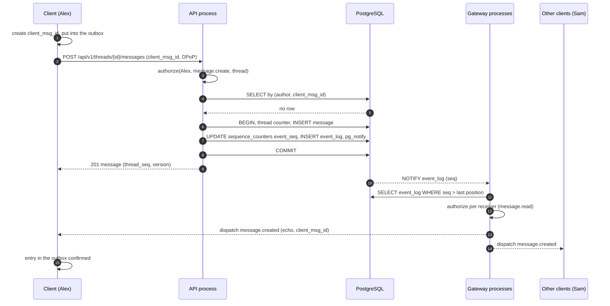
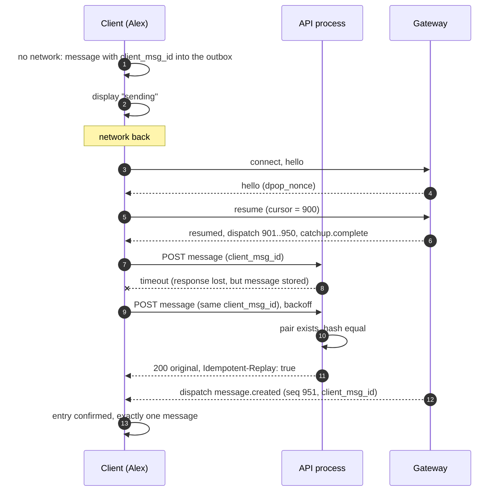
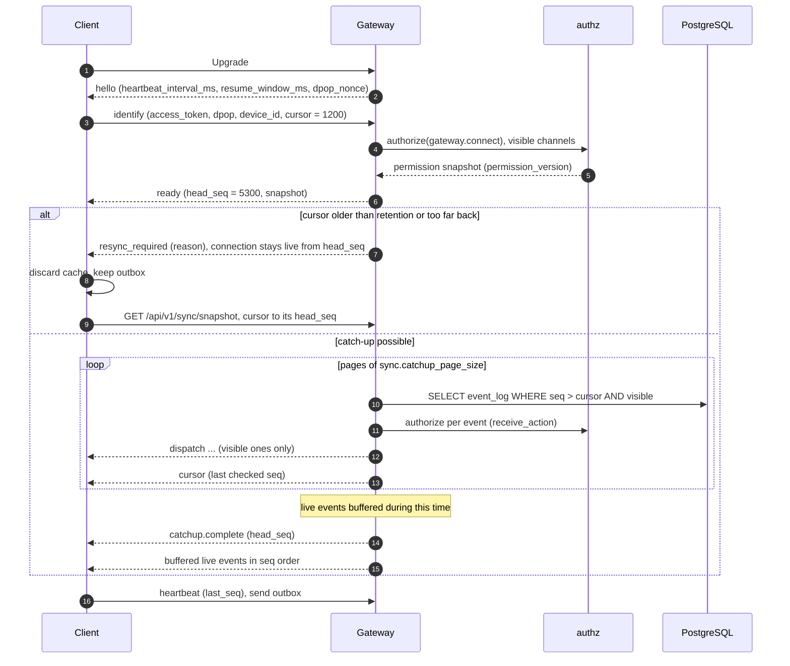
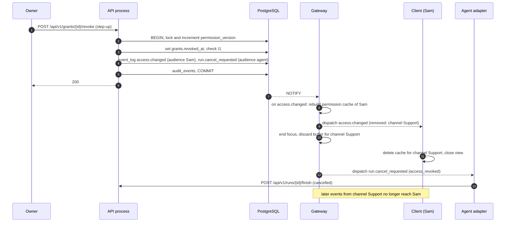
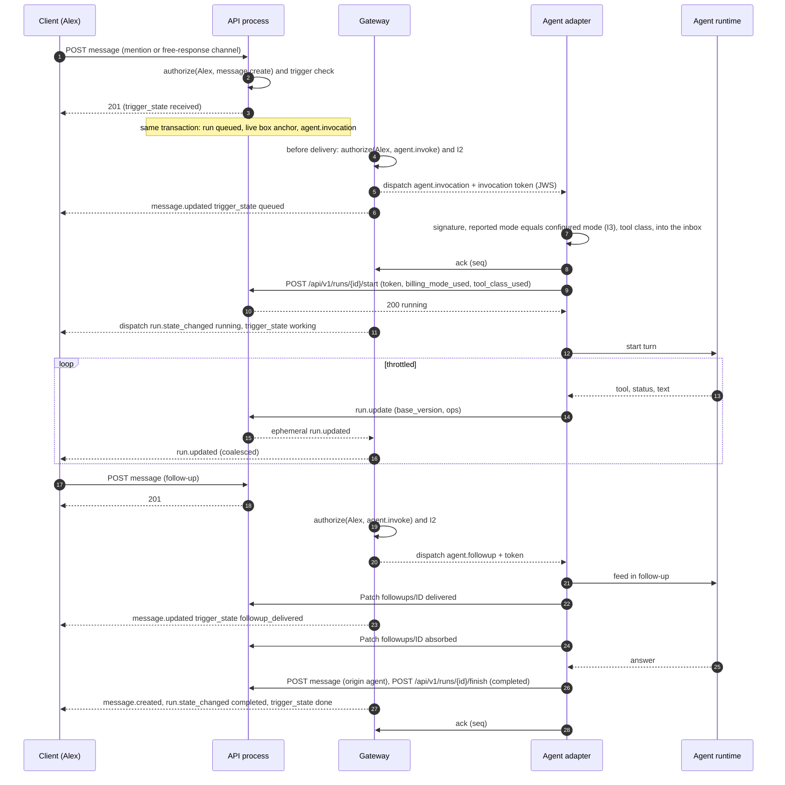

# 04 Event and sync protocol

Status: draft M0, integrated after the feedback of all chapters. Normative for the gateway
(AsyncAPI 3.0), the REST catch-up interface (OpenAPI 3.1), the clients and the agent adapters.
All paths are under the prefix `/api/v1` ([06-api.md](06-api.md), R-API-01).
Terms: [00-glossary.md](00-glossary.md). Tables: [03-data-model.md](03-data-model.md).
Actions and event types: [05-actions.md](05-actions.md).

All limits, windows and intervals are named configuration values. Their defaults
are only in section 18.

## 1. Goals

1. No event is lost: a client that comes back gets everything it may see,
   or the clear instruction to reload.
2. Nothing is created twice: every write request can be repeated.
3. The order in a thread is the same for everyone.
4. Permissions apply at every delivery, not only at the request. A revocation takes effect immediately.
5. An agent adapter is a normal client with a durable cursor. It misses nothing and
   starts nothing twice.

## 2. Events

### 2.1 Two kinds

| Kind | Stored | Sequence | Can be caught up | Examples |
|---|---|---|---|---|
| durable | yes, in `event_log` | global `seq` | yes, until `sync.event_retention` | `message.created`, `thread.closed`, `run.state_changed`, `access.changed` |
| ephemeral | no | none | no | `typing.started`, `run.updated`, `agent.presence_changed`, `notification.created`, `command.autocomplete_requested` |

Rule: everything a client must know after a pause is durable. Ephemeral events
are pure acceleration; their loss is healed by the next durable state or a
fetch. The complete list of durable types with the receive action is in
[05-actions.md](05-actions.md), section 6.

Terminal ([24-terminal.md](24-terminal.md)): states of hosts (`host.updated`) and of own
terminal sessions (`terminal_session.changed`, personal) are durable events; the
connection of a host (`host.presence_changed`) is ephemeral. The terminal stream itself is
not an event: it runs end-to-end encrypted over its own WebSocket connections outside the
gateway and is never in the event log, in snapshots or in catch-up. Reason: the log is for
states, not for byte streams, and the server and backups read everything in it in plain text.

Live statistics ([25-visualization.md](25-visualization.md)): the live frame `stats.live` is
an ephemeral event that only connections with a subscription (`stats.subscribe`) receive
(section 12, item 4). It is never in the event log; the next frame replaces a
lost one.

### 2.2 Envelope

Every event, durable or ephemeral, has the same envelope, on the gateway, in
REST catch-up and in webhooks ([ADR 0052](../adr/0052-one-event-envelope-for-gateway-rest-and-webhooks.md)). On the wire it is JSON. There is no JSON `null`:
a missing field means "no value" ([ADR 0053](../adr/0053-no-json-null-in-api-and-events.md)).

| Field | Type | Required | Meaning |
|---|---|---|---|
| `id` | UUIDv7 | yes | unique event ID, dedupe key |
| `seq` | int64 | for durable ones | global sequence; missing for ephemeral events |
| `type` | string | yes | event type, for example `message.created` |
| `schema_version` | int | yes | version of the payload of this type; changes only additive |
| `occurred_at` | RFC 3339 | yes | time of the transaction (display only, never order) |
| `actor` | `{id, kind}` | no | who triggered it; `kind` is `user`, `agent`, `app`, `system`; `id` is missing for `system` (system action of the server, 05 rule 10); `actor` is missing for events of jobs without a principal and without a system action (03, `event_log.actor_kind`) |
| `scope` | `{space_id, channel_id, thread_id}` | yes | place; fields that do not apply are missing |
| `resource` | `{kind, id, version}` | yes | affected object and its version after the change; `version` is missing where the event does not report a new version of exactly this object (section 9, item 3) |
| `audience` | `"self"` | no | set for personal events |
| `payload` | object | yes | payload according to the schema `<type>.v<schema_version>` |
| `redacted` | bool | no | `true`: the payload was redacted after a deletion |
| `truncated` | bool | no | `true`: the payload was truncated to `sync.event_payload_max_bytes`; the client reloads via REST |
| `correlation_id` | UUID | no | trace ID of the triggering request (03, `event_log.correlation_id`) |
| `trace_context` | string | no | W3C `traceparent` of the triggering request; only in deliveries to agent adapters and only if the request was recorded |
| `client_msg_id` | UUIDv7 | no | echo of the client ID so that the sender can reconcile its outbox |
| `permission_version` | int64 | for durable ones | permission version at the time of the commit |
| `invocation_token` | string | no | delivery field: freshly issued invocation token (JWS, I3) for events to agents that carry an invocation (section 15.3) |
| `redelivered` | bool | no | delivery field: repeated delivery to an agent consumer after `agent.ack_timeout` |
| `sync_epoch` | UUIDv7 | no | delivery field: epoch of the timeline (7.5), only in webhook deliveries; a receiver that sees a new epoch resets its `seq` position ([ADR 0059](../adr/0059-sync-epoch-after-restore.md)) |

Delivery fields are created per delivery and are never in the event log.

Rules for the payload:

1. It contains only fields that a receiver with the receive action of the type may see.
   Data that needs more permissions (for example channel prompt, skills, project binding) is never in
   events. The event then names only the new version (`channels.settings_version`);
   authorized receivers reload via REST.
2. It is smaller than `sync.event_payload_max_bytes`. For larger objects (a long message)
   the producer builds a reduced payload with a reference and sets `truncated: true`
   (03, `event_log.truncated`); the appender rejects an oversized payload instead of
   truncating it. The client reloads via REST.
3. It contains no secrets and no tokens.
4. Message contents are only in events with the resource `message` (`message.*`; `reaction.*`
   carry the emoji). All other events name messages only by ID, including `agent.invocation`
   and `agent.followup`; the receiver reads the content via REST with a check by
   `authorize`. Reason: this way, redaction on deletion (03, section 6.5) reaches all content.
5. A redacted payload stays valid according to its schema: `message.created` and
   `message.updated` carry the tombstone of the message (`content_md` empty, without attachments,
   mentions, components and reactions, with `deleted_at`); `reaction.added` and
   `reaction.removed` carry `emoji: ""` and `count: 0`; `pin.added` and `pin.removed` stay
   unchanged because they carry no content. A new event type with the resource `message` defines
   its redaction with its schema; without it, the deletion fails (test).
   `file.updated` (schema version 1) of a deleted file keeps in `file` only `id`, `uploaded_by`,
   `purpose`, `upload_state`, `scan_status`, `transcript_status` and `created_at`, with
   `original_name` `""`, `size_bytes` `0`, `mime_type` `application/octet-stream` and `thumbnails`
   `[]`; every other member is dropped. Another event type with resource `file` defines its
   redaction with its schema; without it the deletion fails ([03-data-model.md](03-data-model.md),
   R-DM-45).

### 2.3 Frames on the WebSocket

Every frame is a JSON text frame of the form `{"op": "<name>", "d": {...}}`. A frame is
at most `sync.ws_max_frame_bytes` in size. Events come as `{"op": "dispatch", "d":
<envelope>}`; the invocation token and `redelivered` are delivery fields in the envelope.

## 3. Global, commit-ordered sequence

### 3.1 Why `bigserial` is not enough

A PostgreSQL sequence assigns numbers at the call, not at the commit, and it is not
transactional. Example: transaction A gets `seq = 10`, transaction B gets `seq = 11`. B
commits first. A reader sees 11 and sets its cursor to 11. Then A commits with 10.
The reader asks for "everything after 11" and misses 10 forever. In addition, every
rolled-back transaction leaves a gap; a reader cannot tell a gap from a transaction that is
still open.

### 3.2 Pattern with a counter row

The row `sequence_counters('event_seq')` is locked in the same transaction that writes the
domain change, as the last step before the commit:

```sql
BEGIN;  -- READ COMMITTED
  -- 1. Domain change (example: new message)
  UPDATE threads
     SET last_message_seq = last_message_seq + 1,
         last_activity_at = now(), message_count = message_count + 1,
         version = version + 1
   WHERE id = $thread_id
  RETURNING last_message_seq;                          -- -> $thread_seq

  INSERT INTO messages (id, thread_id, channel_id, thread_seq, author_principal_id,
                        client_msg_id, client_payload_sha256, origin, kind, content_md, ...)
  VALUES ($id, $thread_id, $channel_id, $thread_seq, $author, $client_msg_id, $hash,
          'human', 'text', $content, ...);

  -- 2. As the last step: lock the counter and get n numbers
  UPDATE sequence_counters
     SET value = value + $n            -- n = number of events of this transaction
   WHERE name = 'event_seq'
  RETURNING value;                     -- -> $last; numbers are $last - $n + 1 .. $last

  INSERT INTO event_log (seq, id, type, ..., permission_version)
  VALUES ($last - $n + 1, ...), ..., ($last, ...);

  SELECT pg_notify('event_log', $last::text);
COMMIT;
```

Why this is correct:

1. The row lock from the `UPDATE` holds until the commit. A second transaction waits at
   the same row.
2. In `READ COMMITTED` the waiting transaction reads the new counter value again after the
   commit of the first one. So it gets the next numbers.
3. PostgreSQL makes a transaction visible before it releases its locks. When B gets the
   lock, A is already visible. Therefore: if a reader sees `seq = k`, it also sees
   every smaller number.
4. If a transaction rolls back, the counter rolls back with it. There are no gaps. A reader may
   therefore simply read `WHERE seq > $cursor ORDER BY seq`.

Cost: all write transactions with events are serialized at the end. The lock holds
only from the last step to the commit (including the WAL flush). That is why the counter step is
always last. Write transactions with events must not run in `REPEATABLE READ` or
`SERIALIZABLE`; there the pattern breaks with serialization errors. The lock order
is in [03-data-model.md](03-data-model.md), section 6.3. A load test holds the throughput
as a quality gate: at least `perf.event_commit_min_per_s` in the reference profile
([02-architecture.md](02-architecture.md), section 17; [ADR 0063](../adr/0063-performance-gate-for-the-event-log.md)).

### 3.3 Other counters

The same pattern applies to `audit_seq` (hash chain in the audit log) and to `permission_version`
(permission version). On permission changes the permission version is locked first, so that all
permission changes are serialized.

## 4. Thread sequence

Every message has `thread_seq`, gapless per thread, assigned through the row lock on
`threads` (pattern above, step 1). It determines the display order. The global `seq`
determines the delivery order. Both are ordered the same way within a thread, because both come
from the same transaction and the thread lock is taken before the counter lock.

Deleted messages keep their `thread_seq` as a tombstone. A client recognizes a real
gap in `thread_seq` as missing data and reloads the range via REST.

## 5. Idempotent writes

### 5.1 Messages: `client_msg_id`

1. The client creates a UUIDv7 as `client_msg_id` when composing. It stores it with the
   outbox entry before it sends.
2. The pair `(author_principal_id, client_msg_id)` is unique, permanently (no expiry).
3. The server computes `client_payload_sha256` over the canonical request (thread, content,
   reply reference, attachments).
4. Flow in the server: first a `SELECT` by the pair. If the message exists, it answers with the
   original (`200`, header `Idempotent-Replay: true`), without new events. If the hash is
   different, it answers `422 idempotency_key_reuse`. If it does not exist, the pattern from
   section 3.2 follows. If two identical requests arrive at the same time, the second violates the
   unique index; its transaction rolls back together with the thread number, and the server answers
   as for a repetition.
5. The server checks the UUID format (version 7), not the time in it. An outbox
   may therefore send entries that are days old.

Interactions use the same procedure with `client_interaction_id`.

### 5.2 All other writes: `Idempotency-Key`

Every other write REST operation accepts the header `Idempotency-Key` (UUIDv7).
Clients set it on every operation from the outbox. The server stores the request hash
and the response in `idempotency_keys` for `sync.idempotency_key_ttl`. A repetition with the same
hash returns the stored response; a different hash: `422 idempotency_key_reuse`; first request
still running: `409 request_in_progress`. Operations with a version check (`If-Match`) are
additionally protected by the version.

## 6. WebSocket gateway

### 6.1 Endpoint and version

One endpoint `wss://<host>/api/v1/gateway`. The protocol version is in `identify` and `hello`.
The supported versions are in one place: `info.x-protocol-versions` in
[asyncapi.yaml](../api/asyncapi.yaml); `hello` and the discovery name the same ones.
Changes within a major version are only additive: new ops, new fields, new
event types. Clients ignore what they do not know. A device holds exactly one connection: a new
`identify` or `resume` of the same device closes an older open connection with `4017`
(section 6.4). Reason: focus, typing and "person is watching" apply per device, and a faulty
client should not hold any number of connections. With `cluster.mode = multi` this applies across all
api nodes (device ID through `NOTIFY ephemeral`, section 12 item 3;
[02-architecture.md](02-architecture.md), section 11.6).

### 6.2 Ops

Client to server:

| Op | Purpose |
|---|---|
| `identify` | login of a new gateway session |
| `resume` | resuming a gateway session after a short disconnect |
| `heartbeat` | sign of life with the last processed `seq` |
| `reauth` | new access token during the connection |
| `focus` | list of the threads that are visible right now (for live box patches and typing), with `idle` (bool): `true` means "open but idle"; the connection keeps getting patches but does not count as "person is watching" ([13-push-notifications.md](13-push-notifications.md), section 4.4). Optional `background_thread_ids` (addendum of 2026-10-24, run visualization, R-SY-27): threads whose runs the app shows without their messages (control room cards, a run graph opened from a card); they get the run document and `run.updated` (11.3) but no typing, never count as "Active in the thread" and are not part of the presence focus (13 4.4, R-DM-51); a thread in both lists counts as in `thread_ids`; both lists together hold at most `sync.max_focused_threads` distinct threads |
| `typing.start` / `typing.stop` | typing indicator; people only (section 12) |
| `ack` | agents only: acknowledgement up to `seq` |
| `run.update` | agents only: patch to an own run (equivalent to REST) |
| `command.autocomplete_result` | agents and apps only: suggestions for a request (equivalent to REST, section 15.7) |
| `stats.subscribe` / `stats.unsubscribe` | subscribe to live statistics (`space_id` optional, otherwise the instance) or end the subscription; at most one subscription per connection (section 12, item 4) |

Server to client:

| Op | Purpose |
|---|---|
| `hello` | first message after the upgrade |
| `ready` | session ready, with a snapshot |
| `resumed` | resumption confirmed |
| `dispatch` | an event |
| `cursor` | advance the cursor without an event (skipped events that are not visible) |
| `catchup.complete` | catch-up finished, live from now on |
| `resync_required` | catch-up not possible, reload |
| `heartbeat_ack` | response to `heartbeat` |
| `reauth_required` | the access token expires soon |
| `error` | error for an op, the connection stays |

Every op is mapped to an action in [05-actions.md](05-actions.md). If an op fails on
its rate-limit class, on `authorize` or on its rules, the server answers with `error` and
the problem code from [06-api.md](06-api.md) (for example `rate_limited`, `forbidden`,
`validation_failed`); the connection stays. The server closes only with the codes from 6.4.

### 6.3 Lifecycle

1. **Upgrade.** The client opens the connection. At the upgrade the server checks nothing except
   the origin. The rate-limit class `rl.gateway_connect` counts on `identify` and `resume`
   as soon as the device or the token has been checked (05, section 3); when exhausted: close with `4008`.
2. **`hello`.** The server immediately sends `{heartbeat_interval_ms, resume_window_ms,
   protocol_versions, dpop_nonce, server_time, sync_epoch}` (schema `GatewayHello`; the values come
   from `sync.heartbeat_interval` and `sync.resume_window`). `dpop_nonce` is fresh and valid for `auth.dpop_nonce_ttl`
   ([08-identity.md](08-identity.md)).
3. **`identify`.** Within `sync.identify_timeout` the client sends:
    - People: `access_token`, `dpop` (DPoP proof according to RFC 9449 with `htm = "GET"`, `htu` =
      HTTPS form of the gateway URL, `nonce` = `dpop_nonce` from `hello`, `ath` = hash of the token),
      `device_id`, `protocol_version`, `cursor` and `sync_epoch` (both missing on the first
      connection), `client` (platform and version).
    - Agents and apps: `api_token`, with `dpop_jkt` on the token also `dpop`, `consumer`
      (name of the consumer, default `default`), `protocol_version`.
    The server checks the token, signature, expiry, `cnf.jkt` against the active DPoP key of the
    device, device `active`, session not revoked, principal `active`. A device in the state
    `pending` is rejected with `4016`. Then it calls `authorize(principal, gateway.connect,
    instance)`.
    The DPoP proof is in `identify`, not in headers of the upgrade. Reason: not every
    client can set headers on the WebSocket upgrade; the server nonce from `hello` prevents
    replay.
4. **`ready`.** The server answers with `{gateway_session_id, principal, device_id,
   permission_version, head_seq, sync_epoch, snapshot}`. `snapshot` contains: visible spaces and channels
   with versions, sidebar state of spaces and channels, unread and mention counters, active runs
   (summary), the active threads, presence of the visible agents, versions of settings and drafts,
   the feature flags evaluated for the principal.
   Active threads (`active_threads`, addendum of 2026-10-27, R-SY-28) are, per visible channel,
   the thread objects (as `getThread`, without messages) of every open thread (`kind = 'thread'`)
   with an active run, of every open thread in `unread_threads` of the same snapshot (unread
   messages or mentions of the caller), plus the open threads whose `last_activity_at` lies within
   `sync.snapshot_thread_window`, newest activity first, until the channel has
   `sync.snapshot_threads_per_channel` entries; threads with an active run and unread threads count
   toward this bound but are never left out, so every thread the sidebar must rank first (01 6.8
   items 2 and 3) is held by the client without a further request. The client keeps them current through `thread.*` and `message.created`
   and fills the sidebar from them (01 6.8) without one list request per channel. A message moves
   `threads.last_activity_at` on the server (section 3.2) without a `thread.*` event, so the
   client moves the stored `last_activity_at` of the thread forward to the `created_at` of every
   message it stores (the event, the `201` of its own message, a loaded page), never back, and
   without changing the thread's `version` (addendum of 2026-11-01, brief FIX-autoarrange-delay);
   the sidebar order by activity (01 6.8 item 4, 6.16) follows at once. Only after
   a full snapshot does it list the open posts of each forum (`listChannelThreads` with
   `state=open`), because a forum lists every open post (01 6.8 item 2, D-M4-46-5).
   Thread contents are not included; the client loads them via REST.
   The server registers the connection for delivery before it reads `head_seq`; every
   later event is buffered or sent, every earlier one is in the snapshot or in the
   catch-up. This way nothing is lost between `ready` and live operation.
   If the client has sent a `cursor`, catch-up starts after that (section 7).
5. **Heartbeat.** The client sends a `heartbeat {last_seq}` every `heartbeat_interval_ms`. It
   delays the first heartbeat by a random fraction of `heartbeat_interval_ms`, so that after
   a server restart not everyone sends at the same time. The server answers `heartbeat_ack`.
   If `sync.heartbeat_miss_limit` heartbeats in a row are missing, the server closes with `4009`.
   If the client does not get a `heartbeat_ack` within `heartbeat_interval_ms`, it closes itself
   and reconnects.
6. **Token renewal.** Before the access token expires, the server sends `reauth_required`
   (lead time `sync.reauth_lead_time`). The client gets a new token through refresh and sends
   `reauth {access_token, dpop}` with the current nonce. Without a valid `reauth` by the expiry
   the server closes with `4011`. Agents and apps get no `reauth_required`; their API token
   has a fixed `expires_at` at which the server closes with `4011`. They can only continue with
   a new token that the owner issues.
7. **`resume`.** After a disconnect within `resume_window_ms` the client sends, instead of
   `identify`, a `resume {gateway_session_id, access_token, dpop, cursor, sync_epoch}`. The server
   checks the token and the session as for `identify`, restores focus and subscriptions and answers
   `resumed`; then the catch-up from `cursor` follows. Ephemeral events of the pause are
   lost. If the gateway session is unknown or expired, the server closes with `4006`;
   the client then does `identify`.
8. **End.** The client closes with `1000`. The server closes with a code from 6.4.

### 6.4 Close codes

| Code | Name | Client reaction |
|---|---|---|
| `1000` | normal | do not reconnect, unless the app is in the foreground |
| `1001` | going_away | reconnect with backoff, try `resume` |
| `4000` | unknown_error | reconnect with backoff |
| `4001` | unknown_op | report the error, reconnect |
| `4002` | decode_error | report the error, reconnect |
| `4003` | not_identified | op sent before `identify`; reconnect |
| `4004` | authentication_failed | renew the token; if that fails, log out |
| `4005` | already_identified | report the error, reconnect |
| `4006` | session_invalid | `identify` instead of `resume` |
| `4007` | protocol_version_unsupported | show an app update, do not reconnect |
| `4008` | rate_limited | only `rl.gateway_connect` on `identify` and `resume`: wait for the waiting time from the close reason |
| `4009` | heartbeat_timeout | reconnect with backoff, try `resume` |
| `4011` | token_expired | renew the token, then `resume` |
| `4012` | revoked | session, device or principal revoked: delete local data, log out, do not reconnect |
| `4013` | server_restart | reconnect immediately with a random delay, try `resume` |
| `4014` | slow_consumer | outbound queue full or write deadline `gateway.write_timeout` missed: reconnect, catch-up from the cursor |
| `4015` | consumer_replaced | agents only: another process has taken over the same consumer; do not reconnect |
| `4016` | device_pending | the device is waiting for approval: do not reconnect until `GET /api/v1/devices/{id}` reports the state `active` |
| `4017` | device_replaced | a newer connection of the same device is active: do not reconnect on its own, only on return to the foreground or on user action |
| `4018` | forbidden | login valid, but `gateway.connect` denied (for example `scope_missing` of an app): show the error, do not renew the token, do not reconnect on its own |

The terminal connections (stream of the device, control and data connection of the host service) are
separate WebSocket channels with their own close codes `4100` to `4114`
([24-terminal.md](24-terminal.md), section 13; [asyncapi.yaml](../api/asyncapi.yaml)); the codes of this table
apply there only where the channel names them.

Mapping during connection setup (reason: one code per cause, so that the client reacts correctly):

| Cause | Code |
|---|---|
| no `identify` and no `resume` within `sync.identify_timeout` | `4003` |
| frame over `sync.ws_max_frame_bytes`, binary frame, invalid JSON or UTF-8, duplicate key, unknown field | `4002` |
| token or DPoP proof invalid, `device_id` does not match | `4004` |
| login valid, but another rejection `forbidden` (for example `scope_missing`); a new token does not help | `4018` |
| access token expired | `4011` |
| session, device, token, principal or app installation revoked or not active | `4012` |
| device or provisioned person waiting for approval | `4016` |
| database not reachable while building `ready` | `4000` |

### 6.5 Reconnecting

Before attempt `n` (from 0) the client waits a time uniformly distributed between 0 and
`min(sync.reconnect_backoff_cap, sync.reconnect_backoff_base * 2^n)` (full jitter). After a
successful `ready` or `resumed` response, `n` starts at 0 again. A network change and a
return to the foreground trigger an immediate attempt that does not increase the counter.

## 7. Catch-up

### 7.1 Cursor

The cursor of a client is the highest global `seq` that the server has **checked** for this
principal, not just the highest delivered one. That is why the server sends `cursor {seq}` when
it has skipped events that are not visible, at the latest after `sync.cursor_advance_every`
skipped events and at the end of every page. The client stores the cursor durably after every
processed page.

### 7.2 Flow

1. The server reads pages of `sync.catchup_page_size`:
   `SELECT ... FROM event_log WHERE seq > $cursor AND seq <= $head AND (channel_id =
   ANY($visible_channels) OR space_id = ANY($fully_visible_spaces) OR (channel_id IS NULL AND
   space_id = ANY($visible_spaces)) OR ($instance_wide AND space_id IS NOT NULL) OR
   audience_principal_id = $principal OR (space_id IS NULL AND channel_id IS NULL AND
   audience_principal_id IS NULL)) ORDER BY seq LIMIT $page`.
   `$visible_channels`, `$visible_spaces` (spaces with at least one visible channel),
   `$fully_visible_spaces` (spaces with a grant on the space) and `$instance_wide` (owner
   or a grant on the instance) are provided by `authz` from the permission cache.
   Reason for the spaces: a channel that is created in a visible space after the cache was built
   is not yet in `$visible_channels`; its events must still not
   be missing.
2. In addition, every event passes through `authorize(principal, <receive_action>, resource)`.
   Only then is it sent as `dispatch`. The SQL filter is the performance, `authorize` is the
   truth.
3. New live events during the catch-up are buffered per connection and sent only after the
   catch-up, in `seq` order. There is no mixing.
4. At the end the server sends `catchup.complete {head_seq}`. After that the connection is live.
5. If the buffer exceeds `sync.outbound_queue_max`, the server closes with `4014`. The client
   restarts from its cursor.
6. The server does not deliver ephemeral events before `catchup.complete`, and it discards them
   when the outbound queue is full instead of closing the connection (never `4014`);
   for `run.updated` the state according to 11.3 item 3 makes up for it. Reason: they are pure
   acceleration (2.1) and must not cost a connection.

### 7.3 `resync_required`

The server sends `resync_required {reason, head_seq, sync_epoch}` instead of events when:

- the sent `sync_epoch` does not match the current one (restore from a
  backup, section 7.5), reason `epoch_changed`;
- `cursor < min_retained_seq - 1` (events were removed after `sync.event_retention`),
  reason `retention`;
- `head_seq - cursor > sync.catchup_max_events`, reason `too_far_behind`;
- `cursor > head_seq`, reason `cursor_ahead` (second safety net, in case a client asks without an epoch).

The client then discards its server state in the cache (the outbox stays), loads
`GET /api/v1/sync/snapshot`, sets the cursor and the epoch to the returned values and loads threads
via REST when needed. On the gateway the connection stays open and is live from `head_seq`;
the client discards events up to the `head_seq` of the new snapshot according to section 9,
item 2. It does not have to reconnect. Reason: every close code would trigger a wrong reaction,
and the live delivery from `head_seq` loses nothing.

### 7.4 REST variant

`GET /api/v1/events?after=<seq>&epoch=<sync_epoch>&limit=<n>` returns the same events with
the same rules: `{events, next_cursor, head_seq, sync_epoch}` or `410 resync_required` with
a reason. It serves SDKs, tests and adapters without WebSocket. `limit` is at most
`sync.catchup_page_size`.

### 7.5 Sync epoch

The global sequence applies within one timeline, named by `instance.sync_epoch`
([03-data-model.md](03-data-model.md), section 6.7). After a restore
`bothy restore finalize` sets a new epoch.

1. `hello`, `ready`, `resumed`, the snapshot and `GET /api/v1/events` name the epoch.
2. The client stores it together with the cursor and sends both on `identify`, `resume`
   and in the REST catch-up.
3. If the sent epoch does not match, the server answers `resync_required` with the reason
   `epoch_changed`, even if `cursor <= head_seq`. Reason: after the first writes
   of the new timeline it overtakes old cursors; without an epoch a client would silently skip
   foreign events with the same number.
4. The same command sets agent consumers, webhook subscriptions and worker consumers to the new
   `head_seq`; they catch up nothing from the old timeline.

### 7.6 Consumers in the worker (push, webhooks)

Push and outgoing webhooks are created in the `worker` from the log, not in the write path
([02-architecture.md](02-architecture.md), section 11.5, [ADR 0051](../adr/0051-worker-consumers-of-the-event-log-with-a-cursor.md)). Per consumer there is one
row in `event_consumer_cursors`. A round reads from `last_seq` in `seq` order, creates one job per
event and receiver and advances the cursor in the same transaction. Before
sending, every job checks `push.deliver` or `webhook_out.deliver` again with the current
permissions.

## 8. Visibility on permission changes

### 8.1 Basic rule

The permissions at the time of the delivery apply, not those at the time of the event.
A gateway process updates the permission cache of a principal when it reaches that principal's
`access.changed` event in the log. It checks all events after that with the new state.
It also applies structure changes (`channel.created`, `channel.updated` with `read_only`,
`channel.archived`, `space.archived`, `thread.moved`) to the cache in log order, because they
change the path or the read-only state of a resource. `channel.archived` and `space.archived` are
in addition permission changes with their own `access.changed` (05, column "Permissions";
[07-permissions.md](07-permissions.md), section 4.5); the others come without a new permission version.

### 8.2 What happens on a change

Every transaction that changes permissions (grant, group, owner, operator, backend policy,
tool class, status of a principal, device or session) increases the permission version and
writes a personal `access.changed` event for every affected principal. This also applies
to the expiry of grants and memberships: it takes effect immediately on every `authorize`,
and the job `authz.expiry_sweep` writes, every `authz.expiry_sweep_interval`, the permission version,
`access.changed` and `run.cancel_requested` for the expired ones (system actions
`grant.expire`, `group.member.expire`). Before an expiry the subject gets
`access.expiring` once ([07-permissions.md](07-permissions.md), section 9.4).

```json
{
  "permission_version": 418,
  "added":   [{"kind": "channel", "id": "...", "level": "write"}],
  "removed": [{"kind": "space", "id": "..."}],
  "changed": [{"kind": "channel", "id": "...", "level": "read", "previous_level": "trigger"}]
}
```

An entry can have `kind: "host"`: it reports the capability `terminal` on a host,
without `level`, with `capabilities: ["terminal"]` ([24-terminal.md](24-terminal.md), section 8). Whoever
loses it, their terminal sessions on the host end in the same transaction
(`access_revoked`).

Affected are all principals whose visible targets or levels can change: for grants
the subject (for groups all current members), for an owner change and for disabling the person, for an
operator change the old and the new operator agent, for archiving a space or channel
everyone with a level above `read` on the target (grants on the target and its ancestors, group members,
owners, operators). If an action changes a target instead of a subject, `authz` determines the affected
principals itself from the target ([02-architecture.md](02-architecture.md), section 8.1). `authz` computes
the content as the difference of the visible targets before and after the change; whoever has no difference
gets no `access.changed`.

### 8.3 What the client receives and does on access removal

1. The server sends `access.changed` immediately, without waiting for other events.
2. After that it delivers no more events from the removed targets, ends their focus and
   discards buffered events of these targets.
3. For removed targets the client deletes all content from the local cache: threads,
   messages, files, thumbnails, search index, drafts. It closes open views with
   the note "No access anymore".
4. Outbox entries for removed targets fail on sending with `404`. The client
   marks them as failed and keeps the text locally for copying.
5. If the principal has lost the level `trigger` on a thread in which a run it
   triggered is active, the server writes `run.cancel_requested` with the reason
   `access_revoked` to the agent. The agent aborts and reports `cancelled` (fail closed,
   ruling L23). The same applies with the reason `channel_read_only` when a channel becomes
   read-only.
6. Push: every push passes through `authorize` before sending. There is nothing to delete.

### 8.4 On access extension

The client gets `access.changed` with `added`. It does not catch up older events of the new targets
before its cursor; it loads the structure of the new targets via REST and contents when needed.

### 8.5 Revocation of a session, device or principal

The server closes all affected connections immediately with `4012`. The client deletes all
local data of this account. Access tokens carry the session ID `sid`; `authorize` checks
the revocation state from a cache that is tied to the permission version. A revoked token is
thus without effect before its expiry.

## 9. Delivery guarantee

1. Durable events are delivered at least once (at-least-once). Duplicates arise
   on reconnecting and on retries.
2. The client discards every event with `seq <= ` its stored cursor. Because a
   connection delivers strictly in `seq` order, this comparison is enough.
3. In addition, the client applies a change to an object only if
   `resource.version` is greater than the local version. This way data from REST and from
   events can be mixed without conflict. `resource.version` is present exactly when the table of the
   object has a column `version` (03) and the event reports its new value. It is therefore
   also missing for these types, whose object has a version that the event does not change:
    - `reaction.*` and `pin.*`: they do not increase `messages.version` (otherwise the author would
      get `412` when editing after every reaction); their payload carries absolute values (count per
      emoji, pinned yes or no).
    - `read_state.updated` (resource `thread`), `sidebar.updated` (resource `space`) and
      `sidebar_channel.updated` (resource `channel`, M4-51): their payload carries the version of
      the personal sub-object; the client compares that one.
    - `channel.settings_changed` and `agent.config_changed` (resource `channel`, payload with
      `settings_version`), `thread.moved_out` (the source channel does not change),
      `agent_session.changed` (resource `thread`), `agent.invocation`, `agent.followup` and
      `run.cancel_requested` (resource `run`), `command.invoked` (resource `command`).
    Without `resource.version` the client applies the event in `seq` order. Reason: a
    foreign version in the field of the object would make later real changes get discarded. The catalogue
    ([ADR 0049](../adr/0049-machine-readable-action-catalogue-as-the-single-source.md)) records per event type whether it has `resource.version`; the frame conformance (G9,
    [06-api.md](06-api.md) section 15) checks every delivery against it.
4. Ephemeral events are delivered at most once (at-most-once).

## 10. Ordering

| Scope | Guarantee |
|---|---|
| global, durable events | delivery in `seq` order = commit order |
| per thread | strictly by `thread_seq`; the same for all receivers |
| per object | strictly by `resource.version` |
| ephemeral | no guarantee among each other; `run.updated` is ordered through `version` |
| between processes | every gateway process reads the same log in the same order |

Timestamps never order anything.

## 11. Live box streaming

### 11.1 Run document

A run has a document (schema `run_document.v1`): `state`, `version`, `status_line`,
`last_text_excerpt`, `model`, `metrics` (including `last_api_retry`), `cost`,
`billing_mode_used`, `plan` (`items` with `id`, `text`, `status`), `steps` (object, the key is
the step ID, every step with `ordinal`, `parent_step_id`, `kind`, `name`, `title`,
`status`, times), `followups` (object, the key is the message ID), `stall_warned_at` (addendum of
2026-10-24), times. Which paths
the adapter may change is defined in [09-agents.md](09-agents.md), section 5.3. Steps are
stored as an object, not as a list, so that patches use stable paths; the order
comes from `ordinal`.

### 11.2 From the adapter to the server

The adapter sends `run.update {run_id, base_version, ops}` (WebSocket) or `PATCH
/api/v1/runs/{id}` (REST). `ops` is a list of operations according to RFC 6902, limited to
`add`, `replace` and `remove`, with JSON Pointer paths into the run document. The server checks:
the principal is the agent of the run, the run is active, `base_version` matches, the paths are allowed
(for example not `state`; states change only through their own endpoints). It stores the change,
increases `runs.version` and answers with the new version. On a wrong `base_version`
it answers `409 base_version_conflict` with the current document. The adapter throttles itself to at most one
change per `agent.run_update_min_interval`.

### 11.3 From the server to the clients

1. State changes (`queued`, `running`, `waiting_input`, end) are durable events
   `run.state_changed` with a summary (state, duration, cost, number of steps). The sidebar and
   "Running now" are fed from them.
2. Content changes are the ephemeral event `run.updated {run_id, base_version,
   version, ops}`. It goes only to connections that have the thread in `focus` and
   may perform `run.read`; a thread in `background_thread_ids` (6.2) counts as in focus for
   this event and for item 5. A client focuses at most `sync.max_focused_threads` threads (both
   lists together); a `focus` with more IDs results in `error` with `validation_failed`, and the
   previous focus stays.
3. Coalescing: the server collects changes per run and connection for
   `sync.run_patch_coalesce_interval`. Then it sends one frame from the oldest
   `base_version` to the newest `version`. Later `replace` operations on the same path replace
   earlier ones. If the outbound queue of the connection is full, the server discards the
   collected patches and instead sends the whole document as `run.updated` with
   `snapshot`.
4. Client rule: if `base_version` equals the local version, it applies the ops. If
   `version` is less than or equal to the local one, it ignores the frame. Otherwise (a gap) it fetches
   `GET /api/v1/runs/{id}` and replaces its document. It always draws only the newest state.
5. When a thread with an active run is focused, the server sends the whole document once.
6. After the end the live box collapses to one line. The summary comes from
   `run.state_changed`; the client loads details via REST when it is expanded.
7. Run graph and control room (addendum of 2026-10-24, run visualization,
   [09-agents.md](09-agents.md) section 5.6): both use only this path. The control room puts
   the threads of its visible cards into `background_thread_ids` of `focus` (6.2), within
   `sync.max_focused_threads` together with the threads the app already shows; `thread_ids` and
   `idle` keep their meaning (the threads the person reads, the window state of 15 section 10),
   so the cards change no notification rule of 13 4.4. There is no further op and no further
   event. `stall_warned_at` is part of the document: the server sends
   `add /stall_warned_at` when `runs.stall_check` sets it (with a version step of its own) and
   `remove /stall_warned_at` in the normalized ops of the patch that clears it.

## 12. Typing and agent presence

1. **Typing.** The client sends `typing.start {thread_id}` at most once per
   `sync.typing_min_interval` while the person is typing, and `typing.stop` when the input is
   cleared or sent. The server checks `typing.start` (action in [05-actions.md](05-actions.md);
   people only) and sends `typing.started {thread_id, principal_id, expires_at}` to connections
   with focus on the thread and read permission, not to the connections of the typing person
   themselves. Without renewal, the indicator ends after `sync.typing_ttl`; clients also end it
   at the next message of this principal in the thread. `typing.stop` creates no event; it only
   resets the throttle of the connection, so that a new `typing.start` applies at once. An active
   run shows the typing of the agent; agents send no typing of their own (Ruling L9).
2. **Presence of agents.** Adapters send `POST /api/v1/agents/me/heartbeat` (or implicitly
   through the gateway `heartbeat`) with state, runtime version, `reported_billing_mode`,
   `billing_modes_supported`, `billing_evidence`, tool class and active runs (schema
   `agent_heartbeat.v1`, [09-agents.md](09-agents.md), section 4.8). Adapters that follow the
   configured mode per run omit `reported_billing_mode` and name both modes in
   `billing_modes_supported`; the check per run is then binding (Ruling L8). A change of the
   reported mode or of the tool class is stored and audited at once. The server derives
   `online`, `degraded` or `offline`; `offline` applies after `agent.presence_timeout` without a
   heartbeat. On a change it sends the ephemeral `agent.presence_changed {agent_id,
   state, reported_billing_mode}` to everyone with `agent.read`. `ready` contains the current state.
   People have no presence indicator.
3. **Multiple nodes.** With `cluster.mode = multi`, a node also distributes typing, presence,
   notifications and live box changes through `pg_notify('ephemeral', ...)`, only with IDs and
   versions; the receiving node reads the content from the database
   ([03-data-model.md](03-data-model.md), section 6.6).
4. **Live statistics.** A person with `stats.read` sends `stats.subscribe {space_id?}`. The
   server checks `stats.read` on the instance or the space and then sends, every
   `stats.live_interval`, the ephemeral event `stats.live` with a live frame (schema
   `StatsLiveFrame`, [25-visualization.md](25-visualization.md), section 5) to this connection.
   A new `stats.subscribe` replaces the subscription, `stats.unsubscribe` ends it, `resume`
   restores it. Every frame passes through the delivery mode with the receive action `stats.read`
   and is filtered to the visible channels of the receiver. If the receiver loses the
   permission, the subscription ends with an `error` (`forbidden`). Agents and apps cannot
   subscribe (`stats.read` requires owner or `manage`). With `cluster.mode = multi`, every node
   builds its frames itself; rates come from `stats_minutes` and are therefore the same on all
   nodes.

## 13. Offline behavior of the client

### 13.1 Local cache

The client keeps the structure, recently opened threads, messages, thumbnails, its own
settings and drafts in a local, encrypted database (protection class per platform: see the
security chapter). The cache is only a copy; the truth lies on the server. Entries older than
`client.cache_max_age` without access are removed.

### 13.2 Outbox

1. Every writing operation first lands in the outbox, with its own ID
   (`client_msg_id` for messages, `client_interaction_id` for interactions,
   `Idempotency-Key` for everything else), a timestamp and the expected version where needed.
2. The outbox is strictly FIFO per thread. The client sends the next entry of a thread only
   after the response to the previous one. Different threads run in parallel.
3. The interface shows waiting messages at once with the state "sending" at the position
   after the last confirmed `thread_seq`.
4. Retry on a network error, a timeout, `5xx` and `429`: backoff with full jitter
   between `client.outbox_retry_base` and `client.outbox_retry_cap`. The same ID on every
   retry. A `Retry-After` is a floor: the client waits it plus the full-jitter backoff of the
   attempt, so entries refused together do not return together (addendum of 2026-10-30,
   [12](12-files.md) 3.8). `409 file_not_ready` of a voice message is retried the same way,
   because the file becomes ready by itself ([12](12-files.md) 8.1, addendum of 2026-10-31).
5. Permanent errors (`400`, `404`, `410`, `413`, `422`) end the retries. The entry stays
   visible as "failed" with a reason; the person can edit it, send it again (new ID) or discard
   it. Nothing is discarded silently.
6. When the echo event `message.created` with a matching `client_msg_id` arrives, the client
   replaces the waiting entry with the server message.

### 13.3 Editing and deleting

| Case | Rule |
|---|---|
| Editing a message that has not been sent yet | changes the entry in the outbox; no server request |
| Deleting a message that has not been sent yet | removes the entry; if it was already sent but not confirmed, a delete entry follows |
| Editing a sent message | `PATCH` with `If-Match` (version). If the version does not match: `412 version_conflict` with the current revision (RFC 9110). The client shows both revisions; the person decides. No automatic merge. |
| Editing a message that has been deleted in the meantime | `410 message_deleted`; the entry is discarded, the text stays available for copying |
| Deleting a sent message | `DELETE` is idempotent; an already deleted message yields `204` |
| Thread marked done in the meantime | sending reopens it (baseline); no conflict |
| Thread moved | the ID stays the same; sending works without a change |

### 13.4 Reconciliation after reconnecting

1. Connect with `resume` or `identify` and the stored cursor.
2. Catch up until `catchup.complete`. Echoes of the person's own messages confirm entries in the
   outbox.
3. After that, the client sends the outbox in order.
4. On `resync_required`, the outbox stays untouched and is sent after the
   reload.

## 14. Cross-device synchronization

Personal data changes through REST. Every change writes a personal durable event
(`audience = self`); all devices of the person receive it through the log. The winner rule is
the commit order in the server, expressed by the version.

| Data | Event | Rule |
|---|---|---|
| Read state | `read_state.updated` | monotonic: `last_read_seq = GREATEST(old, new)`. Resetting ("mark as unread") is a separate operation with `If-Match`. Imported content never counts as unread, through `threads.unread_floor_seq` (section 15.8). The server does not store unread and mention counters (03 `read_states`): the snapshot, `listMyReadStates` and `read_state.updated` give the computed value; in between, the client counts by itself from `message.created`, `message.updated` and `message.deleted` (`mention_ids`). A new mention writes no personal event. The server does not advance the read state of the author on sending; the author's client does that through REST like any other change of personal data. |
| Drafts | `draft.updated`, `draft.deleted` | the last write wins in server order; every write increments `version`. The client sends `base_version`; the server answers with `overwrote_newer: true`, and the client shows a notice, only when the write replaced a stored draft that another device saved with different text or files and whose version the client had not seen (`base_version` absent or older); a write over this device's own last write (its `updated_by_device_id`), over the same text and files, and an empty draft never report it (addendum of 2026-10-29, R-SY-12). A device takes over incoming changes from another device only when the person is not currently typing in this draft on it; otherwise the next local write wins. Successful sending with `clear_draft: true` deletes the draft in the same transaction. An empty draft (no text except whitespace, no files) is deleted; a `PUT` with an empty draft answers `200` with the empty final state. On saving, the server checks `file_ids` only in form and number (`message.max_attachments`); ownership and state are checked on sending ([12-files.md](12-files.md), section 10). |
| Settings | `settings.updated` | per key, the last write wins; changes to different keys do not interfere with each other. The server does not store default values, because some depend on the device or the instance; the client applies the defaults from 01 and 13. Deleting a key writes `settings.updated` with `deleted: true`. |
| Sidebar | `sidebar.updated` | per space (`user_space_states`), the last write wins; the client writes and shows only the personal order (`sort_key`) and the personal channel order (`channel_order`, M4-51; absent in a write keeps it, an empty list returns to the default order) from it and sends `collapsed` unchanged, because whether a space is collapsed is kept on each device (addendum of 2026-10-29, R-SY-29, 01 6.7) |
| Sidebar channel | `sidebar_channel.updated` | per channel (`user_channel_states`, M4-51), the last write wins: the personal order of the posts of a forum (`thread_order`, empty = the default order), written whole with `putMySidebarChannel`; the snapshot member `sidebar_channels` and `getMySidebar` (`channels`) carry the rows of the channels the person may read |
| Notification, quiet hours | `notification_pref.updated`, `quiet_hours.updated` | per row, the last write wins |

A device recognizes its own echo by `updated_by_device_id` and ignores it.

Not synchronized (addendum of 2026-10-29, R-SY-29): the navigation state of a device. Its route
(the open space, channel, thread or view), its selected sidebar row, its open and hidden columns,
which spaces and groups of its sidebar are collapsed and its scroll positions have no event, no
setting key and no REST operation of the client, and no event of this table changes them on
another device (01 6.7). The server keeps `user_space_states.collapsed` for the API; the client
stores the collapse of a space per device (`space_view_states`, 15 6.1) and ignores the stored
value. `focus` (section 6.2) reports what a
connection shows so the server can deliver to it; it is per connection and never reaches another
device.

Lists of personal data (`listMyReadStates`, `listMyDrafts`, snapshot) name only threads
and channels that the person may still read ([07-permissions.md](07-permissions.md), section 7.4, rule 1).
The rows stay stored until their retention ends; if the person gets the read permission
back, they appear again.

## 15. Agent adapters

### 15.1 Connection and cursor

1. An adapter connects like a client, with `api_token` and `consumer`.
2. For each `(agent, consumer)` there is a durable cursor in `agent_consumer_cursors`. On the
   first connection, the server sets it to the current `head_seq`. An adapter therefore never
   catches up on events from the time before its activation.
3. There is exactly one connection per consumer. A new `identify` with the same consumer
   writes its gateway session into `agent_consumer_cursors.holder_session_id` and closes the
   older connection with `4015`. Reason: two processes on the same stream would do the work twice.
   Across several api nodes, fencing holds this: a node stores `acked_seq` only with
   `WHERE holder_session_id = <own session>`; if it gets no row back, it closes
   its connection with `4015`. Until then, the event ID and the run start by
   compare-and-swap prevent duplicate work.
4. The server delivers from `acked_seq + 1` in `seq` order, filtered as for people (the
   agent sees what its grants and the operator rule allow), plus personal events
   to it (`agent.invocation`, `agent.followup`, `run.cancel_requested`, `interaction.created`,
   `command.invoked`, `agent.config_changed`, `access.changed`) and `agent.updated` about
   itself (a change of the configured backend policy or of the configured tool class).
5. Ephemeral, only to one active connection of the agent: `command.autocomplete_requested`
   (section 15.7).

### 15.2 Ack and redelivery

1. The adapter sends `ack {seq}` after durable acceptance. An event with an invocation token is
   accepted when the token passes the check in the adapter (expiry excepted) and the event
   together with the token is stored in the inbox of the adapter; the run start follows after
   that ([09-agents.md](09-agents.md), section 4.3). The ack applies to all numbers up to
   `seq`.
2. At most `agent.max_inflight_events` unacknowledged events are in flight. After that, the
   server waits.
3. Without an ack within `agent.ack_timeout`, the server delivers again from `acked_seq + 1`,
   with the delivery field `redelivered: true` in the envelope.
4. The server stores `acked_seq` at the latest after `agent.ack_persist_interval`. After a
   server restart there can therefore be duplicates; the adapter deduplicates by the event ID and
   by run IDs. If the duplicate carries a different invocation token and the run has not started
   yet at the adapter, the new token replaces the stored one, because the delivery replaced
   `runs.invocation_jti`.

### 15.3 Invocation and run start

1. **Acceptance.** A triggering message (decision in [09-agents.md](09-agents.md),
   section 3.4) writes in its transaction: the message with `trigger_state = received`, a
   run `queued` with `trigger_kind`, the live box anchor and the personal event
   `agent.invocation` to the agent (without a token). Exception: if the message has attachments
   that are not final yet (scan running), or if it is a voice message whose transcript the
   server creates, the event is written only by the job that makes the last attachment final
   (`ReleaseInvocation` in the module `runs`, flag `runs.invocation_held_until`,
   [03-data-model.md](03-data-model.md), R-DM-44), at the latest after `file.invocation_hold_max` or
   `voice.transcript_hold_max` respectively ([12-files.md](12-files.md), section 10). Reason:
   an agent never receives unchecked bytes, and a waiting invocation does not block the other
   events of the consumer.
2. **Delivery.** On every delivery of `agent.invocation`, the server checks immediately
   before it `authorize(trigger_principal, agent.invoke, thread)` with the current permissions,
   the backend policy (I2) and the guard rules SR2 and SR3; `trigger_principal` is the
   triggering person without session, device and token ([05-actions.md](05-actions.md), section 5,
   "Check without a request", R-AZ-29). If the check fails, it does not
   deliver, sets the run to `failed` with a reason, sets `trigger_state = failed` with
   `trigger_state_reason` and writes an audit entry (fail closed). If it passes, the server
   creates a fresh invocation token (JWS, EdDSA, claims in [05-actions.md](05-actions.md),
   section 5) with the validity `agent.invocation_token_ttl`, stores its `jti` in
   `runs.invocation_jti`, sets `runs.billing_mode_expected` to the current configured mode and
   puts the token as the delivery field `invocation_token` into the envelope. With the first
   successful delivery, `trigger_state` changes from `received` to `queued`.
3. **Check in the adapter.** The adapter checks the header (`typ = agent-invocation+jwt`, `alg =
   EdDSA`), the signature against the JWKS of the server, the expiry, the audience (itself), that
   its reported mode for exactly this run equals `billing_mode` of the token and that its
   tool class is not higher than `tool_class`. If something does not match, it reports
   `POST /api/v1/runs/{id}/finish` with `state = failed` and a reason, for example
   `billing_mode_mismatch` or `tool_class_mismatch`. If only the expiry is exceeded, it fetches a
   fresh token with `POST /api/v1/runs/{id}/invocation-token` (action `run.token.renew`): the
   server checks the old token without the expiry, requires the run in `queued` or
   `waiting_input` (otherwise `409 already_started`), `jti` equal to `runs.invocation_jti` or
   equal to `runs.renewed_from_jti`
   (retry after a lost response) and `runs.started_jti` NULL or not equal to `jti` (not
   consumed, in SQL `started_jti IS DISTINCT FROM jti`; otherwise `403 invocation_token_invalid` with `reason: superseded`), repeats the
   checks from step 2 with the current permissions and issues a new token that replaces
   `runs.invocation_jti` (09 section 4.5.1).
4. **Start.** Otherwise it fetches the context (`run.context.read`) and starts with
   `POST /api/v1/runs/{id}/start {invocation_token, billing_mode_used, tool_class_used,
   external_session_ref, model, billing_evidence}`; `external_session_ref` is missing when the runtime creates the reference only
   during the run, and then the first `agent_session.report` creates the session row. The server
   checks the signature, the expiry, `jti` equal to `runs.invocation_jti`, the reported mode equal
   to the configured mode and `tool_class_used` not higher than `tool_class` of the token, and
   performs `queued -> running` as a compare-and-swap; it stores `runs.started_jti` and sets
   `runs.renewed_from_jti` to `NULL`. A retry with the same token (response lost) returns `200`
   with the same result as long as the run is `running`; in `waiting_input` the token is consumed
   (`403 invocation_token_invalid` with `reason: superseded`, 09 section 4.5).
   Another, older delivery of the same invocation gets `409 already_started`; the adapter
   then starts nothing. If `billing_mode_used` deviates from the configured mode, the server
   rejects the start and sets the run to `failed` with `billing_mode_mismatch`; if
   `tool_class_used` is higher, likewise with `tool_class_mismatch` (`409`). An error of the token
   yields `403 invocation_token_invalid` with `reason`: `expired` (the adapter renews and starts
   again), `superseded` (a newer delivery applies; the adapter starts with its token) or `invalid`
   (run `failed`).
5. **Resumption.** While a run waits (`waiting_input`), deliveries of `agent.followup` and
   `interaction.created` also replace the token in `runs.invocation_jti`. The adapter sets the
   run back to `running` with this token (`POST /api/v1/runs/{id}/resume`, action
   `run.start`, the same checks). Deliveries during `running` do not change
   `runs.invocation_jti`; after `running -> waiting_input`, it therefore still holds the
   consumed start token, which neither `run.start` nor `run.token.renew` accepts. Every delivery
   that replaces `runs.invocation_jti` sets `runs.renewed_from_jti` to `NULL`.
6. With the start, `trigger_state` changes to `working`, at the end to `done`, `failed` or
   `cancelled`.

### 15.4 Follow-ups

1. Only a message that would trigger the agent of the active run according to
   [09-agents.md](09-agents.md), section 3.4 becomes a follow-up: a row in `run_followups`
   (`queued`) and, if the adapter can feed follow-ups into the running turn
   (`followups = steer`), the personal event `agent.followup` to the agent. Other messages stay
   normal messages and reach the agent only as context of the next run. If the message would
   trigger another agent, it is rejected (`run_active_other_agent`).
2. The delivery checks as in 15.3 step 2 (a follow-up is a trigger) and attaches a
   token (`trigger_kind = followup`).
3. The adapter reports `delivered` (handed to the runtime) and `absorbed` (taken in by the
   runtime) as a patch on `followups/<message_id>`. On `delivered`, the server sets
   `trigger_state = followup_delivered`.
4. If the run ends with follow-ups in the state `queued` or `delivered` without `absorbed`, the
   server sets them to `deferred` and creates a new run: the first of these messages is the
   triggering one, the others are its follow-ups. If it ends with `cancelled` and the reason
   `user_cancelled`, they become `discarded` ([09-agents.md](09-agents.md), section 7).
5. A follow-up to a run in `waiting_input` is the answer to the open question; the
   adapter resumes the run with the token of the follow-up (15.3 step 5).
6. Control commands (`commands.control = true`, for example stop) are never follow-ups; they go
   to the agent at once as `command.invoked`.

### 15.5 Cancellation

`run.cancel` (person), access removal (8.3), disabling the agent or the triggering person, and
the channel becoming read-only write `run.cancel_requested` with a reason to the agent. The agent
ends the runtime and reports `cancelled`. If it reports nothing within `agent.cancel_grace`,
the server sets the run to `cancelled` itself with the reason `cancel_timeout`; later patches of
the adapter for this run are rejected.

### 15.6 Webhook as transport

An adapter without a running process (for example a function) can receive events by webhook
instead of through the gateway ([09-agents.md](09-agents.md), section 4.2). The subscription is
bound to the agent (`webhook_subscriptions.agent_id`). The same filters and checks apply as
in 15.1 to 15.3. Per subscription, the next event goes out only after a `2xx` for the previous
one; `2xx` counts as an ack up to this `seq`. Every delivery, including a retry, carries a
freshly issued token. Ephemeral events do not exist on this path.

### 15.7 Autocomplete

1. A client requests suggestions for an option with `autocomplete = true`
   (`command.autocomplete`). The server checks as for `agent.invoke` without a run (including I2)
   or, for app commands, `required_level` and scope.
2. It sends the ephemeral event `command.autocomplete_requested {request_id, command_id,
   channel_id, thread_id, user_id, option, value, options, expires_at}` to an active gateway connection of the command's owner, for agents
   with a token (`trigger_kind = autocomplete`, without `run_id`). For agents, token and payload
   name as `thread_id` the thread of the request, without one, in a text channel, the main
   timeline ([03-data-model.md](03-data-model.md), R-DM-11). A forum channel has no main timeline:
   if a request for an agent command there names no thread (new post), the check from item 1
   applies as for a new thread of the channel ([05-actions.md](05-actions.md), section 5). If it
   passes, the server does not ask the agent, issues no token and returns an empty list at once
   (R-AZ-26). For apps without a gateway, the
   server asks through their interaction address ([11-extensions.md](11-extensions.md),
   section 9).
3. The command's owner answers with the op `command.autocomplete_result {request_id, choices}` or
   through REST (`command.autocomplete.respond`), with at most `command.autocomplete_max_choices`
   entries.
4. Without an answer within `command.autocomplete_timeout`, the server returns an empty list. A
   handler never calls a model.

### 15.8 Writes of an import

An import batch (`import.apply`, [22-import-migration.md](22-import-migration.md)) affects
exactly one thread and is one transaction. Instead of `message.created` per message, it writes
one `thread.updated` for the thread and one `import.progress`; clients load the thread through
REST when they display it. At the end of the batch, the server sets `threads.unread_floor_seq` to
the end of the batch; imported content therefore counts as unread for nobody (03, `read_states`). Imported messages have `origin = import`, never trigger agents and create
no notifications.

## 16. Sequence diagrams

### 16.1 Send a message, online



### 16.2 Send offline, then reconnect



### 16.3 Reconnect with catch-up



### 16.4 Access removal during an open connection



### 16.5 Agent run with follow-up



## 17. Decisions of this chapter

| No. | Decision | Reason |
|---|---|---|
| R-SY-01 | DPoP proof in the `identify` frame with a server nonce from `hello`, not in upgrade headers. | The same path for all clients; the nonce prevents replay. |
| R-SY-02 | Permissions apply at delivery time; the permission cache follows `access.changed` in log order. | Simple, effective at once, the same for all gateway processes. |
| R-SY-03 | The cursor is "last checked", not "last delivered"; the server sends `cursor` frames. | Someone who sees little does not rescan the same foreign traffic on every connect. |
| R-SY-04 | `resync_required` also on `cursor > head_seq`. | A second safety net next to the sync epoch (R-SY-18) for clients without a stored epoch. |
| R-SY-05 | Live box patches are ephemeral and go only to focused threads; states are durable. | A high patch rate burdens neither the log nor uninvolved devices; after pauses, the state is enough. |
| R-SY-06 | The patch format is RFC 6902 with `add`, `replace`, `remove`; steps as an object by ID. | Standard, stable paths, simple coalescing. |
| R-SY-07 | Invocation tokens are created anew on every delivery, not on writing. | I2 checks directly before the invocation; a redelivery after expiry stays possible. |
| R-SY-08 | Invocation tokens are signed asymmetrically (EdDSA), keys through JWKS. | The adapter can verify a token but cannot forge one (study A proposed HMAC). |
| R-SY-09 | One consumer per `(agent, consumer)`, the newest wins. | One stream, no duplicate work. |
| R-SY-10 | The run start is a compare-and-swap with a `jti` check. | A redelivery never starts a second run. |
| R-SY-11 | Access removal cancels the runs of the affected triggering person, for all agents. | Fail closed; study C allowed the run to finish writing, which is harder to check. |
| R-SY-12 | Drafts: the last write wins, with the notice `overwrote_newer` only for different content of another device that the writer had not seen; no merge (addendum of 2026-10-29). | Drafts are personal and mostly active on one device; merging would be expensive and error-prone. A device's next draft write leaves before the answer of its previous one arrives, so its base lags behind its own writes; reporting that, or an empty or identical draft, showed the notice on almost every typed draft. |
| R-SY-13 | The read state is monotonic; resetting only with a version check. | Two devices cannot throw each other back to "unread". |
| R-SY-14 | On a device or session revocation, the client deletes all local data. | A lost device keeps no content. |
| R-SY-15 | Distribution to gateway processes through `LISTEN/NOTIFY` and reading the log, no broker. | One dependency path fewer; the log is the source anyway. |
| R-SY-16 | No JSON `null` in the envelope; missing fields mean "no value" ([ADR 0053](../adr/0053-no-json-null-in-api-and-events.md)). | Generated clients (dart-dio) know no null type; Go `omitempty` fits. |
| R-SY-17 | The invocation token and `redelivered` are delivery fields in the same envelope, never in the log ([ADR 0052](../adr/0052-one-event-envelope-for-gateway-rest-and-webhooks.md)). | One envelope for gateway, REST and webhooks; tokens are created per delivery (R-SY-07). |
| R-SY-18 | A sync epoch after every restore; a mismatch yields `resync_required` with `epoch_changed` ([ADR 0059](../adr/0059-sync-epoch-after-restore.md)). | Detects a new timeline even when its numbers have already overtaken old cursors; R-SY-04 stays as a second safety net. |
| R-SY-19 | A repeated `run.start` with the same token returns the result again (`runs.started_jti`) as long as the run is `running`; a repeated `run.token.renew` with the token from before the last renewal issues a token again (`runs.renewed_from_jti`). | A lost response must not leave a run orphaned; the token changes on every delivery. A consumed token does not resume a waiting run. |
| R-SY-20 | `agent.invocation` is written later as long as attachments or a server transcript are not final. | Agents never see unchecked bytes; holding it back in the delivery would block the stream of the consumer. |
| R-SY-21 | `trigger_state` changes to `queued` only with the first successful delivery. | If the agent is offline, the person sees "the server has it, the agent does not yet". |
| R-SY-22 | Only triggering messages become follow-ups; another agent is rejected. | A channel that requires mentions does not push conversations between people into a running turn. |
| R-SY-23 | Fencing of the agent consumers through `holder_session_id`. | The rule "one consumer, one connection" also holds across several api nodes. |
| R-SY-24 | Import batches write `thread.updated` instead of `message.created` per message and set `threads.unread_floor_seq`. | An import can write a multiple of the normal traffic; clients should not receive every message individually. |
| R-SY-25 | Ephemeral events between api nodes through `NOTIFY ephemeral` only with IDs, only in the `multi` mode. | `NOTIFY` stays a wake-up signal without content (R-Stack); a single node does not need the channel. |
| R-SY-26 | Live statistics as a subscription op with an ephemeral frame per interval on the gateway, not as a durable event and not as a separate WebSocket channel. | A frame is worthless after one interval; the gateway already brings login, permission checks and close codes ([25-visualization.md](25-visualization.md), R-VZ-05). |
| R-SY-27 | Live details of the control room come through the optional `focus` member `background_thread_ids` within `sync.max_focused_threads`: run document and `run.updated` only, never "Active in the thread"; no overview op and no overview event (addendum of 2026-10-24). | The focus already delivers the whole document and its patches under `run.read`; `idle` is one flag per connection and follows the window state (15 section 10), so card threads need their own list to stay out of the notification rules (13 4.4); a card that nobody sees needs no live data, and a second fan-out path would need its own receive rule. |
| R-SY-28 | The snapshot carries the active threads of every visible channel (open threads with an active run, open threads unread for the caller, plus open threads active within `sync.snapshot_thread_window`, up to `sync.snapshot_threads_per_channel` per channel); no new event, the client keeps them current from `thread.*` and `message.created` (addendum of 2026-10-27). | The sidebar shows the open sessions of every channel (01 6.8); without titles in the snapshot the client would list the threads of every channel on every connect; unread threads are always included because the sidebar ranks them above newer activity, and a thread the client does not hold gets no row. |
| R-SY-29 | The navigation state of a device (route, selected row, open columns, collapsed spaces and groups, scroll position) is not personal data of section 14: no event, no setting key, no REST operation of the client; of `sidebar.updated` the client uses the order only (addendum of 2026-10-29). | Owner report 2026-10-29: each device of a person navigates on its own; only data syncs (01 6.7, R-PR-24). The mirroring the owner saw was the synchronized collapse of a space: expanding a space on the Mac to open a chat expanded it on the iPhone at the same moment (docs/decisions.d/FIX-device-mirroring-2.md). |

## 18. Configuration values of this chapter

| Name | Default | Meaning |
|---|---|---|
| `sync.event_retention` | `30d` | durable events stay available for catch-up this long |
| `sync.event_payload_max_bytes` | `65536` | largest payload of an event |
| `sync.ws_max_frame_bytes` | `1048576` | largest WebSocket frame |
| `sync.identify_timeout` | `10s` | time between `hello` and `identify` |
| `sync.heartbeat_interval` | `30s` | interval of the heartbeats (reported in `hello`) |
| `sync.heartbeat_miss_limit` | `2` | missed heartbeats until the connection is closed |
| `sync.resume_window` | `5m` | `resume` is possible this long after a disconnect |
| `sync.reauth_lead_time` | `60s` | lead time of `reauth_required` before the token expires |
| `sync.reconnect_backoff_base` | `1s` | base of the backoff when reconnecting |
| `sync.reconnect_backoff_cap` | `60s` | largest interval when reconnecting |
| `sync.catchup_page_size` | `500` | events per catch-up page |
| `sync.catchup_max_events` | `50000` | a larger backlog yields `resync_required` |
| `sync.cursor_advance_every` | `1000` | one `cursor` frame after this many skipped events |
| `sync.outbound_queue_max` | `10000` | frames in the outbound queue of a connection until `4014` |
| `sync.idempotency_key_ttl` | `24h` | retention of `Idempotency-Key` |
| `sync.max_focused_threads` | `20` | threads in `focus` per connection |
| `sync.snapshot_thread_window` | `7d` | an open thread with activity within this window is in `active_threads` of the snapshot (6.3 item 4) |
| `sync.snapshot_threads_per_channel` | `20` | bound of `active_threads` per channel, except threads with an active run or unread for the caller (6.3 item 4) |
| `sync.run_patch_coalesce_interval` | `250ms` | collection window for `run.updated` |
| `sync.typing_min_interval` | `5s` | `typing.start` at most this often |
| `sync.typing_ttl` | `8s` | typing indicator without renewal |
| `client.cache_max_age` | `30d` | unused cache entries |
| `client.outbox_retry_base` | `2s` | base of the backoff in the outbox |
| `client.outbox_retry_cap` | `5m` | largest interval in the outbox |
| `agent.invocation_token_ttl` | `60s` | validity of an invocation token |
| `agent.ack_timeout` | `30s` | without `ack`: redelivery |
| `agent.ack_persist_interval` | `1s` | `acked_seq` is stored at least this often |
| `agent.max_inflight_events` | `100` | unacknowledged events per consumer |
| `agent.run_update_min_interval` | `500ms` | adapter throttle for `run.update` |
| `agent.presence_timeout` | `90s` | without a heartbeat, the agent counts as `offline` |
| `agent.cancel_grace` | `30s` | time for the adapter to report a cancellation |

Values of other chapters that this chapter refers to: `auth.dpop_nonce_ttl`
([08-identity.md](08-identity.md)), `perf.event_commit_min_per_s`
([02-architecture.md](02-architecture.md)), `file.invocation_hold_max` and
`voice.transcript_hold_max` ([12-files.md](12-files.md)), `command.autocomplete_timeout` and
`command.autocomplete_max_choices` ([09-agents.md](09-agents.md)),
`authz.expiry_sweep_interval` ([07-permissions.md](07-permissions.md)), `stats.live_interval`
([25-visualization.md](25-visualization.md)).
