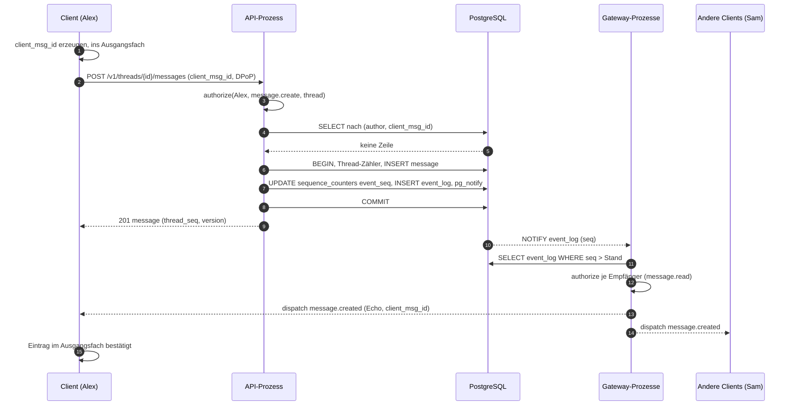
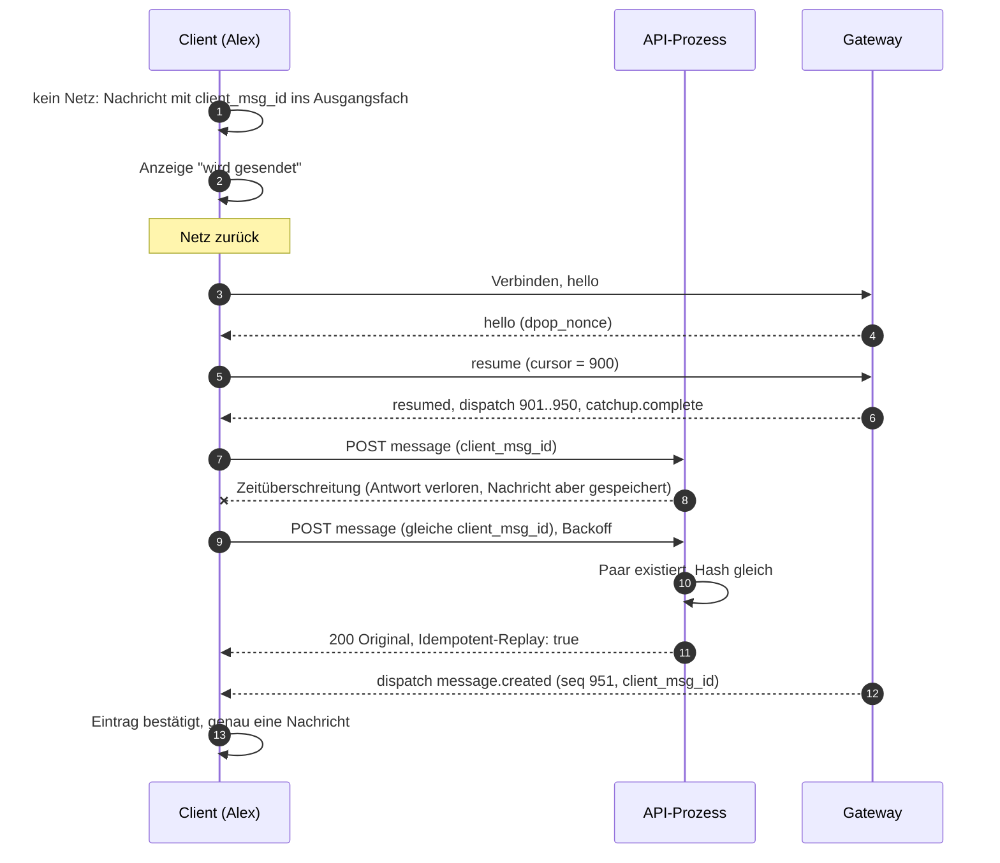
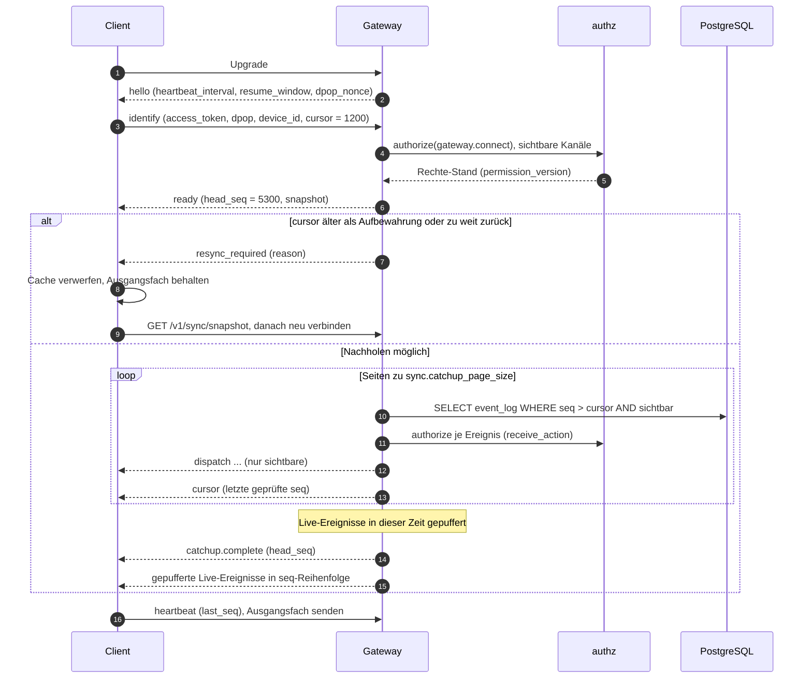
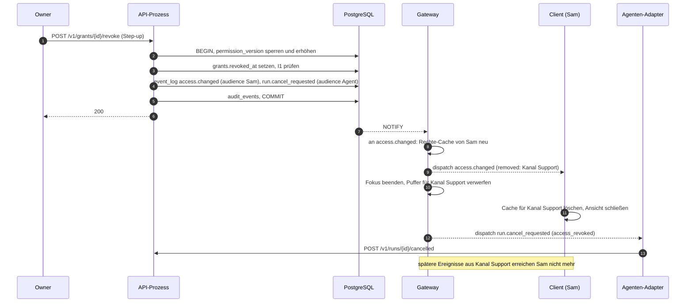
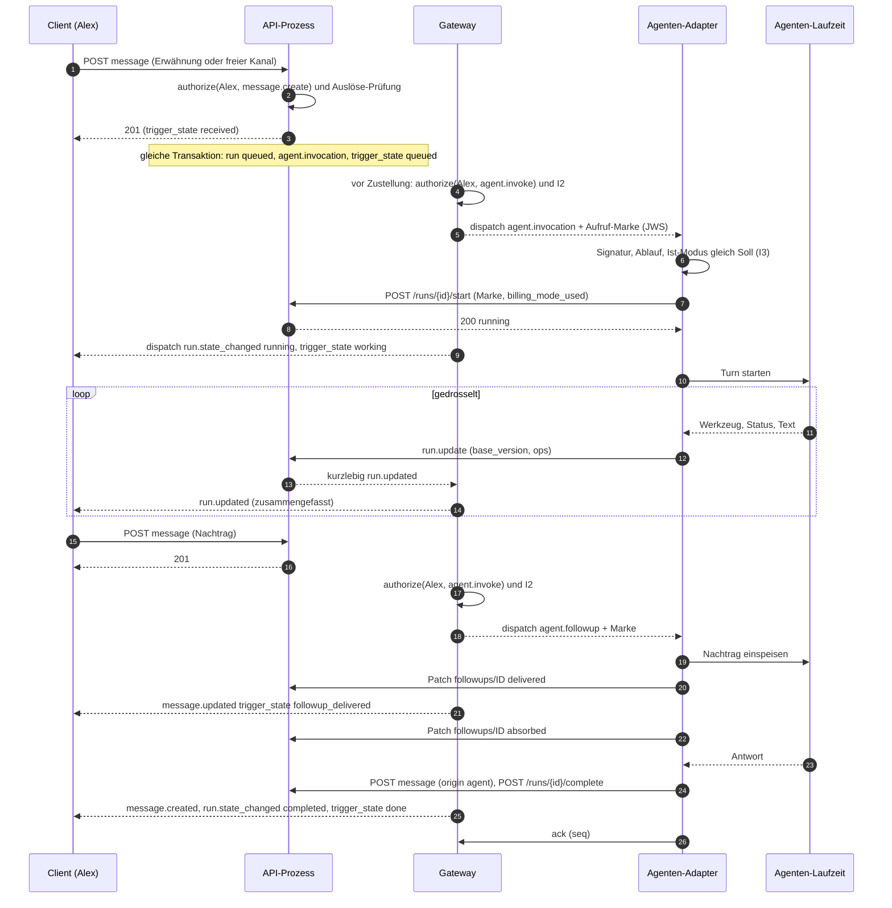

# 04 Ereignis- und Sync-Protokoll

Status: Entwurf M0. Normativ für das Gateway (AsyncAPI 3.0), die REST-Nachholschnittstelle
(OpenAPI 3.1), die Clients und die Agenten-Adapter.
Begriffe: [00-glossar.md](00-glossar.md). Tabellen: [03-datenmodell.md](03-datenmodell.md).
Aktionen und Ereignistypen: [05-aktionen.md](05-aktionen.md).

Alle Grenzen, Fenster und Intervalle sind benannte Konfigurationswerte. Ihre Standardwerte
stehen nur in Abschnitt 18.

## 1. Ziele

1. Kein Ereignis geht verloren: Ein Client, der wiederkommt, bekommt alles, was er sehen darf,
   oder die klare Anweisung, neu zu laden.
2. Nichts wird doppelt angelegt: Jede schreibende Anfrage ist wiederholbar.
3. Die Reihenfolge in einem Thread ist für alle gleich.
4. Rechte gelten bei jeder Zustellung, nicht nur bei der Anfrage. Ein Entzug wirkt sofort.
5. Ein Agenten-Adapter ist ein normaler Client mit dauerhaftem Cursor. Er verpasst nichts und
   startet nichts doppelt.

## 2. Ereignisse

### 2.1 Zwei Arten

| Art | Gespeichert | Sequenz | Nachholbar | Beispiele |
|---|---|---|---|---|
| dauerhaft (durable) | ja, in `event_log` | globale `seq` | ja, bis `sync.event_retention` | `message.created`, `thread.closed`, `run.state_changed`, `access.changed` |
| kurzlebig (ephemeral) | nein | keine | nein | `typing.started`, `run.updated`, `agent.presence_changed` |

Regel: Alles, was ein Client nach einer Pause kennen muss, ist dauerhaft. Kurzlebige Ereignisse
sind reine Beschleunigung; ihr Verlust wird durch den nächsten dauerhaften Zustand oder einen
Abruf geheilt. Die vollständige Liste der dauerhaften Typen mit der Empfangs-Aktion steht in
[05-aktionen.md](05-aktionen.md), Abschnitt 6.

### 2.2 Umschlag (Envelope)

Jedes Ereignis, dauerhaft oder kurzlebig, hat denselben Umschlag. Auf der Leitung ist es JSON.

| Feld | Typ | Pflicht | Bedeutung |
|---|---|---|---|
| `id` | UUIDv7 | ja | eindeutige Ereignis-ID, Dedupe-Schlüssel |
| `seq` | int64 oder null | ja | globale Sequenz; `null` bei kurzlebigen Ereignissen |
| `type` | string | ja | Ereignistyp, z. B. `message.created` |
| `schema_version` | int | ja | Version der Nutzlast dieses Typs; Änderungen nur additiv |
| `occurred_at` | RFC 3339 | ja | Zeit der Transaktion (nur Anzeige, nie Reihenfolge) |
| `actor` | `{id, kind}` oder null | ja | wer es ausgelöst hat; `kind` ist `user`, `agent`, `app`, `system` |
| `scope` | `{space_id, channel_id, thread_id}` | ja | Ort; Felder können null sein |
| `resource` | `{kind, id, version}` | ja | betroffenes Objekt und seine Version nach der Änderung |
| `audience` | `"self"` oder fehlt | nein | gesetzt bei persönlichen Ereignissen |
| `payload` | object | ja | Nutzlast nach Schema `<type>.v<schema_version>` |
| `redacted` | bool | nein | `true`: Nutzlast wurde nach Löschung geschwärzt |
| `correlation_id` | UUID oder null | ja | ID der auslösenden Anfrage |
| `client_msg_id` | UUIDv7 oder null | nein | Echo der Client-ID, damit der Absender sein Ausgangsfach abgleicht |
| `permission_version` | int64 | ja (dauerhaft) | Rechte-Version zur Zeit des Commits |

Regeln für die Nutzlast:

1. Sie enthält nur Felder, die ein Empfänger mit der Empfangs-Aktion des Typs sehen darf.
   Daten, die mehr Rechte brauchen (z. B. Kanal-Prompt, Skills, Projektbindung), stehen nie in
   Ereignissen. Das Ereignis nennt dann nur die neue Version (`channels.settings_version`);
   Berechtigte laden per REST nach.
2. Sie ist kleiner als `sync.event_payload_max_bytes`. Größere Objekte (lange Nachricht)
   werden mit `truncated: true` und Verweis geliefert; der Client lädt per REST nach.
3. Sie enthält keine Geheimnisse und keine Tokens.

### 2.3 Rahmen auf dem WebSocket

Jeder Rahmen ist ein JSON-Textrahmen der Form `{"op": "<name>", "d": {...}}`. Ein Rahmen ist
höchstens `sync.ws_max_frame_bytes` groß. Ereignisse kommen als `{"op": "dispatch", "d":
<Umschlag>}`.

## 3. Globale, commit-geordnete Sequenz

### 3.1 Warum `bigserial` nicht reicht

Eine PostgreSQL-Sequenz vergibt Nummern beim Aufruf, nicht beim Commit, und sie ist nicht
transaktional. Beispiel: Transaktion A holt `seq = 10`, Transaktion B holt `seq = 11`. B
committet zuerst. Ein Leser sieht 11 und setzt seinen Cursor auf 11. Danach committet A mit 10.
Der Leser fragt "alles nach 11" und verpasst 10 für immer. Außerdem hinterlässt jede
zurückgerollte Transaktion eine Lücke; ein Leser kann eine Lücke nicht von einer noch offenen
Transaktion unterscheiden.

### 3.2 Muster mit Zähler-Zeile

Die Zeile `sequence_counters('event_seq')` wird in derselben Transaktion gesperrt, die die
Domänenänderung schreibt, und zwar als letzter Schritt vor dem Commit:

```sql
BEGIN;  -- READ COMMITTED
  -- 1. Domänenänderung (Beispiel: neue Nachricht)
  UPDATE threads
     SET last_message_seq = last_message_seq + 1,
         last_activity_at = now(), message_count = message_count + 1,
         version = version + 1
   WHERE id = $thread_id
  RETURNING last_message_seq;                          -- -> $thread_seq

  INSERT INTO messages (id, thread_id, channel_id, thread_seq, author_principal_id,
                        client_msg_id, client_payload_sha256, origin, kind, content_md, ...)
  VALUES ($id, $thread_id, $channel_id, $thread_seq, $author, $client_msg_id, $hash,
          'human', 'text', $content, ...);

  -- 2. Als letzter Schritt: Zähler sperren und n Nummern holen
  UPDATE sequence_counters
     SET value = value + $n            -- n = Anzahl Ereignisse dieser Transaktion
   WHERE name = 'event_seq'
  RETURNING value;                     -- -> $last; Nummern sind $last - $n + 1 .. $last

  INSERT INTO event_log (seq, id, type, ..., permission_version)
  VALUES ($last - $n + 1, ...), ..., ($last, ...);

  SELECT pg_notify('event_log', $last::text);
COMMIT;
```

Warum das stimmt:

1. Die Zeilensperre aus dem `UPDATE` hält bis zum Commit. Eine zweite Transaktion wartet an
   derselben Zeile.
2. In `READ COMMITTED` liest die wartende Transaktion nach dem Commit der ersten den neuen
   Zählerstand neu. Sie bekommt also die nächsten Nummern.
3. PostgreSQL macht eine Transaktion sichtbar, bevor es ihre Sperren freigibt. Wenn B die
   Sperre bekommt, ist A schon sichtbar. Darum gilt: Sieht ein Leser `seq = k`, sieht er auch
   jede kleinere Nummer.
4. Rollt eine Transaktion zurück, rollt der Zähler mit. Es gibt keine Lücken. Ein Leser darf
   darum einfach `WHERE seq > $cursor ORDER BY seq` lesen.

Kosten: Alle Schreibtransaktionen mit Ereignissen sind am Ende serialisiert. Die Sperre hält
nur vom letzten Schritt bis zum Commit (inklusive WAL-Flush). Darum steht der Zähler-Schritt
immer zuletzt. Schreibende Transaktionen mit Ereignissen dürfen nicht in `REPEATABLE READ` oder
`SERIALIZABLE` laufen; dort bricht das Muster mit Serialisierungsfehlern. Die Sperrreihenfolge
steht in [03-datenmodell.md](03-datenmodell.md), Abschnitt 6.3. Ein Lasttest hält den Durchsatz
als Qualitäts-Gate fest (Risiko im Bericht).

### 3.3 Weitere Zähler

Dasselbe Muster gilt für `audit_seq` (Hash-Kette im Audit-Log) und für `permission_version`
(Rechte-Version). Die Rechte-Version wird bei Rechte-Änderungen als erstes gesperrt, damit alle
Rechte-Änderungen serialisiert sind.

## 4. Thread-Sequenz

Jede Nachricht hat `thread_seq`, lückenlos je Thread, vergeben über die Zeilensperre auf
`threads` (Muster oben, Schritt 1). Sie bestimmt die Anzeige-Reihenfolge. Die globale `seq`
bestimmt die Zustell-Reihenfolge. Beide sind in einem Thread gleich geordnet, weil beide aus
derselben Transaktion kommen und die Thread-Sperre vor der Zähler-Sperre genommen wird.

Gelöschte Nachrichten behalten ihre `thread_seq` als Tombstone. Ein Client erkennt eine echte
Lücke in `thread_seq` als fehlende Daten und lädt den Bereich per REST nach.

## 5. Idempotente Schreibvorgänge

### 5.1 Nachrichten: `client_msg_id`

1. Der Client erzeugt beim Verfassen eine UUIDv7 als `client_msg_id`. Er speichert sie mit dem
   Eintrag im Ausgangsfach, bevor er sendet.
2. Eindeutig ist das Paar `(author_principal_id, client_msg_id)`, dauerhaft (kein Ablauf).
3. Der Server rechnet `client_payload_sha256` über die kanonische Anfrage (Thread, Inhalt,
   Antwort-Bezug, Anhänge).
4. Ablauf im Server: zuerst `SELECT` nach dem Paar. Gibt es die Nachricht, antwortet er mit dem
   Original (`200`, Kopfzeile `Idempotent-Replay: true`), ohne neue Ereignisse. Ist der Hash
   anders, antwortet er `422 idempotency_key_reuse`. Gibt es sie nicht, folgt das Muster aus
   Abschnitt 3.2. Schlagen zwei gleiche Anfragen gleichzeitig an, verletzt die zweite den
   Unique-Index; ihre Transaktion rollt samt Thread-Nummer zurück, und der Server antwortet
   wie bei einer Wiederholung.
5. Der Server prüft das UUID-Format (Version 7), nicht die Uhrzeit darin. Ein Ausgangsfach
   darf also tagealte Einträge senden.

Interaktionen nutzen dasselbe Verfahren mit `client_interaction_id`.

### 5.2 Alle anderen Schreibvorgänge: `Idempotency-Key`

Jede andere schreibende REST-Operation akzeptiert die Kopfzeile `Idempotency-Key` (UUIDv7).
Clients setzen sie bei jeder Operation aus dem Ausgangsfach. Der Server speichert Anfrage-Hash
und Antwort in `idempotency_keys` für `sync.idempotency_key_ttl`. Wiederholung mit gleichem
Hash liefert die gespeicherte Antwort; anderer Hash: `422 idempotency_key_reuse`; Erstanfrage
läuft noch: `409 request_in_progress`. Operationen mit Versionsprüfung (`expected_version`)
sind zusätzlich durch die Version geschützt.

## 6. WebSocket-Gateway

### 6.1 Endpunkt und Version

Ein Endpunkt `wss://<host>/v1/gateway`. Die Protokollversion steht in `identify` und `hello`.
Änderungen innerhalb einer Hauptversion sind nur additiv: neue Ops, neue Felder, neue
Ereignistypen. Clients ignorieren Unbekanntes. Ein Gerät hält genau eine Verbindung.

### 6.2 Ops

Client an Server:

| Op | Zweck |
|---|---|
| `identify` | Anmeldung einer neuen Gateway-Sitzung |
| `resume` | Fortsetzen einer Gateway-Sitzung nach kurzer Trennung |
| `heartbeat` | Lebenszeichen mit letzter verarbeiteter `seq` |
| `reauth` | neuer Zugriffstoken während der Verbindung |
| `focus` | Liste der Threads, die gerade sichtbar sind (für Live-Box-Patches und Tippen) |
| `typing.start` / `typing.stop` | Tippen-Anzeige |
| `ack` | nur Agenten: Bestätigung bis `seq` |
| `run.update` | nur Agenten: Patch an einem eigenen Lauf (gleichwertig zu REST) |

Server an Client:

| Op | Zweck |
|---|---|
| `hello` | erste Nachricht nach dem Upgrade |
| `ready` | Sitzung bereit, mit Momentaufnahme |
| `resumed` | Fortsetzung bestätigt |
| `dispatch` | ein Ereignis |
| `cursor` | Cursor vorrücken ohne Ereignis (übersprungene, nicht sichtbare Ereignisse) |
| `catchup.complete` | Nachholen beendet, ab jetzt live |
| `resync_required` | Nachholen nicht möglich, neu laden |
| `heartbeat_ack` | Antwort auf `heartbeat` |
| `reauth_required` | Zugriffstoken läuft bald ab |
| `error` | Fehler zu einer Op, Verbindung bleibt |

Jede Op ist in [05-aktionen.md](05-aktionen.md) einer Aktion zugeordnet.

### 6.3 Lebenszyklus

1. **Upgrade.** Der Client öffnet die Verbindung. Der Server prüft beim Upgrade nichts außer
   Herkunft und Rate-Limit-Klasse `rl.gateway_connect`.
2. **`hello`.** Der Server sendet sofort `{heartbeat_interval, resume_window, protocol_versions,
   dpop_nonce, server_time}`. `dpop_nonce` ist frisch und gilt `auth.dpop_nonce_ttl`.
3. **`identify`.** Innerhalb von `sync.identify_timeout` sendet der Client:
   - Menschen: `access_token`, `dpop` (DPoP-Beweis nach RFC 9449 mit `htm = "GET"`, `htu` =
     HTTPS-Form der Gateway-URL, `nonce` = `dpop_nonce` aus `hello`, `ath` = Hash des Tokens),
     `device_id`, `protocol_version`, `cursor` (letzte verarbeitete `seq` oder null),
     `client` (Plattform und Version).
   - Agenten und Apps: `api_token`, bei `dpop_jkt` am Token zusätzlich `dpop`, `consumer`
     (Name des Verbrauchers, Standard `default`), `protocol_version`.
   Der Server prüft Token, Signatur, Ablauf, `cnf.jkt` gegen den aktiven Geräteschlüssel, Gerät
   `active`, Sitzung nicht widerrufen, Prinzipal `active`. Dann ruft er
   `authorize(principal, gateway.connect, instance)` auf.
   Der DPoP-Beweis steckt in `identify`, nicht in Kopfzeilen des Upgrades. Grund: nicht jeder
   Client kann Kopfzeilen beim WebSocket-Upgrade setzen; der Server-Nonce aus `hello` verhindert
   Wiedereinspielen.
4. **`ready`.** Der Server antwortet mit `{gateway_session_id, principal, device_id,
   permission_version, head_seq, snapshot}`. `snapshot` enthält: sichtbare Bereiche und Kanäle
   mit Versionen, Seitenleisten-Zustand, Ungelesen- und Erwähnungszähler, laufende Läufe
   (Zusammenfassung), Präsenz der sichtbaren Agenten, Versionen von Einstellungen und Entwürfen.
   Inhalte von Threads sind nicht enthalten; der Client lädt sie per REST.
   Hat der Client einen `cursor` gesendet, beginnt danach das Nachholen (Abschnitt 7).
5. **Heartbeat.** Der Client sendet alle `heartbeat_interval` ein `heartbeat {last_seq}`. Den
   ersten Heartbeat verzögert er um einen Zufallsanteil von `heartbeat_interval`, damit nach
   einem Server-Neustart nicht alle gleichzeitig senden. Der Server antwortet `heartbeat_ack`.
   Fehlen `sync.heartbeat_miss_limit` Heartbeats in Folge, schließt der Server mit `4009`.
   Fehlt dem Client ein `heartbeat_ack` innerhalb von `heartbeat_interval`, schließt er selbst
   und verbindet neu.
6. **Token-Erneuerung.** Vor Ablauf des Zugriffstokens sendet der Server `reauth_required`
   (Vorlauf `sync.reauth_lead_time`). Der Client holt per Refresh einen neuen Token und sendet
   `reauth {access_token, dpop}` mit dem aktuellen Nonce. Ohne gültiges `reauth` bis zum Ablauf
   schließt der Server mit `4011`.
7. **`resume`.** Nach einer Trennung innerhalb von `resume_window` sendet der Client statt
   `identify` ein `resume {gateway_session_id, access_token, dpop, cursor}`. Der Server
   prüft Token und Sitzung wie bei `identify`, stellt Fokus und Abos wieder her und antwortet
   `resumed`, dann folgt das Nachholen ab `cursor`. Kurzlebige Ereignisse der Pause sind
   verloren. Ist die Gateway-Sitzung unbekannt oder abgelaufen, schließt der Server mit `4006`;
   der Client macht dann `identify`.
8. **Ende.** Der Client schließt mit `1000`. Der Server schließt mit einem Code aus 6.4.

### 6.4 Schließ-Codes

| Code | Name | Client-Reaktion |
|---|---|---|
| `1000` | normal | nicht neu verbinden, außer die App ist im Vordergrund |
| `1001` | going_away | neu verbinden mit Backoff, `resume` versuchen |
| `4000` | unknown_error | neu verbinden mit Backoff |
| `4001` | unknown_op | Fehler melden, neu verbinden |
| `4002` | decode_error | Fehler melden, neu verbinden |
| `4003` | not_identified | Op vor `identify` gesendet; neu verbinden |
| `4004` | authentication_failed | Token erneuern; scheitert das, abmelden |
| `4005` | already_identified | Fehler melden, neu verbinden |
| `4006` | session_invalid | `identify` statt `resume` |
| `4007` | protocol_version_unsupported | App-Update anzeigen, nicht neu verbinden |
| `4008` | rate_limited | Wartezeit aus dem Schließgrund abwarten |
| `4009` | heartbeat_timeout | neu verbinden mit Backoff, `resume` versuchen |
| `4011` | token_expired | Token erneuern, dann `resume` |
| `4012` | revoked | Sitzung, Gerät oder Prinzipal widerrufen: lokale Daten löschen, abmelden, nicht neu verbinden |
| `4013` | server_restart | sofort mit Zufallsverzögerung neu verbinden, `resume` versuchen |
| `4014` | slow_consumer | neu verbinden, Nachholen ab Cursor |
| `4015` | consumer_replaced | nur Agenten: ein anderer Prozess hat denselben Verbraucher übernommen; nicht neu verbinden |

### 6.5 Neu verbinden

Der Client wartet vor dem Versuch `n` (ab 0) eine Zeit gleichverteilt zwischen 0 und
`min(sync.reconnect_backoff_cap, sync.reconnect_backoff_base * 2^n)` (Full Jitter). Nach einer
erfolgreichen `ready`- oder `resumed`-Antwort beginnt `n` wieder bei 0. Netzwechsel und
Rückkehr in den Vordergrund lösen einen sofortigen Versuch aus, der den Zähler nicht erhöht.

## 7. Nachholen (Catch-up)

### 7.1 Cursor

Der Cursor eines Clients ist die höchste globale `seq`, die der Server für diesen Prinzipal
**geprüft** hat, nicht nur die höchste zugestellte. Darum sendet der Server `cursor {seq}`, wenn
er nicht sichtbare Ereignisse übersprungen hat, spätestens nach `sync.cursor_advance_every`
übersprungenen Ereignissen und am Ende jeder Seite. Der Client speichert den Cursor nach jeder
verarbeiteten Seite dauerhaft.

### 7.2 Ablauf

1. Der Server liest Seiten zu `sync.catchup_page_size`:
   `SELECT ... FROM event_log WHERE seq > $cursor AND seq <= $head AND (channel_id =
   ANY($visible_channels) OR audience_principal_id = $principal OR (channel_id IS NULL AND
   audience_principal_id IS NULL)) ORDER BY seq LIMIT $page`.
   `$visible_channels` liefert `authz` aus dem Rechte-Cache.
2. Jedes Ereignis läuft zusätzlich durch `authorize(principal, <receive_action>, resource)`.
   Erst dann wird es als `dispatch` gesendet.
3. Neue Live-Ereignisse während des Nachholens werden je Verbindung gepuffert und erst nach dem
   Nachholen in `seq`-Reihenfolge gesendet. Es gibt keine Vermischung.
4. Am Ende sendet der Server `catchup.complete {head_seq}`. Danach ist die Verbindung live.
5. Übersteigt der Puffer `sync.outbound_queue_max`, schließt der Server mit `4014`. Der Client
   setzt ab seinem Cursor neu auf.

### 7.3 `resync_required`

Der Server sendet `resync_required {reason, head_seq}` statt Ereignissen, wenn:

- `cursor < min_retained_seq - 1` (Ereignisse wurden nach `sync.event_retention` entfernt),
  Grund `retention`;
- `head_seq - cursor > sync.catchup_max_events`, Grund `too_far_behind`;
- `cursor > head_seq` (z. B. Server aus Sicherung wiederhergestellt), Grund `cursor_ahead`.

Der Client verwirft dann seinen Server-Zustand im Cache (das Ausgangsfach bleibt), lädt
`GET /v1/sync/snapshot`, setzt den Cursor auf das gelieferte `head_seq` und lädt Threads bei
Bedarf per REST. Danach verbindet er mit diesem Cursor neu.

### 7.4 REST-Variante

`GET /v1/events?after=<seq>&limit=<n>` liefert dieselben Ereignisse mit denselben Regeln:
`{events, next_cursor, head_seq}` oder `410 resync_required`. Sie dient SDKs, Tests und
Adaptern ohne WebSocket. `limit` ist höchstens `sync.catchup_page_size`.

## 8. Sichtbarkeit bei Rechte-Änderungen

### 8.1 Grundregel

Es gelten die Rechte zum Zeitpunkt der Zustellung, nicht die zum Zeitpunkt des Ereignisses.
Ein Gateway-Prozess aktualisiert den Rechte-Cache eines Prinzipals, wenn er im Log an dessen
Ereignis `access.changed` ankommt. Alle Ereignisse danach prüft er mit dem neuen Stand.

### 8.2 Was beim Ändern passiert

Jede Transaktion, die Rechte ändert (Freigabe, Gruppe, Owner, Bediener, Backend-Richtlinie,
Status eines Prinzipals, Gerät oder Sitzung), erhöht die Rechte-Version und schreibt für jeden
betroffenen Prinzipal ein persönliches Ereignis `access.changed`:

```json
{
  "permission_version": 418,
  "added":   [{"kind": "channel", "id": "...", "level": "write"}],
  "removed": [{"kind": "space", "id": "..."}],
  "changed": [{"kind": "channel", "id": "...", "level": "read", "previous_level": "trigger"}]
}
```

Betroffen sind: das Subjekt, bei Gruppen alle aktuellen Mitglieder, bei Owner-Änderung die
Person. Die Liste berechnet `authz` als Unterschied der sichtbaren Ziele vor und nach der
Änderung.

### 8.3 Was der Client bei Entzug bekommt und tut

1. Der Server sendet `access.changed` sofort, ohne auf andere Ereignisse zu warten.
2. Er stellt danach kein Ereignis mehr aus den entfernten Zielen zu, beendet deren Fokus und
   verwirft gepufferte Ereignisse dieser Ziele.
3. Der Client löscht für entfernte Ziele alle Inhalte aus dem lokalen Cache: Threads,
   Nachrichten, Dateien, Vorschaubilder, Suchindex, Entwürfe. Er schließt offene Ansichten mit
   dem Hinweis "Kein Zugriff mehr".
4. Einträge im Ausgangsfach für entfernte Ziele scheitern beim Senden mit `404`. Der Client
   markiert sie als fehlgeschlagen und behält den Text lokal zum Kopieren.
5. Hat der Prinzipal die Stufe `trigger` auf einem Thread verloren, in dem ein von ihm
   ausgelöster Lauf aktiv ist, schreibt der Server `run.cancel_requested` mit Grund
   `access_revoked` an den Agenten. Der Agent bricht ab und meldet `cancelled`.
6. Push: Jeder Push läuft vor dem Versand durch `authorize`. Es gibt nichts zu löschen.

### 8.4 Bei Erweiterung

Der Client bekommt `access.changed` mit `added`. Ältere Ereignisse der neuen Ziele vor seinem
Cursor holt er nicht nach; er lädt die Struktur der neuen Ziele per REST und Inhalte bei Bedarf.

### 8.5 Widerruf von Sitzung, Gerät oder Prinzipal

Der Server schließt alle betroffenen Verbindungen sofort mit `4012`. Der Client löscht alle
lokalen Daten dieses Kontos. Zugriffstokens tragen die Sitzungs-ID `sid`; `authorize` prüft
den Widerrufsstand aus einem Cache, der an der Rechte-Version hängt. Ein widerrufener Token ist
damit vor seinem Ablauf wirkungslos.

## 9. Zustellgarantie

1. Dauerhafte Ereignisse werden mindestens einmal zugestellt (at-least-once). Doppel entstehen
   bei Wiederverbinden und Wiederholungen.
2. Der Client verwirft jedes Ereignis mit `seq <= ` seinem gespeicherten Cursor. Weil eine
   Verbindung streng in `seq`-Reihenfolge liefert, reicht dieser Vergleich.
3. Zusätzlich wendet der Client eine Änderung an einem Objekt nur an, wenn
   `resource.version` größer ist als die lokale Version. Damit sind auch Daten aus REST und aus
   Ereignissen ohne Konflikt mischbar.
4. Kurzlebige Ereignisse werden höchstens einmal zugestellt (at-most-once).

## 10. Reihenfolge

| Bereich | Garantie |
|---|---|
| global, dauerhafte Ereignisse | Zustellung in `seq`-Reihenfolge = Commit-Reihenfolge |
| je Thread | streng nach `thread_seq`; gleich für alle Empfänger |
| je Objekt | streng nach `resource.version` |
| kurzlebig | keine Garantie untereinander; `run.updated` ist über `version` geordnet |
| zwischen Prozessen | jeder Gateway-Prozess liest dasselbe Log in derselben Reihenfolge |

Zeitstempel ordnen nie etwas.

## 11. Live-Box-Streaming

### 11.1 Lauf-Dokument

Ein Lauf hat ein Dokument (Schema `run_document.v1`): `state`, `version`, `status_line`,
`last_text_excerpt`, `metrics`, `cost`, `billing_mode_used`, `steps` (Objekt, Schlüssel ist die
Schritt-ID, jeder Schritt mit `ordinal`, `parent_step_id`, `kind`, `name`, `title`, `status`,
Zeiten), `followups` (Objekt, Schlüssel ist die Nachrichten-ID), Zeiten. Schritte sind als
Objekt gespeichert, nicht als Liste, damit Patches über stabile Pfade laufen; die Reihenfolge
kommt aus `ordinal`.

### 11.2 Vom Adapter zum Server

Der Adapter sendet `run.update {run_id, base_version, ops}` (WebSocket) oder `PATCH
/v1/runs/{id}` (REST). `ops` ist eine Liste von Operationen nach RFC 6902, beschränkt auf
`add`, `replace` und `remove`, mit JSON-Pointer-Pfaden ins Lauf-Dokument. Der Server prüft:
Prinzipal ist der Agent des Laufs, Lauf ist aktiv, `base_version` passt, Pfade sind erlaubt
(z. B. nicht `state`; Zustände wechseln nur über eigene Endpunkte). Er speichert die Änderung,
erhöht `runs.version` und antwortet mit der neuen Version. Bei falscher `base_version`
antwortet er `409` mit dem aktuellen Dokument. Der Adapter drosselt selbst auf höchstens eine
Änderung je `agent.run_update_min_interval`.

### 11.3 Vom Server zu den Clients

1. Zustandswechsel (`queued`, `running`, `waiting_input`, Ende) sind dauerhafte Ereignisse
   `run.state_changed` mit Zusammenfassung (Zustand, Dauer, Kosten, Zahl der Schritte). Daraus
   speisen sich Seitenleiste und "Läuft gerade".
2. Inhaltliche Änderungen sind das kurzlebige Ereignis `run.updated {run_id, base_version,
   version, ops}`. Es geht nur an Verbindungen, die den Thread im `focus` haben und
   `run.read` dürfen. Ein Client fokussiert höchstens `sync.max_focused_threads` Threads.
3. Zusammenfassen: Der Server sammelt je Lauf und Verbindung Änderungen für
   `sync.run_patch_coalesce_interval`. Dann sendet er einen Rahmen von der ältesten
   `base_version` bis zur neuesten `version`. Spätere `replace` auf denselben Pfad ersetzen
   frühere. Ist die Ausgangswarteschlange der Verbindung voll, verwirft der Server die
   gesammelten Patches und sendet stattdessen das ganze Dokument als `run.updated` mit
   `snapshot`.
4. Client-Regel: Ist `base_version` gleich der lokalen Version, wendet er die Ops an. Ist
   `version` kleiner oder gleich der lokalen, ignoriert er den Rahmen. Sonst (Lücke) holt er
   `GET /v1/runs/{id}` und ersetzt sein Dokument. Er zeichnet immer nur den neuesten Stand.
5. Beim Fokussieren eines Threads mit aktivem Lauf sendet der Server einmal das ganze Dokument.
6. Nach dem Ende klappt die Live-Box auf eine Zeile zusammen. Die Zusammenfassung kommt aus
   `run.state_changed`; Details lädt der Client beim Aufklappen per REST.

## 12. Tippen und Agenten-Präsenz

1. **Tippen.** Der Client sendet `typing.start {thread_id}` höchstens einmal je
   `sync.typing_min_interval`, solange getippt wird, und `typing.stop` beim Leeren oder
   Senden. Der Server prüft `typing.start` (Aktion in [05-aktionen.md](05-aktionen.md)) und
   sendet `typing.started {thread_id, principal_id, expires_at}` an Verbindungen mit Fokus auf
   dem Thread und Leserecht. Ohne Erneuerung endet die Anzeige nach `sync.typing_ttl`. Ein
   laufender Lauf zeigt das Tippen des Agenten; Agenten senden kein eigenes Tippen.
2. **Präsenz von Agenten.** Adapter senden `POST /v1/agents/me/heartbeat` (oder implizit über
   das Gateway-`heartbeat`) mit Zustand, Laufzeit-Version und `reported_billing_mode`. Der
   Server leitet daraus `online`, `degraded` oder `offline` ab; `offline` gilt nach
   `agent.presence_timeout` ohne Heartbeat. Bei einer Änderung sendet er das kurzlebige
   `agent.presence_changed {agent_id, state, reported_billing_mode}` an alle mit `agent.read`.
   `ready` enthält den aktuellen Stand. Menschen haben keine Präsenz-Anzeige.

## 13. Offline-Verhalten des Clients

### 13.1 Lokaler Cache

Der Client hält Struktur, zuletzt geöffnete Threads, Nachrichten, Vorschaubilder, eigene
Einstellungen und Entwürfe in einer lokalen, verschlüsselten Datenbank (Schutzklasse je
Plattform siehe Sicherheitskapitel). Der Cache ist nur eine Kopie; die Wahrheit liegt im
Server. Einträge älter als `client.cache_max_age` ohne Zugriff werden entfernt.

### 13.2 Ausgangsfach (Outbox)

1. Jede schreibende Bedienung landet zuerst im Ausgangsfach, mit eigener ID
   (`client_msg_id` für Nachrichten, `client_interaction_id` für Interaktionen,
   `Idempotency-Key` für alles andere), Zeitpunkt und erwarteter Version, wo nötig.
2. Das Ausgangsfach ist je Thread streng FIFO. Der Client sendet den nächsten Eintrag eines
   Threads erst nach der Antwort auf den vorherigen. Verschiedene Threads laufen parallel.
3. Die Oberfläche zeigt wartende Nachrichten sofort mit Zustand "wird gesendet" an der Stelle
   nach der letzten bestätigten `thread_seq`.
4. Wiederholung bei Netzfehler, Zeitüberschreitung, `5xx` und `429`: Backoff mit Full Jitter
   zwischen `client.outbox_retry_base` und `client.outbox_retry_cap`. Dieselbe ID bei jeder
   Wiederholung.
5. Dauerhafte Fehler (`400`, `404`, `410`, `413`, `422`) beenden die Wiederholung. Der Eintrag
   bleibt als "fehlgeschlagen" mit Grund sichtbar; der Mensch kann bearbeiten, erneut senden
   (neue ID) oder verwerfen. Nichts wird still verworfen.
6. Kommt das Echo-Ereignis `message.created` mit passender `client_msg_id`, ersetzt der Client
   den wartenden Eintrag durch die Server-Nachricht.

### 13.3 Bearbeiten und Löschen

| Fall | Regel |
|---|---|
| Bearbeiten einer noch nicht gesendeten Nachricht | ändert den Eintrag im Ausgangsfach; keine Server-Anfrage |
| Löschen einer noch nicht gesendeten Nachricht | entfernt den Eintrag; wurde er schon gesendet, aber nicht bestätigt, folgt ein Lösch-Eintrag |
| Bearbeiten einer gesendeten Nachricht | `PATCH` mit `expected_version`. Passt die Version nicht: `409 version_conflict` mit aktueller Fassung. Der Client zeigt beide Fassungen; der Mensch entscheidet. Keine automatische Zusammenführung. |
| Bearbeiten einer inzwischen gelöschten Nachricht | `410 message_deleted`; der Eintrag wird verworfen, der Text bleibt zum Kopieren |
| Löschen einer gesendeten Nachricht | `DELETE` ist idempotent; schon gelöscht ergibt `204` |
| Thread inzwischen erledigt | Senden öffnet ihn wieder (Baseline); kein Konflikt |
| Thread verschoben | ID bleibt gleich; Senden klappt ohne Änderung |

### 13.4 Abgleich nach dem Wiederverbinden

1. Verbinden mit `resume` oder `identify` und gespeichertem Cursor.
2. Nachholen bis `catchup.complete`. Echos eigener Nachrichten bestätigen Einträge im
   Ausgangsfach.
3. Danach sendet der Client das Ausgangsfach in Reihenfolge.
4. Bei `resync_required` bleibt das Ausgangsfach unberührt und wird nach dem Neuladen
   gesendet.

## 14. Geräteübergreifende Synchronisation

Persönliche Daten ändern sich über REST. Jede Änderung schreibt ein persönliches dauerhaftes
Ereignis (`audience = self`); alle Geräte des Menschen bekommen es über das Log. Die
Gewinnerregel ist die Commit-Reihenfolge im Server, ausgedrückt durch die Version.

| Daten | Ereignis | Regel |
|---|---|---|
| Gelesen-Stand | `read_state.updated` | monoton: `last_read_seq = GREATEST(alt, neu)`. Zurücksetzen ("als ungelesen markieren") ist eine eigene Operation mit `expected_version`. |
| Entwürfe | `draft.updated`, `draft.deleted` | letzte Schreibung gewinnt in Server-Reihenfolge; jede Schreibung erhöht `version`. Der Client sendet `base_version`; ist sie älter als die aktuelle, antwortet der Server mit `overwrote_newer: true`, und der Client zeigt einen Hinweis. Eingehende Änderungen eines anderen Geräts übernimmt ein Gerät nur, wenn der Mensch dort gerade nicht in diesem Entwurf tippt; sonst gewinnt die nächste lokale Schreibung. Erfolgreiches Senden mit `clear_draft: true` löscht den Entwurf in derselben Transaktion. |
| Einstellungen | `settings.updated` | je Schlüssel letzte Schreibung gewinnt; Änderungen an verschiedenen Schlüsseln stören sich nicht |
| Seitenleiste | `sidebar.updated` | je Bereich (`user_space_states`) letzte Schreibung gewinnt |
| Benachrichtigung, Ruhezeiten | `notification_pref.updated`, `quiet_hours.updated` | je Zeile letzte Schreibung gewinnt |

Ein Gerät erkennt sein eigenes Echo an `updated_by_device_id` und ignoriert es.

## 15. Agenten-Adapter

### 15.1 Verbindung und Cursor

1. Ein Adapter verbindet sich wie ein Client, mit `api_token` und `consumer`.
2. Je `(agent, consumer)` gibt es einen dauerhaften Cursor in `agent_consumer_cursors`. Beim
   ersten Verbinden setzt der Server ihn auf den aktuellen `head_seq`. Ein Adapter holt also nie
   Ereignisse aus der Zeit vor seiner Aktivierung nach.
3. Je Verbraucher gibt es genau eine Verbindung. Ein neues `identify` mit demselben Verbraucher
   schließt die ältere Verbindung mit `4015`. Grund: zwei Prozesse am selben Strom würden
   doppelt arbeiten.
4. Der Server liefert ab `acked_seq + 1` in `seq`-Reihenfolge, gefiltert wie bei Menschen (der
   Agent sieht, was seine Freigaben erlauben) plus persönliche Ereignisse an ihn
   (`agent.invocation`, `agent.followup`, `run.cancel_requested`, `interaction.created`,
   `command.invoked`, `agent.config_changed`).

### 15.2 Bestätigung und erneute Zustellung

1. Der Adapter sendet `ack {seq}` nach dauerhafter Verarbeitung. Die Bestätigung gilt für alle
   Nummern bis `seq`.
2. Höchstens `agent.max_inflight_events` unbestätigte Ereignisse sind unterwegs. Danach wartet
   der Server.
3. Ohne Bestätigung innerhalb von `agent.ack_timeout` stellt der Server ab `acked_seq + 1` erneut
   zu, mit `redelivered: true` im Rahmen.
4. Der Server speichert `acked_seq` spätestens nach `agent.ack_persist_interval`. Nach einem
   Server-Neustart kann es darum Doppel geben; der Adapter dedupliziert über die Ereignis-ID und
   über Lauf-IDs.

### 15.3 Aufruf und Lauf-Start

1. Eine auslösende Nachricht schreibt in ihrer Transaktion: Nachricht mit `trigger_state =
   received`, einen Lauf `queued` und das persönliche Ereignis `agent.invocation` an den
   Agenten (ohne Marke). `trigger_state` wechselt auf `queued`.
2. **Bei jeder Zustellung** von `agent.invocation` prüft der Server unmittelbar davor
   `authorize(trigger_principal, agent.invoke, thread)` mit den aktuellen Rechten und die
   Backend-Richtlinie (I2). Scheitert die Prüfung, stellt er nicht zu, setzt den Lauf auf
   `failed` mit Grund, setzt `trigger_state = failed` und schreibt einen Audit-Eintrag
   (fail closed). Besteht sie, erzeugt er eine frische Aufruf-Marke (JWS, I3) mit Gültigkeit
   `agent.invocation_token_ttl`, speichert ihre `jti` in `runs.invocation_jti` und hängt sie
   an den Rahmen.
3. Der Adapter prüft die Signatur über die JWKS des Servers, Ablauf, Zielgruppe (sich selbst)
   und dass sein gemeldeter Ist-Modus gleich `billing_mode` der Marke ist. Passt etwas nicht,
   meldet er `POST /v1/runs/{id}/fail {reason}`, z. B. `billing_mode_mismatch`.
4. Sonst startet er mit `POST /v1/runs/{id}/start {invocation_token, billing_mode_used,
   external_session_ref}`. Der Server prüft `jti` und Ablauf erneut und macht `queued ->
   running` als Compare-and-swap. Eine zweite Zustellung desselben Aufrufs bekommt `409
   already_started`; der Adapter startet dann nichts. Weicht `billing_mode_used` vom Soll ab,
   lehnt der Server ab und setzt den Lauf auf `failed` mit `billing_mode_mismatch`.
5. Mit dem Start wechselt `trigger_state` auf `working`, am Ende auf `done` oder `failed`.

### 15.4 Nachträge

1. Eine Nachricht eines Menschen in einem Thread mit aktivem Lauf wird Nachtrag: Zeile in
   `run_followups` (`queued`) und persönliches Ereignis `agent.followup` an den Agenten.
2. Die Zustellung prüft wie in 15.3 Schritt 2 (ein Nachtrag ist eine Auslösung) und hängt eine
   Marke an.
3. Der Adapter meldet `delivered` (an die Laufzeit übergeben) und `absorbed` (von der Laufzeit
   aufgenommen) als Patch auf `followups/<message_id>`. Bei `delivered` setzt der Server
   `trigger_state = followup_delivered`.
4. Endet der Lauf mit Nachträgen im Zustand `queued` oder `delivered` ohne `absorbed`, setzt
   der Server sie auf `deferred` und legt einen neuen Lauf an: die erste dieser Nachrichten ist
   die auslösende, die übrigen sind seine Nachträge.
5. Steuerbefehle (`commands.control = true`, z. B. Stopp) sind nie Nachträge; sie gehen als
   `command.invoked` sofort an den Agenten.

### 15.5 Abbruch

`run.cancel` (Mensch) oder Rechte-Entzug (8.3) schreibt `run.cancel_requested` an den Agenten.
Der Agent beendet die Laufzeit und meldet `cancelled`. Meldet er nichts innerhalb von
`agent.cancel_grace`, setzt der Server den Lauf selbst auf `cancelled` mit Grund
`cancel_timeout`; spätere Patches des Adapters zu diesem Lauf werden abgelehnt.

## 16. Sequenzdiagramme

### 16.1 Nachricht senden, online



### 16.2 Senden offline, dann Wiederverbinden



### 16.3 Wiederverbinden mit Nachholen



### 16.4 Entzug während offener Verbindung



### 16.5 Agenten-Lauf mit Nachtrag



## 17. Entscheidungen dieses Kapitels

| Nr | Entscheidung | Grund |
|---|---|---|
| R-SY-01 | DPoP-Beweis im `identify`-Rahmen mit Server-Nonce aus `hello`, nicht in Upgrade-Kopfzeilen. | Gleicher Weg für alle Clients; Nonce verhindert Wiedereinspielen. |
| R-SY-02 | Rechte gelten zur Zustellzeit; der Rechte-Cache folgt `access.changed` in Log-Reihenfolge. | Einfach, sofort wirksam, für alle Gateway-Prozesse gleich. |
| R-SY-03 | Der Cursor ist "zuletzt geprüft", nicht "zuletzt zugestellt"; der Server sendet `cursor`-Rahmen. | Wer wenig sieht, scannt nicht bei jedem Verbinden denselben fremden Verkehr erneut. |
| R-SY-04 | `resync_required` auch bei `cursor > head_seq`. | Erkennt eine Wiederherstellung aus der Sicherung, statt still Daten zu verlieren. |
| R-SY-05 | Live-Box-Patches sind kurzlebig und gehen nur an fokussierte Threads; Zustände sind dauerhaft. | Hohe Patch-Rate belastet weder Log noch unbeteiligte Geräte; nach Pausen genügt der Zustand. |
| R-SY-06 | Patch-Format ist RFC 6902 mit `add`, `replace`, `remove`; Schritte als Objekt nach ID. | Standard, stabile Pfade, einfache Zusammenfassung. |
| R-SY-07 | Aufruf-Marken werden bei jeder Zustellung neu erzeugt, nicht beim Schreiben. | I2 prüft direkt vor dem Aufruf; erneute Zustellung nach Ablauf bleibt möglich. |
| R-SY-08 | Aufruf-Marken sind asymmetrisch signiert (EdDSA), Schlüssel über JWKS. | Der Adapter kann prüfen, aber keine Marke fälschen (Studie A schlug HMAC vor). |
| R-SY-09 | Ein Verbraucher je `(agent, consumer)`, der neueste gewinnt. | Ein Strom, keine doppelte Arbeit. |
| R-SY-10 | Lauf-Start ist ein Compare-and-swap mit `jti`-Prüfung. | Erneute Zustellung startet nie einen zweiten Lauf. |
| R-SY-11 | Rechte-Entzug bricht Läufe des betroffenen Auslösers ab, für alle Agenten. | Fail closed; Studie C erlaubte Fertigschreiben, das ist schwerer zu prüfen. |
| R-SY-12 | Entwürfe: letzte Schreibung gewinnt, mit Hinweis `overwrote_newer`; keine Zusammenführung. | Entwürfe sind persönlich und meist auf einem Gerät aktiv; Zusammenführen wäre teuer und fehleranfällig. |
| R-SY-13 | Gelesen-Stand ist monoton; Zurücksetzen nur mit Versionsprüfung. | Zwei Geräte können sich nicht gegenseitig auf "ungelesen" zurückwerfen. |
| R-SY-14 | Bei Geräte- oder Sitzungswiderruf löscht der Client alle lokalen Daten. | Ein verlorenes Gerät behält keine Inhalte. |
| R-SY-15 | Verteilung an Gateway-Prozesse über `LISTEN/NOTIFY` und Lesen des Logs, kein Broker. | Ein Abhängigkeitspfad weniger; das Log ist ohnehin die Quelle. |

## 18. Konfigurationswerte dieses Kapitels

| Name | Standard | Bedeutung |
|---|---|---|
| `sync.event_retention` | `30d` | so lange bleiben dauerhafte Ereignisse nachholbar |
| `sync.event_payload_max_bytes` | `65536` | größte Nutzlast eines Ereignisses |
| `sync.ws_max_frame_bytes` | `1048576` | größter WebSocket-Rahmen |
| `sync.identify_timeout` | `10s` | Zeit zwischen `hello` und `identify` |
| `sync.heartbeat_interval` | `30s` | Abstand der Heartbeats (in `hello` gemeldet) |
| `sync.heartbeat_miss_limit` | `2` | fehlende Heartbeats bis zum Schließen |
| `sync.resume_window` | `5m` | so lange ist `resume` nach Trennung möglich |
| `sync.reauth_lead_time` | `60s` | Vorlauf von `reauth_required` vor Token-Ablauf |
| `sync.reconnect_backoff_base` | `1s` | Basis des Backoffs beim Wiederverbinden |
| `sync.reconnect_backoff_cap` | `60s` | größter Abstand beim Wiederverbinden |
| `sync.catchup_page_size` | `500` | Ereignisse je Nachhol-Seite |
| `sync.catchup_max_events` | `50000` | mehr Rückstand ergibt `resync_required` |
| `sync.cursor_advance_every` | `1000` | nach so vielen übersprungenen Ereignissen ein `cursor`-Rahmen |
| `sync.outbound_queue_max` | `10000` | Rahmen im Ausgang einer Verbindung bis `4014` |
| `sync.idempotency_key_ttl` | `24h` | Aufbewahrung von `Idempotency-Key` |
| `sync.max_focused_threads` | `20` | Threads im `focus` je Verbindung |
| `sync.run_patch_coalesce_interval` | `250ms` | Sammelfenster für `run.updated` |
| `sync.typing_min_interval` | `5s` | höchstens so oft `typing.start` |
| `sync.typing_ttl` | `8s` | Tipp-Anzeige ohne Erneuerung |
| `client.cache_max_age` | `30d` | ungenutzte Cache-Einträge |
| `client.outbox_retry_base` | `2s` | Basis des Backoffs im Ausgangsfach |
| `client.outbox_retry_cap` | `5m` | größter Abstand im Ausgangsfach |
| `agent.invocation_token_ttl` | `60s` | Gültigkeit einer Aufruf-Marke |
| `agent.ack_timeout` | `30s` | ohne `ack`: erneute Zustellung |
| `agent.ack_persist_interval` | `1s` | spätestens so oft wird `acked_seq` gespeichert |
| `agent.max_inflight_events` | `100` | unbestätigte Ereignisse je Verbraucher |
| `agent.run_update_min_interval` | `500ms` | Adapter-Drossel für `run.update` |
| `agent.presence_timeout` | `90s` | ohne Heartbeat gilt der Agent als `offline` |
| `agent.cancel_grace` | `30s` | Zeit für den Adapter, einen Abbruch zu melden |
| `auth.dpop_nonce_ttl` | `5m` | Gültigkeit des DPoP-Nonce aus `hello` |

`auth.dpop_nonce_ttl` gehört fachlich zum Kapitel Identität und Geräte. Übernimmt jenes Kapitel
den Wert, wird diese Zeile dort geführt und hier gestrichen.
