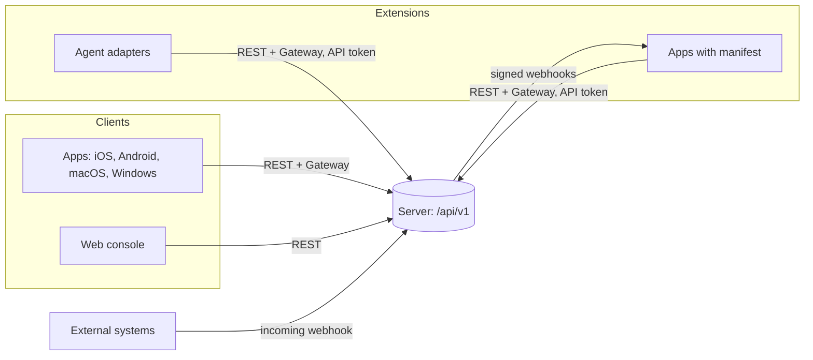
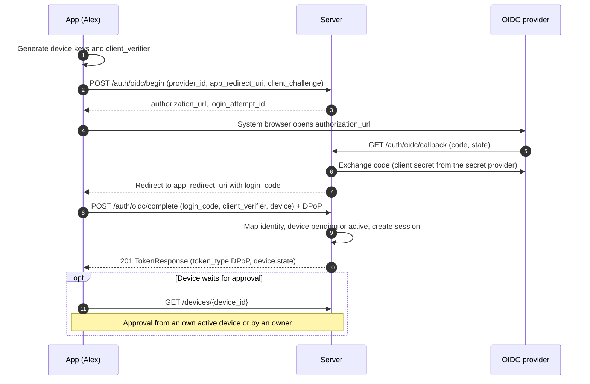
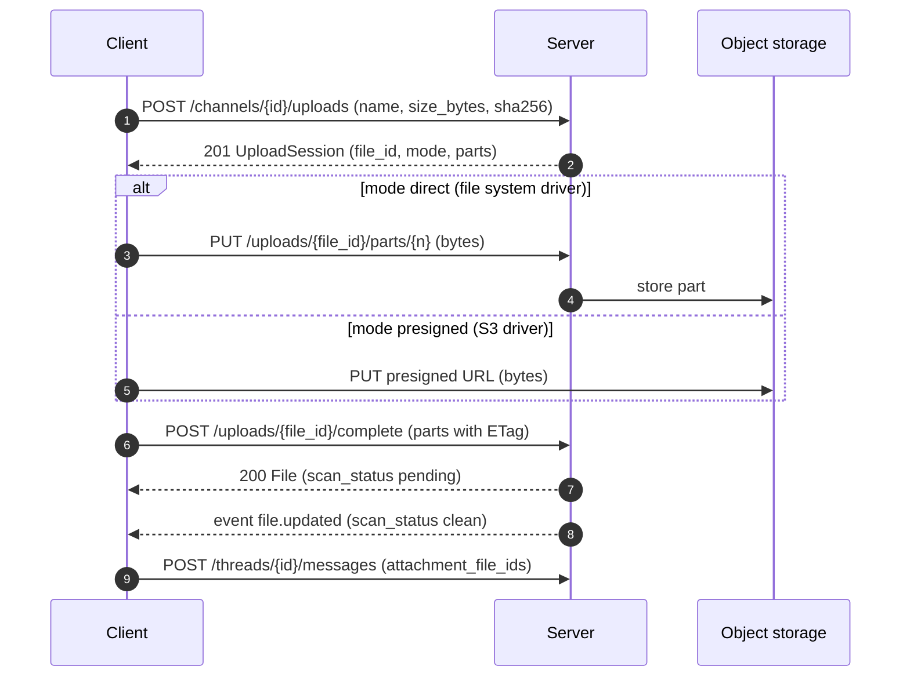

# 06 Public API

Status: draft M0. Normative are [docs/api/openapi.yaml](../api/openapi.yaml) (REST, OpenAPI 3.1),
[docs/api/asyncapi.yaml](../api/asyncapi.yaml) (gateway, AsyncAPI 3.0) and this chapter
(conventions). Webhooks: [docs/api/webhooks.md](../api/webhooks.md). Terms:
[00-glossary.md](00-glossary.md). Tables: [03-data-model.md](03-data-model.md). Sync:
[04-sync-protocol.md](04-sync-protocol.md). Actions: [05-actions.md](05-actions.md).
Decisions: ADR 0013 to 0016.

Precedence in case of contradiction: 05 for actions and permissions, 04 for sync semantics, the YAML
files for shapes (paths, fields, types), this chapter for conventions. A contradiction is a bug and
is fixed in the same change that finds it.

All limits, windows and deadlines are named configuration values. New values of this chapter
appear only in section 20.

## 1. Overview

| Surface | Location | Contract |
|---|---|---|
| REST | `https://<host>/api/v1/...` | openapi.yaml, sections 2 to 10 |
| Gateway (WebSocket) | `wss://<host>/api/v1/gateway` | asyncapi.yaml, 04, section 11 |
| Outgoing webhooks | HTTPS target of the app | `webhooks:` in openapi.yaml, webhooks.md |
| Incoming webhooks | `POST /api/v1/hooks/{webhook_id}/{token}` (`postIncomingWebhook`); `POST /api/v1/hooks/{webhook_id}` with the token in `Authorization: Bearer <token>` (`postIncomingWebhookWithBearer`) | openapi.yaml, webhooks.md |

The server entry in openapi.yaml is relative (`/api/v1`), because every instance has its own host.
The prefix `/api/v1` applies to all surfaces, also in the core contract (04). Liveness and
readiness are not part of the public API; they are on the internal listener
([16-operations.md](16-operations.md), section 4.2; ruling L2).

## 2. Basic rules

| Topic | Rule | Reason |
|---|---|---|
| Paths | Lower case, plural nouns, kebab-case (`/gdpr-requests`). Path parameters are named `{<resource>_id}`. Paths contain only IDs, never handles or names. | Stable URLs; a rename changes no address. |
| State changes | Changes with a side effect, a reason or an audit entry are `POST /<resource>/{id}/<verb>` (`close`, `reopen`, `move`, `revoke`, `approve`, `archive`, `cancel`, `disable`). | One action per route, auditable with a reason, no hidden field in a PATCH. |
| No effect | If the target state is already reached (disabling a disabled one, revoking a revoked one, closing a done thread) or a PATCH changes nothing, the server answers as for the change with the current representation, without a new version, without an event and without a permission version; actions with an audit write an entry with `no_change: true` in `details`. A transition the state machine does not know (for example `deleted` after `active`, closing the main thread) gives `409 invalid_state_transition`. | The outbox retries even after `sync.idempotency_key_ttl`; an error for the desired state would look like a failure. |
| Self reference | `/me/...` for the calling person; agent runtime under `/agents/me/...`. | No special value `me` in ID parameters; code generators type IDs as UUID. |
| Fields | snake_case, the same as the database (03) and events (04). | One name per term across all layers. |
| operationId | lowerCamelCase, verb plus noun (`createMessage`). Lint rule `rule/operation-id-camel-case`. | Generators build method names from it; a rename breaks SDKs. |
| Enumerations | snake_case strings. Repeated value sets are named schemas (for example `ThreadState`). | The same types in all generators, no name collisions. |
| IDs | UUIDv7 (RFC 9562) in lower case. The server accepts upper case when reading. | 03, R-DM-01. |
| Time | RFC 3339 in UTC with `Z` and milliseconds. Durations as integers in milliseconds (`_ms`). Clients read every valid RFC 3339 form. | Unambiguous, sortable, language neutral. |
| Integers | `format: int64`. Sequences, versions and amounts stay below 2^53, so that JavaScript represents them exactly; a server test checks the limit at assignment. | JSON numbers in JavaScript are floating point. |
| Money | `amount_micros` (int64) plus `currency` (ISO 4217). | 03, R-DM-04. |
| No `null` | The server never sends JSON `null`. If a field is missing, it has no value. Clients treat a received `null` like a missing field. Values are removed through their own fields or modes (for example `use_global_order: true`, `OperatorSet.mode = none`), never through `null`. | dart-dio does not know the null type [verified, Q4]; one way for all generators (R-API-03, [ADR 0053](../adr/0053-no-json-null-in-api-and-events.md)). |
| Unknown values | Clients ignore unknown fields, enum values, event types and problem codes. The server rejects unknown fields in requests and gateway frames (`400 validation_failed` or close code `4002`, respectively); writing schemas have `additionalProperties: false` ([19-security.md](19-security.md), SEC-IN-1; PLAN W7). Exception: the payload of a foreign sender that the server only renders, the Alertmanager format of incoming webhooks ([11-extensions.md](11-extensions.md) 8.2, [DECISIONS.md](../DECISIONS.md) D-M7-20-5). A client sees from `features` in the discovery whether a server knows a new field. | A silently discarded field swallows an intent on an older server; responses and events stay additive (section 13). |
| Media types | JSON as `application/json` (UTF-8); errors as `application/problem+json`; file parts as `application/octet-stream`; images for avatar and logo as `multipart/form-data` (part `file`); exports as `application/x-ndjson`. CSP violation reports of the web console (`submitCspReport`, M6-03) as `application/reports+json` (Reporting API) or `application/csp-report` (legacy `report-uri`), both JSON under `http.max_json_body_bytes` and the JSON guard; the only operation with two request media types. | One format per purpose; NDJSON lets large exports stream. |
| Size | JSON bodies up to `http.max_json_body_bytes`, nesting up to `http.max_json_depth` ([02-architecture.md](02-architecture.md)), otherwise `413 payload_too_large` or `400 malformed_request`, respectively. `http.max_json_body_bytes` is strictly larger than `message.max_content_bytes`. The two post operations of the incoming webhooks use `webhook_in.max_body_bytes` instead, and their `413` names that key (02 section 9.1). | Protection against memory pressure without preventing long messages. |
| Caching | Authenticated JSON responses carry `Cache-Control: no-store`. File contents carry `Cache-Control: private, immutable`, because the content of a file ID never changes. | No content in third-party caches; the client deletes on `access.changed` itself (04, 8.3). |
| Correlation | Every response carries `Correlation-Id`: the trace ID of the request written as a UUID (schema `CorrelationId`, not a UUIDv7). The same value appears in problems, events (`correlation_id`) and in the audit. The server generates it; it ignores a sent `Correlation-Id`, and it takes over an incoming `traceparent` only as a span link, not as the parent trace ([17-observability.md](17-observability.md), section 3). | A forgeable client value would falsify audit trails. |
| Client identifier | `User-Agent: <app>/<version> (<platform>)`. | Diagnosis and `min_client_versions` in the discovery. |
| CORS | Off. The web console runs on the same origin. Exceptions only through `api.cors_allowed_origins`. | Smallest attack surface for tokens in the browser. |
| Client IP | For the rate-limit class `rl.public_auth` and the audit, the source IP applies; `Forwarded` and `X-Forwarded-For` only from senders in `server.trusted_proxies` ([16-operations.md](16-operations.md)). | Behind a reverse proxy all clients would otherwise have the same IP, or attackers would set it themselves. |
| Language | `title` and `detail` in problems are English. Clients translate through `code`. Descriptions in the YAML files are English, because they travel into generated code as comments. | Stable texts for logs; localization belongs in the client. |

## 3. Authentication per principal kind

| Principal | Login | Headers per request | Binding | Validity | Step-up |
|---|---|---|---|---|---|
| Person in an app | OIDC, header of a trusted reverse proxy, local account with passkey or password plus TOTP; the result is a token pair | `Authorization: DPoP <access_token>` and `DPoP: <proof>` | device key (`cnf.jkt`), RFC 9449 | access token `auth.access_token_ttl` (chapter 08), refresh `auth.refresh_token_ttl` | passkey or device key with user confirmation |
| Person in the web console | as above; the result is a cookie session following the BFF pattern, no tokens in the browser ([08-identity.md](08-identity.md), section 7.5) | cookie `__Host-console_session` and the CSRF header `X-Console-Request: 1` with the own `Origin` on every request except `GET`, `HEAD`, `OPTIONS` (security scheme `consoleSession`, parameter `ConsoleRequest`) | cookie, as an HMAC on the session | `auth.console_session_max_age`, idle `auth.console_session_idle_timeout` | passkey, otherwise a new OIDC login or password with TOTP |
| Agent | API token, created by the owner (`token.create`) | `Authorization: Bearer <token>`; for tokens with `dpop_jkt` `Authorization: DPoP` plus `DPoP`; within a run additionally `Invocation-Token: <invocation_token>` (07 SR9) | optional `dpop_jkt` | until revocation or `expires_at` | never (R-AZ-03) |
| App | API token with scopes (05, 2.6) | like agent | optional | like agent | never |
| Incoming webhook | secret token of `createIncomingWebhook`, verified by the token check of `apps`, not by the authenticator (02 section 9.1) | none with the token in the path (`postIncomingWebhook`); `Authorization: Bearer <token>` on `postIncomingWebhookWithBearer` | none | until revocation | never |
| Anonymous | none | none | none | | never |

Only operations with `security: []` are reachable anonymously: discovery, JWKS, webhook keys,
logo, problem types, public status page, login flows, incoming webhooks and the pairing of a
host (`pairHost`, the pairing code is the proof, 24 section 3.2). They
still run through `authorize` with the principal `anonymous` (05, 2.1).
`postIncomingWebhookWithBearer` has no security of its own and so carries the root security,
because the route generator records only public or the root security; of the root schemes only
`bearerAuth` applies there, with the token of the incoming webhook. Both post operations (action
`webhook_in.post`) never reach the authenticator: they stay `anonymous` until the token check of
`apps` replaces the actor with the app of the webhook, which then passes `authorize`; every failed
check answers `404 not_found` like an unknown webhook ([11-extensions.md](11-extensions.md),
section 8.4).

### 3.1 DPoP

1. The server issues access tokens as JWS with `sub`, `sid` (session) and `cnf.jkt`
   (RFC 9449 [verified, Q3]). Every request carries a fresh DPoP proof with `htm`, `htu` (without
   query), `iat`, `jti` and `ath` (hash of the access token).
2. If the server requires a nonce, it answers `401` with `WWW-Authenticate: DPoP
   error="use_dpop_nonce"` and `DPoP-Nonce` (problem `use_dpop_nonce`). The client builds the
   proof again with this nonce and retries exactly once. Every response may carry a new
   `DPoP-Nonce`; the client always takes the newest. At the gateway the nonce comes from
   `hello` and `reauth_required` (04, 6.3).
3. Login endpoints do not have an access token yet. They require the header `DPoP` without
   `ath`; the server binds the new tokens to exactly this key.
4. Refresh (`POST /auth/token/refresh`) requires a proof with the key of the session. Reuse of
   an already rotated refresh token revokes the family and the session
   (`session_revoked`, 03). Exception: the same retry with the same key within
   `auth.refresh_reuse_grace`, for example after a lost response; it gets a new pair
   (03, `refresh_tokens`).
5. Chapter 08 sets the `jti` store, the time window for `iat` and the algorithms.

### 3.2 Login flows

Every login method has its own endpoints instead of one endpoint with a union body; this keeps the
schemas free of `oneOf` and the error patterns separate (R-API-12).

1. **OIDC.** The server is the confidential client at the provider. The app opens the
   system browser; `app_redirect_uri` is a custom URI scheme, a claimed
   `https` address or loopback (RFC 8252 [verified, Q12]). After the callback the server redirects
   to `app_redirect_uri` with a one-time `login_code` (valid for `auth.server_code_ttl`).
   Only whoever has the matching `client_verifier` for the `client_challenge` can redeem it; a
   foreign program that intercepts the redirect cannot. The attempt is valid for
   `auth.login_flow_ttl` ([08-identity.md](08-identity.md)).
2. **Proxy header.** `POST /auth/trusted-header/login` reads the identity from the header of the
   proxy. The endpoint answers `404` if no driver `trusted_header` is active or the
   server does not listen only on loopback (B9).
3. **Local accounts.** The owner creates the person (`createUser` with `local_account`) and
   gets a one-time enrollment code (valid for `auth.enrollment_code_ttl`). With it the
   person redeems their first device: with the device keys only (`/auth/enroll/redeem`) or
   together with a passkey (`/auth/enroll/begin`, `/auth/enroll/complete`). After that they log
   in with a passkey (`/auth/passkey/...`), pair further devices (`/auth/pairing/...`) or,
   as long as `auth.local_password_enabled` holds, use password plus TOTP (`/auth/password/login`).
   Reason for the fallback: native Apple apps need a publicly reachable
   Associated Domain for passkeys (Baseline R-Passkeys).
4. **Waiting for approval.** A new device gets tokens but is `pending`; the same applies to
   a provisioned person in the state `pending` ([08-identity.md](08-identity.md),
   section 3.1). All actions except `self.read`, `device.list` for the own device,
   `auth.token.refresh` and `auth.logout` answer `403 device_pending`. The gateway rejects
   `identify` (04, 6.3).

### 3.3 Step-up

Without a fresh confirmation, actions with step-up (05, column "Step-up") answer `401
step_up_required`. The client fetches `POST /auth/step-up/challenge`, lets the person confirm with
a passkey or device key (`/auth/step-up/passkey` or `/auth/step-up/device-key`) and
repeats the original request with the same `Idempotency-Key`. The confirmation is valid for the
session for `auth.step_up_max_age` (03). Agent and app tokens get `403 forbidden` for such
actions (R-AZ-03).

## 4. Authorization in the API

1. Every operation carries `x-authz-action` with exactly one action from 05 and `x-rate-limit-class`
   with its class. Lint rules: `rule/authz-action-required`, `rule/authz-action-known`,
   `rule/rate-limit-class-required`, `rule/rate-limit-class-known` (docs/api/redocly.yaml).
2. List endpoints check the action against the container (channel, space, instance) and filter
   in the query (P2). They return no totals. Exception: `listCostEstimates`
   (`cost.reconcile.read`) checks against the instance and does not filter by visible channels,
   because its entries name neither channel nor thread nor content (05, rule 1.2 and R-AZ-28).
3. No read permission gives `404 not_found`, whether or not the resource exists (R-AZ-01). Read
   permission without the required level or capability gives `403 forbidden`.
4. Apps: visibility follows the grant. If an app has a grant on the channel, the API answers a
   missing scope (reading or writing) with `403 scope_missing`; without a grant the channel is
   invisible (`404`). Reason: the app knows the channel from its grant; a `404` would only make
   debugging harder ([07-permissions.md](07-permissions.md), section 2.10).
5. Invariants: an I1 violation gives `409 i1_violation` with `hint`; the last owner gives
   `409 last_owner`; I3 at the start of a run gives `409 billing_mode_mismatch`, a tool class that is
   too high (`tool_class_used` in the body of `startRun` and `resumeRun` above `tool_class`
   of the invocation token) `409 tool_class_mismatch`. A read-only channel gives
   `403 channel_read_only`, a waiting device `403 device_pending`, maintenance mode
   `503 maintenance` with `Retry-After` for actions with effect `write`, except the exceptions from
   [ADR 0065](../adr/0065-maintenance-mode-read-only.md) (05, rules 1.8 and 1.9, section 2.7).
6. Agent triggering: a message is stored even if `agent.invoke` denies; then
   `trigger_state = failed` with `trigger_state_reason` applies (05, section 5). Commands and
   interactions without trigger permission answer `403 agent_invocation_denied` with `reason`.
7. Actions without their own REST route: `agent.invoke` and `run.followup.create` (checked in
   `createMessage`, `createInteraction`, `invokeCommand`), `gateway.connect`, `gateway.focus`,
   `typing.start` (gateway), `push.deliver` (internal and ephemeral `notification.created`),
   `webhook_out.deliver` (on every entry in `webhooks:`), the system actions
   `instance.bootstrap` (command `bothy setup bootstrap-owner`), `owner.recover` (command `bothy
   setup issue-enrollment-code`), `grant.expire`, `group.member.expire`, `signing_key.transition`
   and `device.expire` (jobs), `webhook_out.transition` (consumer `webhooks` and job
   `apps.webhook_deliver`), `group.member.sync` (reconciliation at OIDC login) as well as
   `dev_environment.*` (routes come with the dev environment milestone, 05 section 4.13).
8. Acting-for binding: the server checks the header `Invocation-Token` on every request that
   passes the authenticator (step 7 of 02 section 9.1; the operations of `webhook_in.post` skip it
   and ignore the header) (signature, audience, run of this agent triggered by the token's person,
   run active); the header from a principal that is not an agent, repeated or empty, or an invalid
   token gives `403 invocation_token_invalid` with `reason: invalid` on every action, a valid token
   of an ended run `reason: run_inactive`, except on `run.start` (also `resumeRun`) and
   `run.token.renew`, which answer a valid token exactly as without the header, also when its run
   has ended. With a bound token every other action is decided
   on the intersection of the agent's rights and the current rights of the person who triggered the
   run: a target invisible only by the intersection answers `404` like an unknown ID, a requirement
   that fails only by it `403 forbidden` with `reason: acting_for_insufficient`, and every list,
   counter, snapshot and catch-up contains only channels both may read. Only replies in the run's
   thread, patches of the own run, `run.finish`, `interaction.respond` and `agent_session.report`
   on the own thread and run keep the agent's own rights ([07-permissions.md](07-permissions.md), SR9).

## 5. Errors

1. Every error is `application/problem+json` per RFC 9457 [verified, Q2] with `type`, `title`,
   `status`, `code`, `correlation_id`, optionally `detail` and `instance`. `instance` is the path
   of the request without query; path parameters that carry a secret (today only `{token}` of
   `postIncomingWebhook`) appear as placeholders, as in logs ([19-security.md](19-security.md),
   SEC-LOG-3), percent-encoded (`%7Btoken%7D`) because `instance` is a URI reference.
2. `type` is a relative URI with the full path `/api/v1/problems/{code}`. RFC 9457 recommends
   absolute URIs "when possible" and allows relative ones with a full path [verified, Q2]. A
   self-hosted software has no common host; every instance serves the description
   at exactly this path (`getProblemType`). Clients compare `type` as a string, or
   `code`. A later switch to absolute URIs would be a breaking change and comes only with `v2`.
3. Extensions: `errors[]` for `validation_failed` with `pointer` (JSON Pointer into the body,
   `#path/<name>`, `#query/<name>` or `#header/<name>` for parameters, empty for a rule of the
   whole request), `code` (for example `required`, `too_long`, `limit_reached` for a reached
   quantity limit, `not_enabled` for a field whose function this server version does not build yet)
   and `detail`; `current` for `version_conflict` and `base_version_conflict`;
   `reason` and `hint` for denials, invariants and conflicts with a named reason (for example
   `one_time_secret`, section 7); `attempts_remaining` for `fingerprint_mismatch` (confirmations
   of a host left, `0` means the fallback to `pairing`, 24 section 3.2). `detail` never contains
   content, secrets or internal paths.
4. `400` stands for schema and rule violations. `422` exists only for `idempotency_key_reuse` (04,
   5.1). `409` for state conflicts, `412` for `If-Match`.
5. A feature switched off by a switch answers logged-in principals with `403
   feature_disabled`, so that the interface can show the reason. Public endpoints
   (password login, proxy header, public status page) answer `404`, so that they do not reveal the
   configuration.
6. The gateway uses the same codes in the frame `error`.
7. The list of codes is closed. Chapters, briefs and the plan name an error as a status
   with a code from `x-problem-codes` (for example `409 conflict`). A finer reason is carried by
   `reason` (for denials by `authorize` the reason code from
   [07-permissions.md](07-permissions.md), section 4.1, otherwise the reason the chapter names) or by
   `errors[].code` for `400 validation_failed`. A new code comes into being only in
   `x-problem-codes` and on the operations that return it. The check
   `tools/docs/problem_code_refs.py` in `make docs` checks every pair of status and code in the
   Markdown files and the API files against this list. It does not see other sentence forms (such
   as "`409` with code ..."); chapters are to avoid them.

Known codes: the source is `x-problem-codes` on the schema `Problem` in openapi.yaml, in English like
all texts of the YAML files (R-API-15); every response component names its status in `x-status`
(R-API-23). The table is generated from it (section 15, G3).

<!-- BEGIN GENERATED: problems -->
| Code | Status | Meaning (from openapi.yaml) | Client reaction (from openapi.yaml) |
|---|---|---|---|
| `validation_failed` | 400 | The request violates the schema or a rule; `errors[]` names the fields. | Correct the input; do not retry. |
| `malformed_request` | 400 | The body is not valid JSON, has a duplicate member name, invalid UTF-8 or nesting deeper than `http.max_json_depth` (SEC-IN-2). | Programming error; do not retry. |
| `cursor_invalid` | 400 | The cursor is unknown or does not match the filters. | Start again without a cursor. |
| `webhook_host_not_allowed` | 400 | The target host is not in `webhook.allowed_hosts`. | The owner requests approval of the host. |
| `unauthenticated` | 401 | No valid principal (token missing, invalid or expired). | Renew the token; if that fails, log in again. |
| `token_expired` | 401 | The access token has expired. | Refresh, then retry. |
| `session_revoked` | 401 | Session, device or principal revoked. | Delete local data and log out (R-SY-14). |
| `step_up_required` | 401 | The action needs a fresh confirmation (`auth.step_up_max_age`), or a step-up confirmation failed. For `terminal.open` and `terminal.attach`: younger than `terminal.step_up_max_age`, not yet consumed, by passkey or step-up device key; in the console only by passkey with `userVerification = required`, otherwise `reason: passkey_required` (08 section 6.3). The quick reattach without step-up never applies in the console. | Perform step-up, then repeat the same request with the same `Idempotency-Key`. |
| `use_dpop_nonce` | 401 | The server requires a fresh nonce in the DPoP proof; header `DPoP-Nonce`. | Build the proof again with the nonce and retry once. |
| `invalid_dpop_proof` | 401 | The DPoP proof is missing, wrongly signed, expired or does not match `cnf.jkt`. | Programming error or device key lost; log in again. |
| `forbidden` | 403 | Read access exists, but the level or a capability is missing (R-AZ-01); `reason` is the deny reason of 07 section 4.1 where it reveals nothing, for example `owner_only`, `step_up_not_possible` or `subject_kind_not_allowed`. | Do not retry; hide the control. |
| `scope_missing` | 403 | The app lacks the required scope. | The owner grants the scope. |
| `device_pending` | 403 | The device or the provisioned account waits for approval. | Wait; poll `GET /devices/{device_id}` or `GET /me`. |
| `channel_read_only` | 403 | The channel is read-only (05 rule 1.8) or archived (`reason: channel_archived`, 07 section 4.5); applies to owners too. | Lock the input and show a note; do not retry. |
| `feature_disabled` | 403 | The feature is switched off (for example personal tokens). | Do not retry. |
| `agent_invocation_denied` | 403 | `agent.invoke` denies; `reason` for example `billing_mode_personal_not_holder`, `project_not_ready`. | Show the reason; do not retry. |
| `terminal_denied` | 403 | The `terminal` capability exists, but a guard rule or limit blocks; `reason` is `not_host_assignee`, `server_host_owner_only`, `i6_holder_only`, `no_session_user` (no own session user on the host, SR12), `session_limit` or `profile_unknown` (24 section 13). | Show the reason; do not retry. |
| `invocation_token_invalid` | 403 | The invocation token is not accepted by `startRun`, `resumeRun` or `renewInvocationToken`; `reason` is `expired` (valid and current, only `exp` passed), `superseded` (valid, but no longer current: a newer delivery or renewal replaced its `jti`, or a start consumed it while the run waits for input) or `invalid` (signature, `kid`, `typ`, audience or run wrong). Also every request with the header `Invocation-Token` (07 guard rule SR9): `reason` is `invalid` (signature, audience, run, agent or triggering person wrong, or the header is repeated, empty or sent by a principal that is not an agent) or `run_inactive` (the token is valid, but its run has ended). | `expired`: renew the token (`renewInvocationToken`) and start again. `superseded`: start nothing, keep the run; start with the newer token of the redelivery or, for a waiting run, of the answer. `invalid`: start nothing and report the run as `failed` with `invalid_invocation_token`; on any other request with `Invocation-Token`, stop using the token, the request is refused. `run_inactive`: the run has ended; end the work on it. |
| `not_found` | 404 | The resource does not exist or is not visible; both answer the same (R-AZ-01). | Mark the outbox entry as failed. |
| `method_not_allowed` | 405 | The method is not defined on this path. | Programming error. |
| `conflict` | 409 | The state prevents the change (for example a name is taken); `reason` names the cause where one is defined. | Reload the state; a person decides. |
| `request_in_progress` | 409 | The first request with this `Idempotency-Key` is still running. | Retry with backoff. |
| `i1_violation` | 409 | The change would violate I1; `hint` names the way out. | Switch to `organization` first. |
| `i6_violation` | 409 | The change would let someone other than the holder of a personal LLM login open a terminal on the host (I6); `hint` names the way out. | Revoke the other grants or declare `organization` first. |
| `last_owner` | 409 | At least one active owner must remain. | Appoint another owner first. |
| `already_started` | 409 | The run is no longer `queued`. | The adapter starts nothing. |
| `billing_mode_mismatch` | 409 | The reported actual mode differs from the target; the run becomes `failed`. | Check the adapter configuration. |
| `tool_class_mismatch` | 409 | The reported tool class is above the one in the invocation token; the run becomes `failed`. | Check the adapter configuration. |
| `host_unavailable` | 409 | The host is not `active` or its host service is not connected. | Show the host state; retry when `host.presence_changed` reports it connected. |
| `fingerprint_mismatch` | 409 | The typed fingerprint prefix does not match the keys the host service registered; `attempts_remaining` counts the confirmations left, `0` means the host fell back to `pairing` without keys. | Compare with the output of `bothy-host pair` and type it again; at `attempts_remaining` `0` issue a new pairing code. |
| `invalid_state_transition` | 409 | The state machine does not allow the transition. | Reload the state. |
| `base_version_conflict` | 409 | `base_version` of a run patch is outdated; `current` holds the document. | Rebase on `current`. |
| `component_used` | 409 | The component is used, expired or disabled. | Refresh the view. |
| `operator_mismatch` | 409 | The target channel has another effective operator. | Choose another target channel. |
| `file_not_ready` | 409 | Upload incomplete or scan still running. | Wait for `file.updated`. |
| `file_blocked` | 409 | The file is never delivered: malware found, scan error or failed upload (12, 9.3). | Show the file as blocked; do not retry. |
| `title_manual` | 409 | The operator agent sets a thread title only while `title_source` is `auto` (09 section 12). | The agent keeps the manual title. |
| `resync_required` | 410 | Catch-up is not possible; `reason` as in the gateway. | Load a snapshot (04, 7.3). |
| `message_deleted` | 410 | The message was deleted in the meantime. | Discard the entry; keep the text for copying. |
| `gone` | 410 | The object has expired (upload, export package, autocomplete). | Start again. |
| `version_conflict` | 412 | `If-Match` does not match; `current` holds the current version. | Show both versions; a person decides. |
| `payload_too_large` | 413 | Body or file above the limit; `detail` names the configuration value. | Do not retry. |
| `unsupported_media_type` | 415 | The media type is not allowed; `reason` `file_type_denied` when the instance operator blocks the type (`file.denied_mime_types`, 12 section 6). | Do not retry. |
| `range_not_satisfiable` | 416 | `Range` lies outside the file. | Load without `Range`. |
| `idempotency_key_reuse` | 422 | The same client ID or `Idempotency-Key` with different content. | Create a new ID only when the person sends again. |
| `precondition_required` | 428 | `If-Match` is missing. | Programming error. |
| `rate_limited` | 429 | The rate-limit class is exhausted. | Wait for `Retry-After`. |
| `internal_error` | 500 | Unexpected error; `correlation_id` for the log search. | Retry with backoff. |
| `unavailable` | 503 | The server is not ready (start, missing dependency) or a resource is exhausted; `reason` names the cause where one is defined: `storage_full` (12, 3.1), `search_timeout` (14, 7). | Wait for `Retry-After`; with `reason` `search_timeout` narrow the query instead of repeating it. |
| `maintenance` | 503 | Maintenance mode (`server.maintenance_mode = read_only`); only writing actions are blocked. | Wait for `Retry-After`; reading continues, the outbox keeps drafts. |
| `setup_required` | 503 | The instance is not set up yet; only discovery answers (08 section 4). | The owner sets up the instance on the host; there is no `Retry-After`. |
<!-- END GENERATED: problems -->

## 6. Pagination

1. Lists with an open-ended set are cursor-based: request with `cursor` and `limit`, response
   `{items, next_cursor}`. If `next_cursor` is missing, this is the last page.
2. The cursor is opaque, bound to filters and sorting, and stable against new rows
   (keyset over the sort key and ID). A foreign or outdated cursor gives `400
   cursor_invalid`. All lists use one codec in `platform/httpserver` (PLAN M1-18).
3. `limit` has the default `api.page_size_default`; values larger than `api.page_size_max` are
   capped, not rejected.
4. No totals. They cost a second query and reveal quantities across permission
   filters.
5. Special cases with public numbers: the history of a thread through `before_seq`, `after_seq`,
   `around_seq` (thread sequence, gaps detectable, 04 section 4); events through `after`
   (global sequence, 04 section 7.4); agent consumers from `acked_seq + 1`. In the history, with
   `L` = page size: without parameters the `L` newest messages; `before_seq = X` the `L`
   highest below `X`; `after_seq = X` the `L` lowest above `X`; `around_seq = X` at most
   `(L - 1) / 2` (integer division) below `X` and the rest from `X` on, where a short page hands its
   share to the other. Entries are always ascending and without gaps; `has_more_before` and
   `has_more_after` say whether there are more before or after, respectively, and come from the
   same query as the entries. In lists the server truncates `content_md` at
   `message.list_content_max_bytes` (`content_truncated: true`); `getMessage` returns the whole
   content. Reason: a page thus stays below `api.page_size_max` times this value instead of times
   `message.max_content_bytes`.
6. Only lists whose set is small stay without pagination (spaces, channels of a space,
   tags, settings, owners, group list of a person, the agent sessions of a thread in
   `listAgentSessions`, newest first by `created_at`, then `id`; the price table in `listPrices`,
   whose `PriceList` has only `items`, every row with closed ones, ordered by `provider`, `model`,
   `unit`, `valid_from`, then `id`). If one of them grows, a new,
   paginated endpoint comes; the old response shape stays (section 13).

## 7. Idempotency

| Case | Mechanism | Response on repetition |
|---|---|---|
| Send a message | `client_msg_id` in the body, unique per author (04, 5.1) | `200` with the original and `Idempotent-Replay: true`; different content `422 idempotency_key_reuse` |
| Interaction | `client_interaction_id` in the body | as above |
| Incoming webhook | optional `client_msg_id` in the body | as above |
| other POST and PATCH | header `Idempotency-Key` (UUIDv7, 04 5.2) | stored response with `Idempotent-Replay: true`; different content `422`; first request still running `409 request_in_progress` |
| PUT and DELETE | idempotent by HTTP semantics | same effect; DELETE of an already deleted resource `204`, of a never visible one `404`; resources without a tombstone (for example login drivers) answer `404` after deletion, because the server cannot tell them apart from resources that never existed |
| POST with a one-time secret in the response (enrollment code, API token, later webhook secrets) | header `Idempotency-Key` | the response is stored without the secret; the repetition answers `409 conflict` with `reason: one_time_secret`. The client creates a new one: a new enrollment code ends the old one (08, section 3.2), an API token without a known secret is revoked by the owner in the list |

1. The key is valid per principal for `sync.idempotency_key_ttl`. Clients set it on every
   entry in the outbox (04, 13.2). Name and behavior follow the common pattern of
   draft-ietf-httpapi-idempotency-key-header; draft -07 has expired, there is no RFC
   [verified, Q10]. 04, section 5.2 is therefore authoritative.
2. Only final responses are stored: `2xx`, `400`, `403`, `404`, `409` (except
   `request_in_progress`), `410`, `412`, `413`, `415`, `422`. `401`, `429` and `5xx` are not
   stored. That is why the repetition with the same key works after step-up, after token renewal
   and after throttling.
3. Exactly the POST and PATCH operations with `x-idempotency-exempt` in openapi.yaml stay without
   `Idempotency-Key`; the reason is attached to them as a code (R-API-24): `auth_flow`
   (challenges and codes are valid once, refresh rotates, `logout` and a new child session have
   the same effect when repeated), `read_only` (`createFileTicket` only creates another short-lived
   ticket, 12 section 9.2), `agent_runtime` (monotonic, compare-and-swap or `base_version`, the
   first response per request counts), `client_id` (table above), `origin_key` (origin key per
   object) and `telemetry` (a duplicate does not matter for telemetry). The gate checks the list
   (section 15, G2):

<!-- BEGIN GENERATED: idempotency_exempt -->
| operationId | Method | Path | Reason |
|---|---|---|---|
| `beginOidcLogin` | POST | `/api/v1/auth/oidc/begin` | login or session flow: one-time challenge or code, refresh rotation, replacement of the child session |
| `completeOidcLogin` | POST | `/api/v1/auth/oidc/complete` | login or session flow: one-time challenge or code, refresh rotation, replacement of the child session |
| `loginWithTrustedHeader` | POST | `/api/v1/auth/trusted-header/login` | login or session flow: one-time challenge or code, refresh rotation, replacement of the child session |
| `beginPasskeyLogin` | POST | `/api/v1/auth/passkey/begin` | login or session flow: one-time challenge or code, refresh rotation, replacement of the child session |
| `completePasskeyLogin` | POST | `/api/v1/auth/passkey/complete` | login or session flow: one-time challenge or code, refresh rotation, replacement of the child session |
| `beginEnrollment` | POST | `/api/v1/auth/enroll/begin` | login or session flow: one-time challenge or code, refresh rotation, replacement of the child session |
| `completeEnrollment` | POST | `/api/v1/auth/enroll/complete` | login or session flow: one-time challenge or code, refresh rotation, replacement of the child session |
| `redeemEnrollmentCode` | POST | `/api/v1/auth/enroll/redeem` | login or session flow: one-time challenge or code, refresh rotation, replacement of the child session |
| `beginPairing` | POST | `/api/v1/auth/pairing/begin` | login or session flow: one-time challenge or code, refresh rotation, replacement of the child session |
| `completePairing` | POST | `/api/v1/auth/pairing/complete` | login or session flow: one-time challenge or code, refresh rotation, replacement of the child session |
| `loginWithPassword` | POST | `/api/v1/auth/password/login` | login or session flow: one-time challenge or code, refresh rotation, replacement of the child session |
| `refreshToken` | POST | `/api/v1/auth/token/refresh` | login or session flow: one-time challenge or code, refresh rotation, replacement of the child session |
| `logout` | POST | `/api/v1/auth/logout` | login or session flow: one-time challenge or code, refresh rotation, replacement of the child session |
| `createStepUpChallenge` | POST | `/api/v1/auth/step-up/challenge` | login or session flow: one-time challenge or code, refresh rotation, replacement of the child session |
| `completeStepUpWithPasskey` | POST | `/api/v1/auth/step-up/passkey` | login or session flow: one-time challenge or code, refresh rotation, replacement of the child session |
| `completeStepUpWithDeviceKey` | POST | `/api/v1/auth/step-up/device-key` | login or session flow: one-time challenge or code, refresh rotation, replacement of the child session |
| `stepUpWithPassword` | POST | `/api/v1/auth/step-up/password` | login or session flow: one-time challenge or code, refresh rotation, replacement of the child session |
| `beginStepUpOidcReauth` | POST | `/api/v1/auth/step-up/oidc` | login or session flow: one-time challenge or code, refresh rotation, replacement of the child session |
| `completeStepUpOidcReauth` | POST | `/api/v1/auth/step-up/oidc/complete` | login or session flow: one-time challenge or code, refresh rotation, replacement of the child session |
| `beginIdentityLink` | POST | `/api/v1/me/identities/begin` | login or session flow: one-time challenge or code, refresh rotation, replacement of the child session |
| `completeIdentityLink` | POST | `/api/v1/me/identities/complete` | login or session flow: one-time challenge or code, refresh rotation, replacement of the child session |
| `beginPasskeyRegistration` | POST | `/api/v1/me/passkeys/begin` | login or session flow: one-time challenge or code, refresh rotation, replacement of the child session |
| `completePasskeyRegistration` | POST | `/api/v1/me/passkeys/complete` | login or session flow: one-time challenge or code, refresh rotation, replacement of the child session |
| `createExtensionSession` | POST | `/api/v1/me/sessions/extensions` | login or session flow: one-time challenge or code, refresh rotation, replacement of the child session |
| `pairHost` | POST | `/api/v1/hosts/pair` | login or session flow: one-time challenge or code, refresh rotation, replacement of the child session |
| `openTerminalSession` | POST | `/api/v1/hosts/{host_id}/terminal/sessions` | login or session flow: one-time challenge or code, refresh rotation, replacement of the child session |
| `attachTerminalSession` | POST | `/api/v1/terminal/sessions/{session_id}/attach` | login or session flow: one-time challenge or code, refresh rotation, replacement of the child session |
| `previewGrant` | POST | `/api/v1/grants/preview` | reads only, changes no durable state |
| `createFileTicket` | POST | `/api/v1/files/{file_id}/tickets` | reads only, changes no durable state |
| `autocompleteCommand` | POST | `/api/v1/channels/{channel_id}/commands/{command_id}/autocomplete` | reads only, changes no durable state |
| `validateManifest` | POST | `/api/v1/app-manifests/validate` | reads only, changes no durable state |
| `verifyAuditChain` | POST | `/api/v1/audit/verify` | reads only, changes no durable state |
| `sendHeartbeat` | POST | `/api/v1/agents/me/heartbeat` | agent runtime: monotonic or compare-and-swap |
| `ackAgentEvents` | POST | `/api/v1/agents/me/consumers/{consumer}/ack` | agent runtime: monotonic or compare-and-swap |
| `patchRun` | PATCH | `/api/v1/runs/{run_id}` | agent runtime: monotonic or compare-and-swap |
| `startRun` | POST | `/api/v1/runs/{run_id}/start` | agent runtime: monotonic or compare-and-swap |
| `resumeRun` | POST | `/api/v1/runs/{run_id}/resume` | agent runtime: monotonic or compare-and-swap |
| `renewInvocationToken` | POST | `/api/v1/runs/{run_id}/invocation-token` | agent runtime: monotonic or compare-and-swap |
| `awaitRunInput` | POST | `/api/v1/runs/{run_id}/await-input` | agent runtime: monotonic or compare-and-swap |
| `finishRun` | POST | `/api/v1/runs/{run_id}/finish` | agent runtime: monotonic or compare-and-swap |
| `answerAutocomplete` | POST | `/api/v1/command-autocompletions/{request_id}/answer` | agent runtime: monotonic or compare-and-swap |
| `postIncomingWebhookWithBearer` | POST | `/api/v1/hooks/{webhook_id}` | client ID in the body (table above) |
| `postIncomingWebhook` | POST | `/api/v1/hooks/{webhook_id}/{token}` | client ID in the body (table above) |
| `createMessage` | POST | `/api/v1/threads/{thread_id}/messages` | client ID in the body (table above) |
| `createInteraction` | POST | `/api/v1/components/{component_id}/interactions` | client ID in the body (table above) |
| `applyImportBatch` | POST | `/api/v1/imports/{import_id}/batches` | origin key of the import ([22-import-migration.md](22-import-migration.md)) |
| `createImportFile` | POST | `/api/v1/imports/{import_id}/files` | origin key of the import ([22-import-migration.md](22-import-migration.md)) |
| `completeImportFile` | POST | `/api/v1/imports/{import_id}/files/{file_id}/complete` | origin key of the import ([22-import-migration.md](22-import-migration.md)) |
| `submitCspReport` | POST | `/api/v1/csp-reports` | anonymous measurements; a retry counts a sample twice |
| `submitClientMetrics` | POST | `/api/v1/client-metrics` | anonymous measurements; a retry counts a sample twice |
<!-- END GENERATED: idempotency_exempt -->

4. A repetition returns the stored response without running the handler, the schema check or
   `authorize` again; authentication and throttling run before it as always. A person who is
   disabled or logged out therefore gets `401`; a person who only lost permissions gets, within
   `sync.idempotency_key_ttl`, their own earlier response, which they were already allowed to
   receive once. `Correlation-Id` and `RateLimit` come from the current request; a stored problem
   keeps its `correlation_id`. Because `idempotency_keys` stores no headers, the server forms an
   `ETag` of the repetition from `version` in the stored body; every operation with a key and
   `ETag` therefore has `version` in the response body (generator check).
   Only a body with `application/json` is stored; a body over
   `http.max_json_body_bytes` is rejected with `413` before the fingerprint and is not stored.
5. `startRun` with the same invocation token after a successful start answers `200` with
   `Idempotent-Replay: true`; only a different token gets `409 already_started`. Otherwise an
   adapter whose response got lost would never process a running run (03
   `runs.started_jti`, 04 section 15.3). This holds only while the run is `running`; in
   `waiting_input` the token is used up (`403 invocation_token_invalid`, `superseded`).
   `renewInvocationToken` with the token that the last renewal replaced
   (`runs.renewed_from_jti`) issues a fresh token again; otherwise a run whose response to the
   renewal got lost would hang (09 section 4.5.1).
6. When the header has no effect: the server ignores `Idempotency-Key` on an operation that does
   not declare the parameter and for the anonymous actor (no public operation declares it, and
   `idempotency_keys` references `principals`); such a request runs as without the header. Where
   it acts, a value that is not one UUIDv7 is `400 validation_failed` with pointer
   `#header/Idempotency-Key` and code `invalid_format`, and nothing is stored. The fingerprint
   (`request_sha256`) is SHA-256 over the upper-case method, a line feed, the escaped request path
   with `/api/v1` and without query, a line feed and the RFC 8785 form of the body (the raw bytes
   when the body is not JSON or repeats a member, empty without a body); docs/DECISIONS.md M1-20.

## 8. Concurrency

1. Versioned resources (column `version` in 03) return `ETag: "<version>"` (strong). For
   channel behavior the ETag is `settings_version`; for branding, which consists of several
   settings keys, it is a value derived from their versions. Clients treat every ETag as an
   opaque string.
2. Changes to shared objects require `If-Match` (in openapi.yaml as the parameter
   `IfMatchRequired`): messages, thread titles, spaces, channels, channel behavior, operators,
   agents, backend policy, credential holder, templates, components, commands, branding and
   "mark as unread". If `If-Match` is missing: `428 precondition_required`. If it does not match:
   `412 version_conflict` with the current version in `current`.
   Branding here means name and accent (`updateBranding`). The logo is replaced or removed as a
   whole with `uploadBrandingLogo` and `deleteBrandingLogo` without `If-Match`: last write wins,
   and the lock on the setting row `branding.logo_file_id` serializes concurrent writes. Every
   logo change still raises the branding version, so an older `If-Match` of `updateBranding`
   fails with `412` (D-M3-10-11).
3. Where "last write wins" applies (instance settings, switches, project binding,
   thread tags), `If-Match` is optional and is checked when it is sent.
4. Personal sync data follow 04, section 14: drafts with `base_version` and
   `overwrote_newer`, read state monotonic. Run patches use `base_version` and `409
   base_version_conflict` (04, 11.2).
5. RFC 9110 forbids execution on a failed `If-Match` and provides `412
   (Precondition Failed)` for it [verified, Q9]; HTTP libraries know exactly this status. That is
   why `412 version_conflict` also applies in the core contract (03 principle 10, 04 section 13.3).
   If a repetition arrives whose change already applies, the `Idempotency-Key` returns the stored
   response instead of `412`.
6. No `If-None-Match` and no `304` in v1, because JSON responses are `no-store`. Adding them later
   is additive.

## 9. Rate limits

1. Every operation belongs, through its action, to a class from 05, section 3 (token bucket with
   `ratelimit.<class>.per_minute` and `.burst`). The check runs before `authorize`.
2. Every throttled class reports its state with the headers from
   draft-ietf-httpapi-ratelimit-headers-11 (work in progress, no RFC) [verified, Q5]:
   `RateLimit-Policy: "<class>";q=<per_minute>;w=60` and `RateLimit: "<class>";r=<whole
   tokens>;t=<seconds until full>`. The mapping of a token bucket onto `q`, `w`, `r`, `t` is
   our own ruling [derived].
3. Exhausted: `429 rate_limited` with `Retry-After` (RFC 9110). Clients wait at least that long;
   the outbox then uses its backoff (04, 13.2). At the gateway only `rl.gateway_connect` closes
   with `4008`, on `identify` and `resume`; every other op answers `error` with `rate_limited`,
   and the connection stays open (04, 6.2 and 6.4).
4. If the headers change when the draft becomes an RFC, the server also sends the new names
   for `api.deprecation_min_notice` (section 13).
5. Rounding (M1-19): `r` is the number of whole tokens left after the decision, rounded down;
   `t` is the seconds until the bucket is full, rounded up, and `0` for a full bucket;
   `Retry-After` is the seconds until one token is there, rounded up and at least `1`. A client
   that waits as told always finds what the headers promised. The headers go on every response of
   a limited operation once the rate-limit stage has decided, successes and errors alike; a
   request the stage cannot key (for example a `webhook_id` that is not an ID) gets its error
   without them.
6. Anonymous requests (M1-19): a class keyed by principal, agent or host counts an anonymous
   request by its client IP (IPv6 by the /64 prefix, as `rl.public_auth`), so unauthenticated
   calls never share one bucket and never use the bucket of a principal. `rl.webhook_in` counts
   by the path value `webhook_id`; a value that is not an ID gets `404 not_found` before a bucket
   exists.
7. Per node (R-AR-12, 02 "Scaling path"): the buckets live in the process. With n api nodes
   the effective limit is up to n times the configured value.

## 10. Files

1. An upload is a session of parts; both drivers (B4, R-Objektspeicher) have the same flow, and
   the client only follows the URLs of the response. Parts can be sent in parallel and resent.
   Part size `file.upload_part_bytes`, validity of the session `file.upload_session_ttl`,
   presigned PUT URLs for parts (only mode `presigned`, S3) `file.s3.presign_ttl`
   ([12-files.md](12-files.md), section 3).
2. `complete` closes the session and queues the job `files.scan`, which checks size and SHA-256,
   detects the MIME type and runs the virus scan in one read pass (M3-03, M3-04). Download works only
   once `scan_status` is `clean` or `skipped`; before that
   `409 file_not_ready`, on `infected`, `error` or a failed upload `409 file_blocked`
   ([12-files.md](12-files.md), section 9.3); without read permission always `404`.
3. `GET /files/{id}/content` always delivers the bytes itself, with `Range` support; there are
   no presigned GET URLs ([ADR 0048](../adr/0048-file-download-only-through-the-server-with-short-lived-tickets.md), [12-files.md](12-files.md), section 9). Media players
   without DPoP fetch a short-lived file ticket (`POST /files/{id}/tickets`). The server checks
   `file.read` each time it serves the file, also with a ticket (B7).
4. Avatar and logo arrive as `multipart/form-data`; the server removes metadata, losslessly for
   JPEG and PNG, and creates re-encoded thumbnails ([12-files.md](12-files.md),
   section 7; Ruling L16; [ADR 0047](../adr/0047-remove-image-metadata-losslessly.md)).
5. Voice messages: upload the audio, message with `kind = voice`. Transcript through
   `requestTranscription` (service port, switch `voice.enabled`) or `submitTranscript` by
   the agent (action `file.transcript.submit`).
   The transcript has no version column; its ETag is derived from its state, source, language and
   text (03 R-DM-48), `getFile` and `getTranscript` send it in `ETag`, and `submitTranscript`
   requires it in `If-Match` (`428 precondition_required` without it, `412 version_conflict` on a
   mismatch; [12-files.md](12-files.md) 8.2).
6. Export package of a privacy request (`downloadGdprExport`, [20-privacy.md](20-privacy.md) 5.2,
   M7-06): a ZIP archive (`application/zip`) whose format is versioned as `schema_version` in
   `manifest.json` and described by one JSON Schema (draft 2020-12) per file in
   [`docs/api/gdpr-export/v1/`](../api/gdpr-export/v1/README.md): `manifest.schema.json`, one
   schema per JSON file of 20 5.2 (`profile`, `identities`, `devices`, `access`, `files`,
   `personal`) and one per line of each JSON Lines file (`lines/<name>.schema.json`). A change that
   is not additive raises `schema_version` and adds `v2/`. The package is served by the server
   itself while `privacy.export_ttl` lasts, with step-up; after that `410 gone`. The deadline of a
   request is `due_at`; `decideGdprRequest` takes the optional `extend_months` (1 or 2, once, only
   before the original `due_at`, Art. 12(3) GDPR), otherwise `409 conflict` with reason
   `extension_not_allowed`. A second open request of the same person and kind is
   `409 conflict` with reason `request_open`; `detail` and `current` name the open request.

## 11. Real-time gateway

1. One endpoint `wss://<host>/api/v1/gateway`. Frames are JSON text frames
   `{"op": <name>, "d": <body>}` (04, 2.3). asyncapi.yaml describes every op as a message,
   every event as a message `dispatch` with `x-receive-action`, and the close codes from 04
   (6.4) in `x-close-codes`.
2. All body schemas live in `components.schemas` of openapi.yaml (`Gateway*`, `*Event`,
   `*Payload`). This way all generators create the types from one source (R-API-06).
3. Event schemas are `allOf` of `EventEnvelope` and a part with `type` and `payload`.
   `Event` is the union of all durable types with the discriminator `type`; AsyncAPI references
   only the single types, because AsyncAPI parsers expect `discriminator` as a string and reject
   the OpenAPI object [verified, own probe 2026-10-10 with @asyncapi/cli 6.2.0].
4. Fields only for delivery: `invocation_token` (fresh invocation token, 04 15.3) and
   `redelivered` (04 15.2) are in the envelope, not in the frame, and never in the event log (04
   section 2.2, [ADR 0052](../adr/0052-one-event-envelope-for-gateway-rest-and-webhooks.md)).
5. REST alternatives: `GET /events` (04, 7.4) and `GET /agents/me/consumers/{consumer}/events`
   with `POST .../ack` for adapters without WebSocket.
6. Command autocompletion: `autocompleteCommand` sends the ephemeral event
   `command.autocomplete_requested` to the owner of the command and waits up to
   `command.autocomplete_timeout` for `answerAutocomplete` or the gateway op
   `command.autocomplete_result` (04 section 15.7).
7. Terminal: the stream connection of the device and the control and data connections of the
   host service are separate channels in asyncapi.yaml (`terminalStream`, `hostControl`, `hostData`)
   with their own close codes `4100` to `4114`; after `hello` and `identify` they carry only
   binary frames with one Noise message each ([24-terminal.md](24-terminal.md), section 5).

Ops and events are listed in section 17.

## 12. Webhooks

Outgoing webhooks follow Standard Webhooks; signature `v1a` (Ed25519) always, `v1` (HMAC) on
request per subscription. Delivery, retry, verification at the receiver and incoming webhooks:
[docs/api/webhooks.md](../api/webhooks.md), decision ADR 0016.

## 13. Versioning, deprecation, compatibility

1. **Major version in the path** (`/api/v1`). Within v1 there are only additive changes.
   `info.version` of openapi.yaml and asyncapi.yaml is SemVer: MINOR for additive changes,
   PATCH for documentation only. Until the first release, `0.x` applies. The discovery reports
   `api_versions`, `spec_version` and `features`.
2. **Gateway.** Protocol versions are in `hello` and `identify`; an unsupported version closes with
   `4007` (04, 6.1). Event payloads change only additively; `schema_version` increases with each
   such change, so that clients recognize new fields.

| Additive, allowed in v1 | Breaking, only in a new major version |
|---|---|
| new endpoint, new op, new event type, new webhook type | remove or rename an endpoint, field, parameter, op or event type |
| new optional request field, new optional query parameter | an optional request field becomes required, a new required field in requests |
| new response field | change the type, format or meaning of a field |
| new enum value in responses and events | remove an enum value |
| new problem code for an existing status | change the status code of an existing situation |
| new header, new rate-limit class | change the sort order, pagination kind or idempotency rule of an op |
| loosen limits (configuration values) | set `x-authz-action` of an op to a different action |

3. New enum values are additive only because every client tolerates them: TypeScript without a
   runtime check, Dart with `enumUnknownDefaultCase=true` [verified, Q4], the Go server has no need,
   Python only with the hand-written layer. openapi-python-client 0.29.1 raises an error on unknown
   values, also with `literal_enums` [verified, own probe 2026-10-10]. The gate holds this with the
   tolerance test G5 (section 15).
4. **Deprecation.** An op or a field gets `deprecated: true`, `x-deprecated-since`
   (spec version), `x-deprecated-at` (date of the replacement, RFC 3339 `full-date`, source of the
   `Deprecation` header, R-API-25) and `x-sunset` (date). On every response of this op the server sends
   `Deprecation: @<unix-time>` (RFC 9745 [verified, Q7]), `Sunset: <HTTP-date>` (RFC 8594) and
   `Link: <...>; rel="deprecation"` pointing to the change note. `x-sunset` lies at least
   `api.deprecation_min_notice` after `x-deprecated-at`; RFC 9745 only requires "not earlier"
   [verified, Q7]. Removal happens only in the next major version.
5. **Major versions overlap.** Server releases that offer `v2` keep serving `v1` for
   at least `api.major_version_overlap` from the first release with `v2`. Reason: apps from the
   stores and self-hosted servers are not updated at the same time.
6. **Security exception.** A security vulnerability may change behavior immediately; this is
   stated in the security advisory and in the changelog.
7. **Check (G6, as built by M7-11).** `make api-breaking` compares `docs/api/openapi.yaml` of the
   working tree, including the frame and event schemas in its `components.schemas`, with the same
   file of the base tag and fails on every row of the right column of the table above. The base is
   the newest stable tag `server/vX.Y.Z` merged into `HEAD`, read with `git show`; a pre-release tag
   (for example `-beta.N`) is the base only while no stable tag exists; without any tag the gate passes with a
   notice. A break passes only when `info.version` raised its major version against the base
   (items 4 and 5); nothing else lowers the gate. The tool is the own comparison
   `tools/api-checks/breaking.py` over the parsed YAML, not oasdiff: oasdiff 1.33.0 parses this
   OpenAPI 3.1 document, but reported neither a removed field of an event schema that no path
   references nor a changed `x-authz-action`, and a removed parameter only as a warning [verified,
   own probe 2026-10-15, Q8]. Left to the review: a changed meaning or sort order that only a
   description states, changes to `asyncapi.yaml` itself (channels, operations, messages), and
   the narrowing changes the tool does not compare (tighter limits such as `maxLength` or
   `minimum`, a narrower `additionalProperties`, a new `enum` on an existing field; the list in
   `tools/api-checks/README.md`); `asyncapi.yaml` only gives the gateway schemas their direction
   (docs/DECISIONS.md D-M7-11-1 to D-M7-11-3).

## 14. Code generation

| Target | Tool (pinned) | Settings | Probe on 2026-10-10 |
|---|---|---|---|
| Go server (module `api`) | oapi-codegen v2.8.0, runtime `oapi-codegen/runtime` from v1.6.0, Go from 1.25 [verified, Q1] | `std-http-server`, `strict-server`, `models`, `output-options.skip-prune: true` (gateway types) | generated, `go vet` without findings, test of the `Event` union green; an unknown type returns an error from `ValueByDiscriminator`, the page still decodes |
| TypeScript SDK | openapi-typescript 7.13.0, runtime client openapi-fetch 0.17.0 | default | `tsc --strict` without errors; the union is narrowed by `type` |
| Python SDK and Hermes adapter | openapi-python-client 0.29.1 | default | generated, compiles, importable; `image/*`, `application/zip` and NDJSON stay without a typed response (the endpoints exist, the hand-written layer streams); strict enums and unions (see 13.3) |
| Dart package of the apps | openapi-generator 7.26.0 `dart-dio` (built_value), image `openapitools/openapi-generator-cli:v7.26.0` pinned by digest in `packages/api_client/Makefile`, run with `docker run --network none` | `enumUnknownDefaultCase=true`, `legacyDiscriminatorBehavior=false`, `sourceFolder=src/generated`, `pubName=api_client`; the paths it must never write are in `packages/api_client/.openapi-generator-ignore` | generated, `build_runner` successful, `dart analyze` without errors (only warnings in the generated code); the generator does not support the DPoP scheme and `application/octet-stream` bodies, the hand-written layer takes over both; OpenAPI 3.1 there only beta [verified, Q6] |

1. Generated code is checked in. The gate generates it again and fails on a difference
   (G4). Reason: the review sees the effect of a spec change, and builds need no generator.
   Where the generated code lives: Python SDK in the subpackage `bothy_sdk.generated`
   (`sdk/python/src/bothy_sdk/generated/`), TypeScript SDK in
   `sdk/typescript/src/generated/openapi.ts`, Dart package in `packages/api_client/lib/src/generated/`
   (the generator's library entry as `generated_api.dart` there); each generator is pinned inside
   its component (`make -C sdk/<language> generate`, `make -C packages/api_client generate`,
   `generate-check`). The Dart check generates into a temporary copy and never writes into the
   working tree.
2. Every SDK has a hand-written layer over the generated core (ADR 0026, Team D): DPoP proofs and
   nonce retry, IDs for the outbox, tolerance for unknown content, pagination iterators,
   mapping of the problem codes, gateway frames.
   In the Python SDK the hand layer installs the tolerance on import (`bothy_sdk.tolerance`);
   the generator keeps its standard settings, without custom templates.
   In the Dart package the hand layer lives in `packages/api_client/lib/src/hand/` and is
   exported with the generated API from `lib/api_client.dart`: `createApiClient` with the
   interceptor slot for DPoP of the `auth` package, `traceparent` on every request,
   `Idempotency-Key` from the caller, retry for `GET` and `HEAD` only, `ApiProblem`, and
   `EventsPageDecoder`, which keeps an event of unknown type as `UnknownEvent` because the
   generated union throws on it.
3. There is no generator for AsyncAPI in the gate. The types come from openapi.yaml; every SDK
   writes the frame router by hand.
4. Schemas stay conservative (lint): no `null`, no type arrays, no `anyOf`, `oneOf` only
   with a discriminator, repeated enums as named schemas.
5. The Go server generates only the operations that the enable list
   `services/server/api/operations.yaml` names under `enabled`; for that, oapi-codegen runs on a
   pre-filtered copy of this spec that keeps all `components` (PLAN P-04; flow and format of the
   list in `services/server/api/README.md`).

## 15. Contract tests and gate

| No. | Check | Tool | Holds |
|---|---|---|---|
| G1 | Lint of both files without errors and warnings | Redocly CLI 2.62.1 with docs/api/redocly.yaml | structure, examples against schemas, rules from 05 (action, class, receive action), conservative schemas |
| G2 | Catalogue sync `api-catalogue-sync` | `tools/api-checks` (M1-03), `make api-checks` | `x-authz-action` and `x-rate-limit-class` equal to `docs/spec/actions.yaml` ([ADR 0049](../adr/0049-machine-readable-action-catalogue-as-the-single-source.md)); ops, events and receive actions in asyncapi.yaml equal to actions.yaml; close codes equal to 04 (6.4, code and name); every POST and PATCH operation has `Idempotency-Key` or `x-idempotency-exempt` with a known reason; deprecation data per 13.4; `x-problem-codes` and `x-status` complete; the enum `AppScope` equal to the scopes of the catalogue (05 section 2.6). `catalog-check` (M1-02) holds the lists in redocly.yaml |
| G3 | Generated tables of this chapter `api-tables` | `tools/api-checks` (M1-03), `make api-tables` | the blocks of sections 5, 7, 16 and 17 and `webhook_events` in webhooks.md match the YAML files |
| G4 | Code generation | the four generators from section 14 | generate, compile, no difference from the checked-in code |
| G5 | Tolerance test | one test with a fixture per SDK (shared fixtures in `sdk/testdata/tolerance/`) | an unknown field is ignored, an unknown enum value is kept as its raw value (Dart: the generated unknown default case), an event of unknown type is skipped while the cursor still advances, a received `null` counts as an absent field; all without an error |
| G6 | Breaking change check against the last release | `tools/api-checks/breaking.py` (`make api-breaking`; oasdiff missed rows, 13.7) | every row of the right column of the table in section 13, against the newest stable tag `server/v*` (13.7); a major step of `info.version` accepts a break |
| G7 | Property-based tests against the running server | Schemathesis against the server from the working tree with a throwaway PostgreSQL (`make contract-test`); the smoke test (`make portability`) checks the Compose stack | status codes, media types, response schemas and headers of every op; stateful sequences over the links that Schemathesis derives (the spec has no `links`; if the pinned version derives no transitions, this part counts as not proven); own checks: problem format, `Correlation-Id`, no `null`, 404 equality for foreign and missing IDs |
| G8 | Response validation in integration tests | middleware in the test build | every response of every integration test matches the spec |
| G9 | Gateway frames | the gateway test harness `services/server/internal/gateway/adapters/wstest` over `services/server/api/specschema` (M1-67), in the integration tests of `make test`; alone: `cd services/server && go test -race ./api/... ./internal/gateway/... ./internal/wire/...` | every frame the server sends in a gateway test matches its AsyncAPI message and its body schema of openapi.yaml strictly (no undeclared member, no `null`, integers below 2^53, at most `sync.ws_max_frame_bytes`, `seq` and `permission_version` exactly on durable events, `resource.version` as the catalogue says), the order per connection holds and every close code is in `x-close-codes`; `TestRegister_MatchesActionsAndAsyncAPI` holds the register of ops and event types and the enable list `gateway_ops` equal to actions.yaml and asyncapi.yaml (05, section 9); `TestConformance_M1EventCorpus` observes every M1 event type and server op; `TestHarness_OnlyEntryPoint` keeps the harness the only WebSocket client of the tests |
| G10 | Webhook conformance | test vectors and an independent verification | `v1` with the reference library, `v1a` with Ed25519 from the standard library |

1. Schemathesis (MIT) derives stateful sequences from the operations and allows custom
   login logic [verified, Q11]. It loads this spec with all operations and creates one case for
   each [verified, own probe with 4.30.1 on 2026-10-10]. A Python hook that builds the DPoP proofs
   handles the login.
2. Pact is not needed. All consumers (apps, SDKs, adapters) are generated in the same repo from the
   same spec and compiled in the gate; G7 and G8 check the provider against the same spec.
   Consumer-driven contracts would add a broker and a second source of truth without covering a
   risk that G4 to G8 leave open. This changes only when outside teams build their own clients
   without this spec.
3. G1 to G6 run in the single local gate command, which is identical to CI (ADR 0038, Team H).
   G7 (`make contract-test`) and G8 (in every integration test) also run in `make check`,
   G9 and G10 with the integration tests. Reason against the Compose stack for G7: it needs the
   finished image and the smoke test of the milestone; the server from the working tree checks
   every change before the merge.

## 16. Endpoints

Generated from openapi.yaml.

<!-- BEGIN GENERATED: endpoints -->
#### Discovery

| Method | Path | operationId | Action | Purpose (from openapi.yaml) |
|---|---|---|---|---|
| GET | `/api/v1/instance/discovery` | `getDiscovery` | `instance.discovery.read` | Public instance metadata |
| GET | `/api/v1/instance/jwks` | `getJwks` | `instance.discovery.read` | Public keys for access and invocation tokens |
| GET | `/api/v1/instance/webhook-keys` | `getWebhookKeys` | `instance.discovery.read` | Public keys for webhook signatures |
| GET | `/api/v1/instance/branding/logo` | `getBrandingLogo` | `instance.discovery.read` | Download the instance logo |
| GET | `/api/v1/problems/{code}` | `getProblemType` | `instance.discovery.read` | Documentation of a problem type |
| POST | `/api/v1/csp-reports` | `submitCspReport` | `console.csp_report` | Accept a CSP violation report of the web console |

#### Auth

| Method | Path | operationId | Action | Purpose (from openapi.yaml) |
|---|---|---|---|---|
| POST | `/api/v1/auth/oidc/begin` | `beginOidcLogin` | `auth.login.begin` | Start an OIDC login |
| GET | `/api/v1/auth/oidc/callback` | `handleOidcCallback` | `auth.login.begin` | OIDC redirect target of the identity provider |
| POST | `/api/v1/auth/oidc/complete` | `completeOidcLogin` | `auth.login.complete` | Finish an OIDC login and register the device |
| POST | `/api/v1/auth/trusted-header/login` | `loginWithTrustedHeader` | `auth.login.complete` | Log in with the identity header of a trusted reverse proxy |
| POST | `/api/v1/auth/passkey/begin` | `beginPasskeyLogin` | `auth.login.begin` | Start a passkey login |
| POST | `/api/v1/auth/passkey/complete` | `completePasskeyLogin` | `auth.login.complete` | Finish a passkey login and register the device |
| POST | `/api/v1/auth/enroll/begin` | `beginEnrollment` | `auth.login.begin` | Start the first passkey registration with an enrollment code |
| POST | `/api/v1/auth/enroll/complete` | `completeEnrollment` | `auth.login.complete` | Register the first passkey and log in |
| POST | `/api/v1/auth/enroll/redeem` | `redeemEnrollmentCode` | `auth.login.complete` | Redeem an enrollment code with device keys and log in |
| POST | `/api/v1/auth/pairing/begin` | `beginPairing` | `auth.login.begin` | Start a device pairing without login |
| POST | `/api/v1/auth/pairing/complete` | `completePairing` | `auth.login.complete` | Collect the tokens of an approved pairing |
| POST | `/api/v1/auth/password/login` | `loginWithPassword` | `auth.login.complete` | Log in with local password and TOTP |
| POST | `/api/v1/auth/token/refresh` | `refreshToken` | `auth.token.refresh` | Rotate the refresh token |
| POST | `/api/v1/auth/logout` | `logout` | `auth.logout` | End the current session |
| POST | `/api/v1/auth/step-up/challenge` | `createStepUpChallenge` | `auth.step_up` | Create a step-up challenge |
| POST | `/api/v1/auth/step-up/passkey` | `completeStepUpWithPasskey` | `auth.step_up` | Confirm step-up with a passkey |
| POST | `/api/v1/auth/step-up/device-key` | `completeStepUpWithDeviceKey` | `auth.step_up` | Confirm step-up with the device key after user verification |
| POST | `/api/v1/auth/step-up/password` | `stepUpWithPassword` | `auth.step_up` | Console step-up with password and TOTP |
| POST | `/api/v1/auth/step-up/oidc` | `beginStepUpOidcReauth` | `auth.step_up` | Start a console step-up with OIDC |
| POST | `/api/v1/auth/step-up/oidc/complete` | `completeStepUpOidcReauth` | `auth.step_up` | Finish a console step-up with OIDC |
| GET | `/api/v1/console/session` | `getConsoleSession` | `self.read` | Read the console session |
| DELETE | `/api/v1/console/session/view-as` | `endViewAs` | `access.view_as.end` | End the stored view as person |

#### Me

| Method | Path | operationId | Action | Purpose (from openapi.yaml) |
|---|---|---|---|---|
| GET | `/api/v1/me` | `getMe` | `self.read` | Read the calling principal |
| PATCH | `/api/v1/me/profile` | `updateMyProfile` | `self.profile.update` | Change own profile |
| PUT | `/api/v1/me/avatar` | `setMyAvatar` | `self.profile.update` | Upload own avatar |
| DELETE | `/api/v1/me/avatar` | `deleteMyAvatar` | `self.profile.update` | Remove own avatar |
| GET | `/api/v1/me/credentials` | `getMyCredentials` | `identity.read` | List own identities and passkeys |
| POST | `/api/v1/me/identities/begin` | `beginIdentityLink` | `identity.link` | Start linking another identity |
| POST | `/api/v1/me/identities/complete` | `completeIdentityLink` | `identity.link` | Finish linking another identity |
| POST | `/api/v1/me/passkeys/begin` | `beginPasskeyRegistration` | `passkey.register` | Start registering a passkey |
| POST | `/api/v1/me/passkeys/complete` | `completePasskeyRegistration` | `passkey.register` | Finish registering a passkey |
| PUT | `/api/v1/me/local-credential` | `setMyLocalCredential` | `local_credential.set` | Set local password and enroll TOTP |
| GET | `/api/v1/me/mentions` | `listMyMentions` | `mention.list` | List own mentions |
| GET | `/api/v1/me/templates` | `listMyTemplates` | `template.read` | List own personal templates |
| POST | `/api/v1/me/templates` | `createPersonalTemplate` | `template.manage` | Create a personal template |

#### Users

| Method | Path | operationId | Action | Purpose (from openapi.yaml) |
|---|---|---|---|---|
| GET | `/api/v1/users` | `listUsers` | `user.read` | List people |
| POST | `/api/v1/users` | `createUser` | `user.create` | Create a person |
| GET | `/api/v1/users/{user_id}` | `getUser` | `user.read` | Read a person |
| PATCH | `/api/v1/users/{user_id}` | `updateUser` | `user.update` | Change another person's profile |
| POST | `/api/v1/users/{user_id}/disable` | `disableUser` | `user.disable` | Disable a person |
| POST | `/api/v1/users/{user_id}/enable` | `enableUser` | `user.enable` | Enable a person |
| POST | `/api/v1/users/{user_id}/enrollment-codes` | `createEnrollmentCode` | `user.update` | Issue an enrollment code |
| GET | `/api/v1/users/{user_id}/credentials` | `getUserCredentials` | `identity.read` | List identities and passkeys of a person |
| DELETE | `/api/v1/users/{user_id}/identities/{identity_id}` | `unlinkIdentity` | `identity.unlink` | Unlink an identity |
| DELETE | `/api/v1/users/{user_id}/passkeys/{passkey_id}` | `revokePasskey` | `passkey.revoke` | Revoke a passkey |
| GET | `/api/v1/owners` | `listOwners` | `user.read` | List owners |
| POST | `/api/v1/owners` | `addOwner` | `owner.add` | Make a person owner |
| POST | `/api/v1/owners/{user_id}/revoke` | `revokeOwner` | `owner.remove` | Remove the owner role |

#### Devices

| Method | Path | operationId | Action | Purpose (from openapi.yaml) |
|---|---|---|---|---|
| GET | `/api/v1/users/{user_id}/devices` | `listUserDevices` | `device.list` | List devices of a person |
| GET | `/api/v1/users/{user_id}/sessions` | `listUserSessions` | `session.list` | List sessions of a person |
| GET | `/api/v1/me/devices` | `listMyDevices` | `device.list` | List own devices |
| POST | `/api/v1/me/devices/pairings` | `approvePairing` | `device.approve` | Approve a device pairing with its code |
| GET | `/api/v1/devices/{device_id}` | `getDevice` | `device.list` | Read a device |
| POST | `/api/v1/devices/{device_id}/approve` | `approveDevice` | `device.approve` | Approve a pending device |
| POST | `/api/v1/devices/{device_id}/revoke` | `revokeDevice` | `device.revoke` | Revoke a device |
| POST | `/api/v1/me/devices/current/push-registrations` | `registerPush` | `push.register` | Register a push target for the current device |
| DELETE | `/api/v1/push-registrations/{registration_id}` | `unregisterPush` | `push.unregister` | Remove a push target |
| GET | `/api/v1/push/preview` | `getPushPreview` | `message.read` | Load the preview of a notification |
| GET | `/api/v1/me/sessions` | `listMySessions` | `session.list` | List own sessions |
| POST | `/api/v1/me/sessions/extensions` | `createExtensionSession` | `session.extension.create` | Create a child session for an app extension |
| POST | `/api/v1/sessions/{session_id}/revoke` | `revokeSession` | `session.revoke` | End a session |

#### Tokens

| Method | Path | operationId | Action | Purpose (from openapi.yaml) |
|---|---|---|---|---|
| GET | `/api/v1/principals/{principal_id}/tokens` | `listTokens` | `token.list` | List API tokens of a principal |
| POST | `/api/v1/principals/{principal_id}/tokens` | `createToken` | `token.create` | Create an API token |
| DELETE | `/api/v1/tokens/{token_id}` | `revokeToken` | `token.revoke` | Revoke an API token |

#### Groups

| Method | Path | operationId | Action | Purpose (from openapi.yaml) |
|---|---|---|---|---|
| GET | `/api/v1/groups` | `listGroups` | `group.read` | List groups |
| POST | `/api/v1/groups` | `createGroup` | `group.create` | Create a group |
| GET | `/api/v1/groups/{group_id}` | `getGroup` | `group.read` | Read a group |
| PATCH | `/api/v1/groups/{group_id}` | `updateGroup` | `group.update` | Rename a group |
| DELETE | `/api/v1/groups/{group_id}` | `deleteGroup` | `group.delete` | Delete a group and revoke its grants |
| GET | `/api/v1/groups/{group_id}/members` | `listGroupMembers` | `group.read` | List members |
| POST | `/api/v1/groups/{group_id}/members` | `addGroupMember` | `group.member.add` | Add a member |
| DELETE | `/api/v1/groups/{group_id}/members/{user_id}` | `removeGroupMember` | `group.member.remove` | Remove a member |

#### Access

| Method | Path | operationId | Action | Purpose (from openapi.yaml) |
|---|---|---|---|---|
| GET | `/api/v1/users/{user_id}/view-as` | `viewAsUser` | `access.view_as` | See the instance as a person sees it |
| GET | `/api/v1/grants` | `listGrants` | `grant.read` | List grants of a target or subject |
| POST | `/api/v1/grants` | `createGrant` | `grant.create` | Create a grant |
| POST | `/api/v1/grants/preview` | `previewGrant` | `access.preview` | Show what a grant would change |
| GET | `/api/v1/grants/{grant_id}` | `getGrant` | `grant.read` | Read a grant |
| POST | `/api/v1/grants/{grant_id}/revoke` | `revokeGrant` | `grant.revoke` | Revoke a grant |
| GET | `/api/v1/spaces/{space_id}/access` | `explainSpaceAccess` | `access.explain` | Who has access to a space |
| GET | `/api/v1/channels/{channel_id}/access` | `explainChannelAccess` | `access.explain` | Who has access to a channel |
| GET | `/api/v1/access/hints` | `listPermissionHints` | `access.hints.read` | List the permission hints |
| GET | `/api/v1/access/expiring` | `listExpiringAccess` | `access.hints.read` | List the access that expires soon |

#### Admin

| Method | Path | operationId | Action | Purpose (from openapi.yaml) |
|---|---|---|---|---|
| PUT | `/api/v1/instance/branding/logo` | `uploadBrandingLogo` | `instance.branding.update` | Upload the logo |
| DELETE | `/api/v1/instance/branding/logo` | `deleteBrandingLogo` | `instance.branding.update` | Remove the logo |
| GET | `/api/v1/instance` | `getInstance` | `instance.read` | Instance settings for clients |
| GET | `/api/v1/instance/settings` | `listInstanceSettings` | `instance.settings.read` | List all instance settings |
| PUT | `/api/v1/instance/settings/{key}` | `putInstanceSetting` | `instance.settings.update` | Set an instance setting |
| PUT | `/api/v1/instance/branding` | `updateBranding` | `instance.branding.update` | Change branding |
| GET | `/api/v1/feature-flags` | `listFeatureFlags` | `feature_flag.read` | List feature flags |
| PUT | `/api/v1/feature-flags/{key}` | `putFeatureFlag` | `feature_flag.update` | Set a feature flag |
| POST | `/api/v1/signing-keys/rotate` | `rotateSigningKey` | `signing_key.rotate` | Rotate a server signing key |
| GET | `/api/v1/identity-providers` | `listIdentityProviders` | `identity_provider.read` | List identity providers |
| POST | `/api/v1/identity-providers` | `createIdentityProvider` | `identity_provider.manage` | Add an identity provider |
| GET | `/api/v1/identity-providers/{provider_id}` | `getIdentityProvider` | `identity_provider.read` | Read an identity provider |
| PATCH | `/api/v1/identity-providers/{provider_id}` | `updateIdentityProvider` | `identity_provider.manage` | Change an identity provider |
| DELETE | `/api/v1/identity-providers/{provider_id}` | `deleteIdentityProvider` | `identity_provider.manage` | Remove an identity provider |

#### Spaces

| Method | Path | operationId | Action | Purpose (from openapi.yaml) |
|---|---|---|---|---|
| GET | `/api/v1/spaces` | `listSpaces` | `space.read` | List visible spaces |
| POST | `/api/v1/spaces` | `createSpace` | `space.create` | Create a space |
| GET | `/api/v1/spaces/{space_id}` | `getSpace` | `space.read` | Read a space |
| PATCH | `/api/v1/spaces/{space_id}` | `updateSpace` | `space.update` | Change name, icon or color |
| POST | `/api/v1/spaces/{space_id}/move` | `moveSpace` | `space.reorder` | Change the global position of a space |
| POST | `/api/v1/spaces/{space_id}/archive` | `archiveSpace` | `space.archive` | Archive a space |
| PUT | `/api/v1/spaces/{space_id}/operator` | `setSpaceOperator` | `space.operator.set` | Set the default operator of a space |

#### Channels

| Method | Path | operationId | Action | Purpose (from openapi.yaml) |
|---|---|---|---|---|
| GET | `/api/v1/spaces/{space_id}/channels` | `listSpaceChannels` | `channel.read` | List visible channels of a space |
| POST | `/api/v1/spaces/{space_id}/channels` | `createChannel` | `channel.create` | Create a channel |
| GET | `/api/v1/channels/{channel_id}` | `getChannel` | `channel.read` | Read a channel |
| PATCH | `/api/v1/channels/{channel_id}` | `updateChannel` | `channel.update` | Change name or topic |
| POST | `/api/v1/channels/{channel_id}/move` | `moveChannel` | `channel.reorder` | Change the position of a channel in its space |
| POST | `/api/v1/channels/{channel_id}/archive` | `archiveChannel` | `channel.archive` | Archive a channel |
| GET | `/api/v1/channels/{channel_id}/behavior` | `getChannelBehavior` | `channel.behavior.read` | Read prompt, skills and mention rules |
| PUT | `/api/v1/channels/{channel_id}/behavior` | `putChannelBehavior` | `channel.behavior.update` | Change prompt, skills and mention rules |
| PUT | `/api/v1/channels/{channel_id}/operator` | `setChannelOperator` | `channel.operator.set` | Set or inherit the operator of a channel |
| PUT | `/api/v1/channels/{channel_id}/read-only` | `setChannelReadOnly` | `channel.read_only.set` | Switch the read-only state of a channel |
| PUT | `/api/v1/channels/{channel_id}/project-binding` | `putProjectBinding` | `channel.project.bind` | Bind a forum to a project |
| DELETE | `/api/v1/channels/{channel_id}/project-binding` | `deleteProjectBinding` | `channel.project.bind` | Remove the project binding |
| GET | `/api/v1/channels/{channel_id}/tags` | `listForumTags` | `channel.read` | List forum tags |
| POST | `/api/v1/channels/{channel_id}/tags` | `createForumTag` | `forum_tag.manage` | Create a forum tag |
| PATCH | `/api/v1/channels/{channel_id}/tags/{tag_id}` | `updateForumTag` | `forum_tag.manage` | Change a forum tag |
| DELETE | `/api/v1/channels/{channel_id}/tags/{tag_id}` | `deleteForumTag` | `forum_tag.manage` | Delete a forum tag |
| POST | `/api/v1/channels/{channel_id}/tags/{tag_id}/move` | `moveForumTag` | `forum_tag.manage` | Change the position of a forum tag |
| GET | `/api/v1/channels/{channel_id}/templates` | `listTemplates` | `template.read` | List own and channel templates |
| POST | `/api/v1/channels/{channel_id}/templates` | `createChannelTemplate` | `template.manage` | Create a channel template |
| PATCH | `/api/v1/templates/{template_id}` | `updateTemplate` | `template.manage` | Change a template |
| DELETE | `/api/v1/templates/{template_id}` | `deleteTemplate` | `template.manage` | Delete a template |
| GET | `/api/v1/me/dms` | `listMyDms` | `channel.read` | List own direct message channels |
| POST | `/api/v1/dms` | `createDm` | `dm.create` | Open a direct message channel |
| POST | `/api/v1/channels/{channel_id}/leave` | `leaveDm` | `dm.leave` | Leave a direct message channel |

#### Threads

| Method | Path | operationId | Action | Purpose (from openapi.yaml) |
|---|---|---|---|---|
| GET | `/api/v1/channels/{channel_id}/threads` | `listChannelThreads` | `thread.read` | List threads or forum posts of a channel |
| POST | `/api/v1/channels/{channel_id}/threads` | `createThread` | `thread.create` | Create a forum post or a thread from a message |
| GET | `/api/v1/threads/{thread_id}` | `getThread` | `thread.read` | Read a thread |
| PUT | `/api/v1/threads/{thread_id}/title` | `setThreadTitle` | `thread.title.update` | Set the title |
| POST | `/api/v1/threads/{thread_id}/close` | `closeThread` | `thread.close` | Mark a thread as done |
| POST | `/api/v1/threads/{thread_id}/reopen` | `reopenThread` | `thread.reopen` | Reopen a thread |
| POST | `/api/v1/threads/{thread_id}/move` | `moveThread` | `thread.move` | Move a thread to another channel |
| PUT | `/api/v1/threads/{thread_id}/tags` | `setThreadTags` | `thread.tags.set` | Set forum tags of a thread |
| GET | `/api/v1/threads/{thread_id}/agent-sessions` | `listAgentSessions` | `agent_session.read` | List current and earlier agent sessions |
| POST | `/api/v1/threads/{thread_id}/agent-sessions/reset` | `resetAgentSession` | `agent_session.reset` | Start a new agent session in the thread |
| POST | `/api/v1/threads/{thread_id}/agent-sessions/bind` | `bindAgentSession` | `agent_session.bind` | Bind an existing external session |

#### Messages

| Method | Path | operationId | Action | Purpose (from openapi.yaml) |
|---|---|---|---|---|
| GET | `/api/v1/threads/{thread_id}/pins` | `listPins` | `thread.read` | List pinned messages |
| GET | `/api/v1/threads/{thread_id}/messages` | `listThreadMessages` | `thread.read` | Read thread history |
| POST | `/api/v1/threads/{thread_id}/messages` | `createMessage` | `message.create` | Send a message |
| GET | `/api/v1/messages/{message_id}` | `getMessage` | `message.read` | Read a message |
| PATCH | `/api/v1/messages/{message_id}` | `updateMessage` | `message.update` | Edit own message |
| DELETE | `/api/v1/messages/{message_id}` | `deleteMessage` | `message.delete` | Delete a message |
| GET | `/api/v1/messages/{message_id}/revisions` | `listMessageRevisions` | `message.revisions.read` | Read earlier versions |
| GET | `/api/v1/messages/{message_id}/reactions` | `listReactions` | `message.read` | List who reacted |
| PUT | `/api/v1/messages/{message_id}/reactions/{emoji}` | `addReaction` | `reaction.add` | Add own reaction |
| DELETE | `/api/v1/messages/{message_id}/reactions/{emoji}` | `removeReaction` | `reaction.remove` | Remove own reaction |
| PUT | `/api/v1/messages/{message_id}/pin` | `pinMessage` | `pin.create` | Pin a message |
| DELETE | `/api/v1/messages/{message_id}/pin` | `unpinMessage` | `pin.delete` | Unpin a message |

#### Interactions

| Method | Path | operationId | Action | Purpose (from openapi.yaml) |
|---|---|---|---|---|
| POST | `/api/v1/components/{component_id}/interactions` | `createInteraction` | `interaction.create` | Use a button, select or form |
| PATCH | `/api/v1/components/{component_id}` | `updateComponent` | `component.update` | Disable or change an own component |

#### Files

| Method | Path | operationId | Action | Purpose (from openapi.yaml) |
|---|---|---|---|---|
| POST | `/api/v1/channels/{channel_id}/uploads` | `createUpload` | `file.upload` | Start an upload |
| PUT | `/api/v1/uploads/{file_id}/parts/{part_number}` | `uploadPart` | `file.upload` | Upload one part in direct mode |
| POST | `/api/v1/uploads/{file_id}/complete` | `completeUpload` | `file.upload` | Finish an upload |
| GET | `/api/v1/uploads/{file_id}` | `getUpload` | `file.upload` | Read the state of an own upload |
| DELETE | `/api/v1/uploads/{file_id}` | `abortUpload` | `file.delete` | Abort an upload |
| GET | `/api/v1/files/{file_id}` | `getFile` | `file.read` | Read file metadata |
| DELETE | `/api/v1/files/{file_id}` | `deleteFile` | `file.delete` | Delete an unattached file |
| GET | `/api/v1/files/{file_id}/content` | `downloadFile` | `file.read` | Download a file |
| GET | `/api/v1/files/{file_id}/thumbnails/{variant}` | `downloadThumbnail` | `file.read` | Download a thumbnail |
| POST | `/api/v1/files/{file_id}/tickets` | `createFileTicket` | `file.read` | Create a short-lived fetch ticket |
| GET | `/api/v1/files/{file_id}/transcript` | `getTranscript` | `file.read` | Read the transcript of a voice message |
| POST | `/api/v1/files/{file_id}/transcribe` | `requestTranscription` | `file.transcribe` | Request a transcript |

#### Search

| Method | Path | operationId | Action | Purpose (from openapi.yaml) |
|---|---|---|---|---|
| GET | `/api/v1/search` | `search` | `search.query` | Full-text search |
| GET | `/api/v1/search/thread-titles` | `searchThreadTitles` | `search.query` | Prefix search over thread titles |

#### Sync

| Method | Path | operationId | Action | Purpose (from openapi.yaml) |
|---|---|---|---|---|
| GET | `/api/v1/sync/snapshot` | `getSnapshot` | `sync.snapshot.read` | Load a snapshot |
| GET | `/api/v1/events` | `listEvents` | `events.catch_up` | Catch up on events after a sequence |

#### Preferences

| Method | Path | operationId | Action | Purpose (from openapi.yaml) |
|---|---|---|---|---|
| GET | `/api/v1/me/sidebar` | `getMySidebar` | `settings.read` | Read own sidebar state |
| PUT | `/api/v1/me/sidebar/spaces/{space_id}` | `putMySidebarSpace` | `sidebar.update` | Collapse or reorder a space for oneself |
| PUT | `/api/v1/threads/{thread_id}/read-state` | `putReadState` | `read_state.update` | Advance the read position |
| POST | `/api/v1/threads/{thread_id}/read-state/mark-unread` | `markThreadUnread` | `read_state.mark_unread` | Move the read position back |
| PUT | `/api/v1/threads/{thread_id}/draft` | `putThreadDraft` | `draft.write` | Save the draft of a thread |
| DELETE | `/api/v1/threads/{thread_id}/draft` | `deleteThreadDraft` | `draft.write` | Delete the draft of a thread |
| PUT | `/api/v1/channels/{channel_id}/draft` | `putChannelDraft` | `draft.write` | Save the draft of a new forum post |
| DELETE | `/api/v1/channels/{channel_id}/draft` | `deleteChannelDraft` | `draft.write` | Delete the draft of a new forum post |
| GET | `/api/v1/me/read-states` | `listMyReadStates` | `settings.read` | List own read positions |
| GET | `/api/v1/me/drafts` | `listMyDrafts` | `draft.read` | List own drafts |
| GET | `/api/v1/me/settings` | `listMySettings` | `settings.read` | List own settings |
| PUT | `/api/v1/me/settings/{key}` | `putMySetting` | `settings.update` | Set an own setting |
| DELETE | `/api/v1/me/settings/{key}` | `deleteMySetting` | `settings.update` | Reset an own setting to default |
| GET | `/api/v1/me/notification-preferences` | `listMyNotificationPreferences` | `settings.read` | List notification levels |
| PUT | `/api/v1/me/notification-preferences/{target_kind}/{target_id}` | `putNotificationPreference` | `notification_pref.update` | Set the notification level of a target |
| DELETE | `/api/v1/me/notification-preferences/{target_kind}/{target_id}` | `deleteNotificationPreference` | `notification_pref.update` | Inherit the notification level again |
| GET | `/api/v1/me/quiet-hours` | `listMyQuietHours` | `settings.read` | List quiet hours |
| POST | `/api/v1/me/quiet-hours` | `createQuietHoursRule` | `quiet_hours.update` | Add a quiet hours rule |
| PUT | `/api/v1/me/quiet-hours/{rule_id}` | `putQuietHoursRule` | `quiet_hours.update` | Change a quiet hours rule |
| DELETE | `/api/v1/me/quiet-hours/{rule_id}` | `deleteQuietHoursRule` | `quiet_hours.update` | Delete a quiet hours rule |

#### Agents

| Method | Path | operationId | Action | Purpose (from openapi.yaml) |
|---|---|---|---|---|
| PUT | `/api/v1/instance/agent-billing-mode` | `setAllAgentsBillingMode` | `agent.billing_mode.set_all` | Switch the backend policy of all agents |
| GET | `/api/v1/agents` | `listAgents` | `agent.read` | List visible agents |
| POST | `/api/v1/agents` | `createAgent` | `agent.create` | Create an agent |
| GET | `/api/v1/agents/{agent_id}` | `getAgent` | `agent.read` | Read an agent with reported state |
| PATCH | `/api/v1/agents/{agent_id}` | `updateAgent` | `agent.update` | Change an agent |
| POST | `/api/v1/agents/{agent_id}/disable` | `disableAgent` | `agent.disable` | Disable an agent |
| POST | `/api/v1/agents/{agent_id}/enable` | `enableAgent` | `agent.enable` | Enable an agent |
| PUT | `/api/v1/agents/{agent_id}/billing-mode` | `setAgentBillingMode` | `agent.billing_mode.set` | Switch the backend policy of an agent |
| PUT | `/api/v1/agents/{agent_id}/credential-holder` | `setCredentialHolder` | `agent.credential_holder.set` | Change the credential holder |
| PUT | `/api/v1/agents/{agent_id}/tool-class` | `setAgentToolClass` | `agent.tool_class.set` | Set the tool class of an agent |
| GET | `/api/v1/agents/{agent_id}/project-folders` | `listAgentProjectFolders` | `agent.project_folders.read` | List the project folders of a runner that have no binding |

#### Agent runtime

| Method | Path | operationId | Action | Purpose (from openapi.yaml) |
|---|---|---|---|---|
| POST | `/api/v1/threads/{thread_id}/agent-sessions/report` | `reportAgentSession` | `agent_session.report` | Report the external session reference and model |
| POST | `/api/v1/interactions/{interaction_id}/respond` | `respondToInteraction` | `interaction.respond` | Acknowledge or answer an interaction |
| PUT | `/api/v1/files/{file_id}/transcript` | `submitTranscript` | `file.transcript.submit` | Store a transcript created by the agent |
| POST | `/api/v1/agents/me/heartbeat` | `sendHeartbeat` | `agent.heartbeat` | Report state and actual billing mode |
| GET | `/api/v1/agents/me/consumers/{consumer}` | `getConsumerState` | `agent.events.consume` | Read the cursor of a consumer |
| GET | `/api/v1/agents/me/consumers/{consumer}/events` | `pollAgentEvents` | `agent.events.consume` | Fetch events for a consumer without WebSocket |
| POST | `/api/v1/agents/me/consumers/{consumer}/ack` | `ackAgentEvents` | `agent.events.consume` | Acknowledge events up to a sequence |
| GET | `/api/v1/agents/me/channels` | `listServedChannels` | `agent.config.read` | List channels the agent serves |
| GET | `/api/v1/agents/me/channels/{channel_id}/config` | `getServedChannelConfig` | `agent.config.read` | Read prompt, skills and project binding of a served channel |
| GET | `/api/v1/agents/me/triggerers` | `getAgentTriggerers` | `agent.triggerers.read` | List who may trigger this agent |
| PATCH | `/api/v1/runs/{run_id}` | `patchRun` | `run.update` | Apply a live-box patch |
| POST | `/api/v1/runs/{run_id}/start` | `startRun` | `run.start` | Start a queued run |
| POST | `/api/v1/runs/{run_id}/resume` | `resumeRun` | `run.start` | Resume a run that waited for input |
| POST | `/api/v1/runs/{run_id}/invocation-token` | `renewInvocationToken` | `run.token.renew` | Get a fresh invocation token for an own waiting run |
| POST | `/api/v1/runs/{run_id}/await-input` | `awaitRunInput` | `run.finish` | Wait for input from a person |
| POST | `/api/v1/runs/{run_id}/finish` | `finishRun` | `run.finish` | End a run |
| POST | `/api/v1/command-autocompletions/{request_id}/answer` | `answerAutocomplete` | `command.autocomplete.respond` | Answer an autocomplete request |

#### Runs

| Method | Path | operationId | Action | Purpose (from openapi.yaml) |
|---|---|---|---|---|
| GET | `/api/v1/threads/{thread_id}/runs` | `listThreadRuns` | `run.read` | List runs of a thread |
| GET | `/api/v1/runs` | `listActiveRuns` | `run.overview.read` | Running now |
| GET | `/api/v1/runs/{run_id}` | `getRun` | `run.read` | Read the run document |
| GET | `/api/v1/runs/{run_id}/steps` | `listRunSteps` | `run.read` | List steps in order |
| GET | `/api/v1/runs/{run_id}/context` | `getRunContext` | `run.context.read` | Load the context of an own active run |
| POST | `/api/v1/runs/{run_id}/cancel` | `cancelRun` | `run.cancel` | Cancel a run |

#### Commands

| Method | Path | operationId | Action | Purpose (from openapi.yaml) |
|---|---|---|---|---|
| GET | `/api/v1/channels/{channel_id}/commands` | `listChannelCommands` | `command.read` | List commands usable in a channel |
| POST | `/api/v1/commands` | `registerCommand` | `command.register` | Register a command |
| GET | `/api/v1/commands/{command_id}` | `getCommand` | `command.read` | Read a command |
| PUT | `/api/v1/commands/{command_id}` | `updateCommand` | `command.register` | Replace a command definition |
| DELETE | `/api/v1/commands/{command_id}` | `removeCommand` | `command.remove` | Remove a command |
| POST | `/api/v1/channels/{channel_id}/commands/{command_id}/autocomplete` | `autocompleteCommand` | `command.autocomplete` | Get suggestions for an option |
| POST | `/api/v1/channels/{channel_id}/commands/{command_id}/invoke` | `invokeCommand` | `command.invoke` | Run a command |

#### Apps

| Method | Path | operationId | Action | Purpose (from openapi.yaml) |
|---|---|---|---|---|
| GET | `/api/v1/apps` | `listApps` | `app.read` | List installed apps |
| POST | `/api/v1/apps` | `installApp` | `app.install` | Install an app from its manifest |
| POST | `/api/v1/app-manifests/validate` | `validateManifest` | `app.read` | Validate a manifest without installing |
| GET | `/api/v1/apps/{app_id}` | `getApp` | `app.read` | Read an app |
| PUT | `/api/v1/apps/{app_id}/manifest` | `upgradeAppManifest` | `app.install` | Install a new manifest version |
| PUT | `/api/v1/apps/{app_id}/scopes` | `setAppScopes` | `app.scopes.update` | Change granted scopes and subscriptions |
| POST | `/api/v1/apps/{app_id}/suspend` | `suspendApp` | `app.suspend` | Suspend an app |
| POST | `/api/v1/apps/{app_id}/resume` | `resumeApp` | `app.resume` | Resume a suspended app |
| POST | `/api/v1/apps/{app_id}/uninstall` | `uninstallApp` | `app.uninstall` | Uninstall an app |

#### Webhooks

| Method | Path | operationId | Action | Purpose (from openapi.yaml) |
|---|---|---|---|---|
| GET | `/api/v1/channels/{channel_id}/incoming-webhooks` | `listIncomingWebhooks` | `webhook_in.read` | List incoming webhooks of a channel |
| POST | `/api/v1/channels/{channel_id}/incoming-webhooks` | `createIncomingWebhook` | `webhook_in.create` | Create an incoming webhook |
| DELETE | `/api/v1/incoming-webhooks/{webhook_id}` | `revokeIncomingWebhook` | `webhook_in.revoke` | Revoke an incoming webhook |
| POST | `/api/v1/hooks/{webhook_id}` | `postIncomingWebhookWithBearer` | `webhook_in.post` | Post a message through an incoming webhook with the token in Authorization |
| POST | `/api/v1/hooks/{webhook_id}/{token}` | `postIncomingWebhook` | `webhook_in.post` | Post a message through an incoming webhook |
| GET | `/api/v1/agents/{agent_id}/webhooks` | `listAgentWebhookSubscriptions` | `webhook_out.read` | List webhook subscriptions of an agent |
| POST | `/api/v1/agents/{agent_id}/webhooks` | `createAgentWebhookSubscription` | `webhook_out.manage` | Subscribe an agent to webhooks |
| GET | `/api/v1/apps/{app_id}/webhooks` | `listWebhookSubscriptions` | `webhook_out.read` | List outgoing webhook subscriptions |
| POST | `/api/v1/apps/{app_id}/webhooks` | `createWebhookSubscription` | `webhook_out.manage` | Subscribe a URL to events |
| PATCH | `/api/v1/webhooks/{subscription_id}` | `updateWebhookSubscription` | `webhook_out.manage` | Change, pause or rotate a subscription |
| DELETE | `/api/v1/webhooks/{subscription_id}` | `deleteWebhookSubscription` | `webhook_out.manage` | Delete a subscription |
| GET | `/api/v1/webhooks/{subscription_id}/deliveries` | `listWebhookDeliveries` | `webhook_out.read` | List delivery attempts |
| POST | `/api/v1/webhook-deliveries/{delivery_id}/redeliver` | `redeliverWebhook` | `webhook_out.redeliver` | Deliver an event again |

#### Audit

| Method | Path | operationId | Action | Purpose (from openapi.yaml) |
|---|---|---|---|---|
| GET | `/api/v1/audit/events` | `listAuditEvents` | `audit.read` | Query the audit log |
| GET | `/api/v1/audit/export` | `exportAuditEvents` | `audit.read` | Export the audit log |
| POST | `/api/v1/audit/verify` | `verifyAuditChain` | `audit.verify` | Verify the hash chain |

#### Stats

| Method | Path | operationId | Action | Purpose (from openapi.yaml) |
|---|---|---|---|---|
| GET | `/api/v1/threads/{thread_id}/costs` | `getThreadCosts` | `cost.read.thread` | Costs of a thread per run |
| POST | `/api/v1/client-metrics` | `submitClientMetrics` | `client_metrics.submit` | Submit anonymous client measurements |
| GET | `/api/v1/stats/usage` | `getUsageStats` | `stats.read` | Usage per space |
| GET | `/api/v1/stats/runs` | `getRunStats` | `stats.read` | Runs per agent |
| GET | `/api/v1/stats/tool-calls` | `getToolCallStats` | `stats.read` | Tool calls by tool name |
| GET | `/api/v1/stats/errors` | `getErrorStats` | `stats.read` | Error rates of runs and deliveries |
| GET | `/api/v1/stats/costs` | `getCostStats` | `cost.read.aggregate` | Costs per space, agent or instance |
| GET | `/api/v1/stats/live` | `getStatsLive` | `stats.read` | Current live frame |
| GET | `/api/v1/stats/timeline` | `getStatsTimeline` | `stats.read` | Minute buckets and runs for playback |
| GET | `/api/v1/stats/slo` | `getStatsSlo` | `stats.read` | SLO traffic light from own measurement |
| GET | `/api/v1/stats/backends` | `getStatsBackends` | `stats.read` | Backend policy view per agent |
| GET | `/api/v1/prices` | `listPrices` | `price.read` | List prices |
| POST | `/api/v1/prices` | `createPrice` | `price.manage` | Add a price with source |
| POST | `/api/v1/prices/{price_id}/close` | `closePrice` | `price.manage` | End the validity of a price |
| POST | `/api/v1/costs/reconcile` | `reconcileCosts` | `cost.reconcile` | Reconcile estimates with invoices |
| POST | `/api/v1/costs/reconciliations` | `submitCostReconciliation` | `cost.reconcile.submit` | Submit reconciled cost entries (app) |
| GET | `/api/v1/costs/estimates` | `listCostEstimates` | `cost.reconcile.read` | Cost estimates per run for reconciliation |

#### Status

| Method | Path | operationId | Action | Purpose (from openapi.yaml) |
|---|---|---|---|---|
| GET | `/api/v1/status` | `getStatus` | `status.read` | Status page |
| GET | `/api/v1/status/public` | `getPublicStatus` | `status.public.read` | Status page without login |
| POST | `/api/v1/status/components` | `createStatusComponent` | `status.manage` | Add a status component |
| PATCH | `/api/v1/status/components/{component_id}` | `updateStatusComponent` | `status.manage` | Change a status component |
| DELETE | `/api/v1/status/components/{component_id}` | `deleteStatusComponent` | `status.manage` | Remove a status component |
| POST | `/api/v1/status/incidents` | `createStatusIncident` | `status.manage` | Open an incident or maintenance |
| POST | `/api/v1/status/incidents/{incident_id}/updates` | `addStatusIncidentUpdate` | `status.manage` | Add an update to an incident |

#### Import

| Method | Path | operationId | Action | Purpose (from openapi.yaml) |
|---|---|---|---|---|
| GET | `/api/v1/imports` | `listImports` | `import.read` | List import sources |
| POST | `/api/v1/imports` | `createImport` | `import.manage` | Add an import source |
| GET | `/api/v1/imports/{import_id}` | `getImport` | `import.read` | Read progress of an import |
| GET | `/api/v1/imports/{import_id}/items` | `listImportItems` | `import.read` | List imported items |
| POST | `/api/v1/imports/{import_id}/start` | `startImport` | `import.manage` | Start or continue an import |
| POST | `/api/v1/imports/{import_id}/pause` | `pauseImport` | `import.manage` | Pause an import |
| POST | `/api/v1/imports/{import_id}/cancel` | `cancelImport` | `import.manage` | Cancel an import |
| POST | `/api/v1/imports/{import_id}/complete` | `completeImport` | `import.manage` | Complete an import |
| PUT | `/api/v1/imports/{import_id}/leads` | `setImportLead` | `import.manage` | Set the leading side of a channel |
| POST | `/api/v1/imports/{import_id}/batches` | `applyImportBatch` | `import.apply` | Write a batch of imported objects |
| POST | `/api/v1/imports/{import_id}/files` | `createImportFile` | `import.apply` | Reserve an imported file |
| PUT | `/api/v1/imports/{import_id}/files/{file_id}/parts/{part_number}` | `uploadImportFilePart` | `import.apply` | Upload one part of an imported file |
| POST | `/api/v1/imports/{import_id}/files/{file_id}/complete` | `completeImportFile` | `import.apply` | Finish the upload of an imported file |
| PUT | `/api/v1/imports/{import_id}/cursor` | `setImportCursor` | `import.apply` | Advance the import cursor |

#### Privacy

| Method | Path | operationId | Action | Purpose (from openapi.yaml) |
|---|---|---|---|---|
| GET | `/api/v1/channels/{channel_id}/export` | `exportChannel` | `export.channel` | Export the history of a channel |
| GET | `/api/v1/gdpr-requests` | `listGdprRequests` | `gdpr.request.read` | List privacy requests |
| POST | `/api/v1/gdpr-requests` | `createGdprRequest` | `gdpr.request.create` | Request export, deletion or rectification |
| GET | `/api/v1/gdpr-requests/{request_id}` | `getGdprRequest` | `gdpr.request.read` | Read a privacy request |
| POST | `/api/v1/gdpr-requests/{request_id}/decide` | `decideGdprRequest` | `gdpr.request.decide` | Approve or reject a privacy request |
| GET | `/api/v1/gdpr-requests/{request_id}/export` | `downloadGdprExport` | `gdpr.export.download` | Download the export package |

#### Hosts

| Method | Path | operationId | Action | Purpose (from openapi.yaml) |
|---|---|---|---|---|
| GET | `/api/v1/hosts` | `listHosts` | `host.read` | List hosts |
| POST | `/api/v1/hosts` | `createHost` | `host.manage` | Register a host and issue its pairing code |
| POST | `/api/v1/hosts/pair` | `pairHost` | `host.pair` | Redeem a pairing code from the host service |
| GET | `/api/v1/hosts/{host_id}` | `getHost` | `host.read` | Read a host |
| PATCH | `/api/v1/hosts/{host_id}` | `updateHost` | `host.manage` | Change name or assignee of a host |
| POST | `/api/v1/hosts/{host_id}/pairing-code` | `issueHostPairingCode` | `host.manage` | Issue a new pairing code (re-pairing) |
| POST | `/api/v1/hosts/{host_id}/confirm` | `confirmHost` | `host.manage` | Confirm the fingerprint and declare the LLM login |
| PUT | `/api/v1/hosts/{host_id}/llm-credentials` | `setHostLlmCredentials` | `host.manage` | Declare the LLM login of a host |
| POST | `/api/v1/hosts/{host_id}/state` | `setHostState` | `host.manage` | Disable, enable or retire a host |

#### Terminal

| Method | Path | operationId | Action | Purpose (from openapi.yaml) |
|---|---|---|---|---|
| POST | `/api/v1/hosts/{host_id}/terminal/sessions` | `openTerminalSession` | `terminal.open` | Open a terminal session |
| GET | `/api/v1/terminal/sessions` | `listTerminalSessions` | `terminal.read_own` | List terminal sessions |
| GET | `/api/v1/terminal/sessions/{session_id}` | `getTerminalSession` | `terminal.read_own` | Read a terminal session |
| POST | `/api/v1/terminal/sessions/{session_id}/attach` | `attachTerminalSession` | `terminal.attach` | Attach to an own session again |
| POST | `/api/v1/terminal/sessions/{session_id}/close` | `closeTerminalSession` | `terminal.close` | End a terminal session |
<!-- END GENERATED: endpoints -->

## 17. WebSocket ops and events

Ops (action per 05, section 7):

<!-- BEGIN GENERATED: ws_ops -->
| Op | Direction | Action | Body schema | Reply |
|---|---|---|---|---|
| `identify` | Client to server | `gateway.connect` | `GatewayIdentify` | `ready` |
| `resume` | Client to server | `gateway.connect` | `GatewayResume` | `resumed` |
| `heartbeat` | Client to server | `gateway.connect` | `GatewayHeartbeat` | `heartbeat_ack` |
| `reauth` | Client to server | `gateway.connect` | `GatewayReauth` |  |
| `focus` | Client to server | `gateway.focus` | `GatewayFocus` |  |
| `typing.start` | Client to server | `typing.start` | `GatewayTyping` |  |
| `typing.stop` | Client to server | `typing.start` | `GatewayTyping` |  |
| `ack` | Client to server | `agent.events.consume` | `GatewayAck` |  |
| `run.update` | Client to server | `run.update` | `GatewayRunUpdate` |  |
| `command.autocomplete_result` | Client to server | `command.autocomplete.respond` | `GatewayAutocompleteResult` |  |
| `stats.subscribe` | Client to server | `stats.read` | `GatewayStatsSubscribe` |  |
| `stats.unsubscribe` | Client to server | `stats.read` | `GatewayStatsUnsubscribe` |  |
| `hello` | Server to client | `gateway.connect` | `GatewayHello` |  |
| `ready` | Server to client | `gateway.connect` | `GatewayReady` |  |
| `resumed` | Server to client | `gateway.connect` | `GatewayResumed` |  |
| `cursor` | Server to client | `gateway.connect` | `GatewayCursor` |  |
| `catchup.complete` | Server to client | `gateway.connect` | `GatewayCatchupComplete` |  |
| `resync_required` | Server to client | `gateway.connect` | `GatewayResyncRequired` |  |
| `heartbeat_ack` | Server to client | `gateway.connect` | `GatewayHeartbeatAck` |  |
| `reauth_required` | Server to client | `gateway.connect` | `GatewayReauthRequired` |  |
| `error` | Server to client | `gateway.connect` | `GatewayError` |  |
| `dispatch` | Server to client | Receive action of the event type | `<Type>Event` | |
<!-- END GENERATED: ws_ops -->

Events (receive action per 05, section 6; schema in openapi.yaml):

<!-- BEGIN GENERATED: events -->
| Event type | Kind | Receive action | Audience | Schema | Webhook |
|---|---|---|---|---|---|
| `message.created` | durable | `message.read` |  | `MessageCreatedEvent` | yes |
| `message.updated` | durable | `message.read` |  | `MessageUpdatedEvent` | yes |
| `message.deleted` | durable | `message.read` |  | `MessageDeletedEvent` | yes |
| `reaction.added` | durable | `message.read` |  | `ReactionAddedEvent` | yes |
| `reaction.removed` | durable | `message.read` |  | `ReactionRemovedEvent` | yes |
| `pin.added` | durable | `thread.read` |  | `PinAddedEvent` | yes |
| `pin.removed` | durable | `thread.read` |  | `PinRemovedEvent` | yes |
| `thread.created` | durable | `thread.read` |  | `ThreadCreatedEvent` | yes |
| `thread.updated` | durable | `thread.read` |  | `ThreadUpdatedEvent` | yes |
| `thread.closed` | durable | `thread.read` |  | `ThreadClosedEvent` | yes |
| `thread.reopened` | durable | `thread.read` |  | `ThreadReopenedEvent` | yes |
| `thread.moved` | durable | `thread.read` |  | `ThreadMovedEvent` | yes |
| `thread.moved_out` | durable | `channel.read` |  | `ThreadMovedOutEvent` | yes |
| `agent_session.changed` | durable | `thread.read` |  | `AgentSessionChangedEvent` | yes |
| `run.state_changed` | durable | `run.read` |  | `RunStateChangedEvent` | yes |
| `space.created` | durable | `space.read` |  | `SpaceCreatedEvent` | yes |
| `space.updated` | durable | `space.read` |  | `SpaceUpdatedEvent` | yes |
| `space.archived` | durable | `space.read` |  | `SpaceArchivedEvent` | yes |
| `channel.created` | durable | `channel.read` |  | `ChannelCreatedEvent` | yes |
| `channel.updated` | durable | `channel.read` |  | `ChannelUpdatedEvent` | yes |
| `channel.settings_changed` | durable | `channel.read` |  | `ChannelSettingsChangedEvent` | yes |
| `channel.archived` | durable | `channel.read` |  | `ChannelArchivedEvent` | yes |
| `command.changed` | durable | `command.read` |  | `CommandChangedEvent` | yes |
| `file.updated` | durable | `file.read` |  | `FileUpdatedEvent` | yes |
| `user.updated` | durable | `user.read` |  | `UserUpdatedEvent` | yes |
| `agent.updated` | durable | `agent.read` |  | `AgentUpdatedEvent` | yes |
| `instance.updated` | durable | `instance.read` |  | `InstanceUpdatedEvent` | yes |
| `status.updated` | durable | `status.read` |  | `StatusUpdatedEvent` | yes |
| `grant.changed` | durable | `grant.read` |  | `GrantChangedEvent` |  |
| `group.changed` | durable | `group.read` |  | `GroupChangedEvent` |  |
| `access.changed` | durable | `self` | self | `AccessChangedEvent` | yes |
| `access.expiring` | durable | `self` | self | `AccessExpiringEvent` |  |
| `device.pending` | durable | `self` | self | `DevicePendingEvent` |  |
| `session.revoked` | durable | `self` | self | `SessionRevokedEvent` |  |
| `read_state.updated` | durable | `self` | self | `ReadStateUpdatedEvent` |  |
| `draft.updated` | durable | `self` | self | `DraftUpdatedEvent` |  |
| `draft.deleted` | durable | `self` | self | `DraftDeletedEvent` |  |
| `settings.updated` | durable | `self` | self | `SettingsUpdatedEvent` |  |
| `sidebar.updated` | durable | `self` | self | `SidebarUpdatedEvent` |  |
| `notification_pref.updated` | durable | `self` | self | `NotificationPrefUpdatedEvent` |  |
| `quiet_hours.updated` | durable | `self` | self | `QuietHoursUpdatedEvent` |  |
| `gdpr.request_updated` | durable | `gdpr.request.read` |  | `GdprRequestUpdatedEvent` |  |
| `gdpr.request_due` | durable | `self` | self | `GdprRequestDueEvent` |  |
| `import.progress` | durable | `import.read` |  | `ImportProgressEvent` |  |
| `agent.invocation` | durable | `agent.events.consume` | self | `AgentInvocationEvent` | yes |
| `agent.followup` | durable | `agent.events.consume` | self | `AgentFollowupEvent` | yes |
| `run.cancel_requested` | durable | `agent.events.consume` | self | `RunCancelRequestedEvent` | yes |
| `interaction.created` | durable | `agent.events.consume` | self | `InteractionCreatedEvent` | yes |
| `command.invoked` | durable | `agent.events.consume` | self | `CommandInvokedEvent` | yes |
| `agent.config_changed` | durable | `agent.config.read` | self | `AgentConfigChangedEvent` | yes |
| `host.updated` | durable | `host.read` |  | `HostUpdatedEvent` |  |
| `terminal_session.changed` | durable | `self` | self | `TerminalSessionChangedEvent` |  |
| `typing.started` | ephemeral | `thread.read` |  | `TypingStartedEvent` |  |
| `run.updated` | ephemeral | `run.read` |  | `RunUpdatedEvent` |  |
| `agent.presence_changed` | ephemeral | `agent.read` |  | `AgentPresenceChangedEvent` |  |
| `host.presence_changed` | ephemeral | `host.read` |  | `HostPresenceChangedEvent` |  |
| `stats.live` | ephemeral | `stats.read` |  | `StatsLiveEvent` |  |
| `notification.created` | ephemeral | `push.deliver` | self | `NotificationCreatedEvent` |  |
| `command.autocomplete_requested` | ephemeral | `agent.events.consume` | self | `CommandAutocompleteRequestedEvent` |  |
<!-- END GENERATED: events -->

## 18. Alignment with the core contract

The additions requested during drafting are decided (integration of 2026-10-10). The
former block "proposed" in docs/api/redocly.yaml is empty and is dropped.

### 18.1 Actions

| ID | Decision, location |
|---|---|
| `health.read` | not adopted: health lives on the internal listener outside the API (Ruling L2, R-API-16) |
| `instance.settings.read` | adopted, 05 section 4.2 |
| `identity.read` | adopted, 05 section 4.3 |
| `self.read` | adopted, 05 section 4.3 |
| `agent.enable` | adopted, 05 section 4.10 (with I1 check) |
| `file.transcript.submit` | adopted, 05 section 4.8 |
| `command.autocomplete.respond` | adopted, 05 section 4.10; plus the gateway op `command.autocomplete_result` |
| `webhook_in.read` | adopted, 05 section 4.11 |
| `local_credential.set` | adopted, 05 section 4.3 |

### 18.2 Other points

| No. | Item | Decision, location |
|---|---|---|
| K1 | Path prefix | `/api/v1` for all surfaces, 04 |
| K2 | no JSON `null` in the envelope | adopted, 04 section 2.2, [ADR 0053](../adr/0053-no-json-null-in-api-and-events.md) |
| K3 | Invocation token and `redelivered` as delivery fields in the envelope | adopted, 04 section 2.2, [ADR 0052](../adr/0052-one-event-envelope-for-gateway-rest-and-webhooks.md) |
| K4 | `412 version_conflict` with `If-Match` | adopted, 03 principle 10, 04 section 13.3 |
| K5 | Repeating `run.start` with the same token | adopted, 03 `runs.started_jti`, 04 section 15.3 |
| K6 | `waiting_input -> running` with the token of an interaction or follow-up | adopted, 04 section 15.3 step 5 (`resumeRun`, action `run.start`) |
| K7 | Autocomplete to the command owner | adopted, 04 section 15.7 |
| K8 | Reason for `trigger_state = failed` | adopted as `messages.trigger_state_reason` (also applies to `cancelled`) |
| K9 | local accounts with password and TOTP, enrollment codes | adopted, 03 `local_credentials`, `enrollment_codes`, `auth_sessions.auth_method` |
| K10 | Grace period for a refresh retry | adopted, 03 `refresh_tokens`, `auth.refresh_reuse_grace` |
| K11 | personal events for apps; scopes for metadata actions | adopted, 05 sections 2.6 and 6 |
| K12 | `agent.read` for the agent itself | adopted, 05 section 4.10 |
| K13 | pending device | adopted: tokens, but `403 device_pending` except for the self lookup (05 section 2.5, R-AZ-16) |
| K14 | HMAC signature `v1` per subscription | adopted, 03 `webhook_subscriptions.hmac_enabled`, `hmac_generation`, `hmac_rotated_at` |
| K15 | Resource of `template.manage` | adopted: `user` for personal templates, `channel` for channel templates (05) |
| K16 | Routes for new actions of the catalogue | created in openapi.yaml: `createFileTicket`, `getUpload`, `getPushPreview`, `searchThreadTitles`, `submitClientMetrics`, `setAgentToolClass`, `listAgentWebhookSubscriptions`, `createAgentWebhookSubscription`, `getAgentTriggerers`, `getRunContext`, `setChannelReadOnly`, `suspendApp`, `resumeApp`, `submitCostReconciliation`, `completeImport`, `setImportLead`, `applyImportBatch`, `createImportFile`, `setImportCursor`, device pairing `beginPairing`, `completePairing`, `approvePairing` (08 section 5.3); the actions from section 4, item 7 stay without a route |
| K17 | Server dry run of an import | dropped (`startImportDryRun`); the dry run lives in the tool and only reads (22, sections 8 and 10.2) |
| K18 | Search | parameters and hits per 14 sections 4 and 11: `type`, `sort`, multiple filters, `segments` instead of HTML highlighting, `candidates_capped`; errors `400 validation_failed` or `cursor_invalid` |
| K19 | Sync epoch | `sync_epoch` in snapshot, `EventPage`, `hello`, `ready`, `resumed`, `resync_required` (04 section 7.5) |
| K20 | Problem codes | new `channel_read_only` (`403`), `tool_class_mismatch` (`409`), `maintenance` (`503`); 05 rules 1.8 and 1.9, 07 section 4.1 |
| K21 | Webhook as agent transport | events `agent.invocation`, `agent.followup`, `run.cancel_requested`, `agent.config_changed` under `webhooks:`; subscriptions to `agent_id` (03 `webhook_subscriptions`, 04 section 15.6) |

## 19. Decisions of this chapter

| No. | Decision | Reason |
|---|---|---|
| R-API-01 | Major version in the path `/api/v1`, only additive changes within it (ADR 0014). | Visible in logs and proxies, simple for generated clients. |
| R-API-02 | Resource paths plus `POST .../<verb>` for state changes. | One action per route; reason and audit belong to the change. |
| R-API-03 | No JSON `null`; missing means no value; removal through dedicated fields or modes ([ADR 0053](../adr/0053-no-json-null-in-api-and-events.md)). | dart-dio does not know the null type; Go `omitempty` fits; PATCH without three-valued logic. |
| R-API-04 | Clients ignore unknown content in responses and events; the server rejects unknown request fields (W7, SEC-IN-1). | Independent updates of apps and servers, without an older server silently swallowing an intent. |
| R-API-05 | `oneOf` only with a discriminator, no `anyOf`, no type arrays (lint). | oapi-codegen turns multi-type unions into `any` (baseline R-Stack). |
| R-API-06 | All schemas in openapi.yaml; asyncapi.yaml references them. | One source for all generators. |
| R-API-07 | Problem `type` relative with the full path, plus `code`. | No shared host for self-hosted software; RFC 9457 allows it. |
| R-API-08 | `If-Match` with `412` instead of `expected_version` with `409`. | Standard HTTP mechanism (RFC 9110); standard middleware and libraries are usable. |
| R-API-09 | `Idempotency-Key` on POST and PATCH except the cases in 7.3; only final responses are stored. | A repetition after step-up and throttling must work. |
| R-API-10 | Cursor without a total count; history through `thread_seq`. | Keyset is stable and cheap; counts reveal volumes. |
| R-API-11 | RateLimit headers per draft -11, marked as provisional. | Clients can throttle in advance; switching to the RFC is additive. |
| R-API-12 | Separate endpoints per login method; OIDC with the server as a confidential client, `login_code` plus `client_verifier`. | No unions; intercepted redirects are worthless. |
| R-API-13 | Uploads as a session of parts with the same flow for both drivers. | One client path; resumption and parallelism. |
| R-API-14 | Webhooks: `v1a` always, `v1` can be switched on per subscription (ADR 0016). | Asymmetric preferred, HMAC for common libraries. |
| R-API-15 | Descriptions in the YAML files and the chapters are English (D-W-94, 2026-10-11; before: chapters German). | Descriptions become comments in the generated code. |
| R-API-16 | No health endpoints in the public API; liveness and readiness live on the internal listener (Ruling L2, [16-operations.md](16-operations.md) 4.2). | Health is an operations contract; the public listener gets no path without login and action. Replaces the draft with `/api/v1/health/*` and `health.read`. |
| R-API-17 | End of a run through `POST /runs/{id}/finish` with a target state instead of the example paths `/fail`, `/complete`, `/cancelled` from 04. | One schema, one action (`run.finish`), no confusing `cancel` with `cancelled`. |
| R-API-18 | Generated code is checked in, with a drift check in the gate. | Review sees the effects; builds without a generator. |
| R-API-19 | Titles of the contracts are neutral ("Chat Server API"), no product name. | The name is configuration (baseline section 1, ADR 0044). |
| R-API-20 | Unpaginated lists only for small sets. | Fewer calls for structure; growth through new endpoints. |
| R-API-21 | An app with a grant but without the scope of the action gets `403 scope_missing`; without a grant `404`. | Visibility follows the grant as for people (R-AZ-01, 07 section 2.10). |
| R-API-22 | Every operation documents at least one 4xx response; the only exceptions are the webhook events under `webhooks:` with class `none` that the server sends. For this, a custom lint rule replaces the built-in `operation-4xx-response`. | Webhook events describe requests to the receiver, not responses of the server; everything else must name its errors. |
| R-API-23 | Problem codes have one source: `x-problem-codes` on the schema `Problem` (English); every response component names its status in `x-status`. The table in section 5 is generated from it. | A German table cannot be generated from an English contract (L5); `getProblemType` and the problem bodies need title and description from one source; `Error` and `ServiceUnavailable` stand under no numeric status. |
| R-API-24 | Exceptions from the `Idempotency-Key` are recorded machine-readably with a reason code (`x-idempotency-exempt`) on the operation. | The prose list did not cover all operations; G2 needs one source. |
| R-API-25 | `x-deprecated-at` carries the date of the replacement. | `x-deprecated-since` is a spec version; the sunset rule and the header `Deprecation` need a date. |
| R-API-26 | One-time secrets are never stored in `idempotency_keys`; a repetition answers `409 conflict` with `reason: one_time_secret`. | 03 principle 9 forbids secrets in plain text; a repetition must neither show the secret nor create a second one. |
| R-API-27 | A state change or PATCH without effect is a success without a version, an event and a permission version (section 2, "No effect"). | The outbox and repetitions after the key expires need the same response; a no-op must not invalidate any cache. |
| R-API-28 | Problem codes are a closed list; finer reasons go in `reason` or `errors[].code`, never in a code that only one chapter names (section 5 item 7). | A code without an entry in `x-problem-codes` stands on no operation, no client knows it, and the problem type endpoint cannot describe it; the check in `make docs` makes the rule checkable. |

## 20. Configuration values of this chapter

| Name | Default | Meaning |
|---|---|---|
| `api.page_size_default` | `50` | page size without `limit` |
| `api.page_size_max` | `200` | larger `limit` values are capped |
| `api.cors_allowed_origins` | empty | additional origins for CORS, each in the form of `server.public_url` |
| `api.deprecation_min_notice` | `180d` | minimum gap from `Deprecation` to `Sunset` |
| `api.major_version_overlap` | `365d` | how long an old major version stays after the new one appears |
| `api.stats_max_buckets` | `1000` | time buckets per statistics query; more yields `400` |
| `message.list_content_max_bytes` | `16384` | largest `content_md` per message in lists; above that truncated with `content_truncated` (section 6) |
| `status.history_window` | `7d` | how long the status page shows resolved incidents |

Values of other chapters that this chapter refers to: `http.max_json_body_bytes`,
`http.max_json_depth`, `http.unavailable_retry_after` ([02-architecture.md](02-architecture.md)), `server.trusted_proxies` ([16-operations.md](16-operations.md)),
`auth.*` ([08-identity.md](08-identity.md), `auth.refresh_reuse_grace` in
[03-data-model.md](03-data-model.md)), `command.autocomplete_timeout`
([09-agents.md](09-agents.md)), `file.upload_part_bytes`, `file.upload_session_ttl` and
`file.s3.presign_ttl` ([12-files.md](12-files.md)).

## Sources

All retrieved on 2026-10-10.

| No. | Source | Content | Marker |
|---|---|---|---|
| Q1 | https://github.com/oapi-codegen/oapi-codegen/releases | v2.8.0: first OpenAPI 3.1 support, Go 1.25, runtime from v1.6.0, `type: [T, "null"]`, webhooks | [verified] |
| Q2 | https://www.rfc-editor.org/rfc/rfc9457.html | Problem Details: `type` as a URI reference, absolute URIs recommended, relative ones with the full path allowed, extensions | [verified] |
| Q3 | https://www.rfc-editor.org/rfc/rfc9449.html | DPoP: scheme `DPoP`, proof claims, `use_dpop_nonce`, `DPoP-Nonce`, `token_type` `DPoP` | [verified] |
| Q4 | https://openapi-generator.tech/docs/generators/dart-dio/ | dart-dio: null type not supported, `enumUnknownDefaultCase`, `oneOf` and discriminator supported | [verified] |
| Q5 | https://datatracker.ietf.org/doc/draft-ietf-httpapi-ratelimit-headers/ | Draft -11 (May 2026), fields `RateLimit-Policy` and `RateLimit` | [verified] |
| Q6 | https://github.com/OpenAPITools/openapi-generator | Version 7.26.0, Apache-2.0; OpenAPI 3.1 "beta support" (also as a warning in the generator output in our own probe) | [verified] |
| Q7 | https://www.rfc-editor.org/rfc/rfc9745.html | `Deprecation` as a structured field date, `Sunset` not earlier, link relation `deprecation` | [verified] |
| Q8 | https://github.com/oasdiff/oasdiff | License Apache-2.0; release 1.33.0 parses this OpenAPI 3.1 document; own probe on 2026-10-15: no finding for a removed field of an event schema without a path and for a changed `x-authz-action`, a removed parameter only as a warning | [verified] |
| Q9 | https://www.rfc-editor.org/rfc/rfc9110.html | `If-Match` fails: `412`; `Retry-After` | [verified] |
| Q10 | https://datatracker.ietf.org/doc/draft-ietf-httpapi-idempotency-key-header/ | Draft -07 expired; header `Idempotency-Key` as a common pattern | [verified] |
| Q11 | https://github.com/schemathesis/schemathesis | MIT, stateful tests through derived links, custom login logic | [verified] |
| Q12 | https://www.rfc-editor.org/rfc/rfc8252.html | Native apps use the external browser; redirect through a custom scheme, a claimed `https` or loopback | [verified] |
