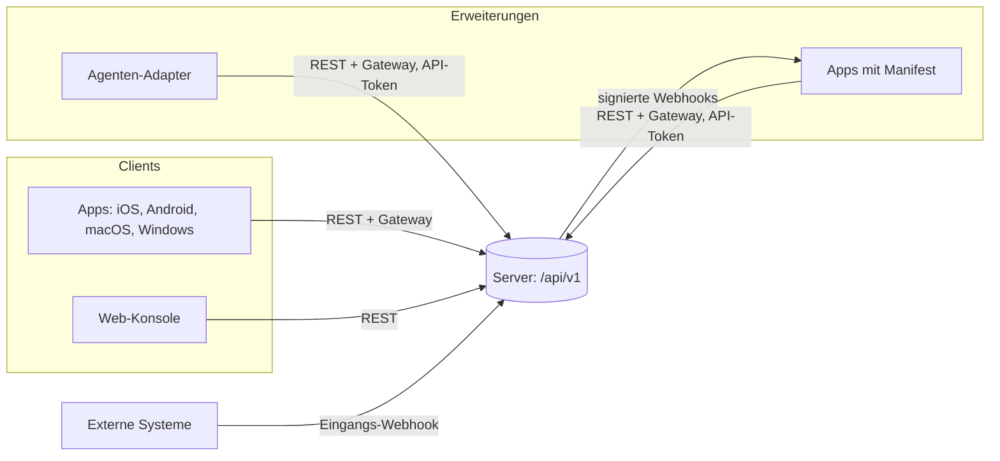
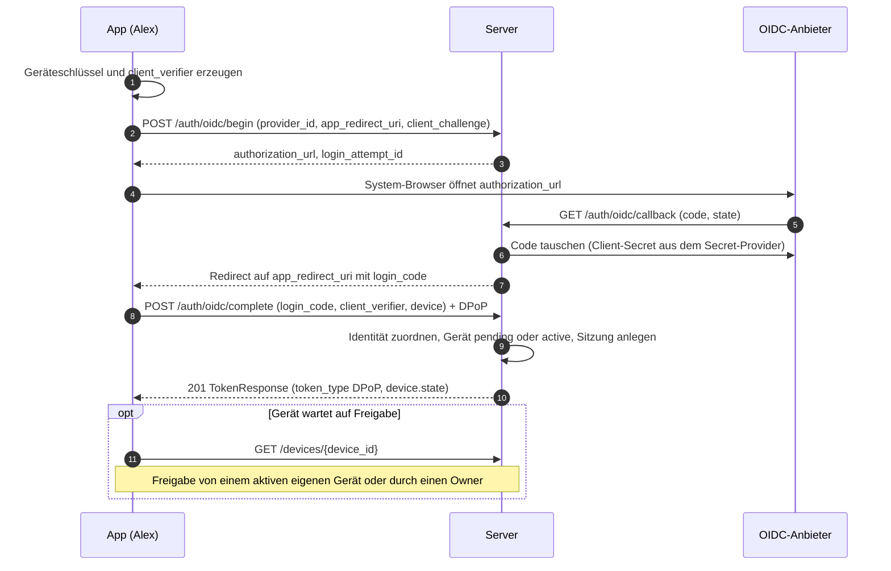
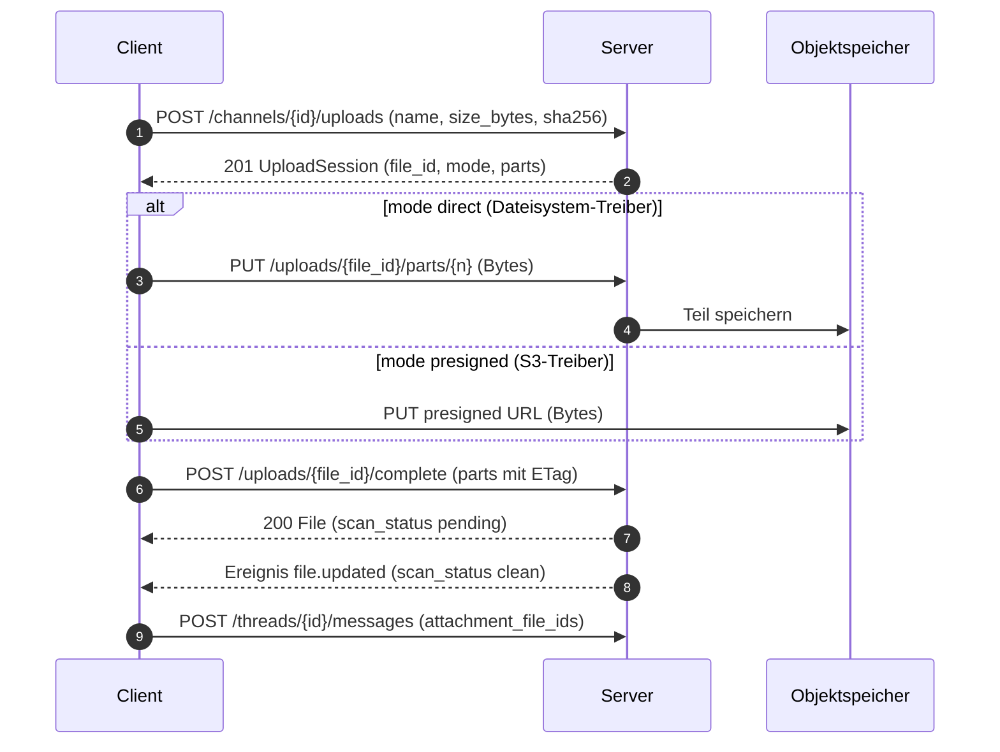

# 06 Öffentliche API

Status: Entwurf M0. Normativ sind [docs/api/openapi.yaml](../api/openapi.yaml) (REST, OpenAPI 3.1),
[docs/api/asyncapi.yaml](../api/asyncapi.yaml) (Gateway, AsyncAPI 3.0) und dieses Kapitel
(Konventionen). Webhooks: [docs/api/webhooks.md](../api/webhooks.md). Begriffe:
[00-glossar.md](00-glossar.md). Tabellen: [03-datenmodell.md](03-datenmodell.md). Sync:
[04-sync-protokoll.md](04-sync-protokoll.md). Aktionen: [05-aktionen.md](05-aktionen.md).
Entscheidungen: ADR 0013 bis 0016.

Rangfolge bei Widerspruch: 05 für Aktionen und Rechte, 04 für Sync-Semantik, die YAML-Dateien für
Formen (Pfade, Felder, Typen), dieses Kapitel für Konventionen. Ein Widerspruch ist ein Fehler und
wird in derselben Änderung behoben, die ihn findet.

Alle Grenzen, Fenster und Fristen sind benannte Konfigurationswerte. Neue Werte dieses Kapitels
stehen nur in Abschnitt 20.

## 1. Überblick

| Fläche | Ort | Vertrag |
|---|---|---|
| REST | `https://<host>/api/v1/...` | openapi.yaml, Abschnitte 2 bis 10 |
| Gateway (WebSocket) | `wss://<host>/api/v1/gateway` | asyncapi.yaml, 04, Abschnitt 11 |
| Ausgehende Webhooks | HTTPS-Ziel der App | `webhooks:` in openapi.yaml, webhooks.md |
| Eingangs-Webhooks | `POST /api/v1/hooks/{webhook_id}/{token}` | openapi.yaml, webhooks.md |

Der Server-Eintrag in openapi.yaml ist relativ (`/api/v1`), weil jede Instanz ihren eigenen Host
hat. Das Präfix `/api/v1` gilt für alle Flächen, auch im Kern-Vertrag (04). Liveness und
Readiness gehören nicht zur öffentlichen API; sie liegen auf dem internen Listener
([16-betrieb.md](16-betrieb.md), Abschnitt 4.2; Ruling L2).

## 2. Grundregeln

| Thema | Regel | Grund |
|---|---|---|
| Pfade | Kleinbuchstaben, Nomen im Plural, kebab-case (`/gdpr-requests`). Pfad-Parameter heißen `{<ressource>_id}`. Pfade enthalten nur IDs, nie Handles oder Namen. | Stabile URLs; Umbenennen ändert keine Adresse. |
| Zustandswechsel | Wechsel mit Nebenwirkung, Grund oder Audit sind `POST /<ressource>/{id}/<verb>` (`close`, `reopen`, `move`, `revoke`, `approve`, `archive`, `cancel`, `disable`). | Eine Aktion je Route, auditierbar mit Grund, kein verstecktes Feld in einem PATCH. |
| Ohne Wirkung | Ist der Zielzustand schon erreicht (Sperren eines Gesperrten, Widerruf eines Widerrufenen, Schließen eines Erledigten) oder ändert ein PATCH nichts, antwortet der Server wie beim Wechsel mit der aktuellen Darstellung, ohne neue Version, ohne Ereignis und ohne Rechte-Version; Aktionen mit Audit schreiben einen Eintrag mit `no_change: true` in `details`. Ein Übergang, den der Zustandsautomat nicht kennt (z. B. `deleted` nach `active`, Hauptverlauf schließen), ergibt `409 invalid_state_transition`. | Das Ausgangsfach wiederholt auch nach `sync.idempotency_key_ttl`; ein Fehler für den gewünschten Zustand sähe wie ein Scheitern aus. |
| Selbstbezug | `/me/...` für den aufrufenden Menschen; Agenten-Laufzeit unter `/agents/me/...`. | Kein Sonderwert `me` in ID-Parametern; Codegeneratoren typisieren IDs als UUID. |
| Felder | snake_case, gleich wie Datenbank (03) und Ereignisse (04). | Ein Name je Begriff über alle Schichten. |
| operationId | lowerCamelCase, Verb plus Nomen (`createMessage`). Lint-Regel `rule/operation-id-camel-case`. | Generatoren bilden Methodennamen daraus; eine Umbenennung bricht SDKs. |
| Aufzählungen | snake_case-Strings. Wiederholte Wertemengen sind benannte Schemas (z. B. `ThreadState`). | Gleiche Typen in allen Generatoren, keine Namenskollisionen. |
| IDs | UUIDv7 (RFC 9562) in Kleinschreibung. Der Server akzeptiert Großschreibung beim Lesen. | 03, R-DM-01. |
| Zeit | RFC 3339 in UTC mit `Z` und Millisekunden. Dauern als Ganzzahl in Millisekunden (`_ms`). Clients lesen jede gültige RFC-3339-Form. | Eindeutig, sortierbar, sprachneutral. |
| Ganzzahlen | `format: int64`. Sequenzen, Versionen und Beträge bleiben unter 2^53, damit JavaScript sie exakt darstellt; ein Server-Test prüft die Grenze bei der Vergabe. | JSON-Zahlen in JavaScript sind Gleitkomma. |
| Geld | `amount_micros` (int64) plus `currency` (ISO 4217). | 03, R-DM-04. |
| Kein `null` | Der Server sendet nie JSON `null`. Fehlt ein Feld, hat es keinen Wert. Clients behandeln ein empfangenes `null` wie ein fehlendes Feld. Werte werden über eigene Felder oder Modi entfernt (z. B. `use_global_order: true`, `OperatorSet.mode = none`), nie durch `null`. | dart-dio kennt den Null-Typ nicht [belegt, Q4]; ein Weg für alle Generatoren (R-API-03, [ADR 0053](../adr/0053-kein-json-null-in-api-und-ereignissen.md)). |
| Unbekanntes | Clients ignorieren unbekannte Felder, Enum-Werte, Ereignistypen und Problem-Codes. Der Server lehnt unbekannte Felder in Anfragen und Gateway-Rahmen ab (`400 validation_failed` bzw. Schließ-Code `4002`); schreibende Schemas haben `additionalProperties: false` ([19-sicherheit.md](19-sicherheit.md), SEC-IN-1; PLAN W7). Ob ein Server ein neues Feld kennt, sieht ein Client an `features` der Discovery. | Ein still verworfenes Feld verschluckt bei einem älteren Server eine Absicht; Antworten und Ereignisse bleiben additiv (Abschnitt 13). |
| Medientypen | JSON als `application/json` (UTF-8); Fehler als `application/problem+json`; Datei-Teile als `application/octet-stream`; Bilder für Avatar und Logo als `multipart/form-data` (Teil `file`); Exporte als `application/x-ndjson`. | Ein Format je Zweck; NDJSON lässt große Exporte streamen. |
| Größe | JSON-Körper bis `http.max_json_body_bytes`, Schachtelung bis `http.max_json_depth` ([02-architektur.md](02-architektur.md)), sonst `413 payload_too_large` bzw. `400 malformed_request`. `http.max_json_body_bytes` ist echt größer als `message.max_content_bytes`. | Schutz vor Speicherdruck ohne lange Nachrichten zu verhindern. |
| Caching | Authentifizierte JSON-Antworten tragen `Cache-Control: no-store`. Datei-Inhalte tragen `Cache-Control: private, immutable`, weil sich der Inhalt einer Datei-ID nie ändert. | Kein Inhalt in fremden Caches; der Client löscht bei `access.changed` selbst (04, 8.3). |
| Korrelation | Jede Antwort trägt `Correlation-Id`: die Trace-ID der Anfrage als UUID geschrieben (Schema `CorrelationId`, keine UUIDv7). Derselbe Wert steht in Problemen, Ereignissen (`correlation_id`) und im Audit. Der Server erzeugt ihn; eine gesendete `Correlation-Id` ignoriert er, und ein eingehender `traceparent` wird nur als Span-Link übernommen, nicht als Eltern-Trace ([17-observability.md](17-observability.md), Abschnitt 3). | Ein fälschbarer Client-Wert würde Audit-Spuren verfälschen. |
| Client-Kennung | `User-Agent: <app>/<version> (<plattform>)`. | Diagnose und `min_client_versions` in der Discovery. |
| CORS | Aus. Die Web-Konsole läuft auf demselben Origin. Ausnahmen nur über `api.cors_allowed_origins`. | Kleinste Angriffsfläche für Token im Browser. |
| Client-IP | Für die Rate-Limit-Klasse `rl.public_auth` und das Audit gilt die Quell-IP; `Forwarded` und `X-Forwarded-For` nur von Absendern aus `server.trusted_proxies` ([16-betrieb.md](16-betrieb.md)). | Hinter einem Reverse-Proxy hätten sonst alle Clients dieselbe IP, oder Angreifer setzen sie selbst. |
| Sprache | `title` und `detail` in Problemen sind Englisch. Clients übersetzen über `code`. Beschreibungen in den YAML-Dateien sind Englisch, weil sie als Kommentare in generierten Code wandern. | Stabile Texte für Logs; Lokalisierung gehört in den Client. |

## 3. Authentifizierung je Prinzipal-Art

| Prinzipal | Anmeldung | Kopfzeilen je Anfrage | Bindung | Gültigkeit | Step-up |
|---|---|---|---|---|---|
| Mensch in einer App | OIDC, Header eines vertrauenswürdigen Reverse-Proxys, lokales Konto mit Passkey oder Passwort plus TOTP; Ergebnis ist ein Token-Paar | `Authorization: DPoP <access_token>` und `DPoP: <Beweis>` | Geräteschlüssel (`cnf.jkt`), RFC 9449 | Zugriffstoken `auth.access_token_ttl` (Kapitel 08), Refresh `auth.refresh_token_ttl` | Passkey oder Geräteschlüssel mit Nutzerbestätigung |
| Mensch in der Web-Konsole | wie oben; Ergebnis ist eine Cookie-Sitzung nach dem BFF-Muster, keine Tokens im Browser ([08-identitaet.md](08-identitaet.md), Abschnitt 7.5) | Cookie `__Host-console_session` and the CSRF header `X-Console-Request: 1` with the own `Origin` on every request except `GET`, `HEAD`, `OPTIONS` (security scheme `consoleSession`, parameter `ConsoleRequest`) | Cookie, als HMAC an der Sitzung | `auth.console_session_max_age`, Leerlauf `auth.console_session_idle_timeout` | Passkey, sonst erneute OIDC-Anmeldung bzw. Passwort mit TOTP |
| Agent | API-Token, vom Owner erzeugt (`token.create`) | `Authorization: Bearer <token>`; bei Token mit `dpop_jkt` `Authorization: DPoP` plus `DPoP` | optional `dpop_jkt` | bis Widerruf oder `expires_at` | nie (R-AZ-03) |
| App | API-Token mit Scopes (05, 2.6) | wie Agent | optional | wie Agent | nie |
| Eingangs-Webhook | geheimer Token im Pfad | keine | keine | bis Widerruf | nie |
| Anonym | keine | keine | keine | | nie |

Anonym erreichbar sind nur Operationen mit `security: []`: Discovery, JWKS, Webhook-Schlüssel,
Logo, Problem-Typen, öffentliche Statusseite, Anmeldeabläufe, Eingangs-Webhooks und die
Kopplung eines Rechners (`pairHost`, der Kopplungs-Code ist der Nachweis, 24 Abschnitt 3.2). Sie
laufen trotzdem durch `authorize` mit dem Prinzipal `anonymous` (05, 2.1).

### 3.1 DPoP

1. Der Server stellt Zugriffstokens als JWS mit `sub`, `sid` (Sitzung) und `cnf.jkt` aus
   (RFC 9449 [belegt, Q3]). Jede Anfrage trägt einen frischen DPoP-Beweis mit `htm`, `htu` (ohne
   Query), `iat`, `jti` und `ath` (Hash des Zugriffstokens).
2. Verlangt der Server einen Nonce, antwortet er `401` mit `WWW-Authenticate: DPoP
   error="use_dpop_nonce"` und `DPoP-Nonce` (Problem `use_dpop_nonce`). Der Client bildet den
   Beweis mit diesem Nonce neu und wiederholt genau einmal. Jede Antwort darf einen neuen
   `DPoP-Nonce` tragen; der Client nimmt immer den neuesten. Am Gateway kommt der Nonce aus
   `hello` und `reauth_required` (04, 6.3).
3. Anmelde-Endpunkte haben noch kein Zugriffstoken. Sie verlangen die Kopfzeile `DPoP` ohne
   `ath`; der Server bindet die neuen Tokens an genau diesen Schlüssel.
4. Refresh (`POST /auth/token/refresh`) verlangt einen Beweis mit dem Schlüssel der Sitzung. Eine
   Wiederverwendung eines schon rotierten Refresh-Tokens sperrt Familie und Sitzung
   (`session_revoked`, 03). Ausnahme: dieselbe Wiederholung mit demselben Schlüssel innerhalb von
   `auth.refresh_reuse_grace`, z. B. nach verlorener Antwort; sie bekommt ein neues Paar
   (03, `refresh_tokens`).
5. `jti`-Speicher, Zeitfenster für `iat` und Algorithmen legt Kapitel 08 fest.

### 3.2 Anmeldeabläufe

Jede Anmeldeart hat eigene Endpunkte statt eines Endpunkts mit Union-Körper; das hält die
Schemas frei von `oneOf` und die Fehlerbilder getrennt (R-API-12).

1. **OIDC.** Der Server ist der vertrauliche Client beim Anbieter. Die App öffnet den
   System-Browser; `app_redirect_uri` ist ein eigenes URI-Schema, eine beanspruchte
   `https`-Adresse oder Loopback (RFC 8252 [belegt, Q12]). Nach dem Rückruf leitet der Server
   mit einem einmaligen `login_code` (gültig `auth.server_code_ttl`) auf `app_redirect_uri` um.
   Nur wer den passenden `client_verifier` zur `client_challenge` hat, kann ihn einlösen; ein
   fremdes Programm, das die Umleitung abfängt, kann es nicht. Der Versuch gilt
   `auth.login_flow_ttl` ([08-identitaet.md](08-identitaet.md)).
2. **Proxy-Header.** `POST /auth/trusted-header/login` liest die Identität aus der Kopfzeile des
   Proxys. Der Endpunkt antwortet `404`, wenn kein Treiber `trusted_header` aktiv ist oder der
   Server nicht nur auf Loopback lauscht (B9).
3. **Lokale Konten.** Der Owner legt den Menschen an (`createUser` mit `local_account`) und
   bekommt einmalig einen Einladungs-Code (gültig `auth.enrollment_code_ttl`). Damit löst der
   Mensch sein erstes Gerät ein: nur mit den Geräteschlüsseln (`/auth/enroll/redeem`) oder
   zusammen mit einem Passkey (`/auth/enroll/begin`, `/auth/enroll/complete`). Danach meldet er
   sich mit Passkey an (`/auth/passkey/...`), koppelt weitere Geräte (`/auth/pairing/...`) oder,
   solange `auth.local_password_enabled` gilt, nutzt Passwort plus TOTP (`/auth/password/login`).
   Grund für den Rückfall: native Apple-Apps brauchen für Passkeys eine öffentlich erreichbare
   Associated Domain (Baseline R-Passkeys).
4. **Warten auf Freigabe.** Ein neues Gerät bekommt Tokens, ist aber `pending`; dasselbe gilt für
   einen bereitgestellten Menschen im Zustand `pending` ([08-identitaet.md](08-identitaet.md),
   Abschnitt 3.1). Alle Aktionen außer `self.read`, `device.list` für das eigene Gerät,
   `auth.token.refresh` und `auth.logout` antworten `403 device_pending`. Das Gateway lehnt
   `identify` ab (04, 6.3).

### 3.3 Step-up

Aktionen mit Step-up (05, Spalte "Step-up") antworten ohne frische Bestätigung `401
step_up_required`. Der Client holt `POST /auth/step-up/challenge`, lässt den Menschen mit Passkey
oder Geräteschlüssel bestätigen (`/auth/step-up/passkey` oder `/auth/step-up/device-key`) und
wiederholt die ursprüngliche Anfrage mit demselben `Idempotency-Key`. Die Bestätigung gilt für die
Sitzung `auth.step_up_max_age` (03). Agenten- und App-Tokens bekommen bei solchen Aktionen
`403 forbidden` (R-AZ-03).

## 4. Autorisierung in der API

1. Jede Operation trägt `x-authz-action` mit genau einer Aktion aus 05 und `x-rate-limit-class`
   mit deren Klasse. Lint-Regeln: `rule/authz-action-required`, `rule/authz-action-known`,
   `rule/rate-limit-class-required`, `rule/rate-limit-class-known` (docs/api/redocly.yaml).
2. Listen-Endpunkte prüfen die Aktion gegen den Container (Kanal, Bereich, Instanz) und filtern
   in der Abfrage (P2). Sie liefern keine Gesamtzahlen.
3. Kein Leserecht ergibt `404 not_found`, gleich ob es die Ressource gibt (R-AZ-01). Leserecht ohne
   nötige Stufe oder Zusatzrecht ergibt `403 forbidden`.
4. Apps: Sichtbarkeit folgt der Freigabe. Hat eine App eine Freigabe auf den Kanal, antwortet die
   API bei fehlendem Scope (lesend oder schreibend) mit `403 scope_missing`; ohne Freigabe ist der
   Kanal unsichtbar (`404`). Grund: Die App kennt den Kanal aus ihrer Freigabe; ein `404` würde nur
   die Fehlersuche erschweren ([07-rechte.md](07-rechte.md), Abschnitt 2.10).
5. Invarianten: I1-Verletzung ergibt `409 i1_violation` mit `hint`; der letzte Owner ergibt
   `409 last_owner`; I3 beim Start eines Laufs `409 billing_mode_mismatch`, eine zu hohe
   Werkzeugklasse `409 tool_class_mismatch`. Ein schreibgeschützter Kanal ergibt
   `403 channel_read_only`, ein wartendes Gerät `403 device_pending`, der Wartungsmodus
   `503 maintenance` mit `Retry-After` für Aktionen mit Wirkung `write` außer den Ausnahmen aus
   [ADR 0065](../adr/0065-wartungsmodus-read-only.md) (05, Regeln 1.8 und 1.9, Abschnitt 2.7).
6. Agenten-Auslösung: Eine Nachricht wird gespeichert, auch wenn `agent.invoke` ablehnt; dann gilt
   `trigger_state = failed` mit `trigger_state_reason` (05, Abschnitt 5). Befehle und
   Interaktionen ohne Auslöserecht antworten `403 agent_invocation_denied` mit `reason`.
7. Aktionen ohne eigene REST-Route: `agent.invoke` und `run.followup.create` (geprüft in
   `createMessage`, `createInteraction`, `invokeCommand`), `gateway.connect`, `gateway.focus`,
   `typing.start` (Gateway), `push.deliver` (intern und kurzlebiges `notification.created`),
   `webhook_out.deliver` (an jedem Eintrag in `webhooks:`), die Systemaktionen
   `instance.bootstrap` (Befehl `bothy setup bootstrap-owner`), `owner.recover` (Befehl `bothy
   setup issue-enrollment-code`), `grant.expire`, `group.member.expire`, `signing_key.transition`
   und `device.expire` (Jobs), `group.member.sync` (Abgleich bei der OIDC-Anmeldung) sowie
   `dev_environment.*` (Routen entstehen mit der Etappe Dev-Umgebung, 05 Abschnitt 4.13).

## 5. Fehler

1. Jeder Fehler ist `application/problem+json` nach RFC 9457 [belegt, Q2] mit `type`, `title`,
   `status`, `code`, `correlation_id`, optional `detail` und `instance`. `instance` ist der Pfad
   der Anfrage ohne Query; Pfad-Parameter, die ein Geheimnis tragen (heute nur `{token}` von
   `postIncomingWebhook`), erscheinen als Platzhalter, wie in Logs ([19-sicherheit.md](19-sicherheit.md),
   SEC-LOG-3).
2. `type` ist ein relativer URI mit vollem Pfad `/api/v1/problems/{code}`. RFC 9457 empfiehlt
   absolute URIs "when possible" und erlaubt relative mit vollem Pfad [belegt, Q2]. Eine
   selbst gehostete Software hat keinen gemeinsamen Host; jede Instanz liefert die Beschreibung
   unter genau diesem Pfad (`getProblemType`). Clients vergleichen `type` als Zeichenkette oder
   `code`. Eine spätere Umstellung auf absolute URIs wäre ein Bruch und kommt nur mit `v2`.
3. Erweiterungen: `errors[]` bei `validation_failed` mit `pointer` (JSON Pointer in den Körper,
   `#path/<name>`, `#query/<name>` oder `#header/<name>` für Parameter, leer für eine Regel der
   ganzen Anfrage), `code` (z. B. `required`, `too_long`, `limit_reached` für eine erreichte
   Mengen-Grenze, `not_enabled` für ein Feld, dessen Funktion diese Server-Version noch nicht baut)
   und `detail`; `current` bei `version_conflict` und `base_version_conflict`;
   `reason` und `hint` bei Ablehnungen, Invarianten und Konflikten mit benanntem Grund (z. B.
   `one_time_secret`, Abschnitt 7); `attempts_remaining` bei `fingerprint_mismatch` (verbleibende
   Bestätigungen eines Rechners, `0` heißt Rückfall auf `pairing`, 24 Abschnitt 3.2). `detail`
   enthält nie Inhalte, Geheimnisse oder interne Pfade.
4. `400` steht für Schema- und Regelverstöße. `422` gibt es nur für `idempotency_key_reuse` (04,
   5.1). `409` für Zustandskonflikte, `412` für `If-Match`.
5. Eine per Schalter ausgeschaltete Funktion antwortet angemeldeten Prinzipalen mit `403
   feature_disabled`, damit die Oberfläche den Grund zeigen kann. Öffentliche Endpunkte
   (Passwort-Anmeldung, Proxy-Header, öffentliche Statusseite) antworten `404`, damit sie die
   Konfiguration nicht verraten.
6. Das Gateway nutzt dieselben Codes im Rahmen `error`.

Bekannte Codes: Quelle ist `x-problem-codes` am Schema `Problem` in openapi.yaml, Englisch wie
alle Texte der YAML-Dateien (R-API-15); jede Antwort-Komponente nennt ihren Status in `x-status`
(R-API-23). Die Tabelle wird daraus erzeugt (Abschnitt 15, G3).

<!-- BEGIN GENERATED: problems -->
| Code | Status | Bedeutung (aus openapi.yaml) | Client-Reaktion (aus openapi.yaml) |
|---|---|---|---|
| `validation_failed` | 400 | The request violates the schema or a rule; `errors[]` names the fields. | Correct the input; do not retry. |
| `malformed_request` | 400 | The body is not valid JSON, has a duplicate member name, invalid UTF-8 or nesting deeper than `http.max_json_depth` (SEC-IN-2). | Programming error; do not retry. |
| `cursor_invalid` | 400 | The cursor is unknown or does not match the filters. | Start again without a cursor. |
| `webhook_host_not_allowed` | 400 | The target host is not in `webhook.allowed_hosts`. | The owner requests approval of the host. |
| `unauthenticated` | 401 | No valid principal (token missing, invalid or expired). | Renew the token; if that fails, log in again. |
| `token_expired` | 401 | The access token has expired. | Refresh, then retry. |
| `session_revoked` | 401 | Session, device or principal revoked. | Delete local data and log out (R-SY-14). |
| `step_up_required` | 401 | The action needs a fresh confirmation (`auth.step_up_max_age`), or a step-up confirmation failed. For `terminal.open` and `terminal.attach`: younger than `terminal.step_up_max_age`, not yet consumed, by passkey or step-up device key; in the console only by passkey with `userVerification = required`, otherwise `reason: passkey_required` (08 section 6.3). The quick reattach without step-up never applies in the console. | Perform step-up, then repeat the same request with the same `Idempotency-Key`. |
| `use_dpop_nonce` | 401 | The server requires a fresh nonce in the DPoP proof; header `DPoP-Nonce`. | Build the proof again with the nonce and retry once. |
| `invalid_dpop_proof` | 401 | The DPoP proof is missing, wrongly signed, expired or does not match `cnf.jkt`. | Programming error or device key lost; log in again. |
| `forbidden` | 403 | Read access exists, but the level or a capability is missing (R-AZ-01). | Do not retry; hide the control. |
| `scope_missing` | 403 | The app lacks the required scope. | The owner grants the scope. |
| `device_pending` | 403 | The device or the provisioned account waits for approval. | Wait; poll `GET /devices/{device_id}` or `GET /me`. |
| `channel_read_only` | 403 | The channel is read-only (05 rule 1.8) or archived (`reason: channel_archived`, 07 section 4.5); applies to owners too. | Lock the input and show a note; do not retry. |
| `feature_disabled` | 403 | The feature is switched off (for example personal tokens). | Do not retry. |
| `agent_invocation_denied` | 403 | `agent.invoke` denies; `reason` for example `billing_mode_personal_not_holder`, `project_not_ready`. | Show the reason; do not retry. |
| `terminal_denied` | 403 | The `terminal` right exists, but a guard rule or limit blocks; `reason` is `not_host_assignee`, `server_host_owner_only`, `i6_holder_only`, `session_limit` or `profile_unknown` (24 section 13). | Show the reason; do not retry. |
| `invocation_token_invalid` | 403 | The invocation token is wrongly signed, expired, issued for another agent, or its `jti` does not match. | The adapter starts nothing and reports the run as `failed`. |
| `not_found` | 404 | The resource does not exist or is not visible; both answer the same (R-AZ-01). | Mark the outbox entry as failed. |
| `method_not_allowed` | 405 | The method is not defined on this path. | Programming error. |
| `conflict` | 409 | The state prevents the change (for example a name is taken); `reason` names the cause where one is defined. | Reload the state; a person decides. |
| `request_in_progress` | 409 | The first request with this `Idempotency-Key` is still running. | Retry with backoff. |
| `i1_violation` | 409 | The change would violate I1; `hint` names the way out. | Switch to `organization` first. |
| `i6_violation` | 409 | The change would let someone other than the holder of a personal LLM login open a terminal on the host (I6); `hint` names the way out. | Revoke the other grants or declare `organization` first. |
| `last_owner` | 409 | At least one active owner must remain. | Appoint another owner first. |
| `already_started` | 409 | The run is no longer `queued`. | The adapter starts nothing. |
| `billing_mode_mismatch` | 409 | The reported actual mode differs from the target; the run becomes `failed`. | Check the adapter configuration. |
| `tool_class_mismatch` | 409 | The reported tool class is above the one in the invocation token; the run becomes `failed`. | Check the adapter configuration. |
| `host_unavailable` | 409 | The host is not `active` or its host service is not connected. | Show the host state; retry when `host.presence_changed` reports it connected. |
| `fingerprint_mismatch` | 409 | The typed fingerprint prefix does not match the keys the host service registered; `attempts_remaining` counts the confirmations left, `0` means the host fell back to `pairing` without keys. | Compare with the output of `bothy-host pair` and type it again; at `attempts_remaining` `0` issue a new pairing code. |
| `invalid_state_transition` | 409 | The state machine does not allow the transition. | Reload the state. |
| `base_version_conflict` | 409 | `base_version` of a run patch is outdated; `current` holds the document. | Rebase on `current`. |
| `component_used` | 409 | The component is used, expired or disabled. | Refresh the view. |
| `operator_mismatch` | 409 | The target channel has another effective operator. | Choose another target channel. |
| `file_not_ready` | 409 | Upload incomplete or scan still running. | Wait for `file.updated`. |
| `file_blocked` | 409 | The file is never delivered: malware found, scan error or failed upload (12, 9.3). | Show the file as blocked; do not retry. |
| `title_manual` | 409 | The operator agent sets a thread title only while `title_source` is `auto` (09 section 12). | The agent keeps the manual title. |
| `resync_required` | 410 | Catch-up is not possible; `reason` as in the gateway. | Load a snapshot (04, 7.3). |
| `message_deleted` | 410 | The message was deleted in the meantime. | Discard the entry; keep the text for copying. |
| `gone` | 410 | The object has expired (upload, export package, autocomplete). | Start again. |
| `version_conflict` | 412 | `If-Match` does not match; `current` holds the current version. | Show both versions; a person decides. |
| `payload_too_large` | 413 | Body or file above the limit; `detail` names the configuration value. | Do not retry. |
| `unsupported_media_type` | 415 | The media type is not allowed. | Do not retry. |
| `range_not_satisfiable` | 416 | `Range` lies outside the file. | Load without `Range`. |
| `idempotency_key_reuse` | 422 | The same client ID or `Idempotency-Key` with different content. | Create a new ID only when the person sends again. |
| `precondition_required` | 428 | `If-Match` is missing. | Programming error. |
| `rate_limited` | 429 | The rate-limit class is exhausted. | Wait for `Retry-After`. |
| `internal_error` | 500 | Unexpected error; `correlation_id` for the log search. | Retry with backoff. |
| `unavailable` | 503 | The server is not ready (start, missing dependency). | Wait for `Retry-After`. |
| `maintenance` | 503 | Maintenance mode (`server.maintenance_mode = read_only`); only writing actions are blocked. | Wait for `Retry-After`; reading continues, the outbox keeps drafts. |
| `setup_required` | 503 | The instance is not set up yet; only discovery answers (08 section 4). | The owner sets up the instance on the host; there is no `Retry-After`. |
<!-- END GENERATED: problems -->

## 6. Paginierung

1. Listen mit offener Menge sind cursor-basiert: Anfrage mit `cursor` und `limit`, Antwort
   `{items, next_cursor}`. Fehlt `next_cursor`, ist das die letzte Seite.
2. Der Cursor ist undurchsichtig, an Filter und Sortierung gebunden und stabil gegen neue Zeilen
   (Keyset über Sortierschlüssel und ID). Ein fremder oder veralteter Cursor ergibt `400
   cursor_invalid`. Alle Listen nutzen einen Codec in `platform/httpserver` (PLAN M1-18).
3. `limit` hat den Standard `api.page_size_default`; größere Werte als `api.page_size_max` werden
   gekappt, nicht abgelehnt.
4. Keine Gesamtzahlen. Sie kosten eine zweite Abfrage und verraten über Rechtefilter hinweg
   Mengen.
5. Sonderfälle mit öffentlichen Nummern: Verlauf eines Threads über `before_seq`, `after_seq`,
   `around_seq` (Thread-Sequenz, Lücken erkennbar, 04 Abschnitt 4); Ereignisse über `after`
   (globale Sequenz, 04 Abschnitt 7.4); Agenten-Verbraucher ab `acked_seq + 1`. Im Verlauf gilt
   mit `L` = Seitengröße: ohne Parameter die `L` neuesten Nachrichten; `before_seq = X` die `L`
   höchsten unter `X`; `after_seq = X` die `L` niedrigsten über `X`; `around_seq = X` höchstens
   `(L - 1) / 2` (ganzzahlig) unter `X` und den Rest ab `X`, wobei eine kurze Seite ihren Anteil an
   die andere abgibt. Einträge stehen immer aufsteigend und lückenlos; `has_more_before` und
   `has_more_after` sagen, ob es davor bzw. danach weitere gibt, und stammen aus derselben Abfrage
   wie die Einträge. In Listen kürzt der Server `content_md` über
   `message.list_content_max_bytes` (`content_truncated: true`); `getMessage` liefert den ganzen
   Inhalt. Grund: Eine Seite bleibt so unter `api.page_size_max` mal diesem Wert statt mal
   `message.max_content_bytes`.
6. Ohne Paginierung bleiben nur Listen, deren Menge klein ist (Bereiche, Kanäle eines Bereichs,
   Tags, Einstellungen, Owner, Gruppenliste einer Person). Wächst eine davon, kommt ein neuer,
   paginierter Endpunkt; die alte Antwortform bleibt (Abschnitt 13).

## 7. Idempotenz

| Fall | Mechanismus | Antwort bei Wiederholung |
|---|---|---|
| Nachricht senden | `client_msg_id` im Körper, eindeutig je Autor (04, 5.1) | `200` mit Original und `Idempotent-Replay: true`; anderer Inhalt `422 idempotency_key_reuse` |
| Interaktion | `client_interaction_id` im Körper | wie oben |
| Eingangs-Webhook | optional `client_msg_id` im Körper | wie oben |
| andere POST und PATCH | Kopfzeile `Idempotency-Key` (UUIDv7, 04 5.2) | gespeicherte Antwort mit `Idempotent-Replay: true`; anderer Inhalt `422`; erste Anfrage läuft noch `409 request_in_progress` |
| PUT und DELETE | idempotent nach HTTP-Semantik | gleiche Wirkung; DELETE einer schon gelöschten Ressource `204`, einer nie sichtbaren `404`; Ressourcen ohne Löschmarke (z. B. Anmelde-Treiber) antworten nach dem Löschen `404`, weil der Server sie von nie vorhandenen nicht unterscheidet |
| POST mit einmaligem Geheimnis in der Antwort (Einladungs-Code, API-Token, später Webhook-Geheimnisse) | Kopfzeile `Idempotency-Key` | gespeichert wird die Antwort ohne das Geheimnis; die Wiederholung antwortet `409 conflict` mit `reason: one_time_secret`. Der Client legt neu an: Ein neuer Einladungs-Code beendet den alten (08, Abschnitt 3.2), ein API-Token ohne bekanntes Geheimnis widerruft der Owner in der Liste |

1. Der Schlüssel gilt je Prinzipal für `sync.idempotency_key_ttl`. Clients setzen ihn bei jedem
   Eintrag im Ausgangsfach (04, 13.2). Name und Verhalten folgen dem verbreiteten Muster aus
   draft-ietf-httpapi-idempotency-key-header; der Entwurf -07 ist abgelaufen, kein RFC
   [belegt, Q10]. Maßgeblich ist darum 04, Abschnitt 5.2.
2. Gespeichert werden nur endgültige Antworten: `2xx`, `400`, `403`, `404`, `409` (außer
   `request_in_progress`), `410`, `412`, `413`, `415`, `422`. Nicht gespeichert werden `401`,
   `429` und `5xx`. Darum klappt die Wiederholung nach Step-up, nach Token-Erneuerung und nach
   einer Drosselung mit demselben Schlüssel.
3. Ohne `Idempotency-Key` bleiben genau die POST- und PATCH-Operationen mit
   `x-idempotency-exempt` in openapi.yaml; der Grund steht als Code daran (R-API-24): `auth_flow`
   (Challenges und Codes gelten einmal, Refresh rotiert, `logout` und eine neue Kind-Sitzung
   wirken wiederholt gleich), `read_only` (`createFileTicket` erzeugt nur ein weiteres kurzlebiges
   Ticket, 12 Abschnitt 9.2), `agent_runtime` (monoton, Compare-and-swap bzw. `base_version`, die
   erste Antwort je Anfrage gilt), `client_id` (Tabelle oben), `origin_key` (Herkunftsschlüssel je
   Objekt) und `telemetry` (ein Doppel ist für Telemetrie unerheblich). Das Gate prüft die Liste
   (Abschnitt 15, G2):

<!-- BEGIN GENERATED: idempotency_exempt -->
| operationId | Methode | Pfad | Grund |
|---|---|---|---|
| `beginOidcLogin` | POST | `/api/v1/auth/oidc/begin` | Anmelde- oder Sitzungsablauf: einmalige Challenge oder Code, Refresh-Rotation, Ersatz der Kind-Sitzung |
| `completeOidcLogin` | POST | `/api/v1/auth/oidc/complete` | Anmelde- oder Sitzungsablauf: einmalige Challenge oder Code, Refresh-Rotation, Ersatz der Kind-Sitzung |
| `loginWithTrustedHeader` | POST | `/api/v1/auth/trusted-header/login` | Anmelde- oder Sitzungsablauf: einmalige Challenge oder Code, Refresh-Rotation, Ersatz der Kind-Sitzung |
| `beginPasskeyLogin` | POST | `/api/v1/auth/passkey/begin` | Anmelde- oder Sitzungsablauf: einmalige Challenge oder Code, Refresh-Rotation, Ersatz der Kind-Sitzung |
| `completePasskeyLogin` | POST | `/api/v1/auth/passkey/complete` | Anmelde- oder Sitzungsablauf: einmalige Challenge oder Code, Refresh-Rotation, Ersatz der Kind-Sitzung |
| `beginEnrollment` | POST | `/api/v1/auth/enroll/begin` | Anmelde- oder Sitzungsablauf: einmalige Challenge oder Code, Refresh-Rotation, Ersatz der Kind-Sitzung |
| `completeEnrollment` | POST | `/api/v1/auth/enroll/complete` | Anmelde- oder Sitzungsablauf: einmalige Challenge oder Code, Refresh-Rotation, Ersatz der Kind-Sitzung |
| `redeemEnrollmentCode` | POST | `/api/v1/auth/enroll/redeem` | Anmelde- oder Sitzungsablauf: einmalige Challenge oder Code, Refresh-Rotation, Ersatz der Kind-Sitzung |
| `beginPairing` | POST | `/api/v1/auth/pairing/begin` | Anmelde- oder Sitzungsablauf: einmalige Challenge oder Code, Refresh-Rotation, Ersatz der Kind-Sitzung |
| `completePairing` | POST | `/api/v1/auth/pairing/complete` | Anmelde- oder Sitzungsablauf: einmalige Challenge oder Code, Refresh-Rotation, Ersatz der Kind-Sitzung |
| `loginWithPassword` | POST | `/api/v1/auth/password/login` | Anmelde- oder Sitzungsablauf: einmalige Challenge oder Code, Refresh-Rotation, Ersatz der Kind-Sitzung |
| `refreshToken` | POST | `/api/v1/auth/token/refresh` | Anmelde- oder Sitzungsablauf: einmalige Challenge oder Code, Refresh-Rotation, Ersatz der Kind-Sitzung |
| `logout` | POST | `/api/v1/auth/logout` | Anmelde- oder Sitzungsablauf: einmalige Challenge oder Code, Refresh-Rotation, Ersatz der Kind-Sitzung |
| `createStepUpChallenge` | POST | `/api/v1/auth/step-up/challenge` | Anmelde- oder Sitzungsablauf: einmalige Challenge oder Code, Refresh-Rotation, Ersatz der Kind-Sitzung |
| `completeStepUpWithPasskey` | POST | `/api/v1/auth/step-up/passkey` | Anmelde- oder Sitzungsablauf: einmalige Challenge oder Code, Refresh-Rotation, Ersatz der Kind-Sitzung |
| `completeStepUpWithDeviceKey` | POST | `/api/v1/auth/step-up/device-key` | Anmelde- oder Sitzungsablauf: einmalige Challenge oder Code, Refresh-Rotation, Ersatz der Kind-Sitzung |
| `stepUpWithPassword` | POST | `/api/v1/auth/step-up/password` | Anmelde- oder Sitzungsablauf: einmalige Challenge oder Code, Refresh-Rotation, Ersatz der Kind-Sitzung |
| `beginStepUpOidcReauth` | POST | `/api/v1/auth/step-up/oidc` | Anmelde- oder Sitzungsablauf: einmalige Challenge oder Code, Refresh-Rotation, Ersatz der Kind-Sitzung |
| `completeStepUpOidcReauth` | POST | `/api/v1/auth/step-up/oidc/complete` | Anmelde- oder Sitzungsablauf: einmalige Challenge oder Code, Refresh-Rotation, Ersatz der Kind-Sitzung |
| `beginIdentityLink` | POST | `/api/v1/me/identities/begin` | Anmelde- oder Sitzungsablauf: einmalige Challenge oder Code, Refresh-Rotation, Ersatz der Kind-Sitzung |
| `completeIdentityLink` | POST | `/api/v1/me/identities/complete` | Anmelde- oder Sitzungsablauf: einmalige Challenge oder Code, Refresh-Rotation, Ersatz der Kind-Sitzung |
| `beginPasskeyRegistration` | POST | `/api/v1/me/passkeys/begin` | Anmelde- oder Sitzungsablauf: einmalige Challenge oder Code, Refresh-Rotation, Ersatz der Kind-Sitzung |
| `completePasskeyRegistration` | POST | `/api/v1/me/passkeys/complete` | Anmelde- oder Sitzungsablauf: einmalige Challenge oder Code, Refresh-Rotation, Ersatz der Kind-Sitzung |
| `createExtensionSession` | POST | `/api/v1/me/sessions/extensions` | Anmelde- oder Sitzungsablauf: einmalige Challenge oder Code, Refresh-Rotation, Ersatz der Kind-Sitzung |
| `pairHost` | POST | `/api/v1/hosts/pair` | Anmelde- oder Sitzungsablauf: einmalige Challenge oder Code, Refresh-Rotation, Ersatz der Kind-Sitzung |
| `openTerminalSession` | POST | `/api/v1/hosts/{host_id}/terminal/sessions` | Anmelde- oder Sitzungsablauf: einmalige Challenge oder Code, Refresh-Rotation, Ersatz der Kind-Sitzung |
| `attachTerminalSession` | POST | `/api/v1/terminal/sessions/{session_id}/attach` | Anmelde- oder Sitzungsablauf: einmalige Challenge oder Code, Refresh-Rotation, Ersatz der Kind-Sitzung |
| `previewGrant` | POST | `/api/v1/grants/preview` | liest nur, ändert keinen dauerhaften Zustand |
| `createFileTicket` | POST | `/api/v1/files/{file_id}/tickets` | liest nur, ändert keinen dauerhaften Zustand |
| `autocompleteCommand` | POST | `/api/v1/channels/{channel_id}/commands/{command_id}/autocomplete` | liest nur, ändert keinen dauerhaften Zustand |
| `validateManifest` | POST | `/api/v1/app-manifests/validate` | liest nur, ändert keinen dauerhaften Zustand |
| `verifyAuditChain` | POST | `/api/v1/audit/verify` | liest nur, ändert keinen dauerhaften Zustand |
| `sendHeartbeat` | POST | `/api/v1/agents/me/heartbeat` | Agenten-Laufzeit: monoton oder Compare-and-swap |
| `ackAgentEvents` | POST | `/api/v1/agents/me/consumers/{consumer}/ack` | Agenten-Laufzeit: monoton oder Compare-and-swap |
| `patchRun` | PATCH | `/api/v1/runs/{run_id}` | Agenten-Laufzeit: monoton oder Compare-and-swap |
| `startRun` | POST | `/api/v1/runs/{run_id}/start` | Agenten-Laufzeit: monoton oder Compare-and-swap |
| `resumeRun` | POST | `/api/v1/runs/{run_id}/resume` | Agenten-Laufzeit: monoton oder Compare-and-swap |
| `awaitRunInput` | POST | `/api/v1/runs/{run_id}/await-input` | Agenten-Laufzeit: monoton oder Compare-and-swap |
| `finishRun` | POST | `/api/v1/runs/{run_id}/finish` | Agenten-Laufzeit: monoton oder Compare-and-swap |
| `answerAutocomplete` | POST | `/api/v1/command-autocompletions/{request_id}/answer` | Agenten-Laufzeit: monoton oder Compare-and-swap |
| `postIncomingWebhook` | POST | `/api/v1/hooks/{webhook_id}/{token}` | Client-ID im Körper (Tabelle oben) |
| `createMessage` | POST | `/api/v1/threads/{thread_id}/messages` | Client-ID im Körper (Tabelle oben) |
| `createInteraction` | POST | `/api/v1/components/{component_id}/interactions` | Client-ID im Körper (Tabelle oben) |
| `applyImportBatch` | POST | `/api/v1/imports/{import_id}/batches` | Herkunftsschlüssel des Imports ([22-import-migration.md](22-import-migration.md)) |
| `createImportFile` | POST | `/api/v1/imports/{import_id}/files` | Herkunftsschlüssel des Imports ([22-import-migration.md](22-import-migration.md)) |
| `submitClientMetrics` | POST | `/api/v1/client-metrics` | anonyme Messwerte; eine Wiederholung zählt eine Stichprobe doppelt |
<!-- END GENERATED: idempotency_exempt -->
4. Eine Wiederholung liefert die gespeicherte Antwort, ohne den Handler, die Schema-Prüfung oder
   `authorize` erneut auszuführen; Authentisierung und Drosselung laufen vorher wie immer. Wer
   gesperrt oder abgemeldet ist, bekommt also `401`; wem nur Rechte entzogen wurden, bekommt
   innerhalb von `sync.idempotency_key_ttl` seine eigene frühere Antwort, die er schon einmal
   bekommen durfte. `Correlation-Id` und `RateLimit` stammen von der aktuellen Anfrage; ein
   gespeichertes Problem behält seine `correlation_id`. Weil `idempotency_keys` keine Kopfzeilen
   speichert, bildet der Server ein `ETag` der Wiederholung aus `version` im gespeicherten Körper;
   jede Operation mit Schlüssel und `ETag` hat darum `version` im Antwortkörper (Generator-Check).
   Gespeichert wird nur ein Körper mit `application/json`; ein Körper über
   `http.max_json_body_bytes` wird vor dem Fingerabdruck mit `413` abgelehnt und nicht gespeichert.
5. `startRun` mit derselben Aufruf-Marke nach erfolgreichem Start antwortet `200` mit
   `Idempotent-Replay: true`; erst eine andere Marke bekommt `409 already_started`. Sonst würde ein
   Adapter, dessen Antwort verloren ging, einen laufenden Lauf nie bearbeiten (03
   `runs.started_jti`, 04 Abschnitt 15.3).
6. When the header has no effect: the server ignores `Idempotency-Key` on an operation that does
   not declare the parameter and for the anonymous actor (no public operation declares it, and
   `idempotency_keys` references `principals`); such a request runs as without the header. Where
   it acts, a value that is not one UUIDv7 is `400 validation_failed` with pointer
   `#header/Idempotency-Key` and code `invalid_format`, and nothing is stored. The fingerprint
   (`request_sha256`) is SHA-256 over the upper-case method, a line feed, the escaped request path
   with `/api/v1` and without query, a line feed and the RFC 8785 form of the body (the raw bytes
   when the body is not JSON or repeats a member, empty without a body); docs/DECISIONS.md M1-20.

## 8. Nebenläufigkeit

1. Versionierte Ressourcen (Spalte `version` in 03) liefern `ETag: "<version>"` (stark). Beim
   Kanal-Verhalten ist das ETag `settings_version`; beim Branding, das aus mehreren
   Einstellungsschlüsseln besteht, ein aus deren Versionen abgeleiteter Wert. Clients behandeln
   jedes ETag als undurchsichtige Zeichenkette.
2. Änderungen an gemeinsam genutzten Objekten verlangen `If-Match` (in openapi.yaml als Parameter
   `IfMatchRequired`): Nachrichten, Thread-Titel, Bereiche, Kanäle, Kanal-Verhalten, Bediener,
   Agenten, Backend-Richtlinie, Zugangsdaten-Inhaber, Vorlagen, Komponenten, Befehle, Branding und
   "als ungelesen markieren". Fehlt `If-Match`: `428 precondition_required`. Passt er nicht:
   `412 version_conflict` mit der aktuellen Fassung in `current`.
3. Wo "letzte Schreibung gewinnt" gilt (Instanz-Einstellungen, Schalter, Projektbindung,
   Thread-Tags), ist `If-Match` optional und wird geprüft, wenn er kommt.
4. Persönliche Sync-Daten folgen 04, Abschnitt 14: Entwürfe mit `base_version` und
   `overwrote_newer`, Gelesen-Stand monoton. Lauf-Patches nutzen `base_version` und `409
   base_version_conflict` (04, 11.2).
5. RFC 9110 verbietet bei gescheitertem `If-Match` die Ausführung und sieht dafür `412
   (Precondition Failed)` vor [belegt, Q9]; HTTP-Bibliotheken kennen genau diesen Status. Darum
   gilt `412 version_conflict` auch im Kern-Vertrag (03 Grundsatz 10, 04 Abschnitt 13.3). Kommt
   eine Wiederholung, deren Änderung schon gilt, liefert der `Idempotency-Key` die gespeicherte
   Antwort statt `412`.
6. Kein `If-None-Match` und kein `304` in v1, weil JSON-Antworten `no-store` sind. Ein späteres
   Nachrüsten ist additiv.

## 9. Rate-Limits

1. Jede Operation gehört über ihre Aktion zu einer Klasse aus 05, Abschnitt 3 (Token-Bucket mit
   `ratelimit.<klasse>.per_minute` und `.burst`). Die Prüfung läuft vor `authorize`.
2. Jede gedrosselte Klasse meldet ihren Stand mit den Kopfzeilen aus
   draft-ietf-httpapi-ratelimit-headers-11 (Arbeitsstand, kein RFC) [belegt, Q5]:
   `RateLimit-Policy: "<klasse>";q=<per_minute>;w=60` und `RateLimit: "<klasse>";r=<ganze
   Token>;t=<Sekunden bis voll>`. Die Abbildung eines Token-Buckets auf `q`, `w`, `r`, `t` ist
   eigene Festlegung [abgeleitet].
3. Erschöpft: `429 rate_limited` mit `Retry-After` (RFC 9110). Clients warten mindestens so lange;
   das Ausgangsfach nutzt danach seinen Backoff (04, 13.2). Am Gateway schließt nur
   `rl.gateway_connect` bei `identify` und `resume` mit `4008`; jede andere Op antwortet `error`
   mit `rate_limited`, die Verbindung bleibt (04, 6.2 und 6.4).
4. Ändern sich die Kopfzeilen, wenn der Entwurf ein RFC wird, sendet der Server die neuen Namen
   zusätzlich für `api.deprecation_min_notice` (Abschnitt 13).
5. Rounding (M1-19): `r` is the number of whole tokens left after the decision, rounded down;
   `t` is the seconds until the bucket is full, rounded up, and `0` for a full bucket;
   `Retry-After` is the seconds until one token is there, rounded up and at least `1`. A client
   that waits as told always finds what the headers promised. The headers go on every response of
   a limited operation once the rate-limit stage has decided, successes and errors alike; a
   request the stage cannot key (for example a `webhook_id` that is not an ID) gets its error
   without them.
6. Anonymous requests (M1-19): a class keyed by principal, agent or host counts an anonymous
   request by its client IP (IPv6 by the /64 prefix, as `rl.public_auth`), so unauthenticated
   calls never share one bucket and never use the bucket of a principal. `rl.webhook_in` counts
   by the path value `webhook_id`; a value that is not an ID gets `404 not_found` before a bucket
   exists.
7. Per node (R-AR-12, 02 "Skalierungspfad"): the buckets live in the process. With n api nodes
   the effective limit is up to n times the configured value.

## 10. Dateien

1. Upload ist eine Sitzung aus Teilen; beide Treiber (B4, R-Objektspeicher) haben denselben
   Ablauf, der Client folgt nur den URLs der Antwort. Teile lassen sich parallel und erneut senden.
   Teilgröße `file.upload_part_bytes`, Gültigkeit der Sitzung `file.upload_session_ttl`,
   presigned PUT-URLs für Teile (nur Modus `presigned`, S3) `file.s3.presign_ttl`
   ([12-dateien.md](12-dateien.md), Abschnitt 3).
2. `complete` prüft Größe und optional SHA-256, erkennt den MIME-Typ selbst und stellt den
   Virenscan an. Herunterladen geht erst bei `scan_status` `clean` oder `skipped`; vorher
   `409 file_not_ready`, bei `infected`, `error` oder gescheitertem Upload `409 file_blocked`
   ([12-dateien.md](12-dateien.md), Abschnitt 9.3); ohne Leserecht immer `404`.
3. `GET /files/{id}/content` liefert die Bytes immer selbst, mit `Range`-Unterstützung; es gibt
   keine presigned GET-URLs ([ADR 0048](../adr/0048-datei-abruf-nur-ueber-den-server-mit-kurzlebigen-tickets.md), [12-dateien.md](12-dateien.md), Abschnitt 9). Medien-Player
   ohne DPoP holen ein kurzlebiges Abruf-Ticket (`POST /files/{id}/tickets`). Der Server prüft
   `file.read` vor jeder Auslieferung, auch mit Ticket (B7).
4. Avatar und Logo kommen als `multipart/form-data`; der Server entfernt Metadaten, bei JPEG und
   PNG verlustfrei, und erzeugt neu kodierte Vorschaubilder ([12-dateien.md](12-dateien.md),
   Abschnitt 7; Ruling L16; [ADR 0047](../adr/0047-bild-metadaten-verlustfrei-entfernen.md)).
5. Sprachnachrichten: Audio hochladen, Nachricht mit `kind = voice`. Transkript über
   `requestTranscription` (Dienst-Port, Schalter `voice.enabled`) oder `submitTranscript` durch
   den Agenten (Aktion `file.transcript.submit`).

## 11. Echtzeit-Gateway

1. Ein Endpunkt `wss://<host>/api/v1/gateway`. Rahmen sind JSON-Textrahmen
   `{"op": <name>, "d": <körper>}` (04, 2.3). asyncapi.yaml beschreibt jede Op als Nachricht,
   jedes Ereignis als Nachricht `dispatch` mit `x-receive-action`, und die Schließ-Codes aus 04
   (6.4) in `x-close-codes`.
2. Alle Körper-Schemas liegen in `components.schemas` von openapi.yaml (`Gateway*`, `*Event`,
   `*Payload`). So erzeugen alle Generatoren die Typen aus einer Quelle (R-API-06).
3. Ereignis-Schemas sind `allOf` aus `EventEnvelope` und einem Teil mit `type` und `payload`.
   `Event` ist die Union aller dauerhaften Typen mit Diskriminator `type`; AsyncAPI referenziert nur
   die Einzeltypen, weil AsyncAPI-Parser `discriminator` als String erwarten und das
   OpenAPI-Objekt ablehnen [belegt, eigene Probe 2026-10-10 mit @asyncapi/cli 6.2.0].
4. Felder nur für die Zustellung: `invocation_token` (frische Aufruf-Marke, 04 15.3) und
   `redelivered` (04 15.2) stehen im Umschlag, nicht im Rahmen, und nie im Ereignis-Log (04
   Abschnitt 2.2, [ADR 0052](../adr/0052-ein-ereignis-umschlag-fuer-gateway-rest-und-webhooks.md)).
5. REST-Alternativen: `GET /events` (04, 7.4) und `GET /agents/me/consumers/{consumer}/events`
   mit `POST .../ack` für Adapter ohne WebSocket.
6. Autovervollständigung von Befehlen: `autocompleteCommand` schickt das kurzlebige Ereignis
   `command.autocomplete_requested` an den Eigentümer des Befehls und wartet bis
   `command.autocomplete_timeout` auf `answerAutocomplete` oder die Gateway-Op
   `command.autocomplete_result` (04 Abschnitt 15.7).
7. Terminal: Die Strom-Verbindung des Geräts und die Steuer- und Datenverbindungen des
   Host-Dienstes sind eigene Kanäle in asyncapi.yaml (`terminalStream`, `hostControl`, `hostData`)
   mit eigenen Schließ-Codes `4100` bis `4114`; nach `hello` und `identify` tragen sie nur
   Binärrahmen mit je einer Noise-Nachricht ([24-terminal.md](24-terminal.md), Abschnitt 5).

Ops und Ereignisse stehen in Abschnitt 17.

## 12. Webhooks

Ausgehende Webhooks folgen Standard Webhooks; Signatur `v1a` (Ed25519) immer, `v1` (HMAC) auf
Wunsch je Abo. Zustellung, Wiederholung, Prüfung beim Empfänger und Eingangs-Webhooks:
[docs/api/webhooks.md](../api/webhooks.md), Entscheidung ADR 0016.

## 13. Versionierung, Deprecation, Kompatibilität

1. **Hauptversion im Pfad** (`/api/v1`). Innerhalb von v1 gibt es nur additive Änderungen.
   `info.version` von openapi.yaml und asyncapi.yaml ist SemVer: MINOR für additive Änderungen,
   PATCH für reine Doku. Bis zur ersten Veröffentlichung gilt `0.x`. Die Discovery meldet
   `api_versions`, `spec_version` und `features`.
2. **Gateway.** Protokollversionen stehen in `hello` und `identify`; nicht unterstützt schließt mit
   `4007` (04, 6.1). Ereignis-Nutzlasten ändern sich nur additiv; `schema_version` steigt dabei,
   damit Clients neue Felder erkennen.

| Additiv, in v1 erlaubt | Bruch, nur in einer neuen Hauptversion |
|---|---|
| neuer Endpunkt, neue Op, neuer Ereignistyp, neuer Webhook-Typ | Endpunkt, Feld, Parameter, Op oder Ereignistyp entfernen oder umbenennen |
| neues optionales Anfragefeld, neuer optionaler Query-Parameter | optionales Anfragefeld wird Pflicht, neues Pflichtfeld in Anfragen |
| neues Antwortfeld | Typ, Format oder Bedeutung eines Feldes ändern |
| neuer Enum-Wert in Antworten und Ereignissen | Enum-Wert entfernen |
| neuer Problem-Code bei bestehendem Status | Status-Code einer bestehenden Situation ändern |
| neue Kopfzeile, neue Rate-Limit-Klasse | Sortierung, Paginierungsart oder Idempotenz-Regel einer Op ändern |
| Grenzen lockern (Konfigurationswerte) | `x-authz-action` einer Op auf eine andere Aktion setzen |

3. Neue Enum-Werte sind nur additiv, weil jeder Client sie toleriert: TypeScript ohne
   Laufzeitprüfung, Dart mit `enumUnknownDefaultCase=true` [belegt, Q4], Go-Server ohne Bedarf,
   Python nur mit Handschicht. openapi-python-client 0.29.1 wirft bei unbekannten Werten einen
   Fehler, auch mit `literal_enums` [belegt, eigene Probe 2026-10-10]. Das Gate hält das mit dem
   Toleranz-Test G5 (Abschnitt 15).
4. **Deprecation.** Eine Op oder ein Feld bekommt `deprecated: true`, `x-deprecated-since`
   (Spec-Version), `x-deprecated-at` (Datum der Ablösung, RFC 3339 `full-date`, Quelle der
   Kopfzeile `Deprecation`, R-API-25) und `x-sunset` (Datum). Der Server sendet bei jeder Antwort dieser Op
   `Deprecation: @<unix-zeit>` (RFC 9745 [belegt, Q7]), `Sunset: <HTTP-Datum>` (RFC 8594) und
   `Link: <...>; rel="deprecation"` auf die Änderungsnotiz. `x-sunset` liegt mindestens
   `api.deprecation_min_notice` nach `x-deprecated-at`; RFC 9745 verlangt nur "nicht früher"
   [belegt, Q7]. Entfernt wird erst in der nächsten Hauptversion.
5. **Hauptversionen überlappen.** Server-Releases, die `v2` anbieten, bedienen `v1` weiter für
   mindestens `api.major_version_overlap` ab dem ersten Release mit `v2`. Grund: Apps aus den
   Stores und selbst gehostete Server werden nicht gleichzeitig aktualisiert.
6. **Ausnahme Sicherheit.** Eine Sicherheitslücke darf Verhalten sofort ändern; das steht im
   Sicherheitshinweis und im Changelog.
7. **Check (G6, as built by M7-11).** `make api-breaking` compares `docs/api/openapi.yaml` of the
   working tree, including the frame and event schemas in its `components.schemas`, with the same
   file of the base tag and fails on every row of the right column of the table above. The base is
   the newest stable tag `server/vX.Y.Z` merged into `HEAD`, read with `git show`; a pre-release tag
   (`-beta.N`) is the base only while no stable tag exists; without any tag the gate passes with a
   notice. A break passes only when `info.version` raised its major version against the base
   (items 4 and 5); nothing else lowers the gate. The tool is the own comparison
   `tools/api-checks/breaking.py` over the parsed YAML, not oasdiff: oasdiff 1.33.0 parses this
   OpenAPI 3.1 document, but reported neither a removed field of an event schema that no path
   references nor a changed `x-authz-action`, and a removed parameter only as a warning [verified,
   own probe 2026-10-15, Q8]. Not detectable from the document and left to the review: a changed
   meaning or sort order that only a description states, and changes to `asyncapi.yaml` itself
   (channels, operations, messages); `asyncapi.yaml` only gives the gateway schemas their direction
   (docs/DECISIONS.md D-M7-11-1 to D-M7-11-3).

## 14. Codegenerierung

| Ziel | Werkzeug (gepinnt) | Einstellungen | Probe am 2026-10-10 |
|---|---|---|---|
| Go-Server (Modul `api`) | oapi-codegen v2.8.0, Laufzeit `oapi-codegen/runtime` ab v1.6.0, Go ab 1.25 [belegt, Q1] | `std-http-server`, `strict-server`, `models`, `output-options.skip-prune: true` (Gateway-Typen) | erzeugt, `go vet` ohne Befund, Test der `Event`-Union grün; unbekannter Typ liefert Fehler aus `ValueByDiscriminator`, die Seite dekodiert trotzdem |
| TypeScript-SDK | openapi-typescript 7.13.0, runtime client openapi-fetch 0.17.0 | Standard | `tsc --strict` ohne Fehler; Union über `type` wird eingeengt |
| Python-SDK und Hermes-Adapter | openapi-python-client 0.29.1 | Standard | erzeugt, kompiliert, importierbar; ohne typisierte Antwort bleiben `image/*`, `application/zip` und NDJSON (Endpunkte existieren, die Handschicht streamt); strenge Enums und Unions (siehe 13.3) |
| Dart-Paket der Apps | openapi-generator 7.26.0 `dart-dio` (built_value), image `openapitools/openapi-generator-cli:v7.26.0` pinned by digest in `packages/api_client/Makefile`, run with `docker run --network none` | `enumUnknownDefaultCase=true`, `legacyDiscriminatorBehavior=false`, `sourceFolder=src/generated`, `pubName=api_client`; the paths it must never write are in `packages/api_client/.openapi-generator-ignore` | erzeugt, `build_runner` erfolgreich, `dart analyze` ohne Fehler (nur Warnungen im generierten Code); DPoP-Schema und `application/octet-stream`-Körper unterstützt der Generator nicht, beides übernimmt die Handschicht; OpenAPI 3.1 dort nur Beta [belegt, Q6] |

1. Generierter Code wird eingecheckt. Das Gate erzeugt ihn neu und bricht bei einem Unterschied
   ab (G4). Grund: Review sieht die Wirkung einer Spec-Änderung, Builds brauchen keinen Generator.
   Where the generated code lives: Python SDK in the subpackage `bothy_sdk.generated`
   (`sdk/python/src/bothy_sdk/generated/`), TypeScript SDK in
   `sdk/typescript/src/generated/openapi.ts`, Dart package in `packages/api_client/lib/src/generated/`
   (the generator's library entry as `generated_api.dart` there); each generator is pinned inside
   its component (`make -C sdk/<language> generate`, `make -C packages/api_client generate`,
   `generate-check`). The Dart check generates into a temporary copy and never writes into the
   working tree.
2. Jedes SDK hat eine Handschicht über dem generierten Kern (ADR 0026, Team D): DPoP-Beweise und
   Nonce-Wiederholung, IDs für das Ausgangsfach, Toleranz für Unbekanntes, Paginierungs-Iteratoren,
   Abbildung der Problem-Codes, Gateway-Rahmen.
   In the Python SDK the hand layer installs the tolerance on import (`bothy_sdk.tolerance`);
   the generator keeps its standard settings, without custom templates.
   In the Dart package the hand layer lives in `packages/api_client/lib/src/hand/` and is
   exported with the generated API from `lib/api_client.dart`: `createApiClient` with the
   interceptor slot for DPoP of the `auth` package, `traceparent` on every request,
   `Idempotency-Key` from the caller, retry for `GET` and `HEAD` only, `ApiProblem`, and
   `EventsPageDecoder`, which keeps an event of unknown type as `UnknownEvent` because the
   generated union throws on it.
3. Für AsyncAPI gibt es keinen Generator im Gate. Die Typen kommen aus openapi.yaml; den
   Rahmen-Router schreibt jedes SDK von Hand.
4. Schemas bleiben konservativ (Lint): kein `null`, keine Typ-Arrays, kein `anyOf`, `oneOf` nur
   mit Diskriminator, wiederholte Enums als benannte Schemas.
5. Der Go-Server erzeugt nur die Operationen, die die Freischalt-Liste
   `services/server/api/operations.yaml` unter `enabled` nennt; oapi-codegen läuft dafür auf einer
   vorgefilterten Kopie dieser Spec, die alle `components` behält (PLAN P-04; Ablauf und Format der
   Liste in `services/server/api/README.md`).

## 15. Vertragstests und Gate

| Nr | Prüfung | Werkzeug | Hält |
|---|---|---|---|
| G1 | Lint beider Dateien ohne Fehler und Warnungen | Redocly CLI 2.62.1 mit docs/api/redocly.yaml | Struktur, Beispiele gegen Schemas, Regeln aus 05 (Aktion, Klasse, Empfangs-Aktion), konservative Schemas |
| G2 | Katalog-Abgleich `api-catalogue-sync` | `tools/api-checks` (M1-03), `make api-checks` | `x-authz-action` und `x-rate-limit-class` gleich `docs/spec/actions.yaml` ([ADR 0049](../adr/0049-maschinenlesbarer-aktionskatalog-als-einzige-quelle.md)); Ops, Ereignisse und Empfangs-Aktionen in asyncapi.yaml gleich actions.yaml; Schließ-Codes gleich 04 (6.4, Code und Name); jede POST- und PATCH-Operation hat `Idempotency-Key` oder `x-idempotency-exempt` mit bekanntem Grund; Deprecation-Daten nach 13.4; `x-problem-codes` und `x-status` vollständig. Die Listen in redocly.yaml hält `catalog-check` (M1-02) |
| G3 | Erzeugte Tabellen dieses Kapitels `api-tables` | `tools/api-checks` (M1-03), `make api-tables` | Blöcke der Abschnitte 5, 7, 16 und 17 und `webhook_events` in webhooks.md entsprechen den YAML-Dateien |
| G4 | Codegenerierung | vier Generatoren aus Abschnitt 14 | erzeugen, kompilieren, keine Abweichung zum eingecheckten Code |
| G5 | Toleranz-Test | je SDK ein Test mit Fixture (shared fixtures in `sdk/testdata/tolerance/`) | an unknown field is ignored, an unknown enum value is kept as its raw value (Dart: the generated unknown default case), an event of unknown type is skipped while the cursor still advances, a received `null` counts as an absent field; all without an error |
| G6 | Breaking change check against the last release | `tools/api-checks/breaking.py` (`make api-breaking`; oasdiff missed rows, 13.7) | every row of the right column of the table in section 13, against the newest stable tag `server/v*` (13.7); a major step of `info.version` accepts a break |
| G7 | Eigenschaftsbasierte Tests gegen den laufenden Server | Schemathesis gegen den Server aus dem Arbeitsbaum mit Wegwerf-PostgreSQL (`make contract-test`); den Compose-Stack prüft der Rauchtest (`make portability`) | Statuscodes, Medientypen, Antwort-Schemas und Kopfzeilen jeder Op; zustandsbehaftete Folgen über die Links, die Schemathesis ableitet (die Spec hat keine `links`; leitet die gepinnte Version keine Übergänge ab, gilt dieser Teil als nicht bewiesen); eigene Prüfungen: Problem-Format, `Correlation-Id`, kein `null`, 404-Gleichheit für fremde und fehlende IDs |
| G8 | Antwort-Validierung in Integrationstests | Middleware im Test-Build | jede Antwort jedes Integrationstests passt zur Spec |
| G9 | Gateway frames | the gateway test harness `services/server/internal/gateway/adapters/wstest` over `services/server/api/specschema` (M1-67), in the integration tests of `make test`; alone: `cd services/server && go test -race ./api/... ./internal/gateway/... ./internal/wire/...` | every frame the server sends in a gateway test matches its AsyncAPI message and its body schema of openapi.yaml strictly (no undeclared member, no `null`, integers below 2^53, at most `sync.ws_max_frame_bytes`, `seq` and `permission_version` exactly on durable events, `resource.version` as the catalogue says), the order per connection holds and every close code is in `x-close-codes`; `TestRegister_MatchesActionsAndAsyncAPI` holds the register of ops and event types and the enable list `gateway_ops` equal to actions.yaml and asyncapi.yaml (05, Abschnitt 9); `TestConformance_M1EventCorpus` observes every M1 event type and server op; `TestHarness_OnlyEntryPoint` keeps the harness the only WebSocket client of the tests |
| G10 | Webhook-Konformität | Testvektoren und unabhängige Prüfung | `v1` mit der Referenzbibliothek, `v1a` mit Ed25519 aus der Standardbibliothek |

1. Schemathesis (MIT) leitet zustandsbehaftete Folgen aus den Operationen ab und erlaubt eigene
   Anmelde-Logik [belegt, Q11]. Es lädt diese Spec mit allen Operationen und erzeugt für jede einen
   Fall [belegt, eigene Probe mit 4.30.1 am 2026-10-10]. Die Anmeldung übernimmt ein Python-Hook,
   der DPoP-Beweise bildet.
2. Pact ist nicht nötig. Alle Verbraucher (Apps, SDKs, Adapter) werden im selben Repo aus derselben
   Spec erzeugt und im Gate kompiliert; G7 und G8 prüfen den Anbieter gegen dieselbe Spec.
   Verbrauchergetriebene Verträge brächten einen Broker und eine zweite Wahrheit, ohne ein Risiko
   zu decken, das G4 bis G8 offen lassen. Das ändert sich erst, wenn fremde Teams eigene Clients
   ohne diese Spec bauen.
3. G1 bis G6 laufen im einen lokalen Gate-Befehl, der mit CI identisch ist (ADR 0038, Team H).
   G7 (`make contract-test`) und G8 (in jedem Integrationstest) laufen ebenfalls in `make check`,
   G9 und G10 mit den Integrationstests. Grund gegen den Compose-Stack für G7: Er braucht das
   fertige Image und den Rauchtest der Etappe; der Server aus dem Arbeitsbaum prüft jede Änderung
   vor dem Merge.

## 16. Endpunkte

Erzeugt aus openapi.yaml.

<!-- BEGIN GENERATED: endpoints -->
#### Discovery

| Methode | Pfad | operationId | Aktion | Zweck (aus openapi.yaml) |
|---|---|---|---|---|
| GET | `/api/v1/instance/discovery` | `getDiscovery` | `instance.discovery.read` | Public instance metadata |
| GET | `/api/v1/instance/jwks` | `getJwks` | `instance.discovery.read` | Public keys for access and invocation tokens |
| GET | `/api/v1/instance/webhook-keys` | `getWebhookKeys` | `instance.discovery.read` | Public keys for webhook signatures |
| GET | `/api/v1/instance/branding/logo` | `getBrandingLogo` | `instance.discovery.read` | Download the instance logo |
| GET | `/api/v1/problems/{code}` | `getProblemType` | `instance.discovery.read` | Documentation of a problem type |

#### Auth

| Methode | Pfad | operationId | Aktion | Zweck (aus openapi.yaml) |
|---|---|---|---|---|
| POST | `/api/v1/auth/oidc/begin` | `beginOidcLogin` | `auth.login.begin` | Start an OIDC login |
| GET | `/api/v1/auth/oidc/callback` | `handleOidcCallback` | `auth.login.begin` | OIDC redirect target of the identity provider |
| POST | `/api/v1/auth/oidc/complete` | `completeOidcLogin` | `auth.login.complete` | Finish an OIDC login and register the device |
| POST | `/api/v1/auth/trusted-header/login` | `loginWithTrustedHeader` | `auth.login.complete` | Log in with the identity header of a trusted reverse proxy |
| POST | `/api/v1/auth/passkey/begin` | `beginPasskeyLogin` | `auth.login.begin` | Start a passkey login |
| POST | `/api/v1/auth/passkey/complete` | `completePasskeyLogin` | `auth.login.complete` | Finish a passkey login and register the device |
| POST | `/api/v1/auth/enroll/begin` | `beginEnrollment` | `auth.login.begin` | Start the first passkey registration with an enrollment code |
| POST | `/api/v1/auth/enroll/complete` | `completeEnrollment` | `auth.login.complete` | Register the first passkey and log in |
| POST | `/api/v1/auth/enroll/redeem` | `redeemEnrollmentCode` | `auth.login.complete` | Redeem an enrollment code with device keys and log in |
| POST | `/api/v1/auth/pairing/begin` | `beginPairing` | `auth.login.begin` | Start a device pairing without login |
| POST | `/api/v1/auth/pairing/complete` | `completePairing` | `auth.login.complete` | Collect the tokens of an approved pairing |
| POST | `/api/v1/auth/password/login` | `loginWithPassword` | `auth.login.complete` | Log in with local password and TOTP |
| POST | `/api/v1/auth/token/refresh` | `refreshToken` | `auth.token.refresh` | Rotate the refresh token |
| POST | `/api/v1/auth/logout` | `logout` | `auth.logout` | End the current session |
| POST | `/api/v1/auth/step-up/challenge` | `createStepUpChallenge` | `auth.step_up` | Create a step-up challenge |
| POST | `/api/v1/auth/step-up/passkey` | `completeStepUpWithPasskey` | `auth.step_up` | Confirm step-up with a passkey |
| POST | `/api/v1/auth/step-up/device-key` | `completeStepUpWithDeviceKey` | `auth.step_up` | Confirm step-up with the device key after user verification |
| POST | `/api/v1/auth/step-up/password` | `stepUpWithPassword` | `auth.step_up` | Console step-up with password and TOTP |
| POST | `/api/v1/auth/step-up/oidc` | `beginStepUpOidcReauth` | `auth.step_up` | Start a console step-up with OIDC |
| POST | `/api/v1/auth/step-up/oidc/complete` | `completeStepUpOidcReauth` | `auth.step_up` | Finish a console step-up with OIDC |
| GET | `/api/v1/console/session` | `getConsoleSession` | `self.read` | Read the console session |
| DELETE | `/api/v1/console/session/view-as` | `endViewAs` | `access.view_as.end` | End the stored view as person |

#### Me

| Methode | Pfad | operationId | Aktion | Zweck (aus openapi.yaml) |
|---|---|---|---|---|
| GET | `/api/v1/me` | `getMe` | `self.read` | Read the calling principal |
| PATCH | `/api/v1/me/profile` | `updateMyProfile` | `self.profile.update` | Change own profile |
| PUT | `/api/v1/me/avatar` | `setMyAvatar` | `self.profile.update` | Upload own avatar |
| DELETE | `/api/v1/me/avatar` | `deleteMyAvatar` | `self.profile.update` | Remove own avatar |
| GET | `/api/v1/me/credentials` | `getMyCredentials` | `identity.read` | List own identities and passkeys |
| POST | `/api/v1/me/identities/begin` | `beginIdentityLink` | `identity.link` | Start linking another identity |
| POST | `/api/v1/me/identities/complete` | `completeIdentityLink` | `identity.link` | Finish linking another identity |
| POST | `/api/v1/me/passkeys/begin` | `beginPasskeyRegistration` | `passkey.register` | Start registering a passkey |
| POST | `/api/v1/me/passkeys/complete` | `completePasskeyRegistration` | `passkey.register` | Finish registering a passkey |
| PUT | `/api/v1/me/local-credential` | `setMyLocalCredential` | `local_credential.set` | Set local password and enroll TOTP |
| GET | `/api/v1/me/mentions` | `listMyMentions` | `mention.list` | List own mentions |
| GET | `/api/v1/me/templates` | `listMyTemplates` | `template.read` | List own personal templates |
| POST | `/api/v1/me/templates` | `createPersonalTemplate` | `template.manage` | Create a personal template |

#### Users

| Methode | Pfad | operationId | Aktion | Zweck (aus openapi.yaml) |
|---|---|---|---|---|
| GET | `/api/v1/users` | `listUsers` | `user.read` | List people |
| POST | `/api/v1/users` | `createUser` | `user.create` | Create a person |
| GET | `/api/v1/users/{user_id}` | `getUser` | `user.read` | Read a person |
| PATCH | `/api/v1/users/{user_id}` | `updateUser` | `user.update` | Change another person's profile |
| POST | `/api/v1/users/{user_id}/disable` | `disableUser` | `user.disable` | Disable a person |
| POST | `/api/v1/users/{user_id}/enable` | `enableUser` | `user.enable` | Enable a person |
| POST | `/api/v1/users/{user_id}/enrollment-codes` | `createEnrollmentCode` | `user.update` | Issue an enrollment code |
| GET | `/api/v1/users/{user_id}/credentials` | `getUserCredentials` | `identity.read` | List identities and passkeys of a person |
| DELETE | `/api/v1/users/{user_id}/identities/{identity_id}` | `unlinkIdentity` | `identity.unlink` | Unlink an identity |
| DELETE | `/api/v1/users/{user_id}/passkeys/{passkey_id}` | `revokePasskey` | `passkey.revoke` | Revoke a passkey |
| GET | `/api/v1/owners` | `listOwners` | `user.read` | List owners |
| POST | `/api/v1/owners` | `addOwner` | `owner.add` | Make a person owner |
| POST | `/api/v1/owners/{user_id}/revoke` | `revokeOwner` | `owner.remove` | Remove the owner role |

#### Devices

| Methode | Pfad | operationId | Aktion | Zweck (aus openapi.yaml) |
|---|---|---|---|---|
| GET | `/api/v1/users/{user_id}/devices` | `listUserDevices` | `device.list` | List devices of a person |
| GET | `/api/v1/users/{user_id}/sessions` | `listUserSessions` | `session.list` | List sessions of a person |
| GET | `/api/v1/me/devices` | `listMyDevices` | `device.list` | List own devices |
| POST | `/api/v1/me/devices/pairings` | `approvePairing` | `device.approve` | Approve a device pairing with its code |
| GET | `/api/v1/devices/{device_id}` | `getDevice` | `device.list` | Read a device |
| POST | `/api/v1/devices/{device_id}/approve` | `approveDevice` | `device.approve` | Approve a pending device |
| POST | `/api/v1/devices/{device_id}/revoke` | `revokeDevice` | `device.revoke` | Revoke a device |
| POST | `/api/v1/me/devices/current/push-registrations` | `registerPush` | `push.register` | Register a push target for the current device |
| DELETE | `/api/v1/push-registrations/{registration_id}` | `unregisterPush` | `push.unregister` | Remove a push target |
| GET | `/api/v1/push/preview` | `getPushPreview` | `message.read` | Load the preview of a notification |
| GET | `/api/v1/me/sessions` | `listMySessions` | `session.list` | List own sessions |
| POST | `/api/v1/me/sessions/extensions` | `createExtensionSession` | `session.extension.create` | Create a child session for an app extension |
| POST | `/api/v1/sessions/{session_id}/revoke` | `revokeSession` | `session.revoke` | End a session |

#### Tokens

| Methode | Pfad | operationId | Aktion | Zweck (aus openapi.yaml) |
|---|---|---|---|---|
| GET | `/api/v1/principals/{principal_id}/tokens` | `listTokens` | `token.list` | List API tokens of a principal |
| POST | `/api/v1/principals/{principal_id}/tokens` | `createToken` | `token.create` | Create an API token |
| DELETE | `/api/v1/tokens/{token_id}` | `revokeToken` | `token.revoke` | Revoke an API token |

#### Groups

| Methode | Pfad | operationId | Aktion | Zweck (aus openapi.yaml) |
|---|---|---|---|---|
| GET | `/api/v1/groups` | `listGroups` | `group.read` | List groups |
| POST | `/api/v1/groups` | `createGroup` | `group.create` | Create a group |
| GET | `/api/v1/groups/{group_id}` | `getGroup` | `group.read` | Read a group |
| PATCH | `/api/v1/groups/{group_id}` | `updateGroup` | `group.update` | Rename a group |
| DELETE | `/api/v1/groups/{group_id}` | `deleteGroup` | `group.delete` | Delete a group and revoke its grants |
| GET | `/api/v1/groups/{group_id}/members` | `listGroupMembers` | `group.read` | List members |
| POST | `/api/v1/groups/{group_id}/members` | `addGroupMember` | `group.member.add` | Add a member |
| DELETE | `/api/v1/groups/{group_id}/members/{user_id}` | `removeGroupMember` | `group.member.remove` | Remove a member |

#### Access

| Methode | Pfad | operationId | Aktion | Zweck (aus openapi.yaml) |
|---|---|---|---|---|
| GET | `/api/v1/users/{user_id}/view-as` | `viewAsUser` | `access.view_as` | See the instance as a person sees it |
| GET | `/api/v1/grants` | `listGrants` | `grant.read` | List grants of a target or subject |
| POST | `/api/v1/grants` | `createGrant` | `grant.create` | Create a grant |
| POST | `/api/v1/grants/preview` | `previewGrant` | `access.preview` | Show what a grant would change |
| GET | `/api/v1/grants/{grant_id}` | `getGrant` | `grant.read` | Read a grant |
| POST | `/api/v1/grants/{grant_id}/revoke` | `revokeGrant` | `grant.revoke` | Revoke a grant |
| GET | `/api/v1/spaces/{space_id}/access` | `explainSpaceAccess` | `access.explain` | Who has access to a space |
| GET | `/api/v1/channels/{channel_id}/access` | `explainChannelAccess` | `access.explain` | Who has access to a channel |

#### Admin

| Methode | Pfad | operationId | Aktion | Zweck (aus openapi.yaml) |
|---|---|---|---|---|
| PUT | `/api/v1/instance/branding/logo` | `uploadBrandingLogo` | `instance.branding.update` | Upload the logo |
| DELETE | `/api/v1/instance/branding/logo` | `deleteBrandingLogo` | `instance.branding.update` | Remove the logo |
| GET | `/api/v1/instance` | `getInstance` | `instance.read` | Instance settings for clients |
| GET | `/api/v1/instance/settings` | `listInstanceSettings` | `instance.settings.read` | List all instance settings |
| PUT | `/api/v1/instance/settings/{key}` | `putInstanceSetting` | `instance.settings.update` | Set an instance setting |
| PUT | `/api/v1/instance/branding` | `updateBranding` | `instance.branding.update` | Change branding |
| GET | `/api/v1/feature-flags` | `listFeatureFlags` | `feature_flag.read` | List feature flags |
| PUT | `/api/v1/feature-flags/{key}` | `putFeatureFlag` | `feature_flag.update` | Set a feature flag |
| POST | `/api/v1/signing-keys/rotate` | `rotateSigningKey` | `signing_key.rotate` | Rotate a server signing key |
| GET | `/api/v1/identity-providers` | `listIdentityProviders` | `identity_provider.read` | List identity providers |
| POST | `/api/v1/identity-providers` | `createIdentityProvider` | `identity_provider.manage` | Add an identity provider |
| GET | `/api/v1/identity-providers/{provider_id}` | `getIdentityProvider` | `identity_provider.read` | Read an identity provider |
| PATCH | `/api/v1/identity-providers/{provider_id}` | `updateIdentityProvider` | `identity_provider.manage` | Change an identity provider |
| DELETE | `/api/v1/identity-providers/{provider_id}` | `deleteIdentityProvider` | `identity_provider.manage` | Remove an identity provider |

#### Spaces

| Methode | Pfad | operationId | Aktion | Zweck (aus openapi.yaml) |
|---|---|---|---|---|
| GET | `/api/v1/spaces` | `listSpaces` | `space.read` | List visible spaces |
| POST | `/api/v1/spaces` | `createSpace` | `space.create` | Create a space |
| GET | `/api/v1/spaces/{space_id}` | `getSpace` | `space.read` | Read a space |
| PATCH | `/api/v1/spaces/{space_id}` | `updateSpace` | `space.update` | Change name, icon or color |
| POST | `/api/v1/spaces/{space_id}/move` | `moveSpace` | `space.reorder` | Change the global position of a space |
| POST | `/api/v1/spaces/{space_id}/archive` | `archiveSpace` | `space.archive` | Archive a space |
| PUT | `/api/v1/spaces/{space_id}/operator` | `setSpaceOperator` | `space.operator.set` | Set the default operator of a space |

#### Channels

| Methode | Pfad | operationId | Aktion | Zweck (aus openapi.yaml) |
|---|---|---|---|---|
| GET | `/api/v1/spaces/{space_id}/channels` | `listSpaceChannels` | `channel.read` | List visible channels of a space |
| POST | `/api/v1/spaces/{space_id}/channels` | `createChannel` | `channel.create` | Create a channel |
| GET | `/api/v1/channels/{channel_id}` | `getChannel` | `channel.read` | Read a channel |
| PATCH | `/api/v1/channels/{channel_id}` | `updateChannel` | `channel.update` | Change name or topic |
| POST | `/api/v1/channels/{channel_id}/move` | `moveChannel` | `channel.reorder` | Change the position of a channel in its space |
| POST | `/api/v1/channels/{channel_id}/archive` | `archiveChannel` | `channel.archive` | Archive a channel |
| GET | `/api/v1/channels/{channel_id}/behavior` | `getChannelBehavior` | `channel.behavior.read` | Read prompt, skills and mention rules |
| PUT | `/api/v1/channels/{channel_id}/behavior` | `putChannelBehavior` | `channel.behavior.update` | Change prompt, skills and mention rules |
| PUT | `/api/v1/channels/{channel_id}/operator` | `setChannelOperator` | `channel.operator.set` | Set or inherit the operator of a channel |
| PUT | `/api/v1/channels/{channel_id}/read-only` | `setChannelReadOnly` | `channel.read_only.set` | Switch the write protection of a channel |
| PUT | `/api/v1/channels/{channel_id}/project-binding` | `putProjectBinding` | `channel.project.bind` | Bind a forum to a project |
| DELETE | `/api/v1/channels/{channel_id}/project-binding` | `deleteProjectBinding` | `channel.project.bind` | Remove the project binding |
| GET | `/api/v1/channels/{channel_id}/tags` | `listForumTags` | `channel.read` | List forum tags |
| POST | `/api/v1/channels/{channel_id}/tags` | `createForumTag` | `forum_tag.manage` | Create a forum tag |
| PATCH | `/api/v1/channels/{channel_id}/tags/{tag_id}` | `updateForumTag` | `forum_tag.manage` | Change a forum tag |
| DELETE | `/api/v1/channels/{channel_id}/tags/{tag_id}` | `deleteForumTag` | `forum_tag.manage` | Delete a forum tag |
| POST | `/api/v1/channels/{channel_id}/tags/{tag_id}/move` | `moveForumTag` | `forum_tag.manage` | Change the position of a forum tag |
| GET | `/api/v1/channels/{channel_id}/templates` | `listTemplates` | `template.read` | List own and channel templates |
| POST | `/api/v1/channels/{channel_id}/templates` | `createChannelTemplate` | `template.manage` | Create a channel template |
| PATCH | `/api/v1/templates/{template_id}` | `updateTemplate` | `template.manage` | Change a template |
| DELETE | `/api/v1/templates/{template_id}` | `deleteTemplate` | `template.manage` | Delete a template |
| GET | `/api/v1/me/dms` | `listMyDms` | `channel.read` | List own direct message channels |
| POST | `/api/v1/dms` | `createDm` | `dm.create` | Open a direct message channel |
| POST | `/api/v1/channels/{channel_id}/leave` | `leaveDm` | `dm.leave` | Leave a direct message channel |

#### Threads

| Methode | Pfad | operationId | Aktion | Zweck (aus openapi.yaml) |
|---|---|---|---|---|
| GET | `/api/v1/channels/{channel_id}/threads` | `listChannelThreads` | `thread.read` | List threads or forum posts of a channel |
| POST | `/api/v1/channels/{channel_id}/threads` | `createThread` | `thread.create` | Create a forum post or a thread from a message |
| GET | `/api/v1/threads/{thread_id}` | `getThread` | `thread.read` | Read a thread |
| PUT | `/api/v1/threads/{thread_id}/title` | `setThreadTitle` | `thread.title.update` | Set the title |
| POST | `/api/v1/threads/{thread_id}/close` | `closeThread` | `thread.close` | Mark a thread as done |
| POST | `/api/v1/threads/{thread_id}/reopen` | `reopenThread` | `thread.reopen` | Reopen a thread |
| POST | `/api/v1/threads/{thread_id}/move` | `moveThread` | `thread.move` | Move a thread to another channel |
| PUT | `/api/v1/threads/{thread_id}/tags` | `setThreadTags` | `thread.tags.set` | Set forum tags of a thread |
| GET | `/api/v1/threads/{thread_id}/agent-sessions` | `listAgentSessions` | `agent_session.read` | List current and earlier agent sessions |
| POST | `/api/v1/threads/{thread_id}/agent-sessions/reset` | `resetAgentSession` | `agent_session.reset` | Start a new agent session in the thread |
| POST | `/api/v1/threads/{thread_id}/agent-sessions/bind` | `bindAgentSession` | `agent_session.bind` | Bind an existing external session |

#### Messages

| Methode | Pfad | operationId | Aktion | Zweck (aus openapi.yaml) |
|---|---|---|---|---|
| GET | `/api/v1/threads/{thread_id}/pins` | `listPins` | `thread.read` | List pinned messages |
| GET | `/api/v1/threads/{thread_id}/messages` | `listThreadMessages` | `thread.read` | Read thread history |
| POST | `/api/v1/threads/{thread_id}/messages` | `createMessage` | `message.create` | Send a message |
| GET | `/api/v1/messages/{message_id}` | `getMessage` | `message.read` | Read a message |
| PATCH | `/api/v1/messages/{message_id}` | `updateMessage` | `message.update` | Edit own message |
| DELETE | `/api/v1/messages/{message_id}` | `deleteMessage` | `message.delete` | Delete a message |
| GET | `/api/v1/messages/{message_id}/revisions` | `listMessageRevisions` | `message.revisions.read` | Read earlier versions |
| GET | `/api/v1/messages/{message_id}/reactions` | `listReactions` | `message.read` | List who reacted |
| PUT | `/api/v1/messages/{message_id}/reactions/{emoji}` | `addReaction` | `reaction.add` | Add own reaction |
| DELETE | `/api/v1/messages/{message_id}/reactions/{emoji}` | `removeReaction` | `reaction.remove` | Remove own reaction |
| PUT | `/api/v1/messages/{message_id}/pin` | `pinMessage` | `pin.create` | Pin a message |
| DELETE | `/api/v1/messages/{message_id}/pin` | `unpinMessage` | `pin.delete` | Unpin a message |

#### Interactions

| Methode | Pfad | operationId | Aktion | Zweck (aus openapi.yaml) |
|---|---|---|---|---|
| POST | `/api/v1/components/{component_id}/interactions` | `createInteraction` | `interaction.create` | Use a button, select or form |
| PATCH | `/api/v1/components/{component_id}` | `updateComponent` | `component.update` | Disable or change an own component |

#### Files

| Methode | Pfad | operationId | Aktion | Zweck (aus openapi.yaml) |
|---|---|---|---|---|
| POST | `/api/v1/channels/{channel_id}/uploads` | `createUpload` | `file.upload` | Start an upload |
| PUT | `/api/v1/uploads/{file_id}/parts/{part_number}` | `uploadPart` | `file.upload` | Upload one part in direct mode |
| POST | `/api/v1/uploads/{file_id}/complete` | `completeUpload` | `file.upload` | Finish an upload |
| GET | `/api/v1/uploads/{file_id}` | `getUpload` | `file.upload` | Read the state of an own upload |
| DELETE | `/api/v1/uploads/{file_id}` | `abortUpload` | `file.delete` | Abort an upload |
| GET | `/api/v1/files/{file_id}` | `getFile` | `file.read` | Read file metadata |
| DELETE | `/api/v1/files/{file_id}` | `deleteFile` | `file.delete` | Delete an unattached file |
| GET | `/api/v1/files/{file_id}/content` | `downloadFile` | `file.read` | Download a file |
| GET | `/api/v1/files/{file_id}/thumbnails/{variant}` | `downloadThumbnail` | `file.read` | Download a thumbnail |
| POST | `/api/v1/files/{file_id}/tickets` | `createFileTicket` | `file.read` | Create a short-lived fetch ticket |
| GET | `/api/v1/files/{file_id}/transcript` | `getTranscript` | `file.read` | Read the transcript of a voice message |
| POST | `/api/v1/files/{file_id}/transcribe` | `requestTranscription` | `file.transcribe` | Request a transcript |

#### Search

| Methode | Pfad | operationId | Aktion | Zweck (aus openapi.yaml) |
|---|---|---|---|---|
| GET | `/api/v1/search` | `search` | `search.query` | Full-text search |
| GET | `/api/v1/search/thread-titles` | `searchThreadTitles` | `search.query` | Prefix search over thread titles |

#### Sync

| Methode | Pfad | operationId | Aktion | Zweck (aus openapi.yaml) |
|---|---|---|---|---|
| GET | `/api/v1/sync/snapshot` | `getSnapshot` | `sync.snapshot.read` | Load a snapshot |
| GET | `/api/v1/events` | `listEvents` | `events.catch_up` | Catch up on events after a sequence |

#### Preferences

| Methode | Pfad | operationId | Aktion | Zweck (aus openapi.yaml) |
|---|---|---|---|---|
| GET | `/api/v1/me/sidebar` | `getMySidebar` | `settings.read` | Read own sidebar state |
| PUT | `/api/v1/me/sidebar/spaces/{space_id}` | `putMySidebarSpace` | `sidebar.update` | Collapse or reorder a space for oneself |
| PUT | `/api/v1/threads/{thread_id}/read-state` | `putReadState` | `read_state.update` | Advance the read position |
| POST | `/api/v1/threads/{thread_id}/read-state/mark-unread` | `markThreadUnread` | `read_state.mark_unread` | Move the read position back |
| PUT | `/api/v1/threads/{thread_id}/draft` | `putThreadDraft` | `draft.write` | Save the draft of a thread |
| DELETE | `/api/v1/threads/{thread_id}/draft` | `deleteThreadDraft` | `draft.write` | Delete the draft of a thread |
| PUT | `/api/v1/channels/{channel_id}/draft` | `putChannelDraft` | `draft.write` | Save the draft of a new forum post |
| DELETE | `/api/v1/channels/{channel_id}/draft` | `deleteChannelDraft` | `draft.write` | Delete the draft of a new forum post |
| GET | `/api/v1/me/read-states` | `listMyReadStates` | `settings.read` | List own read positions |
| GET | `/api/v1/me/drafts` | `listMyDrafts` | `draft.read` | List own drafts |
| GET | `/api/v1/me/settings` | `listMySettings` | `settings.read` | List own settings |
| PUT | `/api/v1/me/settings/{key}` | `putMySetting` | `settings.update` | Set an own setting |
| DELETE | `/api/v1/me/settings/{key}` | `deleteMySetting` | `settings.update` | Reset an own setting to default |
| GET | `/api/v1/me/notification-preferences` | `listMyNotificationPreferences` | `settings.read` | List notification levels |
| PUT | `/api/v1/me/notification-preferences/{target_kind}/{target_id}` | `putNotificationPreference` | `notification_pref.update` | Set the notification level of a target |
| DELETE | `/api/v1/me/notification-preferences/{target_kind}/{target_id}` | `deleteNotificationPreference` | `notification_pref.update` | Inherit the notification level again |
| GET | `/api/v1/me/quiet-hours` | `listMyQuietHours` | `settings.read` | List quiet hours |
| POST | `/api/v1/me/quiet-hours` | `createQuietHoursRule` | `quiet_hours.update` | Add a quiet hours rule |
| PUT | `/api/v1/me/quiet-hours/{rule_id}` | `putQuietHoursRule` | `quiet_hours.update` | Change a quiet hours rule |
| DELETE | `/api/v1/me/quiet-hours/{rule_id}` | `deleteQuietHoursRule` | `quiet_hours.update` | Delete a quiet hours rule |

#### Agents

| Methode | Pfad | operationId | Aktion | Zweck (aus openapi.yaml) |
|---|---|---|---|---|
| PUT | `/api/v1/instance/agent-billing-mode` | `setAllAgentsBillingMode` | `agent.billing_mode.set_all` | Switch the backend policy of all agents |
| GET | `/api/v1/agents` | `listAgents` | `agent.read` | List visible agents |
| POST | `/api/v1/agents` | `createAgent` | `agent.create` | Create an agent |
| GET | `/api/v1/agents/{agent_id}` | `getAgent` | `agent.read` | Read an agent with reported state |
| PATCH | `/api/v1/agents/{agent_id}` | `updateAgent` | `agent.update` | Change an agent |
| POST | `/api/v1/agents/{agent_id}/disable` | `disableAgent` | `agent.disable` | Disable an agent |
| POST | `/api/v1/agents/{agent_id}/enable` | `enableAgent` | `agent.enable` | Enable an agent |
| PUT | `/api/v1/agents/{agent_id}/billing-mode` | `setAgentBillingMode` | `agent.billing_mode.set` | Switch the backend policy of an agent |
| PUT | `/api/v1/agents/{agent_id}/credential-holder` | `setCredentialHolder` | `agent.credential_holder.set` | Change the credential holder |
| PUT | `/api/v1/agents/{agent_id}/tool-class` | `setAgentToolClass` | `agent.tool_class.set` | Set the tool class of an agent |

#### Agent runtime

| Methode | Pfad | operationId | Aktion | Zweck (aus openapi.yaml) |
|---|---|---|---|---|
| POST | `/api/v1/threads/{thread_id}/agent-sessions/report` | `reportAgentSession` | `agent_session.report` | Report the external session reference and model |
| POST | `/api/v1/interactions/{interaction_id}/respond` | `respondToInteraction` | `interaction.respond` | Acknowledge or answer an interaction |
| PUT | `/api/v1/files/{file_id}/transcript` | `submitTranscript` | `file.transcript.submit` | Store a transcript created by the agent |
| POST | `/api/v1/agents/me/heartbeat` | `sendHeartbeat` | `agent.heartbeat` | Report state and actual billing mode |
| GET | `/api/v1/agents/me/consumers/{consumer}` | `getConsumerState` | `agent.events.consume` | Read the cursor of a consumer |
| GET | `/api/v1/agents/me/consumers/{consumer}/events` | `pollAgentEvents` | `agent.events.consume` | Fetch events for a consumer without WebSocket |
| POST | `/api/v1/agents/me/consumers/{consumer}/ack` | `ackAgentEvents` | `agent.events.consume` | Acknowledge events up to a sequence |
| GET | `/api/v1/agents/me/channels` | `listServedChannels` | `agent.config.read` | List channels the agent serves |
| GET | `/api/v1/agents/me/channels/{channel_id}/config` | `getServedChannelConfig` | `agent.config.read` | Read prompt, skills and project binding of a served channel |
| GET | `/api/v1/agents/me/triggerers` | `getAgentTriggerers` | `agent.triggerers.read` | List who may trigger this agent |
| PATCH | `/api/v1/runs/{run_id}` | `patchRun` | `run.update` | Apply a live-box patch |
| POST | `/api/v1/runs/{run_id}/start` | `startRun` | `run.start` | Start a queued run |
| POST | `/api/v1/runs/{run_id}/resume` | `resumeRun` | `run.start` | Resume a run that waited for input |
| POST | `/api/v1/runs/{run_id}/await-input` | `awaitRunInput` | `run.finish` | Wait for input from a person |
| POST | `/api/v1/runs/{run_id}/finish` | `finishRun` | `run.finish` | End a run |
| POST | `/api/v1/command-autocompletions/{request_id}/answer` | `answerAutocomplete` | `command.autocomplete.respond` | Answer an autocomplete request |

#### Runs

| Methode | Pfad | operationId | Aktion | Zweck (aus openapi.yaml) |
|---|---|---|---|---|
| GET | `/api/v1/threads/{thread_id}/runs` | `listThreadRuns` | `run.read` | List runs of a thread |
| GET | `/api/v1/runs` | `listActiveRuns` | `run.overview.read` | Running now |
| GET | `/api/v1/runs/{run_id}` | `getRun` | `run.read` | Read the run document |
| GET | `/api/v1/runs/{run_id}/steps` | `listRunSteps` | `run.read` | List steps in order |
| GET | `/api/v1/runs/{run_id}/context` | `getRunContext` | `run.context.read` | Load the context of an own active run |
| POST | `/api/v1/runs/{run_id}/cancel` | `cancelRun` | `run.cancel` | Cancel a run |

#### Commands

| Methode | Pfad | operationId | Aktion | Zweck (aus openapi.yaml) |
|---|---|---|---|---|
| GET | `/api/v1/channels/{channel_id}/commands` | `listChannelCommands` | `command.read` | List commands usable in a channel |
| POST | `/api/v1/commands` | `registerCommand` | `command.register` | Register a command |
| GET | `/api/v1/commands/{command_id}` | `getCommand` | `command.read` | Read a command |
| PUT | `/api/v1/commands/{command_id}` | `updateCommand` | `command.register` | Replace a command definition |
| DELETE | `/api/v1/commands/{command_id}` | `removeCommand` | `command.remove` | Remove a command |
| POST | `/api/v1/channels/{channel_id}/commands/{command_id}/autocomplete` | `autocompleteCommand` | `command.autocomplete` | Get suggestions for an option |
| POST | `/api/v1/channels/{channel_id}/commands/{command_id}/invoke` | `invokeCommand` | `command.invoke` | Run a command |

#### Apps

| Methode | Pfad | operationId | Aktion | Zweck (aus openapi.yaml) |
|---|---|---|---|---|
| GET | `/api/v1/apps` | `listApps` | `app.read` | List installed apps |
| POST | `/api/v1/apps` | `installApp` | `app.install` | Install an app from its manifest |
| POST | `/api/v1/app-manifests/validate` | `validateManifest` | `app.read` | Validate a manifest without installing |
| GET | `/api/v1/apps/{app_id}` | `getApp` | `app.read` | Read an app |
| PUT | `/api/v1/apps/{app_id}/manifest` | `upgradeAppManifest` | `app.install` | Install a new manifest version |
| PUT | `/api/v1/apps/{app_id}/scopes` | `setAppScopes` | `app.scopes.update` | Change granted scopes and subscriptions |
| POST | `/api/v1/apps/{app_id}/suspend` | `suspendApp` | `app.suspend` | Suspend an app |
| POST | `/api/v1/apps/{app_id}/resume` | `resumeApp` | `app.resume` | Resume a suspended app |
| POST | `/api/v1/apps/{app_id}/uninstall` | `uninstallApp` | `app.uninstall` | Uninstall an app |

#### Webhooks

| Methode | Pfad | operationId | Aktion | Zweck (aus openapi.yaml) |
|---|---|---|---|---|
| GET | `/api/v1/channels/{channel_id}/incoming-webhooks` | `listIncomingWebhooks` | `webhook_in.read` | List incoming webhooks of a channel |
| POST | `/api/v1/channels/{channel_id}/incoming-webhooks` | `createIncomingWebhook` | `webhook_in.create` | Create an incoming webhook |
| DELETE | `/api/v1/incoming-webhooks/{webhook_id}` | `revokeIncomingWebhook` | `webhook_in.revoke` | Revoke an incoming webhook |
| POST | `/api/v1/hooks/{webhook_id}/{token}` | `postIncomingWebhook` | `webhook_in.post` | Post a message through an incoming webhook |
| GET | `/api/v1/agents/{agent_id}/webhooks` | `listAgentWebhookSubscriptions` | `webhook_out.read` | List webhook subscriptions of an agent |
| POST | `/api/v1/agents/{agent_id}/webhooks` | `createAgentWebhookSubscription` | `webhook_out.manage` | Subscribe an agent to webhooks |
| GET | `/api/v1/apps/{app_id}/webhooks` | `listWebhookSubscriptions` | `webhook_out.read` | List outgoing webhook subscriptions |
| POST | `/api/v1/apps/{app_id}/webhooks` | `createWebhookSubscription` | `webhook_out.manage` | Subscribe a URL to events |
| PATCH | `/api/v1/webhooks/{subscription_id}` | `updateWebhookSubscription` | `webhook_out.manage` | Change, pause or rotate a subscription |
| DELETE | `/api/v1/webhooks/{subscription_id}` | `deleteWebhookSubscription` | `webhook_out.manage` | Delete a subscription |
| GET | `/api/v1/webhooks/{subscription_id}/deliveries` | `listWebhookDeliveries` | `webhook_out.read` | List delivery attempts |
| POST | `/api/v1/webhook-deliveries/{delivery_id}/redeliver` | `redeliverWebhook` | `webhook_out.redeliver` | Deliver an event again |

#### Audit

| Methode | Pfad | operationId | Aktion | Zweck (aus openapi.yaml) |
|---|---|---|---|---|
| GET | `/api/v1/audit/events` | `listAuditEvents` | `audit.read` | Query the audit log |
| GET | `/api/v1/audit/export` | `exportAuditEvents` | `audit.read` | Export the audit log |
| POST | `/api/v1/audit/verify` | `verifyAuditChain` | `audit.verify` | Verify the hash chain |

#### Stats

| Methode | Pfad | operationId | Aktion | Zweck (aus openapi.yaml) |
|---|---|---|---|---|
| GET | `/api/v1/threads/{thread_id}/costs` | `getThreadCosts` | `cost.read.thread` | Costs of a thread per run |
| POST | `/api/v1/client-metrics` | `submitClientMetrics` | `client_metrics.submit` | Submit anonymous client measurements |
| GET | `/api/v1/stats/usage` | `getUsageStats` | `stats.read` | Usage per space |
| GET | `/api/v1/stats/runs` | `getRunStats` | `stats.read` | Runs per agent |
| GET | `/api/v1/stats/tool-calls` | `getToolCallStats` | `stats.read` | Tool calls by tool name |
| GET | `/api/v1/stats/errors` | `getErrorStats` | `stats.read` | Error rates of runs and deliveries |
| GET | `/api/v1/stats/costs` | `getCostStats` | `cost.read.aggregate` | Costs per space, agent or instance |
| GET | `/api/v1/stats/live` | `getStatsLive` | `stats.read` | Current live frame |
| GET | `/api/v1/stats/timeline` | `getStatsTimeline` | `stats.read` | Minute buckets and runs for playback |
| GET | `/api/v1/stats/slo` | `getStatsSlo` | `stats.read` | SLO traffic light from own measurement |
| GET | `/api/v1/stats/backends` | `getStatsBackends` | `stats.read` | Backend policy view per agent |
| GET | `/api/v1/prices` | `listPrices` | `price.read` | List prices |
| POST | `/api/v1/prices` | `createPrice` | `price.manage` | Add a price with source |
| POST | `/api/v1/prices/{price_id}/close` | `closePrice` | `price.manage` | End the validity of a price |
| POST | `/api/v1/costs/reconcile` | `reconcileCosts` | `cost.reconcile` | Reconcile estimates with invoices |
| POST | `/api/v1/costs/reconciliations` | `submitCostReconciliation` | `cost.reconcile.submit` | Submit reconciled cost entries (app) |

#### Status

| Methode | Pfad | operationId | Aktion | Zweck (aus openapi.yaml) |
|---|---|---|---|---|
| GET | `/api/v1/status` | `getStatus` | `status.read` | Status page |
| GET | `/api/v1/status/public` | `getPublicStatus` | `status.public.read` | Status page without login |
| POST | `/api/v1/status/components` | `createStatusComponent` | `status.manage` | Add a status component |
| PATCH | `/api/v1/status/components/{component_id}` | `updateStatusComponent` | `status.manage` | Change a status component |
| DELETE | `/api/v1/status/components/{component_id}` | `deleteStatusComponent` | `status.manage` | Remove a status component |
| POST | `/api/v1/status/incidents` | `createStatusIncident` | `status.manage` | Open an incident or maintenance |
| POST | `/api/v1/status/incidents/{incident_id}/updates` | `addStatusIncidentUpdate` | `status.manage` | Add an update to an incident |

#### Import

| Methode | Pfad | operationId | Aktion | Zweck (aus openapi.yaml) |
|---|---|---|---|---|
| GET | `/api/v1/imports` | `listImports` | `import.read` | List import sources |
| POST | `/api/v1/imports` | `createImport` | `import.manage` | Add an import source |
| GET | `/api/v1/imports/{import_id}` | `getImport` | `import.read` | Read progress of an import |
| GET | `/api/v1/imports/{import_id}/items` | `listImportItems` | `import.read` | List imported items |
| POST | `/api/v1/imports/{import_id}/start` | `startImport` | `import.manage` | Start or continue an import |
| POST | `/api/v1/imports/{import_id}/pause` | `pauseImport` | `import.manage` | Pause an import |
| POST | `/api/v1/imports/{import_id}/cancel` | `cancelImport` | `import.manage` | Cancel an import |
| POST | `/api/v1/imports/{import_id}/complete` | `completeImport` | `import.manage` | Complete an import |
| PUT | `/api/v1/imports/{import_id}/leads` | `setImportLead` | `import.manage` | Set the leading side of a channel |
| POST | `/api/v1/imports/{import_id}/batches` | `applyImportBatch` | `import.apply` | Write a batch of imported objects |
| POST | `/api/v1/imports/{import_id}/files` | `createImportFile` | `import.apply` | Reserve an imported file |
| PUT | `/api/v1/imports/{import_id}/cursor` | `setImportCursor` | `import.apply` | Advance the import cursor |

#### Privacy

| Methode | Pfad | operationId | Aktion | Zweck (aus openapi.yaml) |
|---|---|---|---|---|
| GET | `/api/v1/channels/{channel_id}/export` | `exportChannel` | `export.channel` | Export the history of a channel |
| GET | `/api/v1/gdpr-requests` | `listGdprRequests` | `gdpr.request.read` | List privacy requests |
| POST | `/api/v1/gdpr-requests` | `createGdprRequest` | `gdpr.request.create` | Request export, deletion or rectification |
| GET | `/api/v1/gdpr-requests/{request_id}` | `getGdprRequest` | `gdpr.request.read` | Read a privacy request |
| POST | `/api/v1/gdpr-requests/{request_id}/decide` | `decideGdprRequest` | `gdpr.request.decide` | Approve or reject a privacy request |
| GET | `/api/v1/gdpr-requests/{request_id}/export` | `downloadGdprExport` | `gdpr.export.download` | Download the export package |

#### Hosts

| Methode | Pfad | operationId | Aktion | Zweck (aus openapi.yaml) |
|---|---|---|---|---|
| GET | `/api/v1/hosts` | `listHosts` | `host.read` | List hosts |
| POST | `/api/v1/hosts` | `createHost` | `host.manage` | Register a host and issue its pairing code |
| POST | `/api/v1/hosts/pair` | `pairHost` | `host.pair` | Redeem a pairing code from the host service |
| GET | `/api/v1/hosts/{host_id}` | `getHost` | `host.read` | Read a host |
| PATCH | `/api/v1/hosts/{host_id}` | `updateHost` | `host.manage` | Change name or assignee of a host |
| POST | `/api/v1/hosts/{host_id}/pairing-code` | `issueHostPairingCode` | `host.manage` | Issue a new pairing code (re-pairing) |
| POST | `/api/v1/hosts/{host_id}/confirm` | `confirmHost` | `host.manage` | Confirm the fingerprint and declare the LLM login |
| PUT | `/api/v1/hosts/{host_id}/llm-credentials` | `setHostLlmCredentials` | `host.manage` | Declare the LLM login of a host |
| POST | `/api/v1/hosts/{host_id}/state` | `setHostState` | `host.manage` | Disable, enable or retire a host |

#### Terminal

| Methode | Pfad | operationId | Aktion | Zweck (aus openapi.yaml) |
|---|---|---|---|---|
| POST | `/api/v1/hosts/{host_id}/terminal/sessions` | `openTerminalSession` | `terminal.open` | Open a terminal session |
| GET | `/api/v1/terminal/sessions` | `listTerminalSessions` | `terminal.read_own` | List terminal sessions |
| GET | `/api/v1/terminal/sessions/{session_id}` | `getTerminalSession` | `terminal.read_own` | Read a terminal session |
| POST | `/api/v1/terminal/sessions/{session_id}/attach` | `attachTerminalSession` | `terminal.attach` | Attach to an own session again |
| POST | `/api/v1/terminal/sessions/{session_id}/close` | `closeTerminalSession` | `terminal.close` | End a terminal session |
<!-- END GENERATED: endpoints -->

## 17. WebSocket-Ops und Ereignisse

Ops (Aktion nach 05, Abschnitt 7):

<!-- BEGIN GENERATED: ws_ops -->
| Op | Richtung | Aktion | Körper-Schema | Antwort |
|---|---|---|---|---|
| `identify` | Client an Server | `gateway.connect` | `GatewayIdentify` | `ready` |
| `resume` | Client an Server | `gateway.connect` | `GatewayResume` | `resumed` |
| `heartbeat` | Client an Server | `gateway.connect` | `GatewayHeartbeat` | `heartbeat_ack` |
| `reauth` | Client an Server | `gateway.connect` | `GatewayReauth` |  |
| `focus` | Client an Server | `gateway.focus` | `GatewayFocus` |  |
| `typing.start` | Client an Server | `typing.start` | `GatewayTyping` |  |
| `typing.stop` | Client an Server | `typing.start` | `GatewayTyping` |  |
| `ack` | Client an Server | `agent.events.consume` | `GatewayAck` |  |
| `run.update` | Client an Server | `run.update` | `GatewayRunUpdate` |  |
| `command.autocomplete_result` | Client an Server | `command.autocomplete.respond` | `GatewayAutocompleteResult` |  |
| `stats.subscribe` | Client an Server | `stats.read` | `GatewayStatsSubscribe` |  |
| `stats.unsubscribe` | Client an Server | `stats.read` | `GatewayStatsUnsubscribe` |  |
| `hello` | Server an Client | `gateway.connect` | `GatewayHello` |  |
| `ready` | Server an Client | `gateway.connect` | `GatewayReady` |  |
| `resumed` | Server an Client | `gateway.connect` | `GatewayResumed` |  |
| `cursor` | Server an Client | `gateway.connect` | `GatewayCursor` |  |
| `catchup.complete` | Server an Client | `gateway.connect` | `GatewayCatchupComplete` |  |
| `resync_required` | Server an Client | `gateway.connect` | `GatewayResyncRequired` |  |
| `heartbeat_ack` | Server an Client | `gateway.connect` | `GatewayHeartbeatAck` |  |
| `reauth_required` | Server an Client | `gateway.connect` | `GatewayReauthRequired` |  |
| `error` | Server an Client | `gateway.connect` | `GatewayError` |  |
| `dispatch` | Server an Client | Empfangs-Aktion des Ereignistyps | `<Typ>Event` | |
<!-- END GENERATED: ws_ops -->

Ereignisse (Empfangs-Aktion nach 05, Abschnitt 6; Schema in openapi.yaml):

<!-- BEGIN GENERATED: events -->
| Ereignistyp | Art | Empfangs-Aktion | Zielgruppe | Schema | Webhook |
|---|---|---|---|---|---|
| `message.created` | dauerhaft | `message.read` |  | `MessageCreatedEvent` | ja |
| `message.updated` | dauerhaft | `message.read` |  | `MessageUpdatedEvent` | ja |
| `message.deleted` | dauerhaft | `message.read` |  | `MessageDeletedEvent` | ja |
| `reaction.added` | dauerhaft | `message.read` |  | `ReactionAddedEvent` | ja |
| `reaction.removed` | dauerhaft | `message.read` |  | `ReactionRemovedEvent` | ja |
| `pin.added` | dauerhaft | `thread.read` |  | `PinAddedEvent` | ja |
| `pin.removed` | dauerhaft | `thread.read` |  | `PinRemovedEvent` | ja |
| `thread.created` | dauerhaft | `thread.read` |  | `ThreadCreatedEvent` | ja |
| `thread.updated` | dauerhaft | `thread.read` |  | `ThreadUpdatedEvent` | ja |
| `thread.closed` | dauerhaft | `thread.read` |  | `ThreadClosedEvent` | ja |
| `thread.reopened` | dauerhaft | `thread.read` |  | `ThreadReopenedEvent` | ja |
| `thread.moved` | dauerhaft | `thread.read` |  | `ThreadMovedEvent` | ja |
| `thread.moved_out` | dauerhaft | `channel.read` |  | `ThreadMovedOutEvent` | ja |
| `agent_session.changed` | dauerhaft | `thread.read` |  | `AgentSessionChangedEvent` | ja |
| `run.state_changed` | dauerhaft | `run.read` |  | `RunStateChangedEvent` | ja |
| `space.created` | dauerhaft | `space.read` |  | `SpaceCreatedEvent` | ja |
| `space.updated` | dauerhaft | `space.read` |  | `SpaceUpdatedEvent` | ja |
| `space.archived` | dauerhaft | `space.read` |  | `SpaceArchivedEvent` | ja |
| `channel.created` | dauerhaft | `channel.read` |  | `ChannelCreatedEvent` | ja |
| `channel.updated` | dauerhaft | `channel.read` |  | `ChannelUpdatedEvent` | ja |
| `channel.settings_changed` | dauerhaft | `channel.read` |  | `ChannelSettingsChangedEvent` | ja |
| `channel.archived` | dauerhaft | `channel.read` |  | `ChannelArchivedEvent` | ja |
| `command.changed` | dauerhaft | `command.read` |  | `CommandChangedEvent` | ja |
| `file.updated` | dauerhaft | `file.read` |  | `FileUpdatedEvent` | ja |
| `user.updated` | dauerhaft | `user.read` |  | `UserUpdatedEvent` | ja |
| `agent.updated` | dauerhaft | `agent.read` |  | `AgentUpdatedEvent` | ja |
| `instance.updated` | dauerhaft | `instance.read` |  | `InstanceUpdatedEvent` | ja |
| `status.updated` | dauerhaft | `status.read` |  | `StatusUpdatedEvent` | ja |
| `grant.changed` | dauerhaft | `grant.read` |  | `GrantChangedEvent` |  |
| `group.changed` | dauerhaft | `group.read` |  | `GroupChangedEvent` |  |
| `access.changed` | dauerhaft | `self` | self | `AccessChangedEvent` | ja |
| `access.expiring` | dauerhaft | `self` | self | `AccessExpiringEvent` |  |
| `session.revoked` | dauerhaft | `self` | self | `SessionRevokedEvent` |  |
| `read_state.updated` | dauerhaft | `self` | self | `ReadStateUpdatedEvent` |  |
| `draft.updated` | dauerhaft | `self` | self | `DraftUpdatedEvent` |  |
| `draft.deleted` | dauerhaft | `self` | self | `DraftDeletedEvent` |  |
| `settings.updated` | dauerhaft | `self` | self | `SettingsUpdatedEvent` |  |
| `sidebar.updated` | dauerhaft | `self` | self | `SidebarUpdatedEvent` |  |
| `notification_pref.updated` | dauerhaft | `self` | self | `NotificationPrefUpdatedEvent` |  |
| `quiet_hours.updated` | dauerhaft | `self` | self | `QuietHoursUpdatedEvent` |  |
| `gdpr.request_updated` | dauerhaft | `gdpr.request.read` |  | `GdprRequestUpdatedEvent` |  |
| `import.progress` | dauerhaft | `import.read` |  | `ImportProgressEvent` |  |
| `agent.invocation` | dauerhaft | `agent.events.consume` | self | `AgentInvocationEvent` | ja |
| `agent.followup` | dauerhaft | `agent.events.consume` | self | `AgentFollowupEvent` | ja |
| `run.cancel_requested` | dauerhaft | `agent.events.consume` | self | `RunCancelRequestedEvent` | ja |
| `interaction.created` | dauerhaft | `agent.events.consume` | self | `InteractionCreatedEvent` | ja |
| `command.invoked` | dauerhaft | `agent.events.consume` | self | `CommandInvokedEvent` | ja |
| `agent.config_changed` | dauerhaft | `agent.config.read` | self | `AgentConfigChangedEvent` | ja |
| `host.updated` | dauerhaft | `host.read` |  | `HostUpdatedEvent` |  |
| `terminal_session.changed` | dauerhaft | `self` | self | `TerminalSessionChangedEvent` |  |
| `typing.started` | kurzlebig | `thread.read` |  | `TypingStartedEvent` |  |
| `run.updated` | kurzlebig | `run.read` |  | `RunUpdatedEvent` |  |
| `agent.presence_changed` | kurzlebig | `agent.read` |  | `AgentPresenceChangedEvent` |  |
| `host.presence_changed` | kurzlebig | `host.read` |  | `HostPresenceChangedEvent` |  |
| `stats.live` | kurzlebig | `stats.read` |  | `StatsLiveEvent` |  |
| `notification.created` | kurzlebig | `push.deliver` | self | `NotificationCreatedEvent` |  |
| `command.autocomplete_requested` | kurzlebig | `agent.events.consume` | self | `CommandAutocompleteRequestedEvent` |  |
<!-- END GENERATED: events -->

## 18. Abgleich mit dem Kern-Vertrag

Die beim Entwurf beantragten Ergänzungen sind entschieden (Integration vom 2026-10-10). Der
frühere Block "proposed" in docs/api/redocly.yaml ist leer und entfällt.

### 18.1 Aktionen

| ID | Entscheidung, Ort |
|---|---|
| `health.read` | nicht übernommen: Health liegt auf dem internen Listener außerhalb der API (Ruling L2, R-API-16) |
| `instance.settings.read` | übernommen, 05 Abschnitt 4.2 |
| `identity.read` | übernommen, 05 Abschnitt 4.3 |
| `self.read` | übernommen, 05 Abschnitt 4.3 |
| `agent.enable` | übernommen, 05 Abschnitt 4.10 (mit I1-Prüfung) |
| `file.transcript.submit` | übernommen, 05 Abschnitt 4.8 |
| `command.autocomplete.respond` | übernommen, 05 Abschnitt 4.10; dazu die Gateway-Op `command.autocomplete_result` |
| `webhook_in.read` | übernommen, 05 Abschnitt 4.11 |
| `local_credential.set` | übernommen, 05 Abschnitt 4.3 |

### 18.2 Weitere Punkte

| Nr | Punkt | Entscheidung, Ort |
|---|---|---|
| K1 | Pfad-Präfix | `/api/v1` für alle Flächen, 04 |
| K2 | kein JSON `null` im Umschlag | übernommen, 04 Abschnitt 2.2, [ADR 0053](../adr/0053-kein-json-null-in-api-und-ereignissen.md) |
| K3 | Aufruf-Marke und `redelivered` als Zustellfelder im Umschlag | übernommen, 04 Abschnitt 2.2, [ADR 0052](../adr/0052-ein-ereignis-umschlag-fuer-gateway-rest-und-webhooks.md) |
| K4 | `412 version_conflict` mit `If-Match` | übernommen, 03 Grundsatz 10, 04 Abschnitt 13.3 |
| K5 | Wiederholung von `run.start` mit derselben Marke | übernommen, 03 `runs.started_jti`, 04 Abschnitt 15.3 |
| K6 | `waiting_input -> running` mit der Marke von Interaktion oder Nachtrag | übernommen, 04 Abschnitt 15.3 Schritt 5 (`resumeRun`, Aktion `run.start`) |
| K7 | Autovervollständigung zum Eigentümer | übernommen, 04 Abschnitt 15.7 |
| K8 | Grund für `trigger_state = failed` | übernommen als `messages.trigger_state_reason` (gilt auch für `cancelled`) |
| K9 | lokale Konten mit Passwort und TOTP, Einladungs-Codes | übernommen, 03 `local_credentials`, `enrollment_codes`, `auth_sessions.auth_method` |
| K10 | Nachsicht bei Refresh-Wiederholung | übernommen, 03 `refresh_tokens`, `auth.refresh_reuse_grace` |
| K11 | persönliche Ereignisse für Apps; Scopes für Metadaten-Aktionen | übernommen, 05 Abschnitte 2.6 und 6 |
| K12 | `agent.read` für den Agenten selbst | übernommen, 05 Abschnitt 4.10 |
| K13 | wartendes Gerät | übernommen: Tokens, aber `403 device_pending` außer Selbstauskunft (05 Abschnitt 2.5, R-AZ-16) |
| K14 | HMAC-Signatur `v1` je Abo | übernommen, 03 `webhook_subscriptions.hmac_enabled`, `hmac_generation`, `hmac_rotated_at` |
| K15 | Ressource von `template.manage` | übernommen: `user` für persönliche, `channel` für Kanal-Vorlagen (05) |
| K16 | Routen für neue Aktionen des Katalogs | angelegt in openapi.yaml: `createFileTicket`, `getUpload`, `getPushPreview`, `searchThreadTitles`, `submitClientMetrics`, `setAgentToolClass`, `listAgentWebhookSubscriptions`, `createAgentWebhookSubscription`, `getAgentTriggerers`, `getRunContext`, `setChannelReadOnly`, `suspendApp`, `resumeApp`, `submitCostReconciliation`, `completeImport`, `setImportLead`, `applyImportBatch`, `createImportFile`, `setImportCursor`, Geräte-Kopplung `beginPairing`, `completePairing`, `approvePairing` (08 Abschnitt 5.3); ohne Route bleiben die Aktionen aus Abschnitt 4, Punkt 7 |
| K17 | Server-Trockenlauf eines Imports | entfällt (`startImportDryRun`); der Trockenlauf liegt im Werkzeug und liest nur (22, Abschnitte 8 und 10.2) |
| K18 | Suche | Parameter und Treffer nach 14 Abschnitte 4 und 11: `type`, `sort`, mehrfache Filter, `segments` statt HTML-Markierung, `candidates_capped`; Fehler `400 validation_failed` bzw. `cursor_invalid` |
| K19 | Sync-Epoche | `sync_epoch` in Momentaufnahme, `EventPage`, `hello`, `ready`, `resumed`, `resync_required` (04 Abschnitt 7.5) |
| K20 | Problem-Codes | neu `channel_read_only` (`403`), `tool_class_mismatch` (`409`), `maintenance` (`503`); 05 Regeln 1.8 und 1.9, 07 Abschnitt 4.1 |
| K21 | Webhook als Agenten-Transport | Ereignisse `agent.invocation`, `agent.followup`, `run.cancel_requested`, `agent.config_changed` unter `webhooks:`; Abos an `agent_id` (03 `webhook_subscriptions`, 04 Abschnitt 15.6) |

## 19. Entscheidungen dieses Kapitels

| Nr | Entscheidung | Grund |
|---|---|---|
| R-API-01 | Hauptversion im Pfad `/api/v1`, nur additive Änderungen innerhalb (ADR 0014). | Sichtbar in Logs und Proxys, einfach für generierte Clients. |
| R-API-02 | Ressourcen-Pfade plus `POST .../<verb>` für Zustandswechsel. | Eine Aktion je Route; Grund und Audit gehören zum Wechsel. |
| R-API-03 | Kein JSON `null`; fehlend heißt kein Wert; Entfernen über eigene Felder oder Modi ([ADR 0053](../adr/0053-kein-json-null-in-api-und-ereignissen.md)). | dart-dio kennt den Null-Typ nicht; Go `omitempty` passt; PATCH ohne Dreiwertigkeit. |
| R-API-04 | Clients ignorieren Unbekanntes in Antworten und Ereignissen; der Server lehnt unbekannte Anfragefelder ab (W7, SEC-IN-1). | Unabhängige Updates von Apps und Servern, ohne dass ein älterer Server eine Absicht still verschluckt. |
| R-API-05 | `oneOf` nur mit Diskriminator, kein `anyOf`, keine Typ-Arrays (Lint). | oapi-codegen macht aus Mehrtyp-Unions `any` (Baseline R-Stack). |
| R-API-06 | Alle Schemas in openapi.yaml; asyncapi.yaml referenziert sie. | Eine Quelle für alle Generatoren. |
| R-API-07 | Problem-`type` relativ mit vollem Pfad, plus `code`. | Kein gemeinsamer Host bei selbst gehosteter Software; RFC 9457 erlaubt es. |
| R-API-08 | `If-Match` mit `412` statt `expected_version` mit `409`. | HTTP-Standardmechanismus (RFC 9110); Standard-Middleware und Bibliotheken nutzbar. |
| R-API-09 | `Idempotency-Key` auf POST und PATCH außer den Fällen in 7.3; nur endgültige Antworten werden gespeichert. | Wiederholung nach Step-up und Drosselung muss wirken. |
| R-API-10 | Cursor ohne Gesamtzahl; Verlauf über `thread_seq`. | Keyset ist stabil und billig; Zahlen verraten Mengen. |
| R-API-11 | RateLimit-Kopfzeilen nach Entwurf -11, als vorläufig markiert. | Clients können vorab drosseln; Wechsel auf den RFC ist additiv. |
| R-API-12 | Eigene Endpunkte je Anmeldeart; OIDC mit Server als vertraulichem Client, `login_code` plus `client_verifier`. | Keine Unions; abgefangene Umleitungen sind wertlos. |
| R-API-13 | Uploads als Sitzung aus Teilen mit gleichem Ablauf für beide Treiber. | Ein Client-Pfad; Wiederaufnahme und Parallelität. |
| R-API-14 | Webhooks: `v1a` immer, `v1` je Abo zuschaltbar (ADR 0016). | Asymmetrisch bevorzugt, HMAC für verbreitete Bibliotheken. |
| R-API-15 | Beschreibungen in den YAML-Dateien Englisch, Kapitel Deutsch. | Beschreibungen werden Kommentare im generierten Code. |
| R-API-16 | Keine Health-Endpunkte in der öffentlichen API; Liveness und Readiness liegen auf dem internen Listener (Ruling L2, [16-betrieb.md](16-betrieb.md) 4.2). | Health ist Betriebs-Vertrag; der öffentliche Listener bekommt keinen Weg ohne Anmeldung und Aktion. Ersetzt den Entwurf mit `/api/v1/health/*` und `health.read`. |
| R-API-17 | Lauf-Ende über `POST /runs/{id}/finish` mit Zielzustand statt der Beispielpfade `/fail`, `/complete`, `/cancelled` aus 04. | Ein Schema, eine Aktion (`run.finish`), kein Verwechseln von `cancel` und `cancelled`. |
| R-API-18 | Generierter Code wird eingecheckt, Drift-Prüfung im Gate. | Review sieht Wirkungen; Builds ohne Generator. |
| R-API-19 | Titel der Verträge neutral ("Chat Server API"), kein Produktname. | Name ist Konfiguration (Baseline Abschnitt 1, ADR 0044). |
| R-API-20 | Unpaginierte Listen nur für kleine Mengen. | Weniger Aufrufe für Struktur; Wachstum über neue Endpunkte. |
| R-API-21 | App mit Freigabe, aber ohne den Scope der Aktion bekommt `403 scope_missing`; ohne Freigabe `404`. | Sichtbarkeit folgt der Freigabe wie bei Menschen (R-AZ-01, 07 Abschnitt 2.10). |
| R-API-22 | Jede Operation dokumentiert mindestens eine 4xx-Antwort; ausgenommen sind nur die Webhook-Ereignisse unter `webhooks:` mit Klasse `none`, die der Server sendet. Dafür ersetzt eine eigene Lint-Regel die eingebaute `operation-4xx-response`. | Webhook-Ereignisse beschreiben Anfragen an den Empfänger, keine Antworten des Servers; alles andere muss seine Fehler nennen. |
| R-API-23 | Problem-Codes haben eine Quelle: `x-problem-codes` am Schema `Problem` (Englisch); jede Antwort-Komponente nennt ihren Status in `x-status`. Die Tabelle in Abschnitt 5 wird daraus erzeugt. | Eine deutsche Tabelle lässt sich nicht aus einem englischen Vertrag erzeugen (L5); `getProblemType` und die Problem-Körper brauchen Titel und Beschreibung aus einer Quelle; `Error` und `ServiceUnavailable` stehen unter keinem Zahlen-Status. |
| R-API-24 | Ausnahmen vom `Idempotency-Key` stehen maschinenlesbar mit Grund-Code (`x-idempotency-exempt`) an der Operation. | Die Prosaliste deckte nicht alle Operationen ab; G2 braucht eine Quelle. |
| R-API-25 | `x-deprecated-at` trägt das Datum der Ablösung. | `x-deprecated-since` ist eine Spec-Version; Sunset-Regel und Kopfzeile `Deprecation` brauchen ein Datum. |
| R-API-26 | Einmalige Geheimnisse liegen nie in `idempotency_keys`; eine Wiederholung antwortet `409 conflict` mit `reason: one_time_secret`. | 03 Grundsatz 9 verbietet Geheimnisse im Klartext; eine Wiederholung darf weder das Geheimnis zeigen noch ein zweites anlegen. |
| R-API-27 | Ein Zustandswechsel oder PATCH ohne Wirkung ist ein Erfolg ohne Version, Ereignis und Rechte-Version (Abschnitt 2, "Ohne Wirkung"). | Ausgangsfach und Wiederholungen nach Ablauf des Schlüssels brauchen dieselbe Antwort; ein No-op darf keinen Cache ungültig machen. |

## 20. Konfigurationswerte dieses Kapitels

| Name | Standard | Bedeutung |
|---|---|---|
| `api.page_size_default` | `50` | Seitengröße ohne `limit` |
| `api.page_size_max` | `200` | größere `limit` werden gekappt |
| `api.cors_allowed_origins` | leer | zusätzliche Origins für CORS |
| `api.deprecation_min_notice` | `180d` | Mindestabstand von `Deprecation` zu `Sunset` |
| `api.major_version_overlap` | `365d` | so lange bleibt eine alte Hauptversion nach Erscheinen der neuen |
| `api.stats_max_buckets` | `1000` | Zeit-Buckets je Statistik-Abfrage; mehr ergibt `400` |
| `message.list_content_max_bytes` | `16384` | größter `content_md` je Nachricht in Listen; darüber gekürzt mit `content_truncated` (Abschnitt 6) |
| `status.history_window` | `7d` | so lange zeigt die Statusseite gelöste Störungen |

Werte anderer Kapitel, auf die dieses Kapitel verweist: `http.max_json_body_bytes`,
`http.max_json_depth`, `http.unavailable_retry_after` ([02-architektur.md](02-architektur.md)), `server.trusted_proxies` ([16-betrieb.md](16-betrieb.md)),
`auth.*` ([08-identitaet.md](08-identitaet.md), `auth.refresh_reuse_grace` in
[03-datenmodell.md](03-datenmodell.md)), `command.autocomplete_timeout`
([09-agenten.md](09-agenten.md)), `file.upload_part_bytes`, `file.upload_session_ttl` und
`file.s3.presign_ttl` ([12-dateien.md](12-dateien.md)).

## Quellen

Alle abgerufen am 2026-10-10.

| Nr | Quelle | Inhalt | Marker |
|---|---|---|---|
| Q1 | https://github.com/oapi-codegen/oapi-codegen/releases | v2.8.0: erste OpenAPI-3.1-Unterstützung, Go 1.25, Laufzeit ab v1.6.0, `type: [T, "null"]`, Webhooks | [belegt] |
| Q2 | https://www.rfc-editor.org/rfc/rfc9457.html | Problem Details: `type` als URI-Referenz, absolute URIs empfohlen, relative mit vollem Pfad erlaubt, Erweiterungen | [belegt] |
| Q3 | https://www.rfc-editor.org/rfc/rfc9449.html | DPoP: Schema `DPoP`, Beweis-Claims, `use_dpop_nonce`, `DPoP-Nonce`, `token_type` `DPoP` | [belegt] |
| Q4 | https://openapi-generator.tech/docs/generators/dart-dio/ | dart-dio: Null-Typ nicht unterstützt, `enumUnknownDefaultCase`, `oneOf` und Diskriminator unterstützt | [belegt] |
| Q5 | https://datatracker.ietf.org/doc/draft-ietf-httpapi-ratelimit-headers/ | Entwurf -11 (Mai 2026), Felder `RateLimit-Policy` und `RateLimit` | [belegt] |
| Q6 | https://github.com/OpenAPITools/openapi-generator | Version 7.26.0, Apache-2.0; OpenAPI 3.1 "beta support" (auch als Warnung der Generator-Ausgabe in der eigenen Probe) | [belegt] |
| Q7 | https://www.rfc-editor.org/rfc/rfc9745.html | `Deprecation` als Structured-Field-Datum, `Sunset` nicht früher, Link-Relation `deprecation` | [belegt] |
| Q8 | https://github.com/oasdiff/oasdiff | License Apache-2.0; release 1.33.0 parses this OpenAPI 3.1 document; own probe on 2026-10-15: no finding for a removed field of an event schema without a path and for a changed `x-authz-action`, a removed parameter only as a warning | [verified] |
| Q9 | https://www.rfc-editor.org/rfc/rfc9110.html | `If-Match` scheitert: `412`; `Retry-After` | [belegt] |
| Q10 | https://datatracker.ietf.org/doc/draft-ietf-httpapi-idempotency-key-header/ | Entwurf -07 abgelaufen; Kopfzeile `Idempotency-Key` als verbreitetes Muster | [belegt] |
| Q11 | https://github.com/schemathesis/schemathesis | MIT, zustandsbehaftete Tests über abgeleitete Links, eigene Anmelde-Logik | [belegt] |
| Q12 | https://www.rfc-editor.org/rfc/rfc8252.html | Native Apps nutzen den externen Browser; Redirect über eigenes Schema, beanspruchtes `https` oder Loopback | [belegt] |
