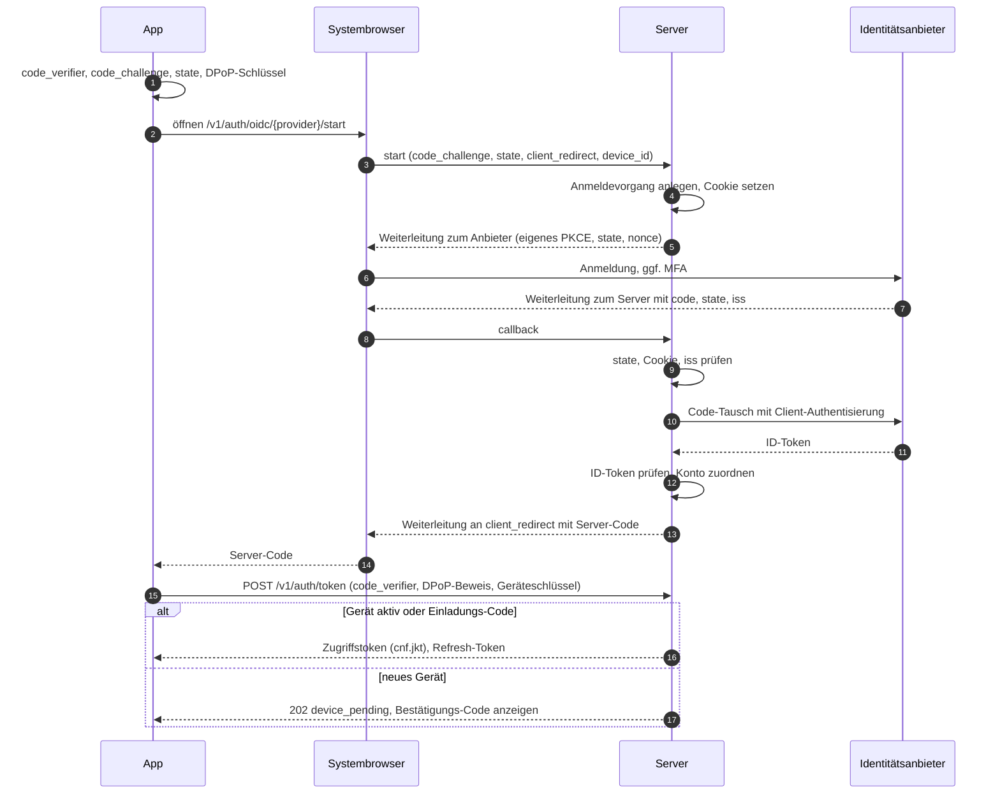
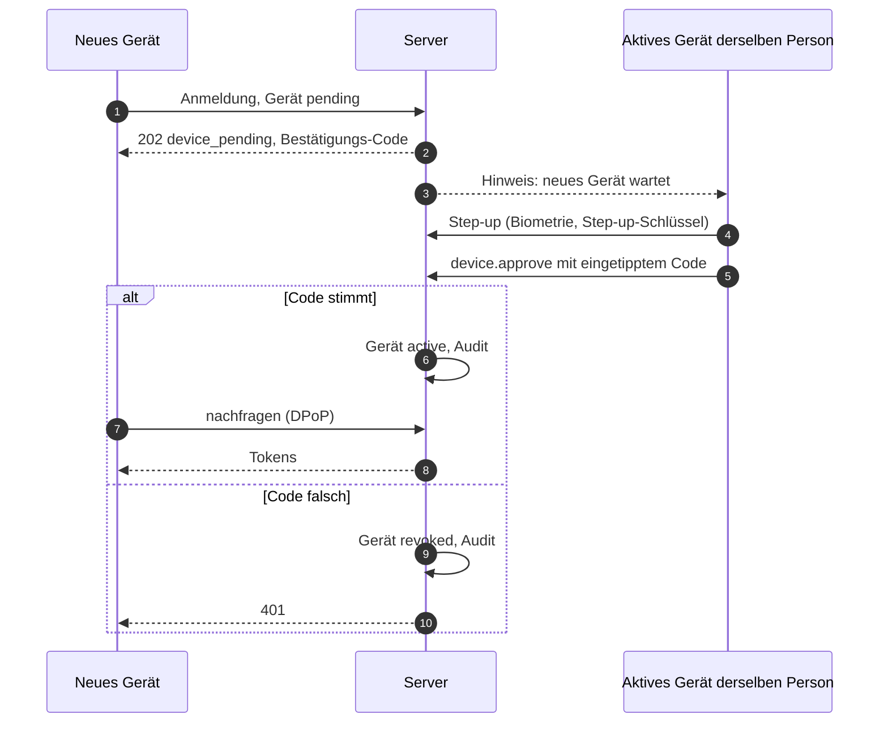
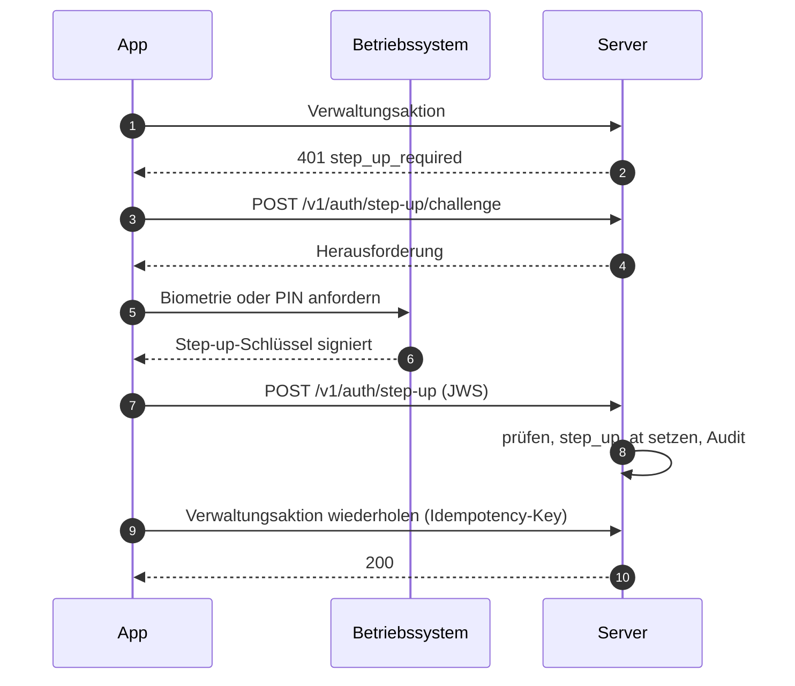

# 08 Identität, Geräte und Sitzungen

Status: Entwurf M0. Normativ für das Modul `identity`, die Anmelde-Endpunkte, die Clients und die
Admin-Konsole.
Begriffe: [00-glossar.md](00-glossar.md). Tabellen: [03-datenmodell.md](03-datenmodell.md),
Abschnitt 4.2. Gateway und DPoP im WebSocket: [04-sync-protokoll.md](04-sync-protokoll.md),
Abschnitt 6.3. Aktionen: [05-aktionen.md](05-aktionen.md), Abschnitte 4.1 und 4.3. Rechte:
[07-rechte.md](07-rechte.md). Entscheidungen: ADR 0019 (Identitätsanbieter), ADR 0020
(Gerätebindung, DPoP, Step-up).

## 1. Ziele

1. Kein Selbst-Registrieren. Jeder Mensch kommt über den Owner in die Instanz (Studie C).
2. Kein Tailscale-Zwang und kein bestimmter Identitätsanbieter im Produkt (Baseline B9).
3. Ein gestohlenes Token allein ist wertlos: Zugriffs- und Refresh-Tokens von Menschen sind an
   einen nicht exportierbaren Geräteschlüssel gebunden (DPoP, RFC 9449).
4. Verwaltung verlangt eine frische Bestätigung durch den Menschen am Gerät (Step-up).
5. Sperren wirkt sofort, auf allen Geräten, in einer festen Reihenfolge.
6. Der Server speichert keine Zugangsdaten Dritter im Klartext und nie Claude.ai-Zugangsdaten
   (Baseline B10, I5).

## 2. Identitätsanbieter

### 2.1 Port

Das Modul `identity` kennt Anbieter nur über einen Port. Jeder Treiber liefert nach erfolgreicher
Prüfung eine `ExternalIdentity`; alles danach (Konto, Gerät, Sitzung, Tokens) ist für alle Treiber
gleich.

```go
// Skizze, kein Produktcode.
type ExternalIdentity struct {
    ProviderID   uuid.UUID
    Issuer       string   // OIDC iss; leer bei trusted_header und local
    Subject      string   // OIDC sub, Header-Login oder lokaler Login-Name
    DisplayName  string   // nur Anzeige
    EmailHint    string   // nur Anzeige, nie für Zuordnung oder Rechte
    Groups       []string // nur bei oidc mit Gruppen-Claim
    AuthTime     time.Time
    AMR          []string // Anmeldemethoden laut Anbieter, falls geliefert
}
```

| Treiber | Code (`identity_providers.kind`) | Einsatz |
|---|---|---|
| OIDC | `oidc` | jeder OpenID-Connect-Anbieter; Microsoft Entra ID ist das Referenzbeispiel |
| Vertrauenswürdiger Proxy-Header | `trusted_header` | Reverse-Proxy, der Identität setzt, z. B. `tailscale serve` |
| Lokales Konto | `local` | Instanzen ohne Identitätsanbieter |

Je Instanz höchstens ein `trusted_header`- und ein `local`-Treiber (03, Unique-Index), beliebig
viele OIDC-Anbieter.

### 2.2 OIDC: Server als Relying Party, App als Client des Servers

Pfade in diesem Kapitel sind Arbeitsnamen; die verbindlichen Pfade legt [06-api.md](06-api.md) fest.

Entscheidung: Die Apps sprechen nie direkt mit dem Identitätsanbieter über Tokens. Der Server ist
vertraulicher OIDC-Client (Relying Party) beim Anbieter und zugleich der Autorisierungsdienst für
seine eigenen Apps. Beide Strecken nutzen Authorization Code mit PKCE (`S256`).

Gründe:

- Keine Anbieter-Tokens auf Geräten; ein Token-Format für alle Treiber.
- Das Client-Secret oder der Client-Schlüssel des Servers liegt nur im Secret-Provider
  (`identity_providers.config` mit `secret_ref`, 03).
- Der Server erzeugt die gerätegebundenen Tokens selbst; Anbieter kennen DPoP meist nicht.
- Beim Anbieter ist nur eine `https`-Rückleitung des Servers eingetragen. Die Rückleitung zur App
  (Loopback, eigenes Schema) liegt in der Hand des Servers.

Ablauf (Diagramm in Abschnitt 14.1):

1. Die App erzeugt `code_verifier`, `code_challenge` (`S256`), `state` und ihren DPoP-Schlüssel und
   öffnet den **Systembrowser** (iOS und macOS: `ASWebAuthenticationSession`; Android: Custom Tabs;
   Windows: Standardbrowser). Eingebettete Web-Views sind verboten (RFC 8252, Abschnitt 8.12;
   https://www.rfc-editor.org/rfc/rfc8252.txt, abgerufen 2026-10-10 [belegt]).
2. `GET /v1/auth/oidc/{provider}/start` mit `code_challenge`, `state`, `client_redirect`,
   `device_id`. Der Server legt einen Anmeldevorgang an (beantragte Tabelle `auth_login_flows`,
   Klasse `transient`, Gültigkeit `auth.login_flow_ttl`) und bindet ihn mit einem kurzlebigen
   `HttpOnly`-Cookie an den Browser. `client_redirect` muss einer festen Liste entsprechen:
   `http://127.0.0.1:<port>/callback` (Desktop, Port beliebig, RFC 8252 Abschnitt 7.3) oder das
   private Schema der App (Mobilgeräte, RFC 8252 Abschnitt 7.1).
3. Der Server leitet zum Anbieter mit eigenem PKCE, eigenem `state`, `nonce`, `response_type=code`,
   `scope=openid profile email`.
4. Rückkehr zu `https://<host>/v1/auth/oidc/callback`. Der Server prüft: `state` gegen Vorgang und
   Cookie; `iss`-Parameter nach RFC 9207, falls der Anbieter ihn sendet, sonst `iss` des ID-Tokens
   gegen den konfigurierten Aussteller (Schutz gegen Mix-up, RFC 9700 Abschnitt 4.4;
   https://www.rfc-editor.org/rfc/rfc9700.html, abgerufen 2026-10-10 [belegt]).
5. Code-Tausch mit Client-Authentisierung (`private_key_jwt` bevorzugt, sonst `client_secret_basic`
   aus dem Secret-Provider). ID-Token prüfen: Signatur über JWKS des Anbieters (Cache
   `auth.oidc_jwks_cache_ttl`, bei unbekannter `kid` einmal neu laden), erlaubte Algorithmen nur
   asymmetrisch (`RS256`, `PS256`, `ES256`, `EdDSA`; nie `none`, nie `HS*`), `iss`, `aud` gleich
   eigener Client-ID, `azp` falls vorhanden, `exp`, `iat` mit `auth.clock_leeway`, `nonce`.
6. Zuordnung zum Konto nach Abschnitt 3. Gelingt sie, erzeugt der Server einen einmaligen
   Server-Code (Gültigkeit `auth.server_code_ttl`), gebunden an `code_challenge`, `device_id` und
   Vorgang, und leitet zu `client_redirect`.
7. Die App tauscht den Server-Code bei `POST /v1/auth/token` (Aktion `auth.login.complete`) mit
   `code_verifier`, DPoP-Beweis und Geräteregistrierung (Abschnitt 5). Der Server prüft PKCE und
   lehnt einen `code_verifier` ohne vorherige `code_challenge` ab (Downgrade-Schutz, RFC 9700
   Abschnitt 4.8.2 [belegt]).

### 2.3 Beispiel Microsoft Entra ID

| Thema | Festlegung | Beleg |
|---|---|---|
| Registrierung | Server als Web-Anwendung (vertraulicher Client), eine Rückleitung `https://<host>/v1/auth/oidc/callback` | Redirect-URIs: `https` Pflicht, `http` nur für localhost; https://learn.microsoft.com/en-us/entra/identity-platform/reply-url, abgerufen 2026-10-10 [belegt] |
| Ablauf | Auth Code mit PKCE; Entra empfiehlt PKCE für alle Client-Typen | https://learn.microsoft.com/en-us/entra/identity-platform/v2-oauth2-auth-code-flow, abgerufen 2026-10-10 [belegt] |
| Aussteller | mandantengebunden `https://login.microsoftonline.com/<tid>/v2.0`; bei `/organizations` Pflicht-Liste erlaubter `tid` in `identity_providers.config` | `tid` immer gegen den Mandanten prüfen; https://learn.microsoft.com/en-us/entra/identity-platform/claims-validation, abgerufen 2026-10-10 [belegt] |
| Subjekt | `sub` (paarweise je Anwendung, unveränderlich) als `user_identities.subject`; `oid` nur als zusätzliche Anzeige | https://learn.microsoft.com/en-us/entra/identity-platform/id-token-claims-reference, abgerufen 2026-10-10 [belegt] |
| E-Mail | `email`, `preferred_username`, `upn` nie für Zuordnung oder Rechte; nur als Anzeige-Hinweis | Microsoft: "Never use claims like email, preferred_username or unique_name ..." (claims-validation) [belegt] |
| Gruppen | optionaler `groups`-Claim; bei mehr als 200 Gruppen im JWT liefert Entra stattdessen einen Überlauf-Verweis | id-token-claims-reference, "Groups overage claim" [belegt] |

Bei Gruppen-Überlauf ruft der Server nicht Microsoft Graph auf (kein zusätzlicher Datenfluss,
keine weitere Berechtigung). Er behandelt den Fall wie "keine Gruppeninformation": Mitgliedschaften
aus Claims laufen nach `auth.group_claim_max_age` ab. Der Betreiber begrenzt den Gruppen-Claim im
Anbieter auf die relevanten Gruppen [abgeleitet].

### 2.4 Vertrauenswürdiger Proxy-Header

Beispiel `tailscale serve`: Es setzt `Tailscale-User-Login` und `Tailscale-User-Name`, entfernt
gleichnamige eingehende Kopfzeilen gegen Fälschung, setzt sie nicht bei Funnel-Verkehr und nicht
bei Verkehr von getaggten Geräten, und empfiehlt, dass der Dienst nur auf localhost lauscht
(https://tailscale.com/kb/1312/serve, abgerufen 2026-10-10 [belegt]).

Regeln:

1. **Nur Loopback.** Ist ein `trusted_header`-Treiber aktiv, startet der Server nur, wenn alle
   HTTP-Listener an Loopback-Adressen gebunden sind (`127.0.0.1`, `::1`). Sonst bricht der Start mit
   einem Fehler ab. Prüfung beim Start und als Test (ID-T08).
2. **Nur aus dem Proxy.** Kopfzeilen werden nur ausgewertet, wenn die Gegenstelle der TCP-Verbindung
   in `net.trusted_proxies` steht ([19-sicherheit.md](19-sicherheit.md)).
3. **Fehlende Identität ist anonym.** Fehlt die Login-Kopfzeile (Funnel, getaggtes Gerät, direkter
   Aufruf), ist die Anfrage nicht angemeldet; `auth.login.begin` endet mit `401`.
4. **Nur zur Anmeldung.** Die Kopfzeile ersetzt den Anmeldevorgang, nicht Gerät und Token: Die App
   registriert Geräteschlüssel und bekommt DPoP-Tokens wie bei OIDC (`POST /v1/auth/header/login`).
5. **Bindung je Anfrage.** Mit `auth.trusted_header_bind_requests = true` muss jede weitere Anfrage
   denselben Header-Login tragen wie die Identität der Sitzung. Abweichung: `401`, Sitzung
   widerrufen, Audit. Grund: Ein gestohlenes Token samt Schlüssel nützt dann nur auf einem Gerät
   desselben Menschen im selben Netz.
6. Kodierte Werte (RFC 2047) werden vor dem Vergleich dekodiert; verglichen wird der Login, nicht
   der Anzeigename.

Alternative ohne Kopfzeilen-Vertrauen: Abfrage der Identität über die lokale Schnittstelle des
Netz-Agenten (bei Tailscale `WhoIs`). Sie ist als späterer Treiber vorgesehen, nicht Teil von M1.

### 2.5 Lokale Konten

Für Instanzen ohne Identitätsanbieter. Anmeldewege eines lokalen Kontos:

| Weg | Wo | Bemerkung |
|---|---|---|
| Passkey (WebAuthn) | Web-Konsole; native Apps nur bei öffentlicher Domain mit Associated Domain | Native Apple-Apps brauchen eine öffentlich erreichbare Associated Domain (Baseline R-Passkeys) |
| Einladungs-Code | erstes Gerät, Wiederherstellung | vom Owner ausgestellt, einmalig, Abschnitt 3.2 |
| Geräte-Kopplung | jedes weitere Gerät | ein aktives Gerät derselben Person bestätigt mit Step-up, Abschnitt 5.3 |
| Passwort mit TOTP | Rückfall | abschaltbar über `auth.local_password_enabled` |

WebAuthn mit go-webauthn (gepinnt, Baseline R-Stack): RP-ID ist die Domain der Instanz, erlaubte
Origins als Liste, `userVerification = required`, `residentKey = preferred`, `attestation = none`.
Ein Rückschritt von `sign_count` wird im Audit gemeldet (03, `passkey_credentials`).

Passwort mit TOTP (beantragte Tabelle `local_credentials`, Abschnitt 17):

- Passwort-Hash Argon2id im PHC-Format. Untergrenze nach OWASP: 19 MiB Speicher, 2 Durchläufe,
  Parallelität 1 (https://cheatsheetseries.owasp.org/cheatsheets/Password_Storage_Cheat_Sheet.html,
  abgerufen 2026-10-10 [belegt]). Standardwerte in Abschnitt 18; ein Test lehnt Werte darunter ab.
- Mindestlänge `auth.password_min_length`; Prüfung gegen eine lokale Liste häufiger Passwörter.
  Keine Zusammensetzungsregeln.
- TOTP nach RFC 6238 mit 30-Sekunden-Schritt, höchstens ein Schritt Toleranz, jede Ziffernfolge nur
  einmal gültig (RFC 6238 Abschnitt 5.2: "MUST NOT accept the second attempt";
  https://www.rfc-editor.org/rfc/rfc6238.html, abgerufen 2026-10-10 [belegt]). Darum speichert der
  Server den zuletzt benutzten Zeitschritt.
- Das TOTP-Geheimnis ist ein Geheimnis, das der Server zum Prüfen braucht. Es liegt verschlüsselt
  (AEAD) in der Datenbank; der Schlüssel liegt nur im Secret-Provider (`secret_ref`).
- Wiederherstellungscodes gibt es nicht. Wiederherstellung läuft über einen neuen Einladungs-Code
  des Owners. Grund: ein zweiter dauerhafter Geheimnis-Satz wäre ein weiterer Angriffsweg.

## 3. Konto, Verknüpfung und Bereitstellung

### 3.1 Zuordnung einer externen Identität

1. Suche `user_identities` nach `(provider_id, subject)` mit `unlinked_at IS NULL` (bei OIDC
   zusätzlich `issuer`). Treffer: Anmeldung für diesen Menschen.
2. Kein Treffer, aber der Vorgang trägt einen gültigen Einladungs-Code: Verknüpfung mit dem Menschen
   des Codes, Code verbraucht, Audit `identity.link`.
3. Kein Treffer, `identity_providers.allow_provisioning = true`: neuer Mensch mit Status `pending`,
   ohne Freigaben, Gerät `pending`. Der Owner aktiviert mit `user.enable` (Step-up).
4. Sonst: Ablehnung mit neutraler Meldung ("Kein Zugang. Bitte wende dich an die Verwaltung."),
   Audit `deny`.

Nie wird über E-Mail-Adressen oder Anzeigenamen zugeordnet. Grund: Diese Werte sind veränderlich
und teils vom Mandanten oder der Person steuerbar (Abschnitt 2.3).

### 3.2 Einladungs-Code

Beantragte Tabelle `enrollment_codes` (Abschnitt 17). Eigenschaften:

- Ausgestellt bei `user.create`, bei der Erstinstallation (Abschnitt 4) oder zur Wiederherstellung
  durch den Owner bzw. per Server-Befehl.
- Zufall mit mindestens 128 Bit, angezeigt einmal, gespeichert nur als HMAC (03, Grundsatz 9).
- Gültig `auth.enrollment_code_ttl`, einmal verwendbar, höchstens `auth.enrollment_code_max_attempts`
  Fehlversuche je Code, danach ungültig.
- Übergabe außerhalb des Produkts (persönlich, Telefon). Kein E-Mail-Versand (Baseline Abschnitt 4).
- Ein Code ist zugleich die Bestätigung des ersten Geräts: Das Gerät, das ihn einlöst, wird `active`.

### 3.3 Weitere Identität verknüpfen und lösen

- `identity.link` (05): Mensch mit Step-up startet einen Anmeldevorgang im Modus "verknüpfen". Das
  Subjekt darf nicht schon verknüpft sein.
- `identity.unlink`: abgelehnt, wenn danach kein Anmeldeweg bleibt (keine Identität, kein Passkey,
  kein aktives Gerät für Geräte-Kopplung).

### 3.4 Gruppen aus Claims

Gruppen mit `source = 'oidc_claim'` werden bei jeder OIDC-Anmeldung abgeglichen: fehlende
Mitgliedschaften entfernt, neue mit `expires_at = Anmeldezeit + auth.group_claim_max_age` angelegt.
Jede Änderung ist eine Rechte-Änderung mit I1-Prüfung (07, Abschnitt 4.4). Verletzt der Abgleich I1,
scheitert die Anmeldung mit Hinweis an den Owner, statt Rechte still zu erweitern.

### 3.5 Verzögerung bei Sperre im Anbieter

Der Server hält keine Refresh-Tokens des Anbieters. Eine im Anbieter gesperrte Person behält ihre
Sitzung darum bis `auth.idp_recheck_interval`; danach verlangt der nächste Refresh eine neue
Anmeldung beim Anbieter. Der Owner sperrt sofort mit `user.disable`. Eine automatische Übernahme
von Sperren (SCIM, Shared Signals) ist als eigene ADR vorgeschlagen.

## 4. Erstinstallation

Bis `instance.setup_completed_at` gesetzt ist, beantwortet der Server nur Health-Checks und
`instance.discovery.read` (mit `setup_required: true`). Alle anderen Anfragen enden mit
`503 setup_required`. Grund: Es gibt kein "der erste Besucher wird Owner".

Der erste Owner entsteht nur per Server-Befehl auf dem Host (Name des Programms folgt
[02-architektur.md](02-architektur.md)):

```text
bothy admin bootstrap-owner --handle alex --display-name "Alex"
```

Der Befehl verbindet sich direkt mit der Datenbank (Rolle für Verwaltung, nicht über HTTP) und
macht in einer Transaktion:

1. Prüfen, dass `setup_completed_at IS NULL`; sonst Abbruch.
2. Prinzipal und Mensch anlegen, Zeile in `owners` mit `granted_by = NULL` und Grund "bootstrap".
3. Signierschlüssel prüfen bzw. anlegen (öffentlicher Teil in `server_signing_keys`, privater Teil
   im Secret-Provider).
4. Einladungs-Code ausstellen und einmal auf die Konsole schreiben.
5. Audit-Eintrag mit `actor_principal_id = NULL` und Systemaktion `instance.bootstrap`
   (Kern-Vertrag: Ergänzung beantragt).
6. `setup_completed_at = now()`.

Der Owner löst den Code in der App ein, mit OIDC (der Code verknüpft die Identität) oder lokal
(Gerät plus Passkey bzw. Passwort mit TOTP).

Wiederherstellung, wenn alle Owner ihre Geräte verloren haben: `bothy admin issue-enrollment-code
--user <handle>` auf dem Host, nur für aktive Owner, mit Audit. Der Zugang zum Host ist die
Vertrauenswurzel der Instanz; das steht so im Betriebshandbuch ([16-betrieb.md](16-betrieb.md)).

## 5. Geräte

### 5.1 Registrierung

Beim Einlösen eines Codes oder Server-Codes sendet die App:

| Feld | Inhalt |
|---|---|
| `device_id` | UUIDv7, vom Client erzeugt (03, `devices.id`) |
| `name`, `platform`, `app_version` | Anzeige |
| `dpop_jwk` | öffentlicher Teil des DPoP-Schlüssels |
| `step_up_jwk` | öffentlicher Teil des Step-up-Schlüssels (nur native Apps) |
| `attestation` | optional, Plattform-Attestierung (nur gespeichert, in M1 nicht verlangt) |

Der Server speichert die Schlüssel in `device_keys` mit Zweck `dpop` bzw. `step_up` (beantragt) und
dem Thumbprint nach RFC 7638 (`jkt`).

### 5.2 Bestätigung

Ein neues Gerät ist `pending`, außer es löst einen Einladungs-Code ein oder wird über die
Geräte-Kopplung bestätigt. Ein wartendes Gerät hat keinen Zugriff: Es bekommt kein Zugriffstoken,
nur die Antwort `202 device_pending` und fragt mit DPoP-signierten Anfragen nach, bis es bestätigt
oder abgelehnt ist. Nach `auth.device_pending_ttl` ohne Bestätigung wird es `revoked`.

Bestätigen dürfen (`device.approve`, Step-up):

- die Person selbst von einem ihrer aktiven Geräte,
- ein Owner.

Bestätigungs-Code: Das wartende Gerät zeigt einen Code mit `auth.device_verification_code_digits`
Ziffern, abgeleitet aus seinem `jkt` und der Anfrage. Die bestätigende Person tippt ihn ein. Ein
falscher Code lehnt das wartende Gerät ab. Grund: Ein blindes "Erlauben" bestätigt sonst auch das
Gerät eines Angreifers, der zur selben Zeit eine Anmeldung ausgelöst hat.

### 5.3 Geräte-Kopplung

Für lokale Konten ohne Passkey und als Komfort für alle: Das neue Gerät fordert ohne Anmeldung eine
Kopplung an und zeigt einen Kopplungs-Code (Gültigkeit `auth.pairing_code_ttl`). Auf einem aktiven
Gerät wählt die Person "Gerät hinzufügen", gibt den Code ein und bestätigt mit Step-up. Das neue
Gerät wird `active` und bekommt beim nächsten Nachfragen seine Tokens. Rate-Limit je Code und je IP
(Abschnitt 13).

### 5.4 Verwaltung

- Liste der Geräte mit Plattform, Name, letzter Aktivität, Sitzungen (`device.list`).
- Ungenutzte Geräte werden nach `auth.device_inactive_revoke_after` ohne Kontakt automatisch
  widerrufen (Grund `inactive`).
- Schlüsselwechsel: neues Schlüsselpaar, Bestätigung mit dem alten Step-up-Schlüssel, alter
  Schlüssel `revoked_at`.

## 6. Geräteschlüssel und Step-up

Baseline R-Passkeys: Gerätebindung und Step-up über einen Geräteschlüssel im sicheren Speicher mit
Nutzerbestätigung; WebAuthn-Passkeys für die Web-Konsole und für Instanzen mit öffentlicher Domain.

### 6.1 Zwei Schlüssel je nativem Gerät

| Schlüssel | Zweck | Nutzerbestätigung je Nutzung | Grund |
|---|---|---|---|
| `dpop` | signiert jeden DPoP-Beweis | nein | jede Anfrage braucht ihn; Biometrie je Anfrage ist unmöglich |
| `step_up` | signiert Step-up-Bestätigungen | ja (Biometrie oder Geräte-PIN) | Bestätigung muss vom Menschen kommen, nicht von Schadcode im Prozess |

Beide Schlüssel sind nicht exportierbar und, wo die Plattform es bietet, hardwaregestützt:

| Plattform | Speicher | Algorithmus | Hinweis |
|---|---|---|---|
| iOS, iPadOS, macOS | Secure Enclave | `ES256` | Step-up-Schlüssel mit Bindung an die aktuell eingerichtete Biometrie, damit neu hinzugefügte Fingerabdrücke ihn ungültig machen |
| Android | Android Keystore, StrongBox falls vorhanden | `ES256` | Step-up-Schlüssel mit verpflichtender Nutzer-Authentisierung |
| Windows | TPM über den Platform Crypto Provider, Bestätigung über Windows Hello | `ES256` angestrebt | offen: ob Windows Hello den Step-up-Schlüssel als `ES256` liefert; sonst ist `RS256` oder `PS256` in `device_keys.alg` nötig (Abschnitt 17) |
| Web-Konsole | kein Geräteschlüssel | | Sitzung per Cookie (Abschnitt 7.5), Step-up per Passkey |

Ob ein Schlüssel wirklich hardwaregestützt ist, kann der Server ohne Attestierung nicht prüfen.
Die Attestierung wird gespeichert; eine Pflicht (`auth.require_key_attestation`) ist für eine spätere
Etappe vorgesehen.

### 6.2 Step-up-Ablauf

1. Die App fordert eine Herausforderung an (`POST /v1/auth/step-up/challenge`); Antwort: Zufallswert,
   Gültigkeit `auth.step_up_challenge_ttl`, Anzeigetext ("Verwaltung bestätigen").
2. Das Betriebssystem fragt Biometrie oder PIN ab; der Step-up-Schlüssel signiert eine JWS über
   `{challenge, sid, iat}`.
3. `POST /v1/auth/step-up` (Aktion `auth.step_up`). Der Server prüft Signatur gegen den aktiven
   `step_up`-Schlüssel des Geräts der Sitzung, Herausforderung (einmalig), Zeit.
4. `auth_sessions.step_up_at = now()`, Audit. Gültig für `auth.step_up_max_age` (03).

Web-Konsole: WebAuthn-Assertion mit `userVerification = required` gegen die Passkeys der Person.
Ohne Passkey: erneute OIDC-Anmeldung mit `prompt=login` und `max_age=0`; der Server verlangt ein
`auth_time` nach Beginn der Herausforderung. Lokale Konten ohne Passkey: Passwort mit TOTP.

Step-up können nur Menschen in einer Sitzung erbringen (07, SR5). Die Bestätigung gilt nur für die
Sitzung, in der sie erbracht wurde, also für ein Gerät.

## 7. Token-Modell

### 7.1 Übersicht

| Token | Form | Gebunden an | Lebensdauer | Speicher Server |
|---|---|---|---|---|
| Zugriffstoken (Mensch) | JWS, `EdDSA`, Schlüssel-Zweck `access_token` | DPoP-Schlüssel (`cnf.jkt`), Sitzung (`sid`) | `auth.access_token_ttl` | nichts (Widerruf über `sid`) |
| Refresh-Token (Mensch) | 256 Bit Zufall | Familie, DPoP-Schlüssel der Familie | `auth.refresh_token_ttl` (03), höchstens bis `auth_sessions.expires_at` | HMAC-SHA-256 |
| Konsole-Sitzung | Cookie, 256 Bit Zufall | Browser | `auth.console_session_max_age`, Leerlauf `auth.console_session_idle_timeout` | HMAC-SHA-256 |
| API-Token (Agent, App, persönlich) | Präfix plus 256 Bit Zufall plus Prüfsumme | optional DPoP (`api_tokens.dpop_jkt`) | `expires_at`, höchstens `auth.api_token_max_ttl` | HMAC-SHA-256 |
| Aufruf-Marke | JWS, Zweck `invocation` | Lauf, Agent (`aud`) | `agent.invocation_token_ttl` (04) | `runs.invocation_jti` |

### 7.2 Zugriffstoken

Claims: `iss` (`instance_id`, 03), `aud` (API der Instanz), `sub`, `sid`, `did` (Gerät), `jti`,
`iat`, `nbf`, `exp`, `cnf.jkt`, `amr` (Anmeldeweg). Keine Rechte im Token; Rechte berechnet `authz`
bei jeder Anfrage (07). Grund: Ein Token mit Rechten wäre bis zum Ablauf veraltet.

Prüfung je Anfrage: Signatur mit `kid` aus den Schlüsseln im Zustand `active` oder `retiring`,
`iss`, `aud`, `exp` und `nbf` mit `auth.clock_leeway`, dann DPoP (7.3), dann Sitzung und Gerät über
`authz` (07, Abschnitt 4.2, Schritt 1).

### 7.3 DPoP

Nach RFC 9449 (https://www.rfc-editor.org/rfc/rfc9449.html, abgerufen 2026-10-10 [belegt]):

- Kopf `typ = dpop+jwt`, `alg` asymmetrisch (`ES256`, `EdDSA`), `jwk` ohne privaten Teil.
- Nutzlast `jti`, `htm`, `htu` (ohne Query und Fragment), `iat`, `ath` (SHA-256 des Tokens), `nonce`.
- Der Server gibt Nonces über die Kopfzeile `DPoP-Nonce` aus und erneuert sie nach
  `auth.dpop_nonce_ttl` (04). Akzeptiert werden der aktuelle und der vorige Nonce. Einmal mit
  Nonces gestartet, lehnt der Server Beweise ohne `nonce` ab (RFC 9449, Abschnitt 11.3).
- `iat` höchstens `auth.dpop_proof_max_age` alt und höchstens `auth.clock_leeway` in der Zukunft.
- `jti` je `htu` innerhalb dieses Fensters nur einmal; gespeichert wird ein Hash (RFC 9449,
  Abschnitt 11.1). Der Speicher ist je Prozess; über Prozesse hinweg schützt der Nonce.
- Ein DPoP-gebundenes Token als `Bearer` wird abgelehnt (RFC 9449, Abschnitt 7.2).
- Fehler: `401` mit `WWW-Authenticate: DPoP error="invalid_dpop_proof"` bzw.
  `error="use_dpop_nonce"` und neuem Nonce.
- Im WebSocket steckt der Beweis in `identify`, `resume` und `reauth` mit dem Nonce aus `hello`
  (04, Abschnitt 6.3, R-SY-01).

### 7.4 Refresh-Tokens: Rotation, Familien, Wiederverwendung

- Jede Sitzung hat genau eine aktive Familie (03). Die Familie speichert den `jkt` des
  DPoP-Schlüssels (beantragt: `refresh_token_families.dpop_jkt`); jede Erneuerung verlangt einen
  DPoP-Beweis mit genau diesem Schlüssel (RFC 9449, Abschnitt 5: Refresh-Tokens öffentlicher Clients
  sind an den Schlüssel gebunden [belegt]).
- Rotation und Wiederverwendungs-Erkennung wie in 03, `refresh_tokens`: Ein schon benutztes oder
  älteres Token widerruft Familie und Sitzung (`refresh_reuse`), schließt Verbindungen mit `4012`,
  schreibt Audit und `session.revoked`. RFC 9700 verlangt für öffentliche Clients Sender-Bindung oder
  Rotation (Abschnitt 2.2.2 [belegt]); das Produkt macht beides.
- **Erweiterungs-Sitzungen.** Prozesse einer App, die getrennt laufen und selbst erneuern müssen
  (iOS- und macOS-Notification-Service-Extension, Share-Extension), bekommen je eine eigene
  Kind-Sitzung mit eigener Familie auf demselben Gerät (beantragt: `auth_sessions.client_component`,
  `auth_sessions.parent_session_id`). Grund: Zwei Prozesse mit einer Familie erneuern gleichzeitig,
  und die zweite Erneuerung sähe wie Diebstahl aus. Widerruf der Eltern-Sitzung widerruft alle
  Kinder.

### 7.5 Web-Konsole: Sitzung nach dem Backend-for-Frontend-Muster

Die Konsole läuft auf demselben Origin wie die API. Der Server ist ihr Backend; Tokens erreichen nie
JavaScript. RFC 10017 (OAuth 2.0 for Browser-Based Applications, BCP 212) nennt dieses Muster das
sicherste und empfiehlt es für Anwendungen mit personenbezogenen Daten
(https://datatracker.ietf.org/doc/rfc10017/, abgerufen 2026-10-10 [belegt]).

- Cookie mit Präfix `__Host-`, Attribute `Secure`, `HttpOnly`, `SameSite=Strict`, `Path=/`, ohne
  `Domain` (RFC 10017, Abschnitt 6.1.3.2 [belegt]). Wert: 256 Bit Zufall; gespeichert als HMAC an
  der Sitzung (beantragt: `auth_sessions.cookie_hash`). Neuer Wert bei Anmeldung und nach Step-up
  (gegen Session Fixation).
- CSRF: Jede ändernde Anfrage der Konsole trägt eine feste eigene Kopfzeile (Name in
  [06-api.md](06-api.md)); ohne CORS-Freigabe kann eine fremde Seite sie nicht setzen. Zusätzlich
  muss `Origin` gleich dem Origin der Konsole sein, auch beim WebSocket-Upgrade.
- Die Konsole ist ein Gerät mit `platform = 'web'` und `client_component = 'console'`. Statt einer
  Gerätebestätigung verlangt sie direkt nach der Anmeldung einen Step-up (Passkey, sonst erneute
  OIDC-Anmeldung bzw. Passwort mit TOTP); vorher zeigt sie nur das eigene Profil. Grund: Owner lesen
  über die Konsole alle Inhalte außer DMs; das darf nicht allein an einem Passwort oder einer
  bestehenden Sitzung beim Identitätsanbieter hängen. Browser können Passkeys auch für Domains
  ohne öffentliche Erreichbarkeit benutzen; die Grenze aus Baseline R-Passkeys betrifft nur native
  Apple-Apps [abgeleitet].

## 8. Sitzungsdauer

| Was | Regel | Wert |
|---|---|---|
| App-Sitzung absolut | danach neue Anmeldung | `auth.session_max_age` (03) |
| Refresh-Token | gleitend, je Erneuerung neu | `auth.refresh_token_ttl` (03) |
| Zugriffstoken | kurz, Erneuerung im Hintergrund | `auth.access_token_ttl` |
| Neue Anmeldung beim Anbieter | erzwingt Prüfung, ob die Person beim Anbieter noch aktiv ist | `auth.idp_recheck_interval` |
| Step-up | Fenster nach Bestätigung | `auth.step_up_max_age` (03) |
| Konsole absolut und Leerlauf | | `auth.console_session_max_age`, `auth.console_session_idle_timeout` |
| Gerät ohne Kontakt | automatischer Widerruf | `auth.device_inactive_revoke_after` |

## 9. App-Sperre

- Die App fragt nach `client.app_lock_after` ohne Benutzung und beim Start Biometrie oder Geräte-PIN
  ab (iOS/macOS LocalAuthentication, Android BiometricPrompt, Windows Hello).
- Die lokale Datenbank ist mit einem Schlüssel aus dem sicheren Speicher verschlüsselt. Tokens und
  Schlüssel sind nur auf diesem Gerät gespeichert (keine Synchronisation in Cloud-Schlüsselbunde,
  nicht in Sicherungen).
- Der Owner kann die Sperre instanzweit verlangen (`security.app_lock_required`). Der Server kann
  sie nicht prüfen; sie ist Schutz gegen Neugier am entsperrten Gerät, keine Server-Kontrolle.
  Was der Server prüft, ist Step-up.
- Details der Schutzklassen und des Caches: [15-client-architektur.md](15-client-architektur.md).

## 10. Verlorenes Gerät

1. Die Person sperrt das Gerät von einem anderen Gerät oder der Konsole (`device.revoke`, Step-up),
   oder der Owner tut es.
2. In einer Transaktion: Gerät `revoked`, Schlüssel `revoked_at`, alle Sitzungen des Geräts
   `device_revoked`, ihre Familien widerrufen, Push-Registrierungen `disabled_reason =
   'device_revoked'`, Rechte-Version erhöhen, Audit.
3. Offene Verbindungen schließen mit `4012`; die App löscht beim nächsten Kontakt alle lokalen Daten
   (04, Abschnitt 8.5, R-SY-14).
4. Ein inhaltsloser Push mit Typ `revoked` weckt die App, damit sie früher löscht. Zustellung ist
   nicht garantiert ([13-push-benachrichtigungen.md](13-push-benachrichtigungen.md)).
5. Restrisiko: Ein Gerät, das nie wieder Kontakt hat, behält den lokalen Cache. Schutz dann nur
   durch Gerätesperre, Datenträger-Verschlüsselung des Betriebssystems und App-Sperre.

## 11. Person sperren

`user.disable` (Owner, Step-up) macht in **einer** Transaktion, in dieser Reihenfolge:

1. Prüfen: Die Person ist nicht der letzte aktive Owner (07, SR8).
2. `principals.status = 'disabled'`, `disabled_at`. Ab dem Commit ergibt jede Anfrage
   `unauthenticated` (07, SR7).
3. Alle Sitzungen `revoked_at`, Grund `user_disabled`; alle Familien widerrufen.
4. Alle Geräte `revoked` (Studie C: "Geräteschlüssel ungültig"). Grund: Ein Gerät einer
   ausgeschiedenen Person bleibt nicht vertrauenswürdig, auch wenn die Person später wieder
   aktiviert wird.
5. Persönliche API-Tokens widerrufen; Push-Registrierungen deaktivieren.
6. Rechte-Version erhöhen; I1 prüfen; `access.changed`, `session.revoked`.
7. Für alle aktiven Läufe, die die Person ausgelöst hat: `run.cancel_requested` mit Grund
   `user_disabled`. Für Dev-Umgebungen der Person: Zustand `suspended`
   ([21-dev-isolation.md](21-dev-isolation.md)).
8. Audit-Eintrag.

Nach dem Commit: Gateway schließt Verbindungen mit `4012`; Agenten brechen ab. Freigaben und
Gruppenmitgliedschaften bleiben stehen, wirken aber nicht; die Konsole bietet "alle Freigaben
widerrufen" als eigenen, bewussten Schritt. Inhalte bleiben.

Die Konsole zeigt danach eine Liste der Schritte außerhalb des Produkts: Konto beim
Identitätsanbieter sperren, Zugang zum Netz entziehen, API-Schlüssel externer Systeme tauschen, die
die Person kannte, Geheimnisse in ihrer Dev-Umgebung rotieren.

## 12. API-Tokens für Agenten, Apps und Werkzeuge

- **Form.** `<präfix>_<art>_<zufall>_<prüfsumme>`: Präfix `bothy` (eine der gelisteten Stellen mit
  dem Arbeitsnamen, ADR 0044), Art `agt` (Agent), `app` (App), `pat` (persönlich), `whi`
  (Eingangs-Webhook), 256 Bit Zufall in Base62, Prüfsumme über den Zufallsteil. Grund: Das Präfix
  erlaubt eine Regel im Secret-Scanner ([23-qualitaet.md](23-qualitaet.md)); die Prüfsumme weist
  Tippfehler und Zufallsfunde ohne Datenbankzugriff ab.
- **Speicher.** Nur HMAC-SHA-256 mit Server-Pepper und die ersten Zeichen als `token_prefix` (03).
  Anzeige genau einmal bei `token.create`.
- **Scopes.** Teilmenge der Manifest-Scopes bzw. Agenten-Scopes (03); Rechte zusätzlich aus
  Freigaben (07).
- **Bindung.** Agenten-Tokens sind DPoP-gebunden, wenn `agent` in `auth.dpop_required_for` steht
  (Standard). Der Adapter erzeugt dafür bei der Einrichtung ein Schlüsselpaar.
- **Ablauf.** Pflicht, höchstens `auth.api_token_max_ttl`, persönliche Tokens höchstens
  `auth.personal_token_max_ttl`. Die Konsole listet bald ablaufende Tokens.
- **Rotation.** Neues Token anlegen, Adapter umstellen, an `last_used_at` sehen, dass das alte
  ruht, altes widerrufen. Es gibt keine Gnadenfrist im Server; die Überlappung entsteht durch zwei
  gleichzeitig gültige Tokens.
- **Grenzen.** API-Tokens können kein Step-up erbringen (07, SR5). Ein persönliches Token eines
  Owners hat keine Owner-Rechte (07, SR5).
- **Eingangs-Webhooks.** Das Token steht in der URL; die URL wird in Logs nur als Muster geführt
  ([19-sicherheit.md](19-sicherheit.md), Abschnitt 9).

## 13. Schutz der Anmeldung

| Schutz | Schlüssel | Grenze |
|---|---|---|
| Anfragen an öffentliche Endpunkte | Client-IP | `ratelimit.rl.public_auth.*` (05) |
| Fehlversuche je Konto (Passwort, TOTP) | lokaler Login-Name | `auth.login_fail_limit` je `auth.login_fail_window`, danach Sperre des Passwortwegs für `auth.login_lock_duration` |
| Fehlversuche je Einladungs-Code | Code | `auth.enrollment_code_max_attempts`, danach ungültig |
| Kopplungs- und Bestätigungs-Codes | Code und IP | ein Fehlversuch macht die Anfrage ungültig |
| Step-up | Sitzung | `auth.step_up_fail_limit` je `auth.login_fail_window`, danach Sitzung widerrufen |

Regeln:

- Die Client-IP stammt nur aus Kopfzeilen eines Proxys in `net.trusted_proxies`; sonst ist es die
  Gegenstelle der Verbindung. Grund: Gefälschte `X-Forwarded-For` würden IP-Grenzen umgehen.
- Eine Kontosperre betrifft nur den Passwortweg. Passkey, Geräte-Kopplung und OIDC bleiben offen,
  damit ein Angreifer niemanden aussperren kann.
- Keine Auskunft über Konten: Unbekannter Login-Name und falsches Passwort ergeben dieselbe Antwort
  in derselben Zeit (der Server berechnet auch bei unbekanntem Namen einen Argon2id-Hash).
- Jede Sperre und jede Häufung erzeugt einen Audit-Eintrag; der Owner sieht sie in der Konsole.

## 14. Abläufe

### 14.1 Anmeldung mit OIDC (native App)



### 14.2 Bestätigung eines neuen Geräts



### 14.3 Step-up



## 15. Tests

| ID | Test | Erwartet |
|---|---|---|
| ID-T01 | Token-Tausch ohne `code_challenge`, aber mit `code_verifier` | abgelehnt |
| ID-T02 | Callback mit falschem `state`, ohne Cookie, mit fremdem `iss` | abgelehnt, Audit |
| ID-T03 | ID-Token mit `alg=none`, `HS256`, falschem `aud`, falschem `nonce`, abgelaufen | abgelehnt |
| ID-T04 | Anmeldung mit unbekanntem `sub`, aber bekannter E-Mail | keine Zuordnung, neutrale Ablehnung |
| ID-T05 | Entra-Token aus nicht erlaubtem `tid` | abgelehnt |
| ID-T06 | Anfrage vor Erstinstallation | `503 setup_required` |
| ID-T07 | `bootstrap-owner` ein zweites Mal | Abbruch, nichts geändert |
| ID-T08 | `trusted_header` aktiv und Listener auf Nicht-Loopback | Server startet nicht |
| ID-T09 | Header-Anmeldung ohne Login-Kopfzeile (getaggtes Gerät simuliert) | `401` |
| ID-T10 | Header-Login einer späteren Anfrage weicht ab (Bindung an) | `401`, Sitzung widerrufen |
| ID-T11 | Einladungs-Code zweimal, abgelaufen, nach zu vielen Fehlversuchen | abgelehnt |
| ID-T12 | wartendes Gerät ruft eine Route auf | kein Zugriffstoken, kein Zugriff |
| ID-T13 | Bestätigung mit falschem Code | Gerät `revoked` |
| ID-T14 | DPoP: falsches `htm`, `htu`, `ath`, alter `iat`, wiederholte `jti`, fehlender oder alter Nonce, Bearer statt DPoP | `401` mit passendem Fehler |
| ID-T15 | Refresh mit schon benutztem Token | Familie und Sitzung widerrufen, `4012`, Audit |
| ID-T16 | gleichzeitige Erneuerung von App und Notification-Extension | keine Wiederverwendungs-Erkennung (getrennte Familien) |
| ID-T17 | Refresh mit anderem DPoP-Schlüssel als die Familie | abgelehnt |
| ID-T18 | Step-up fehlt, zu alt, mit Agenten-Token, mit falschem Schlüssel | `401` bzw. `403` wie in 07 |
| ID-T19 | Konsole: Cookie-Attribute, fehlende CSRF-Kopfzeile, fremder `Origin`, WebSocket mit fremdem `Origin`, Zugriff nach Anmeldung ohne Step-up | Attribute gesetzt; Anfragen abgelehnt; ohne Step-up nur eigenes Profil |
| ID-T20 | TOTP: gleicher Code zweimal im selben Schritt | zweiter abgelehnt |
| ID-T21 | Antwortzeit unbekannter Login-Name gegen falsches Passwort | kein messbarer Unterschied innerhalb `authz.not_found_timing_tolerance` |
| ID-T22 | `user.disable`: alle Schritte aus Abschnitt 11 | jeder Schritt im Zustand nachweisbar, letzter Owner abgelehnt |
| ID-T23 | API-Token: nur Hash gespeichert, einmal angezeigt, Prüfsumme falsch, abgelaufen, DPoP-pflichtiges Agenten-Token ohne Beweis | wie beschrieben abgelehnt |
| ID-T24 | Argon2id-Parameter unter der OWASP-Untergrenze in der Konfiguration | Start abgebrochen |
| ID-T25 | gefälschtes `X-Forwarded-For` von einer nicht vertrauten Gegenstelle | Rate-Limit zählt die echte Gegenstelle |
| ID-T26 | `device.revoke`: alle Schritte aus Abschnitt 10 | Schlüssel, Sitzungen, Familien, Push-Registrierungen widerrufen, Verbindungen mit `4012` geschlossen, Audit |
| ID-T27 | Zufallsteile von Refresh-Token, Konsole-Cookie und API-Token je 256 Bit, Einladungs-Code mindestens 128 Bit, alle aus dem kryptografischen Zufallsgenerator; TOTP mit 30-Sekunden-Schritt und höchstens einem Schritt Toleranz | Längen und Quelle wie angegeben |

## 16. Entscheidungen dieses Kapitels

| Nr | Entscheidung | Grund |
|---|---|---|
| R-ID-01 | Server ist OIDC-Relying-Party und Autorisierungsdienst der Apps; PKCE auf beiden Strecken. | Keine Anbieter-Tokens auf Geräten, ein Token-Format, DPoP unabhängig vom Anbieter. |
| R-ID-02 | Zuordnung nur über `(issuer, subject)` oder Einladungs-Code, nie über E-Mail. | Microsoft und OIDC: E-Mail ist veränderlich und nicht eindeutig. |
| R-ID-03 | Proxy-Header nur bei reiner Loopback-Bindung, nur zur Anmeldung, optional je Anfrage gebunden. | Tailscale-Empfehlung; Kopfzeilen sind sonst fälschbar. |
| R-ID-04 | Zwei Schlüssel je nativem Gerät (DPoP, Step-up). | DPoP braucht Nutzung ohne Biometrie, Step-up braucht Biometrie. |
| R-ID-05 | Erweiterungs-Sitzungen mit eigener Refresh-Familie. | Keine falsche Diebstahl-Erkennung bei gleichzeitiger Erneuerung. |
| R-ID-06 | Konsole nach BFF-Muster mit Cookie; keine Tokens im Browser. | RFC 10017 empfiehlt BFF für Anwendungen mit personenbezogenen Daten. |
| R-ID-07 | Kein "erster Besucher wird Owner"; erster Owner nur per Server-Befehl. | Zugang zum Host ist die Vertrauenswurzel. |
| R-ID-08 | Bestätigungs-Code beim Freigeben neuer Geräte wird eingetippt. | Verhindert das blinde Bestätigen eines fremden Geräts. |
| R-ID-09 | Keine Wiederherstellungscodes; Wiederherstellung über neuen Einladungs-Code. | Ein Geheimnis-Satz weniger; der Owner bleibt im Ablauf. |
| R-ID-10 | Kontosperre nur für den Passwortweg. | Angreifer können niemanden aussperren. |

## 17. Ergänzungen am Kern-Vertrag (beantragt)

| Nr | Ergänzung |
|---|---|
| K-ID-1 | Tabelle `local_credentials`: `identity_id` (PK, FK `user_identities`), `password_hash text` (PHC), `password_changed_at`, `totp_secret_ciphertext bytea`, `totp_key_ref text`, `totp_last_step bigint`, `totp_enabled_at`, `failed_count integer`, `locked_until timestamptz`. Klasse `security`. |
| K-ID-2 | Tabelle `enrollment_codes`: `id`, `user_id`, `purpose CHECK IN ('first_login','identity_link','recovery')`, `code_hash bytea`, `expires_at`, `attempts`, `created_by` (NULL bei Server-Befehl), `created_at`, `used_at`, `used_by_device_id`. Klasse `security`. |
| K-ID-3 | Tabelle `auth_login_flows` (Klasse `transient`): Zustand eines Anmeldevorgangs (Anbieter, `state`, `nonce`, PKCE des Servers, `code_challenge` der App, `client_redirect`, `device_id`, Modus `login`/`link`, `expires_at`, Server-Code-Hash). |
| K-ID-4 | `device_keys.purpose CHECK IN ('dpop','step_up')`; Unique-Teilindex `(device_id, purpose) WHERE revoked_at IS NULL` statt `(device_id)`; `alg` ggf. um `RS256`/`PS256` erweitern (Windows, offen). |
| K-ID-5 | `auth_sessions.client_component CHECK IN ('app','notification_ext','share_ext','console')`, `auth_sessions.parent_session_id`, `auth_sessions.cookie_hash`; `auth_method` um `password_totp`, `enrollment_code`, `device_pairing` erweitern; `revoke_reason` um `inactive` erweitern. |
| K-ID-6 | `refresh_token_families.dpop_jkt text NOT NULL`. |
| K-ID-7 | Systemaktion `instance.bootstrap`; `user.enable` deckt auch `pending -> active` ab. |
| K-ID-8 | `auth.dpop_nonce_ttl` von 04, Abschnitt 18 in dieses Kapitel verschieben (04 sieht das vor). |

## 18. Konfigurationswerte dieses Kapitels

| Name | Standard | Bedeutung |
|---|---|---|
| `auth.access_token_ttl` | `10m` | Lebensdauer eines Zugriffstokens |
| `auth.clock_leeway` | `30s` | erlaubte Uhrabweichung bei `exp`, `nbf`, `iat` |
| `auth.dpop_proof_max_age` | `60s` | Höchstalter eines DPoP-Beweises (`iat`) |
| `auth.login_flow_ttl` | `10m` | Gültigkeit eines Anmeldevorgangs |
| `auth.server_code_ttl` | `60s` | Gültigkeit des einmaligen Server-Codes |
| `auth.oidc_jwks_cache_ttl` | `1h` | Cache der Anbieter-Schlüssel |
| `auth.group_claim_max_age` | `30d` | Ablauf von Mitgliedschaften aus Gruppen-Claims nach der letzten Anmeldung |
| `auth.idp_recheck_interval` | `30d` | spätestens dann neue Anmeldung beim Anbieter |
| `auth.trusted_header_bind_requests` | `true` | jede Anfrage muss denselben Header-Login tragen |
| `auth.enrollment_code_ttl` | `72h` | Gültigkeit eines Einladungs-Codes |
| `auth.enrollment_code_max_attempts` | `5` | Fehlversuche je Einladungs-Code |
| `auth.device_pending_ttl` | `24h` | danach wird ein wartendes Gerät widerrufen |
| `auth.device_verification_code_digits` | `6` | Länge des Bestätigungs-Codes |
| `auth.pairing_code_ttl` | `5m` | Gültigkeit eines Kopplungs-Codes |
| `auth.device_inactive_revoke_after` | `180d` | Gerät ohne Kontakt wird widerrufen |
| `auth.step_up_challenge_ttl` | `2m` | Gültigkeit einer Step-up-Herausforderung |
| `auth.step_up_fail_limit` | `5` | Fehlversuche beim Step-up je Fenster |
| `auth.require_key_attestation` | `false` | Plattform-Attestierung der Geräteschlüssel verlangen |
| `auth.console_session_max_age` | `12h` | absolute Dauer einer Konsolen-Sitzung |
| `auth.console_session_idle_timeout` | `30m` | Leerlauf bis zum Ende der Konsolen-Sitzung |
| `auth.local_password_enabled` | `true` | Passwort mit TOTP als Rückfall für lokale Konten |
| `auth.password_min_length` | `12` | Mindestlänge eines Passworts |
| `auth.argon2id_memory_kib` | `65536` | Argon2id-Speicher (Untergrenze 19456) |
| `auth.argon2id_iterations` | `3` | Argon2id-Durchläufe (Untergrenze 2) |
| `auth.argon2id_parallelism` | `1` | Argon2id-Parallelität |
| `auth.login_fail_limit` | `10` | Fehlversuche je Konto und Fenster |
| `auth.login_fail_window` | `15m` | Fenster für Fehlversuche |
| `auth.login_lock_duration` | `15m` | Sperre des Passwortwegs |
| `auth.dpop_required_for` | `["agent"]` | Token-Arten, die DPoP-gebunden sein müssen |
| `auth.api_token_max_ttl` | `365d` | Höchstdauer eines Agenten- oder App-Tokens |
| `auth.personal_token_max_ttl` | `90d` | Höchstdauer eines persönlichen Tokens |
| `client.app_lock_after` | `5m` | ohne Benutzung bis zur App-Sperre |
| `security.app_lock_required` | `false` | App-Sperre instanzweit verlangen |
