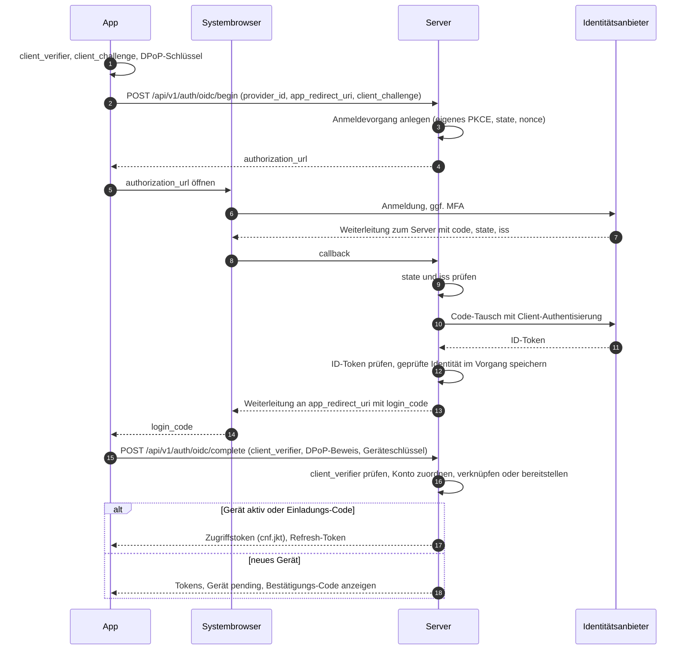
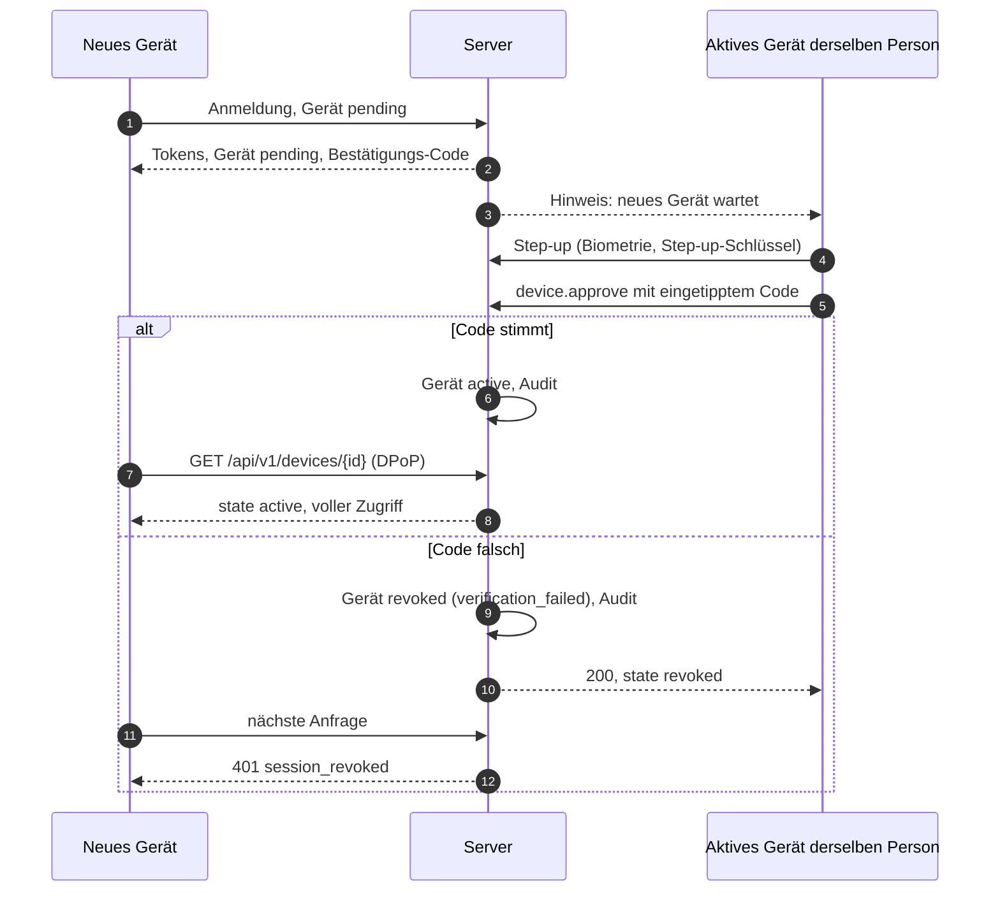
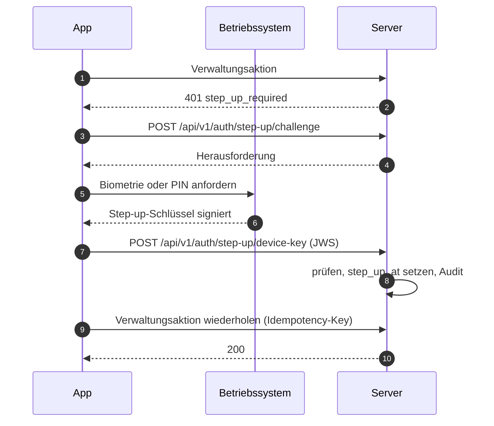

# 08 Identität, Geräte und Sitzungen

Status: Entwurf M0. Normativ für das Modul `identity`, die Anmelde-Endpunkte, die Clients und die
Admin-Konsole.
Begriffe: [00-glossar.md](00-glossar.md). Tabellen: [03-datenmodell.md](03-datenmodell.md),
Abschnitt 4.2. Gateway und DPoP im WebSocket: [04-sync-protokoll.md](04-sync-protokoll.md),
Abschnitt 6.3. Aktionen: [05-aktionen.md](05-aktionen.md), Abschnitte 4.1 und 4.3. Rechte:
[07-rechte.md](07-rechte.md). Entscheidungen: ADR 0019 (Identitätsanbieter), ADR 0020
(Gerätebindung, DPoP, Step-up).

## 1. Ziele

1. Kein Selbst-Registrieren. Jeder Mensch kommt über den Owner in die Instanz (Studie C).
2. Kein Tailscale-Zwang und kein bestimmter Identitätsanbieter im Produkt (Baseline B9).
3. Ein gestohlenes Token allein ist wertlos: Zugriffs- und Refresh-Tokens von Menschen sind an
   einen nicht exportierbaren Geräteschlüssel gebunden (DPoP, RFC 9449).
4. Verwaltung verlangt eine frische Bestätigung durch den Menschen am Gerät (Step-up).
5. Sperren wirkt sofort, auf allen Geräten, in einer festen Reihenfolge.
6. Der Server speichert keine Zugangsdaten Dritter im Klartext und nie Claude.ai-Zugangsdaten
   (Baseline B10, I5).

## 2. Identitätsanbieter

### 2.1 Port

Das Modul `identity` kennt Anbieter nur über einen Port. Jeder Treiber liefert nach erfolgreicher
Prüfung eine `ExternalIdentity`; alles danach (Konto, Gerät, Sitzung, Tokens) ist für alle Treiber
gleich.

```go
// Skizze, kein Produktcode.
type ExternalIdentity struct {
    ProviderID   uuid.UUID
    Issuer       string   // OIDC iss; leer bei trusted_header und local
    Subject      string   // OIDC sub, Header-Login oder lokaler Login-Name
    DisplayName  string   // nur Anzeige
    EmailHint    string   // nur Anzeige, nie für Zuordnung oder Rechte
    Groups       []string // nur bei oidc mit Gruppen-Claim
    AuthTime     time.Time
    AMR          []string // Anmeldemethoden laut Anbieter, falls geliefert
}
```

| Treiber | Code (`identity_providers.kind`) | Einsatz |
|---|---|---|
| OIDC | `oidc` | jeder OpenID-Connect-Anbieter; Microsoft Entra ID ist das Referenzbeispiel |
| Vertrauenswürdiger Proxy-Header | `trusted_header` | Reverse-Proxy, der Identität setzt, z. B. `tailscale serve` |
| Lokales Konto | `local` | Instanzen ohne Identitätsanbieter |

Je Instanz höchstens ein `trusted_header`- und ein `local`-Treiber (03, Unique-Index), beliebig
viele OIDC-Anbieter.

### 2.2 OIDC: Server als Relying Party, App als Client des Servers

Pfade in diesem Kapitel sind Arbeitsnamen; die verbindlichen Pfade legt [06-api.md](06-api.md) fest.

Entscheidung: Die Apps sprechen nie direkt mit dem Identitätsanbieter über Tokens. Der Server ist
vertraulicher OIDC-Client (Relying Party) beim Anbieter und zugleich der Autorisierungsdienst für
seine eigenen Apps. Beide Strecken nutzen Authorization Code mit PKCE (`S256`).

Gründe:

- Keine Anbieter-Tokens auf Geräten; ein Token-Format für alle Treiber.
- Das Client-Secret oder der Client-Schlüssel des Servers liegt nur im Secret-Provider
  (`client_secret_ref` bzw. `client_key_ref` in `identity_providers.config`, Abschnitt 2.6).
- Der Server erzeugt die gerätegebundenen Tokens selbst; Anbieter kennen DPoP meist nicht.
- Beim Anbieter ist nur eine `https`-Rückleitung des Servers eingetragen. Die Rückleitung zur App
  (Loopback, eigenes Schema) liegt in der Hand des Servers.

Ablauf (Diagramm in Abschnitt 14.1):

1. Die App erzeugt `client_verifier`, `client_challenge` (`S256`) und ihren DPoP-Schlüssel.
2. `POST /api/v1/auth/oidc/begin` mit `provider_id`, `app_redirect_uri`, `client_challenge` und
   optional einem Einladungs-Code (`enrollment_code`). Der Server prüft den Code (Abschnitt 3.2),
   löst ihn aber erst beim Abschluss ein, legt einen Anmeldevorgang an (Tabelle
   `auth_login_flows`, Klasse `transient`, Gültigkeit `auth.login_flow_ttl`; in der API
   `login_attempt_id`) und antwortet mit der `authorization_url` des Anbieters.
   `app_redirect_uri` muss einer festen Liste entsprechen: `http://127.0.0.1:<port>/callback` oder
   `http://[::1]:<port>/callback` (Desktop, Port beliebig, RFC 8252 Abschnitt 7.3) oder genau ein
   Eintrag aus `app_redirect_uris` des Anbieters (privates Schema oder beanspruchte
   `https`-Adresse der App, RFC 8252 Abschnitt 7.1 und 7.2); nie `localhost`.
3. Die App öffnet die `authorization_url` im **Systembrowser** (iOS und macOS:
   `ASWebAuthenticationSession`; Android: Custom Tabs; Windows: Standardbrowser). Eingebettete
   Web-Views sind verboten (RFC 8252, Abschnitt 8.12; https://www.rfc-editor.org/rfc/rfc8252.txt,
   abgerufen 2026-10-10 [belegt]). Die URL trägt das eigene PKCE des Servers, eigenen `state`,
   `nonce`, `response_type=code` und `scope=openid profile email`.
4. Rückkehr zu `https://<host>/api/v1/auth/oidc/callback`. Der Server prüft: `state` gegen den
   Vorgang; den Parameter `iss` nach RFC 9207, falls der Anbieter ihn sendet (Pflicht, wenn seine
   Discovery `authorization_response_iss_parameter_supported` meldet), sonst `iss` des ID-Tokens
   gegen den konfigurierten Aussteller (Schutz gegen Mix-up, RFC 9700 Abschnitt 4.4;
   https://www.rfc-editor.org/rfc/rfc9700.html, abgerufen 2026-10-10 [belegt]).
5. Code-Tausch mit Client-Authentisierung (`private_key_jwt` bevorzugt, sonst `client_secret_basic`
   aus dem Secret-Provider). Die Client-Assertion von `private_key_jwt` gilt
   `auth.oidc_client_assertion_ttl`. ID-Token prüfen: Signatur über JWKS des Anbieters (Discovery
   und JWKS im Cache `auth.oidc_jwks_cache_ttl`, bei unbekannter `kid` einmal neu laden), erlaubte
   Algorithmen nur asymmetrisch (`RS256`, `PS256`, `ES256`, `EdDSA`; nie `none`, nie `HS*`),
   `iss`, `aud` gleich eigener Client-ID, `azp` falls vorhanden, `exp`, `iat` mit
   `auth.clock_leeway`, `nonce`. Discovery, JWKS und Token-Endpunkt erreicht der Server nur über den
   Egress-Client; erlaubte Ziele sind der Host des Ausstellers und die Hosts von `token_endpoint`
   und `jwks_uri` aus dem geprüften Discovery-Dokument, nie eine private Adresse ohne Eintrag in
   `egress.allowed_hosts` ([19-sicherheit.md](19-sicherheit.md), SEC-NET-2).
6. Der Server speichert nur die geprüfte externe Identität im Vorgang (`external_identity`, Schema
   `external_identity.v1`: `schema`, `issuer`, `subject`, `display_name`, `preferred_username`,
   `email_hint`, `auth_time` (Unix-Sekunden), `amr`, bei Gruppen-Abgleich `groups_state` und
   `groups`; `preferred_username` dient nur dem Handle einer bereitgestellten Person), erzeugt einen einmaligen Server-Code (in der
   API `login_code`, Gültigkeit `auth.server_code_ttl`), gebunden an `client_challenge` und Vorgang,
   und leitet zu `app_redirect_uri` mit `login_code` und `login_attempt_id`. Er ändert hier kein
   Konto. Nach dem Finden des Vorgangs endet jeder Fehler mit einer Rückleitung mit `error`
   (`access_denied`, `login_failed`, `flow_expired`) und `login_attempt_id`; ein unbekannter oder
   abgelaufener `state` ergibt `400` ohne Rückleitung, weil es kein vertrautes Ziel gibt.
7. Die App tauscht den Server-Code bei `POST /api/v1/auth/oidc/complete` (Aktion
   `auth.login.complete`) mit `client_verifier`, DPoP-Beweis und Geräteregistrierung (Abschnitt 5).
   Der Server prüft die Bindung an `client_challenge`; nur die App-Instanz, die den Vorgang
   begonnen hat, kann den Code einlösen. Ein abgefangener Code ist ohne `client_verifier` wertlos
   (Schutz nach RFC 9700 Abschnitt 4.8.2 [belegt]). Erst jetzt ordnet der Server das Konto zu
   (Abschnitt 3.1), verknüpft über den Einladungs-Code oder stellt bereit, registriert das Gerät,
   legt Sitzung und Tokens an und leert `external_identity`. Grund: Die `authorization_url` ist an
   keinen Browser gebunden; wer sie erhält, könnte beim Rückruf sein eigenes Anbieter-Konto mit dem
   Code eines anderen verknüpfen (Login-CSRF, R-DM-30).

### 2.3 Beispiel Microsoft Entra ID

| Thema | Festlegung | Beleg |
|---|---|---|
| Registrierung | Server als Web-Anwendung (vertraulicher Client), eine Rückleitung `https://<host>/api/v1/auth/oidc/callback` | Redirect-URIs: `https` Pflicht, `http` nur für localhost; https://learn.microsoft.com/en-us/entra/identity-platform/reply-url, abgerufen 2026-10-10 [belegt] |
| Ablauf | Auth Code mit PKCE; Entra empfiehlt PKCE für alle Client-Typen | https://learn.microsoft.com/en-us/entra/identity-platform/v2-oauth2-auth-code-flow, abgerufen 2026-10-10 [belegt] |
| Aussteller | mandantengebunden `https://login.microsoftonline.com/<tid>/v2.0`; für mehrere Mandanten mit dem Platzhalter `{tenantid}` im konfigurierten `issuer` und der Pflicht-Liste `allowed_tenant_ids` (Abschnitt 2.6) | `tid` immer gegen den Mandanten prüfen; https://learn.microsoft.com/en-us/entra/identity-platform/claims-validation, abgerufen 2026-10-10 [belegt] |
| Subjekt | `sub` (paarweise je Anwendung, unveränderlich) als `user_identities.subject`; `oid` nur als zusätzliche Anzeige | https://learn.microsoft.com/en-us/entra/identity-platform/id-token-claims-reference, abgerufen 2026-10-10 [belegt] |
| E-Mail | `email`, `preferred_username`, `upn` nie für Zuordnung oder Rechte; nur als Anzeige-Hinweis | Microsoft: "Never use claims like email, preferred_username or unique_name ..." (claims-validation) [belegt] |
| Gruppen | optionaler `groups`-Claim; bei mehr als 200 Gruppen im JWT liefert Entra stattdessen einen Überlauf-Verweis | id-token-claims-reference, "Groups overage claim" [belegt] |

Bei Gruppen-Überlauf ruft der Server nicht Microsoft Graph auf (kein zusätzlicher Datenfluss,
keine weitere Berechtigung). Er behandelt den Fall wie "keine Gruppeninformation": Mitgliedschaften
aus Claims laufen nach `auth.group_claim_max_age` ab. Der Betreiber begrenzt den Gruppen-Claim im
Anbieter auf die relevanten Gruppen [abgeleitet].

### 2.4 Vertrauenswürdiger Proxy-Header

Beispiel `tailscale serve`: Es setzt `Tailscale-User-Login` und `Tailscale-User-Name`, entfernt
gleichnamige eingehende Kopfzeilen gegen Fälschung, setzt sie nicht bei Funnel-Verkehr und nicht
bei Verkehr von getaggten Geräten, und empfiehlt, dass der Dienst nur auf localhost lauscht
(https://tailscale.com/kb/1312/serve, abgerufen 2026-10-10 [belegt]).

Regeln:

1. **Nur Loopback.** Der Treiber wirkt nur, wenn der öffentliche Listener an eine
   Loopback-Adresse gebunden ist (`127.0.0.0/8`, `::1`; maßgeblich ist die gebundene Adresse, nicht
   der konfigurierte Text). Sonst bleibt er aus: `POST /api/v1/auth/trusted-header/login` antwortet
   `404`, `/readyz` meldet `trusted_header_requires_loopback`, und `identity_provider.manage`
   lehnt das Einschalten mit `409 conflict` (`reason: trusted_header_requires_loopback`) ab
   ([16-betrieb.md](16-betrieb.md), Abschnitt 4.3; PLAN W4). Grund: Der Treiber ist eine
   Einstellung des Owners zur Laufzeit; ein Fehler darin soll den Server nicht am Start hindern,
   aber fail closed bleiben (ID-T08).
2. **Nur aus dem Proxy.** Kopfzeilen werden nur ausgewertet, wenn die Gegenstelle der TCP-Verbindung
   in `server.trusted_proxies` steht ([16-betrieb.md](16-betrieb.md), [19-sicherheit.md](19-sicherheit.md) SEC-TLS-1).
3. **Fehlende Identität ist anonym.** Fehlt die Login-Kopfzeile (Funnel, getaggtes Gerät, direkter
   Aufruf), ist die Anfrage nicht angemeldet; `auth.login.begin` endet mit `401`.
4. **Nur zur Anmeldung.** Die Kopfzeile ersetzt den Anmeldevorgang, nicht Gerät und Token: Die App
   registriert Geräteschlüssel und bekommt DPoP-Tokens wie bei OIDC (`POST /api/v1/auth/trusted-header/login`).
5. **Bindung je Anfrage.** Mit `auth.trusted_header_bind_requests = true` muss jede weitere Anfrage
   denselben Header-Login tragen wie die Identität der Sitzung. Abweichung oder fehlender Login:
   `401 session_revoked`, Sitzung widerrufen mit Grund `trusted_header_mismatch`, Audit. Grund: Ein
   gestohlenes Token samt Schlüssel nützt dann nur auf einem Gerät desselben Menschen im selben
   Netz.
6. Kodierte Werte (RFC 2047, nur `utf-8` und `us-ascii`) werden vor dem Vergleich dekodiert;
   mehrere Werte, Steuer-, Format- oder Bidi-Zeichen gelten als fehlende Kopfzeile; verglichen wird
   der Login, nicht der Anzeigename.
7. Ein unbekannter Login wird nur über einen mitgegebenen Einladungs-Code (`enrollment_code`,
   Abschnitt 3.1) oder `allow_provisioning` zu einem Konto.

Alternative ohne Kopfzeilen-Vertrauen: Abfrage der Identität über die lokale Schnittstelle des
Netz-Agenten (bei Tailscale `WhoIs`). Sie ist als späterer Treiber vorgesehen, nicht Teil von M1.

### 2.5 Lokale Konten

Für Instanzen ohne Identitätsanbieter. Anmeldewege eines lokalen Kontos:

| Weg | Wo | Bemerkung |
|---|---|---|
| Passkey (WebAuthn) | Web-Konsole; native Apps nur bei öffentlicher Domain mit Associated Domain | Native Apple-Apps brauchen eine öffentlich erreichbare Associated Domain (Baseline R-Passkeys) |
| Einladungs-Code | erstes Gerät, Wiederherstellung | vom Owner ausgestellt, einmalig, Abschnitt 3.2 |
| Geräte-Kopplung | jedes weitere Gerät | ein aktives Gerät derselben Person bestätigt mit Step-up, Abschnitt 5.3 |
| Passwort mit TOTP | Rückfall | abschaltbar über `auth.local_password_enabled` |

WebAuthn mit go-webauthn (gepinnt, Baseline R-Stack): RP-ID `auth.webauthn_rp_id` (leer heißt
Host von `server.public_url`), erlaubte Origins `auth.webauthn_origins` (leer heißt Origin von
`server.public_url`), `userVerification = required`, `residentKey = preferred`, `attestation =
none`, Algorithmen nur `ES256`, `EdDSA` und `RS256` (Windows Hello). Der Zustand jeder Zeremonie
(Anmeldung, erste Einrichtung mit Einladungs-Code, Registrierung, Step-up) liegt in
`auth_challenges` (03); jede Herausforderung gilt einmal und `auth.login_flow_ttl` lang (Step-up:
`auth.step_up_challenge_ttl`). Ein Rückschritt von `sign_count` wird im Audit gemeldet, die
Zeremonie läuft weiter (03, `passkey_credentials`). Mit Passkey anmelden kann sich nur, wer eine
aktive Identität beim Treiber `local` hat; Passkeys von Menschen nur mit OIDC dienen dem Step-up.
Grund: Eine Passkey-Anmeldung umginge sonst `auth.idp_recheck_interval`. Für einen unbekannten
Login-Namen liefert `beginPasskeyLogin` eine Schein-Credential-ID aus HMAC und Namen, damit die
Antwort keine Konten verrät.

Details of the implementation (M1-40, [docs/DECISIONS.md](../DECISIONS.md) M1-40): when
`auth.webauthn_rp_id` is empty and the host of `server.public_url` is an IP address or a single
label (never an RP ID), or both passkey keys are empty and `server.public_url` is `http` outside
`localhost` (no secure context), the instance has no passkeys; a passkey counts as a remaining
sign-in method for `identity.unlink` only while a local identity remains; the passkey operations answer
`403 feature_disabled` and `createStepUpChallenge` has no `passkey_options`. Every completion that
opened an issued ceremony row and then failed sets the row to `failed` after the rollback, so a row
works once even when the login, the device or the code is rejected after the check.

Passwort mit TOTP (Tabelle `local_credentials` in 03):

- Passwort-Hash Argon2id im PHC-Format. Untergrenze nach OWASP: 19 MiB Speicher, 2 Durchläufe,
  Parallelität 1 (https://cheatsheetseries.owasp.org/cheatsheets/Password_Storage_Cheat_Sheet.html,
  abgerufen 2026-10-10 [belegt]). Standardwerte in Abschnitt 18; ein Test lehnt Werte darunter ab.
- Login-Name ist das `subject` der lokalen Identität (bei der Einrichtung der Handle).
- Mindestlänge `auth.password_min_length` (in Unicode-Zeichen nach NFC); Prüfung gegen eine lokale
  Liste häufiger Passwörter mit erlaubter Lizenz, im Repository nur als gekürzte SHA-256-Werte;
  Quelle, Stand und Lizenz nennt das README des Adapters. Keine Zusammensetzungsregeln. Weichen
  die gespeicherten Argon2id-Parameter von der Konfiguration ab, speichert eine erfolgreiche
  Anmeldung einen neuen Hash.
- TOTP nach RFC 6238 mit 30-Sekunden-Schritt, höchstens ein Schritt Toleranz, jede Ziffernfolge nur
  einmal gültig (RFC 6238 Abschnitt 5.2: "MUST NOT accept the second attempt";
  https://www.rfc-editor.org/rfc/rfc6238.html, abgerufen 2026-10-10 [belegt]). Darum speichert der
  Server den zuletzt benutzten Zeitschritt.
- Einrichtung in zwei Schritten: `totp_enroll` liefert einmal das neue Geheimnis als otpauth-URI
  (Aussteller ist der Host von `server.public_url`), erst ein gültiger `totp_code` macht es wirksam
  (`totp_enabled_at`). Der Passwortweg gilt als eingerichtet, sobald TOTP bestätigt ist; erst dann
  verlangt `local_credential.set` Step-up (05, Spalte "Step-up" `bedingt`).
- Das TOTP-Geheimnis ist ein Geheimnis, das der Server zum Prüfen braucht. Es liegt verschlüsselt
  (AES-256-GCM mit der Identität als zusätzlichen Daten) in der Datenbank; der Schlüssel liegt nur
  im Secret-Provider (`auth.totp_key_ref`, je Zeile in `totp_key_ref` vermerkt, damit ein neuer
  Schlüssel alte Zeilen lesbar lässt).
- Wiederherstellungscodes gibt es nicht. Wiederherstellung läuft über einen neuen Einladungs-Code
  des Owners. Grund: ein zweiter dauerhafter Geheimnis-Satz wäre ein weiterer Angriffsweg.

### 2.6 Konfiguration je Treiber

`identity_providers.config` folgt je Art einem Schema. Unbekannte Felder, doppelte Schlüssel und
JSON-`null` werden mit `400 validation_failed` abgelehnt; Geheimnisse stehen nur als Verweis auf
den Secret-Provider darin und werden bei der Prüfung nicht aufgelöst.

`identity_provider.oidc.v1`:

| Feld | Pflicht | Bedeutung |
|---|---|---|
| `issuer` | ja | genauer Aussteller, `https` ohne Query und Fragment; für mehrere Entra-Mandanten mit dem Platzhalter `{tenantid}` |
| `client_id` | ja | Client-ID beim Anbieter |
| `client_auth` | ja | `private_key_jwt` (bevorzugt) oder `client_secret_basic` |
| `client_secret_ref` | genau mit `client_secret_basic` | Verweis auf das Client-Secret |
| `client_key_ref` | genau mit `private_key_jwt` | Verweis auf den privaten Schlüssel (PKCS#8, PEM) |
| `client_key_alg` | nein, Standard `PS256` | `PS256`, `RS256` oder `ES256` für die Client-Assertion |
| `client_key_id` | nein | `kid` im Kopf der Client-Assertion |
| `client_cert_x5t_s256` | nein | `x5t#S256` im Kopf (Entra mit Zertifikat) |
| `allowed_tenant_ids` | ja, wenn `issuer` `{tenantid}` enthält | erlaubte Werte des Claims `tid` |
| `app_redirect_uris` | nein | erlaubte private Schemata oder beanspruchte `https`-Adressen der Apps (Abschnitt 2.2, Schritt 2) |
| `groups_claim` | nein | Name des Gruppen-Claims; fehlt er, gibt es keinen Abgleich (Abschnitt 3.4) |

`identity_provider.trusted_header.v1`: `login_header` (Pflicht, Name einer HTTP-Kopfzeile nach RFC
9110, z. B. `Tailscale-User-Login`) und `name_header` (optional, z. B. `Tailscale-User-Name`).
`identity_provider.local.v1`: ein leeres Objekt.

Refinements of the OIDC driver (M1-41, docs/DECISIONS.md M1-41): the discovery document of an
issuer is `<issuer>/.well-known/openid-configuration`; for an issuer with `{tenantid}` the
placeholder is replaced by `organizations` in that URL (the document of the Entra alias names the
template itself as `issuer`), and the document's `issuer` must equal the configured string. A
found flow whose callback completes after `expires_at` ends with `flow_expired`; a state whose
flow is unknown, used or already expired when the callback arrives gets `400` without a redirect.
`client_secret_ref` and `client_key_ref` must name a file below `<secrets.dir>/idp/` or a
variable `BOTHY_IDP_*` and never the value of a server `*_ref` key; another reference fails at
login. A disabled or deleted person, and a subject linked under another issuer of the same
provider, are refused at completion like an unknown one (`401`).

Refinements enforced at write time (M1-36, docs/DECISIONS.md M1-36/5): an `issuer` path segment
`common`, `organizations` or `consumers` is refused, a multi-tenant provider names `{tenantid}`
(at most once, in the path) with `allowed_tenant_ids`, which is refused without the placeholder;
each tenant id matches `^[A-Za-z0-9][A-Za-z0-9._-]*$` and appears once. `client_key_alg`,
`client_key_id` and `client_cert_x5t_s256` belong to `private_key_jwt` only; an absent
`client_key_alg` is stored as `PS256`; `client_cert_x5t_s256` is a SHA-256 thumbprint as base64url
without padding. Each `app_redirect_uris` entry is an `https` URL with host or a private-use scheme
in reverse domain form, without user information or fragment, and appears once. Header names are
stored in canonical form, and `name_header` differs from `login_header`. A secret reference must
parse as `file:` or `env:` reference of the secret provider; schemes without a driver are refused.
The stored and returned `config` is the normalized object; field errors point into `/config/...`.

## 3. Konto, Verknüpfung und Bereitstellung

### 3.1 Zuordnung einer externen Identität

Die Zuordnung läuft beim Abschluss der Anmeldung, in einer Transaktion mit Gerät und Sitzung:

1. Suche `user_identities` nach `(provider_id, subject)` mit `unlinked_at IS NULL` (bei OIDC
   zusätzlich `issuer`). Treffer: Anmeldung für diesen Menschen.
2. Kein Treffer, aber der Vorgang trägt einen gültigen Einladungs-Code (Zweck `first_login`,
   `recovery` oder `identity_link`): Verknüpfung mit dem Menschen des Codes, Code verbraucht, Gerät
   `active` (Abschnitt 3.2), Audit `identity.link`.
3. Kein Treffer, `identity_providers.allow_provisioning = true`: neuer Mensch mit Status `pending`,
   ohne Freigaben, ohne E-Mail (`users.email` bleibt leer, 03), Gerät `pending`. Er hat Tokens,
   darf aber nur sich selbst lesen (`403 device_pending`, 07 Abschnitt 4.1), bis der Owner ihn mit
   `user.enable` (Step-up) aktiviert und das Gerät bestätigt ist (Abschnitt 5.2). Handle und
   Anzeigename leitet der Server aus Claims bzw. Login ab; Steuer- und Bidi-Zeichen werden
   entfernt, ein belegter Handle bekommt eine zufällige Endung.
4. Sonst: Ablehnung mit neutraler Meldung ("Kein Zugang. Bitte wende dich an die Verwaltung."),
   Audit `deny`.
5. Ein Mensch im Zustand `disabled` oder `deleted` meldet sich nie an (`401`).

Nie wird über E-Mail-Adressen oder Anzeigenamen zugeordnet. Grund: Diese Werte sind veränderlich
und teils vom Mandanten oder der Person steuerbar (Abschnitt 2.3).

### 3.2 Einladungs-Code

Tabelle `enrollment_codes` (03). Eigenschaften:

- Ausgestellt bei `user.create` mit `local_account`, mit `createEnrollmentCode` durch den Owner, bei
  der Erstinstallation (Abschnitt 4) und zur Wiederherstellung per Server-Befehl (`owner.recover`).
- Zufall mit mindestens 128 Bit, angezeigt einmal, gespeichert nur als HMAC (03, Grundsatz 9).
  Darstellung `en_` plus Gruppen aus Crockford-Base32; bei der Eingabe zählen Groß- und
  Kleinschreibung, Bindestriche und Leerzeichen nicht.
- Gültig `auth.enrollment_code_ttl`, einmal verwendbar, höchstens `auth.enrollment_code_max_attempts`
  Fehlversuche je Code, danach ungültig. Ein Fehlversuch ist eine abgelehnte Einlösung, deren Code
  passte (z. B. ungültige Geräteregistrierung, falscher DPoP-Schlüssel, gescheiterte
  WebAuthn-Prüfung); er wird nach dem Rollback in eigener Transaktion gezählt. Ein nicht passender
  Code lässt sich keiner Zeile zuordnen; ihn begrenzt `rl.public_auth` je Client-IP.
- Je Person gilt höchstens ein Code; ein neuer beendet die älteren. Jede Ablehnung hat dieselbe
  Antwort.
- Übergabe außerhalb des Produkts (persönlich, Telefon). Kein E-Mail-Versand (Baseline Abschnitt 4).
- Ein Code ist zugleich die Bestätigung des ersten Geräts: Das Gerät, das ihn einlöst, wird `active`.
  Eingelöst wird nur mit Geräteschlüsseln (`POST /api/v1/auth/enroll/redeem`), zusammen mit einem
  Passkey (`/api/v1/auth/enroll/begin` und `/complete`) oder über eine Anmeldung mit OIDC bzw. Proxy-Header
  (Feld `enrollment_code`, Abschnitt 3.1).

| Zweck | Ausgestellt für | Eingelöst über |
|---|---|---|
| `first_login` | Menschen mit lokaler Identität ohne Gerät (Erstinstallation, `createUser` mit `local_account`, `createEnrollmentCode`) | Einlösen mit Geräteschlüsseln oder Passkey, Verknüpfung bei OIDC oder Proxy-Header |
| `recovery` | Menschen mit lokaler Identität und mindestens einem Gerät (`createEnrollmentCode`, `bothy setup issue-enrollment-code`) | wie `first_login` |
| `identity_link` | Menschen ohne lokale Identität, z. B. für OIDC ohne `allow_provisioning` (`createEnrollmentCode`) | nur Verknüpfung bei OIDC oder Proxy-Header |

### 3.3 Weitere Identität verknüpfen und lösen

- `identity.link` (05): Mensch mit Step-up startet einen Anmeldevorgang im Modus "verknüpfen". Das
  Subjekt darf nicht schon verknüpft sein.
- `identity.unlink`: abgelehnt mit `409 conflict` und `reason: no_login_method_left`, wenn danach
  kein Anmeldeweg bleibt (keine Identität bei einem eingeschalteten Treiber, kein Passkey, kein
  aktives Gerät für Geräte-Kopplung). Die Prüfung sperrt die Identitäten der Person, damit zwei
  parallele Lösungen nicht beide gelingen.
  A device counts for device pairing when it is `active` and not on the platform `cli`, which has
  no step-up (ID-T29, docs/DECISIONS.md M1-36/3).
- Lösen einer Identität beendet die Sitzungen, die mit ihr begonnen wurden (`auth_sessions.identity_id`,
  Grund `logout` bei der eigenen, `admin` bei fremder Hand); Abschalten eines Treibers (`enabled =
  false`) beendet die Sitzungen aller seiner Identitäten (`admin`) und verhindert neue Anmeldungen.
  Grund: Wer einen Weg sperrt, meint auch die Sitzungen, die durch ihn entstanden sind (R-ID-12).
- Ein Treiber, auf den eine Identität verweist (auch eine gelöste), wird nicht gelöscht
  (`409 conflict`, abschalten statt löschen); ohne Identitäten ist das Löschen endgültig.

### 3.4 Gruppen aus Claims

Gruppen mit `source = 'oidc_claim'` gehören zu genau einem Anbieter (`groups.provider_id`, 03) und
nennen den Claim-Wert in `external_ref`. Der Owner legt sie an; unbekannte Claim-Werte erzeugen nie
eine Gruppe. Beim Abschluss jeder OIDC-Anmeldung eines Anbieters mit `groups_claim` (Systemaktion
`group.member.sync`, 05):

1. Claim als Liste von Zeichenketten vorhanden (auch leer): neue Mitgliedschaften mit `expires_at =
   Anmeldezeit + auth.group_claim_max_age` anlegen, bestehende (auch abgelaufene) auf denselben
   Ablauf verlängern, fehlende entfernen. Der Ablauf gleitet also mit jeder Anmeldung.
2. Claim fehlt oder Entra meldet einen Überlauf: nichts ändern; die Mitgliedschaften laufen nach
   `auth.group_claim_max_age` ab (Abschnitt 2.3). Ein Claim anderer Form lässt die Anmeldung
   scheitern.
3. Jede Änderung ist eine Rechte-Änderung mit I1-Prüfung (07, Abschnitt 4.4) in der Transaktion
   der Anmeldung; ohne Änderung bleibt die Rechte-Version gleich. Verletzt der Abgleich I1,
   scheitert die ganze Anmeldung mit `409 i1_violation` und Hinweis, statt Rechte still zu
   erweitern; ein Audit-Eintrag nennt Gruppen und Agenten.
4. Mitgliedschaften dieser Gruppen ändert sonst niemand (`409 conflict`, 07 Abschnitt 2.6).
   `added_by` und `removed_by` sind die Person, deren Anmeldung den Claim trug.

### 3.5 Verzögerung bei Sperre im Anbieter

Der Server hält keine Refresh-Tokens des Anbieters. Eine im Anbieter gesperrte Person behält ihre
Sitzung darum bis `auth.idp_recheck_interval`; danach verlangt der nächste Refresh eine neue
Anmeldung beim Anbieter. Der Owner sperrt sofort mit `user.disable`. Eine automatische Übernahme
von Sperren (SCIM, Shared Signals) ist als eigene ADR vorgeschlagen.

## 4. Erstinstallation

Bis `instance.setup_completed_at` gesetzt ist, beantwortet der Server nur Health-Checks und
`instance.discovery.read` (mit `setup_required: true`). Alle anderen Anfragen enden mit
`503 setup_required`. Grund: Es gibt kein "der erste Besucher wird Owner".

Der erste Owner entsteht nur per Server-Befehl auf dem Host (Name des Programms folgt
[02-architektur.md](02-architektur.md)):

```text
bothy setup bootstrap-owner --handle alex --display-name "Alex"
```

Der Befehl verbindet sich direkt mit der Datenbank, nicht über HTTP, mit der Anwendungsrolle
`bothy_app` ([16-betrieb.md](16-betrieb.md), Abschnitt 7.1; er schreibt nur Zeilen). Vor der
Transaktion stellt er die Signierschlüssel sicher ([ADR 0066](../adr/0066-signierschluessel-im-beschreibbaren-schluesselspeicher.md)); dann macht er in einer Transaktion:

1. Prüfen, dass `setup_completed_at IS NULL`; sonst Abbruch ohne Änderung.
2. Einen Treiber `local` anlegen, falls keiner existiert.
3. Prinzipal und Mensch anlegen, Zeile in `owners` mit `granted_by = NULL` und Grund "bootstrap",
   lokale Identität mit dem Handle als `subject`.
4. Einladungs-Code (`first_login`) ausstellen.
5. Audit-Eintrag mit `actor_principal_id = NULL` und Systemaktion `instance.bootstrap` (05).
6. `setup_completed_at = now()`.

Nach dem Commit schreibt er den Code genau einmal auf die Standardausgabe, als einzige Zeile dort;
Logs gehen auf die Standardfehlerausgabe und enthalten ihn nie. So lesen Skripte den Code ohne
eigenes Format. `bothy setup issue-enrollment-code` gibt seinen Code ebenso aus. Exitcodes nach
[02-architektur.md](02-architektur.md), Abschnitt 3.3. Die Sperre bis zur
Einrichtung gilt ab dem nächsten Aufruf ohne Neustart. `createUser` mit `local_account` legt die
lokale Identität ebenso an.

Der Owner löst den Code in der App ein, mit OIDC (der Code verknüpft die Identität) oder lokal
(Gerät plus Passkey bzw. Passwort mit TOTP).

Wiederherstellung, wenn alle Owner ihre Geräte verloren haben: `bothy setup issue-enrollment-code
--user <handle>` auf dem Host, nur für aktive Owner, Code mit Zweck `recovery`, Audit mit der
Systemaktion `owner.recover` (05). Der Zugang zum Host ist die Vertrauenswurzel der Instanz
([16-betrieb.md](16-betrieb.md), Abschnitt 4.3).

## 5. Geräte

### 5.1 Registrierung

Beim Einlösen eines Codes oder Server-Codes sendet die App:

| Feld | Inhalt |
|---|---|
| `device_id` | UUIDv7, vom Client erzeugt (03, `devices.id`) |
| `name`, `platform`, `app_version` | Anzeige |
| `dpop_jwk` | öffentlicher Teil des DPoP-Schlüssels |
| `step_up_jwk` | öffentlicher Teil des Step-up-Schlüssels (nur native Apps) |
| `attestation` | optional, Plattform-Attestierung (nur gespeichert, in M1 nicht verlangt) |

Der Server speichert die Schlüssel in `device_keys` mit Zweck `dpop` bzw. `step_up` (03) und
dem Thumbprint nach RFC 7638 (`jkt`).

### 5.2 Bestätigung

Ein neues Gerät ist `pending`, außer es löst einen Einladungs-Code ein oder wird über die
Geräte-Kopplung bestätigt. Ein wartendes Gerät bekommt Tokens, aber keinen Zugriff auf Inhalte:
Jede Aktion außer `self.read`, `device.list` für das eigene Gerät, `auth.token.refresh` und
`auth.logout` endet mit `403 device_pending`, und das Gateway weist es mit `4016` ab (05,
Abschnitt 2.5; R-AZ-16). Es fragt `GET /api/v1/devices/{id}` ab, bis es bestätigt oder abgelehnt
ist. Grund für Tokens statt Warten ohne Token: Die App braucht keinen zweiten Anmeldeweg für das
Nachfragen; der Schutz liegt in `authorize`. Nach `auth.device_pending_ttl` ohne Bestätigung wird
das Gerät `revoked`.

Bestätigen dürfen (`device.approve`, Step-up):

- die Person selbst von einem ihrer aktiven Geräte,
- ein Owner.

Bestätigungs-Code: Das wartende Gerät zeigt einen Code mit `auth.device_verification_code_digits`
Ziffern. Der Server leitet ihn ab, statt ihn zu speichern: HMAC-SHA-256 mit dem Token-Pepper über
Geräte-ID und `jkt` des DPoP-Schlüssels, als Zahl modulo `10^digits`. Er erscheint nur in Antworten
an das wartende Gerät selbst (`Device.verification_code`), nie bei anderen Geräten oder Owner. Die
bestätigende Person tippt ihn ein (`approveDevice`). Ein falscher Code widerruft das wartende Gerät
(`revoke_reason = verification_failed`); die Antwort ist trotzdem `200` mit `state` `revoked`, weil
die Anfrage gewirkt hat. Grund: Ein blindes "Erlauben" bestätigt sonst auch das Gerät eines
Angreifers, der zur selben Zeit eine Anmeldung ausgelöst hat; ein zweiter Versuch des Angreifers
zeigt wegen des anderen Schlüssels einen anderen Code. Ein wartendes Gerät über
`auth.device_pending_ttl` gilt als widerrufen (`pending_expired`, Systemaktion `device.expire`).

### 5.3 Geräte-Kopplung

Für lokale Konten ohne Passkey und als Komfort für alle: Das neue Gerät fordert ohne Anmeldung eine
Kopplung an (`POST /api/v1/auth/pairing/begin` mit seinen öffentlichen Schlüsseln und einem
DPoP-Beweis, `auth.login.begin`) und zeigt einen Kopplungs-Code mit
`auth.pairing_code_chars` Zeichen (Gültigkeit `auth.pairing_code_ttl`). Auf einem aktiven Gerät
wählt die Person "Gerät hinzufügen", gibt den Code ein und bestätigt mit Step-up
(`POST /api/v1/me/devices/pairings`, `device.approve`). Das neue Gerät fragt
`POST /api/v1/auth/pairing/complete` mit einem DPoP-Beweis desselben Schlüssels ab
(`auth.login.complete`); nach der Bestätigung wird es `active` und bekommt seine Tokens
(`auth_sessions.auth_method = 'device_pairing'`). Zustand in `device_pairings` (03). Die
Bestätigung legt das Gerät für die bestätigende Person an (`active`) und öffnet ein neues Fenster
`auth.pairing_code_ttl` zum Abholen; danach wird die Kopplung `expired` und das nie abgeholte Gerät
widerrufen (`pairing_expired`). Ein Code, der zu keiner offenen Kopplung passt, beendet den
Step-up der bestätigenden Sitzung (`404`); jeder weitere Versuch braucht eine neue Bestätigung mit
Biometrie. Ein Beweis mit einem anderen Schlüssel beim Abholen lehnt die Kopplung ab. Grund für
den Code auf dem neuen Gerät: Nur wer beide Geräte vor sich hat, kann koppeln; ein fremder Code
bindet nie ein fremdes Gerät ohne Step-up der Person.

### 5.4 Verwaltung

- Liste der Geräte mit Plattform, Name, letzter Aktivität, Sitzungen (`device.list`).
- Ungenutzte Geräte werden nach `auth.device_inactive_revoke_after` ohne Kontakt automatisch
  widerrufen (Grund `inactive`, Systemaktion `device.expire`, Job `identity.auth_cleanup`) wie bei
  `device.revoke` (Abschnitt 10).
- Gründe des Widerrufs in `devices.revoke_reason` (03): `revoked_by_self`, `revoked_by_owner`,
  `user_disabled`, `inactive`, `verification_failed`, `pending_expired`, `pairing_expired`.
- Kein Schlüsselwechsel am bestehenden Gerät. Verliert ein Gerät einen Schlüssel (z. B. macht neue
  Biometrie den Step-up-Schlüssel ungültig, Abschnitt 6.1), meldet sich die App als neues Gerät an
  (wartend, Bestätigung oder Kopplung), und die Person widerruft das alte. Grund: Ein Wechsel nur
  mit dem DPoP-Schlüssel ließe Schadcode in der App einen eigenen Step-up-Schlüssel eintragen; mit
  dem alten Step-up-Schlüssel ginge er gerade im häufigsten Fall nicht (R-ID-11).

## 6. Geräteschlüssel und Step-up

Baseline R-Passkeys: Gerätebindung und Step-up über einen Geräteschlüssel im sicheren Speicher mit
Nutzerbestätigung; WebAuthn-Passkeys für die Web-Konsole und für Instanzen mit öffentlicher Domain.

### 6.1 Zwei Schlüssel je nativem Gerät

| Schlüssel | Zweck | Nutzerbestätigung je Nutzung | Grund |
|---|---|---|---|
| `dpop` | signiert jeden DPoP-Beweis | nein | jede Anfrage braucht ihn; Biometrie je Anfrage ist unmöglich |
| `step_up` | signiert Step-up-Bestätigungen | ja (Biometrie oder Geräte-PIN) | Bestätigung muss vom Menschen kommen, nicht von Schadcode im Prozess |

Beide Schlüssel sind nicht exportierbar und, wo die Plattform es bietet, hardwaregestützt:

| Plattform | Speicher | Algorithmus | Hinweis |
|---|---|---|---|
| iOS, iPadOS, macOS | Secure Enclave | `ES256` | Step-up-Schlüssel mit Bindung an die aktuell eingerichtete Biometrie, damit neu hinzugefügte Fingerabdrücke ihn ungültig machen |
| Android | Android Keystore, StrongBox falls vorhanden | `ES256` | Step-up-Schlüssel mit verpflichtender Nutzer-Authentisierung |
| Windows | TPM über den Platform Crypto Provider, Bestätigung über Windows Hello | `ES256` angestrebt | offen: ob Windows Hello den Step-up-Schlüssel als `ES256` liefert; sonst ist `RS256` oder `PS256` in `device_keys.alg` nötig (Abschnitt 17) |
| Web-Konsole | kein Geräteschlüssel | | Sitzung per Cookie (Abschnitt 7.5), Step-up per Passkey |

Ob ein Schlüssel wirklich hardwaregestützt ist, kann der Server ohne Attestierung nicht prüfen.
Die Attestierung wird gespeichert; eine Pflicht (`auth.require_key_attestation`) ist für eine spätere
Etappe vorgesehen.

### 6.2 Step-up-Ablauf

1. Die App fordert eine Herausforderung an (`POST /api/v1/auth/step-up/challenge`); Antwort:
   Zufallswert, Gültigkeit `auth.step_up_challenge_ttl`, bei vorhandenen Passkeys die
   WebAuthn-Optionen mit demselben Wert. Gespeichert wird nur der HMAC in `auth_challenges` (03).
   Den Text der Abfrage zeigt der Client in seiner Sprache.
2. Das Betriebssystem fragt Biometrie oder PIN ab; der Step-up-Schlüssel signiert eine kompakte JWS
   (Kopf nur `alg`, ohne `jwk`, `jku`, `x5u`, `x5c`, `crit`) über `{challenge, sid, iat}`.
3. `POST /api/v1/auth/step-up/device-key` bzw. `/passkey` (Aktion `auth.step_up`). Der Server sperrt
   Sitzung und Herausforderung, prüft die Signatur gegen den aktiven `step_up`-Schlüssel des Geräts
   der Sitzung (ein anderer Schlüssel scheitert), die Herausforderung (einmalig, dieselbe Sitzung)
   und `iat` (nicht vor ihrer Ausgabe minus `auth.clock_leeway`, nicht nach jetzt plus
   `auth.clock_leeway`).
4. `auth_sessions.step_up_at = now()`, `step_up_method`, Audit. Gültig für `auth.step_up_max_age`
   (03), nur für diese Sitzung, nicht für ihre Kind-Sitzungen.

Eine falsche Bestätigung (Signatur, Passkey einer anderen Person) setzt die Herausforderung auf
`failed` und zählt; eine unbekannte, abgelaufene oder schon benutzte Herausforderung zählt nicht.
Erreichen die gezählten Fehlversuche der Sitzung im Fenster `auth.login_fail_window` die Grenze
`auth.step_up_fail_limit`, widerruft der Server die Sitzung (`step_up_failed`). Antworten stehen in
Abschnitt 13.

Details of the check (M1-35, docs/DECISIONS.md M1-35): `iat` is an integer NumericDate compared in
whole seconds, so the lower bound is the issue of the challenge minus `auth.clock_leeway`, cut to the
second. Unknown payload members are ignored. A header with `jwk`, an `alg` other than the one of the
active `step_up` key, a signature by any other key, a wrong `challenge` or `sid` and an `iat`
outside the bounds are wrong confirmations and count. A wrong confirmation answers
`401 step_up_required` because the right reaction of the client is a new step-up; the one that
reaches the limit answers `401 session_revoked`. A caller without a session, a session on a `cli`
device and a device without an active `step_up` key get `403 forbidden` with reason
`step_up_not_possible`.

Web-Konsole: WebAuthn-Assertion mit `userVerification = required` gegen die Passkeys der Person.
Ohne Passkey: erneute OIDC-Anmeldung mit `prompt=login` und `max_age=0`; der Server verlangt ein
`auth_time` nach Beginn der Herausforderung. Lokale Konten ohne Passkey: Passwort mit TOTP. Die
Operationen für die beiden letzten Wege entstehen mit der Konsolen-Sitzung (PLAN M6-01), Spec
zuerst; native Apps haben immer einen Step-up-Schlüssel und brauchen sie nicht.

Step-up können nur Menschen in einer Sitzung erbringen (07, SR5). Die Bestätigung gilt nur für die
Sitzung, in der sie erbracht wurde, also für ein Gerät.

### 6.3 Frischer Step-up für das Terminal

`terminal.open` und `terminal.attach` verlangen Step-up `frisch` (05, Abschnitt 2.4;
[24-terminal.md](24-terminal.md), Abschnitt 6):

1. `auth_sessions.step_up_at` ist jünger als `terminal.step_up_max_age`.
2. `step_up_method` ist `passkey` oder `device_key`. Passwort mit TOTP und erneute OIDC-Anmeldung
   reichen nicht. Grund: Der Owner verlangt eine Passkey-Bestätigung; ein Geräteschlüssel mit
   Biometrie ist dafür auf nativen Geräten der gleichwertige Weg (Baseline R-Passkeys).
3. In der Web-Konsole (`client_component = 'console'`) nur `passkey`, und die gespeicherte
   WebAuthn-Sitzung der Herausforderung (`auth_challenges.webauthn_session`) verlangte
   `userVerification = required`. Es gibt keinen Ersatzweg ([ADR 0070](../adr/0070-terminal-in-der-web-konsole.md)).
4. Der Step-up ist unverbraucht: `step_up_consumed_at IS NULL OR step_up_consumed_at < step_up_at`.
   Die Aktion setzt in ihrer Transaktion `step_up_consumed_at = now()` (Sperre der Sitzungszeile).
   Eine Bestätigung öffnet also genau eine Sitzung; zwei gleichzeitige Öffnungen mit derselben
   Bestätigung scheitern bis auf eine.
5. Ausnahme: Wiederanhängen vom selben Gerät in derselben Anmeldesitzung innerhalb von
   `terminal.quick_reattach_window` nach der Trennung braucht keinen neuen Step-up
   ([24-terminal.md](24-terminal.md), Abschnitt 6.2). Nicht in der Web-Konsole
   (`client_component = 'console'`): Dort beweist kein Geräteschlüssel die Anfrage, nur das Cookie;
   jedes Anhängen braucht einen frischen Passkey.

Fehlt eine Bedingung, antwortet der Server `401 step_up_required` (Grund
`terminal_step_up_not_fresh`, in der Konsole mit `reason: passkey_required`, wenn Punkt 3 fehlt).
Andere Step-up-Aktionen verbrauchen den Step-up nicht; ein für das Terminal verbrauchter Step-up
gilt für sie bis `auth.step_up_max_age` weiter.

## 7. Token-Modell

### 7.1 Übersicht

| Token | Form | Gebunden an | Lebensdauer | Speicher Server |
|---|---|---|---|---|
| Zugriffstoken (Mensch) | JWS, `EdDSA`, Schlüssel-Zweck `access_token` | DPoP-Schlüssel (`cnf.jkt`), Sitzung (`sid`) | `auth.access_token_ttl` | nichts (Widerruf über `sid`) |
| Refresh-Token (Mensch) | 256 Bit Zufall | Familie, DPoP-Schlüssel der Familie | `auth.refresh_token_ttl` (03), höchstens bis `auth_sessions.expires_at` | HMAC-SHA-256 |
| Konsole-Sitzung | Cookie, 256 Bit Zufall | Browser | `auth.console_session_max_age`, Leerlauf `auth.console_session_idle_timeout` | HMAC-SHA-256 |
| API-Token (Agent, App, persönlich) | Präfix plus 256 Bit Zufall plus Prüfsumme | optional DPoP (`api_tokens.dpop_jkt`) | `expires_at`, höchstens `auth.api_token_max_ttl` | HMAC-SHA-256 |
| Aufruf-Marke | JWS, Zweck `invocation` | Lauf, Agent (`aud`) | `agent.invocation_token_ttl` (04) | `runs.invocation_jti` |

### 7.2 Zugriffstoken

Kopf: `alg` des aktiven Schlüssels mit Zweck `access_token`, `kid`, `typ = at+jwt` (RFC 9068,
Abschnitt 2.1; trennt Zugriffstokens von jeder anderen JWS). Claims: `iss` (`instance_id` als UUID,
03), `aud` (Origin von `server.public_url` plus `/api/v1`, z. B. `https://chat.example.com/api/v1`),
`sub`, `sid`, `did` (Gerät), `jti`, `iat`, `nbf`, `exp` (höchstens `auth_sessions.expires_at`),
`cnf.jkt`, `amr` (Liste mit dem Anmeldeweg der Sitzung). Keine Rechte im Token; Rechte berechnet
`authz` bei jeder Anfrage (07). Grund: Ein Token mit Rechten wäre bis zum Ablauf veraltet.
JWS-Aufbau, Prüfung und JWK-Fingerabdrücke laufen über eine Implementierung mit der
Standardbibliothek in `kernel/jose` ([ADR 0067](../adr/0067-jose-profil-mit-der-standardbibliothek.md)).

Prüfung je Anfrage: Signatur mit `kid` aus den Schlüsseln im Zustand `active` oder `retiring`,
`iss`, `aud`, `exp` und `nbf` mit `auth.clock_leeway`, dann DPoP (7.3), dann Sitzung und Gerät über
`authz` (07, Abschnitt 4.2, Schritt 1).

### 7.3 DPoP

Nach RFC 9449 (https://www.rfc-editor.org/rfc/rfc9449.html, abgerufen 2026-10-10 [belegt]):

- Kopf `typ = dpop+jwt`, `alg` asymmetrisch (`ES256`, `EdDSA`), `jwk` ohne privaten Teil.
- Nutzlast `jti`, `htm`, `htu` (ohne Query und Fragment), `iat`, `ath` (SHA-256 des Tokens), `nonce`.
- Der Server gibt Nonces über die Kopfzeile `DPoP-Nonce` aus und erneuert sie nach
  `auth.dpop_nonce_ttl` (Abschnitt 18). Akzeptiert werden der aktuelle und der vorige Nonce. Einmal mit
  Nonces gestartet, lehnt der Server Beweise ohne `nonce` ab (RFC 9449, Abschnitt 11.3).
- Nonces sind zustandslos, damit jeder Prozess und jeder Neustart sie annimmt: Fenster `w` = Unix-
  Sekunden geteilt durch `auth.dpop_nonce_ttl` (abgerundet); Nonce = base64url von `w` (8 Byte)
  und den ersten 16 Byte eines HMAC-SHA-256 über `w` mit einem Schlüssel, den HKDF-SHA256 aus dem
  Token-Pepper ableitet. Gilt der Beweis mit dem vorigen Fenster, trägt die Antwort den aktuellen
  Nonce.
- `htu` ist der Origin von `server.public_url` plus Pfad der Anfrage, ohne Query und Fragment,
  verglichen nach Normalisierung (Schema und Host klein, Standard-Port entfernt).
  `server.public_url` ist darum ein Origin ohne Pfad ([16-betrieb.md](16-betrieb.md)).
- `iat` höchstens `auth.dpop_proof_max_age` alt und höchstens `auth.clock_leeway` in der Zukunft.
- `jti` je `htu` innerhalb dieses Fensters nur einmal; gespeichert wird ein Hash (RFC 9449,
  Abschnitt 11.1). Der Speicher ist je Prozess; über Prozesse hinweg schützt der Nonce. Seine Größe
  begrenzen das Zeitfenster und die Rate-Limits; einen eigenen Grenzwert hat er nicht.
- Ein DPoP-gebundenes Token als `Bearer` wird abgelehnt (RFC 9449, Abschnitt 7.2).
- Fehler: `401` mit `WWW-Authenticate: DPoP error="invalid_dpop_proof"` bzw.
  `error="use_dpop_nonce"` und neuem Nonce.
- Im WebSocket steckt der Beweis in `identify`, `resume` und `reauth` mit dem Nonce aus `hello`
  (04, Abschnitt 6.3, R-SY-01).

### 7.4 Refresh-Tokens: Rotation, Familien, Wiederverwendung

- Jede Sitzung hat genau eine aktive Familie (03). Die Familie speichert den `jkt` des
  DPoP-Schlüssels (`refresh_token_families.dpop_jkt`, 03); jede Erneuerung verlangt einen
  DPoP-Beweis mit genau diesem Schlüssel (RFC 9449, Abschnitt 5: Refresh-Tokens öffentlicher Clients
  sind an den Schlüssel gebunden [belegt]).
- Rotation und Wiederverwendungs-Erkennung wie in 03, `refresh_tokens`: Die unmittelbar vorige
  Generation wird innerhalb von `auth.refresh_reuse_grace` mit demselben DPoP-Schlüssel noch
  einmal rotiert (Absturz zwischen Rotation und lokalem Speichern); jedes andere schon benutzte
  oder ältere Token widerruft Familie und Sitzung (`refresh_reuse`), schließt Verbindungen mit `4012`,
  schreibt Audit und `session.revoked`. RFC 9700 verlangt für öffentliche Clients Sender-Bindung oder
  Rotation (Abschnitt 2.2.2 [belegt]); das Produkt macht beides.
- **Wartungsmodus.** Bei `server.maintenance_mode = read_only` gibt `auth.token.refresh` ein neues
  Zugriffstoken aus und liefert dasselbe Refresh-Token zurück, ohne Rotation und ohne Schreibvorgang
  ([ADR 0065](../adr/0065-wartungsmodus-read-only.md), Punkt 4). Grund: Sonst endet das Lesen nach
  `auth.access_token_ttl`, und eine Rotation nach der Abschluss-Sicherung fehlte auf dem Ziel des
  Umzugs und meldete die Person dort ab. Die Bindung an den DPoP-Schlüssel bleibt; RFC 9700 nennt
  sie als Alternative zur Rotation (Abschnitt 2.2.2 [belegt]). Die Wiederverwendungs-Erkennung
  bleibt: Ein schon rotiertes Token widerruft Familie und Sitzung wie sonst.
- **Erweiterungs-Sitzungen.** Die Share-Extension (iOS, macOS) läuft getrennt von der App und muss
  selbst erneuern; sie bekommt eine eigene Kind-Sitzung mit eigener Familie auf demselben Gerät (`auth_sessions.client_component`,
  `auth_sessions.parent_session_id`, 03). Die App legt sie an (`POST
  /api/v1/me/sessions/extensions`, Aktion `session.extension.create`) und reicht die Tokens über
  die geteilte Keychain-Gruppe weiter; die Familie nutzt denselben DPoP-Schlüssel. Je Eltern-Sitzung
  und Komponente gibt es höchstens eine aktive Kind-Sitzung; eine neue ersetzt die alte (`logout`).
  Grund: Zwei Prozesse mit einer Familie erneuern gleichzeitig, und die zweite Erneuerung sähe wie
  Diebstahl aus. Widerruf der Eltern-Sitzung widerruft alle Kinder. Die Notification Service
  Extension hat keine Sitzung und erneuert nie Tokens: Sie holt nur die Vorschau mit dem
  Vorschau-Token ihrer Push-Registrierung ([13-push-benachrichtigungen.md](13-push-benachrichtigungen.md),
  Abschnitt 6.4; [ADR 0056](../adr/0056-native-erweiterungen-ohne-flutter-engine.md)).

### 7.5 Web-Konsole: Sitzung nach dem Backend-for-Frontend-Muster

Die Konsole läuft auf demselben Origin wie die API. Der Server ist ihr Backend; Tokens erreichen nie
JavaScript. RFC 10017 (OAuth 2.0 for Browser-Based Applications, BCP 212) nennt dieses Muster das
sicherste und empfiehlt es für Anwendungen mit personenbezogenen Daten
(https://datatracker.ietf.org/doc/rfc10017/, abgerufen 2026-10-10 [belegt]).

- Cookie mit Präfix `__Host-`, Attribute `Secure`, `HttpOnly`, `SameSite=Strict`, `Path=/`, ohne
  `Domain` (RFC 10017, Abschnitt 6.1.3.2 [belegt]). Wert: 256 Bit Zufall; gespeichert als HMAC an
  der Sitzung (`auth_sessions.cookie_hash`, 03). Neuer Wert bei Anmeldung und nach Step-up
  (gegen Session Fixation).
- CSRF: Jede ändernde Anfrage der Konsole trägt eine feste eigene Kopfzeile (Name und Wert legt
  die Konsolen-Sitzung, PLAN M6-01, in openapi.yaml fest; [06-api.md](06-api.md), Abschnitt 3);
  ohne CORS-Freigabe kann eine fremde Seite sie nicht setzen. Zusätzlich muss `Origin` gleich dem
  Origin der Konsole sein, auch beim WebSocket-Upgrade.
- Die Konsole ist ein Gerät mit `platform = 'web'` und `client_component = 'console'`. Statt einer
  Gerätebestätigung verlangt sie direkt nach der Anmeldung einen Step-up (Passkey, sonst erneute
  OIDC-Anmeldung bzw. Passwort mit TOTP); vorher zeigt sie nur das eigene Profil. Grund: Owner lesen
  über die Konsole alle Inhalte außer DMs; das darf nicht allein an einem Passwort oder einer
  bestehenden Sitzung beim Identitätsanbieter hängen. Browser können Passkeys auch für Domains
  ohne öffentliche Erreichbarkeit benutzen; die Grenze aus Baseline R-Passkeys betrifft nur native
  Apple-Apps [abgeleitet].

## 8. Sitzungsdauer

| Was | Regel | Wert |
|---|---|---|
| App-Sitzung absolut | danach neue Anmeldung | `auth.session_max_age` (03) |
| Refresh-Token | gleitend, je Erneuerung neu | `auth.refresh_token_ttl` (03) |
| Zugriffstoken | kurz, Erneuerung im Hintergrund | `auth.access_token_ttl` |
| Neue Anmeldung beim Anbieter | erzwingt Prüfung, ob die Person beim Anbieter noch aktiv ist | `auth.idp_recheck_interval` |
| Step-up | Fenster nach Bestätigung | `auth.step_up_max_age` (03) |
| Konsole absolut und Leerlauf | | `auth.console_session_max_age`, `auth.console_session_idle_timeout` |
| Gerät ohne Kontakt | automatischer Widerruf | `auth.device_inactive_revoke_after` |

## 9. App-Sperre

- Die App fragt nach `client.app_lock_after` ohne Benutzung und beim Start Biometrie oder Geräte-PIN
  ab (iOS/macOS LocalAuthentication, Android BiometricPrompt, Windows Hello).
- Die lokale Datenbank ist mit einem Schlüssel aus dem sicheren Speicher verschlüsselt. Tokens und
  Schlüssel sind nur auf diesem Gerät gespeichert (keine Synchronisation in Cloud-Schlüsselbunde,
  nicht in Sicherungen).
- Der Owner kann die Sperre instanzweit verlangen (`security.app_lock_required`). Der Server kann
  sie nicht prüfen; sie ist Schutz gegen Neugier am entsperrten Gerät, keine Server-Kontrolle.
  Was der Server prüft, ist Step-up.
- Details der Schutzklassen und des Caches: [15-client-architektur.md](15-client-architektur.md).

## 10. Verlorenes Gerät

1. Die Person sperrt das Gerät von einem anderen Gerät oder der Konsole (`device.revoke`, Step-up),
   oder der Owner tut es.
2. In einer Transaktion: Gerät `revoked`, Schlüssel `revoked_at`, alle Sitzungen des Geräts
   `device_revoked`, ihre Familien widerrufen, Push-Registrierungen `disabled_reason =
   'device_revoked'`, Rechte-Version erhöhen, Audit.
3. Offene Verbindungen schließen mit `4012`; die App löscht beim nächsten Kontakt alle lokalen Daten
   (04, Abschnitt 8.5, R-SY-14).
4. Ein inhaltsloser Push mit Typ `revoked` weckt die App, damit sie früher löscht. Zustellung ist
   nicht garantiert ([13-push-benachrichtigungen.md](13-push-benachrichtigungen.md)).
5. Restrisiko: Ein Gerät, das nie wieder Kontakt hat, behält den lokalen Cache. Schutz dann nur
   durch Gerätesperre, Datenträger-Verschlüsselung des Betriebssystems und App-Sperre.

Stored codes (M1-45, [docs/DECISIONS.md](../DECISIONS.md) M1-45): `devices.revoke_reason` is a
machine code, `revoked_by_self` when the device's own person revokes it, `revoked_by_owner` when an
owner revokes the device of another person, `user_disabled` from section 11 and `inactive` from
the job (section 5.4); the free text of the request goes only into the audit entry. The sessions
of the device (child sessions included) get `auth_sessions.revoke_reason = 'device_revoked'`
(`inactive` from the job), their families `refresh_token_families.revoke_reason =
'session_revoked'`. `session.revoke` ends the session and every live child session
(`parent_session_id`) with `logout` when the session's own person ends it and `admin` otherwise;
it needs no step-up. Every ended session gives one `session.revoked`, every revoked device one
in-transaction event `DeviceRevoked`; step 2 for push registrations is a subscriber of
`DeviceRevoked` and `SessionEnded` (M3-22). Revoking or ending something already revoked succeeds
without effect: `200` with the device (`204` for a session), an audit entry with `no_change`, no
new rights version.

## 11. Person sperren

`user.disable` (Owner, Step-up) macht in **einer** Transaktion, in dieser Reihenfolge:

1. Prüfen: Die Person ist nicht der letzte aktive Owner (07, SR8).
2. `principals.status = 'disabled'`, `disabled_at`. Ab dem Commit ergibt jede Anfrage
   `unauthenticated` (07, SR7).
3. Alle Sitzungen `revoked_at`, Grund `user_disabled`; alle Familien widerrufen.
4. Alle Geräte `revoked` (Studie C: "Geräteschlüssel ungültig"). Grund: Ein Gerät einer
   ausgeschiedenen Person bleibt nicht vertrauenswürdig, auch wenn die Person später wieder
   aktiviert wird.
5. Persönliche API-Tokens widerrufen; Push-Registrierungen deaktivieren.
6. Rechte-Version erhöhen; I1 prüfen; `access.changed`, `session.revoked`.
7. Für alle aktiven Läufe, die die Person ausgelöst hat: `run.cancel_requested` mit Grund
   `user_disabled` (das In-Tx-Ereignis `AccessChanged` trägt die Ursache, [02-architektur.md](02-architektur.md)
   Abschnitt 4.3). Für Dev-Umgebungen der Person: Zustand `suspended`
   ([21-dev-isolation.md](21-dev-isolation.md)).
8. Audit-Eintrag.

Nach dem Commit: Gateway schließt Verbindungen mit `4012`; Agenten brechen ab. Freigaben und
Gruppenmitgliedschaften bleiben stehen, wirken aber nicht; die Konsole bietet "alle Freigaben
widerrufen" als eigenen, bewussten Schritt. Inhalte bleiben. Sperren, Widerrufen und Beenden von
schon Gesperrtem oder Widerrufenem gelingt ohne Wirkung (06, Abschnitt 2 "Ohne Wirkung").

Stored codes and later steps (M1-45, [docs/DECISIONS.md](../DECISIONS.md) M1-45): sessions get
`auth_sessions.revoke_reason = 'user_disabled'`, their families `session_revoked`, devices
(pending ones included) `devices.revoke_reason = 'user_disabled'` with `revoked_by` the owner; the
owners row, grants and group memberships stay. Step 1 is checked by the invariant check of the
rights change before the commit (07 section 4.4): the last active owner gets `409 last_owner` and
nothing of the transaction stays. Step 5 for push registrations is carried out by a subscriber of
the in-transaction events `DeviceRevoked` and `SessionEnded` (M3-22); step 7 by subscribers of
`AccessChanged` for runs (M2) and dev environments (V2). Disabling a disabled person succeeds
without effect (`200`, audit `no_change`, no new rights version); a deleted person gives `409
invalid_state_transition`.

Die Konsole zeigt danach eine Liste der Schritte außerhalb des Produkts: Konto beim
Identitätsanbieter sperren, Zugang zum Netz entziehen, API-Schlüssel externer Systeme tauschen, die
die Person kannte, Geheimnisse in ihrer Dev-Umgebung rotieren.

## 12. API-Tokens für Agenten, Apps und Werkzeuge

- **Form.** `<präfix>_<art>_<zufall>_<prüfsumme>` nach [ADR 0061](../adr/0061-token-format-mit-festem-praefix-und-pruefsumme.md): Präfix `bothy` (eine der
  gelisteten Stellen mit dem Arbeitsnamen, [02-architektur.md](02-architektur.md) Abschnitt 6),
  Art `agt` (Agent), `app` (App), `pat` (persönlich), `whi` (Eingangs-Webhook), 256 Bit Zufall in
  Base62 (Alphabet `0-9A-Za-z`) als genau 43 Zeichen, Prüfsumme CRC-32 (IEEE) über die Zeichen des
  Zufallsteils als genau 6 Base62-Zeichen. Die Art folgt dem Prinzipal: `agt` nur für Agenten,
  `app` nur für Apps, `pat` nur für Menschen; `whi` stellt nur ein Eingangs-Webhook aus. Grund:
  Das Präfix erlaubt eine Regel im Secret-Scanner ([23-qualitaet.md](23-qualitaet.md)); die
  Prüfsumme weist Tippfehler und Zufallsfunde ohne Datenbankzugriff ab.
- **Speicher.** Nur HMAC-SHA-256 mit Server-Pepper und die ersten 6 Zeichen des Zufallsteils als
  `token_prefix` (03). Anzeige genau einmal bei `token.create`; eine Wiederholung mit demselben
  `Idempotency-Key` antwortet `409 conflict` mit `reason: one_time_secret` (06, Abschnitt 7).
- **Wer.** Persönliche Tokens legt eine Person nur für sich selbst an (sonst `403`, Grund
  `not_self`), nur mit dem Schalter `tokens.personal_enabled`; Agenten- und App-Tokens legt der
  Owner an.
- **Scopes.** Nur App-Tokens tragen Scopes: eine Teilmenge der bewilligten Scopes der Installation.
  Agenten-Tokens tragen keine (Agenten haben ihre Scopes implizit, 05 Abschnitt 2.6), persönliche
  auch nicht (sie handeln mit den Freigaben der Person). Rechte zusätzlich aus Freigaben (07). In
  M1 prüft `authorize` für Apps nur `app_installations.granted_scopes` der Installation des Tokens
  (07, Abschnitt 2.10); wie die Scopes des Tokens selbst dazukommen und wie lange Verbindungen den
  Zustand der Installation neu prüfen, legt die Etappe M2 (Apps) fest, bevor ein App-Token
  ausgegeben wird. Bis dahin antwortet `token.create` für eine App `409 conflict` mit `reason:
  app_not_installed` (PLAN M2-24).
- **Bindung.** Agenten-Tokens sind DPoP-gebunden, wenn `agent` in `auth.dpop_required_for` steht
  (Standard; erlaubte Werte `agent`, `app`, `personal`). Der Adapter erzeugt dafür bei der
  Einrichtung ein Schlüsselpaar. Ein gebundenes Token verlangt das Schema `DPoP` und einen Beweis
  mit genau diesem Schlüssel.
- **Ablauf.** Pflicht, höchstens `auth.api_token_max_ttl`, persönliche Tokens höchstens
  `auth.personal_token_max_ttl`. Die Konsole listet bald ablaufende Tokens.
- **Rotation.** Neues Token anlegen, Adapter umstellen, an `last_used_at` sehen, dass das alte
  ruht, altes widerrufen. Es gibt keine Gnadenfrist im Server; die Überlappung entsteht durch zwei
  gleichzeitig gültige Tokens.
- **Grenzen.** API-Tokens können kein Step-up erbringen (07, SR5). Ein persönliches Token eines
  Owners hat keine Owner-Rechte (07, SR5).
- **Eingangs-Webhooks.** Das Token steht in der URL; die URL wird in Logs nur als Muster geführt
  ([19-sicherheit.md](19-sicherheit.md), Abschnitt 9).

## 13. Schutz der Anmeldung

| Schutz | Schlüssel | Grenze |
|---|---|---|
| Anfragen an öffentliche Endpunkte | Client-IP | `ratelimit.rl.public_auth.*` (05) |
| Fehlversuche je Konto (Passwort, TOTP) | lokaler Login-Name | `auth.login_fail_limit` je `auth.login_fail_window`, danach Sperre des Passwortwegs für `auth.login_lock_duration` |
| Fehlversuche je Einladungs-Code | Code (nur bei passendem Code, Abschnitt 3.2); sonst Client-IP | `auth.enrollment_code_max_attempts`, danach ungültig; nicht passende Codes über `rl.public_auth` |
| Bestätigungs-Code eines Geräts | Gerät | ein falscher Code widerruft das wartende Gerät |
| Kopplungs-Code | Sitzung der bestätigenden Person und IP | ein unbekannter Code beendet den Step-up der Sitzung; das neue Gerät begrenzt `rl.public_auth` |
| Step-up | Sitzung | `auth.step_up_fail_limit` je `auth.login_fail_window` (gezählt in `auth_challenges`), danach Sitzung widerrufen (`step_up_failed`) |

Regeln:

- Die Client-IP stammt nur aus Kopfzeilen eines Proxys in `server.trusted_proxies`; sonst ist es die
  Gegenstelle der Verbindung. Grund: Gefälschte `X-Forwarded-For` würden IP-Grenzen umgehen.
- Eine Kontosperre betrifft nur den Passwortweg. Passkey, Geräte-Kopplung und OIDC bleiben offen,
  damit ein Angreifer niemanden aussperren kann.
- Keine Auskunft über Konten: Unbekannter Login-Name und falsches Passwort ergeben dieselbe Antwort
  in derselben Zeit (der Server berechnet auch bei unbekanntem Namen einen Argon2id-Hash).
- Jede Sperre und jede Häufung erzeugt einen Audit-Eintrag; der Owner sieht sie in der Konsole.
- Step-up failures are counted per session over `auth_challenges` (`status = 'failed'`,
  `finished_at` inside `auth.login_fail_window`). The job `identity.auth_cleanup` deletes a
  challenge after its `expires_at`, but a failed step-up challenge only once its `finished_at` has
  left `auth.login_fail_window`; otherwise the cleanup would reset the count (M1-35).
- Das Fehlerfenster eines Kontos beginnt mit dem ersten Fehlversuch
  (`local_credentials.fail_window_started_at`); ein Fehlversuch danach beginnt ein neues Fenster.
  Jede Anfrage rechnet genau einen Argon2id-Hash, auch bei unbekanntem Namen und bei Sperre.

Antworten, die das Kapitel festlegt:

| Fall | Antwort | Grund |
|---|---|---|
| Step-up-Bestätigung falsch, Herausforderung unbekannt, benutzt oder abgelaufen | `401 step_up_required` | Die richtige Reaktion ist ein neuer Step-up, keine neue Anmeldung |
| Step-up für diesen Aufrufer oder dieses Gerät unmöglich (Token ohne Sitzung, Gerät ohne Step-up-Schlüssel) | `403 forbidden`, Grund `step_up_not_possible` | ein neuer Versuch hilft nicht |
| Refresh mit einem anderen DPoP-Schlüssel als dem der Familie | `401 invalid_dpop_proof`, Familie bleibt | wer den Schlüssel nicht hat, darf keine fremde Sitzung beenden können |
| DPoP-gebundenes Token als `Bearer` | `401 invalid_dpop_proof` | RFC 9449, Abschnitt 7.2 |
| Lösen der letzten Anmeldemöglichkeit | `409 conflict`, `reason: no_login_method_left` | Abschnitt 3.3 |
| Abweichender Header-Login bei Bindung je Anfrage | `401 session_revoked`, Sitzung widerrufen (`trusted_header_mismatch`) | Abschnitt 2.4 |

## 14. Abläufe

### 14.1 Anmeldung mit OIDC (native App)



### 14.2 Bestätigung eines neuen Geräts



### 14.3 Step-up



## 15. Tests

| ID | Test | Erwartet |
|---|---|---|
| ID-T01 | Token-Tausch ohne `code_challenge`, aber mit `code_verifier` | abgelehnt |
| ID-T02 | Callback mit falschem `state` oder fremdem `iss`; `complete` mit falschem `client_verifier` | abgelehnt, Audit |
| ID-T03 | ID-Token mit `alg=none`, `HS256`, falschem `aud`, falschem `nonce`, abgelaufen | abgelehnt |
| ID-T04 | Anmeldung mit unbekanntem `sub`, aber bekannter E-Mail | keine Zuordnung, neutrale Ablehnung |
| ID-T05 | Entra-Token aus nicht erlaubtem `tid` | abgelehnt |
| ID-T06 | Anfrage vor Erstinstallation | `503 setup_required` |
| ID-T07 | `bootstrap-owner` ein zweites Mal | Abbruch, nichts geändert |
| ID-T08 | `trusted_header` aktiv und Listener auf Nicht-Loopback | Treiber bleibt aus (`404`), `/readyz` meldet `trusted_header_requires_loopback`, Einschalten ergibt `409` |
| ID-T09 | Header-Anmeldung ohne Login-Kopfzeile (getaggtes Gerät simuliert) | `401` |
| ID-T10 | Header-Login einer späteren Anfrage weicht ab (Bindung an) | `401`, Sitzung widerrufen |
| ID-T11 | Einladungs-Code zweimal, abgelaufen, nach zu vielen Fehlversuchen | abgelehnt |
| ID-T12 | wartendes Gerät ruft eine Route auf | Tokens, aber kein Zugriff außer Selbstauskunft (`403 device_pending`) |
| ID-T13 | Bestätigung mit falschem Code | Gerät `revoked` |
| ID-T14 | DPoP: falsches `htm`, `htu`, `ath`, alter `iat`, wiederholte `jti`, fehlender oder alter Nonce, Bearer statt DPoP | `401` mit passendem Fehler |
| ID-T15 | Refresh mit schon benutztem Token | Familie und Sitzung widerrufen, `4012`, Audit |
| ID-T16 | gleichzeitige Erneuerung von App und Share-Extension | keine Wiederverwendungs-Erkennung (getrennte Familien) |
| ID-T17 | Refresh mit anderem DPoP-Schlüssel als die Familie | abgelehnt |
| ID-T18 | Step-up fehlt, zu alt, mit Agenten-Token, mit falschem Schlüssel | `401` bzw. `403` wie in 07 |
| ID-T19 | Konsole: Cookie-Attribute, fehlende CSRF-Kopfzeile, fremder `Origin`, WebSocket mit fremdem `Origin`, Zugriff nach Anmeldung ohne Step-up | Attribute gesetzt; Anfragen abgelehnt; ohne Step-up nur eigenes Profil |
| ID-T20 | TOTP: gleicher Code zweimal im selben Schritt | zweiter abgelehnt |
| ID-T21 | Antwortzeit unbekannter Login-Name gegen falsches Passwort | kein messbarer Unterschied innerhalb `authz.not_found_timing_tolerance` |
| ID-T22 | `user.disable`: alle Schritte aus Abschnitt 11 | jeder Schritt im Zustand nachweisbar, letzter Owner abgelehnt |
| ID-T23 | API-Token: nur Hash gespeichert, einmal angezeigt, Prüfsumme falsch, abgelaufen, DPoP-pflichtiges Agenten-Token ohne Beweis | wie beschrieben abgelehnt |
| ID-T24 | Argon2id-Parameter unter der OWASP-Untergrenze in der Konfiguration | Start abgebrochen |
| ID-T25 | gefälschtes `X-Forwarded-For` von einer nicht vertrauten Gegenstelle | Rate-Limit zählt die echte Gegenstelle |
| ID-T26 | `device.revoke`: alle Schritte aus Abschnitt 10 | Schlüssel, Sitzungen, Familien, Push-Registrierungen widerrufen, Verbindungen mit `4012` geschlossen, Audit |
| ID-T27 | Zufallsteile von Refresh-Token, Konsole-Cookie und API-Token je 256 Bit, Einladungs-Code mindestens 128 Bit, alle aus dem kryptografischen Zufallsgenerator; TOTP mit 30-Sekunden-Schritt und höchstens einem Schritt Toleranz | Längen und Quelle wie angegeben |
| ID-T28 | Terminal: Step-up mit Passwort und TOTP, älter als `terminal.step_up_max_age`, zweimal für zwei Öffnungen, in der Konsole mit Passkey ohne `userVerification = required`, Wiederanhängen in der Konsole innerhalb von `terminal.quick_reattach_window` ohne Passkey, gleichzeitige Öffnungen mit einer Bestätigung | jeweils `401 step_up_required` (in der Konsole mit `reason: passkey_required`); bei Gleichzeitigkeit genau eine Sitzung |

## 16. Entscheidungen dieses Kapitels

| Nr | Entscheidung | Grund |
|---|---|---|
| R-ID-01 | Server ist OIDC-Relying-Party und Autorisierungsdienst der Apps; PKCE auf beiden Strecken. | Keine Anbieter-Tokens auf Geräten, ein Token-Format, DPoP unabhängig vom Anbieter. |
| R-ID-02 | Zuordnung nur über `(issuer, subject)` oder Einladungs-Code, nie über E-Mail. | Microsoft und OIDC: E-Mail ist veränderlich und nicht eindeutig. |
| R-ID-03 | Proxy-Header nur bei reiner Loopback-Bindung, nur zur Anmeldung, optional je Anfrage gebunden. | Tailscale-Empfehlung; Kopfzeilen sind sonst fälschbar. |
| R-ID-04 | Zwei Schlüssel je nativem Gerät (DPoP, Step-up). | DPoP braucht Nutzung ohne Biometrie, Step-up braucht Biometrie. |
| R-ID-05 | Erweiterungs-Sitzungen mit eigener Refresh-Familie. | Keine falsche Diebstahl-Erkennung bei gleichzeitiger Erneuerung. |
| R-ID-06 | Konsole nach BFF-Muster mit Cookie; keine Tokens im Browser. | RFC 10017 empfiehlt BFF für Anwendungen mit personenbezogenen Daten. |
| R-ID-07 | Kein "erster Besucher wird Owner"; erster Owner nur per Server-Befehl. | Zugang zum Host ist die Vertrauenswurzel. |
| R-ID-08 | Bestätigungs-Code beim Freigeben neuer Geräte wird eingetippt. | Verhindert das blinde Bestätigen eines fremden Geräts. |
| R-ID-09 | Keine Wiederherstellungscodes; Wiederherstellung über neuen Einladungs-Code. | Ein Geheimnis-Satz weniger; der Owner bleibt im Ablauf. |
| R-ID-10 | Kontosperre nur für den Passwortweg. | Angreifer können niemanden aussperren. |
| R-ID-11 | Kein Schlüsselwechsel am bestehenden Gerät; ein Gerät mit verlorenem Schlüssel meldet sich neu an. | Ein Wechsel nur mit dem DPoP-Schlüssel hebelte den Step-up aus; mit dem alten Step-up-Schlüssel ginge er nach neuer Biometrie nicht. |
| R-ID-12 | Lösen einer Identität und Abschalten eines Treibers beenden die Sitzungen, die durch sie entstanden. | Wer einen Anmeldeweg sperrt, meint auch die Sitzungen aus ihm; sicherer als Weiterlaufen bis `auth.idp_recheck_interval`. |
| R-ID-13 | OIDC-Rückruf ohne Kontowirkung; Zuordnung, Verknüpfung und Bereitstellung beim Abschluss (R-DM-30). | Die `authorization_url` ist an keinen Browser gebunden (Login-CSRF). |
| R-ID-14 | Bereitgestellte Menschen (`pending`) bekommen Tokens, aber nur die Selbstauskunft, wie ein wartendes Gerät. | Mit `401` löschte die App ihre Daten und könnte die Freigabe nicht abwarten. |
| R-ID-15 | Bestätigungs-Code des Geräts abgeleitet (HMAC über Geräte-ID und Schlüssel), nicht gespeichert. | Keine Spalte nötig; ein zweiter Versuch eines Angreifers zeigt einen anderen Code. |
| R-ID-16 | Step-up für das Terminal nur per Passkey oder Step-up-Geräteschlüssel, jung und je Öffnung verbraucht. | Owner-Vorgabe "erneute Passkey-Bestätigung beim Öffnen"; ein Terminal ist Fernzugriff, nicht Verwaltung. |

## 17. Abgleich mit dem Kern-Vertrag

Die beim Entwurf beantragten Ergänzungen sind entschieden (Integration vom 2026-10-10):

| Nr | Ergänzung | Entscheidung, Ort |
|---|---|---|
| K-ID-1 | Tabelle `local_credentials` | übernommen, 03 Abschnitt 4.2 |
| K-ID-2 | Tabelle `enrollment_codes` | übernommen, 03 Abschnitt 4.2 |
| K-ID-3 | Tabelle `auth_login_flows` | übernommen, 03 Abschnitt 4.2, mit den Namen der API (`client_challenge`, `app_redirect_uri`, `login_code`) |
| K-ID-4 | `device_keys.purpose` und ein aktiver Schlüssel je Zweck | übernommen; `RS256`/`PS256` für Windows bleibt offen (Abschnitt 6.1), eine Erweiterung ist additiv |
| K-ID-5 | `auth_sessions.client_component`, `parent_session_id`, `cookie_hash`; neue Anmeldewege; `revoke_reason = inactive` | übernommen, dazu `auth_sessions.step_up_method` |
| K-ID-6 | `refresh_token_families.dpop_jkt` | übernommen, dazu Nachsicht `auth.refresh_reuse_grace` (03) |
| K-ID-7 | Systemaktion `instance.bootstrap`; `user.enable` für `pending -> active` | übernommen, 05 |
| K-ID-8 | `auth.dpop_nonce_ttl` in dieses Kapitel | übernommen, Abschnitt 18 |

## 18. Konfigurationswerte dieses Kapitels

| Name | Standard | Bedeutung |
|---|---|---|
| `auth.access_token_ttl` | `10m` | Lebensdauer eines Zugriffstokens |
| `auth.dpop_nonce_ttl` | `5m` | Gültigkeit eines DPoP-Nonce (Kopfzeile `DPoP-Nonce` und `hello` des Gateways) |
| `auth.token_pepper_ref` | `file:<secrets.dir>/token_pepper` | Verweis auf den Server-Pepper für die HMAC-Hashes aller Tokens und Codes (03, Grundsatz 9) |
| `auth.clock_leeway` | `30s` | erlaubte Uhrabweichung bei `exp`, `nbf`, `iat` |
| `auth.dpop_proof_max_age` | `60s` | Höchstalter eines DPoP-Beweises (`iat`) |
| `auth.login_flow_ttl` | `10m` | Gültigkeit eines Anmeldevorgangs |
| `auth.server_code_ttl` | `60s` | Gültigkeit des einmaligen Server-Codes |
| `auth.oidc_jwks_cache_ttl` | `1h` | Cache der Anbieter-Metadaten (Discovery) und -Schlüssel (JWKS) |
| `auth.oidc_client_assertion_ttl` | `2m` | Gültigkeit einer Client-Assertion bei `private_key_jwt` |
| `auth.group_claim_max_age` | `30d` | Ablauf von Mitgliedschaften aus Gruppen-Claims nach der letzten Anmeldung |
| `auth.idp_recheck_interval` | `30d` | spätestens dann neue Anmeldung beim Anbieter |
| `auth.trusted_header_bind_requests` | `true` | jede Anfrage muss denselben Header-Login tragen |
| `auth.enrollment_code_ttl` | `72h` | Gültigkeit eines Einladungs-Codes |
| `auth.enrollment_code_max_attempts` | `5` | Fehlversuche je Einladungs-Code |
| `auth.device_pending_ttl` | `24h` | danach wird ein wartendes Gerät widerrufen |
| `auth.device_verification_code_digits` | `6` | Länge des Bestätigungs-Codes |
| `auth.pairing_code_ttl` | `5m` | Gültigkeit eines Kopplungs-Codes |
| `auth.pairing_code_chars` | `8` | Länge des Kopplungs-Codes (Crockford-Base32, 40 Bit) |
| `auth.device_inactive_revoke_after` | `180d` | Gerät ohne Kontakt wird widerrufen |
| `auth.cleanup_interval` | `1h` | Abstand des Jobs `identity.auth_cleanup` (abgelaufene Herausforderungen, Anmeldevorgänge und Kopplungen löschen, wartende und ungenutzte Geräte widerrufen) |
| `auth.step_up_challenge_ttl` | `2m` | Gültigkeit einer Step-up-Herausforderung |
| `auth.step_up_fail_limit` | `5` | Fehlversuche beim Step-up je Fenster |
| `auth.require_key_attestation` | `false` | Plattform-Attestierung der Geräteschlüssel verlangen |
| `auth.console_session_max_age` | `12h` | absolute Dauer einer Konsolen-Sitzung |
| `auth.console_session_idle_timeout` | `30m` | Leerlauf bis zum Ende der Konsolen-Sitzung |
| `auth.local_password_enabled` | `true` | Passwort mit TOTP als Rückfall für lokale Konten |
| `auth.totp_key_ref` | `file:<secrets.dir>/totp_key` | Verweis auf den Schlüssel (32 Byte), mit dem TOTP-Geheimnisse verschlüsselt werden |
| `auth.webauthn_rp_id` | leer | RP-ID der Passkeys; leer heißt Host von `server.public_url` |
| `auth.webauthn_origins` | leer | erlaubte Origins der Passkeys; leer heißt Origin von `server.public_url`; Einträge dürfen auch App-Origins wie `android:apk-key-hash:...` sein |
| `auth.password_min_length` | `12` | Mindestlänge eines Passworts |
| `auth.argon2id_memory_kib` | `65536` | Argon2id-Speicher (Untergrenze 19456) |
| `auth.argon2id_iterations` | `3` | Argon2id-Durchläufe (Untergrenze 2) |
| `auth.argon2id_parallelism` | `1` | Argon2id-Parallelität |
| `auth.login_fail_limit` | `10` | Fehlversuche je Konto und Fenster |
| `auth.login_fail_window` | `15m` | Fenster für Fehlversuche |
| `auth.login_lock_duration` | `15m` | Sperre des Passwortwegs |
| `auth.dpop_required_for` | `["agent"]` | Token-Arten, die DPoP-gebunden sein müssen |
| `auth.api_token_max_ttl` | `365d` | Höchstdauer eines Agenten- oder App-Tokens |
| `auth.personal_token_max_ttl` | `90d` | Höchstdauer eines persönlichen Tokens |
| `client.app_lock_after` | `5m` | ohne Benutzung bis zur App-Sperre |
| `security.app_lock_required` | `false` | App-Sperre instanzweit verlangen |
