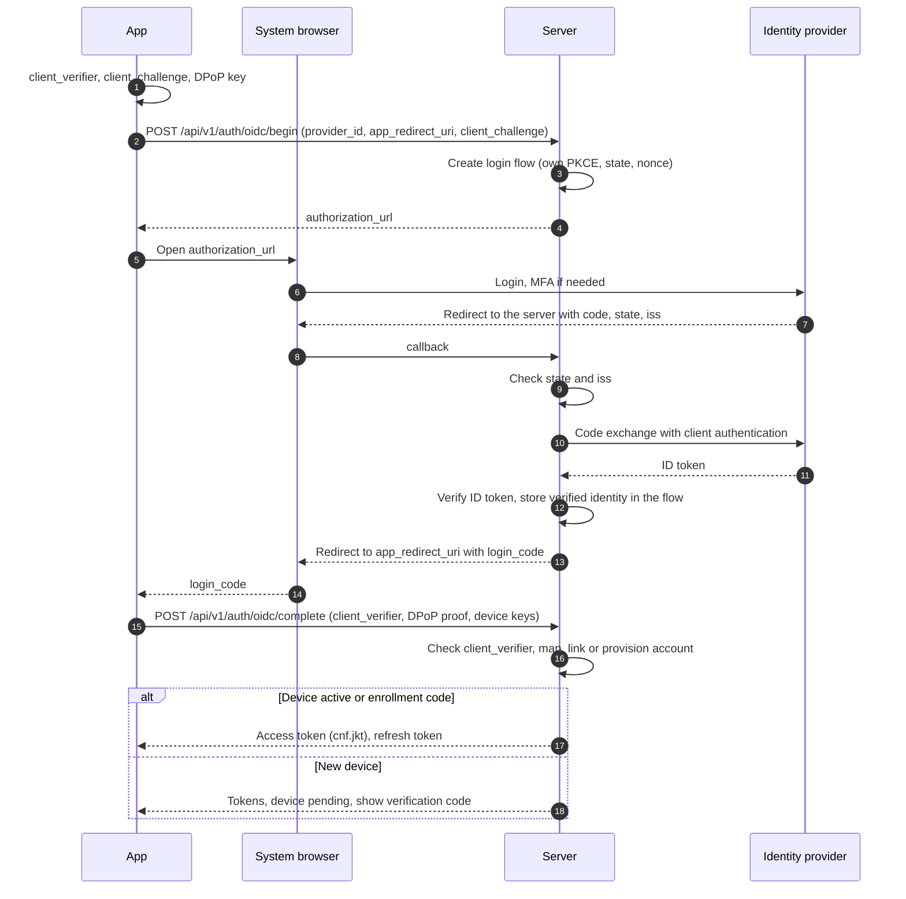
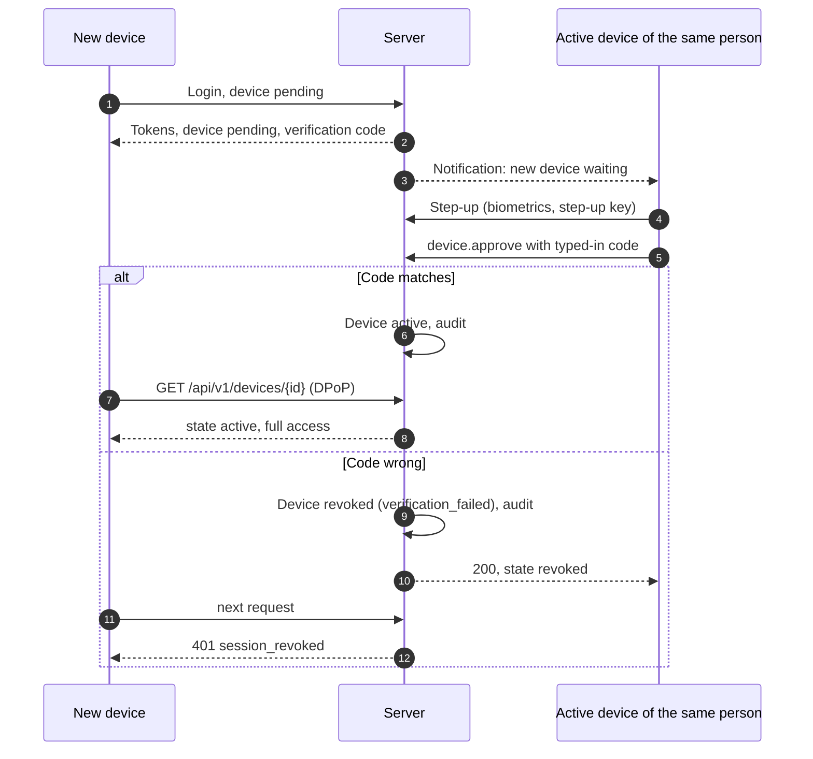
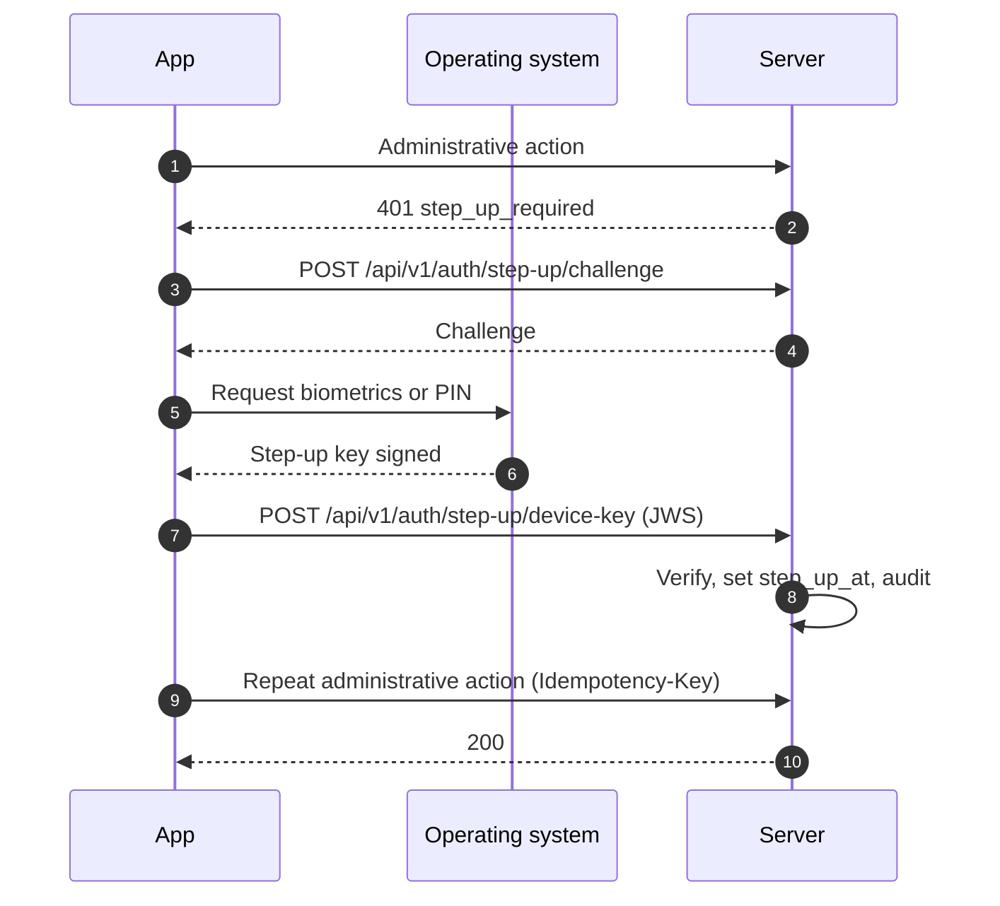

# 08 Identity, devices and sessions

Status: draft M0. Normative for the module `identity`, the login endpoints, the clients and the
admin console.
Terms: [00-glossary.md](00-glossary.md). Tables: [03-data-model.md](03-data-model.md),
section 4.2. Gateway and DPoP in the WebSocket: [04-sync-protocol.md](04-sync-protocol.md),
section 6.3. Actions: [05-actions.md](05-actions.md), sections 4.1 and 4.3. Permissions:
[07-permissions.md](07-permissions.md). Decisions: ADR 0019 (identity providers), ADR 0020
(device binding, DPoP, step-up).

## 1. Goals

1. No self-registration. Every person comes into the instance through the owner (study C).
2. No Tailscale requirement and no specific identity provider in the product (Baseline B9).
3. A stolen token alone is worthless: access and refresh tokens of people are bound to
   a non-exportable device key (DPoP, RFC 9449).
4. Administration requires a fresh confirmation by the person at the device (step-up).
5. Disabling takes effect immediately, on all devices, in a fixed order.
6. The server stores no third-party credentials in plain text and never Claude.ai credentials
   (Baseline B10, I5).

## 2. Identity providers

### 2.1 Port

The module `identity` knows providers only through a port. After a successful check every driver
returns an `ExternalIdentity`; everything after that (account, device, session, tokens) is the
same for all drivers.

```go
// Sketch, not product code.
type ExternalIdentity struct {
    ProviderID   uuid.UUID
    Issuer       string   // OIDC iss; empty for trusted_header and local
    Subject      string   // OIDC sub, header login or local login name
    DisplayName  string   // display only
    EmailHint    string   // display only, never for mapping or permissions
    Groups       []string // only for oidc with a group claim
    AuthTime     time.Time
    AMR          []string // login methods according to the provider, if supplied
}
```

| Driver | Code (`identity_providers.kind`) | Use |
|---|---|---|
| OIDC | `oidc` | any OpenID Connect provider; Microsoft Entra ID is the reference example |
| Trusted proxy header | `trusted_header` | reverse proxy that sets the identity, for example `tailscale serve` |
| Local account | `local` | instances without an identity provider |

Per instance at most one `trusted_header` driver and one `local` driver (03, unique index), any
number of OIDC providers.

### 2.2 OIDC: server as relying party, app as client of the server

Paths in this chapter are working names; [06-api.md](06-api.md) defines the binding paths.

Decision: The apps never talk directly to the identity provider about tokens. The server is a
confidential OIDC client (relying party) at the provider and at the same time the authorization
service for its own apps. Both legs use authorization code with PKCE (`S256`).

Reasons:

- No provider tokens on devices; one token format for all drivers.
- The client secret or the client key of the server lies only in the secret provider
  (`client_secret_ref` or `client_key_ref` in `identity_providers.config`, section 2.6).
- The server creates the device-bound tokens itself; providers mostly do not know DPoP.
- Only one `https` redirect of the server is registered at the provider. The redirect to the app
  (loopback, own scheme) is in the hands of the server.

Flow (diagram in section 14.1):

1. The app creates `client_verifier`, `client_challenge` (`S256`) and its DPoP key.
2. `POST /api/v1/auth/oidc/begin` with `provider_id`, `app_redirect_uri`, `client_challenge` and
   optionally an enrollment code (`enrollment_code`). The server checks the code (section 3.2),
   but redeems it only at completion, creates a login flow (table
   `auth_login_flows`, class `transient`, validity `auth.login_flow_ttl`; in the API
   `login_attempt_id`) and answers with the `authorization_url` of the provider.
   `app_redirect_uri` must match a fixed list: `http://127.0.0.1:<port>/callback` or
   `http://[::1]:<port>/callback` (desktop, any port, RFC 8252 section 7.3) or exactly one
   entry from `app_redirect_uris` of the provider (private scheme or claimed
   `https` address of the app, RFC 8252 sections 7.1 and 7.2); never `localhost`.
3. The app opens the `authorization_url` in the **system browser** (iOS and macOS:
   `ASWebAuthenticationSession`; Android: Custom Tabs; Windows: default browser). Embedded
   web views are forbidden (RFC 8252, section 8.12; https://www.rfc-editor.org/rfc/rfc8252.txt,
   retrieved 2026-10-10 [verified]). The URL carries the server's own PKCE, its own `state`,
   `nonce`, `response_type=code` and `scope=openid profile email`.
4. Return to `https://<host>/api/v1/auth/oidc/callback`. The server checks: `state` against the
   flow; the parameter `iss` per RFC 9207 if the provider sends it (required if its discovery
   reports `authorization_response_iss_parameter_supported`), otherwise `iss` of the ID token
   against the configured issuer (protection against mix-up, RFC 9700 section 4.4;
   https://www.rfc-editor.org/rfc/rfc9700.html, retrieved 2026-10-10 [verified]).
5. Code exchange with client authentication (`private_key_jwt` preferred, otherwise
   `client_secret_basic` from the secret provider). The client assertion of `private_key_jwt` is
   valid for `auth.oidc_client_assertion_ttl`. Check the ID token: signature via the JWKS of the
   provider (discovery and JWKS in the cache `auth.oidc_jwks_cache_ttl`, reload once on an unknown
   `kid`), allowed algorithms only asymmetric (`RS256`, `PS256`, `ES256`, `EdDSA`; never `none`,
   never `HS*`), `iss`, `aud` equal to its own client ID, `azp` if present, `exp`, `iat` with
   `auth.clock_leeway`, `nonce`. The server reaches discovery, JWKS and token endpoint only through
   the egress client; allowed targets are the host of the issuer and the hosts of `token_endpoint`
   and `jwks_uri` from the checked discovery document, never a private address without an entry in
   `egress.allowed_hosts` ([19-security.md](19-security.md), SEC-NET-2).
6. The server stores only the checked external identity in the flow (`external_identity`, schema
   `external_identity.v1`: `schema`, `issuer`, `subject`, `display_name`, `preferred_username`,
   `email_hint`, `auth_time` (Unix seconds), `amr`, with group sync also `groups_state` and
   `groups`; `preferred_username` serves only the handle of a provisioned person), creates a one-time server code (in the
   API `login_code`, validity `auth.server_code_ttl`), bound to `client_challenge` and the flow,
   and redirects to `app_redirect_uri` with `login_code` and `login_attempt_id`. It changes no
   account here. Once the flow has been found, every error ends with a redirect with `error`
   (`access_denied`, `login_failed`, `flow_expired`) and `login_attempt_id`; an unknown or
   expired `state` yields `400` without a redirect, because there is no trusted target.
7. The app exchanges the server code at `POST /api/v1/auth/oidc/complete` (action
   `auth.login.complete`) with `client_verifier`, DPoP proof and device registration (section 5).
   The server checks the binding to `client_challenge`; only the app instance that began the flow
   can redeem the code. An intercepted code is worthless without `client_verifier`
   (protection per RFC 9700 section 4.8.2 [verified]). Only now does the server map the account
   (section 3.1), link through the enrollment code or provision, register the device, create
   session and tokens, and clear `external_identity`. Reason: The `authorization_url` is bound to
   no browser; whoever obtains it could, at the callback, link their own provider account with
   someone else's code (login CSRF, R-DM-30).

### 2.3 Example: Microsoft Entra ID

| Topic | Ruling | Evidence |
|---|---|---|
| Registration | Server as a web application (confidential client), one redirect `https://<host>/api/v1/auth/oidc/callback` | Redirect URIs: `https` required, `http` only for localhost; https://learn.microsoft.com/en-us/entra/identity-platform/reply-url, retrieved 2026-10-10 [verified] |
| Flow | Auth code with PKCE; Entra recommends PKCE for all client types | https://learn.microsoft.com/en-us/entra/identity-platform/v2-oauth2-auth-code-flow, retrieved 2026-10-10 [verified] |
| Issuer | tenant-bound `https://login.microsoftonline.com/<tid>/v2.0`; for several tenants with the placeholder `{tenantid}` in the configured `issuer` and the required list `allowed_tenant_ids` (section 2.6) | always check `tid` against the tenant; https://learn.microsoft.com/en-us/entra/identity-platform/claims-validation, retrieved 2026-10-10 [verified] |
| Subject | `sub` (pairwise per application, immutable) as `user_identities.subject`; `oid` only as additional display | https://learn.microsoft.com/en-us/entra/identity-platform/id-token-claims-reference, retrieved 2026-10-10 [verified] |
| Email | `email`, `preferred_username`, `upn` never for mapping or permissions; only as a display hint | Microsoft: "Never use claims like email, preferred_username or unique_name ..." (claims-validation) [verified] |
| Groups | optional `groups` claim; with more than 200 groups in the JWT, Entra delivers an overage reference instead | id-token-claims-reference, "Groups overage claim" [verified] |

On a group overage the server does not call Microsoft Graph (no additional data flow,
no further permission). It treats the case like "no group information": memberships
from claims expire after `auth.group_claim_max_age`. The instance operator limits the group claim
at the provider to the relevant groups [derived].

### 2.4 Trusted proxy header

Example `tailscale serve`: It sets `Tailscale-User-Login` and `Tailscale-User-Name`, removes
incoming headers of the same name against forgery, does not set them for Funnel traffic and not
for traffic from tagged devices, and recommends that the service listens only on localhost
(https://tailscale.com/kb/1312/serve, retrieved 2026-10-10 [verified]).

Rules:

1. **Loopback only.** The driver takes effect only if the public listener is bound to a
   loopback address (`127.0.0.0/8`, `::1`; what counts is the bound address, not
   the configured text). Otherwise it stays off: `POST /api/v1/auth/trusted-header/login` answers
   `404`, `/readyz` reports `trusted_header_requires_loopback`, and `identity_provider.manage`
   rejects switching it on with `409 conflict` (`reason: trusted_header_requires_loopback`)
   ([16-operations.md](16-operations.md), section 4.3; PLAN W4). Reason: The driver is a runtime
   setting of the owner; an error in it should not keep the server from starting, but should
   stay fail closed (ID-T08).
2. **Only from the proxy.** Headers are evaluated only if the peer of the TCP connection
   is in `server.trusted_proxies` ([16-operations.md](16-operations.md), [19-security.md](19-security.md) SEC-TLS-1).
3. **A missing identity is anonymous.** If the login header is missing (Funnel, tagged device,
   direct call), the request is not logged in; `auth.login.begin` ends with `401`.
4. **Only for login.** The header replaces the login flow, not device and token: The app
   registers device keys and gets DPoP tokens as with OIDC (`POST /api/v1/auth/trusted-header/login`).
5. **Binding per request.** With `auth.trusted_header_bind_requests = true` every further request
   must carry the same header login as the identity of the session. Deviation or missing login:
   `401 session_revoked`, session revoked with reason `trusted_header_mismatch`, audit. Reason: A
   stolen token together with its key is then of use only on a device of the same person in the
   same network.
6. Encoded values (RFC 2047, only `utf-8` and `us-ascii`) are decoded before the comparison;
   multiple values, control, format or bidi characters count as a missing header; the comparison
   uses the login, not the display name.
7. An unknown login becomes an account only through an enrollment code passed along
   (`enrollment_code`, section 3.1) or `allow_provisioning`.

Alternative without trust in headers: querying the identity through the local interface of the
network agent (for Tailscale `WhoIs`). It is planned as a later driver, not part of M1.

### 2.5 Local accounts

For instances without an identity provider. Login methods of a local account:

| Method | Where | Remark |
|---|---|---|
| Passkey (WebAuthn) | web console; native apps only with a public domain with Associated Domain | Native Apple apps need a publicly reachable Associated Domain (Baseline R-Passkeys) |
| Enrollment code | first device, recovery | issued by the owner, one-time, section 3.2 |
| Device pairing | every further device | an active device of the same person approves with step-up, section 5.3 |
| Password with TOTP | fallback | can be switched off via `auth.local_password_enabled` |

WebAuthn with go-webauthn (pinned, Baseline R-Stack): RP ID `auth.webauthn_rp_id` (empty means
the host of `server.public_url`), allowed origins `auth.webauthn_origins` (empty means the origin
of `server.public_url`), `userVerification = required`, `residentKey = preferred`, `attestation =
none`, algorithms only `ES256`, `EdDSA` and `RS256` (Windows Hello). The state of every ceremony
(login, first setup with an enrollment code, registration, step-up) lies in
`auth_challenges` (03); every challenge is valid once and for `auth.login_flow_ttl` (step-up:
`auth.step_up_challenge_ttl`). A step back of `sign_count` is reported in the audit, the
ceremony continues (03, `passkey_credentials`). Only someone who has an active identity at the
driver `local` can log in with a passkey; passkeys of people with only OIDC serve step-up.
Reason: Otherwise a passkey login would bypass `auth.idp_recheck_interval`. For an unknown
login name `beginPasskeyLogin` returns a dummy credential ID from HMAC and name, so that the
answer reveals no accounts.

Details of the implementation (M1-40, [docs/DECISIONS.md](../DECISIONS.md) M1-40): when
`auth.webauthn_rp_id` is empty and the host of `server.public_url` is an IP address or a single
label (never an RP ID), or both passkey keys are empty and `server.public_url` is `http` outside
`localhost` (no secure context), the instance has no passkeys; a passkey counts as a remaining
sign-in method for `identity.unlink` only while a local identity remains; the passkey operations answer
`403 feature_disabled` and `createStepUpChallenge` has no `passkey_options`. Every completion that
opened an issued ceremony row and then failed sets the row to `failed` after the rollback, so a row
works once even when the login, the device or the code is rejected after the check.

Password with TOTP (table `local_credentials` in 03):

- Password hash Argon2id in PHC format. Lower bound per OWASP: 19 MiB memory, 2 iterations,
  parallelism 1 (https://cheatsheetseries.owasp.org/cheatsheets/Password_Storage_Cheat_Sheet.html,
  retrieved 2026-10-10 [verified]). Default values in section 18; a test rejects values below that.
- The login name is the `subject` of the local identity (at setup, the handle).
- Minimum length `auth.password_min_length` (in Unicode characters after NFC); check against a
  local list of common passwords with an allowed license, in the repository only as truncated
  SHA-256 values; the README of the adapter names source, version and license. No composition
  rules. If the stored Argon2id parameters differ from the configuration, a successful
  login stores a new hash.
- TOTP per RFC 6238 with a 30-second step, at most one step of tolerance, every digit sequence
  valid only once (RFC 6238 section 5.2: "MUST NOT accept the second attempt";
  https://www.rfc-editor.org/rfc/rfc6238.html, retrieved 2026-10-10 [verified]). Therefore the
  server stores the last used time step.
- Setup in two steps: `totp_enroll` returns the new secret once as an otpauth URI
  (the issuer is the host of `server.public_url`); only a valid `totp_code` makes it effective
  (`totp_enabled_at`). The password method counts as set up as soon as TOTP is confirmed; only
  then does `local_credential.set` require step-up (05, column "Step-up" `conditional`).
- The TOTP secret is a secret that the server needs for checking. It is stored encrypted
  (AES-256-GCM with the identity as additional data) in the database; the key lies only
  in the secret provider (`auth.totp_key_ref`, noted per row in `totp_key_ref`, so that a new
  key leaves old rows readable).
- There are no recovery codes. Recovery runs through a new enrollment code from the
  owner. Reason: a second permanent set of secrets would be a further attack path.

### 2.6 Configuration per driver

`identity_providers.config` follows one schema per kind. Unknown fields, duplicate keys and
JSON `null` are rejected with `400 validation_failed`; secrets appear in it only as a reference
to the secret provider and are not resolved during the check.

`identity_provider.oidc.v1`:

| Field | Required | Meaning |
|---|---|---|
| `issuer` | yes | exact issuer, `https` without query and fragment; for several Entra tenants with the placeholder `{tenantid}` |
| `client_id` | yes | client ID at the provider |
| `client_auth` | yes | `private_key_jwt` (preferred) or `client_secret_basic` |
| `client_secret_ref` | exactly with `client_secret_basic` | reference to the client secret |
| `client_key_ref` | exactly with `private_key_jwt` | reference to the private key (PKCS#8, PEM) |
| `client_key_alg` | no, default `PS256` | `PS256`, `RS256` or `ES256` for the client assertion |
| `client_key_id` | no | `kid` in the header of the client assertion |
| `client_cert_x5t_s256` | no | `x5t#S256` in the header (Entra with a certificate) |
| `allowed_tenant_ids` | yes, if `issuer` contains `{tenantid}` | allowed values of the claim `tid` |
| `app_redirect_uris` | no | allowed private schemes or claimed `https` addresses of the apps (section 2.2, step 2) |
| `groups_claim` | no | name of the group claim; if it is missing, there is no sync (section 3.4) |

`identity_provider.trusted_header.v1`: `login_header` (required, name of an HTTP header per RFC
9110, for example `Tailscale-User-Login`) and `name_header` (optional, for example `Tailscale-User-Name`).
`identity_provider.local.v1`: an empty object.

Refinements of the OIDC driver (M1-41, docs/DECISIONS.md M1-41): the discovery document of an
issuer is `<issuer>/.well-known/openid-configuration`; for an issuer with `{tenantid}` the
placeholder is replaced by `organizations` in that URL (the document of the Entra alias names the
template itself as `issuer`), and the document's `issuer` must equal the configured string. A
found flow whose callback completes after `expires_at` ends with `flow_expired`; a state whose
flow is unknown, used or already expired when the callback arrives gets `400` without a redirect.
`client_secret_ref` and `client_key_ref` must name a file below `<secrets.dir>/idp/` or a
variable `BOTHY_IDP_*` and never the value of a server `*_ref` key; another reference fails at
login. A disabled or deleted person, and a subject linked under another issuer of the same
provider, are refused at completion like an unknown one (`401`).

Refinements enforced at write time (M1-36, docs/DECISIONS.md M1-36/5): an `issuer` path segment
`common`, `organizations` or `consumers` is refused, a multi-tenant provider names `{tenantid}`
(at most once, in the path) with `allowed_tenant_ids`, which is refused without the placeholder;
each tenant id matches `^[A-Za-z0-9][A-Za-z0-9._-]*$` and appears once. `client_key_alg`,
`client_key_id` and `client_cert_x5t_s256` belong to `private_key_jwt` only; an absent
`client_key_alg` is stored as `PS256`; `client_cert_x5t_s256` is a SHA-256 thumbprint as base64url
without padding. Each `app_redirect_uris` entry is an `https` URL with host or a private-use scheme
in reverse domain form, without user information or fragment, and appears once. Header names are
stored in canonical form, and `name_header` differs from `login_header`. A secret reference must
parse as `file:` or `env:` reference of the secret provider; schemes without a driver are refused.
The stored and returned `config` is the normalized object; field errors point into `/config/...`.

## 3. Account, linking and provisioning

### 3.1 Mapping an external identity

The mapping runs at the completion of the login, in one transaction with device and session:

1. Search `user_identities` for `(provider_id, subject)` with `unlinked_at IS NULL` (for OIDC
   additionally `issuer`). Match: login for this person.
2. No match, but the flow carries a valid enrollment code (purpose `first_login`,
   `recovery` or `identity_link`): link to the person of the code, code consumed, device
   `active` (section 3.2), audit `identity.link`.
3. No match, `identity_providers.allow_provisioning = true`: new person with status `pending`,
   without grants, without email (`users.email` stays empty, 03), device `pending`. They have
   tokens, but may only read themselves (`403 device_pending`, 07 section 4.1), until the owner
   activates them with `user.enable` (step-up) and the device is approved (section 5.2). The
   server derives handle and display name from claims or the login; control and bidi characters
   are removed, a handle that is taken gets a random suffix.
4. Otherwise: rejection with a neutral message ("No access. Please contact your administrator."),
   audit `deny`.
5. A person in the state `disabled` or `deleted` never logs in (`401`).

Mapping never uses email addresses or display names. Reason: These values are mutable
and partly controllable by the tenant or the person (section 2.3).

### 3.2 Enrollment code

Table `enrollment_codes` (03). Properties:

- Issued on `user.create` with `local_account`, with `createEnrollmentCode` by the owner, at
  the initial installation (section 4) and for recovery by server command (`owner.recover`).
- Randomness of at least 128 bits, shown once, stored only as an HMAC (03, principle 9).
  Format `en_` plus groups of Crockford Base32; on input, upper and lower case, hyphens and
  spaces do not count.
- Valid for `auth.enrollment_code_ttl`, usable once, at most `auth.enrollment_code_max_attempts`
  failed attempts per code, invalid after that. A failed attempt is a rejected redemption whose
  code matched (for example an invalid device registration, a wrong DPoP key, a failed
  WebAuthn check); it is counted after the rollback in a separate transaction. A code that does
  not match cannot be assigned to any row; `rl.public_auth` per client IP limits it.
- At most one code is valid per person; a new one ends the older ones. Every rejection has the
  same answer.
- Handover outside the product (in person, telephone). No email sending (Baseline section 4).
- A code is at the same time the approval of the first device: The device that redeems it becomes
  `active`. It is redeemed only with device keys (`POST /api/v1/auth/enroll/redeem`), together
  with a passkey (`/api/v1/auth/enroll/begin` and `/complete`) or through a login with OIDC or proxy header
  (field `enrollment_code`, section 3.1).

| Purpose | Issued for | Redeemed via |
|---|---|---|
| `first_login` | people with a local identity without a device (initial installation, `createUser` with `local_account`, `createEnrollmentCode`) | redemption with device keys or passkey, linking with OIDC or proxy header |
| `recovery` | people with a local identity and at least one device (`createEnrollmentCode`, `bothy setup issue-enrollment-code`) | like `first_login` |
| `identity_link` | people without a local identity, for example for OIDC without `allow_provisioning` (`createEnrollmentCode`) | only linking with OIDC or proxy header |

### 3.3 Linking and unlinking another identity

- `identity.link` (05): a person with step-up starts a login flow in the mode "link". The
  subject must not already be linked.
- `identity.unlink`: rejected with `409 conflict` and `reason: no_login_method_left` if no login
  method remains afterwards (no identity at an enabled driver, no passkey, no active device for
  device pairing). The check locks the identities of the person, so that two parallel unlinks
  do not both succeed.
  A device counts for device pairing when it is `active` and not on the platform `cli`, which has
  no step-up (ID-T29, docs/DECISIONS.md M1-36/3).
- Unlinking an identity ends the sessions that began with it (`auth_sessions.identity_id`,
  reason `logout` when the person does it, `admin` when someone else does); switching off a
  driver (`enabled = false`) ends the sessions of all its identities (`admin`) and prevents new
  logins. Reason: Whoever blocks a path also means the sessions that arose through it (R-ID-12).
- A driver that an identity refers to (also an unlinked one) is not deleted
  (`409 conflict`, switch off instead of deleting); without identities the deletion is final.

### 3.4 Groups from claims

Groups with `source = 'oidc_claim'` belong to exactly one provider (`groups.provider_id`, 03) and
name the claim value in `external_ref`. The owner creates them; unknown claim values never create
a group. At the completion of every OIDC login at a provider with `groups_claim` (system action
`group.member.sync`, 05):

1. Claim present as a list of strings (also empty): create new memberships with `expires_at =
   login time + auth.group_claim_max_age`, extend existing ones (also expired ones) to the same
   expiry, remove missing ones. The expiry thus slides with every login.
2. Claim missing or Entra reports an overage: change nothing; the memberships expire after
   `auth.group_claim_max_age` (section 2.3). A claim of any other form makes the login
   fail.
3. Every change is a permission change with an I1 check (07, section 4.4) in the transaction
   of the login; without a change the permission version stays the same. If the sync violates
   I1, the whole login fails with `409 i1_violation` and a hint, instead of silently widening
   permissions; an audit entry names groups and agents.
4. Nobody else changes memberships of these groups (`409 conflict`, 07 section 2.6).
   `added_by` and `removed_by` are the person whose login carried the claim.

### 3.5 Delay when disabled at the provider

The server holds no refresh tokens of the provider. A person disabled at the provider therefore
keeps their session until `auth.idp_recheck_interval`; after that the next refresh requires a new
login at the provider. The owner disables immediately with `user.disable`. An automatic adoption
of disablings (SCIM, Shared Signals) is proposed as a separate ADR.

## 4. Initial installation

Until `instance.setup_completed_at` is set, the server answers only health checks and
`instance.discovery.read` (with `setup_required: true`). All other requests end with
`503 setup_required`. Reason: There is no "the first visitor becomes owner".

The first owner comes into being only by server command on the host (the name of the program
follows [02-architecture.md](02-architecture.md)):

```text
bothy setup bootstrap-owner --handle alex --display-name "Alex"
```

The command connects directly to the database, not over HTTP, with the application role
`bothy_app` ([16-operations.md](16-operations.md), section 7.1; it only writes rows). Before the
transaction it ensures the signing keys ([ADR 0066](../adr/0066-signing-keys-in-the-writable-key-store.md)); then, in one transaction, it does the following:

1. Check that `setup_completed_at IS NULL`; otherwise abort without a change.
2. Create a driver `local` if none exists.
3. Create principal and person, a row in `owners` with `granted_by = NULL` and reason "bootstrap",
   a local identity with the handle as `subject`.
4. Issue an enrollment code (`first_login`).
5. Audit entry with `actor_principal_id = NULL` and system action `instance.bootstrap` (05).
6. `setup_completed_at = now()`.

After the commit it writes the code exactly once to standard output, as the only line there;
logs go to standard error and never contain it. That way scripts read the code without a format
of their own. `bothy setup issue-enrollment-code` outputs its code the same way. Exit codes per
[02-architecture.md](02-architecture.md), section 3.3. The block until
setup applies from the next request on, without a restart. `createUser` with `local_account`
creates the local identity the same way.

The owner redeems the code in the app, with OIDC (the code links the identity) or locally
(device plus passkey, or password with TOTP).

Recovery when all owners have lost their devices: `bothy setup issue-enrollment-code
--user <handle>` on the host, only for active owners, code with purpose `recovery`, audit with the
system action `owner.recover` (05). Access to the host is the root of trust of the instance
([16-operations.md](16-operations.md), section 4.3).

## 5. Devices

### 5.1 Registration

When redeeming a code or server code, the app sends:

| Field | Content |
|---|---|
| `device_id` | UUIDv7, generated by the client (03, `devices.id`) |
| `name`, `platform`, `app_version` | display |
| `dpop_jwk` | public part of the DPoP key |
| `step_up_jwk` | public part of the step-up key (native apps only; never with `platform = 'cli'`, section 6.4) |
| `attestation` | optional, platform attestation (only stored, not required in M1) |

The server stores the keys in `device_keys` with purpose `dpop` or `step_up` (03) and
the thumbprint per RFC 7638 (`jkt`).

### 5.2 Approval

A new device is `pending`, unless it redeems an enrollment code or is approved through
device pairing. A waiting device gets tokens, but no access to contents:
Every action except `self.read`, `device.list` for its own device, `auth.token.refresh` and
`auth.logout` ends with `403 device_pending`, and the gateway rejects it with `4016` (05,
section 2.5; R-AZ-16). It polls `GET /api/v1/devices/{id}` until it is approved or rejected.
Reason for tokens instead of waiting without a token: The app needs no second login path for
polling; the protection lies in `authorize`. After `auth.device_pending_ttl` without approval
the device becomes `revoked`.

Allowed to approve (`device.approve`, step-up):

- the person themselves from one of their active devices,
- an owner.

Verification code: The waiting device shows a code with `auth.device_verification_code_digits`
digits. The server derives it instead of storing it: HMAC-SHA-256 with the token pepper over the
device ID and the `jkt` of the DPoP key, as a number modulo `10^digits`. It appears only in
responses to the waiting device itself (`Device.verification_code`), never for other devices or
owners. The approving person types it in (`approveDevice`). A wrong code revokes the waiting
device (`revoke_reason = verification_failed`); the response is still `200` with `state`
`revoked`, because the request took effect. Reason: Otherwise a blind "Allow" would also approve
the device of an attacker who triggered a login at the same time; a second attempt by the
attacker shows a different code because of the different key. A waiting device beyond
`auth.device_pending_ttl` counts as revoked (`pending_expired`, system action `device.expire`).

### 5.3 Device pairing

For local accounts without a passkey and as a convenience for everyone: The new device requests a
pairing without login (`POST /api/v1/auth/pairing/begin` with its public keys and a
DPoP proof, `auth.login.begin`) and shows a pairing code with
`auth.pairing_code_chars` characters (validity `auth.pairing_code_ttl`). On an active device
the person chooses "Add device", enters the code and confirms with step-up
(`POST /api/v1/me/devices/pairings`, `device.approve`). The new device polls
`POST /api/v1/auth/pairing/complete` with a DPoP proof of the same key
(`auth.login.complete`); after the approval it becomes `active` and gets its tokens
(`auth_sessions.auth_method = 'device_pairing'`). State in `device_pairings` (03). The
approval creates the device for the approving person (`active`) and opens a new window of
`auth.pairing_code_ttl` for the pickup; after that the pairing becomes `expired` and the device
that was never picked up is revoked (`pairing_expired`). A code that matches no open pairing ends
the step-up of the approving session (`404`); every further attempt needs a new confirmation with
biometrics. A proof with a different key at pickup rejects the pairing. Reason for
the code on the new device: Only someone who has both devices in front of them can pair; a
foreign code never binds a foreign device without the person's step-up.

### 5.4 Management

- List of devices with platform, name, last activity, sessions (`device.list`).
- Unused devices are revoked automatically after `auth.device_inactive_revoke_after` without
  contact (reason `inactive`, system action `device.expire`, job `identity.auth_cleanup`), as with
  `device.revoke` (section 10).
- Reasons for a revocation in `devices.revoke_reason` (03): `revoked_by_self`, `revoked_by_owner`,
  `user_disabled`, `inactive`, `verification_failed`, `pending_expired`, `pairing_expired`.
- No key change on an existing device. If a device loses a key (for example, new biometrics
  invalidate the step-up key, section 6.1), the app logs in as a new device
  (waiting, approval or pairing), and the person revokes the old one. Reason: A change with only
  the DPoP key would let malicious code in the app register its own step-up key; with the old
  step-up key it would not work in precisely the most common case (R-ID-11).

## 6. Device keys and step-up

Baseline R-Passkeys: device binding and step-up via a device key in secure storage with user
verification; WebAuthn passkeys for the web console and for instances with a public domain.

### 6.1 Two keys per native device

| Key | Purpose | User verification per use | Reason |
|---|---|---|---|
| `dpop` | signs every DPoP proof | no | every request needs it; biometrics per request is impossible |
| `step_up` | signs step-up confirmations | yes (biometrics or device PIN) | the confirmation must come from the person, not from malicious code in the process |

Both keys are non-exportable and, where the platform offers it, hardware-backed:

| Platform | Storage | Algorithm | Note |
|---|---|---|---|
| iOS, iPadOS, macOS | Secure Enclave | `ES256` | step-up key bound to the currently enrolled biometrics, so that newly added fingerprints invalidate it |
| Android | Android Keystore, StrongBox if available | `ES256` | step-up key with mandatory user authentication; on API 26 to 29 strong biometrics only, from API 30 biometrics or the device credential ([15](15-client-architecture.md) 9) |
| Windows | `dpop`: TPM via the Platform Crypto Provider, without P-256 or TPM a software key reported as not hardware-bound | `ES256` | settled by M4-11 (D-M4-11-2): Windows has no system-enforced confirmation per use for an `ES256` key (strong key protection is a password the process can supply and that is cached per process; Windows Hello keys are RSA), so Windows clients have no `step_up` key and confirm with password and TOTP (section 6.2, docs/decisions.d/FIX-stepup-macos.md); the terminal, which needs a step-up with `passkey` or `device_key` (section 6.3), stays unavailable on them. A Windows Hello step-up key would need `RS256` or `PS256` in `device_keys.alg` (03) and in the JOSE profile (ADR 0067), a core contract change (section 17) |
| Web console | no device key | | session by cookie (section 7.5), step-up by passkey |

Without attestation the server cannot check whether a key really is hardware-backed.
The attestation is stored; a requirement (`auth.require_key_attestation`) is planned for a later
milestone.

### 6.2 Step-up flow

1. The app requests a challenge (`POST /api/v1/auth/step-up/challenge`); response:
   a random value, validity `auth.step_up_challenge_ttl`, with existing passkeys the
   WebAuthn options with the same value. Only the HMAC is stored, in `auth_challenges` (03).
   The client shows the text of the prompt in its language.
2. The operating system asks for biometrics or PIN; the step-up key signs a compact JWS
   (header only `alg`, without `jwk`, `jku`, `x5u`, `x5c`, `crit`) over `{challenge, sid, iat}`.
3. `POST /api/v1/auth/step-up/device-key` or `/passkey` (action `auth.step_up`). The server locks
   session and challenge, checks the signature against the active `step_up` key of the device of
   the session (a different key fails), the challenge (one-time, same session)
   and `iat` (not before its issue minus `auth.clock_leeway`, not after now plus
   `auth.clock_leeway`).
4. `auth_sessions.step_up_at = now()`, `step_up_method`, audit. Valid for `auth.step_up_max_age`
   (03), only for this session, not for its child sessions.

A wrong confirmation (signature, passkey of a different person) sets the challenge to
`failed` and counts; an unknown, expired or already used challenge does not count.
If the counted failed attempts of the session within the window `auth.login_fail_window` reach
the limit `auth.step_up_fail_limit`, the server revokes the session (`step_up_failed`). Responses
are in section 13.

Details of the check (M1-35, docs/DECISIONS.md M1-35): `iat` is an integer NumericDate compared in
whole seconds, so the lower bound is the issue of the challenge minus `auth.clock_leeway`, cut to the
second. Unknown payload members are ignored. A header with `jwk`, an `alg` other than the one of the
active `step_up` key, a signature by any other key, a wrong `challenge` or `sid` and an `iat`
outside the bounds are wrong confirmations and count. A wrong confirmation answers
`401 step_up_required` because the right reaction of the client is a new step-up; the one that
reaches the limit answers `401 session_revoked`. A caller without a session, a session on a `cli`
device and a device without an active `step_up` key get `403 forbidden` with reason
`step_up_not_possible`.

Web console: WebAuthn assertion with `userVerification = required` against the passkeys of the
person. Without a passkey: a new OIDC login with `prompt=login` and `max_age=0`; the server
requires an `auth_time` after the start of the challenge. Local accounts without a passkey:
password with TOTP. The operations for the last two methods come with the console session
(PLAN M6-01), spec first. A native app whose device has no active `step_up` key (Windows, 6.1,
D-M4-11-2; a Mac without a Secure Enclave in the login keychain) confirms with password and TOTP
as well (docs/decisions.d/FIX-stepup-macos.md); every other native app confirms with its
`step_up` key and never with the password.

Console step-up operations (M6-01, docs/DECISIONS.md D-M6-01-6): every console step-up starts with
`createStepUpChallenge`. The passkey uses `completeStepUpWithPasskey` as for apps (every passkey
ceremony of this server asks `userVerification = required`). Password with TOTP uses
`stepUpWithPassword` (`POST /api/v1/auth/step-up/password`, body `challenge_id`, `password`,
`totp_code`): for a console session, and for an `app` session whose device is not `cli` and has no
active `step_up` key, of a person with a local account while `auth.local_password_enabled` is
true; password and code are checked like the login of section 2.5 with the same lockout, and
`step_up_method = password_totp`. An `app` session whose device has an active `step_up` key, a
`share_ext` session and a `cli` device get `403 forbidden` with reason `step_up_not_possible` (no
downgrade from the device key; audit cause `step_up_key_present`, `not_console` or
`cli_device`). The OIDC re-login uses
`beginStepUpOidcReauth` (`POST /api/v1/auth/step-up/oidc`, body `challenge_id`, `provider_id`,
`app_redirect_uri`, `client_challenge`; the redirect must be `/console/step-up/callback` on the
origin of `server.public_url`) and `completeStepUpOidcReauth` (`POST
/api/v1/auth/step-up/oidc/complete`, body `login_code`, `client_verifier`). The flow asks the
provider for `prompt=login` and `max_age=0`; the identity must be one of the person's linked
identities (same issuer and subject) and its `auth_time` must not lie before the second in which
the challenge was created (`auth_time` has whole seconds); then `step_up_method = oidc_reauth`. A
wrong password, code, identity or `auth_time` fails the challenge and counts toward
`auth.step_up_fail_limit`. The OIDC re-login stays console-only, because its redirect is the
console callback: from any other session its two operations answer `403 forbidden` with reason
`step_up_not_possible`. Every successful step-up of a console session sets a new cookie value
(section 7.5); an app session has no cookie and gets none.

Only people in a session can provide step-up (07, SR5). The confirmation applies only to the
session in which it was provided, that is, to one device.

### 6.3 Fresh step-up for the terminal

`terminal.open` and `terminal.attach` require step-up `fresh` (05, section 2.4;
[24-terminal.md](24-terminal.md), section 6):

1. `auth_sessions.step_up_at` is younger than `terminal.step_up_max_age`.
2. `step_up_method` is `passkey` or `device_key`. Password with TOTP and a new OIDC login
   are not enough. Reason: The owner requires a passkey confirmation; on native devices a device
   key with biometrics is the equivalent path for it (Baseline R-Passkeys).
3. In the web console (`client_component = 'console'`) only `passkey`, and the stored
   WebAuthn session of the challenge (`auth_challenges.webauthn_session`) required
   `userVerification = required`. There is no fallback ([ADR 0070](../adr/0070-terminal-in-the-web-console.md)).
4. The step-up is unconsumed: `step_up_consumed_at IS NULL OR step_up_consumed_at < step_up_at`.
   The action sets `step_up_consumed_at = now()` in its transaction (lock on the session row).
   One confirmation thus opens exactly one session; of two simultaneous openings with the same
   confirmation, all but one fail. The consumption (`StepUp.ConsumeFresh`, M2-40) is the first row
   lock of the transaction of the action and checks the freshness at the locked row once more with
   the same rule as `authorize` and the time of the call, not at the principal of the request: two
   requests with one confirmation both pass `authorize`, only the lock orders them, and the second
   sees the consumption (docs/DECISIONS.md D-M2-40-2).
5. Exception: reattaching from the same device in the same login session within
   `terminal.quick_reattach_window` after the detach needs no new step-up
   ([24-terminal.md](24-terminal.md), section 6.2). Not in the web console
   (`client_component = 'console'`): There no device key proves the request, only the cookie;
   every attach needs a fresh passkey.

If a condition is not met, the server answers `401 step_up_required` (reason
`terminal_step_up_not_fresh`, in the console with `reason: passkey_required` if item 3 is not
met). Other step-up actions do not consume the step-up; a step-up consumed for the terminal
stays valid for them until `auth.step_up_max_age`.

In the web console every refusal of the fresh step-up carries `reason: passkey_required`: a
missing step-up, one that is not a passkey with `userVerification = required` (point 3), and also
one that is too old or consumed, because the only way on in the console is a new passkey (TM-T12
after a detach); the audit reason stays `terminal_step_up_not_fresh`. identity reads the fact of
point 3 from `auth_challenges.webauthn_session` of the challenge that confirmed the step-up
(docs/DECISIONS.md D-M6-18-1).

### 6.4 Command-line tools

Command-line tools log in as a device with `platform = 'cli'` (03 `devices`).
The general rules of sections 5 to 7 apply to them (approval, DPoP, revocation). For
step-up the same rule applies as for API tokens (section 12): no step-up on this path.

1. A `cli` device has no `step_up` key. The server rejects a registration with `step_up_jwk` and
   `platform = 'cli'` with `400 validation_failed`.
2. A session of a `cli` device cannot provide step-up. Already the challenge
   (`POST /api/v1/auth/step-up/challenge`) and every confirmation, with device key or passkey,
   end with `403 forbidden` (audit reason `step_up_not_possible`), as for a principal without a
   session.
3. The person completes actions with step-up (05, section 2.4) in the app or the web console;
   from the tool they end with `401 step_up_required`.

Reason: A tool keeps its key in a file or in memory and signs without user
verification. Without attestation the server cannot tell this apart from a key in secure
storage; otherwise malicious code with the permissions of the person would have the step-up. A
passkey via a tool would have no checked origin. The safer choice is therefore no step-up on the
command line.

## 7. Token model

### 7.1 Overview

| Token | Form | Bound to | Lifetime | Server storage |
|---|---|---|---|---|
| Access token (person) | JWS, `EdDSA`, key purpose `access_token` | DPoP key (`cnf.jkt`), session (`sid`) | `auth.access_token_ttl` | nothing (revocation via `sid`) |
| Refresh token (person) | 256 bits of randomness | family, DPoP key of the family | `auth.refresh_token_ttl` (03), at most until `auth_sessions.expires_at` | HMAC-SHA-256 |
| Console session | cookie, 256 bits of randomness | browser | `auth.console_session_max_age`, idle `auth.console_session_idle_timeout` | HMAC-SHA-256 |
| API token (agent, app, personal) | prefix plus 256 bits of randomness plus checksum | optional DPoP (`api_tokens.dpop_jkt`) | `expires_at`, at most `auth.api_token_max_ttl` | HMAC-SHA-256 |
| Invocation token | JWS, purpose `invocation` | run, agent (`aud`) | `agent.invocation_token_ttl` (04) | `runs.invocation_jti` |
| Preview token (push) | `bothy_pvw_` prefix plus 256 bits of randomness plus checksum ([ADR 0061](../adr/0061-token-format-with-a-fixed-prefix-and-checksum.md)); only `getPushPreview` accepts it | the push registration, its session and the device key (DPoP proof with `ath` over the token) | lifetime of the registration, no expiry and no refresh of its own (13 6.4, R-PN-07) | HMAC-SHA-256 (`push_registrations.preview_token_hash`) |

### 7.2 Access token

Header: `alg` of the active key with purpose `access_token`, `kid`, `typ = at+jwt` (RFC 9068,
section 2.1; separates access tokens from every other JWS). Claims: `iss` (`instance_id` as UUID,
03), `aud` (origin of `server.public_url` plus `/api/v1`, for example `https://chat.example.com/api/v1`),
`sub`, `sid`, `did` (device), `jti`, `iat`, `nbf`, `exp` (at most `auth_sessions.expires_at`),
`cnf.jkt`, `amr` (list with the login method of the session). No permissions in the token; `authz`
computes permissions on every request (07). Reason: a token with permissions would be stale until it expires.
JWS construction, verification and JWK thumbprints use an implementation based on the
standard library in `kernel/jose` ([ADR 0067](../adr/0067-jose-profile-with-the-standard-library.md)).

Verification per request: signature with `kid` from the keys in state `active` or `retiring`,
`iss`, `aud`, `exp` and `nbf` with `auth.clock_leeway`, then DPoP (7.3), then session and device through
`authz` (07, section 4.2, step 1).

### 7.3 DPoP

Following RFC 9449 (https://www.rfc-editor.org/rfc/rfc9449.html, retrieved 2026-10-10 [verified]):

- Header `typ = dpop+jwt`, `alg` asymmetric (`ES256`, `EdDSA`), `jwk` without the private part.
- Payload `jti`, `htm`, `htu` (without query and fragment), `iat`, `ath` (SHA-256 of the token), `nonce`.
- The server issues nonces through the `DPoP-Nonce` header and renews them after
  `auth.dpop_nonce_ttl` (section 18). The current and the previous nonce are accepted. Once it has
  started with nonces, the server rejects proofs without `nonce` (RFC 9449, section 11.3).
- Nonces are stateless so that every process and every restart accepts them: window `w` = Unix
  seconds divided by `auth.dpop_nonce_ttl` (rounded down); nonce = base64url of `w` (8 bytes)
  and the first 16 bytes of an HMAC-SHA-256 over `w` with a key that HKDF-SHA256 derives from the
  token pepper. If the proof is valid with the previous window, the response carries the current
  nonce.
- `htu` is the origin of `server.public_url` plus the path of the request, without query and fragment,
  compared after normalization (scheme and host in lowercase, default port removed).
  `server.public_url` is therefore an origin without a path ([16-operations.md](16-operations.md)).
- `iat` at most `auth.dpop_proof_max_age` old and at most `auth.clock_leeway` in the future.
- `jti` only once per `htu` within this window; a hash is stored (RFC 9449,
  section 11.1). The store is per process; across processes the nonce protects. Its size is
  limited by the time window and the rate limits; it has no limit of its own.
- A DPoP-bound token sent as `Bearer` is rejected (RFC 9449, section 7.2).
- Errors: `401` with `WWW-Authenticate: DPoP error="invalid_dpop_proof"` or
  `error="use_dpop_nonce"` and a new nonce.
- In the WebSocket, the proof is in `identify`, `resume` and `reauth` with the nonce from `hello`
  (04, section 6.3, R-SY-01).

### 7.4 Refresh tokens: rotation, families, reuse

- Every session has exactly one active family (03). The family stores the `jkt` of the
  DPoP key (`refresh_token_families.dpop_jkt`, 03); every refresh requires a
  DPoP proof with exactly this key (RFC 9449, section 5: refresh tokens of public clients
  are bound to the key [verified]).
- Rotation and reuse detection as in 03, `refresh_tokens`: the immediately preceding
  generation is rotated once more within `auth.refresh_reuse_grace` with the same DPoP key
  (crash between rotation and local storage); every other token that was already used
  or is older revokes family and session (`refresh_reuse`), closes connections with `4012`,
  writes audit and `session.revoked`. RFC 9700 requires sender binding or rotation for public clients
  (section 2.2.2 [verified]); the product does both.
- **Maintenance mode.** With `server.maintenance_mode = read_only`, `auth.token.refresh` issues a new
  access token and returns the same refresh token, without rotation and without a write
  ([ADR 0065](../adr/0065-maintenance-mode-read-only.md), item 4). Reason: otherwise reading ends after
  `auth.access_token_ttl`, and a rotation after the final backup would be missing on the target of the
  migration and would log the person out there. The binding to the DPoP key remains; RFC 9700 names
  it as an alternative to rotation (section 2.2.2 [verified]). Reuse detection
  remains: an already rotated token revokes family and session as usual. As built (M7-08,
  D-M7-08-3): the new access token has the normal lifetime and the answer carries the stored expiry
  of the presented refresh token; the generation before the current one inside
  `auth.refresh_reuse_grace` still rotates (a write), because returning it unchanged would make the
  next refresh after the mode a reuse that revokes the family.
- **Extension sessions.** The share extension (iOS, macOS) runs separately from the app and must
  refresh by itself; it gets its own child session with its own family on the same device (`auth_sessions.client_component`,
  `auth_sessions.parent_session_id`, 03). The app creates it (`POST
  /api/v1/me/sessions/extensions`, action `session.extension.create`) and passes the tokens on through
  the shared keychain group; the family uses the same DPoP key. Per parent session
  and component there is at most one active child session; a new one replaces the old one (`logout`).
  Reason: two processes with one family refresh at the same time, and the second refresh would look like
  theft. Revoking the parent session revokes all children. The Notification Service
  Extension has no session and never refreshes tokens: it only fetches the preview with the
  preview token of its push registration ([13-push-notifications.md](13-push-notifications.md),
  section 6.4; [ADR 0056](../adr/0056-native-extensions-without-the-flutter-engine.md)).

### 7.5 Web console: session following the backend-for-frontend pattern

The console runs on the same origin as the API. The server is its backend; tokens never reach
JavaScript. RFC 10017 (OAuth 2.0 for Browser-Based Applications, BCP 212) calls this pattern the
most secure one and recommends it for applications with personal data
(https://datatracker.ietf.org/doc/rfc10017/, retrieved 2026-10-10 [verified]).

- Cookie with the prefix `__Host-`, attributes `Secure`, `HttpOnly`, `SameSite=Strict`, `Path=/`, without
  `Domain` (RFC 10017, section 6.1.3.2 [verified]). Value: 256 bits of randomness; stored as an HMAC on
  the session (`auth_sessions.cookie_hash`, 03). New value at login and after step-up
  (against session fixation).
- CSRF: every modifying request of the console carries a fixed custom header (name and value are set
  in openapi.yaml by the console session, PLAN M6-01; [06-api.md](06-api.md), section 3);
  without a CORS allowance, a foreign page cannot set it. In addition, `Origin` must equal the
  origin of the console, also on the WebSocket upgrade.
- The console is a device with `platform = 'web'` and `client_component = 'console'`. Instead of a
  device approval, it requires a step-up directly after login (passkey, otherwise a new
  OIDC login or password with TOTP); before that it only shows the person's own profile. Reason: owners read
  all content except DMs through the console; that must not depend on a password alone or on an
  existing session at the identity provider. Browsers can use passkeys also for domains
  without public reachability; the limit from Baseline R-Passkeys only affects native
  Apple apps [derived].

Operations and rules of the console session (M6-01, docs/DECISIONS.md D-M6-01-1 to D-M6-01-8):

- Login: `completeOidcLogin`, `completePasskeyLogin`, `loginWithPassword` and
  `loginWithTrustedHeader` take the member `client` (`app` or `console`, default `app`). The
  console form sends no `device` and no DPoP proof; the server registers a device `{platform: web,
  state: active, name: "Web console"}` without keys, starts the session with `client_component =
  'console'`, issues no token and no refresh family, and answers `200` with the schema
  `ConsoleSession` and the cookie. For OIDC, `beginOidcLogin` with `client = console` needs
  `app_redirect_uri` = `/console/login/callback` on the origin of `server.public_url`, and a flow
  begun that way completes only in the console form (and an app flow only in the app form).
  Enrollment codes and device pairing never take the console form (`400 validation_failed`).
- Cookie: name `__Host-console_session`, value 32 random bytes as base64url without padding,
  stored only as HMAC-SHA-256 with the token pepper. Attributes exactly `Secure; HttpOnly;
  SameSite=Strict; Path=/` with `Max-Age` up to `expires_at`; every answer of the API carries
  `Cache-Control: no-store` (SEC-HDR-2). `logout` with the cookie and every `401` for an unknown,
  revoked, expired or idle cookie answer with the clearing cookie (empty value, `Max-Age=0`).
- CSRF: every request with the cookie and a method other than `GET`, `HEAD` and `OPTIONS` carries
  `X-Console-Request: 1` (parameter `ConsoleRequest` of openapi.yaml) and an `Origin` equal to the
  origin of `server.public_url`; otherwise `403 forbidden` with reason `csrf_check_failed` before
  the handler. A WebSocket upgrade with the cookie and a missing or foreign `Origin` is `403`
  before the upgrade. A request with the cookie and an `Authorization` header is `400
  validation_failed`.
- Before the first step-up of the session only `self.read` (`getMe`, `getConsoleSession`),
  `auth.step_up`, `auth.logout`, the discovery and the public login operations pass; every other
  operation is `401 step_up_required` with reason `console_step_up_required`.
- Idle: a request writes `last_seen_at` only when the stored value is older than one hundredth of
  `auth.console_session_idle_timeout`; a session is idle from `last_seen_at +
  auth.console_session_idle_timeout` plus that hundredth on. An idle session or one past
  `auth.console_session_max_age` is revoked with `revoke_reason = 'expired'` by the request that
  finds it or by the job `identity.auth_cleanup`, with one audit entry.
- "View as person" from the console is stored on the session ([07-permissions.md](07-permissions.md),
  section 9.2); `getConsoleSession` (`GET /api/v1/console/session`) shows it with its end, and
  `endViewAs` (`DELETE /api/v1/console/session/view-as`) ends it.

## 8. Session duration

| What | Rule | Value |
|---|---|---|
| App session, absolute | new login afterwards | `auth.session_max_age` (03) |
| Refresh token | sliding, new with each refresh | `auth.refresh_token_ttl` (03) |
| Access token | short, refresh in the background | `auth.access_token_ttl` |
| New login at the provider | forces a check whether the person is still active at the provider | `auth.idp_recheck_interval` |
| Step-up | window after confirmation | `auth.step_up_max_age` (03) |
| Console, absolute and idle | | `auth.console_session_max_age`, `auth.console_session_idle_timeout` |
| Device without contact | automatic revocation | `auth.device_inactive_revoke_after` |

## 9. App lock

- The app asks for biometrics or the device PIN after `client.app_lock_after` without use and at
  start (iOS/macOS LocalAuthentication, Android BiometricPrompt, Windows Hello).
- The local database is encrypted with a key from secure storage. Tokens and
  keys are stored only on this device (no synchronization into cloud keychains,
  not in backups).
- Device and session storage across an app update (addendum of 2026-10-31,
  FIX-secure-store-migration; reason: an update that moved the secrets into the app's own place
  signed macOS installations out although their devices stayed active): an update keeps the
  session and the device key of an instance; the old items are removed only after the first
  successful refresh with them, and an app of another identity never takes them. Details:
  [15-client-architecture.md](15-client-architecture.md) section 9.
- The owner can require the lock instance-wide (`security.app_lock_required`). The server cannot
  check it; it is protection against curiosity at the unlocked device, not a server control.
  What the server checks is step-up.
- Details of the protection classes and the cache: [15-client-architecture.md](15-client-architecture.md).
- Delivery (M5-08): both keys are process configuration of the server; `getInstance` returns them
  to every authenticated caller as `app_lock: {required, after_ms}` (`AppLockPolicy`, 06), and the
  app keeps them with the instance row of its local database, so the lock works offline and at a
  cold start before the network. Discovery does not name them.
- The person's switch is a device-local preference in the secure storage of the device, not a
  synced `user_settings` key, because the lock protects one device and another may lack
  biometrics. Turning it on asks for the system authentication once. With
  `security.app_lock_required` the switch shows on and cannot be turned off.
- Without a device credential (no PIN, pattern, password or passcode) an applying lock cannot be
  opened, so the app shows only a notice with the way to the system settings and "Log out" until
  one is set. Unlocking uses biometrics or the device credential of the system; the app counts no
  attempts of its own. The phones have the lock since M5-08; the desktop follows with a later
  ticket.

## 10. Lost device

1. The person revokes the device from another device or the console (`device.revoke`, step-up),
   or the owner does it.
2. In one transaction: device `revoked`, keys `revoked_at`, all sessions of the device
   `device_revoked`, their families revoked, push registrations `disabled_reason =
   'device_revoked'`, increment the permission version, audit.
3. Open connections close with `4012`; the app deletes all local data at the next contact
   (04, section 8.5, R-SY-14).
4. No push is sent for the revocation: step 2 disables the push registrations of the device in the
   same transaction, so no registration is left to wake the app, and a push could not be relied on
   anyway; the app deletes at its next contact (step 3) ([13-push-notifications.md](13-push-notifications.md); D-W-108).
5. Residual risk: a device that never makes contact again keeps the local cache. Protection then only
   through the device lock, the disk encryption of the operating system and the app lock.

Stored codes (M1-45, [docs/DECISIONS.md](../DECISIONS.md) M1-45): `devices.revoke_reason` is a
machine code, `revoked_by_self` when the device's own person revokes it, `revoked_by_owner` when an
owner revokes the device of another person, `user_disabled` from section 11 and `inactive` from
the job (section 5.4); the free text of the request goes only into the audit entry. The sessions
of the device (child sessions included) get `auth_sessions.revoke_reason = 'device_revoked'`
(`inactive` from the job), their families `refresh_token_families.revoke_reason =
'session_revoked'`. `session.revoke` ends the session and every live child session
(`parent_session_id`) with `logout` when the session's own person ends it and `admin` otherwise;
it needs no step-up. Every ended session gives one `session.revoked`, every revoked device one
in-transaction event `DeviceRevoked`; step 2 for push registrations is a subscriber of
`DeviceRevoked` and `SessionEnded` (M3-22). Revoking or ending something already revoked succeeds
without effect: `200` with the device (`204` for a session), an audit entry with `no_change`, no
new rights version.

## 11. Disabling a person

`user.disable` (owner, step-up) does the following in **one** transaction, in this order:

1. Check: the person is not the last active owner (07, SR8).
2. `principals.status = 'disabled'`, `disabled_at`. From the commit on, every request results in
   `unauthenticated` (07, SR7).
3. All sessions `revoked_at`, reason `user_disabled`; all families revoked.
4. All devices `revoked` (Study C: "device key invalid"). Reason: a device of a
   person who has left does not stay trustworthy, even if the person is enabled
   again later.
5. Revoke personal API tokens; deactivate push registrations.
6. Increment the permission version; check I1; `access.changed`, `session.revoked`.
7. For all active runs that the person triggered: `run.cancel_requested` with reason
   `user_disabled` (the in-tx event `AccessChanged` carries the cause, [02-architecture.md](02-architecture.md)
   section 4.3). For dev environments of the person: state `suspended`
   ([21-dev-isolation.md](21-dev-isolation.md)).
8. Audit entry.

After the commit: the gateway closes connections with `4012`; agents abort. Grants and
group memberships remain in place but have no effect; the console offers "revoke all
grants" as a separate, deliberate step. Content remains. Disabling, revoking and ending
something already disabled or revoked succeeds without effect (06, section 2 "No effect").

Stored codes and later steps (M1-45, [docs/DECISIONS.md](../DECISIONS.md) M1-45): sessions get
`auth_sessions.revoke_reason = 'user_disabled'`, their families `session_revoked`, devices
(pending ones included) `devices.revoke_reason = 'user_disabled'` with `revoked_by` the owner; the
owners row, grants and group memberships stay. Step 1 is checked by the invariant check of the
rights change before the commit (07 section 4.4): the last active owner gets `409 last_owner` and
nothing of the transaction stays. Step 5 for push registrations is carried out by a subscriber of
the in-transaction events `DeviceRevoked` and `SessionEnded` (M3-22); step 7 by subscribers of
`AccessChanged` for runs (M2) and dev environments (V2). Disabling a disabled person succeeds
without effect (`200`, audit `no_change`, no new rights version); a deleted person gives `409
invalid_state_transition`.

Afterwards the console shows a list of the steps outside the product: disable the account at the
identity provider, withdraw network access, replace API keys of external systems that
the person knew, rotate secrets in their dev environment.

## 12. API tokens for agents, apps and tools

- **Form.** `<prefix>_<kind>_<random>_<checksum>` following [ADR 0061](../adr/0061-token-format-with-a-fixed-prefix-and-checksum.md): prefix `bothy` (one of the
  listed places with the working name, [02-architecture.md](02-architecture.md) section 6),
  kind `agt` (agent), `app` (app), `pat` (personal), `whi` (incoming webhook), `hpc` (pairing
  code of a host), 256 bits of randomness in
  Base62 (alphabet `0-9A-Za-z`) as exactly 43 characters, checksum CRC-32 (IEEE) over the characters of the
  random part as exactly 6 Base62 characters. The kind follows the principal: `agt` only for agents,
  `app` only for apps, `pat` only for people; `whi` is issued only by an incoming webhook; `hpc`
  is issued only by `host.manage`, only `host.pair` redeems it, and authentication never accepts it
  (like `whi`, rejected without database access; [24-terminal.md](24-terminal.md), section 3.2). Reason:
  the prefix allows a rule in the secret scanner ([23-quality.md](23-quality.md)); the
  checksum rejects typos and chance finds without database access.
- **Storage.** Only HMAC-SHA-256 with the server pepper and the first 6 characters of the random part as
  `token_prefix` (03). Shown exactly once at `token.create`; a repetition with the same
  `Idempotency-Key` responds `409 conflict` with `reason: one_time_secret` (06, section 7).
- **Who.** A person creates personal tokens only for themselves (otherwise `403`, reason
  `not_self`), and only with the switch `tokens.personal_enabled`; the owner creates agent and app
  tokens.
- **Scopes.** Only app tokens carry scopes: a subset of the granted scopes of the installation.
  Agent tokens carry none (agents have their scopes implicitly, 05 section 2.6), personal tokens
  none either (they act with the grants of the person). Permissions additionally from grants (07).
  `token.create` for an app requires an active installation (otherwise `409 conflict` with
  `reason: app_not_installed`, also while the app is suspended); if `scopes` is missing from the body
  or the list is empty, the token receives the granted scopes of the installation at that moment,
  otherwise exactly the named ones, which must all be granted (`400 validation_failed` at
  `/scopes/<i>`). An app request needs the scope of the action in the token **and** in the
  installation; a check without a token (for example a webhook delivery) only in the installation. A
  scope that is withdrawn from the installation takes effect from the next request of every token; a
  scope granted later needs a new token (rotation). The installation is part of the credential:
  the check of every app token reads the active installation on every request (without a cache); if
  it is not active, the app is not authenticated (`app_not_installed`), its permission state is
  empty, and `Revalidate` closes an open connection as soon as the installation is no longer active
  or no longer grants a scope of the connection (docs/DECISIONS.md D-M2-24-10 and D-M2-24-11).
- **Binding.** Agent tokens are DPoP-bound when `agent` is in `auth.dpop_required_for`
  (default; allowed values `agent`, `app`, `personal`). For this, the adapter creates a key pair during
  setup. A bound token requires the `DPoP` scheme and a proof
  with exactly this key.
- **Expiry.** Required, at most `auth.api_token_max_ttl`, personal tokens at most
  `auth.personal_token_max_ttl`. The console lists tokens that expire soon.
- **Rotation.** Create a new token, switch the adapter over, see from `last_used_at` that the old one
  is idle, revoke the old one. There is no grace period in the server; the overlap comes from two
  tokens that are valid at the same time.
- **Limits.** API tokens cannot provide a step-up (07, SR5). A personal token of an
  owner has no owner permissions (07, SR5).
- **Incoming webhooks.** The token is in the URL; logs record the URL only as a pattern
  ([19-security.md](19-security.md), section 9).

## 13. Login protection

| Protection | Key | Limit |
|---|---|---|
| Requests to public endpoints | Client IP | `ratelimit.rl.public_auth.*` (05) |
| Failed attempts per account (password, TOTP) | local login name | `auth.login_fail_limit` per `auth.login_fail_window`, then lockout of the password path for `auth.login_lock_duration` |
| Failed attempts per enrollment code | Code (only for a matching code, section 3.2); otherwise client IP | `auth.enrollment_code_max_attempts`, then invalid; non-matching codes through `rl.public_auth` |
| Verification code of a device | Device | a wrong code revokes the pending device |
| Pairing code | Session of the approving person and IP | an unknown code ends the step-up of the session; `rl.public_auth` limits the new device |
| Step-up | Session | `auth.step_up_fail_limit` per `auth.login_fail_window` (counted in `auth_challenges`), then the session is revoked (`step_up_failed`) |

Rules:

- The client IP comes only from headers of a proxy in `server.trusted_proxies`; otherwise it is the
  peer of the connection. Reason: a forged `X-Forwarded-For` would bypass IP limits.
- An account lockout affects only the password path. Passkey, device pairing and OIDC stay open,
  so that an attacker cannot lock anyone out.
- No information about accounts: an unknown login name and a wrong password give the same response
  in the same time (the server computes an Argon2id hash even for an unknown name).
- Every lockout and every accumulation creates an audit entry; the owner sees them in the console.
- Step-up failures are counted per session over `auth_challenges` (`status = 'failed'`,
  `finished_at` inside `auth.login_fail_window`). The job `identity.auth_cleanup` deletes a
  challenge after its `expires_at`, but a failed step-up challenge only once its `finished_at` has
  left `auth.login_fail_window`; otherwise the cleanup would reset the count (M1-35).
- The failure window of an account starts with the first failed attempt
  (`local_credentials.fail_window_started_at`); a failed attempt after it starts a new window.
  Every request computes exactly one Argon2id hash, also for an unknown name and during a lockout.

Responses that this chapter defines:

| Case | Response | Reason |
|---|---|---|
| Step-up confirmation wrong, challenge unknown, used or expired | `401 step_up_required` | The right reaction is a new step-up, not a new login |
| Step-up impossible for this caller or this device (token without session, device without step-up key) | `403 forbidden`, reason `step_up_not_possible` | a new attempt does not help |
| Refresh with a DPoP key other than the family's | `401 invalid_dpop_proof`, family remains | whoever does not have the key must not be able to end someone else's session |
| DPoP-bound token as `Bearer` | `401 invalid_dpop_proof` | RFC 9449, section 7.2 |
| Unlinking the last login method | `409 conflict`, `reason: no_login_method_left` | Section 3.3 |
| Different header login with per-request binding | `401 session_revoked`, session revoked (`trusted_header_mismatch`) | Section 2.4 |

## 14. Flows

### 14.1 Login with OIDC (native app)



### 14.2 Approval of a new device



### 14.3 Step-up



## 15. Tests

| ID | Test | Expected |
|---|---|---|
| ID-T01 | Token exchange without `code_challenge`, but with `code_verifier` | rejected |
| ID-T02 | Callback with wrong `state` or foreign `iss`; `complete` with wrong `client_verifier` | rejected, audit |
| ID-T03 | ID token with `alg=none`, `HS256`, wrong `aud`, wrong `nonce`, expired | rejected |
| ID-T04 | Login with unknown `sub`, but known email | no mapping, neutral rejection |
| ID-T05 | Entra token from a `tid` that is not allowed | rejected |
| ID-T06 | Request before the initial installation | `503 setup_required` |
| ID-T07 | `bootstrap-owner` a second time | abort, nothing changed |
| ID-T08 | `trusted_header` active and listener on non-loopback | driver stays off (`404`), `/readyz` reports `trusted_header_requires_loopback`, enabling results in `409` |
| ID-T09 | Header login without login header (tagged device simulated) | `401` |
| ID-T10 | Header login of a later request differs (binding on) | `401`, session revoked |
| ID-T11 | Enrollment code twice, expired, after too many failed attempts | rejected |
| ID-T12 | Pending device calls a route | tokens, but no access except self-information (`403 device_pending`) |
| ID-T13 | Approval with wrong code | device `revoked` |
| ID-T14 | DPoP: wrong `htm`, `htu`, `ath`, old `iat`, repeated `jti`, missing or old nonce, Bearer instead of DPoP | `401` with matching error |
| ID-T15 | Refresh with an already used token | family and session revoked, `4012`, audit |
| ID-T16 | Simultaneous refresh of app and share extension | no reuse detection (separate families) |
| ID-T17 | Refresh with a DPoP key other than the family's | rejected |
| ID-T18 | Step-up missing, too old, with agent token, with wrong key | `401` or `403` as in 07 |
| ID-T19 | Console: cookie attributes, missing CSRF header, foreign `Origin`, WebSocket with foreign `Origin`, access after login without step-up | attributes set; requests rejected; without step-up only own profile |
| ID-T20 | TOTP: same code twice in the same step | second one rejected |
| ID-T21 | Response time of unknown login name versus wrong password | no measurable difference within `authz.not_found_timing_tolerance` |
| ID-T22 | `user.disable`: all steps from section 11 | every step verifiable in the state, last owner rejected |
| ID-T23 | API token: only hash stored, shown once, wrong checksum, expired, agent token that requires DPoP without proof | rejected as described |
| ID-T24 | Argon2id parameters below the OWASP lower bound in the configuration | start aborted |
| ID-T25 | Forged `X-Forwarded-For` from an untrusted peer | rate limit counts the real peer |
| ID-T26 | `device.revoke`: all steps from section 10 | keys, sessions, families, push registrations revoked, connections closed with `4012`, audit |
| ID-T27 | Random parts of refresh token, console cookie and API token 256 bits each, enrollment code at least 128 bits, all from the cryptographic random number generator; TOTP with a 30-second step and at most one step of tolerance | lengths and source as stated |
| ID-T28 | Terminal: step-up with password and TOTP, older than `terminal.step_up_max_age`, twice for two openings, in the console with a passkey without `userVerification = required`, reattach in the console within `terminal.quick_reattach_window` without passkey, simultaneous openings with one confirmation | each `401 step_up_required` (in the console with `reason: passkey_required`); for simultaneous openings exactly one session |
| ID-T29 | Registration with `platform = 'cli'` and `step_up_jwk`; challenge and confirmation with device key and with passkey from a `cli` session; action with step-up from a `cli` session | `400 validation_failed`; `403 forbidden` with audit `step_up_not_possible`; `401 step_up_required` |
| ID-T30 | `stepUpWithPassword` from an `app` session on a device without an active `step_up` key; from a device with one; from a `cli` device | `200`, `step_up_method = password_totp`, audit `auth.step_up` confirm with method `password_totp`, no cookie; `403 forbidden` with `step_up_not_possible` (cause `step_up_key_present`), nothing counted; `403 forbidden` with `step_up_not_possible` |

## 16. Decisions of this chapter

| No. | Decision | Reason |
|---|---|---|
| R-ID-01 | The server is the OIDC relying party and the authorization service of the apps; PKCE on both legs. | No provider tokens on devices, one token format, DPoP independent of the provider. |
| R-ID-02 | Mapping only through `(issuer, subject)` or an enrollment code, never through email. | Microsoft and OIDC: email is mutable and not unique. |
| R-ID-03 | Proxy headers only with pure loopback binding, only for login, optionally bound per request. | Tailscale recommendation; otherwise headers can be forged. |
| R-ID-04 | Two keys per native device (DPoP, step-up). | DPoP needs use without biometrics, step-up needs biometrics. |
| R-ID-05 | Extension sessions with their own refresh family. | No false theft detection on simultaneous refresh. |
| R-ID-06 | Console following the BFF pattern with a cookie; no tokens in the browser. | RFC 10017 recommends BFF for applications with personal data. |
| R-ID-07 | No "first visitor becomes owner"; the first owner only by a server command. | Access to the host is the root of trust. |
| R-ID-08 | The verification code is typed in when approving new devices. | Prevents blindly approving someone else's device. |
| R-ID-09 | No recovery codes; recovery through a new enrollment code. | One set of secrets fewer; the owner stays in the flow. |
| R-ID-10 | Account lockout only for the password path. | Attackers cannot lock anyone out. |
| R-ID-11 | No key change on an existing device; a device with a lost key logs in again. | A change with only the DPoP key would undermine the step-up; with the old step-up key it would not work after new biometrics. |
| R-ID-12 | Unlinking an identity and disabling a driver end the sessions that came from them. | Whoever blocks a login method also means the sessions from it; safer than continuing until `auth.idp_recheck_interval`. |
| R-ID-13 | OIDC callback without effect on accounts; mapping, linking and provisioning at completion (R-DM-30). | The `authorization_url` is not bound to any browser (login CSRF). |
| R-ID-14 | Provisioned people (`pending`) get tokens, but only self-information, like a pending device. | With `401` the app would delete its data and could not wait for the approval. |
| R-ID-15 | Verification code of the device derived (HMAC over device ID and key), not stored. | No column needed; a second attempt by an attacker shows a different code. |
| R-ID-16 | Step-up for the terminal only by passkey or step-up device key, recent and consumed per opening. | Owner requirement "renewed passkey confirmation when opening"; a terminal is remote access, not administration. |
| R-ID-17 | `cli` devices have no step-up key and provide no step-up (6.4). | A key in a tool signs without user confirmation; without attestation, the server cannot tell it apart from a key in secure storage. |
| R-ID-18 | A native app without an active `step_up` key confirms with password and TOTP; a device with one keeps the device key (6.2, docs/decisions.d/FIX-stepup-macos.md). | Windows has no `step_up` key by design (D-M4-11-2), and the console-only rule left such a device without any step-up method; password and TOTP are the strength the console already accepts, and the terminal still requires `passkey` or `device_key` (6.3). |

## 17. Alignment with the core contract

The additions requested during drafting have been decided (integration of 2026-10-10):

| No. | Addition | Decision, location |
|---|---|---|
| K-ID-1 | Table `local_credentials` | adopted, 03 section 4.2 |
| K-ID-2 | Table `enrollment_codes` | adopted, 03 section 4.2 |
| K-ID-3 | Table `auth_login_flows` | adopted, 03 section 4.2, with the names of the API (`client_challenge`, `app_redirect_uri`, `login_code`) |
| K-ID-4 | `device_keys.purpose` and one active key per purpose | adopted; `RS256`/`PS256` for Windows remains open (section 6.1), an extension is additive; until then Windows clients have no `step_up` key (M4-11, D-M4-11-2) |
| K-ID-5 | `auth_sessions.client_component`, `parent_session_id`, `cookie_hash`; new login methods; `revoke_reason = inactive` | adopted, plus `auth_sessions.step_up_method` |
| K-ID-6 | `refresh_token_families.dpop_jkt` | adopted, plus the grace period `auth.refresh_reuse_grace` (03) |
| K-ID-7 | System action `instance.bootstrap`; `user.enable` for `pending -> active` | adopted, 05 |
| K-ID-8 | `auth.dpop_nonce_ttl` in this chapter | adopted, section 18 |

## 18. Configuration values of this chapter

| Name | Default | Meaning |
|---|---|---|
| `auth.access_token_ttl` | `10m` | Lifetime of an access token |
| `auth.dpop_nonce_ttl` | `5m` | Validity of a DPoP nonce (`DPoP-Nonce` header and `hello` of the gateway) |
| `auth.token_pepper_ref` | `file:<secrets.dir>/token_pepper` | Reference to the server pepper for the HMAC hashes of all tokens and codes (03, principle 9) |
| `auth.clock_leeway` | `30s` | allowed clock skew for `exp`, `nbf`, `iat` |
| `auth.dpop_proof_max_age` | `60s` | Maximum age of a DPoP proof (`iat`) |
| `auth.login_flow_ttl` | `10m` | Validity of a login flow |
| `auth.server_code_ttl` | `60s` | Validity of the one-time server code |
| `auth.oidc_jwks_cache_ttl` | `1h` | Cache of the provider metadata (discovery) and provider keys (JWKS) |
| `auth.oidc_client_assertion_ttl` | `2m` | Validity of a client assertion with `private_key_jwt` |
| `auth.group_claim_max_age` | `30d` | Expiry of memberships from group claims after the last login |
| `auth.idp_recheck_interval` | `30d` | new login at the provider at the latest after this |
| `auth.trusted_header_bind_requests` | `true` | every request must carry the same header login |
| `auth.enrollment_code_ttl` | `72h` | Validity of an enrollment code |
| `auth.enrollment_code_max_attempts` | `5` | Failed attempts per enrollment code |
| `auth.device_pending_ttl` | `24h` | after this, a pending device is revoked |
| `auth.device_verification_code_digits` | `6` | Length of the verification code |
| `auth.pairing_code_ttl` | `5m` | Validity of a pairing code |
| `auth.pairing_code_chars` | `8` | Length of the pairing code (Crockford Base32, 40 bits) |
| `auth.device_inactive_revoke_after` | `180d` | a device without contact is revoked |
| `auth.cleanup_interval` | `1h` | Interval of the job `identity.auth_cleanup` (delete expired challenges, login flows and pairings, revoke pending and unused devices) |
| `auth.step_up_challenge_ttl` | `2m` | Validity of a step-up challenge |
| `auth.step_up_fail_limit` | `5` | Failed step-up attempts per window |
| `auth.require_key_attestation` | `false` | Require platform attestation of the device keys |
| `auth.console_session_max_age` | `12h` | absolute duration of a console session |
| `auth.console_session_idle_timeout` | `30m` | idle time until the console session ends |
| `auth.local_password_enabled` | `true` | password with TOTP as a fallback for local accounts |
| `auth.totp_key_ref` | `file:<secrets.dir>/totp_key` | Reference to the key (32 bytes) with which TOTP secrets are encrypted |
| `auth.webauthn_rp_id` | empty | RP ID of the passkeys; empty means the host of `server.public_url` |
| `auth.webauthn_origins` | empty | allowed origins of the passkeys; empty means the origin of `server.public_url`; entries may also be app origins such as `android:apk-key-hash:...` |
| `auth.password_min_length` | `12` | Minimum length of a password |
| `auth.argon2id_memory_kib` | `65536` | Argon2id memory (lower bound 19456) |
| `auth.argon2id_iterations` | `3` | Argon2id iterations (lower bound 2) |
| `auth.argon2id_parallelism` | `1` | Argon2id parallelism |
| `auth.login_fail_limit` | `10` | Failed attempts per account and window |
| `auth.login_fail_window` | `15m` | Window for failed attempts |
| `auth.login_lock_duration` | `15m` | Lockout of the password path |
| `auth.dpop_required_for` | `["agent"]` | Token kinds that must be DPoP-bound |
| `auth.api_token_max_ttl` | `365d` | Maximum duration of an agent or app token |
| `auth.personal_token_max_ttl` | `90d` | Maximum duration of a personal token |
| `client.app_lock_after` | `5m` | time without use until the app lock |
| `security.app_lock_required` | `false` | Require the app lock instance-wide |
