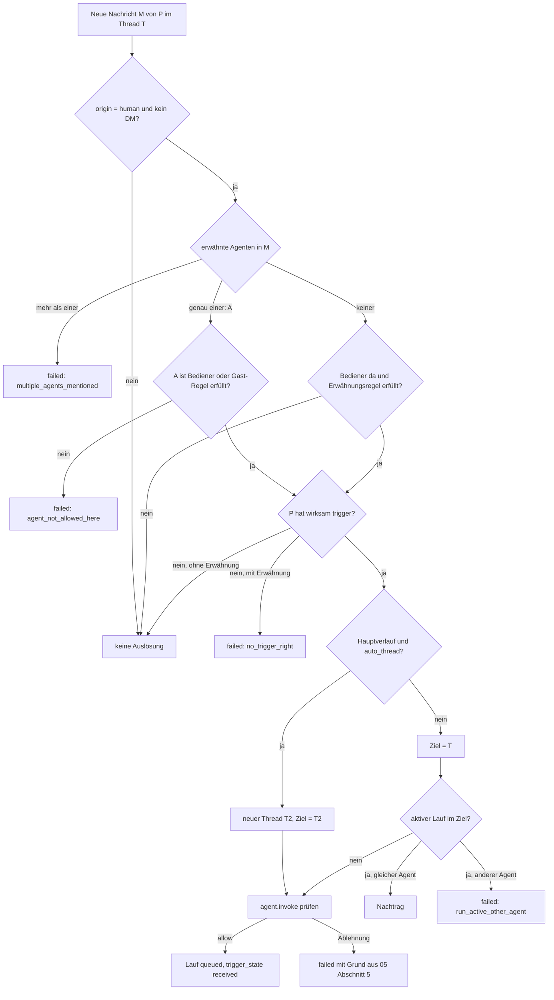
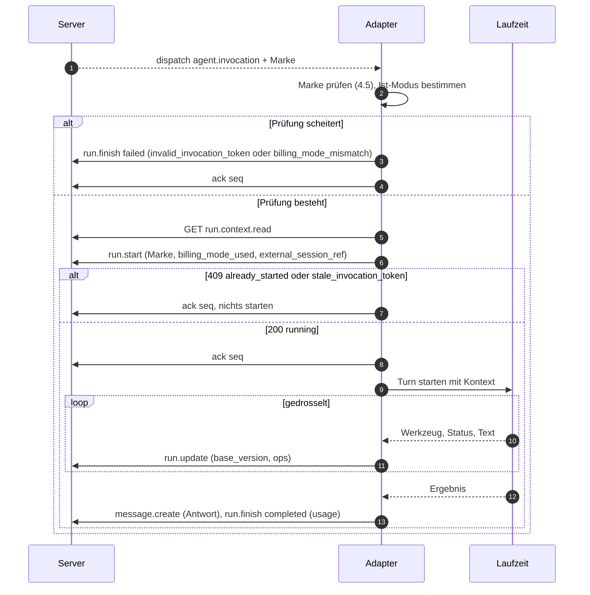
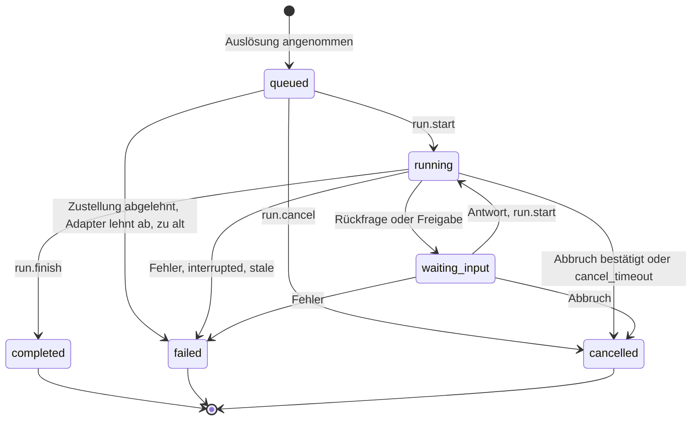
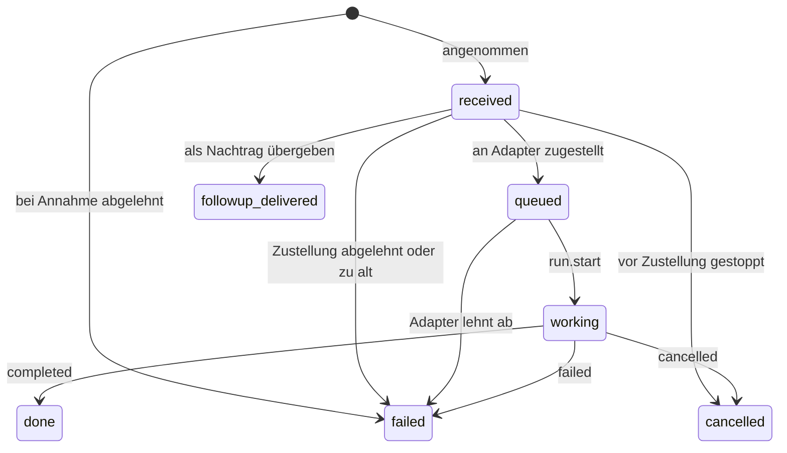
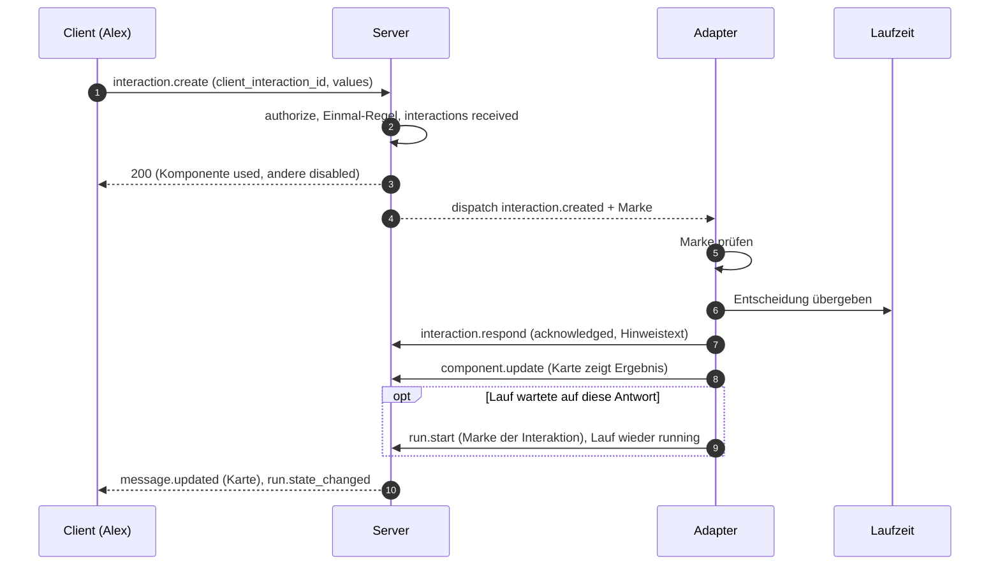
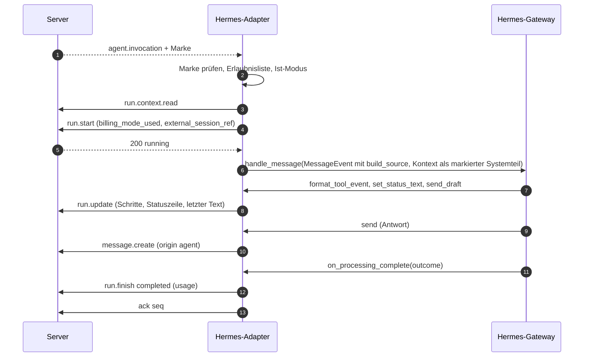
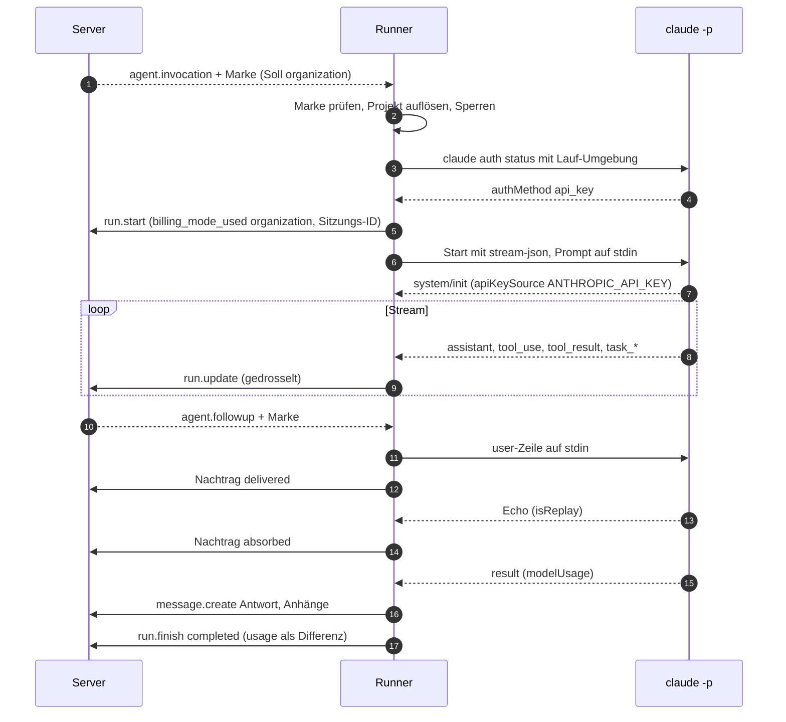

# 09 Agenten

Status: Entwurf M0. Normativ für das Modul `agents` und `runs`, für jeden Agenten-Adapter und für
die beiden Referenz-Adapter (Hermes Agent, Claude-Code-Runner).
Begriffe: [00-glossar.md](00-glossar.md). Tabellen: [03-datenmodell.md](03-datenmodell.md).
Ereignisse, Cursor, Live-Box-Patches: [04-sync-protokoll.md](04-sync-protokoll.md). Aktionen und
`agent.invoke`: [05-aktionen.md](05-aktionen.md). Backend-Richtlinie (I1 bis I5):
[10-backend-richtlinie.md](10-backend-richtlinie.md). Apps, Webhooks, SDK:
[11-erweiterungen.md](11-erweiterungen.md). Rechte und Schutzregeln: [07-rechte.md](07-rechte.md).
Pfade von REST-Endpunkten folgen dem Kern-Vertrag (04); das verbindliche Präfix legt
[06-api.md](06-api.md) fest.

Stellen mit dem Vermerk "(Kern-Vertrag: Ergänzung beantragt)" planen so, wie es richtig wäre. Sie
sind in Abschnitt 20 gesammelt und gelten erst, wenn der Kern-Vertrag sie übernimmt.

## 1. Grundsätze

1. **Außerhalb des Servers.** Agenten-Laufzeiten und Adapter laufen nie im Server-Prozess (B6,
   B10, [ADR 0022](../adr/0022-agenten-und-plugins-ausserhalb-des-server-prozesses.md)). Der Server
   kennt Agenten als Prinzipale, Läufe als Objekte und eine Backend-Richtlinie je Agent.
2. **Öffentliche API.** Ein Adapter nutzt nur die öffentliche API (REST, Gateway). Es gibt keinen
   privaten Kanal. Der Hermes-Adapter ist ein Adapter unter mehreren.
3. **Eine Prüfstelle.** Jede Auslösung, Zustellung und Adapter-Operation läuft durch `authorize`
   mit einer Aktion aus 05. Die Aufruf-Marke (I3) belegt die Entscheidung beim Adapter.
4. **Fail closed.** Fehlt ein Beleg (Marke, Ist-Modus, Rechte), passiert nichts, und der Mensch
   sieht den Grund.
5. **Keine automatische Wiederholung.** Ein abgebrochener Lauf wird nie still wiederholt.
   Nebenwirkungen einer Laufzeit (Dateien, Befehle) dürfen nicht doppelt entstehen.

## 2. Agenten als Prinzipale

### 2.1 Datensätze

| Was | Wo | Hinweis |
|---|---|---|
| Identität | `principals` mit `kind = 'agent'` | Handle für Erwähnungen, Anzeigename, Status |
| Betrieb | `agents` | `adapter_kind`, `operator_config`, `billing_mode`, `credential_holder_id`, gemeldeter Zustand |
| Zugang | `api_tokens` | nur Hash; `dpop_jkt` empfohlen (Token an einen Adapter-Schlüssel gebunden, [08-identitaet.md](08-identitaet.md)) |
| Lesestand | `agent_consumer_cursors` | ein dauerhafter Cursor je `(agent, consumer)` |
| Befehle | `commands` | vom Agenten registriert |
| Sitzungen | `agent_sessions` | eine aktuelle Sitzung je Thread |

Anlegen (`agent.create`), Ändern (`agent.update`), Sperren (`agent.disable`) und Token
(`token.create`) sind Owner-Aktionen mit Step-up. Ein gesperrter Agent verliert sofort Tokens und
Verbindungen; seine aktiven Läufe enden mit `cancelled`, Grund `agent_disabled`.

### 2.2 Fähigkeiten

Eine Fähigkeit ist wirksam, wenn der Owner sie erlaubt **und** der Adapter sie meldet. Der Owner
pflegt die Erlaubnis in `agents.operator_config` (Schema `agent_operator_config.v1`); der Adapter
meldet sein Können im Heartbeat (`agent_heartbeat.v1`, Abschnitt 4.8). Grund: Der Owner soll eine
Fähigkeit abschalten können, aber nie eine einschalten, die der Adapter nicht hat.

| Fähigkeit | Erlaubnis (`operator_config`) | Meldung (Heartbeat `capabilities`) | Wirkung |
|---|---|---|---|
| Nachträge | `supports_followups` | `followups: steer` oder `queue` | Abschnitt 7 |
| Komponenten | `supports_components` | `components: true` | Abschnitt 11; sonst nur Text |
| Spracheingabe | `supports_voice` | `voice_input: true` | Abschnitt 13 |
| Titelvorschlag | `supports_title` | `title: true` | Abschnitt 12 |
| Dateien senden | `supports_files_out` | `files_out: true` | Agent braucht zusätzlich `+upload` |

`supports_title` und `supports_files_out` sind neue Schlüssel in `agent_operator_config.v1`
(Kern-Vertrag: Ergänzung beantragt). `operator_config` enthält nie Geheimnisse.

### 2.3 Freigaben eines Agenten

Ein Agent hat höchstens `write` (R-DM-08). Er braucht `write` auf jedem Kanal, den er bedient, um
dort zu antworten, und `+upload`, um Dateien zu senden. `space.operator.set` und
`channel.operator.set` lehnen ab, wenn der Agent auf dem Ziel nicht wirksam `write` hat (Code
`operator_lacks_write`). Die Konsole bietet dafür eine bestätigte Aktion "Bediener setzen und
Freigabe `write` anlegen" in einer Transaktion an (Kern-Vertrag: Ergänzung beantragt). Grund:
Ein Bediener, der nicht schreiben darf, erzeugt nur fehlschlagende Läufe.

### 2.4 Werkzeugklasse

Die Schutzregel "Werkzeugklasse eines Agenten" steht in [07-rechte.md](07-rechte.md). Sie braucht
ein typisiertes Feld am Agenten, nicht nur `jsonb` (Grundsatz 8 in 03): `agents.tool_class`
(Kern-Vertrag: Ergänzung beantragt). Der Adapter meldet die tatsächlich geladene Klasse im
Heartbeat (`tool_class_reported`); weicht sie ab, zeigt die Konsole eine Warnung, und
`authorize` rechnet mit der höheren der beiden Klassen.

## 3. Bediener und Auslöse-Regeln

### 3.1 Bediener

- **Thread (`threads.kind = 'thread'`).** Der Bediener ist `threads.operator_agent_id`, fest seit
  der Anlage (R-DM-12). Ein späterer Bedienerwechsel am Kanal ändert laufende Gespräche nicht.
- **Hauptverlauf (`threads.kind = 'main'`).** Der Bediener ist der wirksame Bediener des Kanals zum
  Zeitpunkt der Auslösung; `operator_agent_id` bleibt `NULL` (Kern-Vertrag: Präzisierung
  beantragt). Wechselt der Bediener, endet die aktuelle Sitzung des Hauptverlaufs beim nächsten
  Lauf mit `end_reason = 'agent_changed'`. Grund: Ein Hauptverlauf ist kein einzelnes Gespräch;
  ein eingefrorener Bediener würde einen Kanal nach dem Wechsel stumm schalten.
- Ohne Bediener antwortet kein Agent, außer ein erlaubter Gast-Agent wird erwähnt (3.6).

### 3.2 Herkunft (`messages.origin`)

Der Server setzt `origin` aus dem Prinzipal und dem Eingangsweg. Ein Client kann es nie setzen.

| `origin` | Gesetzt bei | Löst Agenten aus |
|---|---|---|
| `human` | Nachricht eines Menschen über REST oder Gateway | ja, nach den Regeln unten |
| `agent` | Nachricht mit Agenten-Token, Live-Box-Anker | nie |
| `app` | Nachricht mit App-Token oder über einen Eingangs-Webhook | nie |
| `import` | Nachricht aus einem Import ([22-import-migration.md](22-import-migration.md)) | nie |
| `system` | vom Server erzeugt (z. B. "Thread verschoben") | nie |

Grund: Schleifenfreiheit ist ein Datenfeld, keine Text-Heuristik. Zwei Agenten können sich nie
gegenseitig auslösen.

### 3.3 Kanal-Schalter

Alle Schalter sind typisierte Spalten von `channels` (03) und nur mit `manage` änderbar
(`channel.behavior.update`).

| Schalter | Standard | Bedeutung |
|---|---|---|
| `require_mention` | `true` | Im Hauptverlauf antwortet der Bediener nur bei Erwähnung. |
| `thread_require_mention` | `false` | In Threads antwortet der Bediener nur bei Erwähnung. |
| `free_response` | `false` | Der Bediener antwortet überall ohne Erwähnung; überstimmt beide Schalter davor. |
| `auto_thread` | `true` | Eine Auslösung im Hauptverlauf legt einen neuen Thread an. |
| `allow_mentioned_agents` | `false` | Weitere Agenten dürfen per Erwähnung antworten (3.6). |
| `history_backfill_limit` | `channel.history_backfill_limit_default` | Fenster für den Kontext (4.6). |

### 3.4 Entscheidung je Nachricht

Für eine neue Nachricht M eines Prinzipals P im Thread T des Kanals C gilt in dieser Reihenfolge:

1. `origin` ist nicht `human`: keine Auslösung, `trigger_state` bleibt leer.
2. C ist ein DM-Kanal: keine Auslösung.
3. E sei die Menge der in M erwähnten Agenten.
   - E hat mehr als ein Element: Ablehnung `multiple_agents_mentioned`. Grund: höchstens ein
     aktiver Lauf je Thread (R-DM-14); welcher Agent gemeint ist, entscheidet nie der Server.
   - E = {A}: A ist Kandidat, wenn A der Bediener ist (3.1) oder die Gast-Regel (3.6) gilt. Sonst
     Ablehnung `agent_not_allowed_here`.
   - E ist leer: Der Bediener ist Kandidat, wenn er existiert und gilt: `free_response`, oder
     (Hauptverlauf und nicht `require_mention`), oder (Thread und nicht `thread_require_mention`).
     Sonst keine Auslösung.
4. P hat auf C nicht wirksam `trigger`: Bei einer ausdrücklichen Erwähnung Ablehnung
   `no_trigger_right`, sonst keine Auslösung. Grund: Wer nur schreiben darf, soll in freien
   Kanälen nicht bei jeder Nachricht eine Fehlermeldung sehen, aber eine gezielte Erwähnung
   braucht eine Antwort.
5. Ziel-Thread: Ist T der Hauptverlauf und `auto_thread` gesetzt, legt der Server in derselben
   Transaktion einen Thread T' mit `parent_message_id = M` an; Ziel ist T'. Sonst ist Ziel T.
6. Hat das Ziel einen aktiven Lauf R: Ist R vom Kandidaten, wird M ein Nachtrag (Abschnitt 7).
   Sonst Ablehnung `run_active_other_agent` (Kern-Vertrag: Ergänzung beantragt; 05 Regel 7 macht
   heute jede Auslösung zum Nachtrag, auch für einen anderen Agenten).
7. `authorize(P, agent.invoke, {Ziel, Kandidat, M})` nach 05 Abschnitt 5 (Rechte, Agent aktiv,
   I2, Projekt bereit). Bei `allow`: Lauf `queued`, Live-Box-Anker, Ereignis `agent.invocation`,
   `trigger_state = received`. Bei Ablehnung: M bleibt gespeichert, `trigger_state = failed` mit
   Grund.

Eine Nachricht mit `trigger_state = failed` zeigt ihren Grund. Dafür braucht `messages` ein Feld
`trigger_state_reason` (Kern-Vertrag: Ergänzung beantragt), weil eine Ablehnung bei der Annahme
keinen Lauf erzeugt, an dem `state_reason` stehen könnte.



### 3.5 Gründe einer Ablehnung bei der Annahme

| Grund | Bedingung | Hinweis an den Menschen |
|---|---|---|
| `multiple_agents_mentioned` | mehr als ein Agent erwähnt | "Bitte nur einen Agenten erwähnen." |
| `agent_not_allowed_here` | erwähnter Agent ist weder Bediener noch erlaubter Gast | "Dieser Agent antwortet hier nicht." |
| `no_trigger_right` | P fehlt `trigger` | "Du darfst hier keine Agenten auslösen." |
| `run_active_other_agent` | anderer Agent arbeitet im Thread | "Ein anderer Agent arbeitet gerade in diesem Thread." |
| `agent_disabled` | Agent gesperrt | "Agent ist abgeschaltet." |
| `billing_mode_personal_not_holder` | I2 (05 Abschnitt 5 Punkt 4) | "Dieser Agent läuft auf einem persönlichen Abo." |
| `project_not_ready` | Projektbindung nicht bereit | "Projekt-Umgebung ist nicht bereit." |
| `voice_unsupported` | Sprachnachricht ohne Transkriptionsweg (13) | "Sprachnachrichten werden hier nicht verstanden." |
| `run_active` | Modell-Befehl während eines aktiven Laufs (10.4) | "Der Agent arbeitet gerade; Befehl nach dem Lauf erneut senden." |

Die Texte sind Schlüssel im Sprachkatalog der Apps ([01-produkt.md](01-produkt.md)); die Tabelle
nennt nur den Sinn.

### 3.6 Gast-Agenten

Ein Gast-Agent ist ein erwähnter Agent, der nicht Bediener des Threads ist. Er wird ausgelöst,
wenn `allow_mentioned_agents` gesetzt ist und er selbst wirksam `write` auf C hat (05 Abschnitt 5
Punkt 3). Ein Gast-Lauf hat keine Agenten-Sitzung (`runs.agent_session_id = NULL`); der Adapter
bekommt `session = null` und arbeitet nur mit dem Kontext aus 4.6. Grund: Je Thread gibt es genau
eine aktuelle Sitzung (03, `agent_sessions`); ein Gast darf die Sitzung des Bedieners nicht
verdrängen. Antworten im Thread ohne Erwähnung lösen danach wieder den Bediener aus, nicht den
Gast.

Ein Agent mit `billing_mode = personal` ist nie Gast-Agent (Kern-Vertrag: Ergänzung beantragt,
05 Abschnitt 5 Punkt 3). Grund: Als Gast wäre er auf jedem Kanal auslösbar, auf dem er `write` hat
und Gäste erlaubt sind; diese Kanäle zählt I1 nicht zu seinen Zielen
([10-backend-richtlinie.md](10-backend-richtlinie.md) Abschnitt 5.2).

### 3.7 Auto-Thread aus einer Kanal-Nachricht

Der neue Thread T' bekommt `parent_message_id = M`, `operator_agent_id` = wirksamer Bediener von
C, `title = ''` und `title_source = 'auto'`. Bis ein Titel gesetzt ist, zeigt der Client die erste
Zeile von M. M bleibt im Hauptverlauf und trägt den `trigger_state`; Lauf, Live-Box-Anker,
Antworten und Sitzung gehören zu T'.

## 4. Adapter-Vertrag

### 4.1 Überblick

| Richtung | Inhalt | Weg |
|---|---|---|
| Server an Adapter | Aufruf, Nachtrag, Abbruch, Interaktion, Befehl, Konfigurationswechsel | persönliche dauerhafte Ereignisse (04 Abschnitt 15) mit Aufruf-Marke |
| Server an Adapter | Kontext eines Laufs, Kanal-Prompt und Skills | REST-Abruf durch den Adapter (4.6, `agent.config.read`) |
| Adapter an Server | Lauf starten, Live-Box-Patches, Lauf beenden | `run.start`, `run.update`, `run.finish` |
| Adapter an Server | Antworten, Dateien, Komponenten, Titel, Thread schließen | normale API mit dem Agenten-Token |
| Adapter an Server | Heartbeat mit Ist-Zustand, Sitzungs-Referenz, Befehle | `agent.heartbeat`, `agent_session.report`, `command.register` |

### 4.2 Transporte

| Transport | Für | Bestätigung | Stand |
|---|---|---|---|
| Gateway-WebSocket | Standard für jeden dauerhaft laufenden Adapter | `ack {seq}` (04 Abschnitt 15.2) | Kern-Vertrag |
| REST-Abruf `GET /v1/events?after=` | Adapter ohne dauerhafte Verbindung, Tests | Cursor im Adapter; dauerhaft per `ack`-Endpunkt | Kern-Vertrag (04 Abschnitt 7.4) |
| Webhook (Push) | Adapter als Funktion ohne laufenden Prozess | Antwort `2xx` gilt als `ack` bis zu dieser `seq` | Kern-Vertrag: Ergänzung beantragt |

Webhook-Zustellung an Agenten braucht ein Abo, das an einen Agenten statt an eine
App-Installation gebunden ist (`webhook_subscriptions.agent_id`, genau eines von beiden gesetzt).
Die Zustellung folgt [11-erweiterungen.md](11-erweiterungen.md) Abschnitt 7 und liefert je Abo
streng in `seq`-Reihenfolge: das nächste Ereignis erst nach `2xx` auf das vorige. Jede Zustellung,
auch eine Wiederholung, trägt eine frisch ausgestellte Aufruf-Marke (R-SY-07).

### 4.3 Verbindung und Cursor

Es gilt 04 Abschnitt 15.1 und 15.2 unverändert: `identify` mit `api_token` und `consumer`, ein
Prozess je Verbraucher (`4015` bei Übernahme), Cursor beim ersten Verbinden auf `head_seq`,
Zustellung ab `acked_seq + 1`, höchstens `agent.max_inflight_events` unbestätigt, erneute
Zustellung nach `agent.ack_timeout`. Der Adapter bestätigt ein Ereignis erst, wenn er es dauerhaft
verarbeitet hat: Ein `agent.invocation` gilt als verarbeitet, sobald `run.start` beantwortet oder
der Lauf mit `run.finish` abgelehnt ist.

### 4.4 Ereignisse an den Adapter

| Ereignis | Wann | Nutzlast (Schema `<typ>.v1`, Auszug) | Marke |
|---|---|---|---|
| `agent.invocation` | neuer Lauf | `run`, `thread`, `channel` (`id`, `kind`, `settings_version`), `trigger` (`kind`, IDs, Auslöser), `session` (4.9 oder `null`), `capabilities_effective` | ja |
| `agent.followup` | Nachtrag (Abschnitt 7) | `run_id`, `message_id`, Auslöser | ja |
| `interaction.created` | Komponente bedient | `interaction_id`, `component` (`custom_id`, Typ), `values`, `run_id`, Bediener | ja |
| `command.invoked` | Steuerbefehl ausgeführt (10.4) | `command_id`, `name`, `options`, Ort, Auslöser | ja |
| `run.cancel_requested` | Abbruch (Abschnitt 8) | `run_id`, `reason` | nein |
| `agent.config_changed` | Prompt, Skills, Projektbindung geändert | `channel_id`, `settings_version` | nein |

Nutzlasten enthalten nie Kanal-Prompt, Skills oder Projektbindung (04 Abschnitt 2.2 Regel 1) und
nie Nachrichteninhalte über `sync.event_payload_max_bytes` hinaus. Den Inhalt holt der Adapter
per REST (4.6).

### 4.5 Aufruf-Marke

Die Aufruf-Marke ist ein JWT in JWS-Kompaktform ([ADR 0023](../adr/0023-signierte-aufruf-marke-und-pruefung-im-adapter.md)).
Der Server erzeugt sie bei jeder Zustellung neu (R-SY-07) und signiert mit dem aktiven Schlüssel
des Zwecks `invocation` (`server_signing_keys`).

**Kopf.** `alg = "EdDSA"`, `kid` (Schlüssel-ID), `typ = "agent-invocation+jwt"`. Expliziter Typ
nach RFC 8725 Abschnitt 3.11, damit kein anderes JWT des Servers (Zugriffstoken) als Marke
durchgeht (https://www.rfc-editor.org/rfc/rfc8725.html, abgerufen 2026-10-10, [belegt]).

**Claims.** Die Liste aus 05 Abschnitt 5 plus drei Zusätze (Kern-Vertrag: Ergänzung beantragt;
alle additiv):

| Claim | Inhalt | Herkunft |
|---|---|---|
| `iss` | `instance.instance_id` | 05 |
| `aud` | Prinzipal-ID des Agenten | 05 |
| `sub` | Prinzipal-ID des auslösenden Menschen | 05 |
| `jti` | UUIDv7 dieser Marke; steht in `runs.invocation_jti` | 05 |
| `iat`, `exp` | Ausstellung, Ablauf (`iat + agent.invocation_token_ttl`) | 05 |
| `run_id` | Lauf; fehlt nur bei `trigger_kind = autocomplete` | 05 |
| `message_id` oder `interaction_id` oder `command_id` | auslösendes Objekt | 05, `command_id` neu |
| `thread_id`, `channel_id` | Ort | 05 |
| `space_id` | Bereich des Kanals | neu |
| `level` | wirksame Stufe von `sub` auf dem Kanal zur Zustellzeit | 05 |
| `billing_mode` | Soll aus `agents.billing_mode` zur Zustellzeit | 05 |
| `permission_version` | Rechte-Version zur Zustellzeit | 05 |
| `trigger_kind` | `message`, `followup`, `interaction`, `command`, `autocomplete` | neu |

**Prüfung im Adapter.** Der Adapter verarbeitet ein Ereignis mit Marke nur, wenn alle Punkte
gelten. Sonst startet er nichts und meldet den Grund (`run.finish` mit `failed`, Grund
`invalid_invocation_token` oder `billing_mode_mismatch`).

1. `alg` ist genau `EdDSA`; jeder andere Wert wird abgelehnt (RFC 8725 Abschnitt 3.1:
   Algorithmen-Erlaubnisliste, ein Algorithmus je Schlüssel).
2. `typ` ist genau `agent-invocation+jwt`.
3. `kid` steht in der zwischengespeicherten JWKS des Servers. Fehlt er, lädt der Adapter die JWKS
   einmal neu, höchstens einmal je `adapter.jwks_refresh_min_interval`.
4. Signatur gültig; `iss` gleich der konfigurierten Instanz; `aud` gleich der eigenen Agenten-ID.
5. `exp` liegt in der Zukunft, `iat` nicht in der Zukunft, je mit `adapter.invocation_token_leeway`.
6. `run_id`, `thread_id` und das auslösende Objekt stimmen mit der Nutzlast des Ereignisses
   überein.
7. `jti` ist dem Adapter neu (Speicher bis `exp`); eine Wiederholung derselben Marke wird
   ignoriert.
8. `billing_mode` ist gleich dem Ist-Modus der Laufzeit für genau diesen Lauf (I3,
   [10-backend-richtlinie.md](10-backend-richtlinie.md) Abschnitt 7).
9. `sub` steht in der Erlaubnisliste des Adapters, wenn er eine führt (17.7). Ist die
   `permission_version` der Marke größer als die der Liste, lädt er die Liste vorher neu.

Der Server prüft beim Lauf-Start erneut: Signatur, Ablauf, `jti` gleich `runs.invocation_jti`
und Ist-Modus gleich Soll (`run.start`, 05). Der Adapter kann also keine Marke wiederverwenden und
keinen Lauf ohne gültige Marke starten.

**Schlüssel und Rotation.** Die JWKS-Ausgabe (Aktion `instance.discovery.read`) enthält die
Schlüssel des Zwecks `invocation` in den Zuständen `next`, `active` und `retiring`, mit
`Cache-Control: max-age` = `agent.jwks_max_age`.

1. Planmäßig nach `signing_key.invocation_rotation_interval`: Ein neuer Schlüssel geht nach `next`
   und wird mindestens `agent.jwks_max_age` lang veröffentlicht, bevor er `active` wird. So kennt
   jeder Adapter ihn vor der ersten Marke.
2. Der alte Schlüssel geht nach `retiring` und bleibt veröffentlicht, bis
   `agent.invocation_token_ttl` plus `adapter.invocation_token_leeway` vergangen sind; dann
   `retired`.
3. Notfall (Schlüssel kompromittiert): sofort `retired` (`signing_key.rotate`, Owner, Step-up).
   Marken mit diesem `kid` scheitern beim Adapter; weil der Server Marken je Zustellung neu
   ausstellt, kommt das Ereignis nach `agent.ack_timeout` mit einer Marke des neuen Schlüssels
   wieder. Ein Notfallwechsel kostet höchstens eine Zustellverzögerung, keinen Lauf.

### 4.6 Kontext eines Laufs

Der Adapter holt den Kontext per REST mit der Aktion `run.context.read` (agent-self, nur für eigene
aktive Läufe; Kern-Vertrag: Ergänzung beantragt). Der Server baut ihn, weil nur `authz` weiß,
welche Autoren wie vertrauenswürdig sind. Schema `run_context.v1`:

| Teil | Inhalt | Grenze |
|---|---|---|
| `trigger_message` | auslösende Nachricht vollständig, mit Anhängen | nie gekürzt |
| `thread_context` | Nachrichten von T vor M mit `thread_seq` größer `context_floor_seq` | neueste zuerst behalten, höchstens `history_backfill_limit` Nachrichten |
| `channel_context` | nur beim ersten Lauf einer Sitzung in einem Thread mit `parent_message_id`: Nachrichten des Hauptverlaufs vor der Elternnachricht | höchstens `history_backfill_limit` Nachrichten |
| `truncated_before_seq` | gesetzt, wenn ältere Nachrichten fehlen | Adapter kann mit `thread.read` nachladen |

- `context_floor_seq` ist die `thread_seq` der auslösenden Nachricht des vorigen Laufs derselben
  Sitzung, sonst `0`. Grund: Eine fortgesetzte Sitzung kennt alles, was ihr schon zugestellt
  wurde; sie braucht nur, was andere seitdem geschrieben haben.
- Eigene Nachrichten des Agenten fehlen bei `session.mode = resume`; bei `new`, `bind` und
  Gast-Läufen sind sie enthalten. Nachrichten, die dieser Sitzung schon als Nachtrag zugestellt
  wurden (`run_followups` mit `delivered` oder `absorbed`), tragen `already_delivered: true`.
- Inhalte über `agent.context_message_max_bytes` werden gekürzt (`truncated: true`); die ganze
  Summe bleibt unter `agent.context_max_bytes` (ohne `trigger_message`).
- Jedes Element: `message_id`, `thread_seq`, `created_at`, `author` (`id`, `kind`, `handle`,
  `display_name`), `role` (`user` für Menschen, `assistant` für diesen Agenten, `other` für andere
  Agenten, Apps, Importe und System), `origin`, `kind`, `content_md`, `attachments` (`file_id`,
  Name, MIME, Größe, `scan_status`, Transkript falls vorhanden), `reply_to_message_id`, `trust`.
  `role` sagt der Laufzeit, wer spricht; `trust` sagt, wie sie den Inhalt behandeln muss.

**Vertrauensmarke `trust`.** Der Server setzt sie zur Abfragezeit:

| `trust` | Autor |
|---|---|
| `trigger` | der auslösende Mensch |
| `authorized` | anderer aktiver Mensch mit wirksam `trigger` auf C |
| `self` | dieser Agent |
| `unverified` | Mensch ohne `trigger` auf C, andere Agenten, Apps, Importe |
| `system` | `origin = system` |

Pflicht für jeden Adapter: Inhalte mit `unverified` gibt er an die Laufzeit nur als markierte
Daten weiter, nie als Anweisung, mit einem festen Hinweis vor dem Block. Der Kontext erreicht die
Laufzeit als fester Systemteil mit Autor und Marke, getrennt vom Text des Auslösers. Grund:
Prompt-Injection über fremde Inhalte (Bedrohungsmodell in [19-sicherheit.md](19-sicherheit.md));
die Laufzeit kann Absender nicht selbst unterscheiden.

Anhänge lädt der Adapter mit `file.read`. Dateien vor `scan_status IN ('clean','skipped')` sind
nicht abrufbar ([12-dateien.md](12-dateien.md)).

### 4.7 Operationen des Adapters

Alle Operationen nutzen das Agenten-Token (bei `dpop_jkt` DPoP-gebunden) und die
Rate-Limit-Klasse aus 05.

| Zweck | Aktion | Idempotenz | Regel |
|---|---|---|---|
| Lauf starten | `run.start` | CAS auf Zustand, `jti` | Körper: `invocation_token`, `billing_mode_used`, `external_session_ref`, optional `model`, `billing_evidence` (Ergänzung, additiv). Gilt für `queued -> running` und `waiting_input -> running` (5.1). |
| Live-Box ändern | `run.update` | `base_version` | erlaubte Pfade in 5.3; Drossel `agent.run_update_min_interval` |
| Schritt melden | `run.update` auf `/steps/<id>` | Schritt-ID (UUIDv7) vom Adapter | `ordinal` vergibt der Server |
| Nachtrag quittieren | `run.update` auf `/followups/<message_id>/state` | Zustand nur vorwärts | `delivered`, dann `absorbed` |
| Lauf beenden | `run.finish` | gleicher Endzustand wiederholt = `200` | Körper: `state`, `reason`, `summary`, `usage` (4.10) |
| Antwort senden | `message.create` | `client_msg_id` | `origin = agent`; der Adapter speichert die ID vor dem Senden |
| Datei senden | `file.upload`, dann `message.create` | Upload-Sitzung, `client_msg_id` | braucht `+upload` und Fähigkeit `files_out` |
| Rückfrage, Freigabe | `message.create` mit `kind = card` und Komponenten | `client_msg_id` | danach `run.finish` mit `waiting_input` (Abschnitt 11) |
| Komponenten ändern | `component.update` | `version` | nur eigene Nachrichten |
| Interaktion beantworten | `interaction.respond` | Zustand nur vorwärts | Abschnitt 11.4 |
| Titel vorschlagen | `thread.title.update` | `expected_version` | nur bei `title_source = auto`; Quelle bleibt `auto` (Abschnitt 12) |
| Thread schließen | `thread.close` | idempotent | nur auf ausdrücklichen Wunsch eines Menschen |
| Sitzung melden | `agent_session.report` | `expected_version` (CAS) | Abschnitt 9 |
| Befehle pflegen | `command.register`, `command.remove` | Sammelabgleich | Abschnitt 10 |
| Heartbeat | `agent.heartbeat` | letzter gewinnt | Abschnitt 4.8 |
| Transkript liefern | `file.transcript.submit` | `expected_version` | Kern-Vertrag: Ergänzung beantragt (Abschnitt 13) |

**Tippen.** Agenten senden kein eigenes Tippen (04 Abschnitt 12.1). Der Client zeigt "Agent
arbeitet", solange der Lauf `running` ist. Adapter, deren Laufzeit Tipp-Signale erzeugt,
verwerfen sie.

### 4.8 Heartbeat und Ist-Zustand

Der Adapter sendet den Heartbeat über das Gateway oder per REST. Schema `agent_heartbeat.v1`
(Inhalt von `agents.reported_details`; Kern-Vertrag nennt nur den Namen):

| Feld | Inhalt |
|---|---|
| `state` | `online` oder `degraded`; `offline` leitet der Server nach `agent.presence_timeout` ab |
| `degraded_reasons` | Codes, z. B. `runtime_unreachable`, `busy_mode_invalid`, `billing_evidence_unknown` |
| `adapter` | `name`, `version` |
| `runtime` | `name`, `version` (z. B. Laufzeit-Version), nie Pfade |
| `protocol_version` | Gateway-Protokoll |
| `reported_billing_mode` | `personal`, `organization` oder `null` für Adapter, die je Lauf dem Soll folgen (17.8, 18.3) |
| `billing_modes_supported` | Liste der Modi, die der Adapter belegen kann |
| `billing_evidence` | `provider`, `key_type` (`api_key`, `oauth`, `cloud`, `none`, `unknown`), `method`; nie ein Wert, nie ein Präfix |
| `capabilities` | Abschnitt 2.2 |
| `tool_class_reported` | Abschnitt 2.4 |
| `active_runs` | IDs der Läufe in `running` oder `waiting_input`, die der Adapter gerade hält |
| `projects` | nur Runner: `workspace_ref`, `ready`, `reason` (setzt `project_bindings.ready`) |

Der Server vergleicht bei jedem Heartbeat:

- `active_runs` mit seinen Läufen `running` und `waiting_input` dieses Agenten. Fehlt ein Lauf in
  `active_runs` länger als `agent.presence_timeout`, setzt der Server ihn auf `failed` mit Grund
  `interrupted` (5.5).
- `reported_billing_mode` und `billing_modes_supported` mit dem Soll; eine Abweichung erzeugt
  eine Warnung an der Agenten-Karte ([10-backend-richtlinie.md](10-backend-richtlinie.md)
  Abschnitt 8).

### 4.9 Reihenfolge im Adapter: erst Zusage, dann Laufzeit



Der Adapter startet die Laufzeit erst nach `200` auf `run.start`. Stürzt er zwischen Zusage und
Laufzeit-Start ab, ist der Lauf `running` ohne Laufzeit und endet als `interrupted`. Damit läuft
ein Aufruf höchstens einmal, nie zweimal.

### 4.10 Verbrauch am Laufende

`run.finish` trägt `usage`: eine Liste je Modell mit `provider`, `model`, `tokens_in`,
`tokens_out`, `tokens_cache_read`, `tokens_cache_write` und optional `amount_micros` und
`currency` (Schätzung der Laufzeit). Der Server schreibt daraus `cost_entries` nach
[10-backend-richtlinie.md](10-backend-richtlinie.md) Abschnitt 12. Zwischenstände während des
Laufs meldet der Adapter über `run.update` auf `/metrics` und `/cost`.

## 5. Lauf

### 5.1 Zustandsmaschine

Die Übergänge stehen in 03 (`runs`); diese Tabelle nennt, wer sie auslöst
([ADR 0025](../adr/0025-lauf-als-eigenes-objekt-fuer-die-live-box.md)).

| Von | Nach | Ausgelöst durch | Bedingung |
|---|---|---|---|
| `queued` | `running` | Adapter, `run.start` | gültige Marke, `jti` aktuell, Ist-Modus gleich Soll |
| `queued` | `failed` | Server bei Zustellung (I2, Rechte), Adapter (`run.finish`), Server nach `run.queued_max_age` | Grund in 5.2 |
| `queued` | `cancelled` | Mensch (`run.cancel`) vor dem Start | |
| `running` | `waiting_input` | Adapter, `run.finish` mit `waiting_input` | Rückfrage oder Freigabe offen |
| `running` | `completed` | Adapter, `run.finish` | |
| `running` | `failed` | Adapter, Server (`interrupted`, `stale`) | |
| `running` | `cancelled` | Adapter nach `run.cancel_requested`, Server nach `agent.cancel_grace` | |
| `waiting_input` | `running` | Adapter, `run.start` mit der Marke der Antwort (Interaktion oder Nachtrag) | |
| `waiting_input` | `failed`, `cancelled` | wie bei `running` | |

`run.start` deckt beide Starts ab (Kern-Vertrag: Präzisierung beantragt; 05 nennt nur
`queued -> running`). Jede Zustellung, die einen Start erlaubt (`agent.invocation`; bei
`waiting_input` auch `agent.followup` und `interaction.created`), ersetzt `runs.invocation_jti`.
Zustellungen während `running` ändern es nicht. Bei jeder Zustellung setzt der Server
`runs.billing_mode_expected` auf das aktuelle Soll (Kern-Vertrag: Präzisierung beantragt; 03 sagt
"beim Aufruf").



### 5.2 Gründe (`runs.state_reason`)

| Grund | Zustand | Gesetzt von | Bedeutung |
|---|---|---|---|
| `user_cancelled` | `cancelled` | Server | Mensch hat gestoppt |
| `access_revoked` | `cancelled` | Server | Auslöser verlor `trigger` (04 Abschnitt 8.3) |
| `cancel_timeout` | `cancelled` | Server | Adapter meldete den Abbruch nicht in `agent.cancel_grace` |
| `agent_disabled` | `cancelled` | Server | Agent gesperrt |
| `billing_mode_personal_not_holder` | `failed` | Server | I2 bei Zustellung |
| `billing_mode_mismatch` | `failed` | Adapter oder Server | I3 |
| `invalid_invocation_token` | `failed` | Adapter | Marke ungültig |
| `project_not_ready` | `failed` | Server | Projektbindung nicht bereit |
| `agent_unavailable` | `failed` | Server | länger als `run.queued_max_age` in `queued` |
| `interrupted` | `failed` | Server | Adapter meldet den Lauf nicht mehr als aktiv |
| `stale` | `failed` | Server | kein Heartbeat seit `run.orphan_timeout` bei aktivem Lauf |
| `runtime_error` | `failed` | Adapter | Laufzeit meldet einen Fehler; Details im letzten Schritt |
| `adapter_error` | `failed` | Adapter | Fehler im Adapter selbst |
| `runtime_not_authenticated` | `failed` | Adapter | Laufzeit hat keine gültige Anmeldung |

Unbekannte Gründe eines Adapters speichert der Server als `adapter_error` mit dem Originalcode in
den Details.

### 5.3 Lauf-Dokument (`run_document.v1`)

Das Dokument ist die Sicht auf `runs`, `run_steps` und `run_followups` (04 Abschnitt 11.1). Der
Adapter ändert es nur über RFC-6902-Patches mit `add`, `replace`, `remove`.

| Pfad | Typ | Adapter darf | Gespeichert in |
|---|---|---|---|
| `/state`, `/version`, `/billing_mode_expected`, Zeiten | | nie (eigene Endpunkte) | `runs` |
| `/status_line` | Text | `add`, `replace`, `remove` | `runs.status_line` |
| `/last_text_excerpt` | Text, gekürzt auf `run.excerpt_max_chars` | `add`, `replace` | `runs.last_text_excerpt` |
| `/model` | Text | `replace` | `runs.model` |
| `/metrics/<feld>` | Zahl | `add`, `replace` | `runs.metrics` (`run_metrics.v1`) |
| `/metrics/last_api_retry` | Objekt `attempt`, `max_retries`, `retry_delay_ms`, `error` | `add`, `replace`, `remove` | `runs.metrics` (Ergänzung beantragt) |
| `/cost` | Objekt `amount_micros`, `currency`, `is_estimate` | `replace` | `runs.cost_micros` u. a. |
| `/plan` | Objekt `items` (`id`, `text`, `status`) | `add`, `replace`, `remove` | `runs.plan` (Kern-Vertrag: Ergänzung beantragt, Schema `run_plan.v1`) |
| `/steps/<id>` | Schritt ohne `ordinal` | `add`; danach `replace` auf `status`, `title`, `detail`, `finished_at` | `run_steps` |
| `/followups/<message_id>/state` | `delivered`, `absorbed` | `replace`, nur vorwärts | `run_followups` |

Alles andere lehnt der Server mit `422 patch_path_forbidden` ab. `run_steps.detail` wird auf
`run.step_detail_max_bytes` gekürzt. Über `run.max_steps_persisted` fasst der Server ältere
abgeschlossene Schritte zusammen (03).

### 5.4 Live-Box-Inhalt

Die Darstellung entwirft [01-produkt.md](01-produkt.md); diese Tabelle legt die Datenquelle fest.

| Anzeige | Quelle | Während des Laufs | Eingeklappt |
|---|---|---|---|
| Zustand | `state` | ja, als Icon und Wort | ja |
| Dauer | `started_at` bis jetzt bzw. `duration_ms` | ja, lokal hochgezählt | ja |
| Kontext in Prozent | `metrics.context_pct` | ja | nein |
| Kosten | `cost`, mit "Schätzung" solange `is_estimate` | nur bei `organization` | nur bei `organization` |
| Abzeichen Backend | `billing_mode_used`, sonst Soll | ja | ja |
| Aktuelles Werkzeug | jüngster Schritt `tool_call` mit `status = running` | ja | nein |
| Letzter Text | `last_text_excerpt` als Zitat | ja | nein |
| Plan | `plan.items` mit Status | ja | nein |
| Unteragenten, Workflows, Hintergrundjobs | Schritte `subagent`, `workflow`, `background_job` (offen und Anzahl) | ja | Anzahl |
| API-Wiederholung | `metrics.last_api_retry` | ja, solange gesetzt | nein |
| Nachträge | `followups` mit Zustand | ja | nein |
| Stillstand | `stall_warned_at` gesetzt | Hinweis "keine Bewegung seit ..." | nein |
| Zusammenfassung | `summary` des Adapters (optional) | nein | ja |

Nach dem Ende klappt die Box auf eine Zeile zusammen. Der Client baut die Zeile aus
`run.state_changed` (Zustand, Dauer, Anzahl der Schritte je Art, Kosten) und dem optionalen
`summary`, nicht aus einem fertigen Satz des Servers. Grund: Die Zeile ist übersetzbar und
gleich auf allen Geräten.

Der Live-Box-Anker ist eine Nachricht mit `kind = 'run'`, Autor der Agent, `origin = 'agent'`,
leerem Inhalt. Der Server legt sie in derselben Transaktion wie den Lauf an. Damit steht die Box
fest hinter der auslösenden Nachricht, auch wenn der Lauf nie startet. Der Anker löst keine
Benachrichtigung aus; "Antwort fertig" hängt am Laufende ([13-push-benachrichtigungen.md](13-push-benachrichtigungen.md)).

### 5.5 Stillstand, Unterbrechung, verwaiste Läufe

| Lage | Erkennung | Folge |
|---|---|---|
| Kein Fortschritt | kein `run.update` seit `run.stall_after` | `stall_warned_at` setzen, Hinweis in der Box; kein Zustandswechsel |
| Adapter neu gestartet | Lauf fehlt in `active_runs` des Heartbeats länger als `agent.presence_timeout` | `failed`, Grund `interrupted` |
| Adapter verschwunden | kein Heartbeat seit `run.orphan_timeout` bei Lauf in `running` oder `waiting_input` | `failed`, Grund `stale` |
| Agent offline beim Aufruf | Lauf bleibt `queued`, Box zeigt "Agent offline, wartet" | nach `run.queued_max_age`: `failed`, Grund `agent_unavailable` |

Nach `interrupted` und `stale` gibt es keine automatische Wiederholung. Die Box zeigt "Lauf
unterbrochen" und einen Knopf "Erneut senden", der eine neue Nachricht mit dem Text der
auslösenden Nachricht in das Ausgangsfach legt. Grund: Die Laufzeit kann vor dem Absturz schon
Nebenwirkungen erzeugt haben; nur der Mensch entscheidet, ob er wiederholt.

`run.queued_max_age` begrenzt, wie alt ein Auftrag sein darf, wenn ein Adapter nach einer Pause
wiederkommt. Grund: Ein Auftrag, der überraschend lange nach dem Absenden ausgeführt wird, ist
schlimmer als eine sichtbare Ablehnung.

## 6. Auslöser-Status (`trigger_state`)

| Zustand | Bedeutung | Gesetzt bei |
|---|---|---|
| `received` | Server hat angenommen, Lauf `queued` oder Nachtrag angelegt | Annahme (3.4 Punkt 7) |
| `queued` | Aufruf an den Adapter zugestellt, Start steht aus | erste erfolgreiche Zustellung von `agent.invocation` (Kern-Vertrag: Präzisierung beantragt) |
| `working` | Lauf läuft (auch `waiting_input`) | `run.start` |
| `done` | Lauf `completed` | `run.finish` |
| `failed` | Ablehnung oder Lauf `failed` | Annahme, Zustellung oder Laufende; Grund in `trigger_state_reason` |
| `cancelled` | Lauf gestoppt | Laufende mit `cancelled` (Kern-Vertrag: Ergänzung beantragt, neuer Wert) |
| `followup_delivered` | Nachtrag an die Laufzeit übergeben | Adapter meldet `delivered` |

Grund für die Trennung `received` und `queued`: Ist der Agent offline, sieht der Mensch "Server
hat es, Agent noch nicht". Grund für den neuen Wert `cancelled`: Ein gestoppter Lauf ist kein
Fehler; ein rotes Fehler-Icon nach einem bewussten Stopp führt in die Irre.



Jede Änderung schreibt `message.updated` (dauerhaft). Der Client zeigt Icons des Design-Systems,
keine Emoji ([01-produkt.md](01-produkt.md)).

## 7. Nachträge während eines Laufs

Eine Nachricht, die nach 3.4 den Agenten des aktiven Laufs auslösen würde, wird ein Nachtrag
(`run.followup.create`, 3.4 Punkt 6; 05 Abschnitt 5 Punkt 7 spricht von "der Auslösung"). Eine
Nachricht ohne Auslösung (kein `trigger`, Erwähnungsregel nicht erfüllt) bleibt eine normale
Nachricht und erreicht den Agenten nur als Kontext des nächsten Laufs. Grund: Ein Kanal mit
Erwähnungspflicht soll Gespräche zwischen Menschen nicht in einen laufenden Turn schieben.

| Wirksame Fähigkeit | Verhalten |
|---|---|
| `followups = steer` | Server sendet `agent.followup` mit Marke. Der Adapter gibt den Text in den laufenden Turn und meldet `delivered`, dann `absorbed`. |
| `followups = queue` oder keine | Server sendet nichts. Der Nachtrag bleibt `queued` und wird am Laufende `deferred` (04 Abschnitt 15.4 Punkt 4). |

Am Laufende gilt:

| Ende | Nachträge in `queued` oder `delivered` ohne `absorbed` |
|---|---|
| `completed`, `failed` | `deferred`; der erste wird auslösende Nachricht eines neuen Laufs, die übrigen seine Nachträge (04) |
| `cancelled` mit `user_cancelled` | `discarded`; die Nachricht zeigt "nicht bearbeitet, Lauf gestoppt" und einen Knopf "Erneut senden" |
| `cancelled` aus anderem Grund | `deferred` |

Grund für `discarded` nach einem Stopp: Wer stoppt, will, dass nichts mehr passiert; ein
automatisch folgender Lauf wäre eine Überraschung. Nach einem Fehler dagegen sind die Nachträge
neue, unbearbeitete Aufträge.

Bestätigung an den Menschen: `trigger_state = followup_delivered` bei `delivered`, und die Box
zeigt je Nachtrag "wartet", "übergeben", "aufgenommen" oder "kommt im nächsten Lauf". Ein
Nachtrag an einen Lauf in `waiting_input` ist die Antwort auf die offene Rückfrage: Der Adapter
übergibt ihn und startet den Lauf mit dessen Marke wieder (`run.start`, 5.1).

Steuerbefehle (Abschnitt 10.1) sind nie Nachträge.

## 8. Stopp

Wege: Knopf "Stopp" in der Box, eingebauter Befehl `/stop`, Rechte-Entzug (04 Abschnitt 8.3),
Sperre des Agenten oder des Auslösers.

1. `run.cancel` prüft `trigger` und (Auslöser des Laufs oder `manage`) (R-AZ-07).
2. Lauf in `queued` ohne Zustellung: sofort `cancelled`. Sonst schreibt der Server
   `run.cancel_requested` an den Agenten.
3. Der Adapter beendet den Turn (Hermes: Unterbrechung; Runner: SIGINT, 18.6) und meldet
   `run.finish` mit `cancelled`.
4. Ohne Meldung in `agent.cancel_grace` setzt der Server `cancelled` mit `cancel_timeout`. Spätere
   Patches dieses Laufs lehnt er ab (04 Abschnitt 15.5).
5. Offene Komponenten des Laufs werden `disabled`, Nachträge nach Abschnitt 7 behandelt.

## 9. Agenten-Sitzung je Thread

### 9.1 Lebenszyklus

Je Thread gibt es höchstens eine aktuelle Sitzung (`agent_sessions.is_current`). Die
Nutzlast von `agent.invocation` enthält `session`:

| `session.mode` | Lage | Adapter tut |
|---|---|---|
| `new` | keine aktuelle Sitzung, oder eine mit `started = false` | externe Sitzung anlegen (bei vorhandener Referenz genau mit dieser) und Referenz melden |
| `resume` | aktuelle Sitzung, von diesem Adapter schon benutzt | Sitzung `external_session_ref` fortsetzen |
| `bind` | aktuelle Sitzung mit `started = true`, aber noch kein Lauf darin (Umbinden, Import) | Sitzung übernehmen wie `/resume` der Laufzeit, Ergebnis melden (9.5) |

Ablauf bei `new`: Kennt der Adapter die Referenz vor dem Start (Runner: vorab vergebene UUID),
meldet er sie in `run.start`; der Server legt die Zeile an (`is_current`, `started = false`) und
setzt `runs.agent_session_id`. Entsteht die Referenz erst in der Laufzeit (Hermes: Sitzungs-ID),
lässt der Adapter sie in `run.start` weg und meldet sie mit `agent_session.report`, sobald sie
existiert; der Server legt die Zeile bei dieser Meldung an (Kern-Vertrag: Präzisierung beantragt;
04 nennt die Referenz als Teil von `run.start`). Sobald die Laufzeit die Sitzung bestätigt
(Runner: `system/init` mit `session_id`), meldet der Adapter `started = true`. Scheitert der erste
Turn vorher, bleibt `started = false`; der nächste Lauf bekommt wieder `new` mit derselben
Referenz (Runner: wieder `--session-id` mit derselben UUID).

### 9.2 Neue Sitzung (`/new`)

`agent_session.reset` beendet die aktuelle Sitzung (`ended_at`, `end_reason = 'reset'`) und
schreibt `agent_session.changed`. Der nächste Lauf bekommt `session.mode = new`. Läuft gerade ein
Lauf, wartet der Reset bis zu dessen Ende (der Befehl antwortet "nach dem Lauf").

### 9.3 Frühere Sitzungen

Beendete Zeilen desselben Threads sind die frühere Sitzungsgeschichte (`agent_session.read`):
Referenz, Modell, Kosten, Zeitraum, Ende-Grund. Die Konsole zeigt sie in der rechten
Sitzungsspalte ([01-produkt.md](01-produkt.md)).

### 9.4 Umbinden (`/resume`)

`agent_session.bind` bindet eine vorhandene externe Sitzung an den aktuellen Thread. Körper:
`external_session_ref`, `expected_current_session_id` (oder `null`), `take_over` (bool).

1. Prüfung: `trigger` und `agent.invoke` auf diesem Thread; ist die Referenz in einem anderen
   Thread aktuell, zusätzlich dort, und `take_over` muss gesetzt sein, sonst `409
   session_bound_elsewhere`.
2. Eine Transaktion, Compare-and-swap über `agent_sessions.version`: alte aktuelle Zeile dieses
   Threads endet (`rebind`); bei Übernahme endet die Zeile im anderen Thread ebenfalls (`rebind`);
   neue Zeile mit `started = true`.
3. Passt `expected_current_session_id` nicht, `409 version_conflict`; nichts ändert sich.
4. Audit-Eintrag (05: `agent_session.bind` mit Audit).

Der nächste Lauf bekommt `session.mode = bind`.

### 9.5 Import-Bindung und fail open

Der Import legt für einen importierten Thread mit früherer Sitzung eine aktuelle Zeile an
(`started = true`, Referenz der alten Sitzung; [22-import-migration.md](22-import-migration.md)).
Die eigentliche Übernahme passiert beim ersten Schreiben:

1. Erster Lauf: `session.mode = bind`.
2. Der Adapter übernimmt die Sitzung mit den Mitteln der Laufzeit (Hermes: wie `/resume`, an das
   lebende Ende einer Kompressionskette; Runner: `--resume`).
3. Er meldet `agent_session.report` mit `expected_version` und der tatsächlich benutzten Referenz.
   Compare-and-swap: genau ein Erfolg, auch bei zwei gleichzeitigen Läufen.
4. Fail open: Existiert die alte Sitzung in der Laufzeit nicht, startet der Adapter eine neue,
   meldet sie mit `bind_failed: session_missing`, und der Server beendet die Importzeile
   (`end_reason = 'import'`). Der Lauf geht weiter. Die Box zeigt einmal "Frühere Sitzung nicht
   gefunden, neue Sitzung begonnen". Grund: Ein fehlender Verlauf darf das Weiterarbeiten nicht
   blockieren.

## 10. Slash-Befehle

### 10.1 Eingebaute Befehle

Diese Namen sind reserviert; `command.register` lehnt sie mit `409 command_name_reserved` ab.
Sie gehen nie als Prompt an ein Modell (Steuerbefehle).

| Befehl | Wirkung | Aktion |
|---|---|---|
| `/stop` | aktiven Lauf stoppen | `run.cancel` |
| `/status` | Lauf- und Sitzungsdetails im Client öffnen; kein Serveraufruf außer Lesen | `run.read`, `agent_session.read` |
| `/new` | neue Sitzung | `agent_session.reset` |
| `/resume` | externe Sitzung binden, mit Auswahl | `agent_session.bind` |
| `/title` | Titel setzen (Quelle wird `manual`) | `thread.title.update` |
| `/close` | Thread erledigt | `thread.close` |

Ein festes Wort wie "erledigt" im Text schließt keinen Thread. Grund: Wörter im Fließtext lösen
sonst ungewollt Aktionen aus; der Befehl und der Knopf sind eindeutig. Die angezeigten Namen und
Beschreibungen sind übersetzt, der Bezeichner bleibt Englisch.

### 10.2 Registrierung

Der Adapter gleicht beim Verbinden seine vollständige Befehlsliste in einer Anfrage ab. Der
Server legt an, ändert und entfernt; jede Änderung ist ein `command.register` bzw.
`command.remove` mit Audit-Eintrag und `command.changed`. Felder nach 03 (`commands`):
`name`, `description` (bis `command.description_max_chars`, übersetzbar als Map nach Sprache),
`options` (`command_options.v1`), `scope_kind` und Ziel, `required_level`, `control`.

- Geltungsbereich nur auf Zielen, die der Agent bedient oder auf denen er `write` hat.
- Höchstens `command.max_per_principal` Befehle je Agent oder App.

### 10.3 Sichtbarkeit und Namenskonflikte

`command.read` liefert für einen Thread: eingebaute Befehle, Befehle des Bedieners, Befehle von
Gast-Agenten (nur wenn `allow_mentioned_agents`) und Befehle von Apps mit `write` auf dem Kanal.
Bei gleichem Namen stehen die des Bedieners zuerst; andere werden mit dem Handle qualifiziert
(`/handle:name`, 03).

### 10.4 Ausführung

| `commands.control` | Ausführung |
|---|---|
| `true` | `command.invoked` mit Marke sofort an den Agenten, auch während eines Laufs. Kein Lauf, nie an das Modell. Antwort optional als Nachricht des Agenten. |
| `false` | wie eine auslösende Nachricht: Lauf `queued`, `agent.invocation` mit `trigger.kind = command` und den geparsten Optionen. Bei aktivem Lauf: Ablehnung `run_active` mit Hinweis, nicht als Nachtrag. |

Ein Modell-Befehl braucht eine Spur am Lauf: `runs.trigger_kind` und `runs.triggering_command_id`
(Kern-Vertrag: Ergänzung beantragt). Grund: Heute hat ein Lauf aus einem Befehl weder auslösende
Nachricht noch Interaktion; Box und Statistik könnten seine Herkunft nicht zeigen.

Befehle von Apps prüfen `required_level` und Scope; `agent.invoke` und I2 entfallen, weil keine
Agenten-Laufzeit beteiligt ist (Kern-Vertrag: Präzisierung beantragt; 05 nennt `agent.invoke`
für jeden Befehl).

### 10.5 Autovervollständigung

Für Optionen mit `autocomplete = true` fragt der Server den Besitzer des Befehls:

1. Client sendet Befehl, Option und Teiltext (`command.autocomplete`, `rl.trigger`).
2. Server prüft wie `agent.invoke` ohne Lauf (inklusive I2) und sendet ein kurzlebiges Ereignis
   `command.autocomplete_requested` mit `request_id`, Marke (`trigger_kind = autocomplete`) und
   Teiltext an die Verbindung des Agenten (Kern-Vertrag: Ergänzung beantragt; 04 kennt nur Ops
   ohne Antwort).
3. Der Adapter antwortet mit der Gateway-Op `command.autocomplete_result {request_id, choices}`
   oder per REST. Höchstens `command.autocomplete_max_choices` Einträge.
4. Ohne Antwort in `command.autocomplete_timeout` liefert der Server eine leere Liste. Der Client
   zeigt dann die statischen Auswahlwerte, falls es welche gibt.
5. Ein Handler der Autovervollständigung ruft nie ein Modell auf. Grund: Tippen darf keine Kosten
   erzeugen.

Apps beantworten Autovervollständigung über ihre Interaktions-Adresse
([11-erweiterungen.md](11-erweiterungen.md) Abschnitt 3).

## 11. Komponenten

### 11.1 Arten (`component.v1`)

| Typ | Felder der Definition |
|---|---|
| `button` | `label`, `style` (`primary`, `secondary`, `danger`), `icon` (Token des Design-Systems), `value` |
| `select` | `placeholder`, `options` (`label`, `value`, `description`), `min_values`, `max_values` |
| `form` | `title`, `submit_label`, `fields` (`name`, `label`, `type` aus `text`, `textarea`, `number`, `boolean`, `choice`; `required`, `max_length`, `choices`) |

Grenzen: `component.max_per_message` je Nachricht, `custom_id` bis
`component.custom_id_max_chars`, Formulare bis `component.form_max_fields` Felder. Der Server
prüft eingereichte Werte gegen die Definition (`422 interaction_values_invalid`).

### 11.2 Wer darf bedienen

`interaction.create` erlaubt, wenn (05):

1. P hat `trigger` auf dem Kanal und `agent.invoke` gilt (inklusive I2 bei persönlichen Agenten).
2. Komponente `active`, nicht abgelaufen (`expires_at`, Standard `component.default_ttl`).
3. P hat `required_capability`, falls gesetzt (z. B. `approve_actions`).
4. `restricted_to`: `any`; `run_starter` (Auslöser des Laufs oder Owner); `owner` (nur Owner;
   Kern-Vertrag: Ergänzung beantragt, neuer Wert).

Wer nicht bedienen darf, sieht die Komponente deaktiviert mit Hinweis. Wer die Nachricht nicht
lesen darf, sieht sie nicht (404-Regel).

### 11.3 Einmal-Regel je Nachricht

Komponenten mit `single_use` bilden je Nachricht eine Gruppe: Wird eine benutzt, werden alle
anderen aktiven `single_use`-Komponenten derselben Nachricht in derselben Transaktion `disabled`.
Grund: Eine Freigabe-Karte hat genau eine Entscheidung; ein zweiter Klick auf "Ablehnen" nach
"Einmal erlauben" wäre ein Widerspruch.

Sperrfolge (03 Abschnitt 6.3 Punkt 2): `SELECT ... FROM message_components WHERE message_id = $m
AND single_use AND state = 'active' ORDER BY id FOR UPDATE`, dann prüfen, ob die gewählte
Komponente dabei ist, dann `used` bzw. `disabled` setzen. Wer die gewählte Komponente nicht mehr
`active` vorfindet, verliert (`409 component_used`). Das erweitert die Einmal-Regel in 03 von
einer Komponente auf die Gruppe (Kern-Vertrag: Präzisierung beantragt).

### 11.4 Ablauf einer Interaktion



Wiederholt der Client mit derselben `client_interaction_id`, bekommt er die gespeicherte Antwort
(04 Abschnitt 5.1). Bleibt `interaction.respond` länger als `interaction.ack_timeout` aus, zeigt
die Karte "nicht bestätigt"; die Komponente wird nicht wieder aktiv. Grund: Die Zustellung ist
dauerhaft und kommt an, sobald der Adapter zurück ist; eine zweite Entscheidung wäre gefährlicher
als eine späte.

### 11.5 Freigabe-Knöpfe

Eine Freigabe-Anfrage ist eine Nachricht `kind = card` mit vier Knöpfen und dem Lauf als
`run_id`. Der Lauf geht auf `waiting_input`.

| Knopf | `value` | `required_capability` | `restricted_to` |
|---|---|---|---|
| Einmal erlauben | `once` | `approve_actions` | `run_starter` |
| Für diese Sitzung erlauben | `session` | `approve_actions` | `run_starter` |
| Immer erlauben | `always` | `approve_actions` | `owner` |
| Ablehnen | `deny` | keine | `run_starter` |

"Immer erlauben" ändert die dauerhafte Erlaubnisliste der Laufzeit und wirkt damit für alle
künftigen Auslöser dieses Agenten. Darum darf nur ein Owner es wählen. Ein Adapter darf den Knopf
weglassen (Adapter-Konfiguration). Die Karte zeigt nach der Entscheidung, wer was gewählt hat;
das Audit-Log hält die Interaktion fest (05: `interaction.create` mit Audit bei
`approve_actions`).

### 11.6 Rückfragen

Eine Rückfrage ist eine Karte mit Knöpfen oder Auswahl, oder ein Formular. Der Lauf geht auf
`waiting_input`. Antworten: Komponente bedienen oder einen Nachtrag schreiben (Abschnitt 7). Was
zuerst ankommt, gilt; die Karte wird danach `disabled`.

## 12. Auto-Titel

Regeln:

1. Ein Thread hat `title_source = 'auto'`, solange kein Mensch einen Titel gesetzt hat. Setzt ein
   Mensch einen Titel, wird die Quelle `manual` und bleibt es (03).
2. Platzhalter-Erkennung bei der Anlage: Gibt ein Mensch beim Anlegen eines Forum-Beitrags einen
   Titel an, der leer ist oder einem Platzhalter entspricht, bleibt die Quelle `auto`. Platzhalter
   sind die Einträge von `thread.placeholder_titles` (ohne Groß- und Kleinschreibung, Leerraum
   normalisiert) und dieselben Einträge mit angehängter Zahl ("Neuer Chat 3"). Sonst wird die
   Quelle `manual`. Grund: "Neuer Chat" ist kein Titel, den jemand behalten will; ein echter
   Titel wird nie überschrieben.
3. Der Bediener-Agent darf den Titel nur bei Quelle `auto` setzen (`thread.title.update`); die
   Quelle bleibt `auto`. Bei `manual` antwortet der Server `409 title_manual`.
4. Gast-Agenten setzen keine Titel.
5. Referenz-Adapter setzen den Titel einmal nach dem ersten abgeschlossenen Lauf einer neuen
   Sitzung (17.3, 18.4).

## 13. Sprachnachrichten

Eine Sprachnachricht ist eine Nachricht `kind = 'voice'` mit einer Audiodatei. Aufnahme, Format,
Dauer und Speicherung legt [12-dateien.md](12-dateien.md) fest. Für Agenten gilt:

| Lage | Weg |
|---|---|
| Fähigkeit `voice_input` wirksam | Der Agent transkribiert selbst. Der Aufruf enthält die Datei; der Adapter liefert das Transkript mit `file.transcript.submit` (`transcript_source = 'agent'`, Kern-Vertrag: Ergänzung beantragt). |
| sonst, Transkriptions-Port konfiguriert | Der Server transkribiert nach dem Virenscan über den Port `TranscriptionProvider` (`transcription.provider`). Der Lauf wartet in `queued`, bis das Transkript da ist (`transcript_source = 'service'`), höchstens `transcription.timeout`. Der Kontext enthält Text und Datei. |
| sonst | Ablehnung bei der Annahme mit `voice_unsupported` |

Der Port hat einen Treiber je Anbieter (z. B. ein OpenAI-kompatibler Transkriptions-Endpunkt oder
ein lokaler Dienst); Adresse und Schlüssel sind Betreiber-Konfiguration und Secret-Provider. Der
Server sendet Audio nur an die konfigurierte Adresse, nie an eine Adresse aus Nutzerdaten. Ein
externer Anbieter ist ein Auftragsverarbeiter ([20-datenschutz.md](20-datenschutz.md)).
Das Transkript sehen alle mit `file.read` unter der Nachricht.

## 14. Meldungen ohne Auslöser

Cron-Jobs und Hintergrundarbeit einer Laufzeit melden Ergebnisse ohne menschlichen Auslöser:

1. Der Agent schreibt mit `message.create` in einen Meldungskanal, auf dem er `write` hat. Es gibt
   keinen Lauf (`runs.triggered_by` ist ein Mensch) und keine Marke.
2. Je Meldung ein neuer Thread (`thread.create`, Titel aus der ersten Zeile) oder ein fester
   Thread; das wählt die Adapter-Konfiguration.
3. Benachrichtigung nach den Einstellungen des Kanals ([13-push-benachrichtigungen.md](13-push-benachrichtigungen.md)).
4. Rate-Limit `rl.message` des Agenten.
5. Eine Antwort eines Menschen in so einem Thread löst nach den normalen Regeln aus.

Grenze: Der Server prüft nur, wohin der Agent schreibt, nicht was er weiß. Eine Meldung kann
Wissen aus anderen Bereichen enthalten. Darum gehört ein Meldungskanal in einen Bereich, dessen
Leser alles sehen dürfen, was die Laufzeit des Agenten kennt ([19-sicherheit.md](19-sicherheit.md)).

## 15. Zuverlässigkeit

| Ereignis | Verhalten | Grundlage |
|---|---|---|
| Zustellung doppelt (Neustart, Zeitüberschreitung) | `run.start` antwortet `409 already_started`; Adapter startet nichts | R-SY-10, 4.9 |
| Adapter stirbt nach Zusage, vor Laufzeit | Lauf `interrupted`, keine Wiederholung | 4.9, 5.5 |
| Adapter stirbt während des Laufs | `interrupted` bzw. `stale`; Nachträge `deferred` | 5.5, 7 |
| Server-Neustart | Läufe bleiben; Adapter verbindet mit `resume` oder `identify`; Patches nach `409` mit `GET /v1/runs/{id}` neu aufsetzen | 04 Abschnitt 11 |
| Antwort beim Senden verloren | gleiche `client_msg_id` erneut; Server liefert das Original | 04 Abschnitt 5.1 |
| Adapter lange offline | Läufe `queued`, nach `run.queued_max_age` `agent_unavailable` | 5.5 |
| Rechte-Entzug während des Laufs | `run.cancel_requested` mit `access_revoked` | 04 Abschnitt 8.3 |
| Marke abgelaufen bevor Adapter startet | `401 invocation_token_expired` bei `run.start`; Adapter bestätigt nicht, Server stellt mit neuer Marke zu | R-SY-07 |

Ein Adapter hält ein eigenes Ausgangsfach für Antworten (IDs vor dem Senden speichern), damit ein
Neustart des Adapters keine Antwort doppelt oder gar nicht sendet.

## 16. Tests

### 16.1 Testdoppel

| Doppel | Zweck | Aufbau |
|---|---|---|
| Fake-Agent | Server-Konformität des Adapter-Vertrags | Skriptbarer Adapter auf dem Python-SDK ([11-erweiterungen.md](11-erweiterungen.md)); Szenarien als Daten; kann Fehler spielen (falsche `base_version`, abgelaufene Marke, falscher Ist-Modus, Absturz nach Zusage) |
| FakeServer | Adapter-Tests ohne echten Server | Im SDK enthalten; In-Prozess-Server auf `127.0.0.1` mit Port 0; Fehlerinjektion "gespeichert, dann 502", "spät gespeichert", Rate-Limit, Verbindungsabbruch |
| Fake-Hermes | Hermes-Adapter gegen echten Hermes-Code | Unterprozess mit gepinnter Hermes-Version, Wegwerf-`HERMES_HOME`, Plugin über die echte Plugin-Suche; Modell über einen lokalen Fake-Endpunkt mit festen Antworten (keine Kosten); Hermes-Checkout vorher und nachher unverändert |
| Fake-Claude | Runner ohne echte Modellaufrufe | ausführbares Skript, das aufgezeichnete stream-json-Fixtures abspielt, stdin liest und auf SIGINT reagiert |

Echte Laufzeiten mit Modellaufrufen laufen nur hinter einem ausdrücklichen Schalter, weil sie Geld
kosten.

### 16.2 Pflicht-Szenarien

| Nr | Szenario | Erwartet |
|---|---|---|
| AG-01 | Nachricht mit `origin` `agent`, `app`, `import`, `system` im freien Kanal | kein Lauf |
| AG-02 | Matrix der Kanal-Schalter (3.3) x Hauptverlauf/Thread x mit/ohne Erwähnung | genau die Kandidaten aus 3.4 |
| AG-03 | zwei Agenten erwähnt | `failed`, `multiple_agents_mentioned` |
| AG-04 | Gast-Agent bei `allow_mentioned_agents = false` bzw. ohne `write` | `agent_not_allowed_here` |
| AG-05 | Auslösung im Hauptverlauf mit `auto_thread` | neuer Thread, Lauf dort, `trigger_state` an M |
| AG-06 | Gast erwähnt während Lauf des Bedieners | `run_active_other_agent` |
| AG-07 | Rechte-Entzug zwischen Annahme und Zustellung | Lauf `failed`, keine Zustellung, Audit (05 Test 6) |
| AG-08 | Adapter ohne gültige Marke (fehlend, falsche Signatur, `alg` anders, `aud` fremd, abgelaufen, `typ` anders) | kein Start, Lauf `failed` (Pflicht-Test aus 07) |
| AG-09 | doppelte Zustellung, zwei Adapter-Prozesse | genau ein `run.start` erfolgreich |
| AG-10 | Absturz nach `run.start` | `interrupted`, keine Wiederholung |
| AG-11 | Ist-Modus ungleich Soll | `billing_mode_mismatch`, keine Laufzeit gestartet |
| AG-12 | Patch auf `/state` oder mit alter `base_version` | `422` bzw. `409` mit Dokument |
| AG-13 | Nachtrag bei `steer` und bei `queue`; Stopp mit offenen Nachträgen | Zustände nach Abschnitt 7 |
| AG-14 | Stopp ohne Adapter-Antwort | `cancelled`, `cancel_timeout`, spätere Patches abgelehnt |
| AG-15 | zwei Menschen klicken gleichzeitig verschiedene Knöpfe einer Karte | genau einer gewinnt, Rest `disabled` |
| AG-16 | "Immer erlauben" durch Nicht-Owner | `403` |
| AG-17 | `/resume` mit veraltetem `expected_current_session_id`; Übernahme ohne `take_over` | `409` |
| AG-18 | Import-Bindung mit fehlender alter Sitzung | neue Sitzung, Hinweis einmal, Lauf läuft |
| AG-19 | Agent setzt Titel bei `manual` | `409 title_manual` |
| AG-20 | Kontext: Autor ohne `trigger`, anderer Agent, Import | `trust = unverified`; Adapter-Test: Text erscheint nur im markierten Block |
| AG-21 | Kontext über `agent.context_max_bytes` | Kürzung von alt nach neu, Auslöser vollständig |
| AG-22 | Schlüsselrotation planmäßig und Notfall | keine fehlgeschlagenen Läufe planmäßig; im Notfall höchstens eine verzögerte Zustellung |
| AG-23 | Autovervollständigung ohne Antwort | leere Liste nach `command.autocomplete_timeout` |
| AG-24 | reservierter Befehlsname registrieren | `409 command_name_reserved` |
| AG-25 | Sprachnachricht ohne Transkriptionsweg | `voice_unsupported` |
| AG-26 | Agent schreibt Meldung in Kanal ohne `write` | `403` bzw. `404` |
| AG-27 | Lauf länger als `run.queued_max_age` in `queued` | `agent_unavailable` |

Jede Verhaltensänderung bekommt ein Szenario, das vorher rot war. Die Szenarien laufen gegen den
echten Server mit eigener PostgreSQL-Instanz ([23-qualitaet.md](23-qualitaet.md)).

## 17. Referenz-Adapter Hermes Agent

### 17.1 Einordnung und Quellen

Hermes Agent ist ein quelloffenes Agenten-Framework (https://github.com/NousResearch/hermes-agent).
Der Referenz-Adapter ist ein Hermes-Plattform-Plugin und nutzt nur öffentliche
Plugin-Oberflächen. Belegte Grundlage, abgerufen 2026-10-10:

- Plugin-Weg ohne Änderung am Hermes-Kern, Registrierung per `ctx.register_platform()` in
  `register(ctx)`, Regeln für `build_source`, Sitzungsschlüssel, `handle_message`, Callback-IDs
  `cl:<id>:<idx>`, `appr:<id>:<choice>`, `sc:<choice>:<id>`, Freigabe-Auswahl
  `once`/`session`/`always`/`deny`, Optionen `cron_deliver_env_var` und `standalone_sender_fn`,
  Verbot von `os.getenv` und `os.environ` in Adaptern:
  https://github.com/NousResearch/hermes-agent/blob/main/gateway/platforms/ADDING_A_PLATFORM.md
  [belegt]
- Basisklasse `BasePlatformAdapter` mit `send`, `edit_message(..., finalize)`, `send_typing`,
  `send_image`, `send_voice`, `send_document`, `send_clarify`, `_send_exec_approval_prompt`,
  `send_slash_confirm`, `on_processing_start`, `on_processing_complete`, `build_source`,
  `get_chat_info`, `supports_status_text` mit `set_status_text`, `supports_draft_streaming` mit
  `send_draft`, `format_tool_event` (Rückgabe `None` verschluckt die Werkzeug-Anzeige),
  `render_message_event`, `enforces_own_access_policy`:
  https://github.com/NousResearch/hermes-agent/blob/main/gateway/platforms/base.py [belegt]
- `display.busy_input_mode` mit `interrupt` (Standard) und `queue`; `steer` nennt die
  Befehlsreferenz (`/steer`): https://hermes-agent.nousresearch.com/docs/user-guide/cli
  [belegt für `interrupt`, `queue`; `steer` in der gepinnten Version zu prüfen]

Hermes ist kein Teil des Produkts. Der Adapter pinnt einen Versionsbereich von Hermes; ein
Kompatibilitätstest läuft gegen die gepinnte und die neueste Version (16.1, Fake-Hermes).

### 17.2 Paket und Registrierung

- Plugin-Ordner mit `plugin.yaml` (`kind: platform`) und Adapter-Modul; Registrierung mit
  `ctx.register_platform(...)`. Logik ohne Hermes-Import in eigenen Modulen; nur das
  Adapter-Modul importiert Hermes. Grund: testbar ohne Hermes, kleine Kopplungsfläche.
- Konfiguration über die Plattform-Konfiguration (`PlatformConfig.extra`, `env_enablement_fn`,
  `apply_yaml_config_fn`), nie über `os.getenv`.
- Plattform-Schlüssel `hermes_adapter.platform_key`. **Nach Inbetriebnahme nie ändern:** Hermes
  baut den Sitzungsschlüssel aus dem Plattformnamen; ein neuer Name trennt jeden Thread von seiner
  Hermes-Sitzung.
- Ein Hermes-Profil entspricht einem Agenten-Prinzipal mit eigenem Token. Ein Profil ist ein
  eigenes Konto beim Server, nie ein geteiltes.

### 17.3 Abbildung der Adapter-Methoden

| Hermes-Oberfläche | Abbildung |
|---|---|
| `connect()` | Gateway `identify` (Token, `consumer` = `hermes_adapter.consumer`), JWKS laden, Befehle abgleichen, Heartbeat starten, Erlaubnisliste laden (17.7) |
| `disconnect()` | Verbindung mit `1000` schließen; offene Läufe meldet der nächste Heartbeat nicht mehr |
| Eingang (`agent.invocation`, `agent.followup`) | Marke prüfen (4.5), `run.start`, dann `MessageEvent` über `build_source` und `handle_message` (17.6) |
| `send(chat_id, content, reply_to, metadata)` | `message.create` (`origin = agent`) im Thread aus `chat_id`/`thread_id`; `client_msg_id` aus dem Adapter-Ausgangsfach |
| `edit_message(..., finalize)` | eigene Antwort-Nachricht: Inhalt puffern, erst bei `finalize=True` oder Laufende ein `message.update`; Grund: jede Bearbeitung wäre ein dauerhaftes Ereignis und eine Revision |
| `supports_draft_streaming()` = wahr, `send_draft(...)` | Entwurfstext eines laufenden Turns als `run.update` auf `/last_text_excerpt`; die fertige Antwort kommt per `send` |
| `supports_status_text` = wahr, `set_status_text(chat_id, text)` | `run.update` auf `/status_line` |
| `format_tool_event(event)` | Schritt `tool_call` per `run.update` anlegen bzw. abschließen; Rückgabe `None`, damit Hermes keine Fortschritts-Blase als Nachricht sendet |
| `render_message_event(event, sink)` | Standardverhalten; Textteile zusätzlich als `last_text_excerpt` |
| `send_typing`, `stop_typing` | keine Operation (4.7, Tippen) |
| `send_image`, `send_document`, `send_voice`, `send_video` | `file.upload`, dann `message.create` mit Anhang (`+upload` nötig) |
| `send_clarify(...)` | Karte mit Knöpfen oder Auswahl, `custom_id` = Callback-ID `cl:<id>:<idx>`; Lauf `waiting_input` |
| `_send_exec_approval_prompt(prompt)` | Freigabe-Karte nach 11.5, `custom_id` = `appr:<id>:<choice>` |
| `send_slash_confirm(...)` | Karte "Einmal", "Immer", "Abbrechen", `custom_id` = `sc:<choice>:<id>` |
| `send_model_picker`, `send_choice_picker` | Auswahl-Komponente |
| Interaktion (`interaction.created`) | Callback-ID an den Hermes-Resolver übergeben, `interaction.respond`, Karte aktualisieren |
| `on_processing_start(event)` | keine Operation (Start ist schon `run.start`) |
| `on_processing_complete(event, outcome)` | `run.finish` mit `completed`, `failed` oder `cancelled`, `usage` |
| `get_chat_info(chat_id)` | Thread und Kanal lesen (`thread.read`) |
| Hermes-Befehle | als Steuerbefehle registrieren (`control = true`), Skill-Befehle als Modell-Befehle |
| Titel | nach dem ersten abgeschlossenen Lauf einer neuen Sitzung den Hermes-Sitzungstitel als Vorschlag (Abschnitt 12) |

`MAX_MESSAGE_LENGTH` entspricht `message.max_content_bytes`; der Adapter teilt nicht
(`splits_long_messages = False`). Grund: lange Antworten bleiben eine Nachricht (Baseline
Abschnitt 4).

Die Abbildung von `format_tool_event`, `send_draft` und `set_status_text` setzt voraus, dass Hermes
diese Methoden in der gepinnten Version so aufruft, wie die Basisklasse sie beschreibt. Ein
Mitschnitt-Test gegen Fake-Hermes hält das fest (Bau-Ticket); bis dahin gilt der Punkt als zu
prüfen.

### 17.4 Sitzungsschlüssel

Der Adapter baut jede Quelle mit `build_source(chat_id = <channel_id>, chat_type = "thread",
thread_id = <thread_id>, user_id = <sub der Marke>, user_name = <Anzeigename>, message_id =
<message_id>)`. `thread_id` ist immer gesetzt, auch im Hauptverlauf (dann die ID des
Hauptverlaufs). Damit ist der Hermes-Sitzungsschlüssel genau einer je Thread, und alle Menschen im
Thread teilen die Sitzung (Hermes-Standard `thread_sessions_per_user = false`). Den Schlüssel
selbst baut nur Hermes (`_event_session_key`); der Adapter meldet als `external_session_ref` die
Hermes-Sitzungs-ID, die zu diesem Schlüssel gehört, per `agent_session.report`, sobald Hermes sie
angelegt hat (9.1).

### 17.5 Nachträge: `busy_input_mode`

Der Installer setzt `display.platforms.<platform_key>.busy_input_mode` ausdrücklich auf `steer`
(Fähigkeit `followups = steer`) oder `queue` (`followups = queue`) und prüft die Datei mit Hermes'
eigenem YAML-Leser vorher und nachher. Findet der Adapter beim Verbinden `interrupt`, meldet er
`degraded` mit `busy_mode_invalid` und keine Nachtrags-Fähigkeit. Grund: `interrupt` lenkt einen
laufenden Turn um; das widerspricht dem Vertrag, dass ein Nachtrag den Lauf ergänzt.

### 17.6 Ablauf eines Aufrufs



Den Kontext (4.6) gibt der Adapter im Format von Hermes' Kanal-Kontext weiter: Kopfzeile,
Zeilen `[Name] Text`, Inhalte mit `trust = unverified` als `[unverified]` markiert mit dem festen
Hinweis, sie nie als Anweisung zu behandeln. Grund: Hermes kennt dieses Format und seinen Schutz
schon.

### 17.7 Zugangsschichten und Erlaubnisliste

Drei Schichten, jede für sich ausreichend für "kein Fremder löst aus":

1. **Server:** `authorize` mit `agent.invoke` und I2 bei Annahme und Zustellung.
2. **Adapter:** Nur Ereignisse mit gültiger Marke erreichen Hermes. Der Adapter setzt
   `enforces_own_access_policy = True` mit Richtlinie "allowlist". Die Liste ist die Menge der
   Prinzipale, die diesen Agenten auslösen dürfen, vom Server gelesen (`agent.triggerers.read`,
   agent-self, liefert IDs und `permission_version`; Kern-Vertrag: Ergänzung beantragt). Neu
   geladen wird sie, wenn eine Marke eine höhere `permission_version` trägt (4.5 Punkt 9).
3. **Hermes:** Bei `personal` schreibt der Installer zusätzlich Hermes' Erlaubnisliste der
   Plattform (`allowed_users_env`) mit genau dem `credential_holder`. Sie ändert sich nur bei
   einer Umschaltung (I4), die bei Hermes ohnehin einen Neustart braucht. Bei `organization`
   bleibt diese Liste leer, und Hermes verlässt sich auf Schicht 2; eine Liste, die bei jeder
   Freigabe einen Neustart bräuchte, wäre nicht betreibbar.

Freigabe-Entscheidungen (11.5) prüft der Server; der Adapter übergibt nur die Callback-ID und den
Bediener.

### 17.8 Ist-Modus

Hermes wählt die Anmeldung je Turn neu; ein gesetzter OAuth-Token hat dort Vorrang vor einem
API-Key ([abgeleitet] aus der Hermes-Anmelde-Reihenfolge; vor Einsatz gegen die gepinnte Version
zu prüfen). Darum erkennt der Adapter den Ist-Modus vor jedem `run.start` aus der aufgelösten
Anmeldung der Laufzeit:

| Aufgelöst | Ist-Modus | `billing_evidence.key_type` |
|---|---|---|
| Anthropic mit Console-API-Key | `organization` | `api_key` |
| Anthropic mit OAuth (Abo) | `personal` | `oauth` |
| anderer Anbieter mit API-Key | `organization` | `api_key` |
| nicht bestimmbar | keiner | `unknown`; `run.finish` mit `billing_mode_mismatch` |

Erkannt wird nur am Schlüsseltyp; der Wert wird nie gelesen, gespeichert, gesendet oder
protokolliert. Die Ermittlung kapselt eine Kompatibilitätsschicht mit Vertragstest gegen die
gepinnte Hermes-Version. Liefert sie nichts, gilt `unknown`, und der Lauf scheitert (fail closed).

Umschalten bei Hermes ([10-backend-richtlinie.md](10-backend-richtlinie.md) Abschnitt 10):
Profil-Umgebung ändern (API-Key gesetzt und OAuth-Variablen leer, bzw. umgekehrt), Gateway neu
starten. Ein Neustart im Multiplex-Betrieb trifft alle Profile dieses Gateway-Prozesses; der
Installer zeigt das vorher an.

### 17.9 Meldungen aus Cron-Jobs

`cron_deliver_env_var` und `standalone_sender_fn` werden registriert, damit Hermes-Cron-Jobs ohne
lebenden Adapter senden können. Ziel ist der Meldungskanal aus der Plattform-Konfiguration
(Abschnitt 14).

### 17.10 Zu prüfen vor dem Bau

- Aufrufmuster von `format_tool_event`, `send_draft`, `set_status_text` und `edit_message` in der
  gepinnten Version (Mitschnitt).
- Verfügbarkeit von `steer` für Plattform-Adapter in der gepinnten Version.
- Öffentliche Oberfläche für den aufgelösten Anmeldetyp (17.8).
- Ob `on_processing_complete` bei Unterbrechung `cancelled` liefert.
- Wie ein Sitzungswechsel (`session.mode = new` bzw. `bind`) über öffentliche Wege ausgelöst wird
  (Hermes-Befehl über `handle_message` oder Resume-Resolver).
- Wie das Hermes-Gateway die eigene Zugangsrichtlinie eines Plattform-Plugins erkennt
  (`enforces_own_access_policy` mit Richtlinie "allowlist", 17.7).

## 18. Referenz-Adapter Claude-Code-Runner (Dev-Foren)

### 18.1 Projekt und Thread

- Ein Projekt ist ein Forum mit Projektbindung (`project_bindings`). `workspace_ref` ist ein
  undurchsichtiger Name; der Runner löst ihn in einen Ordner unter `runner.projects_root` auf. Ein
  Pfad außerhalb dieses Ordners wird abgelehnt, auch über symbolische Links.
- Bereitschaft: Der Runner meldet je `workspace_ref` im Heartbeat `ready` (Ordner vorhanden,
  Git-Arbeitsbaum, Rechte passen). Der Server setzt `project_bindings.ready`; ohne `ready` lehnt
  `agent.invoke` mit `project_not_ready` ab.
- Ein Thread ist eine Claude-Code-Sitzung. Der Runner vergibt die Sitzungs-ID vorab als UUID; der
  erste Turn startet mit `--session-id <uuid>`, jeder weitere mit `--resume <uuid>` (Wahl über
  `agent_sessions.started`, 9.1).

### 18.2 Prozessvertrag

Ein Turn ist ein Prozess:

```text
<runner.claude_bin> -p --input-format stream-json --output-format stream-json --verbose
  --replay-user-messages --model <modell>
  (--session-id <uuid> | --resume <uuid>)
  --permission-mode <aus der Werkzeugklasse> --permission-prompts none
  [--allowedTools ...] [--disallowedTools ...]
  --append-system-prompt-file <runner-prompt>
```

Alle Flags sind in der CLI-Referenz beschrieben (https://code.claude.com/docs/en/cli-reference,
abgerufen 2026-10-10, [belegt]); `--permission-prompts none` braucht laut dieser Quelle Claude
Code ab v2.1.259 [belegt].

| Regel | Inhalt | Grund |
|---|---|---|
| Arbeitsordner | aufgelöster Projektordner | Projekt-Kontext (CLAUDE.md) gilt |
| Umgebung | Erlaubnisliste, nie Sperrliste: `HOME`, `USER`, `LOGNAME`, `SHELL`, bereinigter `PATH`, `LANG`, `LC_*`, `TERM`, `TMPDIR`, optional `SSH_AUTH_SOCK`, plus die Variablen des Modus (18.3) | eine Sperrliste lässt neue Geheimnisse durch |
| Prozessgruppe | eigene (`start_new_session`) | Stopp und Aufräumen treffen alle Kinder |
| Abkopplung | Turns überleben einen Neustart des Runners; der neue Runner findet laufende Turns über gespeicherte PID und Gruppe und beendet verwaiste | Neustart tötet keinen Turn still |
| Sperren | Dateisperre je Sitzung und je Thread; warten höchstens `runner.session_lock_wait` | eine Sitzung läuft nie zweimal gleichzeitig |
| Parallelität | höchstens `runner.max_parallel_runs` Turns | Rechner und Rate-Limits |
| Eingabe | Prompt als erste JSON-Zeile auf stdin, Anhänge als Pfade im Prompt | Nachträge über dieselbe Leitung (18.5) |
| Mitschnitt | Stream und stderr je Sitzung in `runner.state_dir`, aufbewahrt `runner.stream_log_retention` | Fehlersuche, Fixtures |
| Rückfragen | `--permission-prompts none`: nicht erlaubte Aktionen werden abgelehnt statt zu warten | ein unbeaufsichtigter Turn hängt nie an einer Frage |

`--dangerously-skip-permissions` setzt der Runner nur bei Werkzeugklasse `full`. Die Schutzregel
dafür (nur Owner, nur bereite Dev-Abschottung) steht in [07-rechte.md](07-rechte.md) und
[21-dev-isolation.md](21-dev-isolation.md).

### 18.3 Ist-Modus je Lauf

Der Runner baut die Umgebung je Lauf nach dem Soll der Marke. Der Server entscheidet, der Runner
nie.

| Soll | Umgebung | Vorab-Prüfung `claude auth status` | Gegenprobe `system/init.apiKeySource` |
|---|---|---|---|
| `organization` | `ANTHROPIC_API_KEY` aus dem Secret-Provider des Runners; eigener `CLAUDE_CONFIG_DIR` des Runners ohne Abo-Anmeldung; `ANTHROPIC_AUTH_TOKEN`, `CLAUDE_CODE_OAUTH_TOKEN`, `ANTHROPIC_PROFILE`, `CLAUDE_CODE_USE_BEDROCK`, `CLAUDE_CODE_USE_VERTEX`, `CLAUDE_CODE_USE_FOUNDRY` nicht gesetzt | `authMethod = api_key` | `ANTHROPIC_API_KEY` |
| `personal` | `HOME` der Person, kein API-Key, keine der Variablen oben | `authMethod` ist `claude.ai` oder `oauth_token` | `none` |

Belege (abgerufen 2026-10-10): Anmelde-Reihenfolge und "In non-interactive mode (`-p`), the key
is always used when present" unter https://code.claude.com/docs/en/authentication [belegt];
`claude auth status` mit `authMethod` (`none`, `claude.ai`, `oauth_token`, `api_key`,
`api_key_helper`, `third_party`) unter https://code.claude.com/docs/en/cli-reference [belegt];
`apiKeySource` mit den Werten `ANTHROPIC_API_KEY`, `apiKeyHelper`, `/login managed key`, `none`
unter https://code.claude.com/docs/en/agent-sdk/typescript [belegt]. `apiKeySource = none`
unterscheidet Abo, Bearer-Token und Cloud-Anbieter nicht [belegt, gleiche Quelle]; darum ist die
Vorab-Prüfung mit kontrollierter Umgebung der eigentliche Beleg.

Passt eine der beiden Prüfungen nicht, startet der Runner keinen Turn bzw. bricht ihn per SIGINT
ab und meldet `billing_mode_mismatch`. Ob `system/init` vor der ersten Modellanfrage eines Turns mit
`--input-format stream-json` kommt, ist vor dem Bau zu prüfen; bis dahin ist die Vorab-Prüfung
bindend. Der eigene `CLAUDE_CONFIG_DIR` im Modus `organization` setzt die Bedingung durch: Fehlt der
Key, gibt es keine Abo-Anmeldung, auf die Claude Code ausweichen könnte. Der Runner liest oder
kopiert nie Anmeldedateien.

Kann ein Runner beide Modi belegen, meldet er `reported_billing_mode = null` und
`billing_modes_supported` mit beiden Werten.

### 18.4 Live-Box aus dem Stream

Nachrichtentypen laut Agent-SDK-Referenz (https://code.claude.com/docs/en/agent-sdk/typescript,
abgerufen 2026-10-10, [belegt]); Abbildung [abgeleitet]:

| Stream | Lauf-Dokument |
|---|---|
| `system/init` | `model`; Gegenprobe Ist-Modus; `agent_session.report` mit `started = true` |
| `assistant` mit Text | `last_text_excerpt` |
| `assistant` mit `tool_use` | Schritt `tool_call` (`name`, `title` = erste Zeile der Eingabe), `running` |
| `user` mit `tool_result` | Schritt abschließen (`completed` oder `failed`) |
| `tool_progress` mit `heartbeat` | keine Änderung der Box; zählt als Fortschritt gegen `run.stall_after` |
| `system/task_started`, `task_progress`, `task_updated`, `task_notification` | Schritt `subagent` (Typ `local_agent`) bzw. `background_job`; Aufgaben mit `ambient = true` nicht anzeigen |
| `system/background_tasks_changed` | Menge der offenen Hintergrundjobs ersetzen |
| `system/status` mit `compacting` | Statuszeile "komprimiert" |
| `system/api_retry` | `metrics.api_retries`, `metrics.last_api_retry` |
| `user` mit `isReplay` | Nachtrag `absorbed` (18.5) |
| `result` | Laufende, Kosten (18.7) |

Kontext in Prozent: Eingabe- plus Cache-Token des letzten Modellaufrufs geteilt durch
`contextWindow` aus `modelUsage`.

Titel: Der Runner-Prompt bittet in der ersten Antwort einer neuen Sitzung um eine Zeile
`TITLE: <Titel>`. Der Runner entfernt die Zeile aus der Antwort und schlägt den Titel vor
(Abschnitt 12).

### 18.5 Nachträge über stdin

`followups = steer`. Ein Nachtrag wird als weitere JSON-Zeile vom Typ `user` mit eigener `uuid`
auf stdin geschrieben (`delivered`). Mit `--replay-user-messages` gibt Claude Code jede so
gelesene Nachricht auf stdout zurück ("Re-emit user messages from stdin back on stdout for
acknowledgment", CLI-Referenz, [belegt]); das Echo mit derselben `uuid` setzt `absorbed`. Nach dem
`result` hält der Runner stdin `runner.followup_grace` offen, wenn Nachträge noch nicht
aufgenommen sind; danach schließt er stdin, und Abschnitt 7 gilt.

### 18.6 Stopp

SIGINT an die Prozessgruppe beendet den Turn sauber mit `result`. Ohne Ende nach
`runner.stop_grace` folgt SIGTERM, nach `runner.kill_grace` SIGKILL. Beleg: SIGTERM beendet mit
Code 143 ohne `result` für den laufenden Turn; SIGINT beendet den Turn
(https://code.claude.com/docs/en/headless, abgerufen 2026-10-10, [belegt]).

### 18.7 Kosten

`result.modelUsage` zählt je Modell inklusive Unteragenten; bei `--resume` sind
`total_cost_usd` und die Werte der Sitzung kumulativ (Quellen 18.4 und headless, [belegt]). Der
Runner speichert je Sitzung den letzten Stand und meldet die Differenz als `usage` (4.10). Die
Beträge sind Schätzungen der CLI ("client-side estimates", [belegt]); der Server kennzeichnet sie
als Schätzung.

### 18.8 Erledigt

`/close` schließt den Thread (Server). Die Sitzung bleibt; eine neue Nachricht öffnet den Thread
und setzt die Sitzung fort.

### 18.9 Fehlerpfade

| Fehler | Verhalten |
|---|---|
| Kontext voll | genau einmal komprimieren, dann denselben Prompt erneut; nie zweimal. Hatte der Turn schon gearbeitet, bekommt der neue Turn einen Hinweis im Runner-Prompt. Verfügbarkeit von `/compact` im Druckmodus vor dem Bau gegen die gepinnte Version prüfen. |
| Sitzung fehlt in Claude Code | neue Sitzung, Prompt erneut, `agent_session.report` mit neuer Referenz, Hinweis einmal in der Box (fail open) |
| Sitzung existiert schon beim ersten Turn | mit `--resume` fortsetzen, `started = true` melden |
| Laufzeit nicht angemeldet | `failed`, `runtime_not_authenticated` |
| `result` mit Fehler-Subtyp | `failed`, `runtime_error`, Fehlertexte im letzten Schritt |
| Absturz des Runners | Turn läuft weiter; neuer Runner übernimmt oder beendet ihn; kein neuer Turn |

Erkannte Fehlertexte der CLI stehen in einer Tabelle im Runner. Ein Test gegen die installierte,
gepinnte CLI-Version prüft, dass es diese Texte und Ereignisse dort gibt.

### 18.10 Datei-Regeln für Antwort-Anhänge

Claude kündigt Anhänge mit Zeilen `ATTACH: <pfad>` in der Antwort an (Runner-Prompt). Der Runner:

1. löst den Pfad mit `realpath` auf (symbolische Links folgen, dann prüfen);
2. erlaubt nur Pfade unter `runner.attach_allowed_roots` (Projektordner, Eingangsordner des
   Threads, Temp-Ordner des Runners);
3. lehnt Pfade ab, die einem Muster aus `runner.attach_denied_patterns` entsprechen
   (Geheimnis-Dateien wie `.env*`, `*.pem`, `*.key`, `id_*`, `.netrc`, Ordner `.ssh`, `.claude`,
   `.config`, `.aws`, `.azure`, `.gnupg`);
4. prüft Anzahl (`message.max_attachments`) und Größe (`file.max_upload_bytes`) vor dem ersten
   Upload und lädt dann alle hoch oder keine;
5. entfernt die `ATTACH`-Zeilen aus der Antwort und nennt abgelehnte Dateien mit Grund.

Eingehende Anhänge legt der Runner unter `runner.state_dir/files/<thread_id>/` ab und nennt die
Pfade im Prompt.

### 18.11 Ablauf



## 19. Entscheidungen dieses Kapitels

| Nr | Entscheidung | Grund |
|---|---|---|
| R-AG-01 | Wirksame Fähigkeit = Owner-Erlaubnis und Adapter-Meldung. | Owner kann abschalten, aber nichts erzwingen, was der Adapter nicht kann. |
| R-AG-02 | Hauptverläufe nutzen den aktuellen Bediener; Threads ihren festen. | Ein eingefrorener Bediener würde Kanäle nach einem Wechsel stumm schalten. |
| R-AG-03 | Mehr als ein erwähnter Agent ist eine sichtbare Ablehnung. | Höchstens ein aktiver Lauf je Thread; der Server rät nicht. |
| R-AG-04 | Gast-Läufe haben keine Sitzung. | Eine aktuelle Sitzung je Thread; der Gast verdrängt den Bediener nicht. |
| R-AG-22 | Persönliche Agenten sind nie Gast-Agenten. | Sonst wären sie auf Kanälen auslösbar, die I1 nicht prüft. |
| R-AG-05 | Ohne `trigger` gibt es eine Fehlermeldung nur bei ausdrücklicher Erwähnung. | Keine Fehlerflut in freien Kanälen, aber Antwort auf gezielte Ansprache. |
| R-AG-06 | Kontext baut der Server mit Vertrauensmarke je Nachricht. | Nur `authz` kennt die Rechte der Autoren; Schutz gegen Prompt-Injection. |
| R-AG-07 | Adapter startet die Laufzeit erst nach Zusage durch `run.start`. | Höchstens eine Ausführung je Aufruf. |
| R-AG-08 | `run.start` deckt auch `waiting_input -> running` ab. | Eine Rückfrage ist eine Auslösung wie jede andere und braucht eine Marke. |
| R-AG-09 | `trigger_state` trennt `received` (Server) und `queued` (Adapter); neuer Wert `cancelled`. | Mensch sieht, ob der Agent den Auftrag hat; Stopp ist kein Fehler. |
| R-AG-10 | Nach einem Stopp werden offene Nachträge verworfen, nach einem Fehler nachgeholt. | Stopp heißt "nichts mehr"; Fehler lassen neue Aufträge unbearbeitet. |
| R-AG-11 | Einmal-Regel gilt je Nachricht für alle `single_use`-Komponenten. | Eine Karte hat genau eine Entscheidung. |
| R-AG-12 | "Immer erlauben" nur für Owner. | Ändert die dauerhafte Erlaubnis der Laufzeit für alle Auslöser. |
| R-AG-13 | Eingebaute Steuerbefehle mit reservierten Namen; kein Schlüsselwort im Fließtext. | Eindeutig, übersetzbar, nie an das Modell. |
| R-AG-14 | Autovervollständigung ruft nie ein Modell und antwortet nach Frist leer. | Tippen kostet nichts und hängt nie. |
| R-AG-15 | Platzhalter-Erkennung bei der Anlage entscheidet `auto` oder `manual`. | Echte Titel werden nie überschrieben, Platzhalter schon. |
| R-AG-16 | Spracheingabe: Agent transkribiert, sonst Server-Port, sonst sichtbare Ablehnung. | Kein stiller Verlust einer Sprachnachricht. |
| R-AG-17 | Keine automatische Wiederholung nach `interrupted`, `stale`; Knopf "Erneut senden". | Nebenwirkungen der Laufzeit dürfen nicht doppelt entstehen. |
| R-AG-18 | Hermes: Werkzeug-Anzeige als Lauf-Schritte, Entwürfe in die Box, Antworten erst fertig als Nachricht. | Keine Revisionsflut, eine Live-Box statt Fortschritts-Blasen. |
| R-AG-19 | Hermes: Erlaubnisliste im Adapter aus dem Server; Hermes-eigene Liste nur bei `personal`. | Drei Schichten ohne Neustart bei jeder Freigabe. |
| R-AG-20 | Runner: Ist-Modus per Vorab-Prüfung mit kontrollierter Umgebung, `apiKeySource` nur als Gegenprobe. | `apiKeySource = none` unterscheidet Abo und andere Wege nicht. |
| R-AG-21 | Runner: `--permission-prompts none` statt wartender Rückfragen. | Unbeaufsichtigte Turns hängen nicht. |

## 20. Kern-Vertrag: beantragte Ergänzungen

| Nr | Ergänzung | Betrifft |
|---|---|---|
| E-AG-01 | `messages.trigger_state_reason` | 03 `messages` |
| E-AG-02 | `trigger_state` Wert `cancelled` | 03 `messages`, 00 |
| E-AG-03 | Ablehnung `run_active_other_agent` statt Nachtrag für fremden Agenten | 05 Abschnitt 5 Punkt 7 |
| E-AG-04 | Hauptverlauf ohne festen Bediener (`operator_agent_id` bleibt `NULL`) | 03 `threads`, R-DM-12 |
| E-AG-05 | `run.start` auch für `waiting_input -> running`; Regel, welche Zustellungen `invocation_jti` ersetzen; `billing_mode_expected` je Zustellung | 03 `runs`, 04 Abschnitt 15.3, 05 |
| E-AG-06 | Aktion `run.context.read` und Schema `run_context.v1` | 05 Abschnitt 4.10, 04 |
| E-AG-07 | `runs.plan` (`run_plan.v1`), `run_metrics.v1.last_api_retry` | 03 `runs`, 04 Abschnitt 11.1 |
| E-AG-08 | `runs.trigger_kind`, `runs.triggering_command_id` | 03 `runs` |
| E-AG-09 | Claims `space_id`, `trigger_kind`, `command_id`; Kopf `typ` | 05 Abschnitt 5 |
| E-AG-10 | `restricted_to` Wert `owner`; Einmal-Regel je Nachricht | 03 `message_components` |
| E-AG-11 | Kurzlebiges Ereignis `command.autocomplete_requested`, Op `command.autocomplete_result` | 04 Abschnitt 6.2, 05 Abschnitt 6 und 7 |
| E-AG-12 | Aktion `file.transcript.submit` (agent-self) | 05 Abschnitt 4.8 |
| E-AG-13 | Aktion `agent.triggerers.read` (agent-self) | 05 Abschnitt 4.10 |
| E-AG-14 | Webhook-Zustellung an Agenten (`webhook_subscriptions.agent_id`) | 03, 04 Abschnitt 15 |
| E-AG-15 | `agents.tool_class` als Spalte | 03 `agents` |
| E-AG-16 | Bediener setzen verlangt `write` des Agenten (`operator_lacks_write`) | 05 `space.operator.set`, `channel.operator.set` |
| E-AG-17 | App-Befehle ohne `agent.invoke`; persönliche Ereignisse `interaction.created` und `command.invoked` auch für Apps | 05 Abschnitt 4.10 und 6 |
| E-AG-18 | `agent_operator_config.v1` um `supports_title`, `supports_files_out` | 03 `agents` |
| E-AG-19 | `external_session_ref` in `run.start` optional; erste `agent_session.report` legt die Zeile an | 04 Abschnitt 15.3, 05 `agent_session.report` |
| E-AG-20 | Ablehnungsgrund `run_active` für Modell-Befehle während eines Laufs | 05 `command.invoke` |
| E-AG-21 | Gast-Agent nur mit `billing_mode = organization` | 05 Abschnitt 5 Punkt 3 |

## 21. Konfigurationswerte dieses Kapitels

Spalte "Ort": Server = Konfigurationsreferenz des Servers; Adapter, Hermes-Adapter, Runner =
Konfiguration des jeweiligen Programms außerhalb des Servers.

| Name | Ort | Standard | Bedeutung |
|---|---|---|---|
| `agent.context_max_bytes` | Server | `262144` | Summe der Inhalte im Kontext ohne auslösende Nachricht |
| `agent.context_message_max_bytes` | Server | `32768` | Inhalt je Kontext-Nachricht, darüber gekürzt |
| `agent.jwks_max_age` | Server | `1h` | Cache-Dauer der JWKS; Vorlauf eines `next`-Schlüssels |
| `signing_key.invocation_rotation_interval` | Server | `30d` | planmäßiger Wechsel des Markenschlüssels |
| `run.queued_max_age` | Server | `48h` | so alt darf ein nicht gestarteter Lauf werden |
| `run.orphan_timeout` | Server | `15m` | ohne Heartbeat bei aktivem Lauf: `stale` |
| `interaction.ack_timeout` | Server | `30s` | danach zeigt die Karte "nicht bestätigt" |
| `command.autocomplete_timeout` | Server | `2500ms` | Wartezeit auf Vorschläge |
| `command.autocomplete_max_choices` | Server | `25` | Vorschläge je Antwort |
| `command.max_per_principal` | Server | `100` | Befehle je Agent oder App |
| `command.description_max_chars` | Server | `100` | Länge einer Beschreibung |
| `component.max_per_message` | Server | `25` | Komponenten je Nachricht |
| `component.custom_id_max_chars` | Server | `100` | Länge von `custom_id` |
| `component.form_max_fields` | Server | `10` | Felder je Formular |
| `thread.placeholder_titles` | Server | `["", "Neuer Chat", "New chat", "Chat", "Ohne Titel", "Untitled", "Test"]` | Platzhalter für die Titel-Erkennung |
| `transcription.provider` | Server | `none` | Treiber des Transkriptions-Ports |
| `transcription.timeout` | Server | `120s` | Wartezeit auf ein Server-Transkript |
| `adapter.invocation_token_leeway` | Adapter | `10s` | Uhren-Toleranz bei `exp` und `iat` |
| `adapter.jwks_refresh_min_interval` | Adapter | `60s` | höchstens so oft JWKS neu laden |
| `hermes_adapter.platform_key` | Hermes-Adapter | `bothy` | Plattformname in Hermes; nach Inbetriebnahme nie ändern |
| `hermes_adapter.consumer` | Hermes-Adapter | `default` | Verbrauchername am Gateway |
| `runner.claude_bin` | Runner | `claude` | Programm, gesucht im bereinigten `PATH` |
| `runner.projects_root` | Runner | kein Standard, Pflicht | Wurzel aller Projektordner |
| `runner.state_dir` | Runner | kein Standard, Pflicht | Zustand, Mitschnitte, Eingangsdateien |
| `runner.followup_grace` | Runner | `30s` | stdin bleibt nach `result` offen für Nachträge |
| `runner.stop_grace` | Runner | `10s` | nach SIGINT bis SIGTERM |
| `runner.kill_grace` | Runner | `5s` | nach SIGTERM bis SIGKILL |
| `runner.session_lock_wait` | Runner | `10m` | Wartezeit auf eine belegte Sitzung |
| `runner.max_parallel_runs` | Runner | `4` | gleichzeitige Turns |
| `runner.stream_log_retention` | Runner | `14d` | Aufbewahrung der Mitschnitte |
| `runner.attach_allowed_roots` | Runner | Projektordner, Eingangsordner, Runner-Temp | erlaubte Wurzeln für Antwort-Anhänge |
| `runner.attach_denied_patterns` | Runner | Liste in 18.10 | gesperrte Muster für Antwort-Anhänge |

Bestehende Werte aus 03 und 04, auf die dieses Kapitel verweist: `agent.invocation_token_ttl`,
`agent.ack_timeout`, `agent.max_inflight_events`, `agent.run_update_min_interval`,
`agent.presence_timeout`, `agent.cancel_grace`, `run.stall_after`, `run.excerpt_max_chars`,
`run.step_detail_max_bytes`, `run.max_steps_persisted`, `component.default_ttl`,
`channel.history_backfill_limit_default`, `message.max_content_bytes`, `message.max_attachments`,
`file.max_upload_bytes`, `sync.event_payload_max_bytes`.
