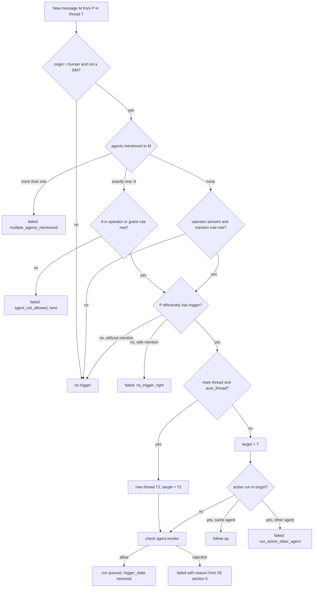
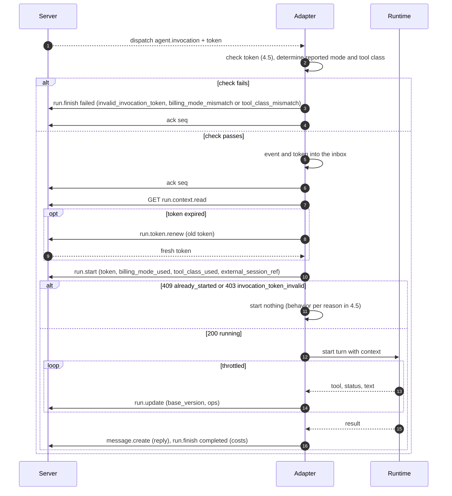
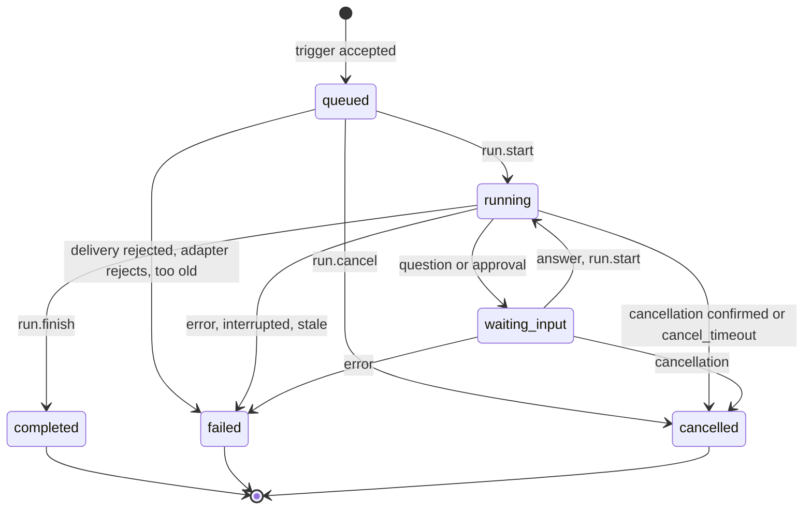
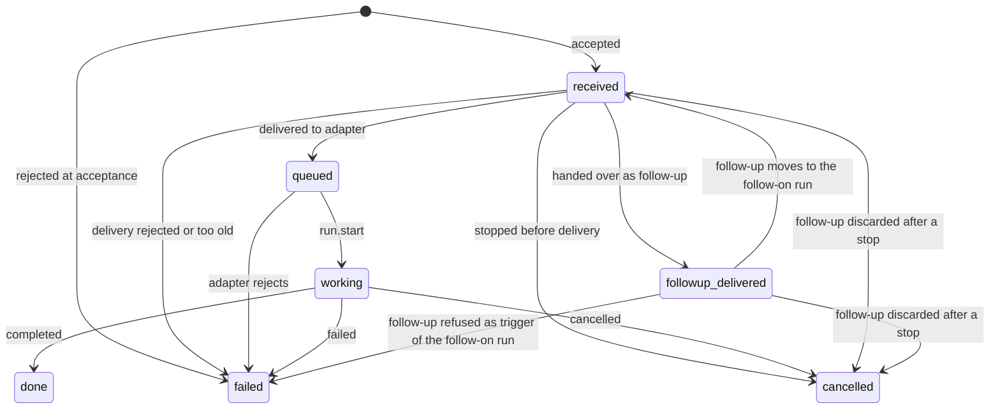
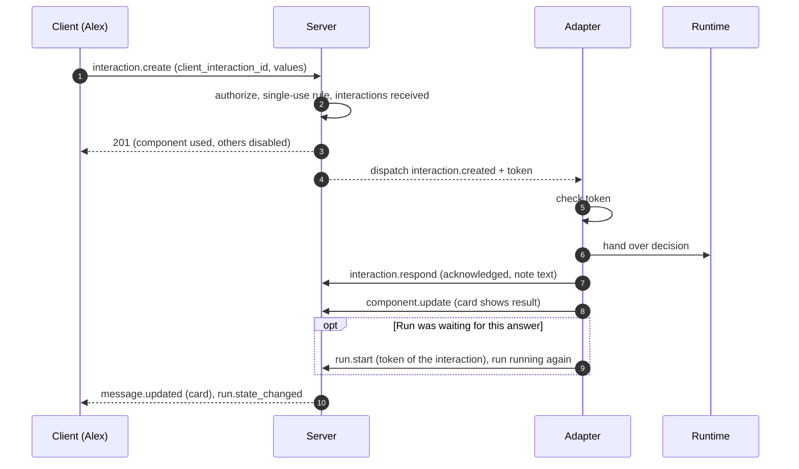
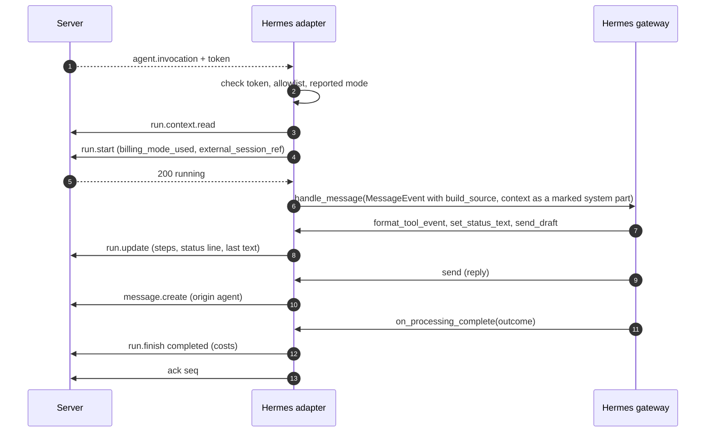
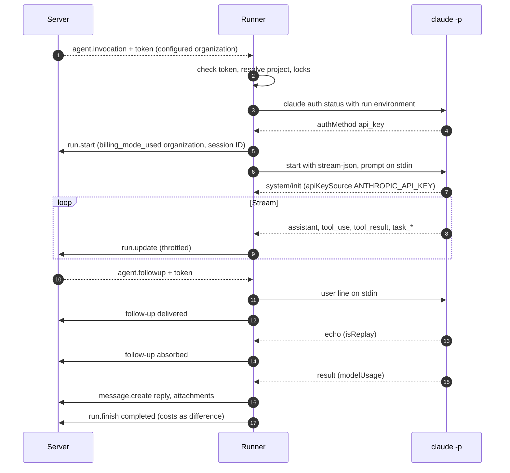

# 09 Agents

Status: draft M0. Normative for the modules `agents` and `runs`, for every agent adapter and for
the two reference adapters (Hermes Agent, Claude Code runner).
Terms: [00-glossary.md](00-glossary.md). Tables: [03-data-model.md](03-data-model.md).
Events, cursors, live box patches: [04-sync-protocol.md](04-sync-protocol.md). Actions and
`agent.invoke`: [05-actions.md](05-actions.md). Backend policy (I1 to I6):
[10-backend-policy.md](10-backend-policy.md). Apps, webhooks, SDK:
[11-extensions.md](11-extensions.md). Permissions and guard rules: [07-permissions.md](07-permissions.md).
All REST paths are under `/api/v1` ([06-api.md](06-api.md)). The additions that this chapter
requested during drafting are decided (section 20).

## 1. Principles

1. **Outside the server.** Agent runtimes and adapters never run in the server process (B6,
   B10, [ADR 0022](../adr/0022-agents-and-plugins-outside-the-server-process.md)). The server
   knows agents as principals, runs as objects and one backend policy per agent.
2. **Public API.** An adapter uses only the public API (REST, gateway). There is no private
   channel. The Hermes adapter is one adapter among several.
3. **A single decision point.** Every trigger, delivery and adapter operation goes through
   `authorize` with an action from 05. The invocation token (I3) proves the decision at the adapter.
4. **Fail closed.** If a piece of evidence is missing (token, reported mode, permissions), nothing
   happens, and the person sees the reason.
5. **No automatic retry.** An aborted run is never silently retried. Side effects of a runtime
   (files, commands) must not happen twice.

## 2. Agents as principals

### 2.1 Records

| What | Where | Note |
|---|---|---|
| Identity | `principals` with `kind = 'agent'` | Handle for mentions, display name, status |
| Operations | `agents` | `adapter_kind`, `operator_config`, `billing_mode`, `credential_holder_id`, reported state |
| Access | `api_tokens` | hash only; `dpop_jkt` recommended (token bound to an adapter key, [08-identity.md](08-identity.md)) |
| Read position | `agent_consumer_cursors` | one durable cursor per `(agent, consumer)` |
| Commands | `commands` | registered by the agent |
| Sessions | `agent_sessions` | one current session per thread |

Creating (`agent.create`), changing (`agent.update`), disabling (`agent.disable`) and tokens
(`token.create`) are owner actions with step-up. A disabled agent loses its tokens and
connections immediately; its active runs end with `cancelled`, reason `agent_disabled`.

### 2.2 Features

A feature is effective when the owner allows it **and** the adapter reports it. The owner
maintains what is allowed in `agents.operator_config` (schema `agent_operator_config.v1`); the
adapter reports what it can do in the heartbeat (`agent_heartbeat.v1`, section 4.8). Reason: the
owner should be able to switch a feature off, but never switch one on that the adapter does not have.
The heartbeat reports the capabilities in `details.capabilities` (section 4.8), with exactly the
keys of the column "Reported" below; any other key is refused.

| Feature | Allowed (`operator_config`) | Reported (heartbeat `details.capabilities`) | Effect |
|---|---|---|---|
| Follow-ups | `supports_followups` | `followups: steer` or `queue` | Section 7 |
| Components | `supports_components` | `components: true` | Section 11; otherwise text only |
| Voice input | `supports_voice` | `voice_input: true` | Section 13 |
| Title suggestion | `supports_title` | `title: true` | Section 12 |
| Sending files | `supports_files_out` | `files_out: true` | Agent additionally needs `+upload`. If `supports_files_out` is off, the server rejects messages of an agent with attachments with `403 feature_disabled`. |

Schema `agent_operator_config.v1` (03, `agents`): a JSON object without further keys
(`additionalProperties: false`); every key is optional. `operator_config` never contains
secrets; an invalid value yields `400 validation_failed` with a JSON Pointer.

| Key | Type | If the key is missing | Meaning |
|---|---|---|---|
| `default_model` | Text, pattern `^[A-Za-z0-9._:/@-]+$` | the adapter chooses | Model that the adapter uses when no model is chosen in the session; the server only passes it on |
| `supports_followups` | Boolean | allowed | Allows follow-ups |
| `supports_components` | Boolean | allowed | Allows components |
| `supports_voice` | Boolean | allowed | Allows voice input |
| `supports_title` | Boolean | allowed | Allows title suggestions |
| `supports_files_out` | Boolean | allowed | Allows sending files |

A missing key allows, because the owner switches features off and the adapter reports only what
it can do anyway; an empty object means "everything the adapter reports is allowed".

The server enforces the owner's part of the capability "Components" (M2-15): a card
(`kind = card`, section 11) of an agent whose `operator_config` sets `supports_components` to
`false` is refused with `403 feature_disabled`, and nothing of the request is stored. `runs` reads
the switch through the agents port (`agents.RunFacts.ComponentsAllowed`). The adapter's part, the
report `components: true` in the heartbeat, is checked with M2-20; until then a card of an agent
whose owner allows components is accepted whatever the adapter reports.

### 2.3 Grants of an agent

An agent has at most `write` and, as a capability, at most `upload` (R-DM-08, R-DM-20). On
every channel that it operates, and in every thread with it as the fixed operator, it has `write`
without a grant row (operator rule, 05 section 2.3, R-AZ-13). For files it additionally needs a
grant with `upload`; as a guest agent or in report channels it needs a grant with `write`.
Reason for the operator rule: an operator that must not write only produces failing
runs, and a second, separately maintained grant would remain after a change of operator.

### 2.4 Tool class

The guard rule "Tool class of an agent" is in [07-permissions.md](07-permissions.md). It needs
a typed field on the agent, not just `jsonb` (principle 8 in 03): `agents.tool_class`,
set with `agent.tool_class.set`. The adapter reports the actually loaded class in the
heartbeat (`reported_tool_class`, stored in `agents.reported_tool_class`); if it differs,
the console shows a warning, and `authorize` calculates with the higher of the two classes.

## 3. Operator and trigger rules

### 3.1 Operator

- **Thread (`threads.kind = 'thread'`).** The operator is `threads.operator_agent_id`, fixed since
  creation (R-DM-12). A later change of operator on the channel does not change ongoing conversations.
- **Main thread (`threads.kind = 'main'`).** The operator is the effective operator of the channel at
  the time of the trigger; `operator_agent_id` stays `NULL` (03, R-DM-21). If the operator changes, the current session of the main thread ends at the next
  run with `end_reason = 'agent_changed'`. Reason: a main thread is not a single conversation;
  a frozen operator would silence a channel after the change.
- Without an operator no agent answers, unless an allowed guest agent is mentioned (3.6).

### 3.2 Origin (`messages.origin`)

The server sets `origin` from the principal and the inbound path. A client can never set it.

| `origin` | Set for | Triggers agents |
|---|---|---|
| `human` | message of a person over REST or gateway | yes, by the rules below |
| `agent` | message with an agent token, live box anchor | never |
| `app` | message with an app token or through an incoming webhook | never |
| `import` | message from an import ([22-import-migration.md](22-import-migration.md)) | never |
| `system` | created by the server (for example "Thread moved") | never |

Reason: freedom from loops is a data field, not a text heuristic. Two agents can never
trigger each other.

### 3.3 Channel switches

All switches are typed columns of `channels` (03) and can be changed only with `manage`
(`channel.behavior.update`).

| Switch | Default | Meaning |
|---|---|---|
| `require_mention` | `true` | In the main thread the operator answers only when mentioned. |
| `thread_require_mention` | `false` | In threads the operator answers only when mentioned. |
| `free_response` | `false` | The operator answers everywhere without a mention; overrides both switches above. |
| `auto_thread` | `true` | A trigger in the main thread creates a new thread. |
| `allow_mentioned_agents` | `false` | Further agents may answer when mentioned (3.6). |
| `history_backfill_limit` | `channel.history_backfill_limit_default` | Window for the context (4.6). |

### 3.4 Decision per message

For a new message M of a principal P in the thread T of the channel C, the following applies in this order:

1. `origin` is not `human`: no trigger, `trigger_state` stays empty.
2. C is a DM channel: no trigger.
3. Let E be the set of agents mentioned in M.
    - E has more than one element: rejection `multiple_agents_mentioned`. Reason: at most one
      active run per thread (R-DM-14); the server never decides which agent is meant.
    - E = {A}: A is a candidate if A is the operator (3.1) or the guest rule (3.6) applies. Otherwise
      rejection `agent_not_allowed_here`.
    - E is empty: the operator is a candidate if it exists and the following holds: `free_response`, or
      (main thread and not `require_mention`), or (thread and not `thread_require_mention`).
      Otherwise no trigger.
4. P does not effectively have `trigger` on C: with an explicit mention rejection
   `no_trigger_right`, otherwise no trigger. Reason: someone who may only write should not see
   an error message for every message in free-response channels, but a targeted mention
   needs an answer.
5. Target thread: if T is the main thread and `auto_thread` is set, the server creates in the same
   transaction a thread T' with `parent_message_id = M`; the target is T'. Otherwise the target is T.
6. If the target has an active run R: if R belongs to the candidate, M becomes a follow-up (section 7).
   Otherwise rejection `run_active_other_agent` (05 section 5 item 8, R-AZ-20).
7. `authorize(P, agent.invoke, {target, candidate, M})` per 05 section 5 (permissions, agent active,
   I2, project ready). On `allow`: run `queued`, live box anchor, event `agent.invocation`,
   `trigger_state = received`. On rejection: M stays stored, `trigger_state = failed` with
   the reason. The first successful delivery of `agent.invocation` moves `trigger_state` to
   `queued`; a denial immediately before the delivery fails the run and sets
   `trigger_state = failed` with the reason of 5.2 (04 section 15.3 step 2, M2-08).

Order of the check and the auto thread (D-M2-05-2): with `auto_thread` in the main thread the check
of point 7 names the thread of M, not the new thread, so the mention rule of point 3 and the guard
of `agent.invoke` judge the same thread. The thread of point 5 is created only after the `allow` of
point 7, so a denial leaves no empty thread. A candidate that M does not mention is first checked
in filter mode: a person without `trigger` gets no `trigger_state` and no audit entry (point 4,
D-M2-05-13).

Position of the voice rule (D-M2-04-2): the rejection `voice_unsupported` of section 13 is decided
after step 4 and before step 5. A voice message without a transcription path
(`voice.transcription_mode` is `off`, or `agent` and the candidate lacks the effective feature
`voice_input`) is rejected at acceptance; it creates neither a new thread nor a follow-up. A voice
message that would not trigger at all stays without trigger.

Mapping of the deny reasons of step 7 to `messages.trigger_state_reason` (D-M2-04-3): the closed
deny list of 07 4.1 has no `agent_disabled`, and the guard of `agent.invoke` answers
`agent_not_reachable` for an inactive agent, so the acceptance maps the reason the person sees:

| Deny reason of `authorize` (07 4.1) | `trigger_state_reason` |
|---|---|
| `agent_not_reachable`, candidate not active | `agent_disabled` |
| `agent_not_reachable`, candidate active | `agent_not_allowed_here` |
| `level_insufficient`, `no_grant` | `no_trigger_right` |
| every other reason (`billing_mode_personal_not_holder`, `project_not_ready`, `run_active_other_agent`, `tool_class_owner_only`, `dev_environment_not_ready`, `channel_read_only`, ...) | unchanged |

A message with `trigger_state = failed` shows its reason from `messages.trigger_state_reason`
(03). Reason for the separate field: a rejection at acceptance creates no run on which
`state_reason` could be stored.



### 3.5 Reasons for rejection at acceptance

| Reason | Condition | Notice to the person |
|---|---|---|
| `multiple_agents_mentioned` | more than one agent mentioned | "Please mention only one agent." |
| `agent_not_allowed_here` | mentioned agent is neither operator nor allowed guest | "This agent does not answer here." |
| `no_trigger_right` | P lacks `trigger` | "You may not trigger agents here." |
| `run_active_other_agent` | another agent is working in the thread | "Another agent is currently working in this thread." |
| `agent_disabled` | agent disabled | "Agent is switched off." |
| `billing_mode_personal_not_holder` | I2 (05 section 5 item 4) | "This agent runs on a personal subscription." |
| `project_not_ready` | project binding not ready | "Project environment is not ready." |
| `voice_unsupported` | voice message without a transcription path (13) | "Voice messages are not understood here." |
| `run_active` | model command during an active run (10.4) | "The agent is currently working; send the command again after the run." |

The texts are keys in the language catalogue of the apps ([01-product.md](01-product.md)); the table
names only the meaning.

The codes of this table are the values of `messages.trigger_state_reason` that the acceptance
writes itself. A deny reason of `authorize` in step 7 appears mapped by the table after step 7 of
3.4; a deny reason without a row there is stored unchanged. `run_active` answers a command and is
never stored on a message, because a command has no trigger message.

### 3.6 Guest agents

A guest agent is a mentioned agent that is not the operator of the thread. It is triggered
when `allow_mentioned_agents` is set and it itself effectively has `write` on C (05 section 5
item 3). A guest run has no agent session (`runs.agent_session_id = NULL`); the adapter
gets no field `session` and works only with the context from 4.6. Reason: per thread there is exactly
one current session (03, `agent_sessions`); a guest must not displace the session of the
operator. Replies in the thread without a mention then trigger the operator again, not the
guest.

An agent with `billing_mode = personal` is never a guest agent (05 section 5 item 3, R-AZ-19). Reason: as a guest it could be triggered on every channel on which it has `write`
and guests are allowed; I1 does not count these channels among its targets
([10-backend-policy.md](10-backend-policy.md) section 5.2).

### 3.7 Auto-thread from a channel message

The new thread T' gets `parent_message_id = M`, `operator_agent_id` = effective operator of
C, `title = ''` and `title_source = 'auto'`. T' is written only after the `allow` of 3.4 item 7,
so a denial creates no empty thread; the check before every delivery decides T' with the
main-thread mention rule of the channel ("for new threads", 05 section 5 item 3; M2-08). Until a
title is set, the client shows the first
line of M. M stays in the main thread and carries the `trigger_state`; run, live box anchor,
replies and session belong to T'.

## 4. Adapter contract

### 4.1 Overview

| Direction | Content | Path |
|---|---|---|
| Server to adapter | Invocation, follow-up, cancellation, interaction, command, configuration change | personal durable events (04 section 15) with invocation token |
| Server to adapter | Context of a run, channel prompt and skills | REST fetch by the adapter (4.6, `agent.config.read`) |
| Adapter to server | Start run, live box patches, finish run | `run.start`, `run.update`, `run.finish` |
| Adapter to server | Replies, files, components, title, close thread | normal API with the agent token |
| Adapter to server | Heartbeat with reported state, session reference, commands | `agent.heartbeat`, `agent_session.report`, `command.register` |

### 4.2 Transports

| Transport | For | Acknowledgement | Reference |
|---|---|---|---|
| Gateway WebSocket | Default for every permanently running adapter | `ack {seq}` (04 section 15.2) | 04 section 15.1 |
| REST fetch `GET /api/v1/agents/me/consumers/{consumer}/events` | Adapters without a durable connection, tests | durable via the `ack` endpoint | 04 section 7.4; rules in 4.3 "REST fetch" |
| Webhook (push) | Adapter as a function without a running process | response `2xx` counts as `ack` up to this `seq` | 04 section 15.6 |

Webhook delivery to agents needs a subscription that is bound to an agent instead of an
app installation (`webhook_subscriptions.agent_id`, exactly one of the two set).
Delivery follows [11-extensions.md](11-extensions.md) section 7 and delivers strictly in
`seq` order per subscription: the next event only after `2xx` on the previous one. Every delivery,
including a retry, carries a freshly issued invocation token (R-SY-07).

### 4.3 Connection and cursor

04 sections 15.1 and 15.2 apply unchanged: `identify` with `api_token` and `consumer`, one
process per consumer (`4015` on takeover), cursor at `head_seq` on the first connection,
delivery from `acked_seq + 1`, at most `agent.max_inflight_events` unacknowledged, redelivery
after `agent.ack_timeout`. The adapter acknowledges an event as soon as it has durably
accepted it: an event with a token counts as accepted when the token passes the check from 4.5
(except item 5, the expiry) and the event together with the token is stored in the adapter's
own inbox, or when the run has been rejected with `run.finish`. The start
(`run.start`) follows only after that, from the inbox. Reason: if the acknowledgement depended on
the start, then for a start that takes longer than `agent.ack_timeout` the server would deliver
again with a new token that replaces the old one; the start with the old token would fail, and the
new delivery would fall victim to duplicate detection. The run would then hang until `run.queued_max_age`.

Duplicate detection (04 section 15.2): if the same event arrives again with a different token and
the run has not yet started at the adapter, the adapter does not process the event a
second time, but replaces the stored token with the new one. The start always uses the
newest token.

**REST fetch** (M2-07). A consumer name matches `^[a-z0-9][a-z0-9_-]*$` (path parameter
`ConsumerPath`, also `GatewayIdentify.consumer`); a name outside it answers `400
validation_failed` on `#path/consumer`, and an `identify` with it closes with `4002`. Consumers
exist only for agents; for people and apps the member `consumer` of `identify` is ignored. The
acknowledgement rules are the same on both transports: `seq` below 0 or above the head of the
serving process is `validation_failed` on `/seq`, `seq` at or below the acknowledgement changes
nothing and is no error, a higher `seq` covers every number up to it, also beyond what was
delivered. The head that consumer operations report and check against is the hub position of the
serving process (the highest `seq` its log tail has delivered), so a consumer is never told about
or acknowledges a `seq` that process cannot yet deliver.

- `pollAgentEvents` is a consumer like an `identify`: it takes the consumer over for the REST
  window of the serving process (newest wins, R-SY-09), and an open gateway connection of the
  consumer in that process closes with `4015` (in another process the fenced save closes it). The
  first poll of a consumer creates its cursor at `head_seq` and answers an empty page. At most
  `agent.max_inflight_events` unacknowledged events are on the way; a larger `limit` is capped.
  Within `agent.ack_timeout` a poll never repeats an unacknowledged event; after it the window
  delivers again from `acked_seq + 1` with `redelivered: true`. `next_cursor` is the highest `seq`
  the window checked, but never covers an event an earlier poll handed out that is still
  unacknowledged; the adapter acknowledges it after processing, also when `events` is empty.
  `retention` and `cursor_ahead` move the cursor to `head_seq` and answer `410 resync_required`
  with the reason. A REST window idle for `sync.resume_window` is dropped; the next poll starts a
  fresh window from `acked_seq + 1`.
- `ackAgentEvents` stores the acknowledgement at once and monotonically, without taking the
  consumer over; `getConsumerState` reads the cursor (`404` for a consumer that never connected).
  Neither creates a cursor.

### 4.4 Events to the adapter

| Event | When | Payload (schema `<type>.v1`, excerpt) | Token |
|---|---|---|---|
| `agent.invocation` | new run | `run`, `thread`, `channel` (`id`, `kind`, `settings_version`), `trigger` (`kind`, IDs, triggering person), `session` (9.1; in openapi the members `session_mode` for `session.mode` and `agent_session` for the session row; `agent_session` is missing for `new` without a row; both are missing for a guest run), `capabilities_effective`; for `trigger_kind = command` the command ID, its name and the parsed options in the order of the definition (`command_id`, `command_name`, `options`, `command_invocation_id`) instead of a message (M2-16) | yes |
| `agent.followup` | follow-up (section 7) | `run_id`, `message_id`, triggering person | yes |
| `interaction.created` | component used | `interaction_id`, `component` (`custom_id`, type), `values`, `run_id`, acting person | yes |
| `command.invoked` | control command executed (10.4) | `command_id`, `command_name`, `options`, location, triggering person; `run_id` exactly when the owner has an active run in the thread at execution time, then that run, never the run of another agent (R-AZ-25) | yes |
| `run.cancel_requested` | cancellation (section 8) | `run_id`, `reason` | no |
| `agent.config_changed` | prompt, skills, project binding changed | `channel_id`, `settings_version` | no |

Payloads never contain the channel prompt, skills or project binding (04 section 2.2 rule 1) and
never message contents beyond `sync.event_payload_max_bytes`. The adapter fetches the content
over REST (4.6).

### 4.5 Invocation token

The invocation token is a JWT in JWS compact serialization ([ADR 0023](../adr/0023-signed-invocation-token-and-check-in-the-adapter.md)).
The server creates it anew for every delivery (R-SY-07) and signs it with the active key
of the purpose `invocation` (`server_signing_keys`).

**Header.** `alg = "EdDSA"`, `kid` (key ID), `typ = "agent-invocation+jwt"`. Explicit type
per RFC 8725 section 3.11, so that no other JWT of the server (access token) passes as an
invocation token (https://www.rfc-editor.org/rfc/rfc8725.html, retrieved 2026-10-10, [verified]).

**Claims.** The normative list is in 05 section 5; here with their source:

| Claim | Content | Source |
|---|---|---|
| `iss` | `instance.instance_id` | 05 |
| `aud` | Principal ID of the agent | 05 |
| `sub` | Principal ID of the triggering person | 05 |
| `jti` | UUIDv7 of this token; stored in `runs.invocation_jti` when its delivery or renewal replaces the token of the run there (04 section 15.3), never for `command.invoked` (R-AZ-25) | 05 |
| `iat`, `exp` | Issued at, expiry (`iat + agent.invocation_token_ttl`) | 05 |
| `run_id` | Run; missing for `trigger_kind = autocomplete` and for `command.invoked` when the owner of the control command has no active run in the thread at execution time (otherwise its run) | 05, R-AZ-25 |
| `message_id` or `interaction_id` or `command_id` | triggering object | 05, `command_id` new |
| `thread_id`, `channel_id` | Location; for `trigger_kind = autocomplete` the thread of the request, without one the main timeline of the text channel; in a forum channel without a thread no token | 05, R-AZ-26 |
| `space_id` | Space of the channel | new |
| `level` | effective level of `sub` on the channel at delivery time | 05 |
| `billing_mode` | configured mode from `agents.billing_mode` at delivery time | 05 |
| `tool_class` | configured tool class from `agents.tool_class` at delivery time (SR2, section 2.4) | 05 |
| `dev_environment_id` | Dev environment of the run; only in the dev environment milestone | 05 |
| `permission_version` | Permission version at delivery time | 05 |
| `trigger_kind` | `message`, `followup`, `interaction`, `command`, `autocomplete` | new |

**Check in the adapter.** The adapter processes an event with a token only if all items
hold. If only item 5 fails because `exp` has passed, it fetches a fresh token (4.5.1).
If the `kid` is missing even after reloading the JWKS (item 3), it does not accept the event and
does not acknowledge it; after `agent.ack_timeout` it arrives again with a token of the current key
(emergency rotation below). If another item fails, it starts nothing and reports the reason (`run.finish` with `failed`,
reason `invalid_invocation_token`, `billing_mode_mismatch` or `tool_class_mismatch`).

1. `alg` is exactly `EdDSA`; every other value is rejected (RFC 8725 section 3.1:
   algorithm allow list, one algorithm per key).
2. `typ` is exactly `agent-invocation+jwt`.
3. `kid` is in the server's cached JWKS. If it is missing, the adapter reloads the JWKS
   once, at most once per `adapter.jwks_refresh_min_interval`.
4. Signature valid; `iss` equals the configured instance; `aud` equals the adapter's own agent ID.
5. `exp` is in the future, `iat` not in the future, each with `adapter.invocation_token_leeway`.
6. `run_id`, `thread_id` and the triggering object match the payload of the
   event.
7. `jti` is new to the adapter (stored until `exp`); a repetition of the same token is
   ignored.
8. `billing_mode` equals the reported mode of the runtime for exactly this run (I3,
   [10-backend-policy.md](10-backend-policy.md) section 7).
9. `sub` is on the allow list of the adapter, if it keeps one (17.7). If the
   `permission_version` of the token is greater than that of the list, it reloads the list first.
10. The actually loaded tool class is not higher than `tool_class` (order `chat`
    < `scoped` < `host`, [07-permissions.md](07-permissions.md) section 2.11). Otherwise
    `tool_class_mismatch`.

The server checks again at run start: signature, expiry, `jti` equal to `runs.invocation_jti`,
reported mode equal to the configured mode and reported tool class (`tool_class_used`) not higher
than `tool_class` of the token (`run.start`, 05). A token is **consumed** when its `jti` equals
`runs.started_jti`. Repeating a start with the consumed token returns the
result only as long as the run is `running` (response lost, R-SY-19); in `waiting_input`
it is a token error (`superseded`), because `run.start` does not change `runs.invocation_jti`.
The adapter can therefore neither reuse a token nor start a run without a valid token,
not even a waiting run without the token of the answer.

A token error at start always yields `403 invocation_token_invalid` with `reason`
([06-api.md](06-api.md)):

| `reason` | Case | Adapter behavior |
|---|---|---|
| `expired` | `exp` passed, otherwise valid and current | fetch a fresh token (4.5.1), retry the start once |
| `superseded` | valid, but no longer current: `jti` not equal to `runs.invocation_jti` (a newer delivery or renewal has replaced the token) or consumed (`jti` equal to `runs.started_jti`, run in `waiting_input`) | start nothing, do not finish the run; the start follows with the newer token from the inbox (4.3), for `waiting_input` with the token of the answer |
| `invalid` | signature, `kid`, `typ`, `aud` or run wrong | start nothing; `run.finish` with `failed` and `invalid_invocation_token` |

Another delivery of an already started run still gets `409 already_started`.

#### 4.5.1 Fresh token for a waiting run

If the way from acceptance to start takes longer than `agent.invocation_token_ttl`, the
adapter fetches a fresh token with `POST /api/v1/runs/{id}/invocation-token` (action
`run.token.renew`, agent-self). The body carries the expired token. The server

1. checks signature, `kid`, `typ`, `aud` equal to the requesting agent and `run_id` equal to the
   path, otherwise `reason: invalid`; it does not check the expiry here;
2. requires the run in `queued` or `waiting_input`, otherwise `409 already_started`;
3. requires `jti` equal to `runs.invocation_jti` or equal to `runs.renewed_from_jti` (retry
   of a renewal whose response was lost) and `runs.started_jti` is NULL or not equal to
   `jti` (not consumed; in SQL `started_jti IS DISTINCT FROM jti`, because `<>` is never
   true with NULL), otherwise `403 invocation_token_invalid` with `reason: superseded`;
4. checks everything that it checks before a delivery, with the current permissions: `agent.invoke` for
   `sub` with the triggering object of the old token, I2, SR2 and SR3 (04 section 15.3
   step 2). If that fails, it sets the run to `failed` with the reason as at delivery
   and answers `403 agent_invocation_denied`;
5. issues a new token with the same triggering object and location, but the current configured
   values (`billing_mode`, `tool_class`), the current `permission_version` and a new `jti`, replaces
   `runs.invocation_jti`, sets `runs.billing_mode_expected` and sets `runs.renewed_from_jti`
   to the `jti` of the presented token if it was the current one (on a retry the value
   stays), all in one transaction with a row lock on the run.

Every delivery that replaces `runs.invocation_jti`, and every successful `run.start`, sets
`runs.renewed_from_jti` to `NULL`. The adapter runs at most one renewal per run at a time
and starts with the most recently received token.

Reason: the old token only proves which trigger the server gave this agent for this run;
the server makes the decision anew. A token that a delivery has replaced is not usable,
because its `jti` is no longer current. A consumed token is not usable,
because the run has already started with it; otherwise a renewed start token would resume a
waiting run without an answer from a person. The token before the last renewal stays
valid, because otherwise a lost response would leave the run hanging until `run.queued_max_age`: the
retry would get `superseded`, and no delivery would bring a newer token. It still starts
the run at most once, because every renewal replaces the previous renewed token and
`run.start` is a compare-and-swap.

**Keys and rotation.** The JWKS output (action `instance.discovery.read`) contains the
keys of the purpose `invocation` in the states `next`, `active` and `retiring`, with
`Cache-Control: max-age` = `agent.jwks_max_age`.

1. Scheduled after `signing_key.invocation_rotation_interval`: a new key goes to `next`
   and is published for at least `agent.jwks_max_age` before it becomes `active`. That way
   every adapter knows it before the first token.
2. The old key goes to `retiring` and stays published until
   `agent.invocation_token_ttl` plus `auth.clock_leeway` have passed; then `retired`. The
   server does not know the tolerance of the adapter; therefore `adapter.invocation_token_leeway`
   must be at most the server's `auth.clock_leeway`.
3. Emergency (key compromised): `signing_key.rotate` with `mode = emergency` (owner,
   step-up) sets all keys of the purpose to `retired` immediately and creates a new `active` one;
   a scheduled rotation triggered by the owner uses `mode = scheduled`.
   Tokens with this `kid` fail at the adapter; because the server issues tokens anew per
   delivery, the event arrives again after `agent.ack_timeout` with a token of the new key.
   An emergency rotation costs at most one delivery delay, no run.

### 4.6 Run context

The adapter fetches the context over REST with the action `run.context.read` (agent-self, only for its own
active runs; `GET /api/v1/runs/{id}/context`). The server builds it, because only `authz` knows
which authors are how trustworthy. Schema `run_context.v1`:

| Part | Content | Limit |
|---|---|---|
| `trigger_message` | triggering message in full, with attachments | never truncated |
| `thread_context` | messages of T before M with `thread_seq` greater than `context_floor_seq` | keep the newest first, at most `history_backfill_limit` messages |
| `channel_context` | only for the first run of a session in a thread with `parent_message_id`: messages of the main thread before the parent message | at most `history_backfill_limit` messages |
| `truncated_before_seq` | set when older messages are missing | adapter can load more with `thread.read` |

- `context_floor_seq` is the `thread_seq` of the triggering message of the previous run of the same
  session, otherwise `0`. Reason: a continued session knows everything that has already been
  delivered to it; it needs only what others have written since.
- Own messages of the agent are missing for `session.mode = resume`; for `new`, `bind` and
  guest runs they are included. Messages that have already been delivered to this session as a
  follow-up (`run_followups` with `delivered` or `absorbed`) carry `already_delivered: true`.
- Contents above `agent.context_message_max_bytes` are truncated (`truncated: true`); the whole
  sum stays below `agent.context_max_bytes` (without `trigger_message`).
- Each element: `message_id`, `thread_seq`, `created_at`, `author` (`id`, `kind`, `handle`,
  `display_name`), `role` (`user` for people, `assistant` for this agent, `other` for other
  agents, apps, imports and system), `origin`, `kind`, `content_md`, `attachments` (`file_id`,
  name, MIME, size, `scan_status`, transcript if available), `reply_to_message_id`, `trust`.
  `role` tells the runtime who is speaking; `trust` tells it how it must treat the content.
- Every element also carries `channel_id`, the channel of the message (SEC-AI-1, M2-13).

Rules of the run context (M2-13, docs/DECISIONS.md D-M2-13-3 to D-M2-13-12):

- Only an own run in `queued`, `running` or `waiting_input` has a context; an unknown run, a run
  the agent cannot see, an own run that is no longer active and a triggering message the agent
  cannot read answer the same `404`. Another agent gets `403 forbidden` with `not_self`, a person
  or an app `403 forbidden` with `subject_kind_not_allowed`; `authz` audits every denial, a
  successful read writes no audit entry. A run whose `trigger_kind` is not `message` answers
  `internal_error` until commands and interactions define their context.
- Classification: the origin decides before the author. `origin = system` gives `role = other`,
  `trust = system`; `import` and `app` give `other`, `unverified`; `agent` gives `assistant`,
  `self` for the run's own agent and `other`, `unverified` for any other agent; `human` gives
  `user` with `trigger` for the triggering person, `authorized` for another active person with
  effective `trigger` on C (an active owner counts on every channel that is not a DM) and
  `unverified` otherwise. `authz` answers who has `trigger` at the time of the request through
  `authorize.TriggerHolders`; a source error fails the request and never weakens trust.
- Session mode: the mode of the invocation (9.1) over the session row of the run
  (`runs.agent_session_id`, the row the run was invoked with or attached at its start), so a reset
  or bind during the run (9.4) does not change it. In `new`, `bind` and guest runs `context_floor_seq` is `0`, the agent's own
  messages are included and `channel_context` is built; in `resume` the own messages are left out,
  no `channel_context` is built, and the floor is the `thread_seq` of the triggering message of the
  latest earlier started run of the session that has one, `0` when that message lies outside T
  (the parent message of an auto thread). `already_delivered` is set only in `resume`.
- Windows: `thread_context` holds the newest `history_backfill_limit` messages of T strictly
  between the floor and M; when M is the parent message of T (auto thread, 3.7) it is empty.
  `channel_context` holds the newest `history_backfill_limit` messages of the main thread of C
  before the parent message, without the parent itself, and only when the parent lies in the
  thread's current channel; after a move (`thread.move`) it is absent. Deleted messages are never
  part of a window and count towards no limit; the triggering message appears as stored.
- Bytes: each element of `thread_context` and `channel_context` is cut to the longest valid UTF-8
  prefix within `agent.context_message_max_bytes` (`truncated: true`); then the newest elements
  are kept, `channel_context` before `thread_context` in time, while the sum of their `content_md`
  stays within `agent.context_max_bytes`; the first element that does not fit and every older one
  are dropped. `trigger_message` is never cut and never counted.
- `truncated_before_seq` refers to T: set when older selectable messages of T are missing (window
  or budget), to the `thread_seq` of the oldest element of `thread_context`, or of M when
  `thread_context` is empty.
- Optional members appear only when they apply (`truncated` and `already_delivered` only when
  true); `channel_context` is present, possibly empty, exactly when it is built. Each request
  recomputes every part; the read opens no transaction and takes no lock.

**Trust mark `trust`.** The server sets it at query time:

| `trust` | Author |
|---|---|
| `trigger` | the triggering person |
| `authorized` | another active person with effective `trigger` on C |
| `self` | this agent |
| `unverified` | person without `trigger` on C, other agents, apps, imports |
| `system` | `origin = system` |

Required for every adapter: it passes contents with `unverified` to the runtime only as marked
data, never as an instruction, with a fixed note before the block. The context reaches the
runtime as a fixed system part with author and trust mark, separate from the text of the triggering person. Reason:
prompt injection through foreign contents (threat model in [19-security.md](19-security.md));
the runtime cannot distinguish senders by itself ([ADR 0054](../adr/0054-origin-and-trust-marking-in-the-agent-context.md)).

The adapter loads attachments with `file.read`. Files before `scan_status IN ('clean','skipped')` cannot
be fetched ([12-files.md](12-files.md)). Contents of files are always marked data,
even if the triggering person uploaded them: a document from the web can contain instructions
that do not come from the person (T-AI-03). The transcript of a voice message, in contrast, carries the
trust mark of its message, because it is the words of its author ([ADR 0054](../adr/0054-origin-and-trust-marking-in-the-agent-context.md)).

### 4.7 Adapter operations

All operations use the agent token (DPoP-bound with `dpop_jkt`) and the
rate-limit class from 05. Every request of the adapter inside a run also carries the header
`Invocation-Token` with the invocation token of the run, which binds it to the rights of the
triggering person ([07-permissions.md](07-permissions.md), SR9; [06-api.md](06-api.md), section 4 point 8).

| Purpose | Action | Idempotency | Rule |
|---|---|---|---|
| Start run | `run.start` | CAS on state, `jti`; a retry with the same token returns the result again | Body: `invocation_token`, `billing_mode_used`, `tool_class_used`, optional `external_session_ref`, `model`, `billing_evidence`. Applies to `queued -> running` (`/start`) and `waiting_input -> running` (`/resume`) (5.1). |
| Fresh token | `run.token.renew` | new `jti` per call; only with the current, unconsumed token or the token before the last renewal | Body: `invocation_token` (expired allowed); response: new token (4.5.1) |
| Change live box | `run.update` | `base_version` | allowed paths in 5.3; throttle `agent.run_update_min_interval` |
| Report step | `run.update` on `/steps/<id>` | step ID (UUIDv7) from the adapter | the server assigns `ordinal` |
| Acknowledge follow-up | `run.update` on `/followups/<message_id>/state` | state only forward | `delivered`, then `absorbed` |
| Finish run | `run.finish` | same end state repeated = `200` | Body: `state`, `reason`, `summary`, `costs` (4.10) |
| Send reply | `message.create` | `client_msg_id` | `origin = agent`; the adapter stores the ID before sending. Optional `run_id`, only for an active run (`queued`, `running`, `waiting_input`) of the agent itself in the target thread; otherwise `400 validation_failed` with `errors[].code` `run_mismatch` (also for a person or app, an unknown run, a run of another thread or agent, one body for all), or for an own ended run `409 conflict` with `reason` `run_not_active`. `run_id` is checked, not stored, and not part of the canonical request of `client_msg_id`. The adapter sends its replies before `run.finish` (04 16.5); a reply refused after the end of the run it sends again without `run_id`, with the same `client_msg_id` (M2-19). |
| Send file | `file.upload`, then `message.create` | upload session, `client_msg_id` | needs `+upload` and the feature `files_out` |
| Question, approval | `message.create` with `kind = card` and components | `client_msg_id` | then `run.finish` with `waiting_input` (section 11) |
| Change components | `component.update` | `version` | only own messages |
| Answer interaction | `interaction.respond` | state only forward | Section 11.4 |
| Suggest title | `thread.title.update` | `If-Match` | only with `title_source = auto`; the source stays `auto` (section 12) |
| Close thread | `thread.close` | idempotent | only at the explicit request of a person |
| Report session | `agent_session.report` | `If-Match` (CAS over `agent_sessions.version`) | Section 9. Only for the session of the agent's own active run in the thread. `If-Match` absent means "this run has no session row yet": the report creates it; where a row exists, an absent or different `If-Match` gives `412 version_conflict` with `current`. `started` only moves forward; a different reference replaces the stored one (9.5 point 3). Reasons of `409 conflict`: `session_bound_elsewhere`, `session_changed`, `session_not_bound` (9.5). |
| Maintain commands | `command.register`, `command.remove` | bulk reconciliation | Section 10 |
| Heartbeat | `agent.heartbeat` | last one wins | Section 4.8 |
| Deliver transcript | `file.transcript.submit` | `If-Match` | Section 13 |

**Typing.** Agents send no typing of their own (04 section 12.1). The client shows "Agent
is working" as long as the run is `running`. Adapters whose runtime produces typing signals
discard them.

### 4.8 Heartbeat and reported state

The adapter sends the heartbeat over the gateway or over REST. Schema `agent_heartbeat.v1`
(content of `agents.reported_details`, 03):

The two transports are `sendHeartbeat` (`POST /api/v1/agents/me/heartbeat`) and the member `agent`
of the gateway op `heartbeat`; both carry the JSON object of the openapi schema `Heartbeat`, go
through the same decoder and have the same effect (action `agent.heartbeat`, `agent-self`,
rate-limit class `rl.agent_runtime`, exempt from `Idempotency-Key`). The body carries no agent id:
an agent reports only for itself; the owner of the agent gets `403 forbidden` with reason
`subject_kind_not_allowed`, any other person or app `404 not_found` (visibility first, R-AZ-01). The server answers `HeartbeatAck` with the presence after the heartbeat
(`AgentRuntimeStatus`) and `interval_ms`, which is `sync.heartbeat_interval`. A gateway heartbeat
of an agent without the member `agent` keeps the connection alive and changes no presence, because
presence needs the state report. Errors of the member `agent` answer `error {op: "heartbeat",
code}` and keep the connection.

Top-level members (openapi `Heartbeat`, closed; an unknown member is `400 validation_failed`):

| Member | Content |
|---|---|
| `state` | required: `online` or `degraded`; `offline` and `unknown` are derived by the server (below) |
| `runtime_version` | version of the agent runtime, stored in `agents.reported_runtime_version`; version form |
| `reported_billing_mode` | `personal` or `organization`, the mode of the runtime configuration; absent for adapters that follow the configured mode per run (17.8, 18.3; no JSON `null`, [ADR 0053](../adr/0053-no-json-null-in-api-and-events.md)) |
| `billing_modes_supported` | distinct modes the adapter can prove |
| `billing_evidence` | `provider` (code), `key_type` (required: `api_key`, `oauth`, `cloud`, `none`, `unknown`), `method` (code); never a key value, never a prefix |
| `reported_tool_class` | the tool class the runtime actually loaded, section 2.4 |
| `rate_limit` | not accepted yet: field error `not_enabled` at `/rate_limit` until M6-14 builds it (state of the provider's rate limits: `state` `ok`, `near_limit`, `limited` or `unknown`, and `resets_at` when known; display in the backend view of [25-visualization.md](25-visualization.md), section 6.2) |
| `details` | closed object, keys below |
| `project_readiness` | runners only: list of `{channel_id, ready}`, one entry per bound forum, distinct `channel_id` values (sets `project_bindings.ready`, M2-03) |

Keys of `details` (closed; any other key, also inside `capabilities`, `adapter` and `runtime`, is
an unknown member):

| Key | Content |
|---|---|
| `capabilities` | object, section 2.2: `followups` (`steer` or `queue`), `components`, `voice_input`, `title`, `files_out` (booleans) |
| `active_runs` | distinct ids (UUID, R-DM-01) of the runs in `running` or `waiting_input` the adapter holds |
| `degraded_reasons` | distinct codes, for example `runtime_unreachable`, `busy_mode_invalid`, `billing_evidence_unknown` |
| `adapter` | `name` (required, name form), `version` (optional, version form): the adapter's own version ([18-release.md](18-release.md) section 9 point 5) |
| `runtime` | `name` (required, name form); its version is the top-level `runtime_version`; never paths |
| `protocol_version` | integer, at least 1: gateway protocol |

Forms (the server checks them itself on both transports, SEC-IN-1): names `^[a-z0-9][a-z0-9._-]*$`,
versions `^[0-9A-Za-z][0-9A-Za-z.+_-]*$`, codes (`billing_evidence.provider`,
`billing_evidence.method`, each entry of `degraded_reasons`) `^[a-z0-9][a-z0-9_.:-]*$`, the code
form of SEC-AUD-5, so `method` enters the audit details unchanged. Lists carry no duplicates; a
channel listed twice in `project_readiness` is one field error at `/project_readiness`. Lengths are
bounded by `http.max_json_body_bytes`. Reason: the heartbeat carries no secrets, contents or paths,
and these forms make path separators, whitespace, control and bidi characters and most key formats
unrepresentable. A violation answers one `validation_failed` with every field error and its JSON
pointer.

Full state: every heartbeat replaces the whole reported state. An absent optional member means
"not reported": `reported_billing_mode` and `reported_tool_class` become NULL, and the key is left
out of `reported_details`. Exception: `project_readiness` is applied only when present and
different from the last list this server process applied for the agent, in its own transaction
before the rest of the heartbeat; absent means "unchanged". `reported_details` holds exactly
`capabilities`, `billing_modes_supported`, `billing_evidence`, `active_runs` (run ids as strings),
`degraded_reasons`, `adapter`, `runtime` and `protocol_version`, never `null`.

Storage: a change of `reported_billing_mode` or `reported_tool_class` against the stored value,
also from or to "not reported" and the first report ever, is stored at once with the whole
reported state and audited in the same transaction (action `agent.heartbeat`, decision `allow`,
details `billing_mode_old`, `billing_mode_new`, `tool_class_old`, `tool_class_new` for the changed
column, each only when the value exists, and `key_type` and `method` of `billing_evidence`; one
entry per heartbeat). The row lock lets exactly one server process audit a given change. The other
fields are stored at most once per `agent.heartbeat_persist_interval`, with a monotone write that
never overwrites a newer stored heartbeat; with several api nodes the first heartbeat a node
receives for an agent it did not feed, or after the agent was offline, is stored at once
(16 4.5). A heartbeat changes neither `agents.version` nor a
`permission_version`, sends no `agent.updated` and writes no `event_log` row; a new
`reported_tool_class` counts for `authorize` from its commit on and can only raise the effective
class (section 2.4).

Presence (the server derives it; people have no presence, R-PR-02):

| State | When |
|---|---|
| `unknown` | no heartbeat ever |
| `online`, `degraded` | the `state` of the latest heartbeat |
| `offline` | at and after the last heartbeat plus `agent.presence_timeout`, without a newer heartbeat (the boundary is inclusive) |

When `state` or `reported_billing_mode` differ from the pair last published for the agent, the
server sends the ephemeral event `agent.presence_changed {agent_id, state, reported_billing_mode}`
to every principal with `agent.read`, never before `catchup.complete`. The last reported mode stays
in the payload while `offline` and is left out when not reported. The snapshot (`getSnapshot`,
`ready`) and the agent card (`getAgent`, `listAgents`) show the same presence.

Start rule: a server process in the role `api` or `all` loads at start the agents stored as
`online` or `degraded`. An agent whose stored `last_heartbeat_at` is missing or older than
`agent.presence_timeout` plus `agent.heartbeat_persist_interval` is `offline` at once (the stored
value lags the real last heartbeat by at most the persist interval); the others keep their stored
state until the start plus `agent.presence_timeout`, which gives adapters time to reconnect after
`4013`. At shutdown the server stores the presence without an event: a restart is not an agent
going offline.

On every heartbeat the server compares:

- `active_runs` with its runs in `running` and `waiting_input` of this agent. If a run is missing from
  `active_runs` for longer than `agent.presence_timeout`, the server sets it to `failed` with reason
  `interrupted` (5.5).
- The reported with the configured values, while the state is `online` or `degraded`. A difference
  of the billing mode is one of three kinds: (a) `reported_billing_mode` is present and unequal to
  `billing_mode`; (b) `reported_billing_mode` is absent, `billing_modes_supported` is reported and
  `billing_mode` is not in it; (c) `billing_evidence.key_type` is `unknown`, which counts as unequal
  to every configured mode ([10-backend-policy.md](10-backend-policy.md) section 7).
  `billing_mode_matches` is false only when a reported mode exists and differs.

The agent card carries the warnings as codes of `AgentRuntimeStatus.warnings`, only while the
state is `online` or `degraded` ([10-backend-policy.md](10-backend-policy.md) section 8):

| Code | Holds when |
|---|---|
| `billing_mode_mismatch` | kind (a) has held for longer than `billing.mismatch_alert_after` |
| `billing_mode_unsupported` | kind (b) holds, at once |
| `billing_evidence_unknown` | kind (c) holds, at once |
| `tool_class_mismatch` | `reported_tool_class` is present and unequal to `tool_class` (section 2.4), at once |

A warning disappears with the heartbeat that ends its cause. The server takes no action on runs:
the heartbeat is evidence for display, warning, audit and alarm and never a permission; the binding
checks are in the adapter (I3) and at `run.start` (BR-06).

### 4.9 Order in the adapter: commitment first, then runtime



The adapter starts the runtime only after `200` on `run.start`. If it crashes between the commitment and
the runtime start, the run is `running` without a runtime and ends as `interrupted`. Thus
an invocation runs at most once, never twice. If it crashes between the acknowledgement and `run.start`,
it picks the run up again from the inbox after the restart (with an expired token through 4.5.1).

### 4.10 Usage at the end of a run

`run.finish` carries `costs`: a list per model with `provider`, `model`, `tokens_in`,
`tokens_out`, `tokens_cache_read`, `tokens_cache_write`, the required `currency` and optionally
`amount_micros` (estimate of the runtime). From it the server writes `cost_entries` per
[10-backend-policy.md](10-backend-policy.md) section 12. The adapter reports intermediate
values during the run through `run.update` on `/metrics` and `/cost`.

The member is `costs`, a list of `CostReport` (M2-22): one report per `provider` and `model`
with `tokens_in`, `tokens_out`, `tokens_cache_read`, `tokens_cache_write` (5 minutes or no stated
duration), `tokens_cache_write_1h` (absent counts are `0`), the optional `amount_micros` and the
required `currency` (ISO 4217, `^[A-Z]{3}$`). The values are the consumption of this run, never a
session sum: the server books them as given and never subtracts the cost baseline of the session
(`agent_sessions.cost_baseline_micros`; the baseline of imported sessions is M8-06). A runtime that
counts per session reports the difference since its last report (18.7). Only `run.finish` books:
a run the server ends gets no entry, and a repeated `run.finish` with the same end state books
nothing (10 section 12.1).

## 5. Run

### 5.1 State machine

The transitions are in 03 (`runs`); this table names who triggers them
([ADR 0025](../adr/0025-run-as-its-own-object-for-the-live-box.md)).

| From | To | Triggered by | Condition |
|---|---|---|---|
| `queued` | `running` | Adapter, `run.start` | valid token, `jti` current, reported mode equal to configured mode, tool class not higher than configured |
| `queued` | `failed` | Server at delivery (I2, permissions), adapter (`run.finish`), server after `run.queued_max_age` | Reason in 5.2 |
| `queued` | `cancelled` | Person (`run.cancel`) before the start | |
| `running` | `waiting_input` | Adapter, `run.finish` with `waiting_input` | question or approval open |
| `running` | `completed` | Adapter, `run.finish` | |
| `running` | `failed` | Adapter, server (`interrupted`, `stale`) | |
| `running` | `cancelled` | Adapter after `run.cancel_requested`, server after `agent.cancel_grace` | |
| `waiting_input` | `running` | Adapter, `run.start` with the token of the answer (interaction or follow-up) | |
| `waiting_input` | `failed`, `cancelled` | as for `running` | |

`run.start` covers both starts (05, 04 section 15.3). Every delivery that allows a start
(`agent.invocation`; in `waiting_input` also `agent.followup` and `interaction.created`)
replaces `runs.invocation_jti`. Deliveries during `running` do not change it. On every
delivery the server sets `runs.billing_mode_expected` to the current configured mode (03).



### 5.2 Reasons (`runs.state_reason`)

| Reason | State | Set by | Meaning |
|---|---|---|---|
| `user_cancelled` | `cancelled` | Server | A person stopped it |
| `access_revoked` | `cancelled`; `failed` on denial before delivery | Server | Triggering person lost `trigger` (04 section 8.3); at delivery every denial of `agent.invoke` without its own code below (AZ-M51) |
| `cancel_timeout` | `cancelled` | Server | Adapter did not report the cancellation within `agent.cancel_grace` |
| `agent_disabled` | `cancelled`; `failed` on denial before delivery | Server | Agent disabled |
| `billing_mode_personal_not_holder` | `failed` | Server | I2 at delivery |
| `channel_read_only` | `cancelled`; `failed` on denial before delivery | Server | Channel became read-only or archived (04 section 8.3) |
| `billing_mode_mismatch` | `failed` | Adapter or Server | I3 |
| `tool_class_owner_only` | `failed` | Server | SR2 at delivery or at `run.token.renew` |
| `tool_class_mismatch` | `failed` | Adapter or Server | actual tool class higher than the `tool_class` of the token (SR2) |
| `invalid_invocation_token` | `failed` | Adapter | Token invalid (`reason: invalid`, 4.5) |
| `project_not_ready` | `failed` | Server | Project binding not ready |
| `agent_unavailable` | `failed` | Server | longer than `run.queued_max_age` in `queued` |
| `interrupted` | `failed` | Server | Adapter no longer reports the run as active |
| `stale` | `failed` | Server | no heartbeat since `run.orphan_timeout` while a run is active |
| `runtime_error` | `failed` | Adapter | Runtime reports an error; details in the last step |
| `adapter_error` | `failed` | Adapter | Error in the adapter itself |
| `runtime_not_authenticated` | `failed` | Adapter | Runtime has no valid login |
| `user_disabled` | `cancelled`; `failed` on denial before delivery | Server | The triggering person was disabled (`user.disable`, 02 section 4.3): `cancelled` on revocation, `failed` at delivery |

The server stores a `failed` reason of an adapter that this table does not list for the adapter (an
unknown code, or a server code such as `stale`) as `adapter_error` (D-M2-05-8). It keeps the
original code as the detail `original_reason` of a server step with `kind = status` and
`name = adapter_reason`, cut to `run.step_detail_max_bytes`.

### 5.3 Run document (`run_document.v1`)

The document is the view of `runs`, `run_steps` and `run_followups` (04 section 11.1). The
adapter changes it only through RFC 6902 patches with `add`, `replace`, `remove`.

| Path | Type | Adapter may | Stored in |
|---|---|---|---|
| `/state`, `/version`, `/billing_mode_expected`, times | | never (own endpoints) | `runs` |
| `/status_line` | Text | `add`, `replace`, `remove` | `runs.status_line` |
| `/last_text_excerpt` | Text, truncated to `run.excerpt_max_chars` | `add`, `replace` | `runs.last_text_excerpt` |
| `/model` | Text | `replace` | `runs.model` |
| `/metrics/<field>` | Number | `add`, `replace` | `runs.metrics` (`run_metrics.v1`) |
| `/metrics/last_api_retry` | Object `attempt`, `max_retries`, `retry_delay_ms`, `error` | `add`, `replace`, `remove` | `runs.metrics` (`run_metrics.v1`) |
| `/cost` | Object `amount_micros`, `currency`, `is_estimate` | `replace` | `runs.cost_micros` and others |
| `/plan` | Object `items` (`id`, `text`, `status`) | `add`, `replace`, `remove` | `runs.plan` (schema `run_plan.v1`) |
| `/steps/<id>` | Step without `ordinal` | `add`; then `replace` on `status`, `title`, `detail`, `finished_at` | `run_steps` |
| `/followups/<message_id>/state` | `delivered`, `absorbed` | `replace`, forward only | `run_followups` |

The server rejects everything else with `400 validation_failed` (`errors[].code`
`patch_path_forbidden`, `pointer` to the operation). `run_steps.detail` is truncated to
`run.step_detail_max_bytes`. Above `run.max_steps_persisted` the server merges older
completed steps (03).

Rules of `patchRun` and the gateway op `run.update` (both call the same use case; M2-10,
`docs/decisions.d/M2-10.md` D-M2-10-1 to D-M2-10-7 and D-M2-10-14):

- Order of checks: the run is loaded and `run.update` is authorized (an unknown or invisible run
  gives `404 not_found`, another agent's run or a person or app as actor `403 forbidden`), then
  the static checks of every op, then the row is locked. A run that is no longer `queued`,
  `running` or `waiting_input` gives `409 conflict` with `reason` `run_not_active`, before the
  version is compared, so an adapter after a cancel learns that the run ended. Then a
  `base_version` other than `runs.version` gives `409 base_version_conflict` with the document in
  `current`, exactly as `getRun` answers it. A stored patch raises `runs.version` by exactly one,
  whatever the number of ops, and clears `stall_warned_at`.
- Set semantics: `add` and `replace` set the member, also when it is absent (so `replace` works
  on an absent `/model` or `/steps/<id>/finished_at`); `remove` of an absent member is a no-op.
  The ops allowed per path stay those of the table. An empty string in a text member stores no
  value, like `remove`. The server sends clients normalized ops: per effective change `add` when
  the member was absent, `replace` when it was present, `remove` when it was cleared, with the
  stored values as `getRun` encodes them (a step `add` carries the whole step with the server's
  `ordinal` and `started_at`); no-ops are dropped. One stored patch is one version step even when
  every op is a no-op.
- `errors[].code` values: `patch_path_forbidden` for a path or op outside the table and for an
  `ordinal` member in the value of a step `add` (pointer `/ops/<i>/value/ordinal`, the server
  assigns it); `invalid_format` at `/ops/<i>/path` for a step or message id that is not a UUIDv7;
  `patch_target_exists` for a step `add` with an id the run already has; `patch_target_missing`
  for a member `replace` on an unknown step, a follow-up the run does not have, or a
  `parent_step_id` that names no step of the run and no step added earlier in the same patch;
  `limit_reached` at the first step `add` when the run would keep more than
  `run.max_steps_persisted` steps and no step can be summarized. Display texts (`status_line`,
  `model`, step `name` and `title`, plan item `text`, `last_api_retry.error`) give the name of the
  violated text rule (`invalid_utf8`, `control_character`, `bidi_control`); `last_text_excerpt`
  and `detail` are agent output and are not text checked. A JSON `null` anywhere gives
  `invalid_type`, an unknown member `unknown_member`; `is_estimate` must be `true` and plan item
  ids must be unique (`invalid`).
- Cutting: `last_text_excerpt` keeps its last `run.excerpt_max_chars` runes, because a draft grows
  at the end. A `detail` above `run.step_detail_max_bytes` gets its string values shortened, the
  longest first, at a rune boundary, and the top-level member `truncated: true`; if it still does
  not fit, the stored value is `{"truncated": true}`. Numbers in a `detail` are stored and
  measured in plain decimal form without exponent (`1.5e-3` becomes `0.0015`), the form the
  database prints, so the limit bounds every read; numbers are never shortened. Equal input gives
  equal output.
- Summary step: after the step adds of a patch, while the run has more than
  `run.max_steps_persisted` steps, the server removes the finished step (`completed`, `failed`,
  `cancelled`) with the lowest ordinal that has no child step and counts it into one summary step:
  kind `status`, name `steps_summarized`, empty title, status `completed`, `detail`
  `{"summarized": {"count": <n>, "by_kind": {"<kind>": <n>}}}`, an id of the server and the lowest
  ordinal removed so far. Running steps and parents are never removed. The normalized ops carry a
  `remove` per removed step and the `add` of the summary step or the `replace` of its `detail`
  (and of its `ordinal` when it moves lower).
- `run.update` answers no frame on success; the adapter's next base is `base_version + 1`. A
  failure answers `error {op, code, detail, ref}` and keeps the connection; `detail` is
  `<pointer>: <code>` of the first field error or the `reason`, never a value. `GatewayError` has
  no `current`, so after `base_version_conflict` the adapter loads `getRun`.

### 5.4 Live box content

[01-product.md](01-product.md) designs the presentation; this table defines the data source.

| Display | Source | During the run | Collapsed |
|---|---|---|---|
| State | `state` | yes, as icon and word | yes |
| Duration | `started_at` until now, or `duration_ms` | yes, counted up locally | yes |
| Context in percent | `metrics.context_pct` | yes | no |
| Costs | `cost`, with "Estimate" as long as `is_estimate` | only for `organization` | only for `organization` |
| Backend badge | `billing_mode_used`, otherwise the configured mode | yes | yes |
| Current tool | latest step `tool_call` with `status = running` | yes | no |
| Last text | `last_text_excerpt` as a quote | yes | no |
| Plan | `plan.items` with status | yes | no |
| Subagents, workflows, background jobs | steps `subagent`, `workflow`, `background_job` (open ones and count) | yes | count |
| API retry | `metrics.last_api_retry` | yes, while set | no |
| Follow-ups | `followups` with state | yes | no |
| Stall | `stall_warned_at` set | notice "no movement since ..." | no |
| Summary | `summary` of the adapter (optional) | no | yes |

After the end the box collapses to one line. The client builds the line from
`run.state_changed` (state, duration, number of steps per kind, costs) and the optional
`summary`, not from a finished sentence of the server. Reason: the line is translatable and
the same on all devices.

The live box anchor is a message with `kind = 'run'`, the agent as author, `origin = 'agent'`,
empty content. The server creates it in the same transaction as the run. This keeps the box
fixed behind the triggering message, even if the run never starts. The anchor triggers no
notification; "Answer ready" depends on the end of the run ([13-push-notifications.md](13-push-notifications.md)).

### 5.5 Stall, interruption, orphaned runs

| Situation | Detection | Consequence |
|---|---|---|
| No progress | no `run.update` since `run.stall_after` | set `stall_warned_at`, notice in the box; no state change |
| Adapter restarted | run missing from `active_runs` of the heartbeat for longer than `agent.presence_timeout` | `failed`, reason `interrupted` |
| Adapter gone | no heartbeat since `run.orphan_timeout` for a run in `running` or `waiting_input` | `failed`, reason `stale` |
| Agent offline at invocation | run stays `queued`, box shows "Agent offline, waiting" | after `run.queued_max_age`: `failed`, reason `agent_unavailable` |

The periodic job `runs.stall_check` (every `agent.presence_timeout`, 02 section 12.3) evaluates the
rows `interrupted` and `stale` on the last persisted heartbeat of the agent (`agents.last_heartbeat_at`
and `agents.reported_details.active_runs`, stored at most every `agent.heartbeat_persist_interval`):
a run in `running` or `waiting_input` is `interrupted` when that heartbeat does not list it in
`active_runs` and lies more than `agent.presence_timeout` after `runs.started_at`; it is `stale`
when the agent has no heartbeat or its last one is older than `run.orphan_timeout` and
`runs.started_at` is older than `run.orphan_timeout`. A heartbeat without the member `active_runs`
gives no `interrupted`. Only the persisted heartbeat is visible to the worker, so the comparison
"on every heartbeat" of 4.8 happens on the stored one (D-M2-09-20); `agent.heartbeat_persist_interval`
must be below `run.orphan_timeout` (start check, D-M2-09-21). The row "no progress" is not built yet
(the core contract keeps no time of the last `run.update`).

After `interrupted` and `stale` there is no automatic retry. The box shows "Run
interrupted" and a button "Send again", which puts a new message with the text of the
triggering message into the outbox. Reason: the runtime may already have caused side effects
before the crash; only the person decides whether to retry.

`run.queued_max_age` limits how old a request may be when an adapter comes back after a
pause. Reason: a request that is executed surprisingly long after it was sent is worse than a
visible rejection.

## 6. Trigger state (`trigger_state`)

| State | Meaning | Set at |
|---|---|---|
| `received` | Server has accepted it, run `queued` or follow-up created | acceptance (3.4 item 7) |
| `queued` | Invocation delivered to the adapter, start pending | first successful delivery of `agent.invocation` (04 section 15.3) |
| `working` | Run is running (also `waiting_input`) | `run.start` |
| `done` | Run `completed` | `run.finish` |
| `failed` | Rejection or run `failed` | acceptance, delivery or end of run; reason in `trigger_state_reason` |
| `cancelled` | Run stopped | end of run with `cancelled`; reason in `trigger_state_reason` |
| `followup_delivered` | Follow-up handed over to the runtime | adapter reports `delivered` |

Reason for separating `received` and `queued`: if the agent is offline, the person sees "Server
has it, agent not yet". Reason for the new value `cancelled`: a stopped run is not an
error; a red error icon after a deliberate stop is misleading.



Transitions of a follow-up message (M2-11; every change goes through `Messages.SetTriggerState`):

| Moment | `trigger_state` | `trigger_state_reason` |
|---|---|---|
| accepted as follow-up | `received` | |
| refused at acceptance | `failed` | the acceptance mapping of 3.5 |
| first leaves `queued` by the adapter's patch | `followup_delivered` | |
| refused at delivery | `failed` | the delivery mapping of 5.2 |
| discarded at the end after a stop | `cancelled` | `user_cancelled` |
| trigger of the follow-on run | `received`, then as any run trigger (`queued`, `working`, `done`, ...) | |
| moved to the follow-on run | `received` | |
| refused as trigger of the follow-on run | `failed` | the delivery mapping of 5.2 |
| message deleted | unchanged | |

Every change writes `message.updated` (durable). The client shows icons of the design system,
no emoji ([01-product.md](01-product.md)).

## 7. Follow-ups during a run

A message that under 3.4 would trigger the agent of the active run becomes a follow-up
(`run.followup.create`, 3.4 item 6; 05 section 5 item 7 speaks of "the triggering").
`agent.followup` passes `agent.invoke` for the author of the follow-up immediately before every
delivery; a denial sends nothing and sets the follow-up message to `trigger_state = failed` with the
reason, but leaves the run unchanged, because the run's own trigger was checked for its own
invocation and another person's follow-up must not end it (M2-08). A
message without triggering (no `trigger`, mention rule not met) stays a normal
message and reaches the agent only as context of the next run. Reason: a channel with a
mention requirement should not push conversations between people into a running turn.

| Effective feature | Behavior |
|---|---|
| `followups = steer` | Server sends `agent.followup` with a token. The adapter passes the text into the running turn and reports `delivered`, then `absorbed`. |
| `followups = queue` or none | Server sends nothing. The follow-up stays `queued` and becomes `deferred` at the end of the run (04 section 15.4 item 4). |

At the end of the run:

| End | Follow-ups in `queued` or `delivered` without `absorbed` |
|---|---|
| `completed`, `failed` | `deferred`; the first becomes the triggering message of a new run, the others its follow-ups (04) |
| `cancelled` with `user_cancelled` | `discarded`; the message shows "not processed, run stopped" and a button "Send again" |
| `cancelled` for another reason | `deferred` |

Reason for `discarded` after a stop: whoever stops wants nothing more to happen; an
automatically following run would be a surprise. After an error, in contrast, the follow-ups are
new, unprocessed requests.

Confirmation to the person: `trigger_state = followup_delivered` at `delivered`, and the box
shows per follow-up "waiting", "handed over", "absorbed" or "comes in the next run". A
follow-up to a run in `waiting_input` is the answer to the open question: the adapter
hands it over and restarts the run with the follow-up's token (`run.start`, 5.1).

Control commands (section 10.1) are never follow-ups.

Rulings of the build (M2-11, `docs/decisions.d/M2-11.md` D-M2-11-2 to D-M2-11-8):

- Acceptance: the acceptance reads the active run of the thread with its row lock before the
  decision, so the run cannot end before the follow-up is stored; `run.followup.create` is decided
  for the author with the facts of `agent.invoke` (a person without `trigger` and without mention
  gets no answer, as in 3.4). An allowed follow-up is one row `queued` in `run_followups`,
  `trigger_state = received` and one step of `runs.version`; the run's state, `invocation_jti` and
  billing mode do not change.
- Mode: the effective capability is read once at acceptance. With `steer` the server writes
  `agent.followup` while the run is `queued`, `running` or `waiting_input`; with `queue` or without
  the capability it writes it only to a run in `waiting_input`, because the follow-up is then the
  answer and only the token of its delivery resumes the run. A follow-up written with `queue` while
  the run was `queued` or `running` is not delivered later, even if the run then waits for input.
- Acknowledgement: the adapter's patch moves a follow-up forward only: `queued -> delivered`,
  `queued -> absorbed`, `delivered -> absorbed`; the same state again is no change; every other move
  gives `409 invalid_state_transition` and the whole patch is not stored. The first move out of
  `queued` sets `trigger_state = followup_delivered`.
- Delivery: `agent.followup` is delivered only while its row belongs to the run in `queued` or
  `delivered` and the message is not deleted; otherwise it is skipped without check, token or audit.
  A denial at delivery sets the row `discarded`, raises `runs.version` and sets `trigger_state =
  failed` with the reason; the run stays.
- End of the run: open follow-ups whose message is deleted become `discarded` without a
  `trigger_state` change. After `cancelled` with `user_cancelled` the rest become `discarded` with
  `trigger_state = cancelled` and the reason `user_cancelled`. After every other end they become
  `deferred` in ascending `thread_seq`; the first one whose author still passes `agent.invoke` (the
  check of the delivery for that author, without an active run, audit stage `run_end`) triggers the
  follow-on run and stays `deferred` on the ended run; the rest move to the follow-on run as
  `queued` with `trigger_state = received` and, with `steer`, get `agent.followup` after its
  `agent.invocation`. A refused candidate becomes `discarded` with `trigger_state = failed`.
- A deleted follow-up message in `queued` or `delivered` becomes `discarded` at once and raises
  `runs.version`; deleted content never triggers a run.
- Every server-side change of a follow-up of an active run (acceptance, refused delivery, deletion)
  raises `runs.version` without `run.updated`; the next frame of the run reaches focused clients as
  a snapshot (5.4).

## 8. Stop

Ways: button "Stop" in the box, built-in command `/stop`, revocation of permissions (04 section 8.3),
disabling of the agent or of the triggering person.

1. `run.cancel` checks `trigger` and (triggering person of the run or `manage`) (R-AZ-07).
2. A run in `queued` ends `cancelled` with `user_cancelled` at once, and the server writes
   `run.cancel_requested` to the agent as well, because the core contract keeps no delivery marker
   on a run: an adapter that never got the invocation ignores the request, one that holds it drops
   it, and its later `startRun` gets 409 `already_started` (D-M2-09-12). For a run in `running` or
   `waiting_input` the server writes `run.cancel_requested` to the agent and schedules the job
   `runs.cancel_timeout` at now plus `agent.cancel_grace`; the state stays until the adapter
   reports `cancelled` or the job ends the run. A loss of `trigger` by the starter (04 section 8.3)
   takes the same path with `access_revoked`, `user_disabled` or `channel_read_only`, also for a
   `queued` run; a disabled agent's runs end `cancelled` with `agent_disabled` at once (2.1).
3. The adapter ends the turn (Hermes: `/stop` via `handle_message`, after which Hermes reports
   `on_processing_complete` with `CANCELLED` and calls the model no further; Runner: SIGINT,
   18.6) and reports `run.finish` with `cancelled`.
4. Without a report within `agent.cancel_grace` the server sets `cancelled` with `cancel_timeout`. It
   rejects later patches of this run (04 section 15.5).
5. Open components of the run become `disabled`; follow-ups are handled according to section 7.

## 9. Agent session per thread

### 9.1 Lifecycle

Per thread there is at most one current session (`agent_sessions.is_current`). The
payload of `agent.invocation` contains `session`:

| `session.mode` | Situation | Adapter does |
|---|---|---|
| `new` | no current session, or one with `started = false` | create an external session (if a reference exists, with exactly that one) and report the reference |
| `resume` | current session, already used by this adapter | continue session `external_session_ref` |
| `bind` | current session with `started = true`, but no run in it yet (rebinding, import) | take over the session like `/resume` of the runtime, report the result (9.5) |

Flow for `new`: if the adapter knows the reference before the start (Runner: UUID assigned in advance),
it reports it in `run.start`; the server creates the row (`is_current`, `started = false`) and
sets `runs.agent_session_id`. If the reference only comes into being in the runtime (Hermes: session ID),
the adapter leaves it out of `run.start` and reports it with `agent_session.report` as soon as it
exists; the server creates the row at this report (04 section 15.3, 05
`agent_session.report`). As soon as the runtime confirms the session
(Runner: `system/init` with `session_id`), the adapter reports `started = true`. If the first
turn fails before that, `started = false` remains; the next run again gets `new` with the same
reference (Runner: again `--session-id` with the same UUID).

In the payload of `agent.invocation` (4.4) `session.mode` is the member `session_mode` and the
session row is `agent_session`; `new` without a row has no `agent_session`. The mode follows from
the row: no row gives `new`; a row with `started = false` gives `new` with the row; a started row
that a started run already used gives `resume`; a started row that no started run used gives
`bind`. The invocation records its row in `runs.agent_session_id` of the new run, so the run keeps
the row it was invoked with. A command run (10.4) decides its session in the same way.

Attach at `run.start` (`queued -> running`; `waiting_input -> running` keeps the run's row):

1. A guest run attaches nothing; a reference in `run.start` is ignored.
2. The run was invoked with a row: it keeps that row unchanged, even if the reference or model in
   `run.start` differ and even if a reset or a rebind ended the row while the run was queued (a
   session switch during an active run leaves that run on its row, 9.2 and 9.4). A change of an
   existing row comes only through `agent_session.report`, so the `version` the adapter got with
   the payload stays valid for its first `If-Match`.
3. The run was invoked without a row and a reference is given: the most recent row of this thread
   and agent with that reference is attached unchanged; otherwise the server creates a current row
   with the reference, `model` and `started = false`. A new row starts at version 1 (03). A row
   bound while the run was queued is not attached: it is the session of the next run.
4. No row and no reference: nothing is attached; the first `agent_session.report` creates the row.

`runs.agent_session_id` is written in the same transaction. The reference is checked as in 9.4
point 1; an invalid one gives `400 validation_failed` with pointer `/external_session_ref`.

### 9.2 New session (`/new`)

`agent_session.reset` ends the current session (`ended_at`, `end_reason = 'reset'`) and
writes `agent_session.changed`. The next run gets `session.mode = new`. If a run is in progress,
the reset waits until it ends (the command answers "after the run").

Without a current session the answer is `409 conflict` with `reason` `no_current_session`:
there is nothing to end. A reset during an active run ends the current row at once and leaves
the run alone: the run keeps `runs.agent_session_id`, its reports still reach that row, and the
next run gets `new`. This is how "waits until it ends" is built (03 has no column for a pending
reset); the visible effect is the same.

### 9.3 Previous sessions

Ended rows of the same thread are the previous session history (`agent_session.read`):
reference, model, costs, time span, end reason. The console shows them in the right
session column ([01-product.md](01-product.md)).

### 9.4 Rebinding (`/resume`)

`agent_session.bind` binds an existing external session to the current thread. Body:
`external_session_ref`, `expected_current_session_id` (missing if the thread has no session yet), `take_over` (bool).

1. Check: `trigger` and `agent.invoke` on this thread; if the reference is current in another
   thread, also there, and `take_over` must be set, otherwise `409 conflict` with `reason`
   `session_bound_elsewhere`. The other thread is the second target of the action
   (07 4.2): `authz` checks visibility and the same requirement there; an invisible other thread
   gives `404 not_found` with exactly the body and headers of an unknown thread ID. Order: load
   the thread and its operator, find the thread in which the operator's reference is current,
   authorize on both, check the body, then the `take_over` rule, then the transaction.
   `external_session_ref` (also in `agent_session.report` and `run.start`) is not empty or only
   white space (`required`), is display text (`invalid_utf8`, `control_character`,
   `bidi_control`) and has at most `agent.session_ref_max_bytes` bytes (`too_long`); it is
   stored exactly as sent. `model` follows the pattern of `default_model` (2.2).
2. One transaction, compare-and-swap on `agent_sessions.version`: the old current row of this
   thread ends (`rebind`); on takeover the row in the other thread ends as well (`rebind`);
   new row with `started = true`.
3. If `expected_current_session_id` does not match, `409 conflict` with `reason` `session_changed`;
   nothing changes. (`412 version_conflict` belongs to `If-Match`, 06 section 5.) Race: the
   transaction locks the current rows of both threads in ascending `id`; if the other thread's row
   is no longer current, the bind continues without a take-over. If the new row cannot be
   inserted because the thread got another current row or the reference became current in a third
   thread meanwhile, the answer is `409 conflict` with `session_changed` or
   `session_bound_elsewhere` and nothing changes. Of two concurrent binds with the same
   `expected_current_session_id` exactly one succeeds.
4. Audit entry (05: `agent_session.bind` with audit).

The next run gets `session.mode = bind`.

### 9.5 Import binding and fail open

For an imported thread with a previous session, the import creates a previous reference
(`is_current = false`, `started = true`, `end_reason = 'import'`, optional
`cost_baseline_micros`; [22-import-migration.md](22-import-migration.md) section 9, 03
`agent_sessions`). The takeover happens at the first triggering:

1. If the thread has had no current session since the import, the server creates, in the transaction of the
   run, a current row with the same `external_session_ref` and `started = true`
   (compare-and-swap via the partial indexes in 03; exactly one of two concurrent triggerings
   binds). Audit `agent_session.bind`, event `agent_session.changed`. The run gets
   `session.mode = bind`.
2. The adapter takes over the session with the means of the runtime (Hermes: `/resume <session ID>
   --all` via `handle_message` for the adapter's admin sender, 17.4, onto the live end of a
   compression chain; Runner: `--resume`).
3. It reports `agent_session.report` with `If-Match` and the reference actually used.
4. Fail open: if the old session does not exist in the runtime, the adapter starts a new one and
   reports it with `bind_failed: session_missing`. The server ends the bound row
   (`end_reason = 'rebind'`), creates the new one and writes exactly one system message into
   the thread. The system message has `system_code` `agent_session.resume_failed` and the run's
   agent as author, and it does not reopen a closed thread (03 `messages`, R-DM-42). If a reset or
   rebind ended the bound row during the run, the new row is created already ended, with the same
   `end_reason` and `ended_at` now, so that decision stays in force (03 `ended_at`: "or was never
   current"). The new row starts at the version of the bound row plus one, so a concurrent
   duplicate report with the old `If-Match` fails and the line is written exactly once.
   `bind_failed` without a started session row of the run gives `409 conflict` with
   `reason` `session_not_bound`. The run continues; the box shows once "Previous session not found, new
   session started". Reason: a missing history must not block continuing the work.
5. An import row is bound only as long as the thread has had no current session since the import;
   a later `agent_session.reset` never binds again.

## 10. Slash commands

### 10.1 Built-in commands

These names are reserved; `command.register` rejects them with `409 conflict` and `reason`
`command_name_reserved`.
They never go to a model as a prompt (control commands).

| Command | Effect | Action |
|---|---|---|
| `/stop` | stop the active run | `run.cancel` |
| `/status` | open run and session details in the client; no server call except reads | `run.read`, `agent_session.read` |
| `/new` | new session | `agent_session.reset` |
| `/resume` | bind an external session, with a selection | `agent_session.bind` |
| `/title` | set the title (source becomes `manual`) | `thread.title.update` |
| `/close` | thread done | `thread.close` |

A fixed word such as "done" in the text does not close a thread. Reason: otherwise words in running
text trigger actions unintentionally; the command and the button are unambiguous. The displayed names and
descriptions are translated; the identifier stays English.

### 10.2 Registration

When connecting, the adapter reconciles its complete command list in one request. The
server creates, changes and removes; every change is a `command.register` or
`command.remove` with an audit entry and `command.changed`. Fields according to 03 (`commands`):
`name`, `description` (up to `command.description_max_chars`, translatable as a map by language),
`options` (`command_options.v1`), `scope_kind` and target, `required_level`, `control`.

- Scope only on targets that the agent operates or on which it has `write`.
- At most `command.max_per_principal` commands per agent or app.

Rules of the register (M2-16, docs/decisions.d/M2-16.md, D-M2-16):

- Target rule of `command.register`: `instance` needs nothing further; a space must be visible to
  the owner (else `404`) and the owner its default operator or with effective `write` on it (else
  `403 forbidden`, `level_insufficient`); a channel must exist, not be a dm channel and be readable
  (else `404`), and the owner needs effective `write` on it, the operator rule included (else
  `403`). On an update the rule checks the new scope only.
- `command.max_per_principal` counts the live commands of the owner; registrations of one owner
  serialize on its `principals` row. Beyond the limit: `400 validation_failed` with pointer empty
  and code `limit_reached`. Removed commands do not count.
- A built-in name of 10.1 answers `409 conflict` with `reason: command_name_reserved`, also on an
  update; a name the owner already uses on the same scope target answers `409 conflict` without a
  reason. The unique index treats the empty scope target of `instance` as equal
  (`NULLS NOT DISTINCT`).
- Definition: `description` is a plain string with at least one character that is not white
  space, without control and bidi characters (SEC-IN-4), at most `command.description_max_chars`
  characters; the translation map is not built. `scope_kind` is `instance`, `space` or `channel`;
  `scope_id` is absent for `instance` and required otherwise. Defaults: `instance`, no options,
  `trigger`, no control command. Options (`command_options.v1`, the array of `CommandOption`):
  names after the command name pattern and unique; descriptions after the description rule;
  `choices` and `autocomplete` only for `string`, `integer` and `choice`; a `choice` option needs
  choices or `autocomplete`; at most `command.autocomplete_max_choices` static choices, each
  value valid for the type and unique. The `command.changed` of the definition must fit
  `sync.event_payload_max_bytes` (else `400`, pointer empty, `too_large`).
- An update with the stored definition changes nothing (no event, no audit entry); removing a
  removed command answers `204` without a write. The audit details name the change, the scope,
  `control`, `required_level` and the version, never name, description or options.

### 10.3 Visibility and name conflicts

`command.read` returns for a thread: built-in commands, commands of the operator, commands of
guest agents (only if `allow_mentioned_agents`) and commands of apps with `write` on the channel.
With the same name, those of the operator come first; others are qualified with the handle
(`/handle:name`, 03).

`listChannelCommands` (M2-16, docs/decisions.d/M2-16.md, D-M2-16): the built-in commands are not part of the
answer; the client shows the fixed list of 10.1 to everyone with `command.read`, and each built-in
runs through its own operation. The answer lists the registered commands whose scope covers the
channel and whose owner is active and offered there: the channel's effective operator, a guest
agent only with `allow_mentioned_agents`, its own effective level at least `write` and billing
mode `organization`, an app with effective `write`. Per owner and name only the most specific
scope appears (`channel` before `space` before `instance`). Order: the commands of the effective
operator first, then the others, each group by lower-case name, owner and ID. A dm channel lists
nothing. The list has no thread parameter; in a thread with a fixed operator other than the
channel's, the invocation follows the thread's operator through `agent.invoke`.

### 10.4 Execution

| `commands.control` | Execution |
|---|---|
| `true` | `command.invoked` with a token immediately to the agent, also during a run. No run, never to the model. Answer optional as a message of the agent. |
| `false` | like a triggering message: run `queued`, `agent.invocation` with `trigger.kind = command` and the parsed options. With an active run: rejection `run_active` with a note, not as a follow-up. |

A model command leaves its trace on the run: `runs.trigger_kind = 'command'` and
`runs.triggering_command_id` (03). Reason: a run from a command has neither a triggering message
nor an interaction; without the trace, the box and the statistics could not show its origin.

Commands of apps check `required_level` and scope; `agent.invoke` and I2 do not apply, because no
agent runtime is involved (05 `command.invoke`, R-AZ-18).

Execution of `invokeCommand` (M2-16, docs/decisions.d/M2-16.md, D-M2-16), in this order:

1. The command must be live and usable in the channel (its scope covers the channel, no more
   specific command of the same owner and name shadows it); otherwise `404`, the same as an
   unknown ID.
2. Target thread: `thread_id` must name a thread of the channel (else `404`). Without `thread_id`:
   in a text channel the main thread for a control command, and for a model command only when
   `auto_thread` is false; otherwise, and in a forum channel, `400 validation_failed` with
   `/thread_id` `required` (after a visibility check of the channel, so an invisible channel answers
   `404`). A command has no message from which the `auto_thread` thread could start.
3. A model command locks the thread row before it reads the active run (the lock order of the
   message acceptance).
4. `command.invoke` (`required_level`, `run_active` for a model command during an active run of any
   agent, read-only and archived channels), then `agent.invoke` with the command as an explicit
   address (like a mention: the operator's commands work regardless of `require_mention`, a guest's
   only under the guest rule) and without the active-run rule, which `command.invoke` applied, so a
   control command reaches its owner during the run of any agent. `not_found` gives `404`, a
   read-only or archived channel `403 channel_read_only`, every other refusal `403
   agent_invocation_denied` with the decision's reason.
5. The option values: required options present, no unknown option or option twice, `string` a
   display text, `integer` the canonical decimal form of a signed 64-bit integer, `boolean` `true`
   or `false`, `choice` a static value unless `autocomplete` (then any display text), `user` a
   UUID in canonical form (existence not checked), `file` `not_enabled` until files arrive; the
   event must fit `sync.event_payload_max_bytes` (`/options` `too_large`).
6. A control command appends `command.invoked`; its `run_id` is the owner's active run in the
   thread, absent otherwise (R-AZ-25). A model command opens the run `queued` with
   `trigger_kind = 'command'` and appends `agent.invocation`.

The answer `202` carries a new `invocation_id` per accepted invocation (not stored; it appears as
`invocation_id` in `command.invoked` and as `command_invocation_id` in `agent.invocation`) and
`accepted: true`; a refusal is an error response. Every delivery re-checks `agent.invoke` for the
invoking person with the rights of that moment and carries a fresh token with
`trigger_kind = command` and `command_id`; a refused `command.invoked` is not sent and changes no
run.

### 10.5 Autocomplete

For options with `autocomplete = true` the server asks the owner of the command:

1. Client sends command, option and partial text (`command.autocomplete`, `rl.trigger`).
2. Server checks like `agent.invoke` without a run (including I2) and sends an ephemeral event
   `command.autocomplete_requested` with `request_id`, token (`trigger_kind = autocomplete`) and
   partial text to the connection of the agent (04 section 15.7). If the request in a forum
   channel names no thread, the server does not ask the agent after the check passed and returns
   an empty list at once (R-AZ-26).
3. The adapter answers with the gateway op `command.autocomplete_result {request_id, choices}`
   or via REST. At most `command.autocomplete_max_choices` entries.
4. Without an answer within `command.autocomplete_timeout` the server returns an empty list. The client
   then shows the static choice values, if there are any.
5. An autocomplete handler never calls a model. Reason: typing must not create
   costs.

Apps answer autocomplete through their interaction address
([11-extensions.md](11-extensions.md) section 9).

API-visible rules of the server (M2-17; docs/decisions.d/M2-17.md, D-M2-17-1 to D-M2-17-12):

- The command must be usable at the place: an unknown or removed command, a command whose scope
  does not cover the channel, an unknown channel and a `thread_id` of another channel all answer
  `404 not_found`, identical to an unknown ID; so does an app command until its execution through
  the interaction address is built (M2-25, D-M2-16-20). Then `command.autocomplete` is decided on the channel
  in request mode, with the target thread as path: the thread of the request, without one the
  main thread of a text channel (R-AZ-26). For an agent command the person needs `trigger` and the
  `agent.invoke` rules without a run, where the command addresses its owner like a mention; for an
  app command `required_level`. Denials answer `403 agent_invocation_denied` with `reason`, a
  read-only or archived channel `403 channel_read_only`, and are audited.
- The query names an option of the command with `autocomplete = true`; `errors[].code` is
  `unknown_option` (pointer `/option` or `/options/<i>/name`), `autocomplete_not_enabled`
  (`/option`) or `duplicate` (an option given twice, or the option again in `options`). The values
  are passed on unchecked, because the person is still typing. A request whose payload does not
  fit `sync.event_payload_max_bytes` answers `400 validation_failed` with `too_long` and an empty
  pointer.
- The server answers an empty list at once, without asking anybody and without a token: for an
  agent command in a forum channel without `thread_id` (R-AZ-26), and when the owner has no live
  gateway connection in this process. Otherwise exactly one live connection gets the event: the one of consumer `default`,
  else the most recently attached one; people and other principals never get it.
- The first valid answer counts; the person gets it at once. `answerAutocomplete` and the op answer
  `404` for an unknown or forgotten request (before any rights check), `403` for a principal that
  is not the owner (`not_self`, `subject_kind_not_allowed`), `400 validation_failed` for more than
  `command.autocomplete_max_choices` choices (`too_many_items`), an empty name or value
  (`too_short`) or a name or value that is no display text (`invalid_utf8`, `control_character`,
  `bidi_control`; SEC-IN-4), `410 gone` after the wait ended, and `204` without effect for a later
  answer. After a `400` the request stays open. The op answers failures with an `error` frame
  (`detail` names pointer and code of the first field error, never a value) and keeps the
  connection.
- Open requests live only in the memory of the api process that took the request; answered and
  expired ones are remembered until `expires_at` plus `command.autocomplete_timeout`. A restart
  forgets them. With `cluster.mode = multi` only owner connections and REST answers on the same api
  node are reached until the distribution of 02 section 11.6 is built.
- `command.autocomplete_timeout` must be lower than `http.request_timeout`; the start refuses
  otherwise. `command.autocomplete_max_choices` is at most the `maxItems` of the answer schemas.

## 11. Components

### 11.1 Kinds (`component.v1`)

| Type | Fields of the definition |
|---|---|
| `button` | `label`, `style` (role of the design system: `primary`, `secondary`, `success`, `danger`, `ghost`; no free color), `icon` (token of the design system), `value` |
| `select` | `placeholder`, `options` (`label`, `value`, `description`), `min_values`, `max_values` |
| `form` | `title`, `submit_label`, `fields` (`name`, `label`, `type` from `text`, `textarea`, `number`, `boolean`, `choice`; `required`, `max_length`, `choices`) |

Limits: `component.max_per_message` per message, `custom_id` up to
`component.custom_id_max_chars`, forms up to `component.form_max_fields` fields. The server
checks submitted values against the definition (`400 validation_failed`, `errors[].code`
`interaction_values_invalid`, `pointer` to the field).

**Definition rules (M2-15).** The server checks every component of a card before the card's
message exists (`messaging.ComponentWriter.Check`, implemented by `runs`, 02 section 4.3). The
definition is one JSON object with a closed member set per type; a member outside the set, a
wrong JSON type (JSON `null` included) and a repeated key are refused.

| Type | Members (closed set) | Rules and defaults |
|---|---|---|
| `button` | `label`, `style`, `icon`, `value` | `label` and `value` required; `style` one of `primary`, `secondary`, `success`, `danger`, `ghost`, default `secondary`; `icon` optional and only a semantic icon name of `ds.icons.glyphs` (the list in `kernel/designkeys`), so an emoji, a glyph file name or a free name is refused ([docs/design/icons.md](../design/icons.md) "Rules") |
| `select` | `placeholder`, `options`, `min_values`, `max_values` | `placeholder` optional; `options` required with at least one option, each with the members `label` (required), `value` (required, unique within the select) and `description` (optional); `min_values` and `max_values` optional integers, defaults `1` and `1`, with `0 <= min_values <= max_values`, `max_values >= 1` and `max_values` at most the number of options |
| `form` | `title`, `submit_label`, `fields` | `title` required; `submit_label` optional; `fields` required with at least one and at most `component.form_max_fields` fields, each with the members `name` (required, `^[a-z][a-z0-9_]*$`, unique within the form), `label` (required), `type` (required, one of `text`, `textarea`, `number`, `boolean`, `choice`), `required` (boolean, default `false`), `max_length` (an integer of at least one, only for `text` and `textarea`) and `choices` (required for `choice` and only there: a non-empty list of unique, non-empty strings) |

- Every display text of a definition (`label`, `placeholder`, option `label` and `description`,
  `title`, `submit_label`, field `label`, every entry of `choices`) and every `value` passes the
  text check of SEC-IN-4 (no control or bidi characters), because these texts are drawn as
  controls next to the header the server sets (T-AI-05). A required text that is empty counts as
  missing.
- `custom_id` is required, passes the same check, has at most `component.custom_id_max_chars`
  characters and is unique within the card.
- The fields of a component outside its definition are set by the server (03
  `message_components`): `position` is the index in the request plus one; `single_use` defaults to
  `true`; `required_capability` is one of `approve_actions`, `upload`, `export`, `manage`
  (`terminal` exists only on the target `host`, 07 section 2.4, and is refused); `restricted_to`
  defaults to `run_starter` when `required_capability = approve_actions` (SEC-AI-4) and to `any`
  otherwise; `expires_at` must lie after the request time and defaults to the request time plus
  `component.default_ttl`; `run_id` is `MessageCreate.run_id` (section 11.4); `state` is `active`
  and `version` is `1`. `ComponentCreate` has no member for `position`, `run_id`, `state`,
  `used_by` or `version`; the decoder refuses them as unknown members.
- No length limit per member exists besides the keys of section 21. The whole card is bounded by
  its events: when the largest `message.updated` payload the card can reach (with every component
  disabled, used and expiring, `reply_to_message_id`, `edited_at`, pinned,
  `reaction.max_distinct_per_message` reactions of `reaction.emoji_max_bytes`, `message.max_mentions`
  mentions and the author with the longest handle, display name and an avatar; every value from its
  configured bound, never from the card as it is now) would not fit
  `sync.event_payload_max_bytes` even after the cut of `content_md`, the request fails with
  `too_long` on `/components`, and `updateComponent` with a new definition fails with `too_long`
  on `/definition`, because components cannot be cut (04 section 2.2 rule 2).

Errors are `400 validation_failed` with one `errors[]` entry per finding, the `pointer` below
`/components/<index>/...` (below `/definition` for `updateComponent`) and these codes; `detail`
names the rule, never the offending text, and the pointer of a member outside the closed set names
the object, never the member:

| Code | Finding |
|---|---|
| `required` | a required member is missing or empty, an empty required list, a card without components (`/components`) |
| `too_long` | `custom_id` above `component.custom_id_max_chars`; a card whose largest `message.updated` payload does not fit `sync.event_payload_max_bytes` (`/components`, `/definition` for `updateComponent`) |
| `limit_reached` | more components than `component.max_per_message` (`/components`), more fields than `component.form_max_fields` |
| `invalid` | every other rule: a member outside the set, a wrong JSON type, JSON `null`, a repeated key, a value outside its list (style, icon, type, capability, restriction, field type), a duplicate `custom_id`, option value, field name or choice, bad bounds, `expires_at` not after the request time, a rejected character |

An empty card and a card with more than `component.max_per_message` components give only that
one finding on `/components`; otherwise every finding of every component is reported.

The stored form (`Component.definition`) is the normalized definition: the typed form re-encoded
in a fixed member order, with the defaults applied (button `style`, select `min_values` and
`max_values`, field `required`) and without empty optional texts (`placeholder`, option
`description`, `submit_label`). The request hash of the card uses the form as received, without
defaults (section 11.4). `updateComponent` checks a new definition with the same rules for the
component's type and stores it in the same normalized form.

**Values (M2-15).** `InteractionCreate.values` is checked against the stored definition; absent
values (and JSON `null`) mean `{}`:

| Type | Shape | Rules |
|---|---|---|
| `button` | `{}` | no member |
| `select` | `{"selected": [<option value>, ...]}` | `selected` is the only member; every entry is a `value` of the options and appears once; the count lies between `min_values` and `max_values`; with `min_values = 0` an absent `selected` is the empty list |
| `form` | an object keyed by field `name` | no key that is not a field name; every `required` field present, `text` and `textarea` with at least one character that is not white space; `text` and `textarea` strings, `text` without a line break, at most `max_length` characters when set; `number` a finite JSON number within the range of a 64-bit float; `boolean` a JSON boolean; `choice` one of `choices` |

Every finding is `400 validation_failed` with `errors[].code` `interaction_values_invalid` and
the `pointer` `/values/<name>` (a form field), `/values/selected/<index>` (an unknown or repeated
entry), `/values/selected` (a missing selection, a wrong type, a count outside the bounds) or
`/values` (a button with values, a member other than `selected`, a key that is not a field name,
a values document that is not one JSON object); the pointer never names a key the person typed,
and `detail` names the rule, never the value (SEC-T10). Values are content: the text check of
SEC-IN-4 does not apply to them, and they are stored exactly as sent after the check. A values
document that holds the escape of NUL or of an unpaired surrogate is `interaction_values_invalid`
on `/values`, because `jsonb` refuses both (`textcheck.StorableJSON`). The
`interaction.created` payload that carries them must fit `sync.event_payload_max_bytes`, otherwise
`400 validation_failed` with `too_long` on `/values`, because the agent has no other way to read
them (04 section 2.2 rule 2).

### 11.2 Who may interact

`interaction.create` is allowed if (05):

1. P has `trigger` on the channel and `agent.invoke` holds (including I2 for personal agents).
2. Component `active`, not expired (`expires_at`, default `component.default_ttl`).
3. P has `required_capability`, if set (for example `approve_actions`).
4. `restricted_to`: `any`; `run_starter` (triggering person of the run or owner); `owner` (owner only).

Whoever may not interact sees the component disabled with a note. Whoever may not read the
message does not see it (404 rule).

**How the server decides (M2-15).** `interaction.create` needs `trigger` on the channel of the
card and runs the guard of `agent.invoke` (05 section 5) for the card's agent with the facts of
the component as read under its row lock, in this order: points 1 to 5 (origin, reachability,
I2, SR2), then point 6 with the rules of this section, then point 7 (project binding), then
point 8. The reasons and their answers (07 section 4.1):

- The mention rule of point 3 counts as met: the card is the agent's own address to the person.
  A guest agent still needs `allow_mentioned_agents`, its own `write` and billing mode
  `organization`.
- `component_inactive`: a state other than `active`, an `expires_at` at or before the request
  time (whether or not the expiry job has run), or a component bound to a run that is no longer
  `queued`, `running` or `waiting_input`; a component of an ended run is inactive. It is answered
  `409 component_used`; the reason stays in the audit, so a lost race answers the same whether
  `authorize` or the single-use lock of section 11.3 decided it.
- `capability_missing`: `required_capability` is not among the effective capabilities of the
  person on the path; `403 forbidden` with `reason`.
- `component_restricted`: `restricted_to = run_starter` and the person is neither the starter of
  the component's run (`runs.triggered_by`) nor an effective owner, or `restricted_to = owner` and
  the person is not an effective owner; `403 forbidden` with `reason`. Effective owners hold every
  capability and meet every restriction.
- `run_active_other_agent`: the thread's active run belongs to another agent. `run_active`: the
  component has no run while the card's agent has an active run in the thread; it would need a
  second run, which cannot exist (R-DM-14), and the person answers the active run with a
  follow-up message (section 7). Both, like the reasons of points 1 to 5 and 7, answer
  `403 agent_invocation_denied` with `reason`.
- A person without read on the channel gets `404`, identical to an unknown component; every
  denial is audited (07 section 4.2).

Until apps post cards (M2-25) every card has an agent as its author.

**Check at delivery.** Before `interaction.created`, and `agent.invocation` of a run that an
interaction opened, are handed to the agent, `runs.Delivery` decides `agent.invoke` again for the
person with the rights of that moment (07 section 8.1) and the component as it is then (stage
`deliver`). This check evaluates `required_capability` and `restricted_to`, but neither the state
of the component nor the rule `run_active`: the component is `used` by this very interaction, and
the run is the one the event goes to. A denial is described in section 11.4.

### 11.3 Single-use rule per message

Components with `single_use` form one group per message: if one is used, all
other active `single_use` components of the same message become `disabled` in the same transaction.
Reason: an approval card has exactly one decision; a second click on "Deny" after
"Allow once" would be a contradiction.

Lock order (03 section 6.3 item 2): `SELECT ... FROM message_components WHERE message_id = $m
AND single_use AND state = 'active' ORDER BY id FOR UPDATE`, then check whether the chosen
component is among them, then set `used` or `disabled`. Whoever no longer finds the chosen component
`active` loses (`409 component_used`). The rule is stated this way in 03
(`message_components`).

Components without `single_use` (M2-15) stay `active` and unchanged when they are used: the
component row keeps its state and version, and no `message.updated` follows; the interaction row
records who used it and when. Such a component is locked alone (`FOR UPDATE` of its row), not with
the single-use group, and it can be used again until it expires, is disabled or its run ends.
`updateComponent` reactivates a `single_use` component only while no `single_use` component of
the same message is `used`, so the rule never allows a second decision (section 11.4).

### 11.4 Flow of an interaction



If the client retries with the same `client_interaction_id`, it gets the stored answer
(04 section 5.1). If `interaction.respond` does not arrive for longer than `interaction.ack_timeout`,
the card shows "not confirmed"; the component does not become active again. Reason: the delivery is
durable and arrives as soon as the adapter is back; a second decision would be more dangerous
than a late one.

**A card and its run (M2-15).** An agent posts a card with `createMessage` (`kind = card`, at
least one component); `components` require `kind = card`, people get `400` with code `invalid`,
and apps `not_enabled` until M2-25. `MessageCreate.run_id` on a card binds its components to the
author's own active run. It follows the answer rules of section 4.7: it must name a run of the
author in the thread of the message in state `queued`, `running` or `waiting_input`; an unknown
run, a run of another thread or of another agent answer alike `400 validation_failed` with
`errors[].code` `run_mismatch` on `/run_id`, so nothing about the runs of other agents leaks, and
an ended own run answers `409 conflict` with `reason` `run_not_active`. The run lives in
`message_components.run_id`; `messages.run_id` stays empty for a card, because 03 allows it only
for `kind = 'run'`. The card's message row is written first, then the components under a share
lock on the run, so a concurrent end of the run either comes first (the card is refused) or
disables the new components (section 11.6). The request hash of a card is `bothy-msg-v2` (04
section 5.1): the fields of `bothy-msg-v1`, then `run_id` and the components as received; every
other request keeps `bothy-msg-v1`, so the `run_id` of a text answer stays outside the hash
(section 4.7).

**Flow of `createInteraction`.** An unknown component gives `404`. One unit of work locks, in
this order, the thread, the component's run and the thread's active run (ascending id), the card
message (a deleted one gives `404`) and the single-use group of section 11.3 (or the component
alone without `single_use`); then it answers a repetition (below), decides `interaction.create`
(section 11.2), checks the values (section 11.1) and writes:

1. the single-use rule (the chosen component `used` with `used_by` and `used_at`, the rest of
   the group `disabled`, each with `version + 1`);
2. the interaction in state `received`;
3. the run: a component with a run goes to that run (it is active, section 11.2). A component
   without a run in a thread without an active run opens a new run in `queued` with
   `trigger_kind = interaction`, `triggering_interaction_id` the new interaction, `triggered_by`
   the person, the card's agent and the card's thread (section 5.1);
4. the events, in this order: `message.updated` of the card when the single-use rule changed a
   component; the events of the new run (`run.state_changed`); `interaction.created` to the
   card's agent (audience, receive action `agent.events.consume`, resource the interaction
   without `version`, payload `InteractionCreatedPayload` with the values and without
   `response`); for a new run `agent.invocation` last (`trigger_kind = interaction`,
   `interaction_id`, no `message_id`, `triggered_by` the person). The values reach the agent only
   through `interaction.created`, so it comes before the start-bearing event (ADR 0023);
5. the audit entry of an approval (section 11.5).

The answer is `201` with the `Interaction`: `custom_id` of the component, `thread_id` of the
card, `run_id` the component's run or the run opened for it, the values and `state = received`,
never `response`.

**Repetition.** The same person with the same `client_interaction_id` is looked up under the locks,
so a concurrent twin finds the committed row. The person must still be allowed to read the card,
else `404` like an unknown component; the same `component_id` with values equal as JSON (key
order ignored, numbers compared by value) answers `200` with the current interaction and
`Idempotent-Replay: true`, without a write or an event; anything else is
`422 idempotency_key_reuse`. 03 `interactions` stores no request hash, so the comparison uses the
stored `component_id` and `values`.

**Delivery.** When `runs.Delivery` hands `interaction.created` to a transport after the check of
section 11.2, the interaction goes from `received` to `dispatched`; a denial at delivery sets it
`failed`, leaves the run as it is and is audited with stage `delivery`. An interaction the agent
already answered keeps its state. The token delivered with `interaction.created` to a run in
`waiting_input` resumes it (`resumeRun`, section 5.1). An `interaction.created` whose interaction
no longer exists (its card was deleted) is not sent, without a check or an audit entry; an
`agent.invocation` of a run whose interaction was deleted is still checked for the person (points
1 to 5, 7 and 8 of 05 section 5), without the component. `renewInvocationToken` checks an
interaction token again like the delivery it came with (`agent.invocation` for the interaction that
opened the run, and for any interaction once `runs.triggering_interaction_id` is empty,
`interaction.created` for any other interaction of the run). An `interaction.created` token whose
interaction was deleted is not renewed (`403 invocation_token_invalid` with `reason` `invalid`);
the token of the run a deleted interaction opened is checked for the person without the component
and renewed on allow.

**Answer of the agent (`respondToInteraction`).** Only the agent that owns the card, with
`state` `acknowledged`, `failed` or `rejected` and an optional `response.text` of at most
`message.max_content_bytes` UTF-8 bytes (`400` with `too_long` on `/response/text`; the hint is
content, so the text check of SEC-IN-4 does not apply; a `response.text` with U+0000 is `400`
with `invalid_characters` on `/response/text`, because `jsonb` refuses it). From `received` or `dispatched` the state
and the response are stored; the same final state again answers `200` with the current
interaction and writes nothing; every other transition is `409 invalid_state_transition`. No
event: the card shows the result through `updateComponent`.

**Changing a component (`updateComponent`).** Only the author of the card, with `If-Match` on the
component version (`428` without it, `412 version_conflict` with the current `Component` when it
is stale). Transitions: `used` and `expired` are final (an `active` component past `expires_at`
counts as `expired`); `active -> disabled` is allowed; `disabled -> active` only before
`expires_at` and, for a `single_use` component, only while no `single_use` component of the same
message is `used`; every other change of `state` is `409 invalid_state_transition`. `definition`
may change in every state and follows section 11.1 for the component's type; `type`,
`custom_id`, `single_use`, `required_capability`, `restricted_to` and `run_id` cannot change
(`ComponentUpdate` has no such members, so they give `400`), so the header fields stay the
server's (SEC-OUT-4). A request without a change answers `200` with the current component and
writes nothing; a change raises the component version, and a reactivation schedules the expiry
again.

**Visibility of changes.** Every change of the state or the definition of a component raises
`messages.version` of the card by one and appends one `message.updated` with the card and its
current components, produced by `messaging` (`Messages.ComponentsChanged`, 02 section 4.7). The
components appear in every representation of a message; a deleted message shows
`components: []`. `Component` never carries form values; they live only in `interactions` and
leave the server only in the answers of `createInteraction` to the person, in
`interaction.created` to the card's agent and in the answer of `respondToInteraction` to that
agent (SEC-T10).

### 11.5 Approval buttons

An approval request is a message `kind = card` with four buttons and the run as
`run_id`. The run goes to `waiting_input`.

| Button | `value` | `required_capability` | `restricted_to` |
|---|---|---|---|
| Allow once | `once` | `approve_actions` | `run_starter` |
| Allow for this session | `session` | `approve_actions` | `run_starter` |
| Always allow | `always` | `approve_actions` | `owner` |
| Deny | `deny` | none | `run_starter` |

"Always allow" changes the permanent allowlist of the runtime and thus applies to everyone
who triggers this agent in the future. Therefore only an owner may choose it. An adapter may
omit the button (adapter configuration). After the decision the card shows who chose what;
the audit log records the interaction (05: `interaction.create` with audit for
`approve_actions`).

The allowed `interaction.create` on a component with `required_capability = approve_actions`
writes one audit entry in its transaction (M2-15): action `interaction.create`, decision `allow`,
resource the component, and the details `interaction_id`, `message_id`, `run_id` (when set),
`component_type`, `required_capability`, `restricted_to` and `choice` only for a button whose
`value` is one of `once`, `session`, `always`, `deny`. It never names `custom_id`, a label, another
value or a form value, because they are agent or human text (SEC-AUD-5). Denials are audited by
`authorize` (07 section 4.2); other allowed interactions write no allow entry.

### 11.6 Questions

A question is a card with buttons or a selection, or a form. The run goes to
`waiting_input`. Answers: interact with the component or write a follow-up (section 7). Whatever
arrives first counts; the card then becomes `disabled`.

A follow-up answer disables the card (M2-15): `runs` provides `DisableRunComponents`, which
disables the active components of a run in the transaction that accepts a follow-up for the run in
`waiting_input` (the follow-up acceptance of M2-11 calls it when it stores the follow-up). A later
click on a disabled component gives `409 component_used`.

Lifecycle of components (M2-15):

- **End of the run.** The open components of a run are disabled at every end of the run, not only
  after a stop: `completed`, `failed` and `cancelled`, also a `queued` run that is denied at
  delivery or that `runs.queued_expiry` fails, because a card can be bound to a `queued` run.
  They are disabled in the transaction of the end, grouped by card, with one `message.updated`
  per card (section 8 point 5).
- **Expiry.** A component expires at its `expires_at` (default `component.default_ttl`). The job
  `runs.component_expiry` is scheduled per card at its earliest `expires_at` and sets the due
  components `expired` with one `message.updated`; correctness never depends on the job, because
  `interaction.create` treats a passed `expires_at` as expired (section 11.2).
- **Deletion.** Deleting the card deletes its components and their interactions in the deleting
  transaction (03 `messages`); `runs.triggering_interaction_id` of a run the interaction opened
  becomes empty. No event of its own: `message.deleted` and the tombstone with `components: []`
  cover it.

## 12. Auto-title

Rules:

1. A thread has `title_source = 'auto'` until a principal other than its operator agent sets a
   title (a person, or an app or an agent as creator, 05 `thread.title.update`). Then the source
   becomes `manual` and stays so (03). Agents and apps always create threads with `auto`.
2. Placeholder detection at creation: if a person, when creating a forum post or a thread from
   a message, gives a title that is empty or matches a placeholder, the source stays `auto`. Placeholders
   are the entries of `thread.placeholder_titles` (case-insensitive, whitespace
   normalized) and the same entries with an appended number ("New chat 3"). Otherwise the
   source becomes `manual`. Reason: "New chat" is not a title anyone wants to keep; a real
   title is never overwritten. An appended number is a space and one or more digits 0 to 9; the
   empty entry has no form with a number. The default of `thread.placeholder_titles` is the union
   of the word lists per language (German and English) that the module `chat` carries as data
   files; a test keeps the table and the files equal.
3. The operator agent may set the title only with source `auto` (`thread.title.update`); the
   source stays `auto`. With `manual` the server answers `409 title_manual`.
4. Guest agents do not set titles.
5. Reference adapters set the title once after the first completed run of a new
   session (17.3, 18.4).

## 13. Voice messages

A voice message is a message `kind = 'voice'` with an audio file. [12-files.md](12-files.md)
defines recording, format, duration and storage. For agents:

| Situation | Path |
|---|---|
| `voice.transcription_mode = agent` and feature `voice_input` effective | The agent transcribes itself. The invocation contains the file; the adapter delivers the transcript with `file.transcript.submit` (`transcript_source = 'agent'`). |
| `voice.transcription_mode = service` | The server transcribes after the virus scan through the port `Transcriber` ([12-files.md](12-files.md), section 8.2). The invocation is written only when the transcript is there (`transcript_source = 'service'`), at the latest after `voice.transcript_hold_max` (04 section 15.3). The context contains text and file. |
| otherwise | Rejection at acceptance with `voice_unsupported` |

The port has one driver per provider (for example an OpenAI-compatible transcription endpoint or
a local service); address and key are instance operator configuration and secret provider
(`voice.*` in [12-files.md](12-files.md)). The
server sends audio only to the configured address, never to an address from user data. An
external provider is a processor ([20-privacy.md](20-privacy.md)).
Everyone with `file.read` sees the transcript under the message.

## 14. Reports without a trigger

Cron jobs and background work of a runtime report results without a human trigger:

1. The agent writes with `message.create` without `run_id` into a report channel on which it has
   `write`. There is no run (`runs.triggered_by` is a person) and no token.
2. Per report a new thread (`thread.create`, title from the first line) or a fixed
   thread; the adapter configuration chooses.
3. Notification according to the settings of the channel ([13-push-notifications.md](13-push-notifications.md)).
4. Rate limit `rl.message` of the agent.
5. A reply of a person in such a thread triggers according to the normal rules.

Limit: the server checks only where the agent writes, not what it knows. A report can
contain knowledge from other spaces. Therefore a report channel belongs in a space whose
readers may see everything the runtime of the agent knows ([19-security.md](19-security.md)).

## 15. Reliability

| Event | Behavior | Basis |
|---|---|---|
| Duplicate delivery (restart, timeout) | `run.start` answers `409 already_started`; adapter starts nothing | R-SY-10, 4.9 |
| Adapter dies after commitment, before runtime | run `interrupted`, no retry | 4.9, 5.5 |
| Adapter dies during the run | `interrupted` or `stale`; follow-ups `deferred` | 5.5, 7 |
| Server restart | runs remain; adapter connects with `resume` or `identify`; after `409` rebuild patches from `GET /api/v1/runs/{id}` | 04 section 11 |
| Answer lost while sending | same `client_msg_id` again; server returns the original | 04 section 5.1 |
| Adapter offline for a long time | runs `queued`, after `run.queued_max_age` `agent_unavailable` | 5.5 |
| Revocation of permissions during the run | `run.cancel_requested` with `access_revoked` | 04 section 8.3 |
| Token expired before the adapter starts | adapter gets a fresh token with `run.token.renew` and starts with it; for `run.start` with an expired token `403 invocation_token_invalid` with `reason: expired`, then the same | 4.5, 4.5.1 |
| Start takes longer than `agent.ack_timeout` | no redelivery, because the adapter acknowledges after acceptance (4.3); a delivery after a server restart only replaces the stored token | 4.3, 04 section 15.2 |

An adapter keeps its own outbox for answers (store IDs before sending), so that a
restart of the adapter sends no answer twice or not at all.

## 16. Tests

### 16.1 Test doubles

| Double | Purpose | Setup |
|---|---|---|
| Fake agent | Server conformance of the adapter contract | Scriptable adapter on the Python SDK ([11-extensions.md](11-extensions.md)); scenarios as data; can play faults (wrong `base_version`, expired token, wrong reported mode, crash after commitment) |
| FakeServer | Adapter tests without a real server | Included in the SDK; in-process server on `127.0.0.1` with port 0; fault injection "stored, then 502", "stored late", rate limit, connection drop |
| Fake Hermes | Hermes adapter against real Hermes code | Harness `plugins/hermes-adapter/tests/hermes_harness` (M2-32): subprocess with a pinned Hermes version, throwaway `HERMES_HOME`, plugin via the real plugin discovery; model via a local fake endpoint with fixed answers (no costs); Hermes checkout unchanged before and after |
| Fake Claude | Runner without real model calls | executable script that replays recorded stream-json fixtures, reads stdin and reacts to SIGINT |

Real runtimes with model calls run only behind an explicit switch, because they cost
money.

### 16.2 Required scenarios

| No. | Scenario | Expected |
|---|---|---|
| AG-01 | Message with `origin` `agent`, `app`, `import`, `system` in a free-response channel | no run |
| AG-02 | Matrix of the channel switches (3.3) x main thread/thread x with/without mention | exactly the candidates from 3.4 |
| AG-03 | two agents mentioned | `failed`, `multiple_agents_mentioned` |
| AG-04 | Guest agent with `allow_mentioned_agents = false` or without `write` | `agent_not_allowed_here` |
| AG-05 | Triggering in the main thread with `auto_thread` | new thread, run there, `trigger_state` on M |
| AG-06 | Guest mentioned during a run of the operator | `run_active_other_agent` |
| AG-07 | Revocation of permissions between acceptance and delivery | run `failed`, no delivery, audit (05 test 6) |
| AG-08 | Adapter without a valid token (missing, wrong signature, different `alg`, foreign `aud`, different `typ`); the same tokens at `run.start` and `run.token.renew` | no start, run `failed`; server `403 invocation_token_invalid` with `reason: invalid` (required test from 07) |
| AG-09 | duplicate delivery, two adapter processes | exactly one `run.start` succeeds |
| AG-10 | Crash after `run.start` | `interrupted`, no retry |
| AG-11 | Reported mode differs from the configured mode | `billing_mode_mismatch`, no runtime started |
| AG-12 | Patch on `/state` or with an old `base_version` | `400 validation_failed` (`patch_path_forbidden`) or `409 base_version_conflict` with document |
| AG-13 | Follow-up with `steer` and with `queue`; stop with open follow-ups | states according to section 7 |
| AG-14 | Stop without an adapter answer | `cancelled`, `cancel_timeout`, later patches rejected |
| AG-15 | two people click different buttons of a card at the same time | exactly one wins, the rest `disabled` |
| AG-16 | "Always allow" by a non-owner | `403` |
| AG-17 | `/resume` with an outdated `expected_current_session_id`; takeover without `take_over` | `409` |
| AG-18 | Import binding with a missing old session | new session, note once, run runs |
| AG-19 | Agent sets title with `manual` | `409 title_manual` |
| AG-20 | Context: author without `trigger`, other agent, import; attachment of the triggering person; transcript of a voice message of the triggering person | `trust = unverified`; adapter test: text appears only in the marked block; file content of the attachment appears only in the marked data block, even when uploaded by the triggering person; the transcript carries the trust marker of its message (`trigger`) (4.6, ADR 0054) |
| AG-21 | Context above `agent.context_max_bytes` | truncation from old to new, triggering message complete |
| AG-22 | Key rotation, scheduled and emergency | no failed runs when scheduled; in an emergency at most one delayed delivery |
| AG-23 | Autocomplete without an answer | empty list after `command.autocomplete_timeout` |
| AG-24 | register a reserved command name | `409 conflict` with `reason` `command_name_reserved` |
| AG-25 | Voice message without a transcription path | `voice_unsupported` |
| AG-26 | Agent writes a report into a channel without `write` | `403` or `404` |
| AG-27 | Run longer than `run.queued_max_age` in `queued` | `agent_unavailable` |
| AG-28 | Start takes longer than `agent.ack_timeout` and longer than `agent.invocation_token_ttl` (fake agent delays `run.context.read`); then server restart with redelivery of the same event | no redelivery before the restart; adapter gets a fresh token with `run.token.renew`; the run starts exactly once; `run.start` with the expired token results in `403 invocation_token_invalid` with `reason: expired`, with a replaced token `reason: superseded` |
| AG-29 | `run.token.renew` with a replaced token, for a run in `running`, after `trigger` was revoked from the triggering person | `403 invocation_token_invalid` (`superseded`); `409 already_started`; `403 agent_invocation_denied` and run `failed` with the reason that the same check sets before a delivery |
| AG-30 | Adapter with actual tool class `host` for a token with `tool_class = scoped`; then `run.start` with `tool_class_used = host` bypassing the adapter's check | no start, `tool_class_mismatch`; server `409 tool_class_mismatch`, run `failed` |
| AG-31 | Run starts with token S, adapter reports `waiting_input`; then `run.token.renew` with S and `resumeRun` with S, without an answer from a person | both `403 invocation_token_invalid` (`superseded`), run stays `waiting_input`; only the token of the delivery `interaction.created` sets it to `running` (4.5, 4.5.1) |
| AG-32 | Answer of `run.token.renew` gets lost (fake proxy drops it), the adapter retries with the old token; then `run.start` with the lost token and with the new one | retry `200` with a new token; start with the lost token `403` (`superseded`); the run starts exactly once; after the start the old token at `run.token.renew` results in `409 already_started` (run `running`, step 2 before step 3); after `running -> waiting_input` it results in `403` (`superseded`) (4.5.1) |

Every behavior change gets a scenario that was red before. The scenarios run against the
real server with its own PostgreSQL instance ([23-quality.md](23-quality.md)).

## 17. Reference adapter: Hermes Agent

### 17.1 Context and sources

Hermes Agent is an open-source agent framework (https://github.com/NousResearch/hermes-agent).
The reference adapter is a Hermes platform plugin and uses only public
plugin surfaces. Verified basis, retrieved 2026-10-10:

- Plugin path without changes to the Hermes core, registration via `ctx.register_platform()` in
  `register(ctx)`, rules for `build_source`, session keys, `handle_message`, callback IDs
  `cl:<id>:<idx>`, `appr:<id>:<choice>`, `sc:<choice>:<id>`, approval choices
  `once`/`session`/`always`/`deny`, options `cron_deliver_env_var` and `standalone_sender_fn`,
  ban on `os.getenv` and `os.environ` in adapters:
  https://github.com/NousResearch/hermes-agent/blob/main/gateway/platforms/ADDING_A_PLATFORM.md
  [verified]
- Base class `BasePlatformAdapter` with `send`, `edit_message(..., finalize)`, `send_typing`,
  `send_image`, `send_voice`, `send_document`, `send_clarify`, `_send_exec_approval_prompt`,
  `send_slash_confirm`, `on_processing_start`, `on_processing_complete`, `build_source`,
  `get_chat_info`, `supports_status_text` with `set_status_text`, `supports_draft_streaming` with
  `send_draft`, `format_tool_event` (returning `None` swallows the tool display),
  `render_message_event`, `enforces_own_access_policy`:
  https://github.com/NousResearch/hermes-agent/blob/main/gateway/platforms/base.py [verified]
- `display.busy_input_mode` with `interrupt` (default), `queue` and `steer`; `steer` is also
  named in the command reference (`/steer`): https://hermes-agent.nousresearch.com/docs/user-guide/cli
  [verified; `steer` measured in M2-32: it works through the global key and through `/steer`, the
  per-platform key is not read, 17.5 and 17.10 row `steer`]
- Pinned version for tests: `plugins/hermes-adapter/tests/hermes_pin.toml` (release tag and full
  commit). The recording of M2-32 proves the mapping of this section against exactly this
  version (17.10).

Hermes is not part of the product. The adapter pins a version range of Hermes; a
compatibility test runs against the pinned and the newest version (16.1, fake Hermes).

### 17.2 Package and registration

- Plugin folder with `plugin.yaml` (`kind: platform`) and adapter module; registration with
  `ctx.register_platform(...)`. Logic without a Hermes import in separate modules; only the
  adapter module imports Hermes. Reason: testable without Hermes, small coupling surface.
- Configuration through the platform configuration (`PlatformConfig.extra`, `env_enablement_fn`,
  `apply_yaml_config_fn`), never through `os.getenv`.
- Platform key `hermes_adapter.platform_key`. **Never change after commissioning:** Hermes
  builds the session key from the platform name; a new name separates every thread from its
  Hermes session.
- A Hermes profile corresponds to one agent principal with its own token. A profile is a
  separate account at the server, never a shared one.

### 17.3 Mapping of the adapter methods

| Hermes surface | Mapping |
|---|---|
| `connect()` | Gateway `identify` (token, `consumer` = `hermes_adapter.consumer`), load JWKS, reconcile commands, start heartbeat, load allowlist (17.7) |
| `disconnect()` | close the connection with `1000`; the next heartbeat no longer reports open runs |
| Inbound (`agent.invocation`, `agent.followup`) | check the token (4.5), `run.start`, then `MessageEvent` via `build_source` and `handle_message` (17.6) |
| `send(chat_id, content, reply_to, metadata)` | `message.create` (`origin = agent`) in the thread from `chat_id`/`thread_id`; `client_msg_id` from the adapter outbox |
| `edit_message(..., finalize)` | own reply message: buffer the content, a `message.update` only on `finalize=True` or at the end of the run; reason: every edit would be a durable event and a revision. Measured: without draft streaming Hermes first sends the reply as `send` with a typing cursor, edits it with `finalize=False` and closes it with exactly one `edit_message(finalize=True)` carrying the finished text; with draft streaming there is no `finalize=True`. If `send_draft` is off, the buffered content is the source of `/last_text_excerpt` |
| `supports_draft_streaming()` = true, `send_draft(...)` | draft text of a running turn as `run.update` on `/last_text_excerpt`; the finished reply comes via `send`. Measured: the text is cumulative (each draft contains the previous one), the last draft equals the reply except for leading spaces; after a tool it starts with a paragraph |
| `supports_status_text` = true, `set_status_text(chat_id, text)` | `run.update` on `/status_line`. Measured: Hermes sets a status sentence when a tool starts and `None` when it ends; that is the only signal about tool steps. The adapter creates the step `tool_call` at the status sentence, takes the text verbatim as the step title (never parsed, D-L7) and completes it at `None`, at the next status sentence, at the next draft or the reply, or at `on_processing_complete`, whichever comes first |
| `format_tool_event(event)` | not called in `v2026.9.24` (the base class offers the method, no caller in the gateway). The adapter still overrides it with the return value `None` and, on a later call, creates the step as with `set_status_text`. Hermes sends progress bubbles via `send` and edits them with `edit_message`; that is why the installer sets `display.platforms.<platform_key>.tool_progress: off` (measured: then no progress message) |
| `render_message_event(event, sink)` | not called in `v2026.9.24`; the default behavior stays, text parts also as `last_text_excerpt` |
| `send_typing`, `stop_typing` | no operation (4.7, typing) |
| `send_image`, `send_document`, `send_voice`, `send_video` | `file.upload`, then `message.create` with an attachment (`+upload` needed) |
| `send_clarify(...)` | card with buttons or a selection, `custom_id` = callback ID `cl:<id>:<idx>`; run `waiting_input` |
| `_send_exec_approval_prompt(prompt)` | approval card per 11.5, `custom_id` = `appr:<id>:<choice>` |
| `send_slash_confirm(...)` | card "Once", "Always", "Cancel", `custom_id` = `sc:<choice>:<id>` |
| `send_model_picker`, `send_choice_picker` | selection component; missing from the base class in `v2026.9.24` (Hermes then falls back to text, which arrives as `send`) |
| Interaction (`interaction.created`) | pass the callback ID to the Hermes resolver, `interaction.respond`, update the card |
| `on_processing_start(event)` | no operation (the start is already `run.start`) |
| `on_processing_complete(event, outcome)` | `run.finish` with `completed`, `failed` or `cancelled`, `costs`. Measured: after `/stop` comes `ProcessingOutcome.CANCELLED` |
| `get_chat_info(chat_id)` | read thread and channel (`thread.read`) |
| Hermes commands | register as control commands (`control = true`), skill commands as model commands. Measured: a new session (`session.mode = new` after a reset) with `/new` via `handle_message`; Hermes asks via `send_slash_confirm`, and the adapter answers the question, because the server has already checked the reset, through the resolver `tools.slash_confirm.resolve(session_key, confirm_id, "once")`. Rebinding (`bind`) with `/resume <session ID>` via `handle_message` (17.4, 9.5). Stop with `/stop` via `handle_message` (8 item 3). A follow-up without configuration also with `/steer <text>` (17.5) |
| Title | after the first completed run of a new session, the Hermes session title as a suggestion (section 12) |

`MAX_MESSAGE_LENGTH` corresponds to `message.max_content_bytes`; the adapter does not split
(`splits_long_messages = False`). Reason: long replies stay one message (Baseline
section 4). In `v2026.9.24` `MAX_MESSAGE_LENGTH` is missing from the base class (Hermes takes a
default of its own); the adapter sets the limit as a class attribute and also through
`max_message_length` in `ctx.register_platform`.

The recording test of M2-32 holds the call patterns of this table against the pinned version
(`plugins/hermes-adapter/tests/fixtures/recording/`, 17.10); every new version is recorded again
before the adapter supports it.

### 17.4 Session key

The adapter builds every source with `build_source(chat_id = <channel_id>, chat_type = "thread",
thread_id = <thread_id>, user_id = <sub of the token>, user_name = <display name>, message_id =
<message_id>)`. `thread_id` is always set, also in the main thread (then the ID of the
main thread). This makes the Hermes session key exactly one per thread, and all people in the
thread share the session (Hermes default `thread_sessions_per_user = false`). Only Hermes builds the
key itself (`_event_session_key`); as `external_session_ref` the adapter reports the
Hermes session ID that belongs to this key, via `agent_session.report`, as soon as Hermes has
created it (9.1).

The adapter reads the session ID through the documented plugin hook `pre_llm_call`
(`ctx.register_hook`), whose argument `session_id` is the ID of the running turn (measured in
M2-32; `on_session_reset` reports the new ID after `/new`). It never parses the text of a command
reply. Rebinding: `/resume <session ID>` via `handle_message` binds a session whose origin is the
same thread. Hermes refuses a session of another thread (takeover with `take_over`, import) for
normal senders; it binds only `/resume <session ID> --all`, sent for a sender that the platform
configuration lists as an admin of the slash commands (`PlatformConfig.extra.group_allow_admin_from`;
for threads the group scope applies in `v2026.9.24`). That is why the adapter always sends
`/resume` with `--all` for its own admin sender, which the installer enters there; because this
makes the approval of slash commands in the group scope active, it sends every Hermes command for
this sender after the server has checked the permission (10.4). It sees whether the rebinding
worked from the session ID of the next `pre_llm_call`; for a missing ID Hermes keeps the current
session and answers with a notice (9.5 item 4).

### 17.5 Follow-ups: `busy_input_mode`

The installer explicitly sets the global key `display.busy_input_mode` of the Hermes profile to
`steer` (feature `followups = steer`) or `queue` (`followups = queue`) and checks the file with
Hermes' own YAML reader before and after. The per-platform key
(`display.platforms.<platform_key>.busy_input_mode`) is not read in `v2026.9.24` (measured: every
value there acts like `interrupt`); the global one applies, because a Hermes profile is exactly
one agent principal (17.2) and the profile serves no other platforms. Measured with the global
key: `steer` puts the follow-up behind the next tool in the same turn, `queue` starts a new turn
after the current one. If the adapter finds `interrupt` when connecting, it reports `degraded`
with `busy_mode_invalid` and no follow-up feature. Reason: `interrupt` redirects a
running turn; that contradicts the contract that a follow-up adds to the run.

### 17.6 Flow of an invocation



The adapter passes on the context (4.6) in the format of Hermes' channel context: header line,
lines `[Name] Text`, contents with `trust = unverified` marked as `[unverified]` with the fixed
note never to treat them as an instruction. Reason: Hermes already knows this format and its
protection.

### 17.7 Access layers and allowlist

Three layers, each sufficient on its own for "no stranger triggers":

1. **Server:** `authorize` with `agent.invoke` and I2 at acceptance and at delivery.
2. **Adapter:** Only events with a valid token reach Hermes. The adapter sets
   `enforces_own_access_policy = True` (a property of the base class) and the policy
   "allowlist" in `PlatformConfig.extra.dm_policy`; for `chat_type = "thread"` Hermes reads the
   DM scope, because a thread is not a group type in `v2026.9.24` (measured in M2-32: with the
   declaration the message of a person without a Hermes list reaches the turn, without it it does
   not). The list is the set of the
   principals that may trigger this agent, read from the server (`agent.triggerers.read`,
   agent-self, `GET /api/v1/agents/me/triggerers`, returns IDs and `permission_version`). It is
   reloaded when a token carries a higher `permission_version` (4.5 item 9).
3. **Hermes:** With `personal` the installer also writes Hermes' allowlist of the
   platform (`allowed_users_env`) with exactly the `credential_holder`. It changes only on
   a switch (I4), which needs a restart in Hermes anyway. With `organization`
   this list stays empty, and Hermes relies on layer 2; a list that would need a restart on every
   grant would not be operable.

The server checks approval decisions (11.5); the adapter passes on only the callback ID and the
acting person.

### 17.8 Reported mode

Hermes chooses the login anew for every turn; a set OAuth token takes precedence there over an
API key (measured in M2-32 against the pinned version: with both set, OAuth arrives at the
endpoint; a changed `.env` of the Hermes home takes effect from the next turn). Therefore the adapter detects the reported mode before every `run.start` from the
resolved login of the runtime:

| Resolved | Reported mode | `billing_evidence.key_type` |
|---|---|---|
| Anthropic with Console API key | `organization` | `api_key` |
| Anthropic with OAuth (subscription) | `personal` | `oauth` |
| other provider with API key | `organization` | `api_key` |
| not determinable | none | `unknown`; `run.finish` with `billing_mode_mismatch` |

Detection uses only the key type; the value is never stored, sent or logged. There is no
public surface for it in `v2026.9.24`. The compatibility layer uses the internal function with
which Hermes itself chooses the login: `hermes_cli.runtime_provider.resolve_runtime_provider()`
and `agent.anthropic_credentials.anthropic_route_is_oauth(base_url, credential, *, provider)`; the
value stays in this call and never leaves it. In M2-32 its answer matched in every profile what
arrived at the fake endpoint (API key, OAuth, both, no login, login file of another tool, other
provider, a switch between two turns). A contract test against the pinned version holds that
(M2-33, RK-12, RK-13). If it returns nothing, `unknown` applies, and the run fails (fail closed).

Without a login of its own, Hermes also uses the login file of Claude Code
(`~/.claude/.credentials.json` in the `HOME` of the profile, on macOS also the keychain) as
OAuth; the documented switch `auth.adopt_external_logins: false` works (measured). The
consequences for `organization` are in [10-backend-policy.md](10-backend-policy.md) 10.1.

Switching in Hermes ([10-backend-policy.md](10-backend-policy.md) section 10):
change the profile environment (API key set and OAuth variables empty, or the other way around),
restart the gateway. A restart in multiplex operation hits all profiles of this gateway process; the
installer shows this beforehand.

### 17.9 Reports from cron jobs

`cron_deliver_env_var` and `standalone_sender_fn` (both present in `v2026.9.24`) are registered so that Hermes cron jobs can send
without a live adapter. The target is the report channel from the platform configuration
(section 14).

### 17.10 To check before building

Measured in M2-32 against Hermes Agent `v2026.9.24`, commit `f97608f178d1`, recorded on
2026-10-12, with a fake model (no costs). Evidence in
`plugins/hermes-adapter/tests/fixtures/recording/`; `observations.json` computes the verdict of
every row from the facts, and a test keeps table and evidence equal.

| Item | Result | Evidence | Consequence |
|---|---|---|---|
| `progress_hooks` | adapted: `format_tool_event` and `render_message_event` are not called, progress comes as a bubble via `send` and `edit_message`; `set_status_text` reports the start and end of a tool, `send_draft` is cumulative and ends with the reply, without drafts exactly one `edit_message(finalize=True)` closes the reply. | `tool_and_text.json`, `tool_without_progress.json`, `text_without_draft.json`, `observations.json` | 17.3 |
| `steer` | adapted: the per-platform key is not read (every value acts like `interrupt`); the global `display.busy_input_mode` with `steer` puts the follow-up into the running turn, with `queue` into a new one, and `/steer <text>` also works without configuration. | `busy_steer.json`, `busy_queue.json`, `busy_interrupt.json`, `busy_steer_global.json`, `busy_queue_global.json`, `busy_steer_command.json`, `observations.json` | 17.1, 17.3, 17.5 |
| `credential_type` | adapted: no public surface; Hermes' internal resolution matches the endpoint in every profile, OAuth takes precedence, the choice applies per turn, a login file of Claude Code is used, and `auth.adopt_external_logins: false` switches that off. | `credential_api_key_only.json`, `credential_oauth_only.json`, `credential_both.json`, `credential_none.json`, `credential_login_file_only.json`, `credential_login_file_optout.json`, `credential_other_provider.json`, `credential_per_turn.json`, `observations.json` | 17.8, 10 10.1 |
| `interrupt_outcome` | confirmed: `/stop` via `handle_message` ends the turn, `on_processing_complete` reports `CANCELLED`, and the model is not called further; `cancel_session_processing` also reports `CANCELLED`, but lets the agent run on. | `interrupt.json`, `interrupt_command.json`, `observations.json` | 8, 17.3 |
| `session_switch` | confirmed: `/new` with the confirmation through `tools.slash_confirm.resolve` starts a new session, `/resume` binds a session of the same thread, a foreign one only with `--all` for an admin sender; the hook `pre_llm_call` delivers the ID, and a missing ID leaves the current session in place. | `session_new.json`, `session_resume.json`, `session_resume_admin.json`, `session_resume_same_thread.json`, `session_resume_missing.json`, `observations.json` | 9.5, 17.3, 17.4 |
| `own_access_policy` | confirmed: with `enforces_own_access_policy = True` and `dm_policy = "allowlist"` in `PlatformConfig.extra` the message of a person without a Hermes list reaches the turn; without the declaration Hermes holds it back. | `access_policy_own.json`, `access_policy_default.json`, `observations.json` | 17.7 |

## 18. Reference adapter: Claude-Code-Runner (development forums)

### 18.1 Project and thread

- A project is a forum with a project binding (`project_bindings`). `workspace_ref` is an opaque
  name; the runner resolves it to a folder under `runner.projects_root`. A path outside this
  folder is rejected, also via symbolic links: the runner refuses an empty reference, one that is
  absolute, starts with `~` or `-`, contains `\`, a drive letter with colon or a `..` segment,
  joins the rest with the real path of the root, resolves symbolic links and requires a strict
  descendant of the root (the root itself is refused). The resolved real path is the working
  folder of every turn (D-M2-34-5).
- Readiness: the runner reports `ready` per bound forum in the heartbeat member
  `project_readiness` (`channel_id`, `ready`; section 4.8): the reference resolves, the target is
  a folder, `.git` exists in it (a folder or a file, so linked work trees count) and the runner
  user may read, write and search it. A forum that is not ready carries a log code of the runner:
  `outside_root`, `workspace_missing`, `not_a_git_worktree` or `not_writable`. The runner
  computes readiness at start, after every change of its channel cache and before every
  heartbeat, and sends a heartbeat at once when `agent.config_changed` changed a readiness. The
  server sets `project_bindings.ready`; without `ready`, `agent.invoke` rejects with
  `project_not_ready`.
- Schema `project_runner_config.v1` (`project_bindings.runner_config`, OpenAPI
  `ProjectRunnerConfig`, M2-03): a closed JSON object (unknown members are rejected) with the
  optional members `model` (string, not empty, not starting with `-`; the runner passes it as
  `--model`) and `allowed_tools` (array of distinct strings, each not empty and not starting with
  `-`). It holds no secrets. The server checks only this shape and the length limit
  `project.binding_text_max_chars`; it never interprets a tool name. The runner never widens its
  configured tool class with this list: it derives its flags from its configured class (18.2) and
  only narrows them by `allowed_tools`, so the rule "within `agents.tool_class`" of 03 is enforced
  by the runner. `allowed_tools` acts only under `scoped`: the tools of the class are the entries
  of `runner.scoped_allowed_tools` that also appear in `allowed_tools`, in the order of the runner
  key (all of them when the binding has no `allowed_tools`); under `chat` there are no tools and
  `bypassPermissions` of `host` honours no allow list (D-M2-34-8).
- Binding changes (`putProjectBinding`, `deleteProjectBinding`, M2-03): every effective change of
  the binding and every change of the effective operator of the forum sets `ready` to `false`; an
  identical PUT changes nothing. Only reports of the effective operator for a bound forum that is
  not archived and not in an archived space are applied; a readiness change writes no event, no audit entry and no new
  `settings_version`.
- A thread is one Claude Code session. The runner assigns the session ID in advance as a UUID
  (version 4); a turn starts with `--session-id <uuid>` while the payload has no `agent_session`
  or one with `started = false` (its `external_session_ref`), and with `--resume <uuid>` once
  `agent_session.started` is true (9.1; `resume` and `bind` both mean `--resume` for this
  runtime, 9.5). A reference that is not a UUID ends the run `failed` with `adapter_error`.
  `startRun` carries the reference in `external_session_ref`; after `system/init` with this
  `session_id` the runner reports `started = true` once (18.4).

### 18.2 Process contract

A turn is one process with exactly this argument list, in this order (no shell):

```text
<runner.claude_bin> -p --input-format stream-json --output-format stream-json --verbose
  --replay-user-messages --model <model> (--session-id <uuid> | --resume <uuid>)
  <flags of the tool class> --permission-prompts none [--add-dir <incoming folder of the thread>]
  --append-system-prompt-file <system prompt file>
```

All flags are described in the CLI reference (https://code.claude.com/docs/en/cli-reference,
retrieved 2026-10-10, [verified]); according to this source, `--permission-prompts none` needs
Claude Code v2.1.259 or later [verified]. The order has no meaning to the CLI; it is fixed so that
a test compares the whole list. `runner.claude_bin` is looked up in the cleaned `PATH` and its
absolute path is used. Model: the binding's `runner_config.model`, else `runner.default_model`.
`--add-dir` names `<runner.state_dir>/files/<thread_id>` only for `scoped` and `host` and only
when at least one attachment was stored, because `dontAsk` reads only in the working folder and
the incoming folder of the thread lies outside it (18.10). Every model and tool value becomes a
process argument only when it is not empty, does not start with `-` and holds no control or bidi
character (D-M2-34-8).

| Rule | Content | Reason |
|---|---|---|
| Working folder | resolved project folder (18.1) | project context (CLAUDE.md) applies |
| Environment | allowlist, never denylist: `HOME`, `USER`, `LOGNAME`, `SHELL`, cleaned `PATH`, `LANG`, `LC_*`, `TERM`, `TMPDIR`, `SSH_AUTH_SOCK` only with `runner.forward_ssh_agent`, plus the variables of the mode (18.3); the cleaned `PATH` keeps, in order and once each, only absolute, existing folders that neither group nor others may write | a denylist lets new secrets through; a writable folder on the path lets another account plant a program; an agent socket gives the turn the keys of the runner user (T-DEV-01) |
| Process group | own (`start_new_session`) | stop and cleanup hit all children |
| Detachment | stdout and stderr go to the files `<run_id>.stream.jsonl` and `<run_id>.stderr.log` under `<runner.state_dir>/sessions/<session>/` (mode `0600`), not to pipes; the runner reads the stream file every `runner.poll_interval`; the turn record `<runner.state_dir>/turns/<run_id>.json` holds run, thread, channel, session, PID, group, start time and file paths, never a token; turns survive a restart of the runner, and the new runner finds running turns via the record and ends orphaned ones (M2-35) | a restart never silently kills a turn |
| Locks | `flock` per thread and per session (`<runner.state_dir>/locks/`), taken in this order with attempts every `runner.poll_interval`; wait at most `runner.session_lock_wait`, then the run ends `failed` with `adapter_error`; the turn inherits the descriptors, so a lock lives as long as the turn, also when the runner dies | a session never runs twice at the same time |
| Parallelism | at most `runner.max_parallel_runs` turns | host and rate limits |
| Input | the system prompt file (`--append-system-prompt-file`, `<run_id>.system-prompt.md`) holds only the fixed runner instructions (the `TITLE:` request only for a new or unstarted session) and, in an own section, the channel prompt `behavior.prompt`; the first stdin line is one `user` message with two text items: first the context of 4.6 with trust marks, every `unverified` content and every file entry in marked data blocks, the attachments of the triggering message as local paths inside those blocks; second the text of the triggering message with the transcripts of its attachments; the line is stored as `<run_id>.input.jsonl` | the context becomes part of the session history, so a `--resume` turn still knows what `context_floor_seq` no longer sends; files are data, never instructions (ADR 0054); follow-ups through the same pipe (18.5) |
| Recording | stream and stderr per session in `runner.state_dir`, prompt files and downloaded attachments too, kept for `runner.stream_log_retention` (swept at start and after every turn; the usage of a session, `usage.json`, is state and never swept) | troubleshooting, fixtures |
| Permission prompts | `--permission-prompts none`: actions that are not allowed are rejected instead of waiting | an unattended turn never hangs on a question |
| Version | `claude --version` is probed at start and before heartbeats within `runner.cli_probe_timeout`; the runner reports `degraded` with `runtime_unreachable` (no answer), `runtime_version_unsupported` (below the version named above for `--permission-prompts none`, or unreadable) or `runtime_version_untested` (another version than the pinned one, `PINNED_CLAUDE_CODE_VERSION` of the runner, equal to that version in M2-34); the first two end every run in prepare with `runtime_error`, the third only warns | the fixtures and the stream table of 18.4 hold for the pinned version (RK-14) |

Tool class and flags: the runner derives the flags from its configured tool class. It
reports this class in the heartbeat (`reported_tool_class`) and in `run.start`
(`tool_class_used`); if it is higher than the `tool_class` of the token, it starts no turn
(`tool_class_mismatch`, 4.5).

| Class | Flags | Effect |
|---|---|---|
| `chat` | `--permission-mode dontAsk --tools "" --disallowedTools "mcp__*"` | no tools; replies only |
| `scoped` | `--permission-mode dontAsk --allowedTools <named tools of the runner configuration>` | reading in the working folder, only read-only shell commands and the named tools; everything else is rejected |
| `host` | `--permission-mode bypassPermissions` | every action without a confirmation prompt |

Under `scoped`, `--allowedTools` is followed by one argument per tool (18.1) and is left out when
no tool remains.

Evidence (https://code.claude.com/docs/en/cli-reference and
https://code.claude.com/docs/en/permission-modes, retrieved 2026-10-10 [verified]): `--tools ""`
turns off all built-in tools and has no effect on MCP tools, hence also
`--disallowedTools "mcp__*"`; `dontAsk` rejects every call that would otherwise trigger a
permission prompt, and allows reading in the working folder, only read-only shell commands and
tools allowed in advance; `--dangerously-skip-permissions` is equivalent to `--permission-mode
bypassPermissions`. The class `host` is allowed only when SR2 permits it (only the owner or a
ready own dev environment, [07-permissions.md](07-permissions.md) and
[21-dev-isolation.md](21-dev-isolation.md)). Runner test: for each class the generated command
line against this table, with fake Claude.

### 18.3 Reported mode per run

The runner builds the environment for each run according to the desired mode of the token (the
claim `billing_mode`). The server decides, the runner never does.

| Desired mode | Environment | Pre-check `claude auth status` | Cross-check `system/init.apiKeySource` |
|---|---|---|---|
| `organization` | `ANTHROPIC_API_KEY` read for this run from `runner.anthropic_api_key_ref`; the runner's own `CLAUDE_CONFIG_DIR` `<runner.state_dir>/claude-config/organization` (created empty with mode `0700`, never written by the runner) without a subscription login; `ANTHROPIC_AUTH_TOKEN`, `CLAUDE_CODE_OAUTH_TOKEN`, `ANTHROPIC_PROFILE`, `CLAUDE_CODE_USE_BEDROCK`, `CLAUDE_CODE_USE_VERTEX`, `CLAUDE_CODE_USE_FOUNDRY` never set | `authMethod = api_key` | `ANTHROPIC_API_KEY` |
| `personal` | `HOME` of the runner user, which is the person's own account (only with `runner.allow_personal`), no API key, no own configuration folder, none of the variables above | `authMethod` is `claude.ai` or `oauth_token` | `none` |

Evidence (retrieved 2026-10-10): login order and "In non-interactive mode (`-p`), the key
is always used when present" at https://code.claude.com/docs/en/authentication [verified];
`claude auth status` with `authMethod` (`none`, `claude.ai`, `oauth_token`, `api_key`,
`api_key_helper`, `third_party`) at https://code.claude.com/docs/en/cli-reference [verified];
`apiKeySource` with the values `ANTHROPIC_API_KEY`, `apiKeyHelper`, `/login managed key`, `none`
at https://code.claude.com/docs/en/agent-sdk/typescript [verified]. `apiKeySource = none`
does not distinguish subscription, bearer token and cloud provider [verified, same source];
therefore the pre-check with a controlled environment is the actual evidence.

The pre-check runs `<runner.claude_bin> auth status` right before `startRun` in the run
environment, in the project folder, with stdin closed and within `runner.cli_probe_timeout`; the
runner reads `authMethod` from stdout as one JSON object and ignores the exit code (`none` may
come with a non-zero exit). Anything else (no JSON, member missing, unknown value, start failure,
time limit) counts as `unknown`. Outcome, first match wins (D-M2-34-7):

| Desired | `authMethod` | Outcome |
|---|---|---|
| `organization` | `api_key` | start |
| `personal` | `claude.ai` or `oauth_token` | start |
| any | `none` | `runtime_not_authenticated` |
| any | every other value, and `unknown` | `billing_mode_mismatch` |

`billing_evidence` of `run.start` is `{provider: anthropic, key_type, method: claude_auth_status}`
with `key_type` from `authMethod` alone: `api_key` and `api_key_helper` give `api_key`,
`claude.ai` and `oauth_token` give `oauth`, `third_party` gives `cloud`, `none` gives `none`,
everything else `unknown`; never a value or prefix of a key. A non-start ends the run with
`run.finish` `failed` and the reason, without `run.start` and without a turn. For
`organization` without a key (`runner.anthropic_api_key_ref` empty, missing or empty), the runner
calls no CLI at all and ends the run `failed` with `runtime_not_authenticated` (BR-12).

If the cross-check at `system/init` does not match, the runner interrupts the turn with SIGINT to
its group (18.6), sends no reply and reports `billing_mode_mismatch`. Whether `system/init`
arrives before the first model request of a turn with `--input-format stream-json` must be
checked before building; until then the pre-check is binding. The own `CLAUDE_CONFIG_DIR` in mode
`organization` enforces the condition: if the key is missing, there is no subscription login that
Claude Code could fall back to. The runner never reads, copies or writes login files. Sessions of
`organization` live in the runner's own configuration folder and sessions of `personal` under
`HOME`, so after a switch of the mode (I4) `--resume` does not find the earlier session (M2-35:
fail open, 18.9).

If a runner can provide evidence for both modes, it omits `reported_billing_mode` and reports
`billing_modes_supported` with both values; the reference runner always omits
`reported_billing_mode` and reports `organization` when `runner.anthropic_api_key_ref` is set and
`personal` when `runner.allow_personal` is true (D-L8).

### 18.4 Live box from the stream

Message types according to the Agent SDK reference
(https://code.claude.com/docs/en/agent-sdk/typescript, retrieved 2026-10-10, [verified]); fields
read and mapping [derived]. The runner keeps a partial last line until it is complete and
skips lines that are not JSON objects and messages of other types (counted per type in a debug
log line without content); all changes go through the throttled patch of the SDK
(`agent.run_update_min_interval`, `base_version`, rebase after `409 base_version_conflict`).

| Message | Fields | Live box |
|---|---|---|
| `system` `init` | `session_id`, `model`, `apiKeySource` | replace `/model`; cross-check (18.3); `agent_session.report` with `started = true` once, when `session_id` is the turn's session and the payload's session was absent or not started (`If-Match` of its version, or `"1"` when `run.start` created the row; on `412 version_conflict` with the same reference one retry with the current version) |
| `assistant` | `message.content[]` with `text` items and `tool_use` items (`id`, `name`, `input`); `message.usage`; `parent_tool_use_id` | `/last_text_excerpt` from the text items of the newest message; `add` on `/steps/<id>` with kind `tool_call`, `name`, `title`, status `running`, `parent_step_id` of the step of `parent_tool_use_id` |
| `user` | `message.content[]` with `tool_result` items (`tool_use_id`, `is_error`); `isReplay`, `uuid` | step `completed` or `failed` with `finished_at`; the echo of the own prompt (its `uuid`) is ignored; `isReplay` of a follow-up sets `absorbed` (18.5, M2-35) |
| `tool_progress` | none | no change to the box; counts as progress against `run.stall_after` |
| `system` `task_started`, `task_progress`, `task_updated`, `task_notification` | `task_id`, `description`, `task_type`, `ambient`, `status` | step kind `subagent` with detail `{"type":"local_agent"}` when `task_type` is `local_agent`, else `background_job`; tasks with `ambient = true` get no step; `status` `completed`, `failed`, `stopped` end the step as `completed`, `failed`, `cancelled` |
| `system` `background_tasks_changed` | `tasks[]` with `task_id`, `description` | open background steps outside the set end `completed`; `/metrics/background_jobs` is the size of the set |
| `system` `status` | `status` | `compacting` sets `/status_line` to `compacting`, its absence removes it |
| `system` `api_retry` | `attempt`, `max_retries`, `retry_delay_ms`, `error` | `/metrics/api_retries` and `/metrics/last_api_retry` |
| `result` | `subtype`, `is_error`, `result`, `modelUsage` (`inputTokens`, `outputTokens`, `cacheReadInputTokens`, `cacheCreationInputTokens`, `costUSD`, `contextWindow` per model) | end of the turn, reply, costs (18.7) |

Step title: the first non-empty line of the first string member of `input` in the order
`command`, `file_path`, `path`, `pattern`, `url`, `query`, `description`, `prompt`, else of the
first string member, else empty; no further step `detail` (data economy). Step IDs are UUIDv7
(4.7). Context in percent: input plus cache tokens of an `assistant` message divided by the
`contextWindow` of the model stored from the last `result` of the session, left out while
unknown. `/metrics/subagents` counts the subagent steps.

End of the turn: after `result` the runner closes stdin, waits `runner.stop_grace` for the exit
and then ends the group (18.6), also when the leader exited and a child it started still runs. A turn that exits without `result`, or a `result` with `is_error`
or a `subtype` other than `success`, ends `failed` with `runtime_error`: one step of kind
`status`, `name` `runtime_error`, empty `title`, status `failed` and `detail`
`{"exit": "<exit code or signal name>"}` (no error text and no stderr), no reply, no title
(M2-35 adds the recognised error texts of 18.9). Otherwise the reply is `result.result` without
the `TITLE:` line; an empty reply sends nothing; a reply still pending after the SDK's retries is
sent again with the same `client_msg_id` up to `sdk.retry_max_attempts` times; a refused or
undelivered reply (for example `400 validation_failed` on `message.create`) ends the run `failed`
with `adapter_error`.

Title: the runner prompt asks for a line `TITLE: <title>` in the first reply of a new or
unstarted session. The runner removes the line from the excerpt and the reply and, after the
first completed run of such a session and only when the line was present and not empty, reads the
thread and, when `title_source` is `auto`, proposes the title with `If-Match` (section 12);
`409 title_manual`, `412 version_conflict` and every other failure are logged by code and never
retried, and the run still completes (AG-19).

### 18.5 Follow-ups via stdin

`followups = steer`. A follow-up is written to stdin as a further JSON line of type `user` with
its own `uuid` (`delivered`). With `--replay-user-messages` Claude Code returns every message
read this way on stdout ("Re-emit user messages from stdin back on stdout for
acknowledgment", CLI reference, [verified]); the echo with the same `uuid` sets `absorbed`. After
the `result`, the runner keeps stdin open for `runner.followup_grace` if follow-ups have not been
absorbed yet; after that it closes stdin, and section 7 applies.

### 18.6 Stop

SIGINT to the process group ends the turn cleanly with `result`. Without an end after
`runner.stop_grace`, SIGTERM follows, after `runner.kill_grace` SIGKILL. Evidence: SIGTERM ends
with code 143 without `result` for the running turn; SIGINT ends the turn
(https://code.claude.com/docs/en/headless, retrieved 2026-10-10, [verified]).

### 18.7 Costs

`result.modelUsage` counts per model including subagents; with `--resume`,
`total_cost_usd` and the values of the session are cumulative (sources 18.4 and headless,
[verified]). The runner stores the last state per session in
`<runner.state_dir>/sessions/<session>/usage.json` and reports the difference (4.10),
per model: `inputTokens`, `outputTokens`, `cacheReadInputTokens`, `cacheCreationInputTokens` and
`costUSD` against the stored values (zero for a new session); a negative difference of any value
means the runtime started counting again, and the current values count as this run's. Each
model gives one `CostReport` (`provider` `anthropic`, `model`, `tokens_in`, `tokens_out`,
`tokens_cache_read`, `tokens_cache_write` with cache writes counted as 5 minutes (10 12.3),
`amount_micros` from the decimal value of `costUSD` with half-even rounding, `currency` `USD`);
`run.finish` carries them as `costs` and the token sums in `metrics`, also when a turn with a
`result` ends `failed`, so its usage is never billed to the next run of the session. Before `run.finish` the
runner writes the new values and a pending record (`run_id`, the reports) atomically, so a
repeated `run.finish` of the same run sends the stored reports and a delta is reported at most
once (D-M2-34-11). The amounts are estimates of the CLI ("client-side estimates", [verified]); the
server marks them as an estimate.

### 18.8 Done

`/close` closes the thread (server). The session remains; a new message reopens the thread
and continues the session.

### 18.9 Error paths

| Error | Behavior |
|---|---|
| Context full | compact exactly once, then the same prompt again; never twice. If the turn had already done work, the new turn gets a note in the runner prompt. Check the availability of `/compact` in print mode against the pinned version before building. |
| Session missing in Claude Code | new session, prompt again, `agent_session.report` with a new reference, note once in the box (fail open) |
| Session already exists at the first turn | continue with `--resume`, report `started = true` |
| Runtime not logged in | `failed`, `runtime_not_authenticated` |
| `result` with an error subtype | `failed`, `runtime_error`, error texts in the last step |
| Crash of the runner | the turn keeps running; a new runner takes it over or ends it; no new turn |

The recognized error texts of the CLI are in a table in the runner. A test against the
installed, pinned CLI version checks that these texts and events exist there.

### 18.10 File rules for reply attachments

Claude announces attachments with lines `ATTACH: <path>` in the reply (runner prompt). The runner:

1. resolves the path with `realpath` (follow symbolic links, then check);
2. allows only paths under `runner.attach_allowed_roots` (project folder, incoming folder of the
   thread, temp folder of the runner);
3. rejects paths that match a pattern from `runner.attach_denied_patterns`
   (secret files such as `.env*`, `*.pem`, `*.key`, `id_*`, `.netrc`, folders `.ssh`, `.claude`,
   `.config`, `.aws`, `.azure`, `.gnupg`);
4. checks count (`message.max_attachments`) and size (`file.max_upload_bytes`) before the first
   upload and then uploads all or none;
5. removes the `ATTACH` lines from the reply and names rejected files with the reason.

The runner stores incoming attachments under `runner.state_dir/files/<thread_id>/` and names the
paths in the prompt.

### 18.11 Flow



## 19. Decisions of this chapter

| No. | Decision | Reason |
|---|---|---|
| R-AG-01 | Effective feature = owner allowance and adapter report. | The owner can switch off, but cannot force anything that the adapter cannot do. |
| R-AG-02 | Main threads use the current operator; threads their fixed one. | A frozen operator would mute channels after a change. |
| R-AG-03 | More than one mentioned agent is a visible rejection. | At most one active run per thread; the server does not guess. |
| R-AG-04 | Guest runs have no session. | One current session per thread; the guest does not displace the operator. |
| R-AG-22 | Personal agents are never guest agents. | Otherwise they could be triggered in channels that I1 does not check. |
| R-AG-05 | Without `trigger` there is an error message only on an explicit mention. | No flood of errors in free-response channels, but a reply to a targeted mention. |
| R-AG-06 | The server builds the context with a trust marker per message ([ADR 0054](../adr/0054-origin-and-trust-marking-in-the-agent-context.md)). | Only `authz` knows the permissions of the authors; protection against prompt injection. |
| R-AG-07 | The adapter starts the runtime only after the commitment through `run.start`. | At most one execution per invocation. |
| R-AG-08 | `run.start` also covers `waiting_input -> running`. | A question is a trigger like any other and needs a token. |
| R-AG-09 | `trigger_state` separates `received` (server) and `queued` (adapter); new value `cancelled`. | The person sees whether the agent has the request; a stop is not an error. |
| R-AG-10 | After a stop, open follow-ups are discarded; after an error, they are processed later. | Stop means "nothing more"; errors leave new requests unprocessed. |
| R-AG-11 | The single-use rule applies per message to all `single_use` components. | A card has exactly one decision. |
| R-AG-12 | "Always allow" only for the owner. | Changes the permanent allowance of the runtime for all triggering people. |
| R-AG-13 | Built-in control commands with reserved names; no keyword in free text. | Unambiguous, translatable, never sent to the model. |
| R-AG-14 | Autocomplete never calls a model and answers empty after the timeout. | Typing costs nothing and never hangs. |
| R-AG-15 | Placeholder detection at creation decides `auto` or `manual`. | Real titles are never overwritten, placeholders are. |
| R-AG-16 | Voice input: the agent transcribes, otherwise the server port, otherwise a visible rejection. | No silent loss of a voice message. |
| R-AG-17 | No automatic retry after `interrupted`, `stale`; button "Send again". | Side effects of the runtime must not happen twice. |
| R-AG-18 | Hermes: tool display as run steps, drafts into the box, replies as a message only when finished. | No flood of revisions, one live box instead of progress bubbles. |
| R-AG-19 | Hermes: allowlist in the adapter from the server; Hermes' own list only with `personal`. | Three layers without a restart on every grant. |
| R-AG-20 | Runner: reported mode by a pre-check with a controlled environment, `apiKeySource` only as a cross-check. | `apiKeySource = none` does not distinguish subscription and other ways. |
| R-AG-21 | Runner: `--permission-prompts none` instead of waiting permission prompts. | Unattended turns do not hang. |
| R-AG-23 | Tool class in the protocol: claim `tool_class`, check in the adapter, `tool_class_used` in `run.start`, flags per class in the runner. | SR2 needs a checkable actual class at the start; `full` did not exist (D-W-16). |
| R-AG-24 | Ack after acceptance into the inbox, not after `run.start`; renew an expired token through `run.token.renew`; a token error at the start is always `403 invocation_token_invalid` with `reason`. | Otherwise a slow start triggered a redelivery whose token replaces the old one and which duplicate detection discards; the run would hang (D-W-15). |
| R-AG-25 | `run.token.renew` and `run.start` do not accept a consumed token (`jti` equal to `runs.started_jti`) for a waiting run; `run.token.renew` also accepts the token from before the last renewal (`runs.renewed_from_jti`). | Otherwise a renewed start token would continue a waiting run without an answer from a person (R-AG-08); otherwise a lost answer from `run.token.renew` would leave the run hanging (D-W-44). |

## 20. Alignment with the core contract

The additions that this chapter requested during drafting are decided (integration
of 2026-10-10). All except E-AG-16 are in the core contract.

| No. | Addition | Decision, location |
|---|---|---|
| E-AG-01 | `messages.trigger_state_reason` | adopted, 03 `messages` |
| E-AG-02 | `trigger_state` value `cancelled` | adopted, 03 `messages`, 00 |
| E-AG-03 | Rejection `run_active_other_agent` instead of a follow-up for another agent | adopted, 05 section 5 item 8, R-AZ-20 |
| E-AG-04 | Main thread without a fixed operator | adopted, 03 `threads`, R-DM-21 |
| E-AG-05 | `run.start` for both starts; rule for `invocation_jti`; `billing_mode_expected` per delivery | adopted, 03 `runs`, 04 section 15.3, 05 |
| E-AG-06 | Action `run.context.read`, schema `run_context.v1` | adopted, 05 section 4.10 |
| E-AG-07 | `runs.plan`, `run_metrics.v1.last_api_retry` | adopted, 03 `runs`, 04 section 11.1 |
| E-AG-08 | `runs.trigger_kind`, `runs.triggering_command_id` | adopted, 03 `runs` |
| E-AG-09 | Claims `space_id`, `trigger_kind`, `command_id`; header `typ` | adopted, 05 section 5 |
| E-AG-10 | `restricted_to` value `owner`; single-use rule per message | adopted, 03 `message_components` |
| E-AG-11 | `command.autocomplete_requested`, op `command.autocomplete_result` | adopted, 04 section 15.7, 05 sections 6 and 7 |
| E-AG-12 | Action `file.transcript.submit` | adopted, 05 section 4.8 |
| E-AG-13 | Action `agent.triggerers.read` | adopted, 05 section 4.10 |
| E-AG-14 | Webhook delivery to agents | adopted, 03 `webhook_subscriptions.agent_id`, 04 section 15.6 |
| E-AG-15 | `agents.tool_class` as a column | adopted, 03 `agents` |
| E-AG-16 | Setting the operator requires the agent to have `write` | not adopted; instead the operator rule (05 section 2.3, R-AZ-13), because it follows the operator without a second grant |
| E-AG-17 | App commands without `agent.invoke`; personal events for apps | adopted, 05 sections 4.10 and 6, R-AZ-18 |
| E-AG-18 | `supports_title`, `supports_files_out` | adopted, 03 `agents` |
| E-AG-19 | `external_session_ref` in `run.start` optional | adopted, 04 section 15.3, 05 `agent_session.report` |
| E-AG-20 | Rejection reason `run_active` for model commands | adopted, 05 `command.invoke` |
| E-AG-21 | Guest agent only with `billing_mode = organization` | adopted, 05 section 5 item 3, R-AZ-19 |

## 21. Configuration values of this chapter

Column "Place": Server = configuration reference of the server; Adapter, Hermes adapter, Runner =
configuration of the respective program outside the server.

| Name | Place | Default | Meaning |
|---|---|---|---|
| `agent.context_max_bytes` | Server | `262144` | sum of the contents in the context without the triggering message |
| `agent.context_message_max_bytes` | Server | `32768` | content per context message, truncated above that |
| `agent.jwks_max_age` | Server | `1h` | cache duration of the JWKS; lead time of a `next` key |
| `signing_key.invocation_rotation_interval` | Server | `30d` | scheduled change of the token key |
| `run.queued_max_age` | Server | `48h` | the maximum age a run that has not started may reach |
| `run.orphan_timeout` | Server | `15m` | without a heartbeat during an active run: `stale` |
| `interaction.ack_timeout` | Server | `30s` | after that the card shows "not acknowledged" |
| `command.autocomplete_timeout` | Server | `2500ms` | wait time for suggestions |
| `command.autocomplete_max_choices` | Server | `25` | suggestions per answer |
| `command.max_per_principal` | Server | `100` | commands per agent or app |
| `command.description_max_chars` | Server | `100` | length of a description |
| `component.max_per_message` | Server | `25` | components per message |
| `component.custom_id_max_chars` | Server | `100` | length of `custom_id` |
| `component.form_max_fields` | Server | `10` | fields per form |
| `project.binding_text_max_chars` | Server | `512` | longest `workspace_ref`, `repository_url`, `default_branch`, `runner_config.model` and tool name of a project binding in Unicode characters; 512 characters of at most 4 bytes in UTF-8, also after `lower()`, stay below the PostgreSQL B-tree entry limit of the unique index on `lower(workspace_ref)`, so an over-long reference is a field error, never an internal error (maximum `600`) |
| `agent.session_ref_max_bytes` | Server | `1024` | longest `external_session_ref` and longest `model` of a session in bytes (bind, report, `run.start`; over it `too_long`); the maximum `2048` keeps an entry of the unique index on `(agent_id, external_session_ref)` within the PostgreSQL B-tree index entry limit, so an over-long reference is a field error, never an internal error |
| `thread.placeholder_titles` | Server | `["Neuer Chat", "Chat", "Ohne Titel", "Test", "New chat", "Untitled"]` | placeholders for the title detection; the empty title is always a placeholder (12 point 2), a list entry is never empty |
| `adapter.invocation_token_leeway` | Adapter | `10s` | clock tolerance for `exp` and `iat`; at most the server's `auth.clock_leeway` (4.5) |
| `adapter.jwks_refresh_min_interval` | Adapter | `60s` | reload JWKS at most this often |
| `hermes_adapter.platform_key` | Hermes adapter | `bothy` | platform name in Hermes; never change after commissioning |
| `hermes_adapter.consumer` | Hermes adapter | `default` | consumer name at the gateway |
| `runner.server_url` | Runner | no default, required | base URL of the server; only `https`, `http` only for the host `127.0.0.1` |
| `runner.instance_id` | Runner | no default, required | instance ID of the server; `iss` of every invocation token must be equal to it (4.5 item 4), the discovery is compared with it at start |
| `runner.agent_token_ref` | Runner | no default, required | `secret_ref` of the agent token in the secret provider of the runner |
| `runner.dpop_key_ref` | Runner | empty | `secret_ref` of the DPoP key; empty means: token without `dpop_jkt` |
| `runner.consumer` | Runner | `default` | consumer name at the gateway |
| `runner.tool_class` | Runner | `chat` | loaded tool class; determines flags (18.2), `reported_tool_class` and `tool_class_used` |
| `runner.scoped_allowed_tools` | Runner | empty | named tools of the class `scoped` (`--allowedTools`) |
| `runner.default_model` | Runner | no default, required | model when the project binding names none |
| `runner.anthropic_api_key_ref` | Runner | empty | `secret_ref` of the API key for `organization`; empty means: `organization` cannot be proven |
| `runner.allow_personal` | Runner | `false` | runs in mode `personal` with the login of the runner user allowed |
| `runner.forward_ssh_agent` | Runner | `false` | pass `SSH_AUTH_SOCK` on to the turn |
| `runner.cli_probe_timeout` | Runner | `30s` | time limit for `claude auth status` and `claude --version` |
| `runner.poll_interval` | Runner | `200ms` | interval at which the runner checks the recording for new lines and a held lock again |
| `runner.claude_bin` | Runner | `claude` | program, searched in the cleaned `PATH` |
| `runner.projects_root` | Runner | no default, required | root of all project folders |
| `runner.state_dir` | Runner | no default, required | state, recordings, incoming files |
| `runner.followup_grace` | Runner | `30s` | stdin stays open for follow-ups after `result` |
| `runner.stop_grace` | Runner | `10s` | after SIGINT until SIGTERM |
| `runner.kill_grace` | Runner | `5s` | after SIGTERM until SIGKILL |
| `runner.session_lock_wait` | Runner | `10m` | wait time for a busy session |
| `runner.max_parallel_runs` | Runner | `4` | concurrent turns |
| `runner.stream_log_retention` | Runner | `14d` | retention of the recordings |
| `runner.attach_allowed_roots` | Runner | project folder, incoming folder, runner temp | allowed roots for reply attachments |
| `runner.attach_denied_patterns` | Runner | list in 18.10 | blocked patterns for reply attachments |

Existing values from 03 and 04 that this chapter refers to: `agent.invocation_token_ttl`,
`agent.ack_timeout`, `agent.max_inflight_events`, `agent.run_update_min_interval`,
`agent.presence_timeout`, `agent.cancel_grace`, `run.stall_after`, `run.excerpt_max_chars`,
`run.step_detail_max_bytes`, `run.max_steps_persisted`, `component.default_ttl`,
`channel.history_backfill_limit_default`, `message.max_content_bytes`, `message.max_attachments`,
`file.max_upload_bytes`, `sync.event_payload_max_bytes`.
