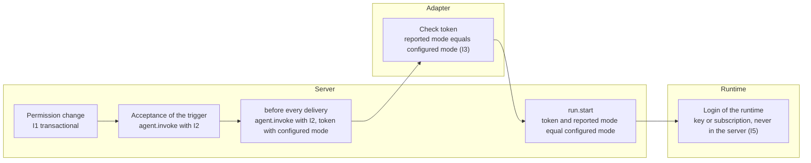
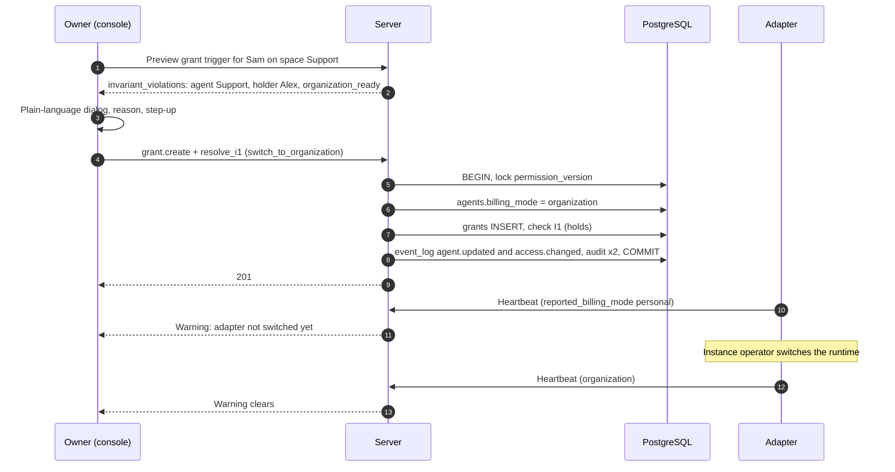

# 10 Backend policy

Status: draft M0. Normative for the modules `agents`, `authz`, `billing`, for every
agent adapter and for the console.
Terms: [00-glossary.md](00-glossary.md). Tables: [03-data-model.md](03-data-model.md)
(`agents`, `runs`, `cost_entries`, `price_table`). Actions: [05-actions.md](05-actions.md).
Adapter contract and invocation token: [09-agents.md](09-agents.md). Permission model:
[07-permissions.md](07-permissions.md). Decision:
[ADR 0024](../adr/0024-backend-policy-personal-organization-with-invariant.md).

The additions requested during drafting are now in the core contract (section 16).

## 1. Purpose

Every agent runs on exactly one backend:

| `billing_mode` | Meaning | Who pays | Who may trigger |
|---|---|---|---|
| `personal` | The runtime uses the personal subscription of exactly one person (`credential_holder_id`) for that person's own use. | the person through their subscription | only this person (I1, I2) |
| `organization` | The runtime uses an organization API key from the secret provider of the adapter. | the key holder | everyone with `trigger` |

The server knows only the configured mode, checks it at three places and displays it. It never
knows credentials (B10, I5).

## 2. Rationale from the Anthropic terms

Source: https://code.claude.com/docs/en/legal-and-compliance, sections "Usage policy" and "Can
customers offer Claude Code in their products?", retrieved 2026-10-10. Verbatim quotes [verified]:

- "Advertised usage limits for Pro and Max plans assume ordinary, individual usage of Claude Code
  and the Agent SDK."
- "OAuth authentication is intended exclusively for purchasers of Claude Free, Pro, Max, Team,
  and Enterprise subscription plans and is designed to support ordinary use of Claude Code and
  other native Anthropic applications."
- "Anthropic does not permit third-party developers to offer Claude.ai login into their own
  applications, or to route requests through Free, Pro, or Max plan credentials on behalf of their
  users. Moreover, developers may not collect, store, or intermediate Claude.ai credentials or
  session tokens"
- "This does not restrict how customers provision and manage their own API keys or third-party
  inference provider credentials" ... "provided the resulting usage is billed to the key owner
  under their agreement with Anthropic (or the applicable provider) and is not resold or
  intermediated as described above."
- "Customers may not pay for, resell, or intermediate Claude usage on their end users' behalf."

Consequences for the product [derived]:

1. An agent that several people can trigger runs with an organization key whose costs land with
   the key holder (`organization`).
2. A personal subscription serves only the person's own use. That is why with `personal` exactly
   this person may trigger; the server enforces this (I1, I2) instead of assuming it.
3. The product does not collect, store or broker Claude.ai credentials or session tokens.
   It offers no Claude login. The login of the runtime stays with the runtime (I5).

The product makes no legal statement about a particular runtime. Whether a runtime is operated
permissibly in mode `personal` is the responsibility of the instance operator; the console links
the source above. For cases of doubt, the source names Anthropic's sales team as the contact
[verified].

## 3. Invariants

Wording from the planning basis, section 5 (binding), without instance-specific details:

- **I1:** An agent with `billing_mode = personal` may be triggered only by its `credential_holder`.
  Formally: the set of principals with effective level `trigger` on any target that this agent
  operates (including owners, group members, inheritance) is exactly {credential_holder}. The
  server checks I1 transactionally on every change to grants, group memberships, the owner list,
  the operator assignment and the policy, and rejects every change that would violate I1 (error
  with code and hint "switch to organization first").
- **I2:** In addition, the dispatch path checks immediately before every agent invocation: with
  `personal`, the triggering person is the credential_holder, otherwise no invocation (fail
  closed, audit entry).
- **I3:** The server signs every agent invocation (short-lived invocation token, JWS) with:
  triggering person, target, level, message ID, run ID, `billing_mode`, expiry. The adapter checks
  the signature and requires that its reported mode (`reported_billing_mode`, proven from the
  heartbeat and per run from the runtime) matches the configured mode. If it does not match, the
  adapter starts no run and reports `failed` with reason `billing_mode_mismatch`.
- **I4:** Switching is an admin action with step-up, global (all agents) or per agent, with a
  reason, in the audit log. Switching to `personal` is possible only if I1 holds afterwards.
- **I5:** The server knows no credentials. At the adapter, the API key comes from the adapter's
  secret provider; the personal subscription stays in the runtime of the person.

Added by the terminal addendum (owner requirement 2026-10-10, ruling T2):

- **I6:** If `hosts.llm_credentials = personal` on a host, only
  `hosts.credential_holder_id` may open or attach a terminal there, not even another owner.
  Grants `terminal` on this host exist only as an individual grant to the holder of the
  login. The server checks I6 transactionally on `grant.create` with target `host` and on
  `host.manage` (03 section 6.8) and on every `terminal.open` and `terminal.attach` (07, SR11).
  Details: [24-terminal.md](24-terminal.md), section 7.

In addition, ruling T12 (07, SR12): every person works on a host in their own session user, which
no other person ever gets, and no place on the host connects these accounts again (ruling T13). A
subscription login that someone creates in their session therefore reaches no session of another
person, even with `organization` or `none` ([24-terminal.md](24-terminal.md), sections 2.2 and
7.4). I6 remains unchanged.

Distinction: I1 governs who triggers an agent on a subscription and knows no owner exception
(ruling L22). I6 governs who gets a shell on a host with a subscription and has an owner
exception, because a terminal is access to a specific host and not an inherited level
([ADR 0068](../adr/0068-terminal-through-a-host-service-with-noise-stream-and-invariant-i6.md)). Both
enforce the same Anthropic term (section 2): a personal subscription only for one's own
use.

Consequence of I1 (03 section 6.4): every owner has `trigger` everywhere, so every owner belongs
to the set. `personal` is therefore possible only as long as the `credential_holder` is the only
owner. A second owner first requires switching all personal agents (section 11). There is no
owner exception (ruling L22, ADR 0024).

## 4. Overview of check points



| Check point | Checks | On violation | Audit |
|---|---|---|---|
| Permission change | I1 for affected personal agents | Transaction rolls back, `409 i1_violation` (decision `invariant_violation`) | Rejection in its own transaction |
| Acceptance | I2 (05 section 5 item 4) | `trigger_state = failed`, `billing_mode_personal_not_holder` | Rejection |
| Delivery | I2 with current permissions; the token carries the current configured mode | Run `failed`, no delivery | Rejection |
| Adapter | Token, reported mode of the runtime for this run | no start, `run.finish` with `billing_mode_mismatch` | Server writes on receipt |
| `run.start` | Token again, `billing_mode_used` equals configured mode | `409`, run `failed`, `billing_mode_mismatch` | Rejection |

## 5. I1 transactional

### 5.1 Which changes

05 rule 1.6 names the actions. Only active agents are checked (principal status `active`): a
disabled agent cannot be triggered, and `agent.enable` is in the list precisely because a
violation can arise while the agent is disabled. Per action, these personal agents are
affected:

| Action | Affected personal agents |
|---|---|
| `grant.create` with level `trigger`, target instance | all |
| `grant.create` with level `trigger`, target space S | those that operate a channel in S (5.2) |
| `grant.create` with level `trigger`, target channel K | those that operate K |
| `grant.revoke`, `group.delete`, `group.member.remove`, `user.disable` | no extension possible; the check runs anyway (rule 1.6) because it is cheap |
| `group.member.add`, `group.member.sync`, `owner.add`, `owner.remove`, `user.enable` | all (03 section 6.4) |
| `space.operator.set`, `channel.operator.set` | the new operator, if `personal` |
| `agent.billing_mode.set` to `personal`, `agent.credential_holder.set`, `agent.enable` | this agent |
| `agent.billing_mode.set_all` to `personal` | all switched agents |

Grants and group memberships with an expiry date are checked on creation. An expiry only shrinks
the set; there is no time-driven violation.

### 5.2 Targets that an agent operates

The targets of agent A are:

1. Channels whose effective operator is A (03, `channels`).
2. Channels with at least one thread (`kind = 'thread'`) whose fixed operator is A, even if the
   channel has a different operator by now and even if the thread is done. Reason:
   `threads.operator_agent_id` is fixed (R-DM-12), and a new message reopens a done thread;
   so A is still triggered there.
3. The spaces of these channels and every space whose default operator is A, even without a
   channel. Reason: `channel.create` is not an action with an I1 check; without this item, a new
   channel would make A the operator of a target on whose space someone else already has `trigger`.
4. The instance.

Item 2 uses the index `threads (operator_agent_id, channel_id)` without a condition on `state`
(03, `threads`; check in 03 section 6.4).

Guest channels (`allow_mentioned_agents`) do not count as targets, because a personal agent is
never a guest agent ([09-agents.md](09-agents.md) section 3.6). Without this rule, I1 would also
have to run on `channel.behavior.update` and on grants to the agent itself.

### 5.3 Query

The check belongs to the module `authz` (03 principle 12). The port of the module `chat` supplies
the operated channels. Pattern in SQL, run after the change and before the commit, under the lock
of `permission_version` (03 section 6.3), therefore correct without `SERIALIZABLE`:

```sql
-- $a: active agent with billing_mode = 'personal'
WITH served_channels AS (           -- port of the module chat
  SELECT c.id, c.space_id
    FROM channels c
    JOIN spaces s ON s.id = c.space_id
   WHERE c.archived_at IS NULL AND s.archived_at IS NULL
     AND ((c.operator_inherit AND s.default_operator_agent_id = $a)
          OR (NOT c.operator_inherit AND c.operator_agent_id = $a))
  UNION
  SELECT c.id, c.space_id
    FROM threads t
    JOIN channels c ON c.id = t.channel_id
    JOIN spaces s ON s.id = c.space_id
   WHERE t.kind = 'thread' AND t.operator_agent_id = $a
     AND c.archived_at IS NULL AND s.archived_at IS NULL
),
trigger_grants AS (
  SELECT g.subject_kind, g.subject_principal_id, g.subject_group_id
    FROM grants g
   WHERE g.revoked_at IS NULL
     AND (g.expires_at IS NULL OR g.expires_at > now())
     AND g.level = 'trigger'
     AND (g.target_kind = 'instance'
          OR (g.target_kind = 'space'
              AND (g.target_space_id IN (SELECT space_id FROM served_channels)
                   OR g.target_space_id IN (SELECT s.id FROM spaces s       -- item 3, port of chat
                                             WHERE s.default_operator_agent_id = $a
                                               AND s.archived_at IS NULL)))
          OR (g.target_kind = 'channel'
              AND g.target_channel_id IN (SELECT id FROM served_channels)))
),
triggerers AS (
  SELECT subject_principal_id AS user_id
    FROM trigger_grants WHERE subject_kind = 'user'
  UNION
  SELECT m.user_id
    FROM trigger_grants tg
    JOIN groups gr ON gr.id = tg.subject_group_id AND gr.deleted_at IS NULL
    JOIN group_memberships m ON m.group_id = gr.id
         AND m.removed_at IS NULL
         AND (m.expires_at IS NULL OR m.expires_at > now())
   WHERE tg.subject_kind = 'group'
  UNION
  SELECT o.user_id FROM owners o WHERE o.revoked_at IS NULL
)
SELECT t.user_id
  FROM triggerers t
  JOIN principals p ON p.id = t.user_id AND p.status = 'active';
-- I1 holds exactly when the result is the set {agents.credential_holder_id}.
```

Agents and apps are missing from the set because they never have `trigger` (R-DM-08).

### 5.4 Error response

`409` as `application/problem+json` with `type` for `invariant_violation`, `code = i1_violation`
and a list `conflicts`: per affected agent `agent_id`, `credential_holder_id` and the IDs
of the additional principals. The hint text says, in essence, "switch to organization
first". The response contains names of other principals only if the requester may read them
(`user.read`). An audit entry with `decision = 'deny'` and `deny_reason = 'i1_violation'` is created
in its own transaction (03 section 6.4).

## 6. Dispatch check (I2)

I2 is item 4 of `agent.invoke` (05 section 5) and runs twice: at acceptance and
immediately before every delivery to the adapter, with the permissions and the configured mode at
that time. If it does not hold, nothing is delivered (fail closed), the run ends with `failed`,
reason `billing_mode_personal_not_holder`, and an audit entry is created. Follow-ups,
interactions, commands and autocompletion are triggers and go through the same
check.

I1 does not make I2 redundant: I1 checks permission changes, I2 checks the individual invocation.
Between the two lies time in which the configured mode or the permissions can change.

## 7. Adapter check (I3)

The adapter checks the invocation token according to [09-agents.md](09-agents.md) section 4.5 and
compares the claim `billing_mode` with the reported mode of its runtime **for exactly this
run**:

| Evidence source | Supplies | Strength |
|---|---|---|
| Heartbeat `reported_billing_mode`, `billing_evidence` | State of the runtime configuration | Hint for display and warning |
| Check before the start (Hermes: resolved login; Runner: `claude auth status` with the run environment) | Login type with which this run will start | binding for the start |
| Runtime report during the run (Runner: `system/init.apiKeySource`) | Login type that the run actually uses | cross-check; a deviation aborts |

If the reported mode cannot be determined (`key_type = unknown`), it counts as unequal to every
configured mode. The adapter starts nothing and reports `billing_mode_mismatch`. Reason: an unknown
mode could carry other people's requests over a personal subscription.

`run.start` carries `billing_mode_used` and optionally `billing_evidence` (`provider`, `key_type`,
`method`; never a value). The server compares again with the configured mode (05 `run.start`).

## 8. Expected and reported

| Field | Meaning | Source |
|---|---|---|
| `agents.billing_mode` | Configured mode | Owner (I4) |
| `agents.reported_billing_mode` | Reported mode of the runtime configuration; not set (column NULL, missing in the heartbeat and in the API) for adapters that follow the configured mode per run | Heartbeat |
| `agents.reported_details.billing_modes_supported` | Modes that the adapter can prove | Heartbeat |
| `runs.billing_mode_expected` | Configured mode at delivery time | Server ([09-agents.md](09-agents.md) 5.1) |
| `runs.billing_mode_used` | Reported mode of the run | Adapter at `run.start` |
| `cost_entries.billing_mode` | Reported mode of the recorded usage | Server from `billing_mode_used` |

Warnings on the agent card and in the console:

| Situation | Display | Consequence |
|---|---|---|
| `reported_billing_mode` is set and not equal to the configured mode, for longer than `billing.mismatch_alert_after` | "Adapter reports Personal, Organization is configured" (or the other way round) | Invocations fail with `billing_mode_mismatch` until the adapter is switched; alert to owners ([17-observability.md](17-observability.md)) |
| Configured mode not in `billing_modes_supported` | "Adapter cannot prove this mode" | as above |
| `billing_evidence.key_type = unknown` | "Login type of the runtime unknown" | all invocations fail |

The server compares the heartbeat with the configured values at each heartbeat
([09-agents.md](09-agents.md) section 4.8) and shows the three rows above as codes of
`AgentRuntimeStatus.warnings` on the agent card (`getAgent`, `listAgents`, `HeartbeatAck.presence`),
only while the agent is `online` or `degraded`:

| Row | Code | Delay |
|---|---|---|
| 1: `reported_billing_mode` set and unequal to the configured mode | `billing_mode_mismatch` | only after the difference has held for longer than `billing.mismatch_alert_after` |
| 2: no `reported_billing_mode`, configured mode not in `billing_modes_supported` | `billing_mode_unsupported` | at once |
| 3: `billing_evidence.key_type = unknown` | `billing_evidence_unknown` | at once |

The unknown mode (`key_type` `unknown`) counts as a difference to every configured mode (section
7), also when no `reported_billing_mode` is reported. A warning disappears with the heartbeat that
ends its cause. A different reported tool class gives `tool_class_mismatch`
([09-agents.md](09-agents.md) section 2.4).

Alarm: the api process exports the gauge `bothy.agent.billing_mode.mismatch_age`
([signals.md](../observability/signals.md) 4.3): per tracked active agent the seconds since a
difference of any of the three rows began, 0 without a difference. The alarm
`BothyBillingModeMismatch` ([alerting.md](../observability/alerting.md) 3.2, severity `page`) fires
when the gauge exceeds `billing.mismatch_alert_after` (the rule holds its default, checked by
`alert-thresholds`), or at once when a run hits the adapter check
(I3, counter `bothy.agent.billing_mode_mismatch`). The heartbeat evidence serves display, warning,
audit and alarm and is never a permission; the binding checks are I3 in the adapter and BR-06 at
`run.start`.

A change of `reported_billing_mode` writes an audit entry (action `agent.heartbeat`,
`decision = allow`, old and new values in the details; 05, `agent.heartbeat`). The entry is
written in the transaction that stores the change, at once, also for a change from or to "not
reported"; its details are `billing_mode_old`, `billing_mode_new`, `tool_class_old`,
`tool_class_new` (for the changed column, each only when the value exists) and `key_type` and
`method` of `billing_evidence`. Reason: the
reported mode is the evidence for I3; its history must be auditable.

## 9. Switching (I4)

### 9.1 Actions

| Action | Body | Effect |
|---|---|---|
| `agent.billing_mode.set` | `billing_mode`, `credential_holder_id` (required with `personal`), `reason` | one agent |
| `agent.billing_mode.set_all` | `billing_mode`, `credential_holder_id` (with `personal`), `agent_ids` (required with `personal`, otherwise optional), `reason` | several agents in one transaction, all or nothing |
| `agent.credential_holder.set` | `credential_holder_id`, `reason` | only with `personal` |

All three: owner, step-up, audit, permission version (05). `reason` is required and appears in the
audit.

Switching to `organization` is always possible. `credential_holder_id` becomes `NULL` in the process
(check in 03); the old value is in the audit entry. "All to organization" is the emergency switch
when there are doubts about a personal operation. `set_all` to `personal` needs an explicit list.
Reason: a global "all to personal" would hit agents that never ran personally. The
console proposes as the list the agents that the last global switch switched over (from the
audit log).

### 9.2 What happens when switching

1. The configured mode changes in the transaction; I1 is checked if the new mode is `personal`.
2. `agent.updated` (badge in all clients), `access.changed` for those affected (permission version).
3. Running runs finish in the old mode. They were started with a valid configured mode.
4. Runs not yet started get the new configured mode in the token at the next delivery. If
   the adapter still has the old reported mode, they fail with `billing_mode_mismatch`, visibly with
   a reason. Reason for "fail instead of wait": simpler and without a hidden queue; the
   owner sees in the console that the adapter still has to be switched.
5. The adapter switches its runtime (section 10). As soon as the heartbeat reports the new reported
   mode, the warning disappears.

## 10. Switching per reference adapter

### 10.1 Hermes Agent

The reported mode depends on the profile environment of Hermes:

| Configured mode | Profile environment | Afterwards |
|---|---|---|
| `organization` | API key set; OAuth variables empty; no login file of another tool in the `HOME` of the profile and `auth.adopt_external_logins: false` | restart the gateway |
| `personal` | API key empty; login of the person (OAuth) | restart the gateway |

Precedence in Hermes (measured in M2-32 against the pinned version, [09-agents.md](09-agents.md)
17.10): OAuth variable (`ANTHROPIC_TOKEN`, `CLAUDE_CODE_OAUTH_TOKEN`) before `ANTHROPIC_API_KEY`
before Hermes' own OAuth logins before the login file of Claude Code
(`~/.claude/.credentials.json`, on macOS also the keychain). Hermes uses the login file as OAuth
without any further login; that is why the `HOME` of a profile in the mode `organization` must
not contain it, and the installer checks that and sets `auth.adopt_external_logins: false` (the
documented switch, measured to work). A change of the `.env` of the Hermes home takes effect from
the next turn; variables of the process environment need the restart.

The adapter recognizes the reported mode only by the key type of the resolved login, never by its
value ([09-agents.md](09-agents.md) 17.8). The installer of the adapter carries out the switch as
a command, checks the configuration with Hermes' own reader before and after, and shows whether
the gateway process serves several profiles (then the restart hits all of them). The product never
writes to a credential file of a runtime.

### 10.2 Claude-Code-Runner

The runner builds the environment per run according to the configured mode of the token
([09-agents.md](09-agents.md) 18.3). If it can prove both modes, a switch takes effect from the
next run without a restart. In mode `organization` it sets `ANTHROPIC_API_KEY` from its secret
provider, removes the other login variables and uses its own configuration directory without a
subscription login. In mode `personal` it uses only the login of the person under that person's
`HOME`. Evidence of the reported mode: pre-check `claude auth status` (field `authMethod`) and
cross-check `apiKeySource` in the `system/init` event.

Evidence (retrieved 2026-10-10): "In non-interactive mode (`-p`), the key is always used when
present." (https://code.claude.com/docs/en/authentication) [verified]; values of `authMethod`
(https://code.claude.com/docs/en/cli-reference) [verified]; values of `apiKeySource`
(https://code.claude.com/docs/en/agent-sdk/typescript) [verified].

None of this circumvents the terms: the runner never logs in for another person, passes on
no credentials and, with `personal`, runs only for the triggering person, who is also the
logged-in person.

## 11. Guided flow "Grant a person access in a personal space"

Starting point: a space is operated by a personal agent. The owner wants to give another person
`trigger`. The bare change fails because of I1. The console therefore guides through a confirmed
action:

1. When the grant is created, the console calls the preview ("what would this grant
   do", [06-api.md](06-api.md)). The preview returns `invariant_violations` (`GrantPreview`): per agent
   `agent_id`, holder and `organization_ready` (configured mode `organization` in
   `billing_modes_supported`); the console reads the agent's name with `getAgent`.
2. The console shows in plain language: "This grant allows Sam to trigger the agent Support.
   Support runs on the personal subscription of Alex. Support must first be switched to
   Organization; the organization key then bears the costs." If `organization_ready` is false, it
   also says: "The adapter of Support does not report an organization key yet. Invocations fail
   until it is switched."
3. The owner enters a reason and confirms with step-up.
4. One request: `grant.create` with `resolve_i1 = {switch_to_organization: [agent_ids], reason}`
   (05, rule 1.6; same field for `group.member.add`, `owner.add` and the operator actions). The server checks both actions individually with `authorize`, carries them out in one
   transaction (first the switch, then the grant), checks I1 and writes two audit entries with
   the same `correlation_id`.
5. Afterwards the console shows the agent card with the state of the adapter (section 8) and the
   instructions for switching (section 10).



Server rules of point 4 (M2-21, docs/decisions.d/M2-21.md D-M2-21-2 to D-M2-21-6): the server
first validates the whole body (the reason of `resolve_i1` is not blank, passes SEC-IN-4 and has
at most `audit.reason_max_chars` characters), then runs the outer action's `authorize` and its
checks that write nothing (`404`, `403`, `401 step_up_required`, `409 conflict`, `428`, `412`), so
a caller without read access to the outer target learns nothing about the listed agents. An
operator change without effect switches nothing. Then, inside the transaction of the outer action
and before its first write, it authorizes `agent.billing_mode.set` for every listed agent in
ascending id: an unknown id, a principal that is not an agent and an agent the caller cannot read
give the same `404 not_found`, a visible agent and a caller who is not an owner `403 forbidden`
with `owner_only`. It switches the agents (an agent already on `organization` keeps its row and
gets an entry with `no_change`), applies the change and checks I1 and SR8 before the commit.
Audit: one allow entry `agent.billing_mode.set` per listed agent and the entry of the outer
action, all with the request's `correlation_id`. The preview of `createGrant` with `resolve_i1` is
a dry run of the whole request ([07-permissions.md](07-permissions.md) section 9.3). The presence
tracker learns the new desired mode with the agent's next heartbeat; `billing_mode_matches`
compares at read time.

The reverse way (back to `personal`) is not a guided flow: the console shows which
grants, groups and owners would violate I1; the owner first revokes them personally. Reason:
revoking permissions automatically has too many consequences for a side effect.

## 12. Costs

### 12.1 Recording

At the end of a run ([09-agents.md](09-agents.md) 4.10), the server writes one entry per model
into `cost_entries`:

| Situation | `source` | Amount |
|---|---|---|
| Price for `provider`, `model` at time `occurred_at` in `price_table` | `computed` | tokens per unit times price per unit |
| no price, but an amount from the adapter | `adapter_reported` | amount of the adapter |
| neither | `unpriced` | `0`; display "Price missing" |

`computed` takes precedence over `adapter_reported`. Reason: a price table with source and
retrieval time is verifiable and the same for all adapters; runtimes calculate with their own,
version-dependent tables (Claude Code calls its values "client-side estimates",
https://code.claude.com/docs/en/headless, retrieved 2026-10-10, [verified]).

A calculation uses up to five price rows (input, output, cache read, cache write with
5 minutes and with 1 hour). That is why a `computed` entry does not reference one price row,
but the price set for `provider`, `model` and `occurred_at`; price rows that have been used never
change again (03, R-DM-23).

All entries are estimates (`is_estimate = true`) until a reconciliation replaces them (12.4).
Amounts in different currencies are never converted; sums are shown per currency.

### 12.2 Display

| Where | What | Action |
|---|---|---|
| Live box, collapsed line | Costs of the run | `cost.read.thread` |
| Thread header | Sum of the session (`agent_sessions.cumulative_cost_micros`) | `cost.read.thread` |
| Agent card, console | Sums per agent, per space, per period | `cost.read.aggregate` |
| Statistics | History per space, agent, model | `cost.read.aggregate`, [01-product.md](01-product.md) |

Rules: amounts appear only in mode `organization`. Until reconciliation, every number carries the
suffix "Estimate". In mode `personal` the interface shows the badge "Personal" and tokens,
no amounts; there, amounts are only information, never an invoice (03). The switch
`billing.show_personal_estimates` shows them anyway, labeled "Information, not
billed".

### 12.3 Price table

The price table is configuration in the database (`price_table`), maintained with `price.manage`
(owner, step-up). Every row has `source_url` and `retrieved_at`; validity periods do not overlap
(exclusion constraint in 03). The product ships a starter file with prices, source and
retrieval date; a test checks that every row has a source and a retrieval date. This specification
names no prices.

The public pricing page (https://platform.claude.com/docs/en/about-claude/pricing, retrieved
2026-10-10) lists columns for input, cache write with 5 minutes and with 1 hour,
cache hits and output, as well as surcharges and discounts for batch processing, US inference
(`inference_geo`), Fast Mode and long prompts for one model [verified]. The estimate maps
only the base prices per unit of these. From this follows [derived]:

- `price_table.unit` distinguishes cache write with 5 minutes (`cache_write_mtok`) and with
  1 hour (`cache_write_1h_mtok`); the usage arrives separately as `tokens_cache_write` and
  `tokens_cache_write_1h` (03). If a runtime does not report the duration, everything counts as
  5 minutes, and the estimate is too low for cache with 1 hour until the reconciliation
  corrects it.
- Surcharges, discounts and price tiers are missing from the estimate; the reconciliation (12.4)
  corrects them.

### 12.4 Reconciliation with billing

Decision: the reconciliation is a separate app outside the server, not part of the
server process, and off by default.

Reason: according to the documentation, an admin access of the Anthropic organization can manage
members, workspaces, invitations and API keys, including renaming keys and changing their status
(https://platform.claude.com/docs/en/manage-claude/admin-api, retrieved 2026-10-10,
[verified]). A read-only admin key is not described there [verified: not found]. A
break-in into the chat server must not reach this access. In addition, the server never calls
models (B10); it needs the access for nothing except the reconciliation.

Flow:

1. The instance operator assigns agents to Anthropic workspaces, recommended one workspace per
   agent with its own key (configuration of the app). Reason: the Cost API groups costs by
   workspace or description, not by key.
2. The app calls `GET /v1/organizations/cost_report` (daily buckets, grouping by
   `workspace_id` and `description`) with the admin key from its own secret provider.
   Evidence (https://platform.claude.com/docs/en/manage-claude/usage-cost-api, retrieved
   2026-10-10, [verified]): costs in USD as a decimal string in cents; only daily granularity; data
   "typically ... within 5 minutes"; polling "once per minute for sustained use"; workspace keys
   do not work, an admin access is required; Priority Tier costs are missing from the cost endpoint.
3. Per day and workspace, the app distributes the actual amount over the estimated entries of the
   assigned agents in proportion to their estimates; the rounding remainder goes to the largest
   entry. It reports an amount without a matching run as "unassigned" (other usage in the
   workspace).
4. It submits new entries with `source = 'reconciled'`, `is_estimate = false` and
   `supersedes_id` pointing to the estimate. The server then sets `runs.cost_is_estimate` and
   `agent_sessions.cost_is_estimate` and adjusts the sums.
5. The app queries at most every `reconciler.min_request_interval` and for the last
   `reconciler.lookback` days.

Authorization: `cost.reconcile` requires step-up and is therefore impossible for an app (R-AZ-03).
The app therefore uses the separate action `cost.reconcile.submit` with scope `costs:reconcile`
(05), without step-up; it only creates `reconciled` entries for existing runs and deletes nothing
([ADR 0055](../adr/0055-cost-reconciliation-as-its-own-app-admin-key-never-in-the-server.md)). Reason: the
reconciliation changes only estimated amounts, no permissions; a job cannot confirm a passkey.
It reads the estimates per run that it distributes according to item 3, and the run IDs for the
submission, with `cost.reconcile.read` under the same scope, also without step-up (05, R-AZ-28).

## 13. Display in the app

| Element | Content |
|---|---|
| Badge | "Personal" or "Organization" on the thread header, agent card, live box; icon and text, not color alone (accessibility) |
| Agent card (console) | Configured mode, reported mode according to the heartbeat, evidence source (`method`), supported modes, holder with `personal`, costs with `organization`, warnings from section 8 |
| Admin switch | per agent and global; required field reason; step-up; beforehand a plain-language text on what changes (who pays, who may trigger) |
| I1 preview | on every permission change that touches I1 (section 11) |
| Note on rejection | `billing_mode_personal_not_holder`: "This agent runs on a personal subscription and accepts requests only from its holder." |

The texts are keys in the language catalogue ([01-product.md](01-product.md)); the table gives the
meaning.

## 14. Audit trail

| Event | Action in the audit | Details (never content, never secrets) |
|---|---|---|
| Switching per agent | `agent.billing_mode.set` | old, new, holder old and new, reason |
| Switching globally | `agent.billing_mode.set_all` | list of agents with old and new, reason |
| Change holder | `agent.credential_holder.set` | old, new, reason |
| I1 rejection | causing action, `deny`, `i1_violation` | agents and additional principal IDs |
| I2 rejection | `agent.invoke`, `deny`, `billing_mode_personal_not_holder` | run, triggering person, agent |
| I3 mismatch | `run.start` or the report of the adapter, `deny`, `billing_mode_mismatch` | configured mode, reported mode, `billing_evidence` without values |
| Reported mode changed | `agent.heartbeat` (section 8) | old, new, `method` |
| Cost reconciliation | `cost.reconcile.submit` | period, number of entries, sums per currency |
| Prices | `price.manage` | row, source, retrieval time |

## 15. Tests

| No. | Test | Expected |
|---|---|---|
| BR-01 | Per action from 5.1, one change that violates I1 (grant on instance, space, channel; group with member; second owner; set operator; switching; change holder; re-enable a person) | `409 i1_violation`, nothing changed, audit `deny` (05 test 5) |
| BR-02 | I1 via a done thread with a fixed personal operator in a channel with a different operator | Violation detected |
| BR-03 | Parallel permission changes that violate I1 only together | one fails (serialization via `permission_version`) |
| BR-04 | Permission revocation or switching between acceptance and delivery | Run `failed`, no delivery (05 test 6) |
| BR-05 | Adapter with reported mode unequal to configured mode, with `unknown`, with a change during the run | no start or abort, `billing_mode_mismatch` |
| BR-06 | `run.start` with `billing_mode_used` unequal to configured mode | `409`, run `failed` |
| BR-07 | Guided flow: grant plus switch in one request; abort of one part | both changes or none; two audit entries with the same `correlation_id` |
| BR-08 | `set_all` to `personal` with one agent that violates I1 | no change at all |
| BR-09 | Cost recording with price, without price with adapter amount, without either | `computed`, `adapter_reported`, `unpriced` |
| BR-10 | Reconciliation distributes the daily amount over estimates | Sum equals actual amount, rounding remainder at the largest entry, estimates replaced |
| BR-11 | Display in mode `personal` | no amounts, badge visible |
| BR-12 | Runner in mode `organization` without key | no fallback to a subscription; `runtime_not_authenticated` |
| BR-13 | Search responses and logs for key values (secret text in all fields) | Value appears nowhere |

## 16. Alignment with the core contract

The additions requested during drafting are decided (integration of 2026-10-10):

| No. | Addition | Decision, location |
|---|---|---|
| E-BR-01 | I1 targets with threads whose fixed operator is the agent, even done ones | adopted, 03 section 6.4 and index on `threads` |
| E-BR-02 | Field `resolve_i1` | adopted, 05 rule 1.6, R-AZ-17 |
| E-BR-03 | Audit on a change of `reported_billing_mode` | adopted, 05 `agent.heartbeat` |
| E-BR-04 | `cost_entries.source` value `unpriced` | adopted, 03 |
| E-BR-05 | Price set instead of a single `price_id` | adopted, 03 `cost_entries`, R-DM-23 |
| E-BR-06 | Unit `cache_write_1h_mtok` | adopted, plus `tokens_cache_write_1h` (03) |
| E-BR-07 | Action `cost.reconcile.submit` with scope `costs:reconcile` | adopted, 05 |
| E-BR-08 | `billing_evidence` in `run.start` and in the heartbeat | adopted, 03 `runs.billing_evidence`, `agent_heartbeat.v1` |

## 17. Configuration values of this chapter

| Name | Place | Default | Meaning |
|---|---|---|---|
| `billing.show_personal_estimates` | Server | `false` | Show amounts in mode `personal` too, as information |
| `billing.mismatch_alert_after` | Server | `5m` | how long the reported mode may deviate from the configured mode before an alert goes out |
| `reconciler.min_request_interval` | Reconciliation app | `60s` | Interval between requests to the Cost API |
| `reconciler.lookback` | Reconciliation app | `3d` | this many days back are reconciled |
| `reconciler.workspace_map` | Reconciliation app | empty | Assignment of workspace to agent |
