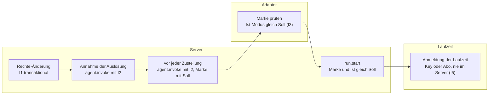
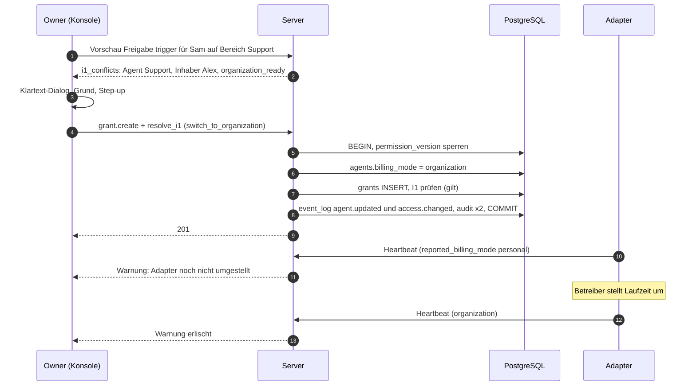

# 10 Backend-Richtlinie

Status: Entwurf M0. Normativ für die Module `agents`, `authz`, `billing`, für jeden
Agenten-Adapter und für die Konsole.
Begriffe: [00-glossar.md](00-glossar.md). Tabellen: [03-datenmodell.md](03-datenmodell.md)
(`agents`, `runs`, `cost_entries`, `price_table`). Aktionen: [05-aktionen.md](05-aktionen.md).
Adapter-Vertrag und Aufruf-Marke: [09-agenten.md](09-agenten.md). Rechte-Modell:
[07-rechte.md](07-rechte.md). Entscheidung:
[ADR 0024](../adr/0024-backend-richtlinie-personal-organization-mit-invariante.md).

Die beim Entwurf beantragten Ergänzungen stehen jetzt im Kern-Vertrag (Abschnitt 16).

## 1. Zweck

Jeder Agent läuft auf genau einem Backend:

| `billing_mode` | Bedeutung | Wer zahlt | Wer darf auslösen |
|---|---|---|---|
| `personal` | Die Laufzeit nutzt das persönliche Abo genau einer Person (`credential_holder_id`) für deren eigene Nutzung. | die Person über ihr Abo | nur diese Person (I1, I2) |
| `organization` | Die Laufzeit nutzt einen Organisations-API-Key aus dem Secret-Provider des Adapters. | der Key-Inhaber | jeder mit `trigger` |

Der Server kennt nur das Soll, prüft es an drei Stellen und zeigt es an. Zugangsdaten kennt er
nie (B10, I5).

## 2. Begründung aus den Anthropic-Bedingungen

Quelle: https://code.claude.com/docs/en/legal-and-compliance, Abschnitte "Usage policy" und "Can
customers offer Claude Code in their products?", abgerufen 2026-10-10. Zitate wörtlich [belegt]:

- "Advertised usage limits for Pro and Max plans assume ordinary, individual usage of Claude Code
  and the Agent SDK."
- "OAuth authentication is intended exclusively for purchasers of Claude Free, Pro, Max, Team,
  and Enterprise subscription plans and is designed to support ordinary use of Claude Code and
  other native Anthropic applications."
- "Anthropic does not permit third-party developers to offer Claude.ai login into their own
  applications, or to route requests through Free, Pro, or Max plan credentials on behalf of their
  users. Moreover, developers may not collect, store, or intermediate Claude.ai credentials or
  session tokens"
- "This does not restrict how customers provision and manage their own API keys or third-party
  inference provider credentials" ... "provided the resulting usage is billed to the key owner
  under their agreement with Anthropic (or the applicable provider) and is not resold or
  intermediated as described above."
- "Customers may not pay for, resell, or intermediate Claude usage on their end users' behalf."

Folgerungen für das Produkt [abgeleitet]:

1. Ein Agent, den mehrere Menschen auslösen können, läuft mit einem Organisations-Key, dessen
   Kosten beim Key-Inhaber landen (`organization`).
2. Ein persönliches Abo dient nur der eigenen Nutzung der Person. Darum darf bei `personal` genau
   diese Person auslösen; der Server erzwingt das (I1, I2) statt es anzunehmen.
3. Das Produkt sammelt, speichert und vermittelt keine Claude.ai-Zugangsdaten oder Sitzungstokens.
   Es bietet keinen Claude-Login an. Die Anmeldung der Laufzeit bleibt bei der Laufzeit (I5).

Das Produkt trifft keine Rechtsaussage über eine bestimmte Laufzeit. Ob eine Laufzeit im Modus
`personal` zulässig betrieben wird, verantwortet der Betreiber; die Konsole verlinkt die Quelle
oben. Die Quelle nennt für Zweifelsfälle den Vertrieb von Anthropic als Ansprechpartner
[belegt].

## 3. Invarianten

Wortlaut aus der Planungsgrundlage, Abschnitt 5 (verbindlich). Bei I5 fehlt nur ein Klammerzusatz zu
einer bestimmten Installation; instanzbezogene Angaben gehören nicht ins Produkt-Repo:

- **I1:** Ein Agent mit `billing_mode = personal` darf nur von seinem `credential_holder`
  ausgelöst werden. Formal: Die Menge der Prinzipale mit effektiver Stufe `trigger` auf
  irgendeinem Ziel, das dieser Agent bedient (inklusive Owner, Gruppenmitglieder, Vererbung), ist
  genau {credential_holder}. Der Server prüft I1 transaktional bei jeder Änderung an Freigaben,
  Gruppenmitgliedschaften, Owner-Liste, Bediener-Zuordnung und Richtlinie, und lehnt jede
  Änderung ab, die I1 verletzen würde (Fehler mit Code und Hinweis "zuerst auf organization
  umstellen").
- **I2:** Zusätzlich prüft der Dispatch-Pfad unmittelbar vor jedem Agenten-Aufruf: Auslöser ist
  bei `personal` der credential_holder, sonst kein Aufruf (fail closed, Audit-Eintrag).
- **I3:** Der Server signiert jeden Agenten-Aufruf (kurzlebige Aufruf-Marke, JWS) mit: Auslöser,
  Ziel, Stufe, Nachrichten-ID, Lauf-ID, `billing_mode`, Ablauf. Der Adapter prüft Signatur und
  verlangt, dass sein gemeldeter Ist-Modus (`reported_billing_mode`, aus Heartbeat und je Lauf
  aus der Laufzeit belegt) zum Soll passt. Passt er nicht, startet er keinen Lauf und meldet
  `failed` mit Grund `billing_mode_mismatch`.
- **I4:** Umschalten ist eine Admin-Aktion mit Step-up, global (alle Agenten) oder je Agent, mit
  Grund, im Audit-Log. Umschalten auf `personal` geht nur, wenn I1 danach gilt.
- **I5:** Der Server kennt keine Zugangsdaten. Der API-Key kommt beim Adapter aus dessen
  Secret-Provider; das persönliche Abo bleibt in der Laufzeit der Person.

Folge von I1 (03 Abschnitt 6.4): Jeder Owner hat überall `trigger`, also gehört jeder Owner zur
Menge. `personal` ist darum nur möglich, solange der `credential_holder` der einzige Owner ist.
Ein zweiter Owner verlangt vorher die Umstellung aller persönlichen Agenten (Abschnitt 11). Eine
Owner-Ausnahme gibt es nicht (Ruling L22, ADR 0024).

## 4. Prüfstellen im Überblick



| Stelle | Prüft | Bei Verstoß | Audit |
|---|---|---|---|
| Rechte-Änderung | I1 für betroffene persönliche Agenten | Transaktion rollt zurück, `409 invariant_violation`, Code `i1_violation` | Ablehnung in eigener Transaktion |
| Annahme | I2 (05 Abschnitt 5 Punkt 4) | `trigger_state = failed`, `billing_mode_personal_not_holder` | Ablehnung |
| Zustellung | I2 mit aktuellen Rechten; Marke trägt das aktuelle Soll | Lauf `failed`, keine Zustellung | Ablehnung |
| Adapter | Marke, Ist-Modus der Laufzeit für diesen Lauf | kein Start, `run.finish` mit `billing_mode_mismatch` | Server schreibt bei Empfang |
| `run.start` | Marke erneut, `billing_mode_used` gleich Soll | `409`, Lauf `failed`, `billing_mode_mismatch` | Ablehnung |

## 5. I1 transaktional

### 5.1 Welche Änderungen

05 Regel 1.6 nennt die Aktionen. Je Aktion sind diese persönlichen Agenten betroffen:

| Aktion | Betroffene persönliche Agenten |
|---|---|
| `grant.create` mit Stufe `trigger`, Ziel Instanz | alle |
| `grant.create` mit Stufe `trigger`, Ziel Bereich S | die einen Kanal in S bedienen (5.2) |
| `grant.create` mit Stufe `trigger`, Ziel Kanal K | die K bedienen |
| `grant.revoke`, `group.delete`, `group.member.remove`, `user.disable` | keine Erweiterung möglich; Prüfung läuft trotzdem (Regel 1.6), weil sie billig ist |
| `group.member.add`, `owner.add`, `owner.remove`, `user.enable` | alle (03 Abschnitt 6.4) |
| `space.operator.set`, `channel.operator.set` | der neue Bediener, falls `personal` |
| `agent.billing_mode.set` auf `personal`, `agent.credential_holder.set` | dieser Agent |
| `agent.billing_mode.set_all` auf `personal` | alle umgestellten |

Freigaben und Gruppenmitgliedschaften mit Ablaufdatum werden bei der Anlage geprüft. Ein Ablauf
verkleinert die Menge nur; es gibt keinen zeitgesteuerten Verstoß.

### 5.2 Ziele, die ein Agent bedient

Ziele von Agent A sind:

1. Kanäle, deren wirksamer Bediener A ist (03, `channels`).
2. Kanäle mit mindestens einem Thread (`kind = 'thread'`), dessen fester Bediener A ist, auch wenn
   der Kanal inzwischen einen anderen Bediener hat und auch wenn der Thread erledigt ist. Grund:
   `threads.operator_agent_id` ist fest (R-DM-12), und eine neue Nachricht öffnet einen erledigten
   Thread wieder; dort löst also weiter A aus.
3. Die Bereiche dieser Kanäle.
4. Die Instanz.

Punkt 2 nutzt den Index `threads (operator_agent_id, channel_id)` ohne Bedingung auf `state`
(03, `threads`; Prüfung in 03 Abschnitt 6.4).

Gast-Kanäle (`allow_mentioned_agents`) zählen nicht zu den Zielen, weil ein persönlicher Agent nie
Gast-Agent ist ([09-agenten.md](09-agenten.md) Abschnitt 3.6). Ohne diese Regel müsste I1 auch bei
`channel.behavior.update` und bei Freigaben an den Agenten selbst laufen.

### 5.3 Abfrage

Die Prüfung gehört dem Modul `authz` (03 Grundsatz 12). Die bedienten Kanäle liefert der Port des
Moduls `chat`. Muster in SQL, ausgeführt nach der Änderung und vor dem Commit, unter der Sperre
von `permission_version` (03 Abschnitt 6.3), darum ohne `SERIALIZABLE` korrekt:

```sql
-- $a: Agent mit billing_mode = 'personal'
WITH served_channels AS (           -- Port des Moduls chat
  SELECT c.id, c.space_id
    FROM channels c
    JOIN spaces s ON s.id = c.space_id
   WHERE c.archived_at IS NULL AND s.archived_at IS NULL
     AND ((c.operator_inherit AND s.default_operator_agent_id = $a)
          OR (NOT c.operator_inherit AND c.operator_agent_id = $a))
  UNION
  SELECT c.id, c.space_id
    FROM threads t
    JOIN channels c ON c.id = t.channel_id
    JOIN spaces s ON s.id = c.space_id
   WHERE t.kind = 'thread' AND t.operator_agent_id = $a
     AND c.archived_at IS NULL AND s.archived_at IS NULL
),
trigger_grants AS (
  SELECT g.subject_kind, g.subject_principal_id, g.subject_group_id
    FROM grants g
   WHERE g.revoked_at IS NULL
     AND (g.expires_at IS NULL OR g.expires_at > now())
     AND g.level = 'trigger'
     AND (g.target_kind = 'instance'
          OR (g.target_kind = 'space'
              AND g.target_space_id IN (SELECT space_id FROM served_channels))
          OR (g.target_kind = 'channel'
              AND g.target_channel_id IN (SELECT id FROM served_channels)))
),
triggerers AS (
  SELECT subject_principal_id AS user_id
    FROM trigger_grants WHERE subject_kind = 'user'
  UNION
  SELECT m.user_id
    FROM trigger_grants tg
    JOIN groups gr ON gr.id = tg.subject_group_id AND gr.deleted_at IS NULL
    JOIN group_memberships m ON m.group_id = gr.id
         AND m.removed_at IS NULL
         AND (m.expires_at IS NULL OR m.expires_at > now())
   WHERE tg.subject_kind = 'group'
  UNION
  SELECT o.user_id FROM owners o WHERE o.revoked_at IS NULL
)
SELECT t.user_id
  FROM triggerers t
  JOIN principals p ON p.id = t.user_id AND p.status = 'active';
-- I1 gilt genau dann, wenn das Ergebnis die Menge {agents.credential_holder_id} ist.
```

Agenten und Apps fehlen in der Menge, weil sie nie `trigger` haben (R-DM-08).

### 5.4 Fehlerantwort

`409` als `application/problem+json` mit `type` für `invariant_violation`, `code = i1_violation`
und einer Liste `conflicts`: je betroffenem Agenten `agent_id`, `credential_holder_id` und die IDs
der zusätzlichen Prinzipale. Der Hinweistext lautet sinngemäß "zuerst auf organization
umstellen". Namen fremder Prinzipale enthält die Antwort nur, wenn der Anfragende sie lesen darf
(`user.read`). Ein Audit-Eintrag mit `decision = 'deny'` und `deny_reason = 'i1_violation'` entsteht
in einer eigenen Transaktion (03 Abschnitt 6.4).

## 6. Dispatch-Prüfung (I2)

I2 ist Punkt 4 von `agent.invoke` (05 Abschnitt 5) und läuft zweimal: bei der Annahme und
unmittelbar vor jeder Zustellung an den Adapter, mit den Rechten und dem Soll zu diesem
Zeitpunkt. Gilt sie nicht, wird nicht zugestellt (fail closed), der Lauf endet mit `failed`,
Grund `billing_mode_personal_not_holder`, und ein Audit-Eintrag entsteht. Nachträge,
Interaktionen, Befehle und Autovervollständigung sind Auslösungen und durchlaufen dieselbe
Prüfung.

I2 ist nicht durch I1 überflüssig: I1 prüft Rechte-Änderungen, I2 prüft den einzelnen Aufruf.
Zwischen beiden liegt Zeit, in der sich Soll oder Rechte ändern können.

## 7. Adapter-Prüfung (I3)

Der Adapter prüft die Aufruf-Marke nach [09-agenten.md](09-agenten.md) Abschnitt 4.5 und vergleicht
den Claim `billing_mode` mit dem Ist-Modus seiner Laufzeit **für genau diesen Lauf**:

| Belegquelle | Liefert | Stärke |
|---|---|---|
| Heartbeat `reported_billing_mode`, `billing_evidence` | Stand der Laufzeit-Konfiguration | Hinweis für Anzeige und Warnung |
| Prüfung vor dem Start (Hermes: aufgelöste Anmeldung; Runner: `claude auth status` mit der Lauf-Umgebung) | Anmeldeart, mit der dieser Lauf starten wird | bindend für den Start |
| Laufzeit-Meldung im Lauf (Runner: `system/init.apiKeySource`) | Anmeldeart, die der Lauf tatsächlich nutzt | Gegenprobe; Abweichung bricht ab |

Ist der Ist-Modus nicht bestimmbar (`key_type = unknown`), gilt er als ungleich jedem Soll. Der
Adapter startet nichts und meldet `billing_mode_mismatch`. Grund: Ein unbekannter Modus könnte
fremde Aufträge über ein persönliches Abo führen.

`run.start` trägt `billing_mode_used` und optional `billing_evidence` (`provider`, `key_type`,
`method`; nie ein Wert). Der Server vergleicht erneut mit dem Soll (05 `run.start`).

## 8. Soll und Ist

| Feld | Bedeutung | Quelle |
|---|---|---|
| `agents.billing_mode` | Soll | Owner (I4) |
| `agents.reported_billing_mode` | Ist der Laufzeit-Konfiguration; `null` bei Adaptern, die je Lauf dem Soll folgen | Heartbeat |
| `agents.reported_details.billing_modes_supported` | Modi, die der Adapter belegen kann | Heartbeat |
| `runs.billing_mode_expected` | Soll zur Zustellzeit | Server ([09-agenten.md](09-agenten.md) 5.1) |
| `runs.billing_mode_used` | Ist des Laufs | Adapter bei `run.start` |
| `cost_entries.billing_mode` | Ist des gebuchten Verbrauchs | Server aus `billing_mode_used` |

Warnungen an der Agenten-Karte und in der Konsole:

| Lage | Anzeige | Folge |
|---|---|---|
| `reported_billing_mode` ist nicht `null` und ungleich Soll, länger als `billing.mismatch_alert_after` | "Adapter meldet Persönlich, eingestellt ist Organisation" (bzw. umgekehrt) | Aufrufe scheitern mit `billing_mode_mismatch`, bis der Adapter umgestellt ist; Alarm an Owner ([17-observability.md](17-observability.md)) |
| Soll nicht in `billing_modes_supported` | "Adapter kann diesen Modus nicht belegen" | wie oben |
| `billing_evidence.key_type = unknown` | "Anmeldeart der Laufzeit unbekannt" | alle Aufrufe scheitern |

Ein Wechsel von `reported_billing_mode` schreibt einen Audit-Eintrag (Aktion `agent.heartbeat`,
`decision = allow`, alte und neue Werte in den Details; 05, `agent.heartbeat`). Grund: Der
Ist-Modus ist der Beleg für I3; seine Geschichte muss prüfbar sein.

## 9. Umschalten (I4)

### 9.1 Aktionen

| Aktion | Körper | Wirkung |
|---|---|---|
| `agent.billing_mode.set` | `billing_mode`, `credential_holder_id` (Pflicht bei `personal`), `reason` | ein Agent |
| `agent.billing_mode.set_all` | `billing_mode`, `credential_holder_id` (bei `personal`), `agent_ids` (Pflicht bei `personal`, sonst optional), `reason` | mehrere Agenten in einer Transaktion, alles oder nichts |
| `agent.credential_holder.set` | `credential_holder_id`, `reason` | nur bei `personal` |

Alle drei: Owner, Step-up, Audit, Rechte-Version (05). `reason` ist Pflicht und steht im Audit.

Auf `organization` umschalten geht immer. `credential_holder_id` wird dabei `NULL` (Check in 03);
der alte Wert steht im Audit-Eintrag. "Alle auf Organisation" ist der Notschalter, wenn Zweifel an
einem persönlichen Betrieb bestehen. `set_all` auf `personal` braucht eine ausdrückliche Liste.
Grund: Ein globales "alle auf persönlich" würde Agenten treffen, die nie persönlich liefen. Die
Konsole schlägt als Liste die Agenten vor, die der letzte globale Wechsel umgestellt hat (aus dem
Audit-Log).

### 9.2 Was beim Umschalten passiert

1. Soll ändert sich in der Transaktion; I1 wird geprüft, wenn das Ziel `personal` ist.
2. `agent.updated` (Abzeichen in allen Clients), `access.changed` für Betroffene (Rechte-Version).
3. Laufende Läufe laufen im alten Modus zu Ende. Sie wurden mit gültigem Soll gestartet.
4. Nicht gestartete Läufe bekommen bei der nächsten Zustellung das neue Soll in der Marke. Hat
   der Adapter noch den alten Ist-Modus, scheitern sie mit `billing_mode_mismatch`, sichtbar mit
   Grund. Grund für "scheitern statt warten": einfacher und ohne versteckte Warteschlange; der
   Owner sieht in der Konsole, dass der Adapter noch umgestellt werden muss.
5. Der Adapter stellt seine Laufzeit um (Abschnitt 10). Sobald der Heartbeat das neue Ist meldet,
   verschwindet die Warnung.

## 10. Umschalten je Referenz-Adapter

### 10.1 Hermes Agent

Der Ist-Modus hängt an der Profil-Umgebung von Hermes:

| Soll | Profil-Umgebung | Danach |
|---|---|---|
| `organization` | API-Key gesetzt; OAuth-Variablen leer | Gateway neu starten |
| `personal` | API-Key leer; Anmeldung der Person (OAuth) | Gateway neu starten |

Der Adapter erkennt den Ist-Modus nur am Schlüsseltyp der aufgelösten Anmeldung, nie am Wert
([09-agenten.md](09-agenten.md) 17.8). Der Installer des Adapters führt die Umstellung als Befehl
aus, prüft die Konfiguration mit Hermes' eigenem Leser vorher und nachher und zeigt an, ob der
Gateway-Prozess mehrere Profile bedient (dann trifft der Neustart alle). Das Produkt schreibt nie
in eine Anmeldedatei einer Laufzeit.

### 10.2 Claude-Code-Runner

Der Runner baut die Umgebung je Lauf nach dem Soll der Marke ([09-agenten.md](09-agenten.md)
18.3). Kann er beide Modi belegen, wirkt eine Umstellung ab dem nächsten Lauf ohne Neustart. Im
Modus `organization` setzt er `ANTHROPIC_API_KEY` aus seinem Secret-Provider, entfernt die
anderen Anmelde-Variablen und nutzt ein eigenes Konfigurationsverzeichnis ohne Abo-Anmeldung. Im
Modus `personal` nutzt er nur die Anmeldung der Person unter deren `HOME`. Ist-Belege: Vorab-
Prüfung `claude auth status` (Feld `authMethod`) und Gegenprobe `apiKeySource` im
`system/init`-Ereignis.

Belege (abgerufen 2026-10-10): "In non-interactive mode (`-p`), the key is always used when
present." (https://code.claude.com/docs/en/authentication) [belegt]; Werte von `authMethod`
(https://code.claude.com/docs/en/cli-reference) [belegt]; Werte von `apiKeySource`
(https://code.claude.com/docs/en/agent-sdk/typescript) [belegt].

Nichts davon umgeht die Bedingungen: Der Runner meldet sich nie für eine andere Person an,
reicht keine Zugangsdaten weiter und läuft bei `personal` nur für die Auslöse-Person, die zugleich
die angemeldete Person ist.

## 11. Geführter Ablauf "Person freigeben in persönlichem Bereich"

Ausgangslage: Ein Bereich wird von einem persönlichen Agenten bedient. Der Owner will einer
weiteren Person `trigger` geben. Die nackte Änderung scheitert an I1. Die Konsole führt deshalb
durch eine bestätigte Aktion:

1. Beim Anlegen der Freigabe ruft die Konsole die Vorschau auf ("was würde diese Freigabe
   bewirken", [06-api.md](06-api.md)). Die Vorschau liefert `i1_conflicts`: je Agent `agent_id`,
   Name, Inhaber und `organization_ready` (Soll `organization` in `billing_modes_supported`).
2. Die Konsole zeigt im Klartext: "Diese Freigabe erlaubt Sam, den Agenten Support auszulösen.
   Support läuft auf dem persönlichen Abo von Alex. Vorher muss Support auf Organisation umgestellt
   werden; die Kosten trägt dann der Organisations-Key." Ist `organization_ready` falsch, steht
   dabei: "Der Adapter von Support meldet noch keinen Organisations-Key. Aufrufe scheitern, bis er
   umgestellt ist."
3. Der Owner gibt einen Grund ein und bestätigt mit Step-up.
4. Eine Anfrage: `grant.create` mit `resolve_i1 = {switch_to_organization: [agent_ids], reason}`
   (05, Regel 1.6; gleiches Feld für `group.member.add`, `owner.add` und die Bediener-Aktionen). Der Server prüft beide Aktionen einzeln mit `authorize`, führt sie in einer
   Transaktion aus (erst Umschalten, dann Freigabe), prüft I1 und schreibt zwei Audit-Einträge mit
   derselben `correlation_id`.
5. Die Konsole zeigt danach die Agenten-Karte mit dem Stand des Adapters (Abschnitt 8) und die
   Anleitung zum Umstellen (Abschnitt 10).



Der umgekehrte Weg (zurück auf `personal`) ist kein geführter Ablauf: Die Konsole zeigt, welche
Freigaben, Gruppen und Owner I1 verletzen würden; der Owner entzieht sie erst selbst. Grund:
Rechte automatisch zu entziehen ist zu folgenreich für einen Nebeneffekt.

## 12. Kosten

### 12.1 Buchung

Am Laufende ([09-agenten.md](09-agenten.md) 4.10) schreibt der Server je Modell einen Eintrag in
`cost_entries`:

| Lage | `source` | Betrag |
|---|---|---|
| Preis für `provider`, `model` zur Zeit `occurred_at` in `price_table` | `computed` | Token je Einheit mal Preis je Einheit |
| kein Preis, aber Betrag vom Adapter | `adapter_reported` | Betrag des Adapters |
| weder noch | `unpriced` | `0`; Anzeige "Preis fehlt" |

`computed` hat Vorrang vor `adapter_reported`. Grund: Eine Preistabelle mit Quelle und Abrufzeit
ist prüfbar und für alle Adapter gleich; Laufzeiten rechnen mit eigenen, versionsabhängigen
Tabellen (Claude Code nennt seine Werte "client-side estimates",
https://code.claude.com/docs/en/headless, abgerufen 2026-10-10, [belegt]).

Eine Berechnung nutzt bis zu fünf Preiszeilen (Eingabe, Ausgabe, Cache lesen, Cache schreiben mit
5 Minuten und mit 1 Stunde). Darum verweist eine Buchung `computed` nicht auf eine Preiszeile,
sondern auf den Preissatz zu `provider`, `model` und `occurred_at`; benutzte Preiszeilen ändern
sich nicht mehr (03, R-DM-23).

Alle Einträge sind Schätzungen (`is_estimate = true`), bis ein Abgleich sie ersetzt (12.4).
Beträge verschiedener Währungen werden nie umgerechnet; Summen stehen je Währung.

### 12.2 Anzeige

| Wo | Was | Aktion |
|---|---|---|
| Live-Box, eingeklappte Zeile | Kosten des Laufs | `cost.read.thread` |
| Thread-Kopfzeile | Summe der Sitzung (`agent_sessions.cumulative_cost_micros`) | `cost.read.thread` |
| Agenten-Karte, Konsole | Summen je Agent, je Bereich, je Zeitraum | `cost.read.aggregate` |
| Statistik | Verlauf je Bereich, Agent, Modell | `cost.read.aggregate`, [01-produkt.md](01-produkt.md) |

Regeln: Beträge stehen nur im Modus `organization`. Bis zum Abgleich trägt jede Zahl den Zusatz
"Schätzung". Im Modus `personal` zeigt die Oberfläche das Abzeichen "Persönlich" und Token,
keine Beträge; Beträge sind dort nur Information, nie Rechnung (03). Der Schalter
`billing.show_personal_estimates` zeigt sie trotzdem, gekennzeichnet "Information, nicht
abgerechnet".

### 12.3 Preistabelle

Die Preistabelle ist Konfiguration in der Datenbank (`price_table`), gepflegt mit `price.manage`
(Owner, Step-up). Jede Zeile hat `source_url` und `retrieved_at`; Gültigkeiten überlappen nicht
(Ausschluss-Constraint in 03). Das Produkt liefert eine Startdatei mit Preisen, Quelle und
Abrufdatum aus; ein Test prüft, dass jede Zeile Quelle und Abrufdatum hat. Diese Spezifikation
nennt keine Preise.

Die öffentliche Preisseite (https://platform.claude.com/docs/en/about-claude/pricing, abgerufen
2026-10-10) führt Spalten für Eingabe, Cache-Schreiben mit 5 Minuten und mit 1 Stunde,
Cache-Treffer und Ausgabe sowie Zu- und Abschläge für Batch-Verarbeitung, US-Inferenz
(`inference_geo`), Fast Mode und lange Prompts bei einem Modell [belegt]. Die Schätzung bildet
davon nur die Grundpreise je Einheit ab. Daraus folgt [abgeleitet]:

- `price_table.unit` unterscheidet Cache-Schreiben mit 5 Minuten (`cache_write_mtok`) und mit
  1 Stunde (`cache_write_1h_mtok`); der Verbrauch kommt getrennt als `tokens_cache_write` und
  `tokens_cache_write_1h` (03). Meldet eine Laufzeit die Dauer nicht, zählt alles als
  5 Minuten, und die Schätzung ist bei Cache mit 1 Stunde zu niedrig, bis der Abgleich sie
  korrigiert.
- Zuschläge, Rabatte und Preisstufen fehlen in der Schätzung; der Abgleich (12.4) korrigiert sie.

### 12.4 Abgleich mit der Abrechnung

Entscheidung: Der Abgleich ist eine eigene App außerhalb des Servers, nicht Teil des
Server-Prozesses, und standardmäßig aus.

Grund: Ein Admin-Zugang der Anthropic-Organisation kann laut Dokumentation Mitglieder,
Arbeitsbereiche, Einladungen und API-Keys verwalten, darunter Keys umbenennen und ihren Status
ändern (https://platform.claude.com/docs/en/manage-claude/admin-api, abgerufen 2026-10-10,
[belegt]). Ein nur lesender Admin-Key ist dort nicht beschrieben [belegt: nicht gefunden]. Ein
Einbruch in den Chat-Server darf diesen Zugang nicht erreichen. Der Server ruft außerdem nie
Modelle auf (B10); er braucht den Zugang für nichts außer dem Abgleich.

Ablauf:

1. Der Betreiber ordnet Agenten Anthropic-Arbeitsbereichen zu, empfohlen ein Arbeitsbereich je
   Agent mit eigenem Key (Konfiguration der App). Grund: Die Cost-API gruppiert Kosten nach
   Arbeitsbereich oder Beschreibung, nicht nach Key.
2. Die App ruft `GET /v1/organizations/cost_report` (Tagesbuckets, Gruppierung nach
   `workspace_id` und `description`) mit dem Admin-Key aus ihrem eigenen Secret-Provider ab.
   Belege (https://platform.claude.com/docs/en/manage-claude/usage-cost-api, abgerufen
   2026-10-10, [belegt]): Kosten in USD als Dezimal-String in Cent; nur Tagesgranularität; Daten
   "typically ... within 5 minutes"; Abruf "once per minute for sustained use"; Arbeitsbereich-Keys
   funktionieren nicht, nötig ist ein Admin-Zugang; Priority-Tier-Kosten fehlen im Kosten-Endpunkt.
3. Je Tag und Arbeitsbereich verteilt die App den Ist-Betrag auf die geschätzten Einträge der
   zugeordneten Agenten im Verhältnis ihrer Schätzungen; der Rundungsrest geht an den größten
   Eintrag. Betrag ohne passenden Lauf meldet sie als "nicht zugeordnet" (anderer Verbrauch im
   Arbeitsbereich).
4. Sie übermittelt neue Einträge mit `source = 'reconciled'`, `is_estimate = false` und
   `supersedes_id` auf die Schätzung. Der Server setzt danach `runs.cost_is_estimate` und
   `agent_sessions.cost_is_estimate` und passt die Summen an.
5. Die App fragt höchstens alle `reconciler.min_request_interval` und für die letzten
   `reconciler.lookback` Tage.

Berechtigung: `cost.reconcile` verlangt Step-up und ist damit für eine App unmöglich (R-AZ-03).
Die App nutzt darum die eigene Aktion `cost.reconcile.submit` mit Scope `costs:reconcile` (05),
ohne Step-up; sie legt nur `reconciled`-Einträge zu vorhandenen Läufen an und löscht nichts
(ADR 0055). Grund: Der Abgleich ändert nur Schätzbeträge, keine Rechte;
ein Job kann keinen Passkey bestätigen.

## 13. Anzeige in der App

| Element | Inhalt |
|---|---|
| Abzeichen | "Persönlich" oder "Organisation" an Thread-Kopfzeile, Agenten-Karte, Live-Box; Icon und Text, keine Farbe allein (Barrierefreiheit) |
| Agenten-Karte (Konsole) | Soll, Ist laut Heartbeat, Belegquelle (`method`), unterstützte Modi, Inhaber bei `personal`, Kosten bei `organization`, Warnungen aus Abschnitt 8 |
| Admin-Schalter | je Agent und global; Pflichtfeld Grund; Step-up; vorher Klartext, was sich ändert (wer zahlt, wer auslösen darf) |
| I1-Vorschau | bei jeder Rechte-Änderung, die I1 berührt (Abschnitt 11) |
| Hinweis bei Ablehnung | `billing_mode_personal_not_holder`: "Dieser Agent läuft auf einem persönlichen Abo und nimmt nur Aufträge seines Inhabers an." |

Die Texte sind Schlüssel im Sprachkatalog ([01-produkt.md](01-produkt.md)); die Tabelle nennt den
Sinn.

## 14. Audit-Spur

| Ereignis | Aktion im Audit | Details (nie Inhalte, nie Geheimnisse) |
|---|---|---|
| Umschalten je Agent | `agent.billing_mode.set` | alt, neu, Inhaber alt und neu, Grund |
| Umschalten global | `agent.billing_mode.set_all` | Liste der Agenten mit alt und neu, Grund |
| Inhaber ändern | `agent.credential_holder.set` | alt, neu, Grund |
| I1-Ablehnung | auslösende Aktion, `deny`, `i1_violation` | Agenten und zusätzliche Prinzipal-IDs |
| I2-Ablehnung | `agent.invoke`, `deny`, `billing_mode_personal_not_holder` | Lauf, Auslöser, Agent |
| I3-Abweichung | `run.start` bzw. Meldung des Adapters, `deny`, `billing_mode_mismatch` | Soll, gemeldetes Ist, `billing_evidence` ohne Werte |
| Ist-Modus geändert | `agent.heartbeat` (Abschnitt 8) | alt, neu, `method` |
| Kostenabgleich | `cost.reconcile.submit` | Zeitraum, Anzahl Einträge, Summen je Währung |
| Preise | `price.manage` | Zeile, Quelle, Abrufzeit |

## 15. Tests

| Nr | Test | Erwartet |
|---|---|---|
| BR-01 | Je Aktion aus 5.1 eine Änderung, die I1 verletzt (Freigabe auf Instanz, Bereich, Kanal; Gruppe mit Mitglied; zweiter Owner; Bediener setzen; Umschalten; Inhaber ändern; Person entsperren) | `409 i1_violation`, nichts geändert, Audit `deny` (05 Test 5) |
| BR-02 | I1 über einen erledigten Thread mit festem persönlichen Bediener in einem Kanal mit anderem Bediener | Verstoß erkannt |
| BR-03 | Parallele Rechte-Änderungen, die nur zusammen I1 verletzen | eine scheitert (Serialisierung über `permission_version`) |
| BR-04 | Rechte-Entzug oder Umschalten zwischen Annahme und Zustellung | Lauf `failed`, keine Zustellung (05 Test 6) |
| BR-05 | Adapter mit Ist ungleich Soll, mit `unknown`, mit Wechsel während des Laufs | kein Start bzw. Abbruch, `billing_mode_mismatch` |
| BR-06 | `run.start` mit `billing_mode_used` ungleich Soll | `409`, Lauf `failed` |
| BR-07 | Geführter Ablauf: Freigabe plus Umschalten in einer Anfrage; Abbruch eines Teils | beide oder keine Änderung; zwei Audit-Einträge mit gleicher `correlation_id` |
| BR-08 | `set_all` auf `personal` mit einem Agenten, der I1 verletzt | gar keine Änderung |
| BR-09 | Kostenbuchung mit Preis, ohne Preis mit Adapterbetrag, ohne beides | `computed`, `adapter_reported`, `unpriced` |
| BR-10 | Abgleich verteilt Tagesbetrag auf Schätzungen | Summe gleich Ist-Betrag, Rundungsrest beim größten Eintrag, Schätzungen ersetzt |
| BR-11 | Anzeige im Modus `personal` | keine Beträge, Abzeichen sichtbar |
| BR-12 | Runner im Modus `organization` ohne Key | kein Rückfall auf ein Abo; `runtime_not_authenticated` |
| BR-13 | Antworten und Protokolle auf Schlüsselwerte durchsuchen (Geheimtext in allen Feldern) | Wert erscheint nirgends |

## 16. Abgleich mit dem Kern-Vertrag

Die beim Entwurf beantragten Ergänzungen sind entschieden (Integration vom 2026-10-10):

| Nr | Ergänzung | Entscheidung, Ort |
|---|---|---|
| E-BR-01 | I1-Ziele mit Threads, deren fester Bediener der Agent ist, auch erledigt | übernommen, 03 Abschnitt 6.4 und Index an `threads` |
| E-BR-02 | Feld `resolve_i1` | übernommen, 05 Regel 1.6, R-AZ-17 |
| E-BR-03 | Audit bei Änderung von `reported_billing_mode` | übernommen, 05 `agent.heartbeat` |
| E-BR-04 | `cost_entries.source` Wert `unpriced` | übernommen, 03 |
| E-BR-05 | Preissatz statt einzelner `price_id` | übernommen, 03 `cost_entries`, R-DM-23 |
| E-BR-06 | Einheit `cache_write_1h_mtok` | übernommen, dazu `tokens_cache_write_1h` (03) |
| E-BR-07 | Aktion `cost.reconcile.submit` mit Scope `costs:reconcile` | übernommen, 05 |
| E-BR-08 | `billing_evidence` in `run.start` und im Heartbeat | übernommen, 03 `runs.billing_evidence`, `agent_heartbeat.v1` |

## 17. Konfigurationswerte dieses Kapitels

| Name | Ort | Standard | Bedeutung |
|---|---|---|---|
| `billing.show_personal_estimates` | Server | `false` | Beträge auch im Modus `personal` anzeigen, als Information |
| `billing.mismatch_alert_after` | Server | `5m` | so lange darf Ist von Soll abweichen, bevor ein Alarm ausgeht |
| `reconciler.min_request_interval` | Abgleich-App | `60s` | Abstand der Anfragen an die Cost-API |
| `reconciler.lookback` | Abgleich-App | `3d` | so viele Tage rückwärts wird abgeglichen |
| `reconciler.workspace_map` | Abgleich-App | leer | Zuordnung Arbeitsbereich zu Agent |
