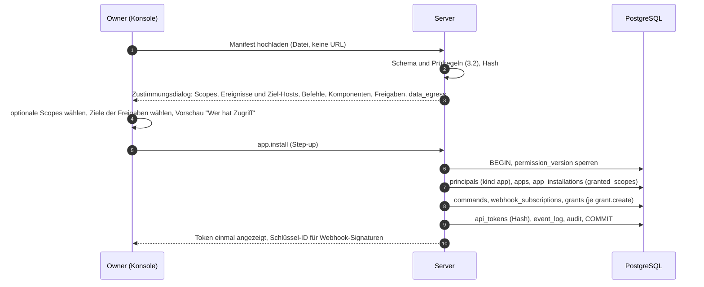
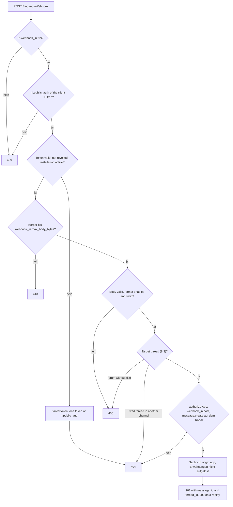

# 11 Erweiterungen: Apps, Webhooks, SDK

Status: Entwurf M0. Normativ für das Modul `apps`, für Integrationen und für die SDKs.
Begriffe: [00-glossar.md](00-glossar.md). Tabellen: [03-datenmodell.md](03-datenmodell.md)
(`apps`, `app_installations`, `webhook_subscriptions`, `webhook_deliveries`, `incoming_webhooks`,
`commands`). Aktionen und Scopes: [05-aktionen.md](05-aktionen.md). Agenten-Vertrag:
[09-agenten.md](09-agenten.md). API-Konventionen, Versionierung, Deprecation:
[06-api.md](06-api.md). Webhook-Format im Detail: [../api/webhooks.md](../api/webhooks.md).
Entscheidungen: [ADR 0022](../adr/0022-agenten-und-plugins-ausserhalb-des-server-prozesses.md),
[ADR 0026](../adr/0026-sdks-generierter-kern-plus-handschicht.md).

Die beim Entwurf beantragten Ergänzungen stehen jetzt im Kern-Vertrag (Abschnitt 15).

## 1. Grundsätze

1. Erweiterungen laufen nie im Server-Prozess (B6). Sie sind eigene Prozesse und sprechen nur die
   öffentliche API.
2. Jede Erweiterung ist ein Prinzipal mit eigenem Token, eigenen Freigaben und eigenen Grenzen. Für
   Apps kommen Scopes dazu; beides muss passen.
3. Die API, die Erweiterungen nutzen, ist dieselbe, die die Apps und die Referenz-Adapter nutzen.
   Es gibt keine Abkürzung für "eigene" Erweiterungen.
4. Der Server lädt nie eine URL aus Nutzerdaten (SSRF-Verbot, Baseline Abschnitt 4). Manifeste
   werden hochgeladen, nicht von einer Adresse geholt; ausgehende Webhooks gehen nur an
   freigegebene Hosts.

## 2. Agent oder App

| | Agent | App |
|---|---|---|
| Zweck | Gesprächspartner mit Laufzeit (Modell) | Integration eines anderen Systems |
| Läufe, Live-Box, Sitzungen | ja | nein |
| Bediener eines Kanals | ja | nein |
| Wird ausgelöst durch | Nachrichten, Befehle, Komponenten von Menschen | Befehle, Komponenten, abonnierte Ereignisse |
| Backend-Richtlinie | ja ([10-backend-richtlinie.md](10-backend-richtlinie.md)) | nein |
| Scopes | alle außer `users:read`, implizit (05 Abschnitt 2.6) | nur bewilligte |
| Manifest | nein (Konfiguration in `agents`) | ja |
| Höchste Stufe | `write` | `write` |
| Löst Agenten aus | nie | nie |

Faustregel: Antwortet ein Modell auf Menschen, ist es ein Agent. Bringt es Ereignisse eines
anderen Systems in den Chat oder Aktionen aus dem Chat in ein anderes System, ist es eine App.

## 3. App-Manifest

### 3.1 Format

Das Manifest ist JSON nach dem Schema `app_manifest.v1` (JSON Schema 2020-12, im Repo neben der
API-Spezifikation). YAML ist als Autorenformat erlaubt; die Konsole wandelt es vor dem Hochladen in
JSON. Unbekannte Felder sind ein Fehler. Grund: ein Tippfehler in einem Scope darf nicht still
ignoriert werden.

| Feld | Pflicht | Inhalt |
|---|---|---|
| `schema_version` | ja | `1` |
| `slug` | ja | `^[a-z0-9][a-z0-9-]*$`, eindeutig in der Instanz |
| `name`, `description`, `publisher` | ja | Anzeige |
| `version` | ja | SemVer des Manifests (`apps.manifest_version`) |
| `homepage_url` | nein | nur Anzeige; der Server lädt sie nie |
| `min_api_version` | ja | kleinste API-Version, die die App braucht ([06-api.md](06-api.md)) |
| `scopes.required`, `scopes.optional` | ja | Scopes aus 05 Abschnitt 2.6 |
| `events` | nein | Ereignistypen aus 05 Abschnitt 6, für die der passende Scope verlangt ist |
| `delivery.mode` | wenn `events` gesetzt | `gateway` oder `webhook` |
| `delivery.events_url` | bei `webhook` | HTTPS-Adresse für ausgehende Webhooks |
| `delivery.interactions_url` | wenn Befehle oder Komponenten ohne Gateway | HTTPS-Adresse für synchrone Anfragen (Abschnitt 9) |
| `commands` | nein | Befehle nach [09-agenten.md](09-agenten.md) Abschnitt 10, ohne reservierte Namen |
| `components` | nein | genutzte Komponententypen (`button`, `select`, `form`); nur für die Zustimmung |
| `requested_grants` | nein | je Eintrag `target_kind`, `level` (`read` oder `write`), `capabilities` (nur `upload`, R-DM-20), `purpose` |
| `incoming_webhooks` | nein | erwartete Eingangs-Webhooks mit `name` und `purpose` |
| `data_egress` | ja, wenn `events` oder Interaktionen | Klartext, welche Daten die Instanz verlassen und wohin |

Ein Manifest ist höchstens `app.manifest_max_bytes` groß. Der Server speichert es unverändert und
seinen Hash (`apps.manifest_sha256`).

### 3.2 Prüfregeln

1. Jeder Scope steht im Katalog; jedes Ereignis steht in 05 Abschnitt 6 und ist kein
   persönliches Ereignis eines anderen Prinzipals (`access.changed`, `draft.*` usw. sind nie
   abonnierbar).
2. Für jedes Ereignis ist der Scope seiner Empfangs-Aktion in `scopes` enthalten
   (z. B. `message.created` braucht `messages:read`).
3. Alle Adressen sind `https`; ihr Host steht bei der Installation in `webhook.allowed_hosts`
   (R-DM-17). Fehlt er, lehnt der Server das Manifest mit `400 webhook_host_not_allowed` ab; der
   Betreiber nimmt den Host in die Prozess-Konfiguration auf (`webhook.allowed_hosts` ändert sich
   nur beim Start, docs/DECISIONS.md D-M2-24-5).
4. `requested_grants` enthält nie `trigger` (R-DM-08) und als Zusatzrecht höchstens `upload`
   (R-DM-20; Check in `grants`). Grund für den Ausschluss von `manage`: Eine App mit `manage`
   könnte selbst Freigaben vergeben (R-AZ-05) und Kanal-Prompts lesen; das ist für eine
   Integration nie nötig. `export` hieße Massenabzug von Verläufen.
5. Befehle wie in [09-agenten.md](09-agenten.md) Abschnitt 10.2, höchstens
   `command.max_per_principal`.

### 3.3 Beispiel

Neutral, gekürzt:

```yaml
schema_version: 1
slug: repo-bridge
name: Repo Bridge
description: Bringt Ereignisse aus einem Code-Hosting-Dienst in ein Forum.
publisher: Example Org
version: 1.2.0
homepage_url: https://bridge.example.com
min_api_version: "1.0"
scopes:
  required: [messages:write, commands:write, components:write]
  optional: [messages:read, events:subscribe]
events: [message.created]
delivery:
  mode: webhook
  events_url: https://bridge.example.com/hooks/events
  interactions_url: https://bridge.example.com/hooks/interactions
commands:
  - name: issue
    description: Create an issue
    options:
      - {name: title, description: Title of the issue, type: string, required: true}
    required_level: write
components: [button, form]
requested_grants:
  - {target_kind: channel, level: write, capabilities: [], purpose: "Beiträge je Ticket anlegen"}
data_egress: "Nachrichten der freigegebenen Kanäle gehen an bridge.example.com, wenn messages:read bewilligt ist."
```

## 4. Installation, Aktualisierung, Deinstallation

### 4.1 Installation



- Der Zustimmungsdialog zeigt in Klartext, was die App lesen, schreiben und wohin sie Daten
  senden darf. Grund: Der Owner entscheidet über einen Datenabfluss; er muss ihn sehen.
- Freigaben werden mit konkreten Zielen angelegt (`grant.create` je Ziel, mit Audit). Ein
  Manifest kann nie selbst ein Ziel festlegen.
- Die Installation (`app.install`) legt Prinzipal, `apps` und `app_installations` an und erzeugt
  weder ein Token noch eine Freigabe: Freigaben folgen je Ziel mit `grant.create`, Tokens mit
  `token.create` (`createToken`). Das Diagramm oben zeigt den ganzen Ablauf der Zustimmung, nicht
  eine Transaktion (docs/DECISIONS.md D-M2-24-8).
- Das Token erscheint genau einmal. Rotation: neues Token anlegen, altes widerrufen
  (`token.create`, `token.revoke`).

### 4.2 Aktualisierung

Ein neues Manifest mit gleichem `slug` zeigt einen Unterschied an. Neue Scopes und Ereignisse
brauchen eine neue Zustimmung (`app.scopes.update`, Step-up). Bis dahin läuft die App mit den alten
Bewilligungen; neue Befehle und Ereignisse, die neue Scopes brauchen, bleiben inaktiv. Entfernte
Scopes, Ereignisse und Befehle wirken sofort. Eine Aktualisierung fügt nie eine Freigabe hinzu;
Freigaben entstehen nur mit `grant.create`. Neue Ziel-Hosts der Zustellung bestätigt die
Aktualisierung selbst (Owner, Step-up, `app.install`); sie müssen in `webhook.allowed_hosts`
stehen. Ein Token behält die Scopes, mit denen es angelegt wurde: Ein entzogener Scope wirkt ab der
nächsten Anfrage, ein neu bewilligter braucht ein neues Token.

### 4.3 Abschalten und Deinstallation

| Schritt | `app.suspend` | `app.uninstall` |
|---|---|---|
| Tokens | gesperrt, nicht widerrufen | widerrufen |
| Zustellungen | pausiert, Stand bleibt | Abos `disabled` |
| Befehle | ausgeblendet | entfernt |
| Komponenten der App | `disabled` | `disabled` |
| Freigaben, Eingangs-Webhooks | bleiben | widerrufen |
| Nachrichten der App | bleiben | bleiben (Autor bleibt erhalten, Prinzipal `disabled`) |

`app_installations.state = 'suspended'` setzt die Aktion `app.suspend`, zurück mit `app.resume`
(beide Owner, Step-up, Audit; 05). Grund: Ein Not-Aus darf keine Neuinstallation mit neuer
Zustimmung erzwingen. Incoming webhooks of a suspended app stay, but every post answers `404`
while the installation is not `active`; after `app.resume` the same URL works again (8.4).

## 5. Scopes und Freigaben

Eine App darf eine Aktion nur, wenn **beides** gilt (05 Abschnitt 2.6):

1. Die Freigaben der App erlauben die Aktion auf dem Ziel (wie bei Menschen, höchstens `write`).
2. Die Installation hat den Scope der Aktion bewilligt, und das Token der Anfrage trägt ihn auch
   ([08-identitaet.md](08-identitaet.md), Abschnitt 12).

| Scope | Aktionen (05) | Typische App |
|---|---|---|
| `messages:read` | `message.read`, `thread.read`, `channel.read`, `space.read`, `run.read` | Spiegeln von Antworten in ein anderes System |
| `messages:write` | `message.create`, `message.update`, `message.delete`, `reaction.*`, `thread.create` | jede postende App |
| `files:read`, `files:write` | `file.read`, `file.upload` | Anhänge |
| `commands:write` | `command.register`, `command.remove` | Befehle |
| `components:write` | `component.update`, `interaction.respond` | Knöpfe, Formulare |
| `users:read` | `user.read` | Namen auflösen |
| `events:subscribe` | Ereignis-Abos, `gateway.connect` | jede abonnierende App |
| `costs:reconcile` | `cost.reconcile.submit` | Kostenabgleich ([10-backend-richtlinie.md](10-backend-richtlinie.md) 12.4; [ADR 0055](../adr/0055-kostenabgleich-als-eigene-app-admin-key-nie-im-server.md)) |

Grund für beides: Freigaben sagen "wo", Scopes sagen "was". Eine App mit `write` auf einem Kanal,
aber ohne `messages:read`, kann posten, ohne mitzulesen.

## 6. Isolation und Grenzen

| Maßnahme | Inhalt |
|---|---|
| Eigener Prozess | außerhalb des Servers, beliebige Sprache, beliebiger Ort |
| Eigenes Token | nur Hash gespeichert; optional DPoP-gebunden ([08-identitaet.md](08-identitaet.md)) |
| Rate-Limits | Klassen aus 05 je Prinzipal; Eingangs-Webhooks je Webhook (`rl.webhook_in`) |
| Zustell-Quote | Delivery quota: at most `webhook.max_pending_per_subscription` open (`pending`) deliveries per subscription; the round whose insert reaches the quota sets an `active` subscription `paused` and audits `webhook_out.transition` with cause `max_pending`; rows keep being created while paused, so no event is lost; the owner learns it from the audit entry and the state in `listWebhookSubscriptions` ([DECISIONS.md](../DECISIONS.md) D-M2-26-2) |
| Zeitgrenzen | `webhook.delivery_timeout` je Zustellung, `app.interaction_timeout` je synchroner Anfrage |
| Abschalten | `app.suspend`, `app.uninstall`; automatisch `disabled` nach `webhook.max_consecutive_failures` |
| Nie erlaubt | Agenten auslösen (`origin = app`), Step-up-Aktionen (R-AZ-03), DM-Kanäle, Kanal-Prompts, `manage`, `trigger` |

Deliveries come from the event log, not from a copy: a paused subscription continues with its
pending deliveries where it stood. A gap is detected at two points ([DECISIONS.md](../DECISIONS.md)
D-M2-26-5): at the head of a subscription, when the event of its lowest pending delivery is no
longer in the log (`sync.event_retention`), and in the round of the worker consumer `webhooks`,
when retention removed events before the consumer read them (the lost range of the round). In both
cases the subscription becomes `disabled` with cause `gap` instead of skipping events silently, its
expired pending deliveries become `dead` with `last_error = event_expired`, and the audit entry of
`webhook_out.transition` names the lost range.

## 7. Ausgehende Webhooks

| Regel | Inhalt |
|---|---|
| Abo | `webhook_subscriptions` je Installation; `event_types` Teilmenge der bewilligten Ereignisse. Agenten nutzen dieselbe Tabelle mit `agent_id` als Transport ([09-agenten.md](09-agenten.md) Abschnitt 4.2) |
| Format | Körper = Ereignis-Umschlag wie auf dem Gateway (04 Abschnitt 2.2, [ADR 0052](../adr/0052-ein-ereignis-umschlag-fuer-gateway-rest-und-webhooks.md)) |
| Signatur | Standard Webhooks, Kopfzeilen `webhook-id` (= Ereignis-ID), `webhook-timestamp`, `webhook-signature` mit Schema `v1a` (Ed25519) |
| Schlüssel | `server_signing_keys` mit Zweck `webhook_out` und `alg = 'EdDSA'`; ES256 ist für diesen Zweck nicht erlaubt, weil `v1a` nur Ed25519 kennt |
| Reihenfolge | je Abo streng nach `seq`; das nächste Ereignis erst nach Erfolg des vorigen |
| Prüfung | Check: before every attempt `webhook_out.deliver` with the current grants and scopes of the app (filter mode, no denial in the audit); an event the app may no longer receive ends `dead` with `last_error = not_authorized`, without a request and without counting as a failure |
| Erfolg | Success: only `2xx`; `410` disables the subscription; `429`, `502`, `503` and `504` throttle and honour `Retry-After`; redirects are never followed, a `3xx` is a failure ([../api/webhooks.md](../api/webhooks.md), section 4) |
| Wiederholung | Backoff mit Zufall zwischen `webhook.retry_backoff_base` und `webhook.retry_backoff_cap` (03) |
| Zeitgrenze | `webhook.delivery_timeout`; der Antwortkörper wird nicht gespeichert |
| SSRF-Schutz | nur `https`, Host in `webhook.allowed_hosts`, Zustellung über den Egress-Client mit Adressprüfung nach der DNS-Auflösung ([19-sicherheit.md](19-sicherheit.md), SEC-NET-1 bis SEC-NET-5), Verbindung an die geprüfte Adresse gebunden, keine Weiterleitungen |

Belege Standard Webhooks (https://github.com/standard-webhooks/standard-webhooks/blob/main/spec/standard-webhooks.md,
abgerufen 2026-10-10, [belegt]): die drei Kopfzeilen; `v1` symmetrisch mit HMAC-SHA256, `v1a`
asymmetrisch mit Ed25519; signiert wird `msg_id.timestamp.payload`; `webhook-id` dient dem
Empfänger als Idempotenz-Schlüssel und bleibt bei Wiederholungen gleich; nur `2xx` ist Erfolg,
`410` heißt Endpunkt abschalten, `429`, `502` und `504` heißen drosseln; empfohlene Zeitgrenze
zwischen 15 und 30 Sekunden. Das Leitungsformat im Detail legt [../api/webhooks.md](../api/webhooks.md)
fest.

Grund für asymmetrische Signatur: Der Empfänger braucht nur den öffentlichen Schlüssel des Zwecks
`webhook_out`, den der Server unter `GET /api/v1/instance/webhook-keys` (`getWebhookKeys`) ausgibt;
die JWKS (`getJwks`) enthält nur Schlüssel für Zugriffstokens und Aufruf-Marken. Ein Leck beim
Empfänger erlaubt keine gefälschten Webhooks.

## 8. Eingehende Webhooks

### 8.1 Anlage und Aufruf

- `webhook_in.create` (`manage` auf dem Kanal, Step-up) legt einen Eingangs-Webhook für einen
  Kanal an. Er schreibt immer als App (`incoming_webhooks.app_id`) mit `write` auf dem Kanal. Ein
  Owner kann dabei in derselben bestätigten Aktion eine "Eingangs-App" mit eingebautem
  Minimal-Manifest anlegen (nur `messages:write`, Freigabe `write` auf genau diesem Kanal);
  andere wählen eine vorhandene App, weil `app.install` dem Owner vorbehalten ist.
- Aufruf: `POST` auf die Webhook-Adresse mit `Authorization: Bearer <token>`. Für Absender ohne
  Kopfzeilen erlaubt der Server das Token als letztes Pfadsegment; Zugriffsprotokolle schwärzen
  dieses Segment. Ein unbekannter Webhook und ein falsches Token ergeben dieselbe Antwort `404`.
- Two operations serve the call, with the same action `webhook_in.post`, request body and
  answers ([DECISIONS.md](../DECISIONS.md) D-M2-27-1): `postIncomingWebhookWithBearer` on
  `POST /api/v1/hooks/{webhook_id}` takes the token from `Authorization: Bearer <token>`, where a
  missing header or another scheme counts as a wrong token; `postIncomingWebhook` on
  `POST /api/v1/hooks/{webhook_id}/{token}` takes the last path segment and ignores
  `Authorization`. Of the root security only `bearerAuth` applies to the Bearer operation, with
  the webhook token, which the token check of 8.4 verifies, not the authenticator
  (D-M2-27-17).
- Das Token erscheint einmal; gespeichert ist nur der Hash. The token has the kind `whi`
  (`bothy_whi_...`); `createIncomingWebhook` returns it inside the absolute URL `url` built from
  `server.public_url` with the path of `postIncomingWebhook`; Bearer senders drop the last
  segment and send the token in the header.

### 8.2 Formate

| `format` | Körper | Abbildung |
|---|---|---|
| `native` (Standard) | `content_md` (Markdown, required, not only white space), optional `title`, `thread_id`, `client_msg_id` (UUIDv7) | eine Nachricht; `client_msg_id` macht Wiederholungen idempotent: a repeat answers `200` with `Idempotent-Replay: true` and the original `message_id` and `thread_id`; the same `client_msg_id` with other content, or through another webhook of the same app, gives `422 idempotency_key_reuse` (the hash context names the webhook, the body `thread_id` and the `title`). Without `client_msg_id` the server creates one |
| `alertmanager` | Webhook-Nutzlast von Prometheus Alertmanager | eine Nachricht je Benachrichtigung: Zustand, Anzahl, `alertname`, Zusammenfassung je Alarm aus Labels und Annotationen, Links `generatorURL` und `externalURL` als Text. The layout, the escaping of payload values, the URL rules and the shortening to `message.max_content_bytes` are fixed in [DECISIONS.md](../DECISIONS.md) D-M2-27-10 and D-M2-27-23. Retries are not deduplicated: every post gets a new server `client_msg_id` |

The format is decided per request from the body, not stored per webhook
([DECISIONS.md](../DECISIONS.md) D-M2-27-5). One closed request schema, `IncomingWebhookPost`,
holds the members of both formats. A body with at least one Alertmanager member (`version`,
`groupKey`, `truncatedAlerts`, `status`, `receiver`, `groupLabels`, `commonLabels`,
`commonAnnotations`, `externalURL`, `alerts`) is `alertmanager`; if it also holds a native
member, the answer is `400 validation_failed` with the pointer of the first native member and
`errors[].code` `format_mixed`. Every other body is `native`. A format not listed in
`webhook_in.formats_enabled` gives `400 validation_failed` with `errors[].code`
`format_disabled`. Unknown members give `400 validation_failed` (`unknown_member`); a native
`content_md` above `message.max_content_bytes` gives `413 payload_too_large`.

Welche Formate eingeschaltet sind, steuert `webhook_in.formats_enabled`. Weitere Formate kommen
nicht in den Server, sondern als App (Abschnitt 10). Grund: Ein eingebauter Konverter ist
Server-Code; nur Formate, die stabil, verbreitet und zustandslos abbildbar sind, rechtfertigen
das.

Beleg Alertmanager (https://prometheus.io/docs/alerting/latest/configuration/, abgerufen
2026-10-10, [belegt]): `webhook_config` mit `url` und `http_config`, dessen Block
`authorization` den Typ `Bearer` mit `credentials` unterstützt; die Nutzlast hat `version`,
`groupKey`, `truncatedAlerts`, `status`, `receiver`, `groupLabels`, `commonLabels`,
`commonAnnotations`, `externalURL` und `alerts` mit `status`, `labels`, `annotations`,
`startsAt`, `endsAt`, `generatorURL`, `fingerprint`.

### 8.3 Ziel-Thread

1. Fester Thread des Webhooks (`incoming_webhooks.thread_id`), sonst
2. `thread_id` im Körper, wenn der Thread zum Kanal gehört, sonst
3. `title` legt einen neuen Thread an (in Foren Pflicht), sonst
4. Hauptverlauf des Text-Kanals.

Rules as built ([DECISIONS.md](../DECISIONS.md) D-M2-27-6 and D-M2-27-7):

- Rule 1 holds only while the fixed thread belongs to the webhook's channel; then `thread_id`
  and `title` of the body are ignored. A fixed thread moved to another channel gives `404`,
  because a webhook writes only into its own channel.
- Rule 2 uses the body `thread_id` only when that thread belongs to the webhook's channel; an
  unknown thread or one of another channel falls through to the next rule, so nothing about
  other channels shows.
- Rule 3 in a forum creates a forum post with the message as its first message. In a text
  channel the message is written into the main thread and the new thread starts from that
  message; the answer names the new thread in `thread_id`, and a replay answers the same thread.
- Rules 2 and 3 apply to `native` bodies only. A forum reached by none of the rules gives
  `400 validation_failed` with `errors[].code` `required_for_forum_post` (pointer `/title` for
  `native`, empty for `alertmanager`).

Ein Thread je Alarmgruppe bräuchte eine Zuordnung von externem Schlüssel zu Thread. Ein Abgleich
über den Titel scheidet aus, weil namensbasierte Identität eine eigene Fehlerklasse ist; die
Zuordnung kommt bei Bedarf als eigene Tabelle (Vorschlag im Bericht) oder als App.

### 8.4 Regeln



The token check is a stage of the HTTP chain (02 9.1, `StageWebhookToken`) after the rate
limit `rl.webhook_in` and before the body is read, so a wrong token wins over a body that is too
large ([DECISIONS.md](../DECISIONS.md) D-M2-27-2 and D-M2-27-20). The authenticator never runs
on the two post operations; the request stays anonymous until the token check replaces it with
the webhook actor: the app with its active installation and only the scope `messages:write`
(D-M2-27-3). A failed check takes one token of `rl.public_auth` of the client IP; while that
bucket is empty the stage answers `429` without checking the token. Every refusal answers the
same `404 not_found` as an unknown webhook: unknown ID, wrong or malformed token, revoked
webhook, an installation that is uninstalled or not `active` (so `app.suspend` stops posts and
`app.resume` lets the same URL work again, D-M2-27-13), a fixed thread in another channel and
every denial of `webhook_in.post`, `message.create` or `thread.create` (D-M2-27-4).

Both post operations are also served on the internal listener (`server.internal_listen_addr`)
in every role, for senders inside the stack such as Alertmanager, through a chain of their own
whose client IP is the peer address (no forwarded headers, R-SE-09) and whose rate limits count
per listener; nothing else of the API is mounted there (D-M2-27-15, D-M2-27-18).

- `origin = 'app'`; die Nachricht löst nie Agenten aus (03, `incoming_webhooks`).
- Erwähnungen im Text werden nicht aufgelöst. Grund: Ein geleaktes Token soll keine
  Benachrichtigungsflut an Personen auslösen können; Benachrichtigung folgt den
  Kanaleinstellungen.
- Inhalt bis `message.max_content_bytes`; keine Anhänge über diesen Weg (Dateien über die App-API
  mit `files:write`).
- Revocation ends posting: `revokeIncomingWebhook`, `app.uninstall` (4.3) and the archive of the
  channel, which revokes its active webhooks in the archive transaction with the archive time
  ([DECISIONS.md](../DECISIONS.md) D-M2-27-14, D-M2-27-21); after their commit no post writes.

## 9. Befehle und Interaktionen für Apps

Apps erhalten `command.invoked`, `interaction.created` und Autovervollständigung auf einem von
zwei Wegen:

| Weg | Wann | Antwort |
|---|---|---|
| Gateway-Verbindung der App | App hält eine Verbindung (`events:subscribe`) | wie Agenten ([09-agenten.md](09-agenten.md) 10.5, 11.4) |
| `interactions_url` | sonst | synchrone `POST`-Anfrage, signiert wie ausgehende Webhooks; Antwort in `app.interaction_timeout` |

Antwortformen bei `interactions_url`: Vorschläge (Autovervollständigung); `200` mit einer
Nachricht, die der Server im Namen der App schreibt; `202` "angenommen", wenn die App später
selbst über die API antwortet. Ohne Antwort in der Frist sieht der Mensch "App antwortet nicht";
die Komponente bleibt `used` (gleiche Begründung wie [09-agenten.md](09-agenten.md) 11.4).

Für Apps entfallen `agent.invoke` und I2; geprüft werden `required_level`, `restricted_to`,
`required_capability`, Freigaben und Scope (05 `command.invoke`, R-AZ-18).

## 10. Fertige Integrationen als Beispiele

Die Beispiele sind geplante Referenz-Apps im Ordner `plugins/` des Repos (siehe `plugins/README.md`).
Sie zeigen Muster; sie sind nicht Teil des Servers.

### 10.1 Code-Hosting (GitHub)

| Punkt | Inhalt |
|---|---|
| Art | App, eigener Prozess |
| Eingang | GitHub-Webhooks an die eigene Adresse der App, nicht an einen Eingangs-Webhook des Servers. Grund: Die App muss die Signatur `X-Hub-Signature-256` (HMAC-SHA256, Wert beginnt mit `sha256=`, Vergleich in konstanter Zeit) prüfen und eine Zuordnung Ticket zu Thread halten (https://docs.github.com/en/webhooks/using-webhooks/validating-webhook-deliveries, abgerufen 2026-10-10, [belegt]). |
| Ausgabe | Forum-Kanal, ein Thread je Ticket oder Pull-Request (Zuordnung im Zustand der App), Nachrichten je Ereignis |
| Befehle | `/issue` mit Formular; legt über die GitHub-API ein Ticket an |
| Scopes | `messages:write`, `commands:write`, `components:write`; optional `messages:read` mit Ereignis `message.created`, wenn Antworten zurückgespiegelt werden |
| Freigaben | `write` auf dem Forum |
| Schleifen | eigene Nachrichten der App (Autor = App) spiegelt sie nie zurück |

### 10.2 Ticketsystem (Jira)

Wie 10.1. Belege (https://developer.atlassian.com/cloud/jira/platform/webhooks/, abgerufen
2026-10-10, [belegt]): Webhooks per Verwaltungsoberfläche oder REST; mit gesetztem Geheimnis
signiert Jira mit HMAC in der Kopfzeile `X-Hub-Signature` im Format `method=signature`, derzeit
SHA-256, und kündigt an, die Methode künftig ändern zu können; Ereignisse u. a.
`jira:issue_created`, `jira:issue_updated`, `comment_created`. Folge [abgeleitet]: Die App liest
die Methode aus der Kopfzeile und lehnt unbekannte Methoden ab, statt SHA-256 anzunehmen.

### 10.3 Monitoring-Alarme

Eingangs-Webhook mit Format `alertmanager` (Abschnitt 8) in einem Text-Kanal oder festen Thread.
Alertmanager sendet das Token als `Bearer` über `http_config.authorization` (Beleg 8.2). Keine
eigene App nötig. Ein Thread je Alarmgruppe ist eine App-Aufgabe (8.3).

### 10.4 Cron-Meldungen

Zwei Wege:

1. Ein Agent meldet selbst ohne Auslöser ([09-agenten.md](09-agenten.md) Abschnitt 14).
2. Ein externer Cron-Job sendet `POST` im Format `native` an einen Eingangs-Webhook, mit
   `client_msg_id` je Lauf des Jobs, damit Wiederholungen keine Doppel erzeugen.

## 11. SDK-Design

Entscheidung: [ADR 0026](../adr/0026-sdks-generierter-kern-plus-handschicht.md). Zwei SDKs,
Python und TypeScript, je aus zwei Schichten.

### 11.1 Generierter Kern

| Sprache | Generator (Baseline R-Clients) | Inhalt |
|---|---|---|
| Python | openapi-python-client | Modelle und Aufrufe aller REST-Operationen |
| TypeScript | openapi-typescript | Typen aller Operationen; runtime client openapi-fetch |

Der Kern wird im Gate aus `docs/api/openapi.yaml` erzeugt und kompiliert ([23-qualitaet.md](23-qualitaet.md)).
Er wird nicht von Hand geändert. Gateway messages take their types from the schemas of
`docs/api/openapi.yaml` that `docs/api/asyncapi.yaml` references; no generator runs for AsyncAPI
([06-api.md](06-api.md) 14 point 3).

### 11.2 Handschicht

| Modul | Aufgabe |
|---|---|
| `auth` | Token, optional DPoP-Beweise mit Schlüssel aus Datei oder Schlüsselspeicher, Nonce-Behandlung |
| `gateway` | Verbindung nach 04: `hello`, `identify`, `resume`, Heartbeat mit Zufallsversatz, `ack`-Fenster, Wiederverbinden mit Full Jitter, Reaktion je Schließ-Code (bei `4015` beenden, nicht neu verbinden) |
| `invocation` | Prüfung der Aufruf-Marke nach [09-agenten.md](09-agenten.md) 4.5: JWKS-Cache mit gedrosseltem Neuladen, Erlaubnisliste `EdDSA`, `typ`, `iss`, `aud`, Zeit mit Toleranz, `jti`-Speicher, Rückruf für den Ist-Modus |
| `runs` | Lauf-Helfer: `run.start`, Kontext holen, Patches sammeln und drosseln (`agent.run_update_min_interval`), `base_version` führen, bei `409` neu aufsetzen, Schritte, Nachtrags-Zustände, `run.finish` mit `usage`, Abbruch-Rückruf |
| `components` | Bausteine für Knopf, Auswahl, Formular mit den Grenzen aus 09; fertige Freigabe-Karte (09 Abschnitt 11.5) und Rückfrage |
| `commands` | deklarative Befehlsliste mit Abgleich beim Verbinden; Autovervollständigung mit Zeitwächter |
| `outbox` | Senden mit `client_msg_id`, die vor dem Senden gespeichert wird (austauschbarer Speicher); `Idempotency-Key` für andere Schreibvorgänge |
| `retry` | Wiederholung nur für idempotente Operationen: Netzfehler, `5xx`, `429` mit `Retry-After`; Backoff mit Full Jitter zwischen `sdk.retry_backoff_base` und `sdk.retry_backoff_cap`, höchstens `sdk.retry_max_attempts` Versuche |
| `heartbeat` | Baustein für `agent_heartbeat.v1`; lehnt Felder ab, die Geheimnisse tragen könnten |
| `webhooks` | Prüfung von Standard-Webhooks-Signaturen (`v1a`) für Apps, auch für `interactions_url` |
| `testing` | FakeServer im Prozess mit Fehlerinjektion, Szenario-Helfer, aufgezeichnete Fixtures |

Fehler sind typisiert nach dem Problem-Format aus [06-api.md](06-api.md) (RFC 9457); ein `404`
heißt "nicht da oder nicht sichtbar" und wird nie als "fehlt sicher" behandelt.

### 11.3 Laufzeiten und Abhängigkeiten

- Python: asynchrone API zuerst (Adapter wie Hermes sind asynchron), dazu eine synchrone Hülle für
  Skripte. Unterstützt werden die CPython-Versionen, die laut python.org noch gepflegt werden.
  Abhängigkeiten klein halten und mit dem Hermes-Umfeld verträglich wählen (Prüfung im
  Fake-Hermes-Test).
- TypeScript: ESM, aktive LTS-Linien von Node.js; Browser nur für die Teile ohne Geheimnisse
  (keine Agenten-Tokens im Browser).
- JOSE-Prüfung mit einer Bibliothek, die EdDSA und eine Algorithmen-Erlaubnisliste kann. Belegte
  Kandidaten (abgerufen 2026-10-10): PyJWT nennt EdDSA mit Ed25519 und Ed448
  (https://pyjwt.readthedocs.io/en/stable/algorithms.html) [belegt]; `jose` für JavaScript nennt
  RFC 8037 und `createRemoteJWKSet`, Lizenz MIT (https://github.com/panva/jose) [belegt]. Die
  endgültige Wahl trifft das Bau-Ticket mit Lizenz-Gate.

## 12. Versionierung und Kompatibilität

| Gegenstand | Version | Regel |
|---|---|---|
| REST-API | Hauptversion im Pfad, Nebenversion additiv | [06-api.md](06-api.md), ADR 0014 |
| Gateway-Protokoll | `protocol_version` in `identify` und `hello` | 04 Abschnitt 6.1 |
| SDK | SemVer je Sprache, eigenes Changelog | neue Hauptversion bei neuer API-Hauptversion oder bruchhafter Änderung der Handschicht; Nebenversion für neue Operationen aus der Spec; Fehlerbehebung als Patch |
| App-Manifest | `schema_version`, `version` | neue `schema_version` nur bei bruchhafter Änderung; Server liest alle unterstützten |

Die Kompatibilitätsmatrix steht in `sdk/README.md` (Repo-Wurzel) mit den Spalten
SDK-Version, API-Version, Gateway-Protokoll, Server-Version mindestens, Status. Ein Test im Gate
prüft, dass jede veröffentlichte SDK-Version gegen die Server-Versionen ihrer Zeile ihre
Vertragstests besteht.

Deprecation folgt [06-api.md](06-api.md). Das SDK schreibt einmal je Operation eine Warnung, wenn
der Server die Kopfzeilen `Deprecation` (RFC 9745) oder `Sunset` (RFC 8594) sendet
(https://www.rfc-editor.org/rfc/rfc9745.html, abgerufen 2026-10-10, [belegt]: RFC 9745 definiert
`Deprecation` und verweist für `Sunset` auf RFC 8594). Veraltete Operationen sind im erzeugten Kern
als veraltet markiert.

## 13. Leitfaden: eigenen Agenten anbinden in zehn Schritten

Gliederung für den Entwickler-Leitfaden der Doku-Site:

1. **Agent anlegen.** Owner legt den Agenten in der Konsole an (Handle, Name, `adapter_kind`,
   Backend-Richtlinie).
2. **Token erzeugen.** Agenten-Token einmal anzeigen lassen; empfohlen an einen Adapter-Schlüssel
   gebunden (DPoP).
3. **Freigaben und Bediener.** `write` (und `+upload`) auf den Zielen; Agent als Bediener eines
   Kanals oder Bereichs setzen; Kanal-Schalter wählen.
4. **SDK installieren und verbinden.** Gateway mit `consumer`; Wiederverbinden und `ack` macht das
   SDK.
5. **Fähigkeiten melden.** Heartbeat mit `capabilities`, Ist-Modus und Belegquelle.
6. **Befehle registrieren.** Steuerbefehle und Modell-Befehle, optional Autovervollständigung.
7. **Aufruf empfangen.** Marke prüfen (SDK), Ist-Modus vergleichen, Kontext holen, Vertrauensmarken
   beachten.
8. **Lauf führen.** `run.start`, Live-Box mit Status, Schritten, Text und Kennzahlen füllen;
   Antwort senden; `run.finish` mit Verbrauch.
9. **Interaktiv werden.** Nachträge, Stopp, Rückfragen, Freigabe-Karten, Dateien.
10. **Testen und betreiben.** FakeServer-Szenarien aus [09-agenten.md](09-agenten.md) Abschnitt 16,
    Protokolle ohne Inhalte und Geheimnisse, Verhalten bei Neustart, Versions-Pinning.

## 14. Entscheidungen dieses Kapitels

| Nr | Entscheidung | Grund |
|---|---|---|
| R-EX-01 | Manifeste werden hochgeladen, nie per URL geholt. | SSRF-Verbot. |
| R-EX-02 | Unbekannte Manifest-Felder sind ein Fehler. | Tippfehler in Scopes dürfen nicht still wirken. |
| R-EX-03 | Apps bekommen nie `manage` und nie `trigger`. | Keine Rechtevergabe durch Integrationen; keine Auslösung von Agenten. |
| R-EX-04 | Zustimmung zeigt Ziel-Hosts und Datenabfluss im Klartext. | Der Owner entscheidet über Daten, die die Instanz verlassen. |
| R-EX-05 | `app.suspend` als Not-Aus ohne Verlust der Bewilligungen. | Abschalten darf keine Neuinstallation erzwingen. |
| R-EX-06 | Ausgehende Webhooks nach Standard Webhooks `v1a` (Ed25519), streng geordnet je Abo. | Empfänger prüft mit öffentlichem Schlüssel; Reihenfolge wie im Gateway. |
| R-EX-07 | Zustellung aus dem Ereignis-Log mit Stand je Abo; Lücke führt zu `disabled`. | Kein stiller Verlust, keine zweite Kopie. |
| R-EX-08 | Eingebaute Eingangsformate nur `native` und `alertmanager`; alles andere als App. | Wenig Server-Code für fremde Formate. |
| R-EX-09 | Eingangs-Webhooks lösen keine Erwähnungen auf; Token auch im Pfad erlaubt, aber geschwärzt. | Kein Benachrichtigungs-Missbrauch; Absender ohne Kopfzeilen. |
| R-EX-10 | SDK = erzeugter Kern plus Handschicht; Kern nie von Hand geändert. | Spec bleibt Quelle der Wahrheit; Handschicht trägt die schwierigen Teile einmal. |

## 15. Abgleich mit dem Kern-Vertrag

Die beim Entwurf beantragten Ergänzungen sind entschieden (Integration vom 2026-10-10):

| Nr | Ergänzung | Entscheidung, Ort |
|---|---|---|
| E-EX-01 | Aktionen `app.suspend`, `app.resume` | übernommen, 05 Abschnitt 4.11 |
| E-EX-02 | kein `manage` für Apps | übernommen in schärferer Form: Agenten und Apps als Zusatzrecht nur `upload` (03 `grants`, R-DM-20) |
| E-EX-03 | Scope `costs:reconcile` | übernommen, 05 Abschnitt 2.6 |
| E-EX-04 | `webhook_out`-Schlüssel nur `EdDSA` | übernommen, 03 `server_signing_keys` |
| E-EX-05 | persönliche Ereignisse für Apps, App-Befehle ohne `agent.invoke` | übernommen, 05 Abschnitte 4.10 und 6, R-AZ-18 |

## 16. Konfigurationswerte dieses Kapitels

| Name | Ort | Standard | Bedeutung |
|---|---|---|---|
| `app.manifest_max_bytes` | Server | `65536` | Größe eines Manifests |
| `app.interaction_timeout` | Server | `3s` | Frist für synchrone Antworten über `interactions_url` |
| `webhook.delivery_timeout` | Server | `15s` | Zeitgrenze einer Zustellung |
| `webhook.max_pending_per_subscription` | Server | `10000` | offene Zustellungen je Abo, darüber `paused` |
| `webhook.retry_max_age` | Server | `72h` | after that a delivery becomes `dead` ([webhooks.md](../api/webhooks.md), section 4) |
| `webhook.secret_rotation_overlap` | Server | `24h` | how long the server signs with the old and the new HMAC generation |
| `webhook.hmac_master_key_ref` | Server | `file:<secrets.dir>/webhook_hmac_master_key` | reference to the master key from which the HMAC secrets of the subscriptions are derived ([webhooks.md](../api/webhooks.md), section 2.1) |
| `webhook_in.max_body_bytes` | Server | `1048576` | Größe eines eingehenden Körpers |
| `webhook_in.formats_enabled` | Server | `["native", "alertmanager"]` | eingeschaltete Eingangsformate; the start check `webhook_in_formats` allows only `native` and `alertmanager`, each at most once; an empty list switches every format off |
| `sdk.http_timeout` | SDK | `30s` | Zeitgrenze einer REST-Anfrage |
| `sdk.retry_max_attempts` | SDK | `5` | Versuche je idempotenter Operation |
| `sdk.retry_backoff_base` | SDK | `500ms` | Basis des Backoffs |
| `sdk.retry_backoff_cap` | SDK | `30s` | größter Abstand |
