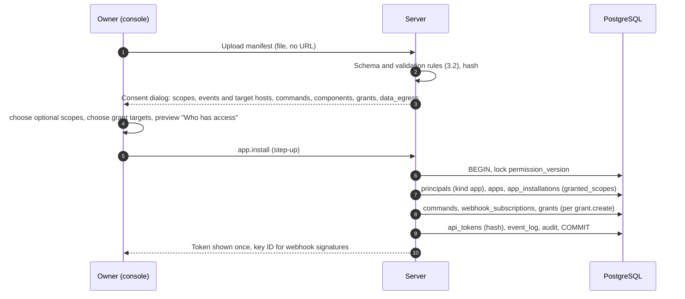
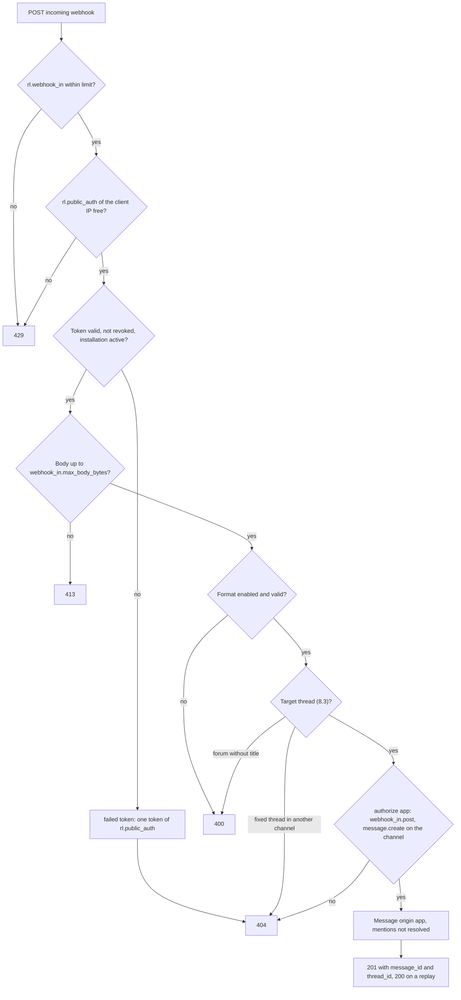

# 11 Extensions: apps, webhooks, SDK

Status: draft M0. Normative for the module `apps`, for integrations and for the SDKs.
Terms: [00-glossary.md](00-glossary.md). Tables: [03-data-model.md](03-data-model.md)
(`apps`, `app_installations`, `webhook_subscriptions`, `webhook_deliveries`, `incoming_webhooks`,
`commands`). Actions and scopes: [05-actions.md](05-actions.md). Agent contract:
[09-agents.md](09-agents.md). API conventions, versioning, deprecation:
[06-api.md](06-api.md). Webhook format in detail: [../api/webhooks.md](../api/webhooks.md).
Decisions: [ADR 0022](../adr/0022-agents-and-plugins-outside-the-server-process.md),
[ADR 0026](../adr/0026-sdks-generated-core-plus-hand-written-layer.md).

The additions requested during drafting are now in the core contract (section 15).

## 1. Principles

1. Extensions never run in the server process (B6). They are separate processes and speak only
   the public API.
2. Every extension is a principal with its own token, its own grants and its own limits. Apps
   also have scopes; both must match.
3. The API that extensions use is the same API that the apps and the reference adapters use.
   There is no shortcut for "own" extensions.
4. The server never loads a URL from user data (SSRF ban, Baseline section 4). Manifests
   are uploaded, not fetched from an address; outgoing webhooks go only to
   allowed hosts.

## 2. Agent or app

| | Agent | App |
|---|---|---|
| Purpose | Conversation partner with a runtime (model) | Integration of another system |
| Runs, live box, sessions | yes | no |
| Operator of a channel | yes | no |
| Triggered by | messages, commands, components from people | commands, components, subscribed events |
| Backend policy | yes ([10-backend-policy.md](10-backend-policy.md)) | no |
| Scopes | all except `users:read` and `costs:reconcile`, implicit (05 section 2.6) | only granted ones |
| Manifest | no (configuration in `agents`) | yes |
| Highest level | `write` | `write` |
| Triggers agents | never | never |

Rule of thumb: if a model answers people, it is an agent. If it brings events of another
system into the chat or actions from the chat into another system, it is an app.

## 3. App manifest

### 3.1 Format

The manifest is JSON according to the schema `app_manifest.v1` (JSON Schema 2020-12, in the repo
next to the API specification). YAML is allowed as an authoring format; the console converts it to
JSON before uploading. Unknown fields are an error. Reason: a typo in a scope must not be silently
ignored.

| Field | Required | Content |
|---|---|---|
| `schema_version` | yes | `1` |
| `slug` | yes | `^[a-z0-9][a-z0-9-]*$`, unique in the instance |
| `name`, `description`, `publisher` | yes | display |
| `version` | yes | SemVer of the manifest (`apps.manifest_version`) |
| `homepage_url` | no | display only; the server never loads it |
| `min_api_version` | yes | lowest API version that the app needs ([06-api.md](06-api.md)) |
| `scopes.required`, `scopes.optional` | yes | scopes from 05 section 2.6 |
| `events` | no | event types from 05 section 6 for which the matching scope is required |
| `delivery.mode` | if `events` is set | `gateway` or `webhook` |
| `delivery.events_url` | with `webhook` | HTTPS address for outgoing webhooks |
| `delivery.interactions_url` | if commands or components without a gateway | HTTPS address for synchronous requests (section 9) |
| `commands` | no | commands according to [09-agents.md](09-agents.md) section 10, without reserved names |
| `components` | no | component types used (`button`, `select`, `form`); only for the consent |
| `requested_grants` | no | per entry `target_kind`, `level` (`read` or `write`), `capabilities` (only `upload`, R-DM-20), `purpose` |
| `incoming_webhooks` | no | expected incoming webhooks with `name` and `purpose` |
| `data_egress` | yes, if `events` or interactions | plain text: which data leave the instance and where to |

A manifest is at most `app.manifest_max_bytes` in size. The server stores it unchanged together
with its hash (`apps.manifest_sha256`).

### 3.2 Validation rules

1. Every scope is in the catalogue; every event is in 05 section 6 and is not a
   personal event of another principal (`access.changed`, `draft.*` and so on can never be
   subscribed to).
2. For every event, the scope of its receive action is contained in `scopes`
   (for example `message.created` needs `messages:read`).
3. All addresses are `https`; at installation their host is in `webhook.allowed_hosts`
   (R-DM-17). If it is missing, the server rejects the manifest with `400 webhook_host_not_allowed`;
   the operator adds the host to the process configuration (`webhook.allowed_hosts` changes
   only at start, docs/DECISIONS.md D-M2-24-5).
4. `requested_grants` never contains `trigger` (R-DM-08) and at most `upload` as a capability
   (R-DM-20; check in `grants`). Reason for excluding `manage`: an app with `manage`
   could create grants itself (R-AZ-05) and read channel prompts; an integration never
   needs that. `export` would mean bulk extraction of histories.
5. Commands as in [09-agents.md](09-agents.md) section 10.2, at most
   `command.max_per_principal`.

### 3.3 Example

Neutral, shortened:

<!-- language-check: off -->

```yaml
schema_version: 1
slug: repo-bridge
name: Repo Bridge
description: Brings events from a code hosting service into a forum.
publisher: Example Org
version: 1.2.0
homepage_url: https://bridge.example.com
min_api_version: "1.0"
scopes:
  required: [messages:write, commands:write, components:write]
  optional: [messages:read, events:subscribe]
events: [message.created]
delivery:
  mode: webhook
  events_url: https://bridge.example.com/hooks/events
  interactions_url: https://bridge.example.com/hooks/interactions
commands:
  - name: issue
    description: Create an issue
    options:
      - {name: title, description: Title of the issue, type: string, required: true}
    required_level: write
components: [button, form]
requested_grants:
  - {target_kind: channel, level: write, capabilities: [], purpose: "Create posts per ticket"}
data_egress: "Messages of the granted channels go to bridge.example.com if messages:read is granted."
```

<!-- language-check: on -->

## 4. Installation, update, uninstallation

### 4.1 Installation



- The consent dialog shows in plain text what the app may read and write and where it may send
  data. Reason: the owner decides on a data outflow; they must see it.
- Grants are created with concrete targets (`grant.create` per target, with audit). A
  manifest can never set a target itself.
- The installation (`app.install`) creates the principal, `apps` and `app_installations` and
  creates neither a token nor a grant: grants follow per target with `grant.create`, tokens with
  `token.create` (`createToken`). The diagram above shows the whole consent flow, not one
  transaction (docs/DECISIONS.md D-M2-24-8).
- The token appears exactly once. Rotation: create a new token, revoke the old one
  (`token.create`, `token.revoke`).

### 4.2 Update

A new manifest with the same `slug` shows a diff. New scopes and events need a new consent
(`app.scopes.update`, step-up). Until then the app runs with the old granted scopes; new commands
and events that need new scopes stay inactive. Removed scopes, events and commands take effect
immediately. An update never adds a grant; grants arise only with `grant.create`. New target hosts
of the delivery are confirmed by the update itself (owner, step-up, `app.install`); they must be in
`webhook.allowed_hosts`. A token keeps the scopes it was created with: a withdrawn scope takes
effect from the next request, a newly granted one needs a new token.

### 4.3 Suspension and uninstallation

| Step | `app.suspend` | `app.uninstall` |
|---|---|---|
| Tokens | blocked, not revoked | revoked |
| Deliveries | paused, position kept | subscriptions `disabled` |
| Commands | hidden | removed |
| Components of the app | `disabled` | `disabled` |
| Grants, incoming webhooks | remain | revoked |
| Messages of the app | remain | remain (author is kept, principal `disabled`) |

`app_installations.state = 'suspended'` is set by the action `app.suspend` and reset by
`app.resume` (both owner, step-up, audit; 05). Reason: an emergency stop must not force a
reinstallation with a new consent. Incoming webhooks of a suspended app stay, but every post
answers `404` while the installation is not `active`; after `app.resume` the same URL works
again (8.4).

## 5. Scopes and grants

An app may perform an action only if **both** hold (05 section 2.6):

1. The grants of the app allow the action on the target (as for people, at most `write`).
2. The installation has granted the scope of the action, and the token of the request carries it too
   ([08-identity.md](08-identity.md), section 12).

Which actions a scope allows is stated only in the table in [05-actions.md](05-actions.md#26-scopes-for-apps), section 2.6 (source:
`app_scope` per action in the action catalogue, [ADR 0049](../adr/0049-machine-readable-action-catalogue-as-the-single-source.md)). The scopes themselves are the enum
`AppScope` in openapi.yaml; the check `api-catalogue-sync` (M1-03) keeps both the same. Typical
use:

| Scope | Typical app |
|---|---|
| `messages:read` | mirroring replies into another system |
| `messages:write` | every posting app |
| `files:read`, `files:write` | attachments |
| `commands:write` | commands |
| `components:write` | buttons, forms |
| `users:read` | resolving names |
| `events:subscribe` | every subscribing app |
| `costs:reconcile` | cost reconciliation ([10-backend-policy.md](10-backend-policy.md) 12.4; [ADR 0055](../adr/0055-cost-reconciliation-as-its-own-app-admin-key-never-in-the-server.md)) |

Reason for both: grants say "where", scopes say "what". An app with `write` on a channel
but without `messages:read` can post without reading along.

## 6. Isolation and limits

| Measure | Content |
|---|---|
| Own process | outside the server, any language, any location |
| Own token | only the hash is stored; optionally DPoP-bound ([08-identity.md](08-identity.md)) |
| Rate limits | classes from 05 per principal; incoming webhooks per webhook (`rl.webhook_in`) |
| Delivery quota | at most `webhook.max_pending_per_subscription` open (`pending`) deliveries per subscription; the round whose insert reaches the quota sets an `active` subscription `paused` and audits `webhook_out.transition` with cause `max_pending`; rows keep being created while paused, so no event is lost; the owner learns it from the audit entry and the state in `listWebhookSubscriptions` ([DECISIONS.md](../DECISIONS.md) D-M2-26-2) |
| Timeouts | `webhook.delivery_timeout` per delivery, `app.interaction_timeout` per synchronous request |
| Suspension | `app.suspend`, `app.uninstall`; automatically `disabled` after `webhook.max_consecutive_failures` |
| Never allowed | triggering agents (`origin = app`), step-up actions (R-AZ-03), DM channels, channel prompts, `manage`, `trigger` |

Deliveries come from the event log, not from a copy: a paused subscription continues with its
pending deliveries where it stood. A gap is detected at two points ([DECISIONS.md](../DECISIONS.md)
D-M2-26-5): at the head of a subscription, when the event of its lowest pending delivery is no
longer in the log (`sync.event_retention`), and in the round of the worker consumer `webhooks`,
when retention removed events before the consumer read them (the lost range of the round). In both
cases the subscription becomes `disabled` with cause `gap` instead of skipping events silently, its
expired pending deliveries become `dead` with `last_error = event_expired`, and the audit entry of
`webhook_out.transition` names the lost range.

## 7. Outgoing webhooks

| Rule | Content |
|---|---|
| Subscription | `webhook_subscriptions` per installation; `event_types` is a subset of the granted events. Agents use the same table with `agent_id` as transport ([09-agents.md](09-agents.md) section 4.2) |
| Format | body = event envelope as on the gateway (04 section 2.2, [ADR 0052](../adr/0052-one-event-envelope-for-gateway-rest-and-webhooks.md)) |
| Signature | Standard Webhooks, headers `webhook-id` (= event ID), `webhook-timestamp`, `webhook-signature` with scheme `v1a` (Ed25519) |
| Key | `server_signing_keys` with purpose `webhook_out` and `alg = 'EdDSA'`; ES256 is not allowed for this purpose because `v1a` only knows Ed25519 |
| Order | strictly by `seq` per subscription; the next event only after the previous one succeeded |
| Check | before every attempt `webhook_out.deliver` with the current grants and scopes of the app (filter mode, no denial in the audit); an event the app may no longer receive ends `dead` with `last_error = not_authorized`, without a request and without counting as a failure |
| Success | only `2xx`; `410` disables the subscription; `429`, `502`, `503` and `504` throttle and honour `Retry-After`; redirects are never followed, a `3xx` is a failure ([../api/webhooks.md](../api/webhooks.md), section 4) |
| Retry | backoff with jitter between `webhook.retry_backoff_base` and `webhook.retry_backoff_cap` (03) |
| Timeout | `webhook.delivery_timeout`; the response body is not stored |
| SSRF protection | only `https`, host in `webhook.allowed_hosts`, delivery through the egress client with an address check after DNS resolution ([19-security.md](19-security.md), SEC-NET-1 to SEC-NET-5), connection bound to the checked address, no redirects |

Evidence for Standard Webhooks (https://github.com/standard-webhooks/standard-webhooks/blob/main/spec/standard-webhooks.md,
retrieved 2026-10-10, [verified]): the three headers; `v1` symmetric with HMAC-SHA256, `v1a`
asymmetric with Ed25519; the signed content is `msg_id.timestamp.payload`; `webhook-id` serves the
receiver as an idempotency key and stays the same across retries; only `2xx` is success,
`410` means disable the endpoint, `429`, `502` and `504` mean throttle; recommended timeout
between 15 and 30 seconds. [../api/webhooks.md](../api/webhooks.md) defines the wire format in
detail.

Reason for the asymmetric signature: the receiver needs only the public key of the purpose
`webhook_out`, which the server publishes at `GET /api/v1/instance/webhook-keys` (`getWebhookKeys`);
the JWKS (`getJwks`) contains only keys for access tokens and invocation tokens. A leak at the
receiver does not allow forged webhooks.

## 8. Incoming webhooks

### 8.1 Creation and call

- `webhook_in.create` (`manage` on the channel, step-up) creates an incoming webhook for a
  channel. It always writes as an app (`incoming_webhooks.app_id`) with `write` on the channel. An
  owner can, in the same confirmed action, create an "incoming app" with a built-in
  minimal manifest (only `messages:write`, grant `write` on exactly this channel);
  others choose an existing app, because `app.install` is reserved for the owner.
- Call: `POST` to the webhook address with `Authorization: Bearer <token>`. For senders without
  headers, the server allows the token as the last path segment; access logs redact
  this segment. An unknown webhook and a wrong token produce the same response `404`.
- Two operations serve the call, with the same action `webhook_in.post`, request body and
  answers ([DECISIONS.md](../DECISIONS.md) D-M2-27-1): `postIncomingWebhookWithBearer` on
  `POST /api/v1/hooks/{webhook_id}` takes the token from `Authorization: Bearer <token>`, where a
  missing header or another scheme counts as a wrong token; `postIncomingWebhook` on
  `POST /api/v1/hooks/{webhook_id}/{token}` takes the last path segment and ignores
  `Authorization`. Of the root security only `bearerAuth` applies to the Bearer operation, with
  the webhook token, which the token check of 8.4 verifies, not the authenticator
  (D-M2-27-17).
- The token appears once; only the hash is stored. The token has the kind `whi`
  (`bothy_whi_...`); `createIncomingWebhook` returns it inside the absolute URL `url` built from
  `server.public_url` with the path of `postIncomingWebhook`; Bearer senders drop the last
  segment and send the token in the header.

### 8.2 Formats

| `format` | Body | Mapping |
|---|---|---|
| `native` (default) | `content_md` (Markdown, required, not only white space), optional `title`, `thread_id`, `client_msg_id` (UUIDv7) | one message; `client_msg_id` makes retries idempotent: a repeat answers `200` with `Idempotent-Replay: true` and the original `message_id` and `thread_id`; the same `client_msg_id` with other content, or through another webhook of the same app, gives `422 idempotency_key_reuse` (the hash context names the webhook, the body `thread_id` and the `title`). Without `client_msg_id` the server creates one |
| `alertmanager` | webhook payload of Prometheus Alertmanager | one message per notification: state, count, `alertname`, summary per alert from labels and annotations, links `generatorURL` and `externalURL` as text. The layout, the escaping of payload values, the URL rules and the shortening to `message.max_content_bytes` are fixed in [DECISIONS.md](../DECISIONS.md) D-M2-27-10 and D-M2-27-23. Retries are not deduplicated: every post gets a new server `client_msg_id` |

The format is decided per request from the body, not stored per webhook
([DECISIONS.md](../DECISIONS.md) D-M2-27-5). One closed request schema, `IncomingWebhookPost`,
holds the members of both formats. A body with at least one Alertmanager member (`version`,
`groupKey`, `truncatedAlerts`, `status`, `receiver`, `groupLabels`, `commonLabels`,
`commonAnnotations`, `externalURL`, `alerts`) is `alertmanager`; if it also holds a native
member, the answer is `400 validation_failed` with the pointer of the first native member and
`errors[].code` `format_mixed`. Every other body is `native`. A format not listed in
`webhook_in.formats_enabled` gives `400 validation_failed` with `errors[].code`
`format_disabled`. Unknown members give `400 validation_failed` (`unknown_member`); a native
`content_md` above `message.max_content_bytes` gives `413 payload_too_large`.

Which formats are enabled is controlled by `webhook_in.formats_enabled`. Further formats do not
go into the server but come as an app (section 10). Reason: a built-in converter is
server code; only formats that are stable, widespread and mappable without state justify
that.

Evidence for Alertmanager (https://prometheus.io/docs/alerting/latest/configuration/, retrieved
2026-10-10, [verified]): `webhook_config` with `url` and `http_config`, whose block
`authorization` supports the type `Bearer` with `credentials`; the payload has `version`,
`groupKey`, `truncatedAlerts`, `status`, `receiver`, `groupLabels`, `commonLabels`,
`commonAnnotations`, `externalURL` and `alerts` with `status`, `labels`, `annotations`,
`startsAt`, `endsAt`, `generatorURL`, `fingerprint`.

### 8.3 Target thread

1. Fixed thread of the webhook (`incoming_webhooks.thread_id`), otherwise
2. `thread_id` in the body, if the thread belongs to the channel, otherwise
3. `title` creates a new thread (required in forums), otherwise
4. main thread of the text channel.

Rules as built ([DECISIONS.md](../DECISIONS.md) D-M2-27-6 and D-M2-27-7):

- Rule 1 holds only while the fixed thread belongs to the webhook's channel; then `thread_id`
  and `title` of the body are ignored. A fixed thread moved to another channel gives `404`,
  because a webhook writes only into its own channel.
- Rule 2 uses the body `thread_id` only when that thread belongs to the webhook's channel; an
  unknown thread or one of another channel falls through to the next rule, so nothing about
  other channels shows.
- Rule 3 in a forum creates a forum post with the message as its first message. In a text
  channel the message is written into the main thread and the new thread starts from that
  message; the answer names the new thread in `thread_id`, and a replay answers the same thread.
- Rules 2 and 3 apply to `native` bodies only. A forum reached by none of the rules gives
  `400 validation_failed` with `errors[].code` `required_for_forum_post` (pointer `/title` for
  `native`, empty for `alertmanager`).

One thread per alert group would need a mapping from an external key to a thread. Matching
by title is ruled out because name-based identity is its own class of errors; the
mapping comes as a separate table if needed (proposal in the report) or as an app.

### 8.4 Rules



The token check is a stage of the HTTP chain (02 9.1, `StageWebhookToken`) after the rate
limit `rl.webhook_in` and before the body is read, so a wrong token wins over a body that is too
large ([DECISIONS.md](../DECISIONS.md) D-M2-27-2 and D-M2-27-20). The authenticator never runs
on the two post operations; the request stays anonymous until the token check replaces it with
the webhook actor: the app with its active installation and only the scope `messages:write`
(D-M2-27-3). A failed check takes one token of `rl.public_auth` of the client IP; while that
bucket is empty the stage answers `429` without checking the token. Every refusal answers the
same `404 not_found` as an unknown webhook: unknown ID, wrong or malformed token, revoked
webhook, an installation that is uninstalled or not `active` (so `app.suspend` stops posts and
`app.resume` lets the same URL work again, D-M2-27-13), a fixed thread in another channel and
every denial of `webhook_in.post`, `message.create` or `thread.create` (D-M2-27-4).

Both post operations are also served on the internal listener (`server.internal_listen_addr`)
in every role, for senders inside the stack such as Alertmanager, through a chain of their own
whose client IP is the peer address (no forwarded headers, R-SE-09) and whose rate limits count
per listener; nothing else of the API is mounted there (D-M2-27-15, D-M2-27-18).

- `origin = 'app'`; the message never triggers agents (03, `incoming_webhooks`).
- Mentions in the text are not resolved. Reason: a leaked token should not be able to trigger
  a flood of notifications to people; notification follows the
  channel settings.
- Content up to `message.max_content_bytes`; no attachments through this path (files through the
  app API with `files:write`).
- Revocation ends posting: `revokeIncomingWebhook`, `app.uninstall` (4.3) and the archive of the
  channel, which revokes its active webhooks in the archive transaction with the archive time
  ([DECISIONS.md](../DECISIONS.md) D-M2-27-14, D-M2-27-21); after their commit no post writes.

## 9. Commands and interactions for apps

Apps receive `command.invoked`, `interaction.created` and autocomplete in one of
two ways:

| Way | When | Response |
|---|---|---|
| Gateway connection of the app | the app holds a connection (`events:subscribe`) | like agents ([09-agents.md](09-agents.md) 10.5, 11.4) |
| `interactions_url` | otherwise | synchronous `POST` request, signed like outgoing webhooks; response within `app.interaction_timeout` |

Response forms with `interactions_url`: suggestions (autocomplete); `200` with a
message that the server writes on behalf of the app; `202` "accepted" if the app answers
later by itself through the API. Without a response within the deadline the person sees "App is
not responding"; the component stays `used` (same reason as [09-agents.md](09-agents.md) 11.4).

For apps, `agent.invoke` and I2 do not apply; the checks cover `required_level`, `restricted_to`,
`required_capability`, grants and scope (05 `command.invoke`, R-AZ-18).

## 10. Ready-made integrations as examples

All four integrations from requirement 19 are built and tested, not only described
([PLAN](../PLAN.md), "Block reference integrations" in M2). Code hosting and the ticket system are
reference apps in the folder `plugins/` of the repo (`plugins/github-app`, `plugins/jira-app`; see
[plugins/README.md](../../plugins/README.md)). Monitoring alerts and cron reports need no
app of their own. The apps show patterns; they are not part of the server and use only the public
API.

| Integration | Way | Ticket |
|---|---|---|
| Code hosting (GitHub) | reference app `plugins/github-app` (TypeScript SDK) | M2-49 |
| Ticket system (Jira) | reference app `plugins/jira-app` (Python SDK) | M2-50 |
| Monitoring alerts | incoming webhook in the format `alertmanager` | M2-27, M7-20 |
| Cron reports | incoming webhook in the format `native` or a report from an agent | M2-27 |

Tests never call a real service: the counterparts are fake APIs with webhook fixtures from the
public documentation of the provider. The apps have their own `VERSION` and `CHANGELOG.md` in their
folder, but are not a release component from [18-release.md](18-release.md): instance operators
build them from the repository. Reason: they are patterns for your own apps, not a maintained
product with commitments.

### 10.1 Code hosting (GitHub)

| Item | Content |
|---|---|
| Kind | app, own process |
| Input | GitHub webhooks to the app's own address, not to an incoming webhook of the server. Reason: the app must check the signature `X-Hub-Signature-256` (HMAC-SHA256, value starts with `sha256=`, comparison in constant time) and keep a mapping from issue to thread (https://docs.github.com/en/webhooks/using-webhooks/validating-webhook-deliveries, retrieved 2026-10-10, [verified]). |
| Output | forum channel, one thread per issue or pull request (mapping in the state of the app), messages per event |
| Commands | `/issue` with a form; creates an issue through the GitHub API |
| Scopes | `messages:write`, `commands:write`, `components:write`; optionally `messages:read` with the event `message.created` if replies are mirrored back |
| Grants | `write` on the forum |
| Loops | the app never mirrors back its own messages (author = app) |

### 10.2 Ticket system (Jira)

Like 10.1. Evidence (https://developer.atlassian.com/cloud/jira/platform/webhooks/, retrieved
2026-10-10, [verified]): webhooks through the administration interface or REST; with a secret set,
Jira signs with HMAC in the header `X-Hub-Signature` in the format `method=signature`, currently
SHA-256, and announces that it may change the method in the future; events include
`jira:issue_created`, `jira:issue_updated`, `comment_created`. Consequence [derived]: the app reads
the method from the header and rejects unknown methods instead of assuming SHA-256.

### 10.3 Monitoring alerts

Incoming webhook with the format `alertmanager` (section 8) in a text channel or a fixed thread.
Alertmanager sends the token as `Bearer` through `http_config.authorization` (evidence 8.2). No
app of its own is needed. The alert path of the instance itself uses exactly this path (PLAN M7-20). One thread per alert group is an app task (8.3).

### 10.4 Cron reports

Two ways:

1. An agent reports by itself without a trigger ([09-agents.md](09-agents.md) section 14).
2. An external cron job sends `POST` in the format `native` to an incoming webhook, with
   `client_msg_id` per run of the job, so that retries create no duplicates. An
   integration test in M2-27 proves this: a retry of the same run produces no second
   message.

## 11. SDK design

Decision: [ADR 0026](../adr/0026-sdks-generated-core-plus-hand-written-layer.md). Two SDKs,
Python and TypeScript, each made of two layers.

### 11.1 Generated core

| Language | Generator (Baseline R-Clients) | Content |
|---|---|---|
| Python | openapi-python-client | models and calls of all REST operations |
| TypeScript | openapi-typescript | types of all operations; runtime client openapi-fetch |

The core is generated from `docs/api/openapi.yaml` and compiled in the gate ([23-quality.md](23-quality.md)).
It is not changed by hand. Gateway messages take their types from the schemas of
`docs/api/openapi.yaml` that `docs/api/asyncapi.yaml` references; no generator runs for AsyncAPI
([06-api.md](06-api.md) 14 point 3).

### 11.2 Hand-written layer

| Module | Task |
|---|---|
| `auth` | token, optionally DPoP proofs with a key from a file or a key store, nonce handling |
| `gateway` | connection according to 04: `hello`, `identify`, `resume`, heartbeat with random offset, `ack` window, reconnect with full jitter, reaction per close code (on `4015` stop, do not reconnect) |
| `invocation` | check of the invocation token according to [09-agents.md](09-agents.md) 4.5: JWKS cache with throttled reloading, allow list `EdDSA`, `typ`, `iss`, `aud`, time with tolerance, `jti` store, callback for the reported mode |
| `runs` | run helpers: `run.start`, fetch the context, collect and throttle patches (`agent.run_update_min_interval`), track `base_version`, start over on `409`, steps, follow-up states, `run.finish` with `usage`, cancel callback |
| `components` | building blocks for button, select, form with the limits from 09; ready-made approval card (09 section 11.5) and question |
| `commands` | declarative command list with sync on connect; autocomplete with a time guard |
| `outbox` | sending with `client_msg_id`, which is stored before sending (exchangeable store); `Idempotency-Key` for other writes |
| `retry` | retry only for idempotent operations: network errors, `5xx`, `429` with `Retry-After`; backoff with full jitter between `sdk.retry_backoff_base` and `sdk.retry_backoff_cap`, at most `sdk.retry_max_attempts` attempts |
| `heartbeat` | building block for `agent_heartbeat.v1`; rejects fields that could carry secrets |
| `webhooks` | check of Standard Webhooks signatures (`v1a`) for apps, also for `interactions_url` |
| `testing` | in-process FakeServer with fault injection, scenario helpers, recorded fixtures |

Errors are typed according to the problem format from [06-api.md](06-api.md) (RFC 9457); a `404`
means "not there or not visible" and is never treated as "definitely missing".

### 11.3 Runtimes and dependencies

- Python: asynchronous API first (adapters such as Hermes are asynchronous), plus a synchronous
  wrapper for scripts. Supported are the CPython versions that python.org still maintains.
  Keep dependencies small and choose them to be compatible with the Hermes environment (check in
  the fake Hermes test).
- TypeScript: ESM, active LTS lines of Node.js; browser only for the parts without secrets
  (no agent tokens in the browser).
- JOSE validation with a library that supports EdDSA and an algorithm allow list. Verified
  candidates (retrieved 2026-10-10): PyJWT lists EdDSA with Ed25519 and Ed448
  (https://pyjwt.readthedocs.io/en/stable/algorithms.html) [verified]; `jose` for JavaScript lists
  RFC 8037 and `createRemoteJWKSet`, license MIT (https://github.com/panva/jose) [verified]. The
  final choice is made by the build ticket with the license gate.

## 12. Versioning and compatibility

| Subject | Version | Rule |
|---|---|---|
| REST API | major version in the path, minor version additive | [06-api.md](06-api.md), ADR 0014 |
| Gateway protocol | `protocol_version` in `identify` and `hello` | 04 section 6.1 |
| SDK | SemVer per language, own changelog | new major version on a new API major version or a breaking change of the hand-written layer; minor version for new operations from the spec; bug fix as a patch |
| App manifest | `schema_version`, `version` | new `schema_version` only on a breaking change; the server reads all supported ones |

The compatibility matrix is in `sdk/README.md` (repo root) with the columns
SDK version, API version, gateway protocol, minimum server version, status. A test in the gate
checks that every published SDK version passes its contract tests against the server versions of
its row.

Deprecation follows [06-api.md](06-api.md). The SDK writes a warning once per operation when
the server sends the headers `Deprecation` (RFC 9745) or `Sunset` (RFC 8594)
(https://www.rfc-editor.org/rfc/rfc9745.html, retrieved 2026-10-10, [verified]: RFC 9745 defines
`Deprecation` and refers to RFC 8594 for `Sunset`). Deprecated operations are marked as deprecated
in the generated core.

## 13. Guide: connecting your own agent in ten steps

Outline for the developer guide of the docs site:

1. **Create the agent.** The owner creates the agent in the console (handle, name, `adapter_kind`,
   backend policy).
2. **Create a token.** Have the agent token shown once; recommended: bound to an adapter key
   (DPoP).
3. **Grants and operator.** `write` (and `+upload`) on the targets; set the agent as operator of a
   channel or space; choose the channel switches.
4. **Install the SDK and connect.** Gateway with `consumer`; the SDK handles reconnecting and
   `ack`.
5. **Report adapter features.** Heartbeat with `capabilities`, reported mode and evidence source.
6. **Register commands.** Control commands and model commands, optionally autocomplete.
7. **Receive the invocation.** Check the invocation token (SDK), compare the reported mode, fetch
   the context, respect the trust marks.
8. **Manage the run.** `run.start`, fill the live box with status, steps, text and metrics;
   send the answer; `run.finish` with usage.
9. **Become interactive.** Follow-ups, stop, questions, approval cards, files.
10. **Test and operate.** FakeServer scenarios from [09-agents.md](09-agents.md) section 16,
    logs without content and secrets, behavior on restart, version pinning.

## 14. Decisions of this chapter

| No. | Decision | Reason |
|---|---|---|
| R-EX-01 | Manifests are uploaded, never fetched by URL. | SSRF ban. |
| R-EX-02 | Unknown manifest fields are an error. | Typos in scopes must not take effect silently. |
| R-EX-03 | Apps never get `manage` and never `trigger`. | No granting of permissions by integrations; no triggering of agents. |
| R-EX-04 | The consent shows target hosts and data outflow in plain text. | The owner decides on data that leave the instance. |
| R-EX-05 | `app.suspend` as an emergency stop without losing the granted scopes. | Suspending must not force a reinstallation. |
| R-EX-06 | Outgoing webhooks according to Standard Webhooks `v1a` (Ed25519), strictly ordered per subscription. | The receiver checks with a public key; order as in the gateway. |
| R-EX-07 | Delivery from the event log with a position per subscription; a gap leads to `disabled`. | No silent loss, no second copy. |
| R-EX-08 | Built-in incoming formats are only `native` and `alertmanager`; everything else as an app. | Little server code for foreign formats. |
| R-EX-09 | Incoming webhooks do not resolve mentions; the token is also allowed in the path, but redacted. | No notification abuse; senders without headers. |
| R-EX-10 | SDK = generated core plus hand-written layer; the core is never changed by hand. | The spec stays the source of truth; the hand-written layer carries the hard parts once. |
| R-EX-11 | The integrations from requirement 19 are build tickets with tests, not only examples: GitHub app on the TypeScript SDK, Jira app on the Python SDK, alerts and cron through the incoming webhook. | The requirement asks for them explicitly; one real app per SDK proves that the SDK is enough for apps, not only for agents. |

## 15. Alignment with the core contract

The additions requested during drafting are decided (integration of 2026-10-10):

| No. | Addition | Decision, location |
|---|---|---|
| E-EX-01 | actions `app.suspend`, `app.resume` | adopted, 05 section 4.11 |
| E-EX-02 | no `manage` for apps | adopted in a stricter form: agents and apps get only `upload` as a capability (03 `grants`, R-DM-20) |
| E-EX-03 | scope `costs:reconcile` | adopted, 05 section 2.6 |
| E-EX-04 | `webhook_out` key only `EdDSA` | adopted, 03 `server_signing_keys` |
| E-EX-05 | personal events for apps, app commands without `agent.invoke` | adopted, 05 sections 4.10 and 6, R-AZ-18 |

## 16. Configuration values of this chapter

| Name | Place | Default | Meaning |
|---|---|---|---|
| `app.manifest_max_bytes` | Server | `65536` | size of a manifest |
| `app.interaction_timeout` | Server | `3s` | deadline for synchronous responses through `interactions_url` |
| `webhook.delivery_timeout` | Server | `15s` | timeout of a delivery |
| `webhook.max_pending_per_subscription` | Server | `10000` | open deliveries per subscription, above that `paused` |
| `webhook.retry_max_age` | Server | `72h` | after that a delivery becomes `dead` ([webhooks.md](../api/webhooks.md), section 4) |
| `webhook.secret_rotation_overlap` | Server | `24h` | how long the server signs with the old and the new HMAC generation |
| `webhook.hmac_master_key_ref` | Server | `file:<secrets.dir>/webhook_hmac_master_key` | reference to the master key from which the HMAC secrets of the subscriptions are derived ([webhooks.md](../api/webhooks.md), section 2.1) |
| `webhook.receiver_tolerance` | Receiver | `5m` | recommendation, not a server value: tolerance for `webhook-timestamp` at the receiver and default of the check function of the SDKs |
| `webhook_in.max_body_bytes` | Server | `1048576` | size of an incoming body |
| `webhook_in.formats_enabled` | Server | `["native", "alertmanager"]` | enabled incoming formats; the start check `webhook_in_formats` allows only `native` and `alertmanager`, each at most once; an empty list switches every format off |
| `sdk.http_timeout` | SDK | `30s` | timeout of a REST request |
| `sdk.retry_max_attempts` | SDK | `5` | attempts per idempotent operation |
| `sdk.retry_backoff_base` | SDK | `500ms` | base of the backoff |
| `sdk.retry_backoff_cap` | SDK | `30s` | largest interval |
