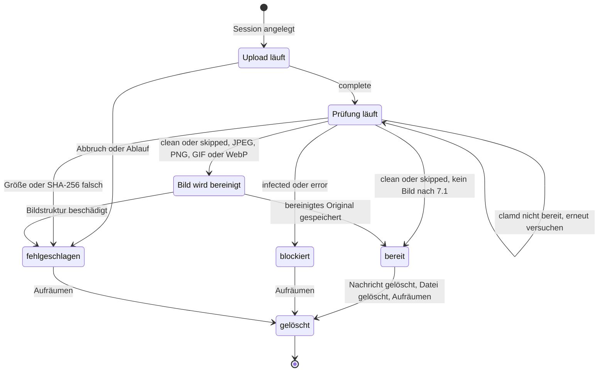
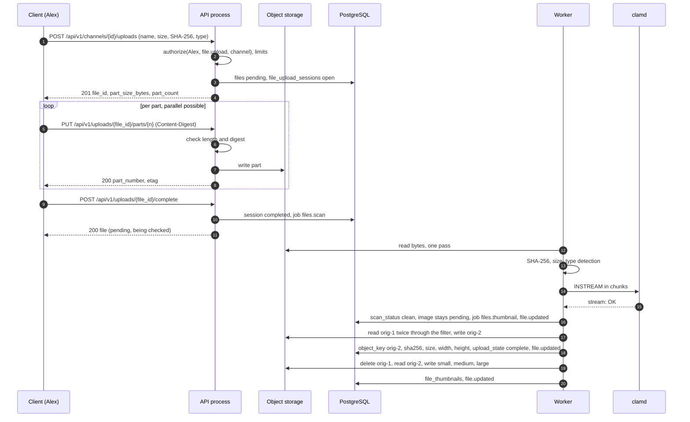

# 12 Dateien

Status: Entwurf M0. Normativ für das Modul `files`, den Objektspeicher-Port, den Malware-Scan und
die Datei-Endpunkte. Begriffe: [00-glossar.md](00-glossar.md). Tabellen:
[03-datenmodell.md](03-datenmodell.md) (4.7). Aktionen: [05-aktionen.md](05-aktionen.md) (4.8).
Ereignisse und Sync: [04-sync-protokoll.md](04-sync-protokoll.md). Rechte:
[07-rechte.md](07-rechte.md). Suche in Dateien: [14-suche.md](14-suche.md). Aufbewahrung:
[20-datenschutz.md](20-datenschutz.md). Entscheidungen: ADR 0010 (Objektspeicher) und ADR 0033
(Malware-Scan).

Alle Grenzen, Fristen und Größen sind benannte Konfigurationswerte. Ihre Standardwerte stehen
nur in Abschnitt 18. Externe Fakten tragen einen Verweis auf die Quellenliste (Abschnitt 19).

## 1. Ziele und Grenzen

1. **Kein ungeprüftes Byte erreicht einen Empfänger.** Inhalt, Vorschaubild und Transkript einer
   Datei liefert der Server erst aus, wenn Prüfsumme und Größe stimmen und der Malware-Scan
   `clean` meldet (oder der Scan ausdrücklich abgeschaltet ist, `skipped`).
2. **Jeder Abruf geht durch `authorize`.** Auch Vorschaubilder und Abspiel-Anfragen. Kein
   Sichtrecht ergibt `404` (B7).
3. **Portabel.** Ein Port für den Objektspeicher, zwei Treiber: Dateisystem (Standard) und
   S3-kompatibel mit Kern-S3 (B4, R-Objektspeicher, ADR 0010).
4. **Mobil robust.** Uploads sind in Teilen wiederholbar und nach Netzabbruch fortsetzbar.
5. **Datenschutz.** Bilder, die der Server inline zeigt, sind frei von Metadaten (Standort,
   Gerät). Keine Deduplizierung über Dateien hinweg (R-DM-13).

Nicht Ziel: Bearbeiten von Dateien, Ordner, Freigabe-Links nach außen, Link-Vorschau vom Server
(Baseline Abschnitt 4, SSRF-Verbot), serverseitiges Abspielen im Browser (B5: kein Chat im Web).

## 2. Zustände einer Datei

Eine Datei hat zwei Zustandsfelder aus [03-datenmodell.md](03-datenmodell.md): `upload_state`
(Bytes vollständig und geprüft?) und `scan_status` (Malware-Scan). Dazu kommt der Zustand der
Upload-Session (Abschnitt 3.1; Tabelle `file_upload_sessions` in 03).

| Sicht | `upload_state` | `scan_status` | Session `state` | Auslieferung |
|---|---|---|---|---|
| Upload läuft | `pending` | `pending` | `open` | nein |
| Client fertig, Prüfung läuft | `pending` | `pending` | `completed` | nein; Anzeige "wird geprüft" |
| Prüfsumme oder Größe falsch | `failed` | `pending` | `completed` | nein; Anzeige "Upload fehlgeschlagen" |
| image being cleaned (JPEG, PNG, GIF, WebP; 7.1) | `pending` | `clean` or `skipped` | `completed` | no; shown as "being checked" |
| broken image structure (JPEG or PNG; 7.1) | `failed` | `clean` or `skipped` | `completed` | no; shown as "upload failed" |
| bereit | `complete` | `clean` oder `skipped` | `completed` | ja |
| blockiert | `complete` | `infected` oder `error` | `completed` | nein; Anzeige "blockiert" |
| abgebrochen oder abgelaufen | `failed` | `pending` | `aborted` oder `expired` | nein |

Eine Datei ist **auslieferbar** genau dann, wenn `upload_state = 'complete'` und
`scan_status IN ('clean','skipped')` und `deleted_at IS NULL`. Eine Datei ist **endgültig**,
wenn sie auslieferbar ist oder `upload_state = 'failed'` oder `scan_status IN
('infected','error')`. Abschnitt 10 nutzt "endgültig" für den Agenten-Aufruf.



Jede Änderung von `upload_state`, `scan_status`, Vorschaubildern oder Transkript schreibt das
dauerhafte Ereignis `file.updated` (Empfangs-Aktion `file.read`, [05-aktionen.md](05-aktionen.md)
Abschnitt 6). Inhalte stehen nie im Ereignis.

Before attachment the event goes only to the uploader: it carries `audience_principal_id` =
`uploaded_by` in the scope of the scope channel, because the scope alone would hand the file name
to every reader of the channel, while before attachment only the uploader reads the file (05 2.2;
docs/DECISIONS.md D-M3-03-16). An attached file is written without audience in the scope of its
message (M3-07). Creating and completing an upload write no event: neither `upload_state` nor
`scan_status` changes.

## 3. Upload-Ablauf

### 3.1 Creating an upload session

The client declares the file upfront. The server checks everything that can be checked without
bytes and rejects early, before bandwidth is used.

Request (`file.upload` on the channel; `Idempotency-Key` is the optional parameter of openapi,
a repeat answers the stored response):

| Field | Required | Rule |
|---|---|---|
| `name` | yes | is sanitized (section 6.2) and stored as `original_name` |
| `size_bytes` | yes | `1 ..= file.max_upload_bytes`; otherwise `413 payload_too_large` |
| `sha256` | yes | SHA-256 of the whole file as lowercase hex (`^[0-9a-f]{64}$`); the verify pass checks it |
| `declared_mime_type` | no | hint only; stored without parameters in lower case in `declared_mime_type`; the server detects the type itself |
| `purpose` | no | default `attachment`; further values in 3.7 |
| `poster` | no | video only: small JPEG or PNG as thumbnail, at most `file.poster_max_bytes` |

The server checks in this order:

1. `authorize(principal, file.upload, channel)`. No read permission: `404`. Read permission, but
   `write` or `upload` missing: `403`.
2. Size against `file.max_upload_bytes`.
3. Early type check (section 6.1): the name is cleaned (6.2); a denied declared type or an
   extension of the cleaned name that belongs to a denied type gives `415
   unsupported_media_type` with `reason` `file_type_denied`. It needs no database, so it comes
   before the counts (docs/DECISIONS.md D-M3-03-4, D-M3-03-5).
4. Quota: the sum of `size_bytes` of the principal's files that are neither deleted nor failed
   plus the new size is at most `file.quota_bytes_per_principal` (0 = off). Otherwise `409
   conflict` with `reason` `quota_exceeded`. Failed files count as deleted: their objects go at
   once (section 12), so an aborted upload frees its quota (D-M3-03-6).
5. Open sessions of the principal below `file.upload_max_open_sessions`. Otherwise `429
   rate_limited` with `Retry-After` until the earliest expiry of the open sessions, in whole
   seconds and at least one (D-M3-03-8).
6. File system driver only: free space after the upload at least `file.fs.min_free_bytes`.
   Otherwise `503 unavailable` with `reason` `storage_full` and a warning to the status page.

Steps 4 to 6 run under a transaction-level advisory lock of the principal, so two parallel
announcements cannot both pass a limit (D-M3-03-7).

Then it creates in one transaction: a row in `files` (`upload_state = 'pending'`,
`scan_status = 'pending'`, `mime_type = 'application/octet-stream'` until detection,
`scope_channel_id` = channel, `sha256` and `size_bytes` = declared values) and a row in
`file_upload_sessions` (03). The response names
`file_id`, `mode`, `part_size_bytes`, `part_count`, `expires_at` and, for `mode = presigned`,
the target URLs per part.

`part_size_bytes` is `file.upload_part_bytes`; `part_count` = the rounded-up `size_bytes /
part_size_bytes`. The last part may be smaller. The default lies above the smallest
S3 part size so that the same part plan applies to both drivers (S3: parts at least 5 MiB
except the last, at most 10,000 parts [Q1, verified]). At startup the server checks that
`file.max_upload_bytes / file.upload_part_bytes` lies below this part limit.

### 3.2 Transferring parts (mode `direct`, default)

`PUT /api/v1/uploads/{file_id}/parts/{n}` with the raw bytes of the part and the header
`Content-Digest: sha-256=:<base64>:` per RFC 9530 [Q2, verified].

1. Only the principal of the session may send parts; otherwise `404`.
2. The server checks length (`part_size_bytes`, for the last part the remainder) and digest
   while reading. Mismatch: `400 validation_failed` with `errors[].code` `part_digest_mismatch`,
   nothing is stored.
3. A part is idempotent: the same number with the same digest yields `200` without new work;
   the same number with a different digest yields `409 conflict` with `reason` `part_conflict`.
4. Parts may arrive in parallel and in any order. The client chooses the parallelism.
5. `GET /api/v1/uploads/{file_id}` returns the parts already confirmed. After an interruption
   a client resumes from there.

The S3 driver passes each part through as a multipart part (no buffering in the server). The
multipart upload is created at the first part, outside any transaction; its ID goes to
`file_upload_sessions.storage_upload_id`, and a request that loses this race aborts its own
upload and uses the stored one. The ETag of an S3 part is the one the service returns, kept in
`file_upload_parts.etag`. The file system driver writes part `n` as the object
`uploads/<file_id>/<n>` under `file.fs.root`; its ETag is the lowercase hex SHA-256 of the part in
double quotes, derived from `file_upload_parts.sha256`, whose `etag` stays NULL
(D-M3-03-2, D-M3-03-3). A part is never written again once it is confirmed; an object store call
never runs inside a database transaction (02 8.5).

### 3.3 Presigned PUT (mode `presigned`, optional)

Only with the S3 driver and `file.s3.presigned_upload = true`. The session response contains,
per part, a presigned URL for the multipart part, valid for `file.s3.presign_ttl`. The client
uploads directly to the object storage and reports the ETags of the parts on completion. On
completion the server checks part count and total size (HEAD), and in the verification pass
(3.4) the SHA-256.

The mode stays off until two things are proven:

- The presigned URL binds the part length, so that a client cannot store more bytes than
  declared. Integration test against every supported S3 service. Result of M3-02
  (`TestPresignedPartBindsLength`, docs/DECISIONS.md M3-02/9): proven for SeaweedFS at the version
  the Compose stack pins (`BOTHY_SEAWEEDFS_VERSION`). The S3 driver signs `content-length` into
  every part URL; SeaweedFS accepts a plain `PUT` of exactly the signed length and refuses one
  byte more, one byte less, chunked transfer encoding and a request after the validity, each
  without storing a part. Other S3 services are not proven.
- The clients reach the S3 endpoint. For instances in private networks this is often not so
  (open, not checked).

Reason for "optional": the direct path is enough for the limit `file.max_upload_bytes` and
needs no public reachability of the storage.

### 3.4 Completion and verification pass

`POST /api/v1/uploads/{file_id}/complete`:

1. All parts present (otherwise `409 conflict` with `reason` `upload_incomplete` and the
   missing numbers in `detail`).
2. `parts` of the request is checked against the confirmed parts: a duplicate or out-of-range
   number gives `400 validation_failed`, a listed `etag` that differs from the confirmed one
   `409 conflict` with `reason` `part_conflict`; the list may name fewer parts than exist
   (D-M3-03-12). No object store call runs here: the S3 driver's `CompleteMultipartUpload` runs
   in the verify pass, because a keyed request runs inside a transaction (02 8.4, 8.5;
   D-M3-03-2).
3. Session `state = 'completed'`, job `files.scan` into the queue (River, M3-04), response
   `200` with the file object. A completed session answers `200` with the file again. From now
   on the client may attach the file to a message.

The job `files.scan` reads the bytes **exactly once** (on S3 after `CompleteMultipartUpload`)
and splits the stream into:

- SHA-256 and byte counter. If they differ from the declaration: `upload_state = 'failed'`,
  reason `checksum_mismatch` or `size_mismatch` respectively in the session, delete the
  object, `file.updated`.
- Type detection over the first `file.sniff_bytes` (section 6.1).
- clamd `INSTREAM` (section 5).
- File system only: joining the parts into the target object (write to a temporary file,
  `fsync`, `rename`). After that the parts are deleted.

A single read pass keeps the cost low for large files and works the same way for both modes.
The checksum per part (3.2) catches transfer errors early; the total checksum here catches
errors during joining and in presigned mode.

If all is well: `upload_state = 'complete'`, `mime_type` = detected type, `scan_status` per
section 5.2, `scanned_at`, `scan_engine`, event `file.updated`. Exception for images (M3-06,
docs/DECISIONS.md D-M3-06-1): when the detected type is `image/jpeg`, `image/png`, `image/apng`,
`image/gif` or `image/webp` and the verdict is `clean` or `skipped`, the same transaction writes
`scan_status`, `scanned_at`, `scan_engine` and `mime_type` but leaves `upload_state = 'pending'`
and inserts the job `files.thumbnail`; the image becomes `complete` only in the transaction of
that job that stores its cleaned original (section 7.1), so the original with its location data
is never deliverable and never "final" for a held agent invocation (section 10). MP4 and
QuickTime files (`video/mp4`, `video/quicktime`, `video/x-m4v`, `audio/mp4`, `audio/x-m4a`)
become `complete` as before and get `files.thumbnail` for their display size and duration
(section 7.3). Blocked and failed files never get the job.

Rules of the pass (M3-04, docs/DECISIONS.md D-M3-04-1 to D-M3-04-15): the job reads
`object_key` when it exists (after an earlier attempt or, on S3, after the pass ran
`CompleteMultipartUpload`), otherwise the parts in order, and writes the joined object from the
same stream; the source is limited to the declared size plus one byte. Size, SHA-256 and a
detected type listed in `file.denied_mime_types` decide first (`failed` with `size_mismatch`,
`checksum_mismatch` or `file_type_denied`), also when the scan failed transiently; a malware
finding is audited for such a file as well. Then 5.2 applies; the reasons of blocked files are
`malware_detected`, `scan_limits_exceeded`, `scan_stream_limit_exceeded` and
`scan_engine_error` in the session's `failure_reason`. `scan_engine = 'clamd'` and `scanned_at`
are set when clamd decided the file, NULL for `skipped` and `failed`. The result is written in one
transaction that locks the session and then the file, writes `file.updated` without actor and
publishes `files.FileFinalized` for a final file; objects of failed and blocked files and the
parts are deleted after the commit. A transient failure inserts the next `files.scan` with a
delay that doubles from `file.scan.health_interval` up to `file.scan.retry_backoff_cap`, without
an attempt limit, and changes nothing else. If the file is servable or an
image being cleaned, the processing of sections 7 and 8 follows in the job `files.thumbnail`
(02 "Job-Katalog") and, if supported, the text extraction ([14-suche.md](14-suche.md)).

### 3.5 Sequence (direct upload with scan)



### 3.6 Error cases

| Case | Response or consequence |
|---|---|
| No read permission on the channel | `404` |
| `write` or `upload` missing | `403` |
| Size above `file.max_upload_bytes` | `413 payload_too_large` |
| Quota exhausted | `409 conflict` with `reason` `quota_exceeded` |
| Too many open sessions | `429` with `Retry-After` |
| Storage almost full (file system) | `503 unavailable` with `reason` `storage_full` |
| Part with wrong length or digest | `400 validation_failed` with `errors[].code` `part_digest_mismatch` |
| Part number already used with different content | `409 conflict` with `reason` `part_conflict` |
| `complete` with missing parts | `409 conflict` with `reason` `upload_incomplete` |
| Session expired (`file.upload_session_ttl`) | `410 gone`; cleanup deletes the parts and aborts the multipart upload |
| Permissions revoked during the upload | next request `404`; the session is aborted |
| Total checksum or size wrong | `upload_state = 'failed'`, `file.updated` |

### 3.7 Zweck einer Datei

Nicht jede Datei gehört zu einem Kanal. [05-aktionen.md](05-aktionen.md) Abschnitt 2.2 regelt den
Pfad je Zweck. Die Spalte `files.purpose` (03) trägt eine eigene Rechte-Regel je Zweck:

| `purpose` | Upload-Aktion | `scope_channel_id` | Lesen |
|---|---|---|---|
| `attachment` | `file.upload` | Pflicht | `file.read` über den Kanal (vor dem Anhängen nur der Hochladende) |
| `avatar` | `self.profile.update` bzw. `agent.update` | NULL | jeder aktive, angemeldete Prinzipal (`auth`) |
| `branding` | `instance.branding.update` | NULL | öffentlich wie `instance.discovery.read` (Logo auf der Anmeldeseite) |
| `gdpr_export` | nur Server | NULL | `gdpr.export.download` |

Alle Zwecke laufen durch dieselbe Prüfung und denselben Scan.

## 4. Objektspeicher

### 4.1 Port

Das Modul `files` spricht den Speicher nur über den Port `ObjectStore`. Er enthält genau diese
Operationen:

| Operation | Zweck |
|---|---|
| `Put(key, reader, size)` | ganzes Objekt schreiben |
| `Get(key, range)` | lesen, optional ein Byte-Bereich |
| `Head(key)` | Größe und Existenz |
| `Delete(key)` | ein Objekt löschen; fehlendes Objekt ist kein Fehler |
| `CreateMultipart(key)`, `UploadPart(key, uploadID, n, reader, size)`, `CompleteMultipart(key, uploadID, parts)`, `AbortMultipart(key, uploadID)` | Teil-Uploads |
| `PresignUploadPart(key, uploadID, n, size, ttl)` | nur S3, nur für Modus `presigned`; die Signatur bindet die Teil-Länge `size` |

Nicht im Port: Auflisten, Kopieren, Batch-Löschen, Versionierung, Bucket-Richtlinien, Lebenszyklus
und Verschlüsselungs-Kopfzeilen. Der Server kennt jeden Schlüssel aus der Datenbank und braucht
kein Auflisten. Batch-Löschen (`DeleteObjects`) fehlt bewusst: AWS-SDKs erzwingen dort eine
Prüfsumme, an der mehrere S3-kompatible Dienste scheitern [Q3, belegt; Q4, nur
Suchzusammenfassung].

Port contract (M3-01, `internal/files/app`, docs/DECISIONS.md M3-01/1 to M3-01/6). The port is an
outgoing port of the application layer; no other module sees it. Every operation takes a context
first; implementations are safe for concurrent use, and nothing in the port reads a whole object
into memory (`Get` streams, the caller closes the reader).

- Keys: one grammar for all drivers (`domain.ValidateKey`): one or more segments of `[a-z0-9-]`,
  joined by single `/`, without a leading or trailing `/`. It refuses `.`, `..`, absolute paths,
  empty segments, backslashes, upper case, percent signs, spaces, control and non-ASCII
  characters. Every operation checks the key first and returns `ErrInvalidKey` before any storage
  call. The key builders of 4.4 take only the file ID, a number and the closed type `Variant`.
- `Get` reads the whole object or exactly one byte range `{Offset, Length}` (9.3). `Offset < 0`,
  `Length < 1` or `Offset` at or beyond the object size give `ErrInvalidRange`; a range whose end
  lies beyond the object ends at the last byte.
- Errors: `ErrNotFound` (`Get` or `Head` of a missing object), `ErrInvalidRange`,
  `ErrSizeMismatch` (`size < 0` or a body of another length; nothing is stored),
  `ErrUploadNotFound` (an upload that was never created, was aborted or was completed),
  `ErrInvalidPart` (part number below 1; in `CompleteMultipart` an empty list, numbers that are
  not strictly ascending, a number without an uploaded part or an ETag that does not match; the
  upload stays open), `ErrNotSupported` (an operation the driver does not offer). `Delete` of a
  missing object and `AbortMultipart` of an unknown, aborted or completed upload return no error
  (section 12). Every other error is a storage failure that callers answer with `503 unavailable`
  ([02-architektur.md](02-architektur.md) 14.4); errors name the operation and the key and never
  contain object bytes. The port never panics on a failing storage.
- `Put` on an existing key replaces it atomically. The drivers do not enforce "Objekte werden nie
  überschrieben"; the module does, through the key schema and the unique `files.object_key`.
- `PresignUploadPart` takes the size of the part before the validity (M3-02,
  docs/DECISIONS.md M3-02/9), because no driver can bind a length it does not know. `n < 1` gives
  `ErrInvalidPart`, `size < 1` gives `ErrSizeMismatch`, both on every driver; the file system
  driver then answers `ErrNotSupported`. The URL is a credential for its validity: callers hand
  it to the client only and never log it.

### 4.2 Dateisystem-Treiber (Standard)

- Wurzel `file.fs.root`, ein eigener Ordner nur für Bothy. Ordner `0700`, Dateien `0600`.
- Pfade entstehen nur aus dem Schlüsselschema (4.4). Der Treiber lehnt Schlüssel mit `..`,
  absoluten Pfaden oder Zeichen außerhalb `[a-z0-9/-]` ab und folgt keinen symbolischen Links.
- Schreiben: temporäre Datei im selben Dateisystem, `fsync`, `rename`, `fsync` auf den Ordner.
  Ein Leser sieht nie ein halbes Objekt.
- `Get` mit Bereich über `ReadAt`. Kein Zwischenspeicher im Server.
- Verschlüsselung im Ruhezustand ist Aufgabe des Betriebs (Laufwerks-Verschlüsselung,
  [16-betrieb.md](16-betrieb.md)).

File system rules (M3-01, `internal/files/adapters/fs`, docs/DECISIONS.md M3-01/5 to M3-01/11, M3-01/15 and M3-01/17 to M3-01/19):

- Start check: `file.fs.root` is an absolute, clean path of an existing directory (not a symbolic
  link), owned by the effective user of the process, with permission bits exactly `0700`. The
  server creates `<root>/.tmp` (mode `0700`) when missing and never creates the root itself; a
  missing root means a wrong mount; an existing `.tmp` must be a directory of the same user with
  mode `0700`. Errors name `file.fs.root`, not the path.
- Keys map to paths below the root. The driver works through a handle of the root directory
  (`os.Root`), so no operation leaves it, and it follows no symbolic link at any level: every
  existing path component is checked with `lstat` before an operation and before a rename; a read
  checks the path again when the opened file is not the one it checked, because `os.Root` follows
  a link inside the root even with `O_NOFOLLOW`. A link found
  is a storage failure, not `ErrNotFound`. A directory or another non-regular entry at a key counts
  as missing.
- Writes go to a temporary file with mode `0600` in `<root>/.tmp`, which no key can address
  (keys contain no dot). Exactly `size` bytes are copied with a bounded buffer; then `fsync` of
  the file, missing directories with mode `0700` (each synced in its parent), `rename`, `fsync` of
  the directory. A platform
  that refuses to sync a directory as "not supported" counts as success. Every failed write
  removes its temporary file.
- `Delete` removes the file, syncs the directory and removes the directory of the file
  (`f/<aa>/<bb>/<file_id>` or `uploads/<file_id>`) if it is empty now; the levels `f/<aa>` and
  `f/<aa>/<bb>` stay. A writer whose directory a concurrent `Delete` removed creates it again and
  renames again.
- Multipart: `CreateMultipart` accepts only original keys, creates `uploads/<file_id>/`, is
  idempotent and returns the upload ID `""`. `UploadPart` writes `uploads/<file_id>/<n>` like an
  object and returns the ETag `"<sha256 hex>"` of the part bytes (the form of 9.3); a part with the
  same number is replaced atomically. While the upload is open, parts are regular objects under
  their keys. `CompleteMultipart` writes the listed parts in order into one temporary file, reads
  each part exactly once and checks it against its ETag, renames to the key and removes
  `uploads/<file_id>/` with all parts; a failure of that removal does not fail the completion; `Delete`
  of an original key also removes `uploads/<file_id>/`, so parts left behind go with the file. The list shape is checked before any file
  system call. `AbortMultipart` removes that directory. Deleting the last
  part of an open upload with `Delete` removes `uploads/<file_id>/` and so ends the upload.
- `PresignUploadPart` gives `ErrInvalidPart` for a part number below 1 and otherwise `ErrNotSupported`. Several processes may share one root (roles `api`
  and `worker` on one volume), because every change is a rename or an unlink; the driver takes no
  lock and never removes entries of `.tmp`. A temporary file left by a crashed process stays (no
  rule yet).

### 4.3 S3-Treiber (nur Kern-S3)

- AWS SDK for Go v2 mit eigenem Endpunkt (`file.s3.endpoint`), Region, Bucket und Pfad-Stil
  (`file.s3.use_path_style`). Zugangsdaten nur als Verweis auf den Secret-Provider.
- Prüfsummen-Modus `when_required` für Anfrage und Antwort (`file.s3.checksum_mode`). Die SDKs
  rechnen sonst standardmäßig zusätzliche Prüfsummen, die nicht jeder S3-Dienst versteht [Q3,
  belegt]. Die eigene SHA-256 aus 3.4 ersetzt diese Prüfung.
- Empfohlener selbst gehosteter Dienst: SeaweedFS (Apache-2.0) [Q5, belegt]. MinIO wird nicht
  empfohlen, weil das Repository archiviert ist und keine Binärdateien mehr erscheinen [Q6,
  belegt].
- Der Bucket ist privat. Server-seitige Verschlüsselung und Lebenszyklus-Regel
  "unvollständige Multipart-Uploads abbrechen" richtet der Betreiber am Speicher ein; der Server
  verlässt sich nicht darauf und bricht abgelaufene Uploads selbst ab (Abschnitt 12).

S3 driver rules (M3-02, `internal/files/adapters/s3`, docs/DECISIONS.md M3-02/1 to M3-02/14):

- Core S3 only: the driver holds a Go interface with exactly `PutObject`, `GetObject`,
  `HeadObject`, `DeleteObject`, `CreateMultipartUpload`, `UploadPart`,
  `CompleteMultipartUpload`, `AbortMultipartUpload` and a presign interface with only
  `PresignUploadPart`. Only this package and the audit checkpoint sink
  `internal/audit/adapters/s3sink` (M7-22) and the object mirror of the backup service
  `internal/status/adapters/s3mirror` (M7-02) import the AWS SDK (depguard in `make lint`,
  `TestS3SDKOnlyInAdapter`); forbidigo forbids `DeleteObjects` and `PresignGetObject`. No request
  of the files driver sets server-side encryption, ACL, tagging, object lock, storage class or
  conditional headers.
- `file.s3.endpoint` is required; the driver never uses the endpoint resolution, the default
  configuration or the credential chain of the SDK (environment, shared files, instance
  metadata, whose address SEC-NET-3 always blocks).
- Every request goes through the egress client ([19-sicherheit.md](19-sicherheit.md) 8) with
  purpose `objectstore`; its host policy allows exactly the request host and port (the endpoint
  with path style, `<bucket>.<endpoint host>` with virtual-hosted style). An `http` endpoint or
  one on a private address needs an `egress.allowed_hosts` entry with `allow_private`. For an
  `http` endpoint `bothy config check` fails without it (cross-check `file_s3`); a private
  address behind an `https` endpoint is refused by the egress client when it connects. TLS is always verified. Redirects are never
  followed; the time limit of a request is `http.transfer_timeout`, the largest response body
  `file.max_upload_bytes`.
- No retries in the SDK ([02-architektur.md](02-architektur.md) 14.3): a failed call is one
  request, and the caller sees a storage failure (`503 unavailable`); jobs retry through River.
- `Put` and `UploadPart` stream the caller's reader without a buffer and sign it as
  `UNSIGNED-PAYLOAD`, because the reader is not seekable and the endpoint may be plain `http`;
  the part digest (3.2) and the file SHA-256 of 3.4 check the content. A body of another length
  gives `ErrSizeMismatch` and stores nothing: the driver holds back the last byte until the
  reader reports its end.
- Access keys come only from `file.s3.access_key_ref` and `file.s3.secret_key_ref` through the
  secret provider ([16-betrieb.md](16-betrieb.md) 5.2), read only with `file.storage.driver = s3`.
  A key that cannot be read stops the start; the driver asks the provider again on every refresh
  of the SDK credential cache, so a rotation works without restart after `secrets.cache_ttl`.
- The object name is `<file.s3.prefix>/<key>` with a prefix, else the key; key and prefix follow
  the key grammar of 4.1, checked before any request.
- Errors keep the contract of 4.1 and read `files/s3: <operation> <key>: <detail>`; they never
  contain a request URL, a query, a presigned URL, the endpoint or credentials. A `HEAD` answer
  has no body, so `Head` on a missing bucket reads as `ErrNotFound`; `Get` reports `NoSuchBucket`
  as a storage failure.

The second package that may import the AWS SDK (M7-22, docs/DECISIONS.md M7-22/4) is the object
store sink of the audit checkpoints, `internal/audit/adapters/s3sink`
([19-sicherheit.md](19-sicherheit.md) section 16, `audit.checkpoint_sink = s3://...`). It holds a
Go interface with only `PutObject` (with `If-None-Match: *`), `GetObject`, `ListObjectVersions`
and `GetObjectLockConfiguration` (`TestAPIMethodSet`), and follows the egress and credential rules
above with its own keys (`audit.checkpoint_s3_*`, purpose `audit_checkpoint`, the limits
`egress.timeout` and `egress.max_response_bytes`). The rules of this section stay unchanged for
the files driver.

### 4.4 Schlüsselschema

```
f/<aa>/<bb>/<file_id>/orig-<n>      Original, n = Revision (1 = wie hochgeladen)
f/<aa>/<bb>/<file_id>/small         Vorschaubild-Varianten aus file_thumbnails
f/<aa>/<bb>/<file_id>/medium
f/<aa>/<bb>/<file_id>/large
f/<aa>/<bb>/<file_id>/poster
uploads/<file_id>/<n>               nur Dateisystem: Teile während des Uploads
```

`<aa>` und `<bb>` sind die letzten vier Hex-Zeichen der `file_id`. Bei UUIDv7 sind das
Zufallsbits; sie verteilen Dateien gleichmäßig auf Ordner. Der Schlüssel enthält keine Namen,
keine Kanal- oder Bereichs-IDs und keinen Dateinamen ([03-datenmodell.md](03-datenmodell.md),
`files.object_key`). Ändert die Verarbeitung das Original (Abschnitt 7), entsteht `orig-2`;
`files.object_key` zeigt in derselben Transaktion auf das neue Objekt, danach wird `orig-1`
gelöscht. Objekte werden nie überschrieben.

Optional `file.s3.prefix` vor allen Schlüsseln, damit ein Bucket mehrere Umgebungen tragen kann.

## 5. Malware-Scan

Entscheidung und Alternativen: ADR 0033. ClamAV läuft als eigener Dienst; der Server spricht
mit `clamd` über das Protokoll, nie über eine eingebundene Bibliothek. Der Port heißt `Scanner`
(`Scan(ctx, reader) -> Verdict`, `Ping(ctx)`), damit später andere Engines anschließbar sind.

### 5.1 Ablauf

1. Connection to `file.scan.clamd_address`, only a Unix socket (19 SEC-TLS-5): clamd checks
   requests neither for origin nor for authentication [Q7, belegt], so the server accepts only
   `unix://` with an absolute path and no TCP address. The Compose stack shares the socket with
   the worker through the volume `clamav-socket` (`infra/compose/README.md`).
2. Befehl `zINSTREAM\0` (NUL-Rahmung ist die empfohlene Form) [Q7, belegt].
3. Daten in Stücken: je Stück 4 Byte Länge in Netzwerk-Byte-Reihenfolge, dann die Bytes; Ende
   mit einem Stück der Länge 0 [Q7, belegt]. Stückgröße `file.scan.chunk_bytes`.
4. Antwort lesen bis clamd die Verbindung schließt: `stream: OK`, `stream: <Signatur> FOUND`
   oder eine Zeile mit `ERROR` [Q7, belegt].
5. Zeitlimit je Datei `file.scan.timeout`. Höchstens `file.scan.max_concurrent` Scans je
   Worker-Prozess.

Ein eigener kleiner Client genügt; das Protokoll ist klein, und die bekannte Go-Bibliothek
`go-clamd` hat seit 2017 keinen Stand [Q8, belegt].

### 5.2 Ergebnis-Zuordnung

| clamd-Antwort | `scan_status` | Folge |
|---|---|---|
| `stream: OK` | `clean` | Verarbeitung (Abschnitte 7, 8), `file.updated` |
| `<Signatur> FOUND`, Signatur beginnt mit `Heuristics.Limits.Exceeded` | `error` | Grund `scan_limits_exceeded`; nicht auslieferbar |
| `<Signatur> FOUND`, sonst | `infected` | Objekte sofort löschen, Zeile bleibt; Audit (unten) |
| `INSTREAM size limit exceeded` oder andere `ERROR` | `error` | Grund aus der Antwort; nicht auslieferbar |
| Zeitlimit, Verbindungsfehler | bleibt `pending` | Wiederholung (5.3) |

Bei `infected` entsteht ein Audit-Eintrag mit `action = 'file.upload'`, `decision = 'deny'`,
`deny_reason = 'malware_detected'` und in `details` die Signatur, die SHA-256 und die Größe,
nie Inhalte (05: `file.upload` mit Audit bei Malware-Fund). Der Hochladende und Owner sehen den Grund; alle anderen sehen nur "blockiert".

### 5.3 Wenn ClamAV fehlt oder nicht bereit ist

`file.scan.mode` hat zwei Werte:

- `required` (Standard): fail closed. Ist clamd nicht erreichbar oder antwortet `PING` nicht
  mit `PONG` [Q7, belegt], bleibt die Datei `pending`. Der Job wiederholt mit Backoff bis
  `file.scan.retry_backoff_cap`, ohne Obergrenze der Versuche, solange die Datei nicht
  gelöscht ist. Nichts wird ungeprüft ausgeliefert.
- `off`: kein Scan, `scan_status = 'skipped'`. Gedacht für Entwicklung und für Installationen
  ohne den Speicher, den ClamAV braucht (Abschnitt 5.4). Die Admin-Konsole und die Statusseite
  zeigen dauerhaft "Virenscan aus".

Der Worker prüft clamd alle `file.scan.health_interval` mit `PING`. Das Ergebnis speist die
Statusseiten-Komponente "Virenscan" (`status_components.health_source = 'clamd'`). Liegt die
älteste Datei länger als `file.scan.pending_alert_after` in `pending`, wird die Komponente
`degraded` und ein Alarm ausgelöst ([17-observability.md](17-observability.md)). Beim Start
braucht clamd lange, um Signaturen zu laden; offizielle Images haben dafür ein
Start-Zeitlimit, Standard 1800 s [Q9, belegt]. Uploads in dieser Zeit warten einfach.

Wechselt `file.scan.mode` von `off` auf `required`, bleiben `skipped`-Dateien `skipped`. Ein
Admin kann sie mit dem Wartungsbefehl `bothy files rescan --skipped` nachprüfen lassen
(Server-Befehl, kein Endpunkt).

### 5.4 Pflicht-Einstellungen für clamd

Der Compose-Stack ([16-betrieb.md](16-betrieb.md), `infra/compose`) setzt clamd so:

| clamd-Option | Wert | Grund |
|---|---|---|
| `AlertExceedsMax` | `yes` | Standard ist `no`: Dateien über `MaxFileSize`, `MaxScanSize` oder `MaxRecursion` werden dann nicht geprüft und nicht gemeldet [Q10, belegt]. Mit `yes` erscheinen sie als `Heuristics.Limits.Exceeded...` und werden `error` (5.2). |
| `StreamMaxLength` | mindestens `file.max_upload_bytes` | Standard `100M`, 1M = 1048576 Byte [Q10, belegt]; darüber bricht clamd den Stream ab. |
| `MaxFileSize` | mindestens `file.max_upload_bytes` | Standard `100M` [Q10, belegt]; sonst würde schon die Datei selbst übersprungen. |
| `MaxScanSize`, `MaxRecursion`, `MaxFiles` | Standardwerte | gelten für entpackte Inhalte; Überschreitung wird mit `AlertExceedsMax` zu `error`. |
| `AlertEncrypted` | `no` (Standard) | Verschlüsselte Archive und PDFs sind im Arbeitsalltag häufig. Sie werden darum nicht blockiert, aber auch nicht inhaltlich geprüft. Restrisiko steht im Bedrohungsmodell ([19-sicherheit.md](19-sicherheit.md)). |

Der Server kennt die clamd-Einstellungen nicht über das Protokoll. Darum gibt es
`file.scan.clamd_stream_max_bytes` als Spiegel von `StreamMaxLength`. Der Server startet nicht,
wenn `file.scan.mode = required` und `file.max_upload_bytes` größer als dieser Wert ist.

Image: `clamav/clamav-debian` gibt es für amd64 und arm64; `clamav/clamav:stable` nur für amd64
[Q11, belegt]. ClamAV braucht laut Projekt mindestens 3 GiB, besser 4 GiB Arbeitsspeicher [Q9,
belegt]. ClamAV steht unter GPL-2.0 [Q12, belegt]; die Trennung über Socket und eigenen
Container ist nach der GPL-FAQ getrennte Kommunikation [Q13, belegt], die rechtliche Bewertung
bleibt Sache des Betreibers (keine Rechtsberatung).

## 6. Typ-Erkennung und Dateinamen

### 6.1 Typ

- Der Server erkennt den Typ aus den Bytes mit `github.com/gabriel-vasile/mimetype` (MIT, ohne
  cgo) [Q14, belegt]. Er liest dafür `file.sniff_bytes`; Office-Formate brauchen mehr als den
  Kopf [Q14, belegt].
- `declared_mime_type` bleibt nur zur Diagnose. Die Dateiendung im Namen ändert nichts.
- Weicht der erkannte Typ vom angemeldeten ab, gilt der erkannte. Das ist kein Fehler.
- `file.denied_mime_types` (Standard leer) blockiert Typen, die der Betreiber nicht will. Die
  Prüfung läuft zweimal: vorab gegen den angemeldeten Typ und die Endung (frühe Ablehnung,
  `415 file_type_denied`), danach gegen den erkannten Typ (`upload_state = 'failed'`).
  Standard leer, weil Entwickler-Kanäle ausführbare Dateien und Archive legitim teilen und der
  Scan sowie die Auslieferung als Download (9.3) den Schutz tragen.

### 6.2 Dateinamen

Bereinigung bei der Anmeldung, Ergebnis in `original_name`:

1. Unicode NFC.
2. Nur der letzte Pfadteil; `/` und `\` werden entfernt [Q15, belegt].
3. Steuerzeichen, Bidi-Steuerzeichen (z. B. U+202E, das "exe" als "pdf" tarnen kann) und
   Null-Breite-Zeichen entfernen; Leerraum am Anfang und Ende kürzen [Q15, belegt].
4. `.` und `..` allein sind ungültig [Q15, belegt]. Leerer Rest ergibt `file`. A name that is
   `.` or `..` after steps 1 to 3 also becomes `file`: the name is only a label, and a `400` for
   an already cleaned name would give the client nothing to correct (D-M3-03-9). Names are
   cleaned, never rejected.
5. Länge höchstens `file.name_max_bytes` UTF-8-Bytes; gekürzt wird vor der Endung.

## 7. Bilder: Metadaten und Vorschaubilder

### 7.1 Regel

Bilder sind frei von Metadaten, sobald sie gespeichert sind (Ruling L16, [ADR 0047](../adr/0047-bild-metadaten-verlustfrei-entfernen.md)). Zwei Wege:

1. **Original, verlustfrei.** Bei JPEG und PNG entfernt der Server die Metadaten beim Abschluss
   des Uploads aus dem Original, ohne die Bilddaten neu zu kodieren. Er arbeitet mit einer
   Erlaubnisliste: Nur Segmente bzw. Chunks, die zum Dekodieren oder zur richtigen Farbe und
   Lage nötig sind, bleiben; alles andere fällt weg (Grund für die Liste statt einer Sperrliste:
   R-SE-03 in [19-sicherheit.md](19-sicherheit.md)). Scheitert der Filter an einer Datei, die als
   JPEG oder PNG erkannt wurde (beschädigte Struktur), wird sie nicht gespeichert
   (`upload_state = 'failed'`), weil sie unverändert Ortsdaten tragen könnte.
2. **Vorschaubilder, neu kodiert.** Alle Varianten aus 7.3 entstehen durch Dekodieren und
   Neukodieren in reinem Go (Baseline R-Objektspeicher) mit angewendeter Orientierung. Sie tragen
   keine Metadaten außer dem unveränderten Farbprofil des Originals.

| Typ | Was bleibt im Original | Was wegfällt |
|---|---|---|
| `image/jpeg` | Markierungen für Kopf, Tabellen, Rahmen und Bilddaten (`SOI`, `DQT`, `DHT`, `DRI`, `SOFn`, `SOS` mit Daten, `EOI`), `APP0` (JFIF), `APP2` nur mit der Kennung `ICC_PROFILE` (alle Teile eines mehrteiligen Profils), `APP14` (Adobe-Farbumwandlung) und ein neu geschriebenes `APP1` mit nur dem EXIF-Tag "Orientation" | alle übrigen `APPn` (EXIF samt eingebettetem Vorschaubild, XMP, IPTC, Multi-Picture-Format), `COM` und jedes Byte nach dem ersten `EOI` (angehängte Bilder, z. B. Gain-Maps) |
| `image/png` | kritische Chunks (`IHDR`, `PLTE`, `IDAT`, `IEND`) sowie `tRNS`, `cHRM`, `gAMA`, `iCCP`, `sBIT`, `sRGB`, `cICP`, `mDCV`, `cLLI`, `bKGD`, `pHYs`, `acTL`, `fcTL`, `fdAT` | `tEXt`, `zTXt`, `iTXt`, `eXIf`, `tIME`, `hIST`, `sPLT` und unbekannte Chunks |
| `image/gif` | wird neu kodiert (verlustfrei, Palette); Kommentare und Anwendungsblöcke außer der Schleifen-Angabe fallen weg | |
| `image/webp` (unbewegt) | wird dekodiert (`x/image/webp` kann nur lesen [Q18, belegt]) und als PNG (mit Alpha) oder JPEG (ohne Alpha, `file.image.jpeg_quality`) gespeichert; mit libvips als WebP neu kodiert | |
| `image/webp` (bewegt), `image/heic`, `image/heif`, `image/avif`, `image/tiff`, andere | kein Inline-Bild: Ablage unverändert als Datei, Anzeige als Download-Karte; mit libvips (`file.image.libvips_enabled`, eigener Build mit cgo; libvips LGPL-2.1, govips MIT [Q17, belegt]) in JPEG gewandelt, dann wie JPEG | |
| `image/svg+xml` | nie inline, nie Vorschaubild, immer Download | |

Belege: `APPn`-Segmente (`X'FFE0'` bis `X'FFEF'`) und `COM` (`X'FFFE'`) sind für die Anwendung
reserviert und werden beim Dekodieren nur ausgewertet, soweit sie es nicht stören (ITU-T T.81,
Anhang B, https://www.w3.org/Graphics/JPEG/itu-t81.pdf, abgerufen 2026-10-10 [belegt]); ihr
Entfernen ändert die Bilddaten darum nicht [abgeleitet]. PNG führt `tEXt`, `zTXt` und `iTXt` als
Text-Chunks und `eXIf` als Exif-Profil mit Daten wie Belichtung und Orientierung
(https://www.w3.org/TR/png-3/, abgerufen 2026-10-10 [belegt]).

Das bereinigte Original wird `orig-2` (4.4); `sha256`, `size_bytes`, `mime_type`, `width` und
`height` beschreiben danach das gespeicherte Objekt ([03-datenmodell.md](03-datenmodell.md):
"über die gespeicherten Bytes"). Die angemeldete Prüfsumme bleibt in der Upload-Session
(`declared_sha256`). Die App zeigt im Verlauf die Variante `medium` und im Vollbild `large`; das
Original gibt es als Download in voller Qualität.

Grenze der Zusage: Metadaten **in** anderen Dateien (PDF-Autor, Office-Eigenschaften, Fotos in
einem ZIP) entfernt der Server nicht. Die App wandelt Fotos aus der Mediathek vor dem Upload in
JPEG ([15-client-architektur.md](15-client-architektur.md)); HEIC erreicht den Server dann nur
als bewusst gesendete Datei.

Orientierung und ICC-Profil bleiben, weil Fotos aktueller Telefone oft ein großes Farbprofil
tragen und gedreht gespeichert sind; ohne beides sähen sie blass oder gekippt aus. Beim
Neukodieren der Vorschaubilder wendet der Server die Orientierung selbst an, weil das Dekodieren
sie verwirft [Q16, abgeleitet].

Rulings of M3-06 (docs/DECISIONS.md section 10):

- **Deliverable only when cleaned (D-M3-06-1).** A JPEG, PNG (also `image/apng`), GIF or WebP
  stays `upload_state = 'pending'` after the scan; the job `files.thumbnail` writes the cleaned
  original and sets `complete` in one transaction. Until then delivery answers `409
  file_not_ready` and an agent invocation waits (section 10).
- **JPEG (D-M3-06-2).** Kept are the markers T.81 needs to decode (`SOI`, `DQT`, `DHT`, `DAC`,
  `DRI`, `DNL`, `DHP`, `EXP`, `SOFn`, `SOS` with its data and `RST0` to `RST7`, `EOI`), the first
  `APP0` `JFIF` rewritten without its embedded thumbnail, every `APP2` `ICC_PROFILE` part, `APP14`
  `Adobe`, and one new `APP1` with only "Orientation" (written only for the values 2 to 8,
  D-M3-06-3). Output order: `SOI`, `APP0`, `APP1`, then the other kept segments in input order.
- **PNG (D-M3-06-4).** A CRC mismatch, a chunk beyond the input, `IHDR` not first or a missing
  `IEND` is a broken structure (`failed`, reason `image_malformed`, D-M3-06-7); bytes after `IEND`
  are dropped. The orientation of an `eXIf` chunk is not applied, so original and thumbnails show
  the same pixels.
- **GIF and WebP (D-M3-06-5).** A still WebP is stored with its EXIF orientation applied to the
  pixels, its ICC profile unchanged (dropped only when it does not fit the output, for example a
  CMYK profile) and without any other metadata; `mime_type` becomes `image/png` or `image/jpeg`,
  `original_name` keeps its extension (6.1). A GIF or still WebP above `file.image.max_pixels` or
  failing to decode, and every animated WebP, stays unchanged as revision 1, becomes `complete`
  without thumbnails and is shown as a download card.
- **Revision marker (D-M3-06-12).** Every processed original is revision 2 (`orig-2`), also when
  the filter changed no byte; revision 1 is deleted after the switch. The revision in
  `object_key` tells a processed original from an unchanged one.

### 7.2 Schutz vor Dekompressions-Bomben

Vor dem Dekodieren liest der Server nur Kopf und Maße (`image.DecodeConfig`). Ist Breite mal
Höhe (bei GIF mal Bildzahl) größer als `file.image.max_pixels`, dekodiert er nicht: keine
Vorschau, Anzeige als Download-Karte. Jede Verarbeitung hat das Zeitlimit
`file.image.processing_timeout`; höchstens `file.image.max_concurrent` Bild-Jobs laufen je
Worker gleichzeitig. JPEG and PNG above the limit are still cleaned, because the filter never
decodes pixels; a GIF or WebP above it stays unchanged (D-M3-06-5).

### 7.3 Vorschaubilder

| Variante | Längste Kante | Zweck |
|---|---|---|
| `small` | `file.thumbnail.small_px` | Listen, Mitteilungen |
| `medium` | `file.thumbnail.medium_px` | Bild im Verlauf |
| `large` | `file.thumbnail.large_px` | Vollbild, ohne das Original zu laden |
| `poster` | wie `large` | erstes Bild eines Videos, vom Client geliefert |

Nie größer als das Original (kein Hochskalieren). Ausgabe JPEG mit
`file.thumbnail.jpeg_quality`, bei Alpha PNG. Ein Video-Vorschaubild kann der Server in reinem
Go nicht erzeugen; der Client sendet es mit der Anmeldung (`poster`), der Server behandelt es
wie jedes Bild (Neukodieren, Grenzen). Breite, Höhe und Dauer eines MP4- oder QuickTime-Videos
liest der Server aus den Container-Boxen (`mvhd`, `tkhd`) mit einem kleinen eigenen Leser.

Rulings of M3-06: the server renders `small`, `medium` and `large` for every decodable image,
also when they end up the same size, from the first frame of an animated GIF or the default
image of an APNG, with the orientation applied and the resampler Catmull-Rom; PNG when the
decoded image is not opaque, JPEG otherwise; the colour profile of the original only when its
colour space fits the thumbnail (no profile for CMYK input); a PNG profile larger than the
`APP2` capacity of a JPEG means no thumbnails (D-M3-06-6). `width` and `height` of images and
videos are display sizes after orientation or rotation (the `tkhd` matrix of the first video
track); the duration comes from `mvhd`, else from `mehd`; a box error leaves the values absent
and never blocks the file (D-M3-06-9). Every change of the values writes `file.updated`
(D-M3-06-8). `File.thumbnails` lists the variants in the order `small`, `medium`, `large`,
`poster` (D-M3-06-10). The `poster` of a video is not built: `UploadCreate` has no field for it.

## 8. Sprachnachrichten

### 8.1 Format und Dauer

- Eine Sprachnachricht ist eine Nachricht mit `kind = 'voice'` und genau einem Anhang.
- Format der eigenen Apps: AAC-LC im MP4-Container (`audio/mp4`, Endung `.m4a`). Das ist das
  einzige komprimierte Format, das das Aufnahme-Paket auf allen Zielplattformen sicher erzeugt
  [Q19, belegt; Folgerung abgeleitet]. Angenommen werden für `kind = 'voice'` zusätzlich
  `audio/mpeg` (MP3) für Agenten. Andere Formate: `422 voice_format_unsupported`; sie können
  als normale Datei gesendet werden.
- Dauer: Der Server liest sie bei MP4 aus `mvhd` (Zeitbasis und Dauer). Bei MP3 übernimmt er
  die Angabe des Clients nur zur Anzeige. Höchstens `voice.max_duration`; sonst `422
  voice_too_long`.

### 8.2 Transkript

`voice.transcription_mode`:

| Wert | Wer transkribiert | Ablauf |
|---|---|---|
| `off` | niemand | nur Audio |
| `agent` (Standard) | der Bediener-Agent | Der Adapter bekommt die Sprachnachricht beim Aufruf als Anhang, transkribiert selbst und meldet das Ergebnis mit `PUT /api/v1/files/{id}/transcript` (Aktion `file.transcript.submit`, 05). `transcript_source = 'agent'`. |
| `service` | ein Transkriptions-Dienst | Nach `clean` ruft der Worker den Port `Transcriber` auf. Adapter `openai_compatible`: HTTP-Endpunkt `voice.transcription_url` (z. B. ein selbst gehosteter Whisper-Dienst), Schlüssel aus dem Secret-Provider, Zeitlimit `voice.transcription_timeout`, Sprach-Hinweis aus `users.locale`. `transcript_source = 'service'`. |

Standard `agent`, weil damit kein weiterer Auftragsverarbeiter Audio bekommt. `service` sendet
Audio an einen vom Owner konfigurierten Dienst; er gehört dann in die Liste der
Auftragsverarbeiter ([20-datenschutz.md](20-datenschutz.md)). Die URL ist reine
Instanz-Konfiguration, nie eine Eingabe von Nutzern (kein SSRF-Pfad).

`file.transcribe` (Mensch tippt "Transkribieren") stößt im Modus `service` den Job an; in den
anderen Modi antwortet der Server `409 transcription_unavailable`.

Ergebnis: `transcript_status` `pending` -> `done` oder `failed`, `transcript_text`,
`transcript_language`, `file.updated`. Das Transkript ist durchsuchbar
([14-suche.md](14-suche.md)) und steht dem Agenten im Kontext zur Verfügung.

### 8.3 Transkodierung

Die eigenen Apps nehmen AAC-LC auf und spielen es auf allen Plattformen ab; dafür ist keine
Transkodierung nötig. Bedarf entsteht bei Importen (z. B. OGG/Opus-Sprachnachrichten,
[22-import-migration.md](22-import-migration.md)) und bei Agenten mit anderen Formaten. Dafür
gibt es den Port `MediaTranscoder`. Ein Adapter (z. B. `ffmpeg` als eigener Prozess) ist
"später"; bis dahin sind solche Dateien normale Audio-Anhänge mit Download. Ablage des
Ergebnisses: eine eigene Variante `playback` in `file_thumbnails`. Sie kommt mit dieser Etappe als
additive Migration in den Kern-Vertrag; bis dahin hat `file_thumbnails.variant` den Wert nicht.

## 9. Abruf

### 9.1 Durchreichen durch den Server

Entscheidung R-FI-03 ([ADR 0048](../adr/0048-datei-abruf-nur-ueber-den-server-mit-kurzlebigen-tickets.md)):
Der Server liefert alle Bytes selbst aus (`GET .../content`). Es gibt keine presigned GET-URLs auf
den Speicher.

Gründe: Jeder Abruf muss durch `authorize` zur Abrufzeit (B7, [04-sync-protokoll.md](04-sync-protokoll.md)
Abschnitt 8: Rechte gelten bei jeder Zustellung). Eine presigned URL bleibt bis zu ihrem Ablauf
gültig, auch nach Entzug. Kopfzeilen wie `Content-Disposition` und `nosniff` kontrolliert nur der
Server. Der Speicher muss für Clients nicht erreichbar sein. Preis: Download-Bandbreite läuft
durch den Server; für einen Team-Chat mit `file.max_upload_bytes` ist das tragbar.

### 9.2 Abruf-Tickets

Medien-Player (Audio, Video) und "Öffnen mit" senden ihre eigenen HTTP-Anfragen, oft mit
`Range`, und können keinen DPoP-Beweis je Anfrage erzeugen. Dafür gibt es kurzlebige Tickets:

1. `POST /api/v1/files/{id}/tickets {variant}` mit normaler Anmeldung (`file.read`) liefert
   `{url, expires_at}`.
2. Das Ticket ist `base64url(payload || HMAC-SHA-256(key, payload))`. `payload` enthält
   `file_id`, `variant`, `principal_id`, `auth_session_id` und Ablauf (`file.ticket_ttl`).
   Der Schlüssel kommt aus dem Secret-Provider (`file.ticket_key_ref`); zwei Schlüssel gelten
   gleichzeitig, damit Wechsel ohne Ausfall gehen.
3. Bei **jedem** Abruf mit Ticket prüft der Server: Signatur, Ablauf, Sitzung nicht widerrufen,
   `authorize(principal, file.read, file)` mit aktuellen Rechten. Jeder Fehler ergibt `404`.
   Ein Ticket überlebt also keinen Entzug.
4. Die URL ist ein Bearer-Geheimnis für kurze Zeit. Der Server entfernt den Parameter `ticket`
   aus eigenen Logs und Telemetrie-Attributen; der Collector filtert ihn zusätzlich
   ([17-observability.md](17-observability.md)).

Additions of M3-05 (rulings D-M3-05-1 to D-M3-05-4 and D-M3-05-13 in
[docs/DECISIONS.md](../DECISIONS.md)):

- **Session required.** A ticket binds to a login session. A principal without one (API token,
  agent, app) gets `403 forbidden` with `reason` `step_up_not_possible` on `createFileTicket`
  ([07-rechte.md](07-rechte.md) section 4.1); the rule runs after visibility, so a file the
  principal cannot see still answers `404`.
- **Current and previous key.** The server keeps the key it saw before the last version change of
  `file.ticket_key_ref` as the previous key and verifies against both; it mints only with the
  current key. A key change takes effect per process after `secrets.cache_ttl`; tickets minted
  before keep working in that process until they expire. The previous key lives only in the
  memory of a process that saw it: a process that starts after the change, and every process
  after a second change within `file.ticket_ttl`, refuses tickets of the older key, and the player
  asks for a new ticket.
- **One answer for every failure.** Every failure of the ticket path gives the same `404` as an
  unknown file id: bad encoding or signature, expiry, another file or variant, an unknown or ended
  session, and every decision of `authorize(file.read)` that is not an allow.
- **Where a ticket counts.** The ticket is accepted only in the query parameter `ticket` and only
  by `downloadFile` and `downloadThumbnail` (security scheme `fileTicket`); every other operation
  and every header ignores it. A request with an `Authorization` header is authenticated by that
  header, and a `ticket` parameter beside it is ignored (the response then carries the
  `Cache-Control` of normal authentication).

### 9.3 Antwort

| Kopfzeile | Wert |
|---|---|
| `Content-Type` | erkannter Typ; für Typen außerhalb der Inline-Liste `application/octet-stream` |
| `Content-Disposition` | `inline` nur für die Inline-Liste: gespeicherte Bilder nach Abschnitt 7.1 (`image/jpeg`, `image/png` verlustfrei bereinigt, `image/gif` neu kodiert), Vorschaubilder, `audio/mp4`, `audio/mpeg`, `video/mp4`. Alles andere `attachment`. Immer `filename="<ASCII-Ersatz>"` zuerst, dann `filename*=UTF-8''<prozentkodiert>` [Q15, belegt]. |
| `X-Content-Type-Options` | `nosniff` |
| `Content-Security-Policy` | `default-src 'none'; sandbox` |
| `Cross-Origin-Resource-Policy` | `same-origin` |
| `Cache-Control` | mit Anmeldung `private, max-age=<client.cache_max_age>, immutable`; mit Ticket `private, no-store` |
| `ETag` | `"<sha256 hex>"` der ausgelieferten Variante |
| `Repr-Digest` | `sha-256=:<base64>:` der ganzen Variante [Q2, belegt]; der Client prüft nach dem Download |
| `Accept-Ranges` | `bytes`; genau ein Bereich wird unterstützt (`206`), mehrere Bereiche werden ignoriert (`200`) |

Grund für die strenge Liste: Die Admin-Konsole läuft im Browser. HTML oder SVG aus einem Upload
darf dort nie als Seite der eigenen Herkunft laufen. `attachment`, `nosniff` und die
Sandbox-CSP verhindern das gemeinsam.

Nicht auslieferbare Dateien: Metadaten (`GET /api/v1/files/{id}`) sind für Leseberechtigte
sichtbar (Name, Größe, Zustand). `content`, Vorschaubilder und Transkript antworten mit `409
file_not_ready` und `Retry-After` (Prüfung läuft) oder `409 file_blocked` (blockiert,
fehlgeschlagen). Ohne Leserecht immer `404`.

Additions of M3-05 (rulings D-M3-05-5, D-M3-05-9 to D-M3-05-12 in
[docs/DECISIONS.md](../DECISIONS.md)):

- **`Retry-After`.** The `Retry-After` of `409 file_not_ready` is `file.not_ready_retry_after` in
  whole seconds; `409 file_blocked` carries none.
- **Ranges.** Only the unit `bytes`. Exactly one range in the form `first-last`, `first-` or
  `-suffix` gives `206` with `Content-Range: bytes <first>-<last>/<size>` (`last` is capped at the
  end of the variant; a suffix longer than the variant means the whole variant). Several ranges or
  a syntactically invalid value give `200` with the whole variant. A range whose first byte is at
  or after the end of the variant, or a zero suffix, gives `416 range_not_satisfiable` with
  `Content-Range: bytes */<size>`. `If-Range` lets the range apply only when it equals the current
  strong `ETag`; any other value, an HTTP date included, gives `200`. `If-None-Match` is not
  evaluated and there is no `304`, because content never changes once it is deliverable (section
  4.4).
- **Missing variant.** A thumbnail variant the file does not have answers `404` like an unknown
  id; clients request only the variants that `File.thumbnails` lists.
- **Thumbnail digest.** `file_thumbnails` has no checksum column, so the `ETag` and the
  `Repr-Digest` of a thumbnail are computed from its bytes when it is served.
- **File names.** The name of a thumbnail is the original name without its last extension, then
  `-<variant>`, then `.jpg` or `.png` after the thumbnail's type. In the ASCII fallback
  (`filename="..."`) every character outside printable ASCII and every `"`, `\`, `%` and `;`
  becomes `_`; an empty name becomes `file`.

## 10. Anhängen und Agenten-Aufruf

Regeln beim Senden einer Nachricht mit `file_ids` (`message.create` mit `+upload`):

1. Jede Datei gehört dem Autor (`uploaded_by`), hat `purpose = 'attachment'`,
   `scope_channel_id` = Kanal der Nachricht, eine Session im Zustand `completed`, ist nicht
   `failed` und hängt noch an keiner Nachricht. Sonst `409 file_not_attachable`.
2. Höchstens `message.max_attachments` Dateien.
3. Eine Datei hängt an höchstens einer Nachricht (03, eindeutiger Index auf
   `message_attachments(file_id)`, R-DM-22). Grund: Löschen einer Nachricht löscht ihre
   Dateien eindeutig, ohne Referenzzählung. Weiterleiten erzeugt eine neue Datei.
4. Erfolgreiches Senden mit `clear_draft: true` entfernt die Datei aus `drafts.file_ids`.

**Aufruf erst nach der Prüfung.** Löst eine Nachricht mit Anhängen einen Agenten aus, wird das
Ereignis `agent.invocation` erst geschrieben, wenn alle Anhänge endgültig sind (Abschnitt 2), und
bei `kind = 'voice'` im Modus `service` zusätzlich das Transkript `done` oder `failed` ist.
Bis dahin bleibt `trigger_state = 'received'`. Spätestens nach `file.invocation_hold_max` (bzw.
`voice.transcript_hold_max`) wird der Aufruf trotzdem geschrieben; die Anhänge erscheinen dann
mit ihrem Zustand, nicht mit Inhalt. Umsetzung: Der Job, der den letzten Anhang endgültig macht,
veröffentlicht in seiner Transaktion das In-Tx-Ereignis `files.FileFinalized`; das Modul `runs`
abonniert es und schreibt den zurückgehaltenen Aufruf ([02-architektur.md](02-architektur.md),
Abschnitt 4.3). Der terminierte Job `runs.invocation_hold_timeout` deckt das Zeitlimit ab. So
steht es in [04-sync-protokoll.md](04-sync-protokoll.md), 15.3 Schritt 1.

Gründe: Ein Agent bekommt nie ungeprüfte Bytes. Halten in der Gateway-Zustellung würde die
Ereignisse eines Verbrauchers hinter dem wartenden Aufruf blockieren, weil sie in
`seq`-Reihenfolge laufen ([04-sync-protokoll.md](04-sync-protokoll.md) 15.1); spätes Schreiben
vermeidet das.

Benachrichtigungen warten nicht auf Anhänge ([13-push-benachrichtigungen.md](13-push-benachrichtigungen.md)).

## 11. Dateien von Agenten und aus Importen

**Antwort-Anhänge von Agenten.** Agenten laden über denselben Ablauf hoch (Session, Teile,
Abschluss) und hängen an eigene Nachrichten im Thread des Laufs. Sie brauchen `write` und das
Zusatzrecht `upload` auf dem Kanal wie Menschen; die Grenze ist ihre Freigabe
([05-aktionen.md](05-aktionen.md) 2.6). `uploaded_by` ist der Agent. Gleicher Scan, gleiche
Grenzen, gleiches Kontingent. Welche lokalen Dateien ein Adapter überhaupt hochladen darf
(Erlaubnisliste der Pfade, Sperrliste für Geheimnis-Dateien), regelt der Adapter
([09-agenten.md](09-agenten.md)); der Server prüft nur Rechte, Grenzen und Inhalt.

**Import-Anhänge.** Der Import ([22-import-migration.md](22-import-migration.md)) holt Dateien
selbst ab und übergibt sie dem Modul `files` über den internen Port `IngestFile(stream, meta)`
ohne Upload-Session. Danach gilt derselbe Weg ab 3.4: Prüfsumme, Typ, Scan, Metadaten,
Vorschaubilder. Unterschiede: eigene Job-Warteschlange `files_bulk` mit niedrigerer Priorität,
damit ein großer Import Live-Uploads nicht verzögert; kein Kontingent; die Nachrichten sind
`silent`. `uploaded_by` ist der Prinzipal, dem der Import die Nachricht zuordnet.

## 12. Aufbewahrung, Löschen, Deduplizierung

| Vorgang | Wirkung |
|---|---|
| Nachricht gelöscht | In derselben Transaktion: `message_attachments` weg ([03-datenmodell.md](03-datenmodell.md)), `files.deleted_at` gesetzt, Job `files.purge_objects` eingereiht (02 12.3). Der Job löscht Original und Varianten über ihre bekannten Schlüssel. |
| `file.delete` | nur nicht angehängte eigene Dateien (oder mit `manage`); gleicher Weg |
| Nie angehängt | Dateien mit `purpose = 'attachment'`, `upload_state = 'complete'`, ohne Anhang und ohne Verweis aus einem Entwurf des Hochladenden (`drafts.file_ids` mit `drafts.user_id = files.uploaded_by`), älter als `file.unattached_ttl`: löschen. Grund für "des Hochladenden": Ein Entwurf prüft `file_ids` beim Speichern nur in der Form (04 Abschnitt 14); eine fremde ID darin darf keine Datei am Leben halten |
| Session offen und abgelaufen | nach `file.upload_session_ttl`: Teile löschen, Multipart-Upload abbrechen, `upload_state = 'failed'`, Session `expired` |
| Fehlgeschlagen oder blockiert | Objekte sofort löschen; Zeile bleibt bis `file.failed_row_ttl` für die Anzeige beim Hochladenden |
| Aufbewahrungsfristen | Klasse `content`; Fristen und DSGVO-Löschung in [20-datenschutz.md](20-datenschutz.md) |
| Sicherungen | Gelöschte Objekte bleiben bis zum Ablauf der Sicherungsfrist in Backups ([16-betrieb.md](16-betrieb.md)) |

Ein Aufräum-Job läuft alle `file.gc_interval` und holt verpasste Löschungen nach. Ein
fehlgeschlagenes `Delete` wird wiederholt; ein fehlendes Objekt gilt als gelöscht.

**Keine Deduplizierung** (R-DM-13, bestätigt). Datenschutz-Gründe: (1) Wer eine bekannte Datei
hochlädt und an Zeit oder Antwort merkt, dass sie schon da ist, erfährt, dass eine andere Person
sie hat; ohne Deduplizierung gibt es diesen Seitenkanal nicht. (2) Löschen (auch nach DSGVO)
entfernt die Bytes sicher, weil kein zweiter Verweis sie festhält. (3) Jede Datei hat genau einen
Kanal als Rechte-Anker. Preis: doppelter Speicher bei mehrfach geteilten Dateien.

## 13. Endpunkte und Aktionen

Verbindlich sind `docs/api/openapi.yaml` und [06-api.md](06-api.md); diese Tabelle gibt den Stand
der Spec wieder.

| Methode und Pfad | Aktion | RL-Klasse |
|---|---|---|
| `POST /api/v1/channels/{channel_id}/uploads` | `file.upload` | `rl.upload` |
| `GET /api/v1/uploads/{file_id}` | `file.upload` (eigene Session, bestätigte Teile) | `rl.upload` |
| `PUT /api/v1/uploads/{file_id}/parts/{n}` | `file.upload` (eigene Session) | `rl.upload` |
| `POST /api/v1/uploads/{file_id}/complete` | `file.upload` (eigene Session) | `rl.upload` |
| `DELETE /api/v1/uploads/{file_id}` | `file.delete` (eigene, nicht angehängte Datei) | `rl.write` |
| `GET /api/v1/files/{id}` | `file.read` (Metadaten) | `rl.read` |
| `GET /api/v1/files/{id}/content` | `file.read` | `rl.read` |
| `GET /api/v1/files/{id}/thumbnails/{variant}` | `file.read` | `rl.read` |
| `POST /api/v1/files/{id}/tickets` | `file.read` | `rl.read` |
| `POST /api/v1/files/{id}/transcribe` | `file.transcribe` | `rl.upload` |
| `PUT /api/v1/files/{id}/transcript` | `file.transcript.submit` | `rl.agent_runtime` |
| `DELETE /api/v1/files/{id}` | `file.delete` | `rl.write` |

Uploads für Avatare und Logo nutzen dieselben Session-Endpunkte unter dem jeweiligen Pfad der
Profil- bzw. Branding-Ressource mit der Aktion aus 3.7.

## 14. Beobachtbarkeit

Signale (Namen verbindlich in `docs/observability/signals.md`, Team F): Uploads nach Ergebnis,
Bytes, Dauer von Prüfdurchlauf und Scan, Scan-Ergebnisse nach `scan_status`, Alter der ältesten
`pending`-Datei, clamd-Erreichbarkeit, Bild-Jobs nach Ergebnis, Löschrückstand. Keine Dateinamen,
keine Inhalte, keine Signaturnamen in Metrik-Attributen (Kardinalität und Datenschutz);
Signaturnamen nur im Audit-Log.

## 15. Tests

| Test | Hält |
|---|---|
| Treiber-Konformität: dieselbe Testreihe gegen Dateisystem und gegen SeaweedFS (testcontainers) | Port-Vertrag, Bereiche, Multipart, Löschen fehlender Objekte |
| S3-Treiber hängt nur von einer Go-Schnittstelle mit den Port-Operationen ab; Architektur-Regel: nur `internal/files/adapters/s3` importiert das S3-SDK (and, since M7-22, the audit checkpoint sink `internal/audit/adapters/s3sink`; since M7-02, the backup mirror `internal/status/adapters/s3mirror`) | "nur Kern-S3", kein `DeleteObjects` |
| EICAR-Testdatei gegen echten clamd-Container | `infected`, nie auslieferbar, Objekte gelöscht, Audit-Eintrag |
| clamd gestoppt | Datei bleibt `pending`, `409 file_not_ready`; nach Start `clean` |
| Archiv über `MaxRecursion` | `Heuristics.Limits.Exceeded` wird `error`, nicht `clean` |
| Startprüfung | Server startet nicht bei `file.max_upload_bytes` > `file.scan.clamd_stream_max_bytes` und `required` |
| Gesamt-Prüfsumme falsch (manipulierter Teil im presigned-Modus, Fake-S3) | `upload_state = 'failed'` |
| Teil doppelt, gleich bzw. anders | `204` bzw. `409 part_conflict` |
| JPEG mit GPS-EXIF, XMP, `APP2` mit Multi-Picture-Format, angehängtem Bild und Orientierung 6 | gespeichertes Original mit genau einem `APP1` (nur "Orientation" = 6), `APP2` nur `ICC_PROFILE`, Scan-Daten Byte für Byte gleich, nichts nach dem Bildende; Vorschaubilder mit angewendeter Orientierung und gleichem Farbprofil |
| abgeschnittenes JPEG | `upload_state = 'failed'`, kein Objekt im Speicher |
| Bild mit riesigen Maßen und kleiner Dateigröße | kein Dekodieren, keine Vorschau, kein Speicherspitzen-Anstieg über eine Testgrenze |
| HTML- und SVG-Upload | `Content-Disposition: attachment`, `nosniff`, Sandbox-CSP |
| Dateiname mit U+202E, `../`, Steuerzeichen | bereinigter Name, beide `filename`-Parameter korrekt |
| Fremde Datei-ID und nicht existierende ID | identische `404`-Antwort (B7) |
| Ticket: Range-Abruf; nach Entzug, nach Sitzungs-Widerruf, nach Ablauf | `206`; dreimal `404` |
| Zweites Anhängen derselben Datei | `409 file_not_attachable` |
| Agenten-Aufruf mit Anhang während clamd steht | `agent.invocation` erst nach `clean`; nach `file.invocation_hold_max` mit Zustand `pending` |
| Aufräumen | nie angehängte Datei nach Frist weg; Datei in einem Entwurf bleibt |
| Schlüsselschema | Eigenschaftstest: kein Schlüssel enthält Kanal-ID, Bereichs-ID oder Namen |

## 16. Entscheidungen dieses Kapitels

| Nr | Entscheidung | Grund |
|---|---|---|
| R-FI-01 | Upload immer über eine Session mit Vorab-Anmeldung von Größe, Typ und SHA-256, in Teilen fester Größe. | Frühe Ablehnung; mobile Uploads fortsetzbar; ein Teilplan für beide Treiber. |
| R-FI-02 | Modus `direct` ist Standard; `presigned` nur S3 und erst nach Nachweis der Längenbindung. | Private Netze erreichen den Speicher oft nicht; ohne Längenbindung kann ein Client mehr ablegen als angemeldet. |
| R-FI-03 | Abruf nur durch den Server, kein presigned GET; Tickets für Player. | `authorize` zur Abrufzeit; Entzug wirkt sofort; Kopfzeilen unter Kontrolle. ([ADR 0048](../adr/0048-datei-abruf-nur-ueber-den-server-mit-kurzlebigen-tickets.md)) |
| R-FI-04 | Ein Lesedurchlauf für Prüfsumme, Typ und Scan. | Große Dateien werden nur einmal gelesen; gleicher Weg für alle Modi. |
| R-FI-05 | Scan fail closed (`required`) als Standard; `off` nur ausdrücklich, sichtbar markiert. | Kein ungeprüftes Byte an Empfänger oder Agenten. |
| R-FI-06 | `AlertExceedsMax yes` ist Pflicht; Limit-Treffer werden `error`. | Sonst gelten nicht geprüfte Inhalte still als sauber. |
| R-FI-07 | Metadaten werden bei JPEG und PNG verlustfrei aus dem Original entfernt (Erlaubnisliste der Segmente und Chunks), Vorschaubilder neu kodiert; Orientierung und ICC-Profil bleiben; nicht unterstützte Formate nur als Download. | Ruling L16, [ADR 0047](../adr/0047-bild-metadaten-verlustfrei-entfernen.md): Standortdaten verlassen nie den Absender, das Original behält seine Qualität, Farben und Lage bleiben richtig. |
| R-FI-08 | Eine Datei hängt an höchstens einer Nachricht. | Eindeutiges Löschen, keine Referenzzählung. |
| R-FI-09 | Agenten-Aufruf mit Anhängen erst nach endgültigem Zustand, mit Zeitlimit. | Agenten sehen nie ungeprüfte Bytes; kein Blockieren des Ereignisstroms. |
| R-FI-10 | Transkript standardmäßig durch den Agenten; Dienst nur auf Owner-Konfiguration. | Kein zusätzlicher Auftragsverarbeiter ohne Entscheidung des Owners. |
| R-FI-11 | Keine Deduplizierung (R-DM-13 bestätigt). | Kein Existenz-Seitenkanal, sicheres Löschen. |

## 17. Abgleich mit dem Kern-Vertrag

Die beim Entwurf beantragten Ergänzungen sind entschieden (Integration vom 2026-10-10):

| Nr | Ergänzung | Entscheidung, Ort |
|---|---|---|
| 1 | Tabelle `file_upload_sessions` | übernommen, 03 Abschnitt 4.7 |
| 2 | Tabelle `file_upload_parts` | übernommen, 03 Abschnitt 4.7 |
| 3 | `files.purpose` und Lese-Regeln je Zweck | übernommen, 03 `files`, 05 Abschnitt 2.2 |
| 4 | eindeutiger Index `message_attachments(file_id)` | übernommen, 03, R-DM-22 |
| 5 | Aktion `file.transcript.submit` | übernommen, 05 Abschnitt 4.8 |
| 6 | Audit bei `infected` | übernommen, 05 `file.upload` (Audit bei Malware-Fund), Grund `malware_detected` in [07-rechte.md](07-rechte.md) |
| 7 | späteres Schreiben von `agent.invocation` | übernommen, 04 Abschnitt 15.3 Schritt 1 |
| 8 | Variante `playback` in `file_thumbnails` | nicht jetzt: kommt mit der Etappe, die Transkodierung baut (8.3), als additive Migration |

## 18. Konfigurationswerte dieses Kapitels

Werte aus anderen Kapiteln (nur Verweis): `file.max_upload_bytes`, `message.max_attachments`
([03-datenmodell.md](03-datenmodell.md)), `client.cache_max_age`
([04-sync-protokoll.md](04-sync-protokoll.md)).

| Name | Standard | Bedeutung |
|---|---|---|
| `file.storage.driver` | `fs` | `fs` oder `s3` |
| `file.fs.root` | `/var/lib/bothy/files` | Wurzel des Dateisystem-Treibers (Pfad im Container) |
| `file.fs.min_free_bytes` | `2147483648` | freier Platz, unter dem Uploads mit `503 unavailable` (`reason` `storage_full`) abgelehnt werden |
| `file.s3.endpoint` | leer | S3-Endpunkt |
| `file.s3.region` | `us-east-1` | Region für die Signatur |
| `file.s3.bucket` | leer | Bucket |
| `file.s3.prefix` | leer | Präfix vor allen Schlüsseln |
| `file.s3.use_path_style` | `true` | Pfad-Stil statt virtueller Hosts |
| `file.s3.checksum_mode` | `when_required` | SDK-Prüfsummen für Anfrage und Antwort: `when_required` oder `when_supported` (nur mit `https`-Endpunkt) |
| `file.s3.access_key_ref` | `file:<secrets.dir>/s3_access_key` | Verweise auf den Secret-Provider; nur mit `file.storage.driver = s3` gelesen |
| `file.s3.secret_key_ref` | `file:<secrets.dir>/s3_secret_key` | Verweise auf den Secret-Provider; nur mit `file.storage.driver = s3` gelesen |
| `file.s3.presigned_upload` | `false` | Modus `presigned` erlauben |
| `file.s3.presign_ttl` | `15m` | Gültigkeit einer presigned URL |
| `file.upload_part_bytes` | `8388608` | Teilgröße |
| `file.upload_session_ttl` | `24h` | Lebensdauer einer offenen Session |
| `file.upload_max_open_sessions` | `20` | offene Sessions je Prinzipal |
| `file.quota_bytes_per_principal` | `0` | Kontingent je Prinzipal, 0 = aus |
| `file.poster_max_bytes` | `524288` | Größe des Video-Vorschaubilds vom Client |
| `file.sniff_bytes` | `1048576` | Bytes für die Typ-Erkennung |
| `file.denied_mime_types` | leer | gesperrte Typen |
| `file.name_max_bytes` | `255` | Länge eines Dateinamens in UTF-8-Bytes |
| `file.scan.mode` | `required` | `required` oder `off` |
| `file.scan.clamd_address` | `unix:///run/clamav/clamd.sock` | Unix socket of clamd, `unix://` plus an absolute path; no other transport (19 SEC-TLS-5) |
| `file.scan.chunk_bytes` | `65536` | Stückgröße für `INSTREAM` |
| `file.scan.timeout` | `120s` | Zeitlimit je Scan |
| `file.scan.max_concurrent` | `4` | Scans je Worker-Prozess |
| `file.scan.retry_backoff_cap` | `5m` | größter Abstand zwischen Scan-Versuchen |
| `file.scan.health_interval` | `30s` | `PING`-Abstand |
| `file.scan.pending_alert_after` | `10m` | Alter der ältesten `pending`-Datei bis zum Alarm |
| `file.scan.clamd_stream_max_bytes` | `104857600` | Spiegel von clamd `StreamMaxLength` |
| `file.invocation_hold_max` | `120s` | längstes Warten des Agenten-Aufrufs auf Anhänge |
| `file.image.libvips_enabled` | `false` | libvips-Build nutzen |
| `file.image.max_pixels` | `50000000` | größte dekodierte Pixelzahl |
| `file.image.jpeg_quality` | `90` | Qualität beim Umwandeln unbewegter WebP-Bilder ohne Alpha in JPEG |
| `file.image.processing_timeout` | `60s` | Zeitlimit eines Bild-Jobs |
| `file.image.max_concurrent` | `2` | Bild-Jobs je Worker-Prozess |
| `file.thumbnail.small_px` | `320` | längste Kante `small` |
| `file.thumbnail.medium_px` | `1024` | längste Kante `medium` |
| `file.thumbnail.large_px` | `2048` | längste Kante `large` |
| `file.thumbnail.jpeg_quality` | `82` | Qualität der Vorschaubilder |
| `file.ticket_ttl` | `5m` | Gültigkeit eines Abruf-Tickets |
| `file.ticket_key_ref` | `file:<secrets.dir>/file_ticket_key` | Verweis auf den Ticket-Schlüssel im Secret-Provider |
| `file.not_ready_retry_after` | `5s` | `Retry-After` of the `409 file_not_ready` responses (in whole seconds) |
| `file.unattached_ttl` | `24h` | Frist für nie angehängte Dateien |
| `file.failed_row_ttl` | `7d` | Frist für Zeilen fehlgeschlagener oder blockierter Dateien |
| `file.gc_interval` | `10m` | Abstand des Aufräum-Jobs |
| `voice.max_duration` | `15m` | längste Sprachnachricht |
| `voice.transcription_mode` | `agent` | `off`, `agent` oder `service` |
| `voice.transcription_url` | leer | Endpunkt des Transkriptions-Dienstes |
| `voice.transcription_api_key_ref` | leer | Verweis auf den Schlüssel |
| `voice.transcription_timeout` | `120s` | Zeitlimit einer Transkription |
| `voice.transcript_hold_max` | `60s` | längstes Warten des Agenten-Aufrufs auf das Transkript |

## 19. Quellen

Alle abgerufen am 2026-10-10.

- Q1 Amazon S3, Multipart upload limits: https://docs.aws.amazon.com/AmazonS3/latest/userguide/qfacts.html [belegt]
- Q2 RFC 9530 Digest Fields: https://www.rfc-editor.org/rfc/rfc9530.html [belegt]
- Q3 AWS SDKs and Tools, Data integrity protections: https://docs.aws.amazon.com/sdkref/latest/guide/feature-dataintegrity.html [belegt]
- Q4 Folgen der SDK-Prüfsummen für S3-kompatible Dienste: https://gitlab.com/gitlab-org/gitlab-runner/-/merge_requests/6691 und https://gitlab.com/gitlab-org/container-registry/-/issues/2309 [belegt, nur über Suchzusammenfassung gelesen]
- Q5 SeaweedFS README: https://github.com/seaweedfs/seaweedfs [belegt]
- Q6 MinIO Repository (archiviert): https://github.com/minio/minio [belegt]
- Q7 ClamAV, ClamD protocol: https://docs.clamav.net/manual/Usage/ClamdProtocol.html und https://docs.clamav.net/manual/Usage/Scanning.html [belegt]
- Q8 go-clamd im Go-Modul-Proxy: https://proxy.golang.org/github.com/dutchcoders/go-clamd/@latest [belegt]
- Q9 ClamAV in Docker: https://docs.clamav.net/manual/Installing/Docker.html [belegt]
- Q10 clamd.conf.sample: https://raw.githubusercontent.com/Cisco-Talos/clamav/main/etc/clamd.conf.sample [belegt]
- Q11 Docker Hub Tags `clamav/clamav` und `clamav/clamav-debian`: https://hub.docker.com/v2/repositories/clamav/clamav-debian/tags/stable [belegt]
- Q12 ClamAV COPYING: https://raw.githubusercontent.com/Cisco-Talos/clamav/main/COPYING.txt [belegt]
- Q13 GNU GPL FAQ (MereAggregation): https://www.gnu.org/licenses/gpl-faq.html [belegt]
- Q14 mimetype: https://pkg.go.dev/github.com/gabriel-vasile/mimetype [belegt]
- Q15 RFC 6266 Content-Disposition: https://www.rfc-editor.org/rfc/rfc6266.html [belegt]
- Q16 Go `image/jpeg`: https://pkg.go.dev/image/jpeg [belegt]
- Q17 govips README: https://github.com/davidbyttow/govips [belegt]
- Q18 Go `x/image/webp`: https://pkg.go.dev/golang.org/x/image/webp [belegt]
- Q19 Flutter-Paket `record`: https://pub.dev/packages/record [belegt]
