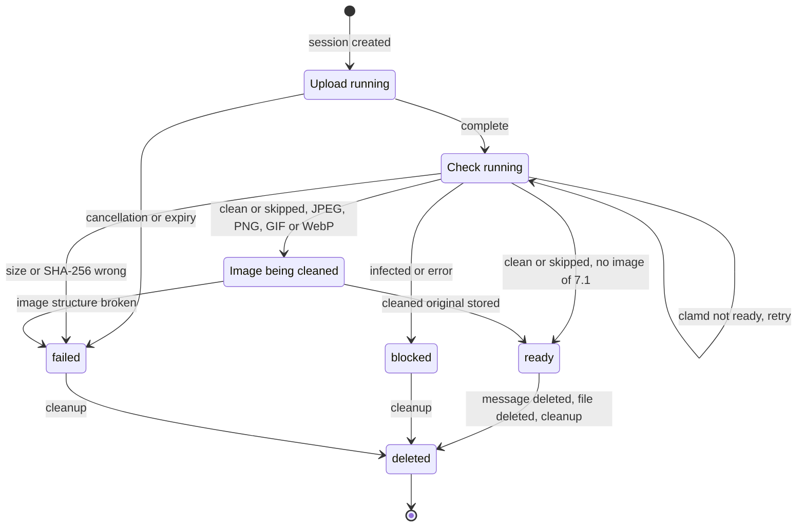
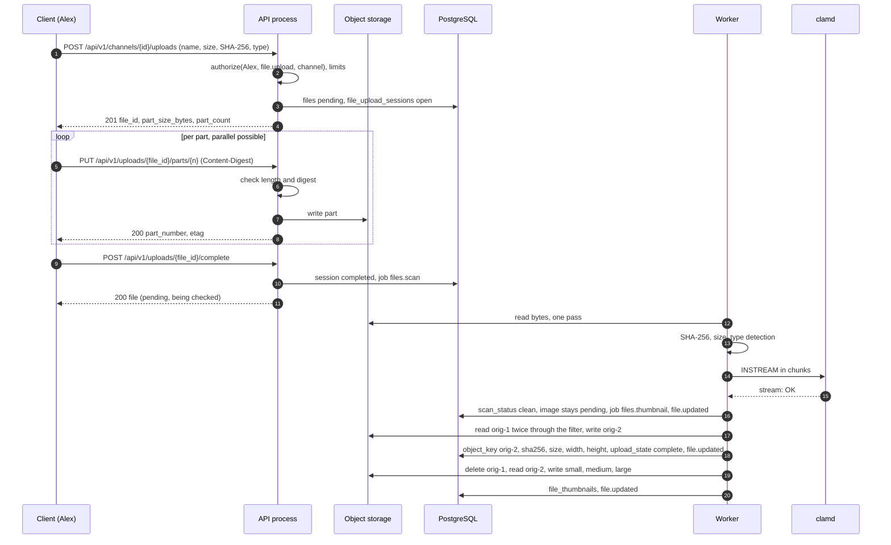

# 12 Files

Status: draft M0. Normative for the module `files`, the object storage port, the malware scan and
the file endpoints. Terms: [00-glossary.md](00-glossary.md). Tables:
[03-data-model.md](03-data-model.md) (4.7). Actions: [05-actions.md](05-actions.md) (4.8).
Events and sync: [04-sync-protocol.md](04-sync-protocol.md). Permissions:
[07-permissions.md](07-permissions.md). Search in files: [14-search.md](14-search.md). Retention:
[20-privacy.md](20-privacy.md). Decisions: ADR 0010 (object storage) and ADR 0033
(malware scan).

All limits, periods and sizes are named configuration values. Their defaults appear
only in section 18. External facts carry a reference to the source list (section 19).

## 1. Goals and limits

1. **No unchecked byte reaches a recipient.** The server serves the content, thumbnail and
   transcript of a file only when checksum and size match and the malware scan reports
   `clean` (or the scan is explicitly switched off, `skipped`).
2. **Every download goes through `authorize`.** Thumbnails and playback requests too. No
   view permission yields `404` (B7).
3. **Portable.** One port for the object storage, two drivers: file system (default) and
   S3-compatible with core S3 (B4, R-Objektspeicher, ADR 0010).
4. **Robust on mobile.** Uploads can be retried in parts and resumed after a network drop.
5. **Privacy.** Images that the server shows inline are free of metadata (location,
   device). No deduplication across files (R-DM-13).

Not a goal: editing files, folders, external share links, link previews from the server
(Baseline section 4, SSRF ban), server-side playback in the browser (B5: no chat on the web).

## 2. States of a file

A file has two state fields from [03-data-model.md](03-data-model.md): `upload_state`
(bytes complete and verified?) and `scan_status` (malware scan). In addition there is the state
of the upload session (section 3.1; table `file_upload_sessions` in 03).

| View | `upload_state` | `scan_status` | Session `state` | Served |
|---|---|---|---|---|
| Upload running | `pending` | `pending` | `open` | no |
| Client done, check running | `pending` | `pending` | `completed` | no; label "being checked" |
| Checksum or size wrong | `failed` | `pending` | `completed` | no; label "Upload failed" |
| Image being cleaned (JPEG, PNG, GIF, WebP; 7.1) | `pending` | `clean` or `skipped` | `completed` | no; label "being checked" |
| Broken image structure (JPEG or PNG; 7.1) | `failed` | `clean` or `skipped` | `completed` | no; label "Upload failed" |
| ready | `complete` | `clean` or `skipped` | `completed` | yes |
| blocked | `complete` | `infected` or `error` | `completed` | no; label "blocked" |
| canceled or expired | `failed` | `pending` | `aborted` or `expired` | no |

A file is **servable** exactly when `upload_state = 'complete'` and
`scan_status IN ('clean','skipped')` and `deleted_at IS NULL`. A file is **final**
when it is servable or `upload_state = 'failed'` or `scan_status IN
('infected','error')`. Section 10 uses "final" for the agent invocation.



Every change of `upload_state`, `scan_status`, thumbnails or transcript writes the
durable event `file.updated` (receive action `file.read`, [05-actions.md](05-actions.md)
section 6). Content never appears in the event.

Before attachment the event goes only to the uploader: it carries `audience_principal_id` =
`uploaded_by` in the scope of the scope channel, because the scope alone would hand the file name
to every reader of the channel, while before attachment only the uploader reads the file (05 2.2;
docs/DECISIONS.md D-M3-03-16). An attached file is written without audience in the scope of its
message (M3-07). Creating and completing an upload write no event: neither `upload_state` nor
`scan_status` changes.

## 3. Upload flow

### 3.1 Creating an upload session

The client declares the file upfront. The server checks everything that can be checked without
bytes and rejects early, before bandwidth is used.

Request (`file.upload` on the channel; `Idempotency-Key` is the optional parameter of openapi,
a repeat answers the stored response):

| Field | Required | Rule |
|---|---|---|
| `name` | yes | is sanitized (section 6.2) and stored as `original_name` |
| `size_bytes` | yes | `1 ..= file.max_upload_bytes`; otherwise `413 payload_too_large` |
| `sha256` | yes | SHA-256 of the whole file as lowercase hex (`^[0-9a-f]{64}$`); the verify pass checks it |
| `declared_mime_type` | no | hint only; stored without parameters in lower case in `declared_mime_type`; the server detects the type itself |
| `purpose` | no | default `attachment`; further values in 3.7 |
| `poster` | no | video only: small JPEG or PNG as thumbnail, at most `file.poster_max_bytes` |

The server checks in this order:

1. `authorize(principal, file.upload, channel)`. No read permission: `404`. Read permission, but
   `write` or `upload` missing: `403`.
2. Size against `file.max_upload_bytes`.
3. Early type check (section 6.1): the name is cleaned (6.2); a denied declared type or an
   extension of the cleaned name that belongs to a denied type gives `415
   unsupported_media_type` with `reason` `file_type_denied`. It needs no database, so it comes
   before the counts (docs/DECISIONS.md D-M3-03-4, D-M3-03-5).
4. Quota: the sum of `size_bytes` of the principal's files that are neither deleted nor failed
   plus the new size is at most `file.quota_bytes_per_principal` (0 = off). Otherwise `409
   conflict` with `reason` `quota_exceeded`. Failed files count as deleted: their objects go at
   once (section 12), so an aborted upload frees its quota (D-M3-03-6).
5. Open sessions of the principal below `file.upload_max_open_sessions`. Otherwise `429
   rate_limited` with `Retry-After` until the earliest expiry of the open sessions, in whole
   seconds and at least one (D-M3-03-8).
6. File system driver only: free space after the upload at least `file.fs.min_free_bytes`.
   Otherwise `503 unavailable` with `reason` `storage_full` and a warning to the status page.

Steps 4 to 6 run under a transaction-level advisory lock of the principal, so two parallel
announcements cannot both pass a limit (D-M3-03-7).

Then it creates in one transaction: a row in `files` (`upload_state = 'pending'`,
`scan_status = 'pending'`, `mime_type = 'application/octet-stream'` until detection,
`scope_channel_id` = channel, `sha256` and `size_bytes` = declared values) and a row in
`file_upload_sessions` (03). The response names
`file_id`, `mode`, `part_size_bytes`, `part_count`, `expires_at` and, for `mode = presigned`,
the target URLs per part.

`part_size_bytes` is `file.upload_part_bytes`; `part_count` = the rounded-up `size_bytes /
part_size_bytes`. The last part may be smaller. The default lies above the smallest
S3 part size so that the same part plan applies to both drivers (S3: parts at least 5 MiB
except the last, at most 10,000 parts [Q1, verified]). At startup the server checks that
`file.max_upload_bytes / file.upload_part_bytes` lies below this part limit.

### 3.2 Transferring parts (mode `direct`, default)

`PUT /api/v1/uploads/{file_id}/parts/{n}` with the raw bytes of the part and the header
`Content-Digest: sha-256=:<base64>:` per RFC 9530 [Q2, verified].

1. Only the principal of the session may send parts; otherwise `404`.
2. The server checks length (`part_size_bytes`, for the last part the remainder) and digest
   while reading. Mismatch: `400 validation_failed` with `errors[].code` `part_digest_mismatch`,
   nothing is stored.
3. A part is idempotent: the same number with the same digest yields `200` without new work;
   the same number with a different digest yields `409 conflict` with `reason` `part_conflict`.
4. Parts may arrive in parallel and in any order. The client chooses the parallelism.
5. `GET /api/v1/uploads/{file_id}` returns the parts already confirmed. After an interruption
   a client resumes from there.

The S3 driver passes each part through as a multipart part (no buffering in the server). The
multipart upload is created at the first part, outside any transaction; its ID goes to
`file_upload_sessions.storage_upload_id`, and a request that loses this race aborts its own
upload and uses the stored one. The ETag of an S3 part is the one the service returns, kept in
`file_upload_parts.etag`. The file system driver writes part `n` as the object
`uploads/<file_id>/<n>` under `file.fs.root`; its ETag is the lowercase hex SHA-256 of the part in
double quotes, derived from `file_upload_parts.sha256`, whose `etag` stays NULL
(D-M3-03-2, D-M3-03-3). A part is never written again once it is confirmed; an object store call
never runs inside a database transaction (02 8.5).

### 3.3 Presigned PUT (mode `presigned`, optional)

Only with the S3 driver and `file.s3.presigned_upload = true`. The session response contains,
per part, a presigned URL for the multipart part, valid for `file.s3.presign_ttl`. The client
uploads directly to the object storage and reports the ETags of the parts on completion. On
completion the server checks part count and total size (HEAD), and in the verification pass
(3.4) the SHA-256.

The mode stays off until two things are proven:

- The presigned URL binds the part length, so that a client cannot store more bytes than
  declared. Integration test against every supported S3 service. Result of M3-02
  (`TestPresignedPartBindsLength`, docs/DECISIONS.md M3-02/9): proven for SeaweedFS at the version
  the Compose stack pins (`BOTHY_SEAWEEDFS_VERSION`). The S3 driver signs `content-length` into
  every part URL; SeaweedFS accepts a plain `PUT` of exactly the signed length and refuses one
  byte more, one byte less, chunked transfer encoding and a request after the validity, each
  without storing a part. Other S3 services are not proven.
- The clients reach the S3 endpoint. For instances in private networks this is often not so
  (open, not checked).

Reason for "optional": the direct path is enough for the limit `file.max_upload_bytes` and
needs no public reachability of the storage.

### 3.4 Completion and verification pass

`POST /api/v1/uploads/{file_id}/complete`:

1. All parts present (otherwise `409 conflict` with `reason` `upload_incomplete` and the
   missing numbers in `detail`).
2. `parts` of the request is checked against the confirmed parts: a duplicate or out-of-range
   number gives `400 validation_failed`, a listed `etag` that differs from the confirmed one
   `409 conflict` with `reason` `part_conflict`; the list may name fewer parts than exist
   (D-M3-03-12). No object store call runs here: the S3 driver's `CompleteMultipartUpload` runs
   in the verify pass, because a keyed request runs inside a transaction (02 8.4, 8.5;
   D-M3-03-2).
3. Session `state = 'completed'`, job `files.scan` into the queue (River, M3-04), response
   `200` with the file object. A completed session answers `200` with the file again. From now
   on the client may attach the file to a message.

The job `files.scan` reads the bytes **exactly once** (on S3 after `CompleteMultipartUpload`)
and splits the stream into:

- SHA-256 and byte counter. If they differ from the declaration: `upload_state = 'failed'`,
  reason `checksum_mismatch` or `size_mismatch` respectively in the session, delete the
  object, `file.updated`.
- Type detection over the first `file.sniff_bytes` (section 6.1).
- clamd `INSTREAM` (section 5).
- File system only: joining the parts into the target object (write to a temporary file,
  `fsync`, `rename`). After that the parts are deleted.

A single read pass keeps the cost low for large files and works the same way for both modes.
The checksum per part (3.2) catches transfer errors early; the total checksum here catches
errors during joining and in presigned mode.

If all is well: `upload_state = 'complete'`, `mime_type` = detected type, `scan_status` per
section 5.2, `scanned_at`, `scan_engine`, event `file.updated`. Exception for images (M3-06,
docs/DECISIONS.md D-M3-06-1): when the detected type is `image/jpeg`, `image/png`, `image/apng`,
`image/gif` or `image/webp` and the verdict is `clean` or `skipped`, the same transaction writes
`scan_status`, `scanned_at`, `scan_engine` and `mime_type` but leaves `upload_state = 'pending'`
and inserts the job `files.thumbnail`; the image becomes `complete` only in the transaction of
that job that stores its cleaned original (section 7.1), so the original with its location data
is never servable and never "final" for a held agent invocation (section 10). MP4 and
QuickTime files (`video/mp4`, `video/quicktime`, `video/x-m4v`, `audio/mp4`, `audio/x-m4a`)
become `complete` as before and get `files.thumbnail` for their display size and duration
(section 7.3). Blocked and failed files never get the job.

Rules of the pass (M3-04, docs/DECISIONS.md D-M3-04-1 to D-M3-04-15): the job reads
`object_key` when it exists (after an earlier attempt or, on S3, after the pass ran
`CompleteMultipartUpload`), otherwise the parts in order, and writes the joined object from the
same stream; the source is limited to the declared size plus one byte. Size, SHA-256 and a
detected type listed in `file.denied_mime_types` decide first (`failed` with `size_mismatch`,
`checksum_mismatch` or `file_type_denied`), also when the scan failed transiently; a malware
finding is audited for such a file as well. Then 5.2 applies; the reasons of blocked files are
`malware_detected`, `scan_limits_exceeded`, `scan_stream_limit_exceeded` and
`scan_engine_error` in the session's `failure_reason`. `scan_engine = 'clamd'` and `scanned_at`
are set when clamd decided the file, NULL for `skipped` and `failed`. The result is written in one
transaction that locks the session and then the file, writes `file.updated` without actor and
publishes `files.FileFinalized` for a final file; objects of failed and blocked files and the
parts are deleted after the commit. A transient failure inserts the next `files.scan` with a
delay that doubles from `file.scan.health_interval` up to `file.scan.retry_backoff_cap`, without
an attempt limit, and changes nothing else. If the file is servable or an
image being cleaned, the processing of sections 7 and 8 follows in the job `files.thumbnail`
(02 12.3 "Job catalogue") and, if supported, the text extraction ([14-search.md](14-search.md)).

### 3.5 Sequence (direct upload with scan)



### 3.6 Error cases

| Case | Response or consequence |
|---|---|
| No read permission on the channel | `404` |
| `write` or `upload` missing | `403` |
| Size above `file.max_upload_bytes` | `413 payload_too_large` |
| Quota exhausted | `409 conflict` with `reason` `quota_exceeded` |
| Too many open sessions | `429` with `Retry-After` |
| Storage almost full (file system) | `503 unavailable` with `reason` `storage_full` |
| Part with wrong length or digest | `400 validation_failed` with `errors[].code` `part_digest_mismatch` |
| Part number already used with different content | `409 conflict` with `reason` `part_conflict` |
| `complete` with missing parts | `409 conflict` with `reason` `upload_incomplete` |
| Session expired (`file.upload_session_ttl`) | `410 gone`; cleanup deletes the parts and aborts the multipart upload |
| Permissions revoked during the upload | next request `404`; the session is aborted |
| Total checksum or size wrong | `upload_state = 'failed'`, `file.updated` |

### 3.7 Purpose of a file

Not every file belongs to a channel. [05-actions.md](05-actions.md) section 2.2 defines the
path per purpose. The column `files.purpose` (03) carries its own permission rule per purpose:

| `purpose` | Upload action | `scope_channel_id` | Read |
|---|---|---|---|
| `attachment` | `file.upload` | required | `file.read` via the channel (before attaching only the uploader) |
| `avatar` | `self.profile.update` or `agent.update` | NULL | every active, authenticated principal (`auth`) |
| `branding` | `instance.branding.update` | NULL | public like `instance.discovery.read` (logo on the login page) |
| `gdpr_export` | server only | NULL | `gdpr.export.download` |

All purposes go through the same check and the same scan.

**Avatar and logo (M3-10).** `setMyAvatar` and `uploadBrandingLogo` take the image as the one
multipart part `file` (`ImageUpload` in `openapi.yaml`); `authorize` runs before the first byte of
the body is read. The server then stages the file outside any transaction, in this order, and
stores nothing when a check fails:

1. The first part is named `file`, else `400 validation_failed` (pointer `/file`, code
   `required`).
2. The declared type is `image/jpeg`, `image/png` or `image/webp`, else `415
   unsupported_media_type`; a declared type in `file.denied_mime_types` gives `415` with `reason`
   `file_type_denied` (6.1, first step).
3. The part is read into memory up to the smaller of `file.max_upload_bytes` and
   `file.upload_part_bytes`, counted and hashed with SHA-256; more bytes give `413
   payload_too_large` whose `detail` names the key that set the cap, no byte gives `400
   validation_failed`. A further part after `file` gives `400 validation_failed`.
4. The limits of 3.1 for open sessions and free space apply; the quota is not checked, because
   an avatar or a logo replaces the previous one.
5. Rows before bytes: a `files` row with the purpose, `scope_channel_id` NULL and the fixed
   `original_name` `avatar` or `logo` (the client's file name is ignored, because every
   signed-in principal may read these files), a session in mode `direct` with the counted size
   and hash as declared values, then the one part through the part logic of 3.2.

One unit of work per operation then locks the anchor row (the principal row, or the setting row
`branding.logo_file_id`), completes the session and inserts `files.scan` (3.4), links the new file
and marks the previous file of the same purpose deleted (`deleted_at`; for an avatar, only a file of the same uploader). The file is
linked before it is deliverable: until then readers get `409 file_not_ready` with `Retry-After`
(9.3) and `getBrandingLogo` answers `404`, so the login screen shows the product mark. The pass
of 3.4 and 7 also applies the purpose rule: an avatar or logo is accepted only as filtered JPEG,
filtered PNG or converted still WebP; any other detected type, an animated WebP and a still WebP
above `file.image.max_pixels` end `upload_state = 'failed'` with `failure_reason`
`file_type_denied` before they can become deliverable, because only originals the server
filtered or converted are free of metadata (7.1). A JPEG or PNG above `file.image.max_pixels` is
filtered, stays deliverable and gets no thumbnails (7.2). Every state change of such a file
writes `file.updated` as a personal event of the uploader (`audience_principal_id =
uploaded_by`, empty scope), because only the uploader waits for the result; other readers learn
of the new file through `user.updated` or `instance.updated`. `getBrandingLogo` serves only the
variant `medium` (7.3) of a deliverable `branding` file, re-encoded by the server, with
`Cache-Control: no-store` and without `Range`; a missing, pending, blocked, failed or deleted logo
and one without that variant give the same `404`. Avatars of agents have no operation in
`openapi.yaml` yet, although the table names `agent.update` (spec gap). Rulings D-M3-10-1 to
D-M3-10-23 in [docs/decisions.d/M3-10.md](../decisions.d/M3-10.md).

## 4. Object storage

### 4.1 Port

The module `files` talks to the storage only through the port `ObjectStore`. It contains exactly
these operations:

| Operation | Purpose |
|---|---|
| `Put(key, reader, size)` | write a whole object |
| `Get(key, range)` | read, optionally a byte range |
| `Head(key)` | size and existence |
| `Delete(key)` | delete one object; a missing object is not an error |
| `CreateMultipart(key)`, `UploadPart(key, uploadID, n, reader, size)`, `CompleteMultipart(key, uploadID, parts)`, `AbortMultipart(key, uploadID)` | multipart uploads |
| `PresignUploadPart(key, uploadID, n, size, ttl)` | S3 only, only for mode `presigned`; the signature binds the part length `size` |

Not in the port: listing, copying, batch deletion, versioning, bucket policies, lifecycle
and encryption headers. The server knows every key from the database and needs no
listing. Batch deletion (`DeleteObjects`) is left out on purpose: AWS SDKs enforce a
checksum there on which several S3-compatible services fail [Q3, verified; Q4, search
summary only].

Port contract (M3-01, `internal/files/app`, docs/DECISIONS.md M3-01/1 to M3-01/6). The port is an
outgoing port of the application layer; no other module sees it. Every operation takes a context
first; implementations are safe for concurrent use, and nothing in the port reads a whole object
into memory (`Get` streams, the caller closes the reader).

- Keys: one grammar for all drivers (`domain.ValidateKey`): one or more segments of `[a-z0-9-]`,
  joined by single `/`, without a leading or trailing `/`. It refuses `.`, `..`, absolute paths,
  empty segments, backslashes, upper case, percent signs, spaces, control and non-ASCII
  characters. Every operation checks the key first and returns `ErrInvalidKey` before any storage
  call. The key builders of 4.4 take only the file ID, a number and the closed type `Variant`.
- `Get` reads the whole object or exactly one byte range `{Offset, Length}` (9.3). `Offset < 0`,
  `Length < 1` or `Offset` at or beyond the object size give `ErrInvalidRange`; a range whose end
  lies beyond the object ends at the last byte.
- Errors: `ErrNotFound` (`Get` or `Head` of a missing object), `ErrInvalidRange`,
  `ErrSizeMismatch` (`size < 0` or a body of another length; nothing is stored),
  `ErrUploadNotFound` (an upload that was never created, was aborted or was completed),
  `ErrInvalidPart` (part number below 1; in `CompleteMultipart` an empty list, numbers that are
  not strictly ascending, a number without an uploaded part or an ETag that does not match; the
  upload stays open), `ErrNotSupported` (an operation the driver does not offer). `Delete` of a
  missing object and `AbortMultipart` of an unknown, aborted or completed upload return no error
  (section 12). Every other error is a storage failure that callers answer with `503 unavailable`
  ([02-architecture.md](02-architecture.md) 14.4); errors name the operation and the key and never
  contain object bytes. The port never panics on a failing storage.
- `Put` on an existing key replaces it atomically. The drivers do not enforce "Objects are never
  overwritten"; the module does, through the key schema and the unique `files.object_key`.
- `PresignUploadPart` takes the size of the part before the validity (M3-02,
  docs/DECISIONS.md M3-02/9), because no driver can bind a length it does not know. `n < 1` gives
  `ErrInvalidPart`, `size < 1` gives `ErrSizeMismatch`, both on every driver; the file system
  driver then answers `ErrNotSupported`. The URL is a credential for its validity: callers hand
  it to the client only and never log it.

### 4.2 File system driver (default)

- Root `file.fs.root`, a dedicated directory for Bothy only. Directories `0700`, files `0600`.
- Paths arise only from the key schema (4.4). The driver rejects keys with `..`,
  absolute paths or characters outside `[a-z0-9/-]` and follows no symbolic links.
- Writing: temporary file in the same file system, `fsync`, `rename`, `fsync` on the directory.
  A reader never sees half an object.
- `Get` with a range via `ReadAt`. No buffering in the server.
- Encryption at rest is a task for operations (disk encryption,
  [16-operations.md](16-operations.md)).

File system rules (M3-01, `internal/files/adapters/fs`, docs/DECISIONS.md M3-01/5 to M3-01/11, M3-01/15 and M3-01/17 to M3-01/19):

- Start check: `file.fs.root` is an absolute, clean path of an existing directory (not a symbolic
  link), owned by the effective user of the process, with permission bits exactly `0700`. The
  server creates `<root>/.tmp` (mode `0700`) when missing and never creates the root itself; a
  missing root means a wrong mount; an existing `.tmp` must be a directory of the same user with
  mode `0700`. Errors name `file.fs.root`, not the path.
- Keys map to paths below the root. The driver works through a handle of the root directory
  (`os.Root`), so no operation leaves it, and it follows no symbolic link at any level: every
  existing path component is checked with `lstat` before an operation and before a rename; a read
  checks the path again when the opened file is not the one it checked, because `os.Root` follows
  a link inside the root even with `O_NOFOLLOW`. A link found
  is a storage failure, not `ErrNotFound`. A directory or another non-regular entry at a key counts
  as missing.
- Writes go to a temporary file with mode `0600` in `<root>/.tmp`, which no key can address
  (keys contain no dot). Exactly `size` bytes are copied with a bounded buffer; then `fsync` of
  the file, missing directories with mode `0700` (each synced in its parent), `rename`, `fsync` of
  the directory. A platform
  that refuses to sync a directory as "not supported" counts as success. Every failed write
  removes its temporary file.
- `Delete` removes the file, syncs the directory and removes the directory of the file
  (`f/<aa>/<bb>/<file_id>` or `uploads/<file_id>`) if it is empty now; the levels `f/<aa>` and
  `f/<aa>/<bb>` stay. A writer whose directory a concurrent `Delete` removed creates it again and
  renames again.
- Multipart: `CreateMultipart` accepts only original keys, creates `uploads/<file_id>/`, is
  idempotent and returns the upload ID `""`. `UploadPart` writes `uploads/<file_id>/<n>` like an
  object and returns the ETag `"<sha256 hex>"` of the part bytes (the form of 9.3); a part with the
  same number is replaced atomically. While the upload is open, parts are regular objects under
  their keys. `CompleteMultipart` writes the listed parts in order into one temporary file, reads
  each part exactly once and checks it against its ETag, renames to the key and removes
  `uploads/<file_id>/` with all parts; a failure of that removal does not fail the completion; `Delete`
  of an original key also removes `uploads/<file_id>/`, so parts left behind go with the file. The list shape is checked before any file
  system call. `AbortMultipart` removes that directory. Deleting the last
  part of an open upload with `Delete` removes `uploads/<file_id>/` and so ends the upload.
- `PresignUploadPart` gives `ErrInvalidPart` for a part number below 1 and otherwise `ErrNotSupported`. Several processes may share one root (roles `api`
  and `worker` on one volume), because every change is a rename or an unlink; the driver takes no
  lock and never removes entries of `.tmp`. A temporary file left by a crashed process stays (no
  rule yet).

### 4.3 S3 driver (core S3 only)

- AWS SDK for Go v2 with its own endpoint (`file.s3.endpoint`), region, bucket and path style
  (`file.s3.use_path_style`). Credentials only as a reference to the secret provider.
- Checksum mode `when_required` for request and response (`file.s3.checksum_mode`). Otherwise
  the SDKs compute additional checksums by default that not every S3 service understands [Q3,
  verified]. Our own SHA-256 from 3.4 replaces this check.
- Recommended self-hosted service: SeaweedFS (Apache-2.0) [Q5, verified]. MinIO is not
  recommended because the repository is archived and no more binaries are released [Q6,
  verified].
- The bucket is private. The instance operator sets up server-side encryption and the lifecycle
  rule "abort incomplete multipart uploads" on the storage; the server does not rely on them
  and aborts expired uploads itself (section 12).

S3 driver rules (M3-02, `internal/files/adapters/s3`, docs/DECISIONS.md M3-02/1 to M3-02/14):

- Core S3 only: the driver holds a Go interface with exactly `PutObject`, `GetObject`,
  `HeadObject`, `DeleteObject`, `CreateMultipartUpload`, `UploadPart`,
  `CompleteMultipartUpload`, `AbortMultipartUpload` and a presign interface with only
  `PresignUploadPart`. Only this package and the audit checkpoint sink
  `internal/audit/adapters/s3sink` (M7-22) and the object mirror of the backup service
  `internal/status/adapters/s3mirror` (M7-02) import the AWS SDK (depguard in `make lint`,
  `TestS3SDKOnlyInAdapter`); forbidigo forbids `DeleteObjects` and `PresignGetObject`. No request
  of the files driver sets server-side encryption, ACL, tagging, object lock, storage class or
  conditional headers.
- `file.s3.endpoint` is required; the driver never uses the endpoint resolution, the default
  configuration or the credential chain of the SDK (environment, shared files, instance
  metadata, whose address SEC-NET-3 always blocks).
- Every request goes through the egress client ([19-security.md](19-security.md) 8) with
  purpose `objectstore`; its host policy allows exactly the request host and port (the endpoint
  with path style, `<bucket>.<endpoint host>` with virtual-hosted style). An `http` endpoint or
  one on a private address needs an `egress.allowed_hosts` entry with `allow_private`. For an
  `http` endpoint `bothy config check` fails without it (cross-check `file_s3`); a private
  address behind an `https` endpoint is refused by the egress client when it connects. TLS is always verified. Redirects are never
  followed; the time limit of a request is `http.transfer_timeout`, the largest response body
  `file.max_upload_bytes`.
- No retries in the SDK ([02-architecture.md](02-architecture.md) 14.3): a failed call is one
  request, and the caller sees a storage failure (`503 unavailable`); jobs retry through River.
- `Put` and `UploadPart` stream the caller's reader without a buffer and sign it as
  `UNSIGNED-PAYLOAD`, because the reader is not seekable and the endpoint may be plain `http`;
  the part digest (3.2) and the file SHA-256 of 3.4 check the content. A body of another length
  gives `ErrSizeMismatch` and stores nothing: the driver holds back the last byte until the
  reader reports its end.
- Access keys come only from `file.s3.access_key_ref` and `file.s3.secret_key_ref` through the
  secret provider ([16-operations.md](16-operations.md) 5.2), read only with `file.storage.driver = s3`.
  A key that cannot be read stops the start; the driver asks the provider again on every refresh
  of the SDK credential cache, so a rotation works without restart after `secrets.cache_ttl`.
- The object name is `<file.s3.prefix>/<key>` with a prefix, else the key; key and prefix follow
  the key grammar of 4.1, checked before any request.
- Errors keep the contract of 4.1 and read `files/s3: <operation> <key>: <detail>`; they never
  contain a request URL, a query, a presigned URL, the endpoint or credentials. A `HEAD` answer
  has no body, so `Head` on a missing bucket reads as `ErrNotFound`; `Get` reports `NoSuchBucket`
  as a storage failure.

The second package that may import the AWS SDK (M7-22, docs/DECISIONS.md M7-22/4) is the object
store sink of the audit checkpoints, `internal/audit/adapters/s3sink`
([19-security.md](19-security.md) section 16, `audit.checkpoint_sink = s3://...`). It holds a
Go interface with only `PutObject` (with `If-None-Match: *`), `GetObject`, `ListObjectVersions`
and `GetObjectLockConfiguration` (`TestAPIMethodSet`), and follows the egress and credential rules
above with its own keys (`audit.checkpoint_s3_*`, purpose `audit_checkpoint`, the limits
`egress.timeout` and `egress.max_response_bytes`). The rules of this section stay unchanged for
the files driver.

### 4.4 Key schema

```
f/<aa>/<bb>/<file_id>/orig-<n>      original, n = revision (1 = as uploaded)
f/<aa>/<bb>/<file_id>/small         thumbnail variants from file_thumbnails
f/<aa>/<bb>/<file_id>/medium
f/<aa>/<bb>/<file_id>/large
f/<aa>/<bb>/<file_id>/poster
uploads/<file_id>/<n>               file system only: parts during the upload
```

`<aa>` and `<bb>` are the last four hex characters of the `file_id`. With UUIDv7 these are
random bits; they spread files evenly across directories. The key contains no names, no
channel or space IDs and no file name ([03-data-model.md](03-data-model.md),
`files.object_key`). If processing changes the original (section 7), `orig-2` is created;
`files.object_key` points to the new object in the same transaction, after that `orig-1` is
deleted. Objects are never overwritten.

Optionally `file.s3.prefix` before all keys, so that one bucket can hold several environments.

## 5. Malware scan

Decision and alternatives: ADR 0033. ClamAV runs as a separate service; the server talks to
`clamd` over the protocol, never through an embedded library. The port is called `Scanner`
(`Scan(ctx, reader) -> Verdict`, `Ping(ctx)`) so that other engines can be connected later.

### 5.1 Flow

1. Connection to `file.scan.clamd_address`, only a Unix socket (19 SEC-TLS-5): clamd checks
   requests neither for origin nor for authentication [Q7, verified], so the server accepts only
   `unix://` with an absolute path and no TCP address. The Compose stack shares the socket with
   the worker through the volume `clamav-socket` (`infra/compose/README.md`).
2. Command `zINSTREAM\0` (NUL framing is the recommended form) [Q7, verified].
3. Data in chunks: per chunk 4 bytes of length in network byte order, then the bytes; end
   with a chunk of length 0 [Q7, verified]. Chunk size `file.scan.chunk_bytes`.
4. Read the response until clamd closes the connection: `stream: OK`, `stream: <signature> FOUND`
   or a line with `ERROR` [Q7, verified].
5. Time limit per file `file.scan.timeout`. At most `file.scan.max_concurrent` scans per
   worker process.

A small client of our own is enough; the protocol is small, and the well-known Go library
`go-clamd` has had no release since 2017 [Q8, verified].

### 5.2 Result mapping

| clamd response | `scan_status` | Consequence |
|---|---|---|
| `stream: OK` | `clean` | processing (sections 7, 8), `file.updated` |
| `<signature> FOUND`, signature starts with `Heuristics.Limits.Exceeded` | `error` | reason `scan_limits_exceeded`; not servable |
| `<signature> FOUND`, otherwise | `infected` | delete the objects immediately, the row stays; audit (below) |
| `INSTREAM size limit exceeded` or another `ERROR` | `error` | reason from the response; not servable |
| Time limit, connection error | stays `pending` | retry (5.3) |

On `infected` an audit entry is written with `action = 'file.upload'`, `decision = 'deny'`,
`deny_reason = 'malware_detected'` and, in `details`, the signature, the SHA-256 and the size,
never content (05: `file.upload` with audit on malware detection). The uploader and the owner see the reason; everyone else sees only "blocked".

### 5.3 When ClamAV is missing or not ready

`file.scan.mode` has two values:

- `required` (default): fail closed. If clamd is not reachable or does not answer `PING`
  with `PONG` [Q7, verified], the file stays `pending`. The job retries with backoff up to
  `file.scan.retry_backoff_cap`, without a cap on the number of attempts, as long as the file
  is not deleted. Nothing is served unchecked.
- `off`: no scan, `scan_status = 'skipped'`. Meant for development and for installations
  without the memory that ClamAV needs (section 5.4). The admin console and the status page
  permanently show "Virus scan off".

The worker checks clamd every `file.scan.health_interval` with `PING`. The result feeds the
status page component "Virus scan" (`status_components.health_source = 'clamd'`). If the
oldest file has been in `pending` longer than `file.scan.pending_alert_after`, the component
becomes `degraded` and an alert fires ([17-observability.md](17-observability.md)). At startup
clamd takes a long time to load signatures; official images have a startup time limit for
this, default 1800 s [Q9, verified]. Uploads during this time simply wait.

If `file.scan.mode` changes from `off` to `required`, `skipped` files stay `skipped`. An
admin can have them rechecked with the maintenance command `bothy files rescan --skipped`
(server command, not an endpoint).

### 5.4 Required settings for clamd

The Compose stack ([16-operations.md](16-operations.md), `infra/compose`) configures clamd like this:

| clamd option | Value | Reason |
|---|---|---|
| `AlertExceedsMax` | `yes` | The default is `no`: files above `MaxFileSize`, `MaxScanSize` or `MaxRecursion` are then neither checked nor reported [Q10, verified]. With `yes` they appear as `Heuristics.Limits.Exceeded...` and become `error` (5.2). |
| `StreamMaxLength` | at least `file.max_upload_bytes` | Default `100M`, 1M = 1048576 bytes [Q10, verified]; above that clamd aborts the stream. |
| `MaxFileSize` | at least `file.max_upload_bytes` | Default `100M` [Q10, verified]; otherwise the file itself would already be skipped. |
| `MaxScanSize`, `MaxRecursion`, `MaxFiles` | defaults | apply to unpacked content; with `AlertExceedsMax` exceeding them becomes `error`. |
| `AlertEncrypted` | `no` (default) | Encrypted archives and PDFs are common in everyday work. They are therefore not blocked, but their content is not checked either. The residual risk is in the threat model ([19-security.md](19-security.md)). |

The server cannot learn the clamd settings through the protocol. That is why
`file.scan.clamd_stream_max_bytes` exists as a mirror of `StreamMaxLength`. The server does not
start if `file.scan.mode = required` and `file.max_upload_bytes` is greater than this value.

Image: `clamav/clamav-debian` exists for amd64 and arm64; `clamav/clamav:stable` only for amd64
[Q11, verified]. According to the project, ClamAV needs at least 3 GiB, better 4 GiB of memory
[Q9, verified]. ClamAV is licensed under GPL-2.0 [Q12, verified]; the separation via socket and
a separate container is separate communication according to the GPL FAQ [Q13, verified]; the
legal assessment remains the instance operator's responsibility (no legal advice).

## 6. Type detection and file names

### 6.1 Type

- The server detects the type from the bytes with `github.com/gabriel-vasile/mimetype` (MIT,
  without cgo) [Q14, verified]. For this it reads `file.sniff_bytes`; Office formats need more
  than the header [Q14, verified].
- `declared_mime_type` stays for diagnosis only. The file extension in the name changes nothing.
- If the detected type differs from the declared one, the detected one applies. This is not an
  error.
- `file.denied_mime_types` (default empty) blocks types that the instance operator does not
  want. The check runs twice: upfront against the declared type and the extension (early
  rejection, `415 unsupported_media_type` with `reason` `file_type_denied`), then against the detected type (`upload_state = 'failed'`).
  Default empty because developer channels legitimately share executables and archives, and
  the scan as well as serving as a download (9.3) carry the protection.

### 6.2 File names

Sanitizing on declaration, result in `original_name`:

1. Unicode NFC.
2. Only the last path segment; `/` and `\` are removed [Q15, verified].
3. Remove control characters, bidi control characters (for example U+202E, which can disguise
   "exe" as "pdf") and zero-width characters; trim whitespace at the start and end [Q15, verified].
4. `.` and `..` alone are invalid [Q15, verified]. An empty remainder yields `file`. A name that is
   `.` or `..` after steps 1 to 3 also becomes `file`: the name is only a label, and a `400` for
   an already cleaned name would give the client nothing to correct (D-M3-03-9). Names are
   cleaned, never rejected.
5. Length at most `file.name_max_bytes` UTF-8 bytes; truncation happens before the extension.

## 7. Images: metadata and thumbnails

### 7.1 Rule

Images are free of metadata as soon as they are stored (Ruling L16, [ADR 0047](../adr/0047-remove-image-metadata-losslessly.md)). Two paths:

1. **Original, lossless.** For JPEG and PNG the server removes the metadata from the original
   when the upload completes, without re-encoding the image data. It works with an
   allow list: only segments or chunks that are needed for decoding or for correct color and
   orientation stay; everything else is dropped (reason for the list instead of a deny list:
   R-SE-03 in [19-security.md](19-security.md)). If the filter fails on a file that was
   detected as JPEG or PNG (damaged structure), the file is not stored
   (`upload_state = 'failed'`), because it could carry location data unchanged.
2. **Thumbnails, re-encoded.** All variants from 7.3 are created by decoding and
   re-encoding in pure Go (Baseline R-Objektspeicher) with the orientation applied. They carry
   no metadata except the unchanged color profile of the original.

| Type | What stays in the original | What is dropped |
|---|---|---|
| `image/jpeg` | markers for header, tables, frame and image data (`SOI`, `DQT`, `DHT`, `DRI`, `SOFn`, `SOS` with data, `EOI`), `APP0` (JFIF), `APP2` only with the identifier `ICC_PROFILE` (all parts of a multi-part profile), `APP14` (Adobe color transform) and a newly written `APP1` with only the EXIF tag "Orientation" | all other `APPn` (EXIF including the embedded thumbnail, XMP, IPTC, Multi-Picture Format), `COM` and every byte after the first `EOI` (appended images, for example gain maps) |
| `image/png` | critical chunks (`IHDR`, `PLTE`, `IDAT`, `IEND`) as well as `tRNS`, `cHRM`, `gAMA`, `iCCP`, `sBIT`, `sRGB`, `cICP`, `mDCV`, `cLLI`, `bKGD`, `pHYs`, `acTL`, `fcTL`, `fdAT` | `tEXt`, `zTXt`, `iTXt`, `eXIf`, `tIME`, `hIST`, `sPLT` and unknown chunks |
| `image/gif` | is re-encoded (lossless, palette); comments and application blocks except the loop setting are dropped | |
| `image/webp` (still) | is decoded (`x/image/webp` can only read [Q18, verified]) and stored as PNG (with alpha) or JPEG (without alpha, `file.image.jpeg_quality`); with libvips re-encoded as WebP | |
| `image/webp` (animated), `image/heic`, `image/heif`, `image/avif`, `image/tiff`, others | no inline image: stored unchanged as a file, shown as a download card; with libvips (`file.image.libvips_enabled`, own build with cgo; libvips LGPL-2.1, govips MIT [Q17, verified]) converted to JPEG, then like JPEG | |
| `image/svg+xml` | never inline, never a thumbnail, always a download | |

Evidence: `APPn` segments (`X'FFE0'` to `X'FFEF'`) and `COM` (`X'FFFE'`) are reserved for the
application and are evaluated during decoding only as far as they do not disturb it (ITU-T T.81,
Annex B, https://www.w3.org/Graphics/JPEG/itu-t81.pdf, retrieved 2026-10-10 [verified]); their
removal therefore does not change the image data [derived]. PNG lists `tEXt`, `zTXt` and `iTXt`
as text chunks and `eXIf` as an Exif profile with data such as exposure and orientation
(https://www.w3.org/TR/png-3/, retrieved 2026-10-10 [verified]).

The sanitized original becomes `orig-2` (4.4); `sha256`, `size_bytes`, `mime_type`, `width` and
`height` then describe the stored object ([03-data-model.md](03-data-model.md):
"over the stored bytes"). The declared checksum stays in the upload session
(`declared_sha256`). The app shows the variant `medium` in the chat and `large` in full screen;
the original is available as a download in full quality.

Limit of this promise: the server does not remove metadata **inside** other files (PDF author,
Office properties, photos in a ZIP). The app converts photos from the media library to JPEG
before the upload ([15-client-architecture.md](15-client-architecture.md)); HEIC then reaches the
server only as a deliberately sent file.

Orientation and ICC profile stay because photos from current phones often carry a large color
profile and are stored rotated; without both they would look pale or tilted. When
re-encoding the thumbnails the server applies the orientation itself because decoding
discards it [Q16, derived].

Rulings of M3-06 (docs/DECISIONS.md D-M3-06):

- **Servable only when cleaned (D-M3-06-1).** A JPEG, PNG (also `image/apng`), GIF or WebP
  stays `upload_state = 'pending'` after the scan; the job `files.thumbnail` writes the cleaned
  original and sets `complete` in one transaction. Until then delivery answers `409
  file_not_ready` and an agent invocation waits (section 10).
- **JPEG (D-M3-06-2).** Kept are the markers T.81 needs to decode (`SOI`, `DQT`, `DHT`, `DAC`,
  `DRI`, `DNL`, `DHP`, `EXP`, `SOFn`, `SOS` with its data and `RST0` to `RST7`, `EOI`), the first
  `APP0` `JFIF` rewritten without its embedded thumbnail, every `APP2` `ICC_PROFILE` part, `APP14`
  `Adobe`, and one new `APP1` with only "Orientation" (written only for the values 2 to 8,
  D-M3-06-3). Output order: `SOI`, `APP0`, `APP1`, then the other kept segments in input order.
- **PNG (D-M3-06-4).** A CRC mismatch, a chunk beyond the input, `IHDR` not first or a missing
  `IEND` is a broken structure (`failed`, reason `image_malformed`, D-M3-06-7); bytes after `IEND`
  are dropped. The orientation of an `eXIf` chunk is not applied, so original and thumbnails show
  the same pixels.
- **GIF and WebP (D-M3-06-5).** A still WebP is stored with its EXIF orientation applied to the
  pixels, its ICC profile unchanged (dropped only when it does not fit the output, for example a
  CMYK profile) and without any other metadata; `mime_type` becomes `image/png` or `image/jpeg`,
  `original_name` keeps its extension (6.1). A GIF or still WebP above `file.image.max_pixels` or
  failing to decode, and every animated WebP, stays unchanged as revision 1, becomes `complete`
  without thumbnails and is shown as a download card.
- **Revision marker (D-M3-06-12).** Every processed original is revision 2 (`orig-2`), also when
  the filter changed no byte; revision 1 is deleted after the switch. The revision in
  `object_key` tells a processed original from an unchanged one.

### 7.2 Protection against decompression bombs

Before decoding, the server reads only the header and dimensions (`image.DecodeConfig`). If width
times height (for GIF times the frame count) is greater than `file.image.max_pixels`, it does not
decode: no preview, shown as a download card. Every processing step has the time limit
`file.image.processing_timeout`; at most `file.image.max_concurrent` image jobs run per
worker at the same time. JPEG and PNG above the limit are still cleaned, because the filter never
decodes pixels; a GIF or WebP above it stays unchanged (D-M3-06-5).

### 7.3 Thumbnails

| Variant | Longest edge | Purpose |
|---|---|---|
| `small` | `file.thumbnail.small_px` | lists, notifications |
| `medium` | `file.thumbnail.medium_px` | image in the chat |
| `large` | `file.thumbnail.large_px` | full screen, without loading the original |
| `poster` | like `large` | first frame of a video, supplied by the client |

Never larger than the original (no upscaling). Output JPEG with
`file.thumbnail.jpeg_quality`, PNG with alpha. The server cannot create a video thumbnail in
pure Go; the client sends it with the declaration (`poster`), and the server treats it like any
image (re-encoding, limits). The server reads width, height and duration of an MP4 or QuickTime
video from the container boxes (`mvhd`, `tkhd`) with a small reader of its own.

Rulings of M3-06: the server renders `small`, `medium` and `large` for every decodable image,
also when they end up the same size, from the first frame of an animated GIF or the default
image of an APNG, with the orientation applied and the resampler Catmull-Rom; PNG when the
decoded image is not opaque, JPEG otherwise; the colour profile of the original only when its
colour space fits the thumbnail (no profile for CMYK input); a PNG profile larger than the
`APP2` capacity of a JPEG means no thumbnails (D-M3-06-6). `width` and `height` of images and
videos are display sizes after orientation or rotation (the `tkhd` matrix of the first video
track); the duration comes from `mvhd`, else from `mehd`; a box error leaves the values absent
and never blocks the file (D-M3-06-9). Every change of the values writes `file.updated`
(D-M3-06-8). `File.thumbnails` lists the variants in the order `small`, `medium`, `large`,
`poster` (D-M3-06-10). The `poster` of a video is not built: `UploadCreate` has no field for it.

## 8. Voice messages

### 8.1 Format and duration

- A voice message is a message with `kind = 'voice'` and exactly one attachment.
- Format of Bothy's own apps: AAC-LC in an MP4 container (`audio/mp4`, extension `.m4a`). This is
  the only compressed format that the recording package reliably produces on all target platforms
  [Q19, verified; conclusion derived]. For `kind = 'voice'`, `audio/mpeg` (MP3) is also accepted
  for agents. Other formats: `400 validation_failed` with `errors[].code`
  `voice_format_unsupported`; they can
  be sent as a normal file.
- Duration: for MP4 the server reads it from `mvhd` (time base and duration). For MP3 it takes
  the client's value for display only. At most `voice.max_duration`; otherwise `400
  validation_failed` with `errors[].code` `voice_too_long`.

### 8.2 Transcript

`voice.transcription_mode`:

| Value | Who transcribes | Flow |
|---|---|---|
| `off` | nobody | audio only |
| `agent` (default) | the operator agent | The adapter receives the voice message as an attachment with the invocation, transcribes it itself and reports the result with `PUT /api/v1/files/{id}/transcript` (action `file.transcript.submit`, 05). `transcript_source = 'agent'`. |
| `service` | a transcription service | After `clean` the worker calls the port `Transcriber`. Adapter `openai_compatible`: HTTP endpoint `voice.transcription_url` (for example a self-hosted Whisper service), key from the secret provider, time limit `voice.transcription_timeout`, language hint from `users.locale`. `transcript_source = 'service'`. |

Default `agent`, because then no additional processor receives audio. `service` sends audio
to a service configured by the owner; that service then belongs in the list of processors
([20-privacy.md](20-privacy.md)). The URL is pure instance configuration, never an
input from users (no SSRF path).

`file.transcribe` (a person taps "Transcribe") starts the job in mode `service`; in the
other modes the server responds `409 conflict` with `reason` `transcription_unavailable`.

Result: `transcript_status` `pending` -> `done` or `failed`, `transcript_text`,
`transcript_language`, `file.updated`. The transcript is searchable
([14-search.md](14-search.md)) and available to the agent in its context.

### 8.3 Transcoding

Bothy's own apps record AAC-LC and play it on all platforms; no transcoding is needed for
that. A need arises with imports (for example OGG/Opus voice messages,
[22-import-migration.md](22-import-migration.md)) and with agents that use other formats. For
this there is the port `MediaTranscoder`. An adapter (for example `ffmpeg` as a separate
process) is "later"; until then such files are normal audio attachments with download. Storage
of the result: a separate variant `playback` in `file_thumbnails`. It comes with that milestone
as an additive migration into the core contract; until then `file_thumbnails.variant` does not have the value.

## 9. Download

### 9.1 Pass-through via the server

Decision R-FI-03 ([ADR 0048](../adr/0048-file-download-only-through-the-server-with-short-lived-tickets.md)):
The server serves all bytes itself (`GET .../content`). There are no presigned GET URLs to
the storage.

Reasons: every download must go through `authorize` at download time (B7, [04-sync-protocol.md](04-sync-protocol.md)
section 8: permissions apply at every delivery). A presigned URL stays valid until it expires,
even after revocation. Only the server controls headers such as `Content-Disposition` and
`nosniff`. The storage does not need to be reachable for clients. Price: download bandwidth runs
through the server; for a team chat with `file.max_upload_bytes` this is acceptable.

### 9.2 File tickets

Media players (audio, video) and "Open with" send their own HTTP requests, often with
`Range`, and cannot produce a DPoP proof per request. For these there are short-lived tickets:

1. `POST /api/v1/files/{id}/tickets {variant}` with normal authentication (`file.read`) returns
   `{url, expires_at}`.
2. The ticket is `base64url(payload || HMAC-SHA-256(key, payload))`. `payload` contains
   `file_id`, `variant`, `principal_id`, `auth_session_id` and expiry (`file.ticket_ttl`).
   The key comes from the secret provider (`file.ticket_key_ref`); two keys are valid at the
   same time so that a key rotation works without downtime.
3. On **every** download with a ticket the server checks: signature, expiry, session not
   revoked, `authorize(principal, file.read, file)` with current permissions. Every failure
   yields `404`. So a ticket does not survive a revocation.
4. The URL is a bearer secret for a short time. The server removes the parameter `ticket`
   from its own logs and telemetry attributes; the collector filters it as well
   ([17-observability.md](17-observability.md)).

Additions of M3-05 (rulings D-M3-05-1 to D-M3-05-4 and D-M3-05-13 in
[docs/decisions.d/M3-05.md](../decisions.d/M3-05.md)):

- **Session required.** A ticket binds to a login session. A principal without one (API token,
  agent, app) gets `403 forbidden` with `reason` `step_up_not_possible` on `createFileTicket`
  ([07-permissions.md](07-permissions.md) section 4.1); the rule runs after visibility, so a file the
  principal cannot see still answers `404`.
- **Current and previous key.** The server keeps the key it saw before the last version change of
  `file.ticket_key_ref` as the previous key and verifies against both; it mints only with the
  current key. A key change takes effect per process after `secrets.cache_ttl`; tickets minted
  before keep working in that process until they expire. The previous key lives only in the
  memory of a process that saw it: a process that starts after the change, and every process
  after a second change within `file.ticket_ttl`, refuses tickets of the older key, and the player
  asks for a new ticket.
- **One answer for every failure.** Every failure of the ticket path gives the same `404` as an
  unknown file id: bad encoding or signature, expiry, another file or variant, an unknown or ended
  session, and every decision of `authorize(file.read)` that is not an allow.
- **Where a ticket counts.** The ticket is accepted only in the query parameter `ticket` and only
  by `downloadFile` and `downloadThumbnail` (security scheme `fileTicket`); every other operation
  and every header ignores it. A request with an `Authorization` header is authenticated by that
  header, and a `ticket` parameter beside it is ignored (the response then carries the
  `Cache-Control` of normal authentication).

### 9.3 Response

| Header | Value |
|---|---|
| `Content-Type` | detected type; for types outside the inline list `application/octet-stream` |
| `Content-Disposition` | `inline` only for the inline list: stored images per section 7.1 (`image/jpeg`, `image/png` losslessly sanitized, `image/gif` re-encoded), thumbnails, `audio/mp4`, `audio/mpeg`, `video/mp4`. Everything else `attachment`. Always `filename="<ASCII fallback>"` first, then `filename*=UTF-8''<percent-encoded>` [Q15, verified]. |
| `X-Content-Type-Options` | `nosniff` |
| `Content-Security-Policy` | `default-src 'none'; sandbox` |
| `Cross-Origin-Resource-Policy` | `same-origin` |
| `Cache-Control` | with authentication `private, max-age=<client.cache_max_age>, immutable`; with a ticket `private, no-store` |
| `ETag` | `"<sha256 hex>"` of the served variant |
| `Repr-Digest` | `sha-256=:<base64>:` of the whole variant [Q2, verified]; the client checks it after the download |
| `Accept-Ranges` | `bytes`; exactly one range is supported (`206`), multiple ranges are ignored (`200`) |

Reason for the strict list: the admin console runs in the browser. HTML or SVG from an upload
must never run there as a page of its own origin. `attachment`, `nosniff` and the
sandbox CSP prevent this together.

Files that cannot be served: their metadata (`GET /api/v1/files/{id}`) is visible to those with
read permission (name, size, state). `content`, thumbnails and transcript respond with `409
file_not_ready` and `Retry-After` (check running) or `409 file_blocked` (blocked,
failed). Without read permission always `404`.

Additions of M3-05 (rulings D-M3-05-5, D-M3-05-9 to D-M3-05-12 in
[docs/decisions.d/M3-05.md](../decisions.d/M3-05.md)):

- **`Retry-After`.** The `Retry-After` of `409 file_not_ready` is `file.not_ready_retry_after` in
  whole seconds; `409 file_blocked` carries none.
- **Ranges.** Only the unit `bytes`. Exactly one range in the form `first-last`, `first-` or
  `-suffix` gives `206` with `Content-Range: bytes <first>-<last>/<size>` (`last` is capped at the
  end of the variant; a suffix longer than the variant means the whole variant). Several ranges or
  a syntactically invalid value give `200` with the whole variant. A range whose first byte is at
  or after the end of the variant, or a zero suffix, gives `416 range_not_satisfiable` with
  `Content-Range: bytes */<size>`. `If-Range` lets the range apply only when it equals the current
  strong `ETag`; any other value, an HTTP date included, gives `200`. `If-None-Match` is not
  evaluated and there is no `304`, because content never changes once it is deliverable (section
  4.4).
- **Missing variant.** A thumbnail variant the file does not have answers `404` like an unknown
  id; clients request only the variants that `File.thumbnails` lists.
- **Thumbnail digest.** `file_thumbnails` has no checksum column, so the `ETag` and the
  `Repr-Digest` of a thumbnail are computed from its bytes when it is served.
- **File names.** The name of a thumbnail is the original name without its last extension, then
  `-<variant>`, then `.jpg` or `.png` after the thumbnail's type. In the ASCII fallback
  (`filename="..."`) every character outside printable ASCII and every `"`, `\`, `%` and `;`
  becomes `_`; an empty name becomes `file`.

## 10. Attaching and agent invocation

Rules when sending a message with `file_ids` (`message.create` with `+upload`):

1. Every file belongs to the author (`uploaded_by`), has `purpose = 'attachment'`,
   `scope_channel_id` = channel of the message, a session in state `completed`, is not
   `failed` and is not yet attached to any message. Otherwise `409 conflict` with `reason`
   `file_not_attachable`.
2. At most `message.max_attachments` files.
3. A file is attached to at most one message (03, unique index on
   `message_attachments(file_id)`, R-DM-22). Reason: deleting a message deletes its files
   unambiguously, without reference counting. Forwarding creates a new file.
4. Successful sending with `clear_draft: true` removes the file from `drafts.file_ids`.

**Invocation only after the check.** If a message with attachments triggers an agent, the
event `agent.invocation` is written only when all attachments are final (section 2) and,
for `kind = 'voice'` in mode `service`, the transcript is also `done` or `failed`.
Until then `trigger_state = 'received'` remains. At the latest after `file.invocation_hold_max`
(or `voice.transcript_hold_max`) the invocation is written anyway; the attachments then appear
with their state, not with content. Implementation: the job that makes the last attachment
final publishes the in-tx event `files.FileFinalized` in its transaction; the module `runs`
subscribes to it and writes the held-back invocation ([02-architecture.md](02-architecture.md),
section 4.3). The scheduled job `runs.invocation_hold_timeout` covers the time limit. This is
how [04-sync-protocol.md](04-sync-protocol.md), 15.3 step 1 states it.

Reasons: an agent never receives unchecked bytes. Holding back in the gateway delivery would
block the events of a consumer behind the waiting invocation, because they run in
`seq` order ([04-sync-protocol.md](04-sync-protocol.md) 15.1); writing late
avoids that.

Notifications do not wait for attachments ([13-push-notifications.md](13-push-notifications.md)).

## 11. Files from agents and from imports

**Reply attachments from agents.** Agents upload through the same flow (session, parts,
completion) and attach to their own messages in the thread of the run. Like people they need
`write` and the capability `upload` on the channel; the limit is their grant
([05-actions.md](05-actions.md) 2.6). `uploaded_by` is the agent. Same scan, same
limits, same quota. Which local files an adapter may upload at all (allow list of paths, deny
list for secret files) is governed by the adapter
([09-agents.md](09-agents.md)); the server checks only permissions, limits and content.

**Import attachments.** The import ([22-import-migration.md](22-import-migration.md)) fetches
files itself and hands them to the module `files` through the internal port
`IngestFile(stream, meta)` without an upload session. After that the same path from 3.4 applies:
checksum, type, scan, metadata, thumbnails. Differences: a separate job queue `files_bulk` with
lower priority, so that a large import does not delay live uploads; no quota; the messages are
`silent`. `uploaded_by` is the principal to whom the import assigns the message.

## 12. Retention, deletion, deduplication

| Case | Effect |
|---|---|
| Message deleted | In the same transaction: `message_attachments` removed ([03-data-model.md](03-data-model.md)), `files.deleted_at` set, job `files.purge_objects` queued (02 12.3). The job deletes the original and the variants via their known keys. |
| `file.delete` | only own files that are not attached (or with `manage`); same path |
| Avatar replaced or removed, logo replaced or removed | In the same transaction as the change of `principals.avatar_file_id` or `branding.logo_file_id`: `files.deleted_at` of the previous file is set; its objects go through `files.purge_objects` (M3-08). A staged file whose session never completes expires like every open session (row below). |
| Never attached | Files with `purpose = 'attachment'`, `upload_state = 'complete'`, without an attachment and without a reference from a draft of the uploader (`drafts.file_ids` with `drafts.user_id = files.uploaded_by`), older than `file.unattached_ttl`: delete. Reason for "of the uploader": a draft checks `file_ids` on saving only for their form (04 section 14); a foreign ID in it must not keep a file alive |
| Session open and expired | after `file.upload_session_ttl`: delete the parts, abort the multipart upload, `upload_state = 'failed'`, session `expired` |
| Failed or blocked | delete the objects immediately; the row stays until `file.failed_row_ttl` for display to the uploader |
| Retention periods | class `content`; periods and GDPR deletion in [20-privacy.md](20-privacy.md) |
| Backups | Deleted objects remain in backups until the backup period expires ([16-operations.md](16-operations.md)) |

A cleanup job runs every `file.gc_interval` and catches up on missed deletions. A
failed `Delete` is retried; a missing object counts as deleted.

**No deduplication** (R-DM-13, confirmed). Privacy reasons: (1) Anyone who uploads a known file
and notices from the timing or the response that it is already there learns that another person
has it; without deduplication this side channel does not exist. (2) Deletion (also under the
GDPR) removes the bytes reliably, because no second reference holds on to them. (3) Every file
has exactly one channel as its permission anchor. Price: double storage for files shared
several times.

## 13. Endpoints and actions

`docs/api/openapi.yaml` and [06-api.md](06-api.md) are binding; this table reflects the state
of the spec.

| Method and path | Action | RL class |
|---|---|---|
| `POST /api/v1/channels/{channel_id}/uploads` | `file.upload` | `rl.upload` |
| `GET /api/v1/uploads/{file_id}` | `file.upload` (own session, confirmed parts) | `rl.upload` |
| `PUT /api/v1/uploads/{file_id}/parts/{n}` | `file.upload` (own session) | `rl.upload` |
| `POST /api/v1/uploads/{file_id}/complete` | `file.upload` (own session) | `rl.upload` |
| `DELETE /api/v1/uploads/{file_id}` | `file.delete` (own file, not attached) | `rl.write` |
| `GET /api/v1/files/{id}` | `file.read` (metadata) | `rl.read` |
| `GET /api/v1/files/{id}/content` | `file.read` | `rl.read` |
| `GET /api/v1/files/{id}/thumbnails/{variant}` | `file.read` | `rl.read` |
| `POST /api/v1/files/{id}/tickets` | `file.read` | `rl.read` |
| `POST /api/v1/files/{id}/transcribe` | `file.transcribe` | `rl.upload` |
| `PUT /api/v1/files/{id}/transcript` | `file.transcript.submit` | `rl.agent_runtime` |
| `DELETE /api/v1/files/{id}` | `file.delete` | `rl.write` |

Avatar and logo have no upload sessions of their own: they arrive as one `multipart/form-data`
request with the part `file` (`ImageUpload`) and use the action of 3.7, and the server opens and
completes the session itself (3.7).

| Method and path | Action | RL class |
|---|---|---|
| `PUT /api/v1/me/avatar` (`setMyAvatar`) | `self.profile.update` | `rl.write` |
| `DELETE /api/v1/me/avatar` (`deleteMyAvatar`) | `self.profile.update` | `rl.write` |
| `PUT /api/v1/instance/branding/logo` (`uploadBrandingLogo`) | `instance.branding.update` | `rl.admin` |
| `DELETE /api/v1/instance/branding/logo` (`deleteBrandingLogo`) | `instance.branding.update` | `rl.admin` |
| `GET /api/v1/instance/branding/logo` (`getBrandingLogo`) | `instance.discovery.read` (public, variant `medium`) | `rl.public_auth` |

## 14. Observability

Signals (names binding in `docs/observability/signals.md`, Team F): uploads by result,
bytes, duration of the verification pass and the scan, scan results by `scan_status`, age of the
oldest `pending` file, clamd reachability, image jobs by result, deletion backlog. No file names,
no content, no signature names in metric attributes (cardinality and privacy);
signature names only in the audit log.

## 15. Tests

| Test | Holds |
|---|---|
| Driver conformance: the same test suite against the file system and against SeaweedFS (testcontainers) | port contract, ranges, multipart, deletion of missing objects |
| The S3 driver depends only on a Go interface with the port operations; architecture rule: only `internal/files/adapters/s3` imports the S3 SDK (and, since M7-22, the audit checkpoint sink `internal/audit/adapters/s3sink`; since M7-02, the backup mirror `internal/status/adapters/s3mirror`) | "core S3 only", no `DeleteObjects` |
| EICAR test file against a real clamd container | `infected`, never servable, objects deleted, audit entry |
| clamd stopped | file stays `pending`, `409 file_not_ready`; after the start `clean` |
| Archive above `MaxRecursion` | `Heuristics.Limits.Exceeded` becomes `error`, not `clean` |
| Startup check | the server does not start with `file.max_upload_bytes` > `file.scan.clamd_stream_max_bytes` and `required` |
| Total checksum wrong (manipulated part in presigned mode, fake S3) | `upload_state = 'failed'` |
| Part sent twice, identical or different | `200` or `409 conflict` with `reason` `part_conflict` respectively |
| JPEG with GPS EXIF, XMP, `APP2` with Multi-Picture Format, an appended image and orientation 6 | stored original with exactly one `APP1` (only "Orientation" = 6), `APP2` only `ICC_PROFILE`, scan data identical byte for byte, nothing after the end of the image; thumbnails with the orientation applied and the same color profile |
| truncated JPEG | `upload_state = 'failed'`, no object in storage |
| Image with huge dimensions and a small file size | no decoding, no preview, no rise in peak memory above a test limit |
| HTML and SVG upload | `Content-Disposition: attachment`, `nosniff`, sandbox CSP |
| File name with U+202E, `../`, control characters | sanitized name, both `filename` parameters correct |
| Someone else's file ID and a non-existent ID | identical `404` response (B7) |
| Ticket: range download; after revocation of permissions, after session revocation, after expiry | `206`; three times `404` |
| Attaching the same file a second time | `409 conflict` with `reason` `file_not_attachable` |
| Agent invocation with an attachment while clamd is down | `agent.invocation` only after `clean`; after `file.invocation_hold_max` with state `pending` |
| Cleanup | a never attached file is gone after the period; a file in a draft stays |
| Key schema | property test: no key contains a channel ID, space ID or names |

## 16. Decisions of this chapter

| No. | Decision | Reason |
|---|---|---|
| R-FI-01 | Upload always through a session with an upfront declaration of size, type and SHA-256, in parts of fixed size. | Early rejection; mobile uploads can be resumed; one part plan for both drivers. |
| R-FI-02 | Mode `direct` is the default; `presigned` only with S3 and only after proof of the length binding. | Private networks often do not reach the storage; without length binding a client can store more than declared. |
| R-FI-03 | Download only through the server, no presigned GET; tickets for players. | `authorize` at download time; revocation takes effect immediately; headers under control. ([ADR 0048](../adr/0048-file-download-only-through-the-server-with-short-lived-tickets.md)) |
| R-FI-04 | One read pass for checksum, type and scan. | Large files are read only once; the same path for all modes. |
| R-FI-05 | Scan fail closed (`required`) as the default; `off` only explicitly, visibly marked. | No unchecked byte to recipients or agents. |
| R-FI-06 | `AlertExceedsMax yes` is mandatory; limit hits become `error`. | Otherwise unchecked content silently counts as clean. |
| R-FI-07 | For JPEG and PNG, metadata is removed losslessly from the original (allow list of segments and chunks), thumbnails are re-encoded; orientation and ICC profile stay; unsupported formats only as a download. | Ruling L16, [ADR 0047](../adr/0047-remove-image-metadata-losslessly.md): location data never leaves the sender, the original keeps its quality, colors and orientation stay correct. |
| R-FI-08 | A file is attached to at most one message. | Unambiguous deletion, no reference counting. |
| R-FI-09 | Agent invocation with attachments only after a final state, with a time limit. | Agents never see unchecked bytes; no blocking of the event stream. |
| R-FI-10 | Transcript by the agent by default; a service only by owner configuration. | No additional processor without a decision by the owner. |
| R-FI-11 | No deduplication (R-DM-13 confirmed). | No existence side channel, reliable deletion. |

## 17. Alignment with the core contract

The additions requested during drafting are decided (integration of 2026-10-10):

| No. | Addition | Decision, location |
|---|---|---|
| 1 | Table `file_upload_sessions` | adopted, 03 section 4.7 |
| 2 | Table `file_upload_parts` | adopted, 03 section 4.7 |
| 3 | `files.purpose` and read rules per purpose | adopted, 03 `files`, 05 section 2.2 |
| 4 | unique index `message_attachments(file_id)` | adopted, 03, R-DM-22 |
| 5 | Action `file.transcript.submit` | adopted, 05 section 4.8 |
| 6 | Audit on `infected` | adopted, 05 `file.upload` (audit on malware detection), reason `malware_detected` in [07-permissions.md](07-permissions.md) |
| 7 | later writing of `agent.invocation` | adopted, 04 section 15.3 step 1 |
| 8 | Variant `playback` in `file_thumbnails` | not now: comes with the milestone that builds transcoding (8.3), as an additive migration |

## 18. Configuration values of this chapter

Values from other chapters (reference only): `file.max_upload_bytes`, `message.max_attachments`
([03-data-model.md](03-data-model.md)), `client.cache_max_age`
([04-sync-protocol.md](04-sync-protocol.md)).

| Name | Default | Meaning |
|---|---|---|
| `file.storage.driver` | `fs` | `fs` or `s3` |
| `file.fs.root` | `/var/lib/bothy/files` | root of the file system driver (path in the container) |
| `file.fs.min_free_bytes` | `2147483648` | free space below which uploads are rejected with `503 unavailable` (`reason` `storage_full`) |
| `file.s3.endpoint` | empty | S3 endpoint |
| `file.s3.region` | `us-east-1` | region for the signature |
| `file.s3.bucket` | empty | bucket |
| `file.s3.prefix` | empty | prefix before all keys |
| `file.s3.use_path_style` | `true` | path style instead of virtual hosts |
| `file.s3.checksum_mode` | `when_required` | SDK checksums for request and response: `when_required` or `when_supported` (only with an `https` endpoint) |
| `file.s3.access_key_ref` | `file:<secrets.dir>/s3_access_key` | reference to the secret provider; read only with `file.storage.driver = s3` |
| `file.s3.secret_key_ref` | `file:<secrets.dir>/s3_secret_key` | reference to the secret provider; read only with `file.storage.driver = s3` |
| `file.s3.presigned_upload` | `false` | allow mode `presigned` |
| `file.s3.presign_ttl` | `15m` | validity of a presigned URL |
| `file.upload_part_bytes` | `8388608` | part size |
| `file.upload_session_ttl` | `24h` | lifetime of an open session |
| `file.upload_max_open_sessions` | `20` | open sessions per principal |
| `file.quota_bytes_per_principal` | `0` | quota per principal, 0 = off |
| `file.poster_max_bytes` | `524288` | size of the video thumbnail from the client |
| `file.sniff_bytes` | `1048576` | bytes for type detection |
| `file.denied_mime_types` | empty | blocked types |
| `file.name_max_bytes` | `255` | length of a file name in UTF-8 bytes |
| `file.scan.mode` | `required` | `required` or `off` |
| `file.scan.clamd_address` | `unix:///run/clamav/clamd.sock` | Unix socket of clamd, `unix://` plus an absolute path; no other transport (19 SEC-TLS-5) |
| `file.scan.chunk_bytes` | `65536` | chunk size for `INSTREAM` |
| `file.scan.timeout` | `120s` | time limit per scan |
| `file.scan.max_concurrent` | `4` | scans per worker process |
| `file.scan.retry_backoff_cap` | `5m` | largest interval between scan attempts |
| `file.scan.health_interval` | `30s` | `PING` interval |
| `file.scan.pending_alert_after` | `10m` | age of the oldest `pending` file before the alert |
| `file.scan.clamd_stream_max_bytes` | `104857600` | mirror of clamd `StreamMaxLength` |
| `file.invocation_hold_max` | `120s` | longest wait of the agent invocation for attachments |
| `file.image.libvips_enabled` | `false` | use the libvips build |
| `file.image.max_pixels` | `50000000` | largest decoded pixel count |
| `file.image.jpeg_quality` | `90` | quality when converting still WebP images without alpha to JPEG |
| `file.image.processing_timeout` | `60s` | time limit of an image job |
| `file.image.max_concurrent` | `2` | image jobs per worker process |
| `file.thumbnail.small_px` | `320` | longest edge `small` |
| `file.thumbnail.medium_px` | `1024` | longest edge `medium` |
| `file.thumbnail.large_px` | `2048` | longest edge `large` |
| `file.thumbnail.jpeg_quality` | `82` | quality of the thumbnails |
| `file.ticket_ttl` | `5m` | validity of a file ticket |
| `file.ticket_key_ref` | `file:<secrets.dir>/file_ticket_key` | reference to the ticket key in the secret provider |
| `file.not_ready_retry_after` | `5s` | `Retry-After` of the `409 file_not_ready` responses (in whole seconds) |
| `file.unattached_ttl` | `24h` | period for never attached files |
| `file.failed_row_ttl` | `7d` | period for rows of failed or blocked files |
| `file.gc_interval` | `10m` | interval of the cleanup job |
| `voice.max_duration` | `15m` | longest voice message |
| `voice.transcription_mode` | `agent` | `off`, `agent` or `service` |
| `voice.transcription_url` | empty | endpoint of the transcription service |
| `voice.transcription_api_key_ref` | empty | reference to the key |
| `voice.transcription_timeout` | `120s` | time limit of a transcription |
| `voice.transcript_hold_max` | `60s` | longest wait of the agent invocation for the transcript |

## 19. Sources

All retrieved on 2026-10-10.

- Q1 Amazon S3, Multipart upload limits: https://docs.aws.amazon.com/AmazonS3/latest/userguide/qfacts.html [verified]
- Q2 RFC 9530 Digest Fields: https://www.rfc-editor.org/rfc/rfc9530.html [verified]
- Q3 AWS SDKs and Tools, Data integrity protections: https://docs.aws.amazon.com/sdkref/latest/guide/feature-dataintegrity.html [verified]
- Q4 Consequences of the SDK checksums for S3-compatible services: https://gitlab.com/gitlab-org/gitlab-runner/-/merge_requests/6691 and https://gitlab.com/gitlab-org/container-registry/-/issues/2309 [verified, read only via a search summary]
- Q5 SeaweedFS README: https://github.com/seaweedfs/seaweedfs [verified]
- Q6 MinIO repository (archived): https://github.com/minio/minio [verified]
- Q7 ClamAV, ClamD protocol: https://docs.clamav.net/manual/Usage/ClamdProtocol.html and https://docs.clamav.net/manual/Usage/Scanning.html [verified]
- Q8 go-clamd in the Go module proxy: https://proxy.golang.org/github.com/dutchcoders/go-clamd/@latest [verified]
- Q9 ClamAV in Docker: https://docs.clamav.net/manual/Installing/Docker.html [verified]
- Q10 clamd.conf.sample: https://raw.githubusercontent.com/Cisco-Talos/clamav/main/etc/clamd.conf.sample [verified]
- Q11 Docker Hub tags `clamav/clamav` and `clamav/clamav-debian`: https://hub.docker.com/v2/repositories/clamav/clamav-debian/tags/stable [verified]
- Q12 ClamAV COPYING: https://raw.githubusercontent.com/Cisco-Talos/clamav/main/COPYING.txt [verified]
- Q13 GNU GPL FAQ (MereAggregation): https://www.gnu.org/licenses/gpl-faq.html [verified]
- Q14 mimetype: https://pkg.go.dev/github.com/gabriel-vasile/mimetype [verified]
- Q15 RFC 6266 Content-Disposition: https://www.rfc-editor.org/rfc/rfc6266.html [verified]
- Q16 Go `image/jpeg`: https://pkg.go.dev/image/jpeg [verified]
- Q17 govips README: https://github.com/davidbyttow/govips [verified]
- Q18 Go `x/image/webp`: https://pkg.go.dev/golang.org/x/image/webp [verified]
- Q19 Flutter package `record`: https://pub.dev/packages/record [verified]
