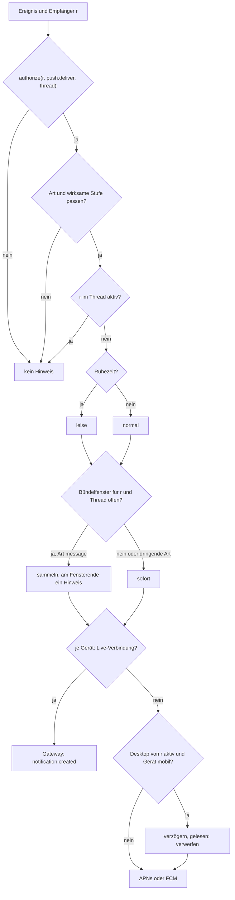
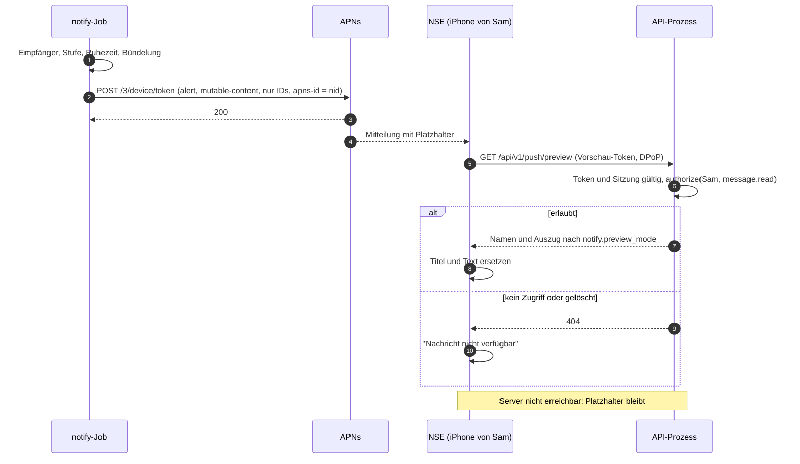

# 13 Push und Benachrichtigungen

Status: Entwurf M0. Normativ für das Modul `notify`, die Push-Adapter und die
Benachrichtigungs-Regeln aller Clients. Begriffe: [00-glossar.md](00-glossar.md). Tabellen:
[03-datenmodell.md](03-datenmodell.md) (`notification_preferences`, `quiet_hours`,
`push_registrations`, `read_states`). Aktionen: [05-aktionen.md](05-aktionen.md) (4.9).
Ereignisse: [04-sync-protokoll.md](04-sync-protokoll.md). Client-Seite:
[15-client-architektur.md](15-client-architektur.md). Entscheidung: ADR 0031 (Push ohne Inhalt).

Alle Fristen, Fenster und Grenzen sind benannte Konfigurationswerte mit Standard in Abschnitt 17.
Externe Fakten verweisen auf die Quellenliste (Abschnitt 18).

## 1. Ziele

1. **Kein Inhalt bei Apple oder Google.** Push trägt nur IDs und einen neutralen Platzhalter.
   Den Text holt die App selbst vom eigenen Server (Baseline R-Push, ADR 0031).
2. **Rechte zur Anzeigezeit.** Vor jedem Push prüft der Server `push.deliver`; beim Abholen des
   Inhalts noch einmal `message.read`. Wer keinen Zugriff mehr hat, sieht nichts.
3. **Wenig Lärm.** Ein Hinweis je Thread und Fenster; keiner, wenn die Person gerade im Thread
   ist; leise in Ruhezeiten.
4. **Eine Regel-Stelle.** Ob, wie und wohin benachrichtigt wird, entscheidet nur der Server.
   Clients zeigen an, sie entscheiden nicht. Das gilt auch für Desktop-Mitteilungen.
5. **Messbar.** Jeder Push hat eine ID; Zustellung und Abholung sind messbar (Abschnitt 9).

Nicht Ziel: E-Mail-Benachrichtigungen (Baseline "bewusst nie"), Push an Agenten oder Apps
(sie nutzen Gateway oder Webhooks), Hintergrund-Push zur Datensynchronisation.

## 2. Arten von Hinweisen und Empfänger

Ein Hinweis hat eine Art (`kind`). Die Art bestimmt Empfänger und die mindestens nötige Stufe.

| `kind` | Auslöser | Empfänger | Gilt ab Stufe | Hinweis |
|---|---|---|---|---|
| `message` | neue Nachricht eines Menschen, einer App oder eines Agenten ohne aktiven Lauf; erster Beitrag eines Forum-Threads | alle Menschen mit Leserecht und wirksamer Stufe `all`, außer dem Autor | `all` | Meldungskanäle, Abschnitt 2.2 |
| `mention` | Nachricht erwähnt den Menschen r | r | `mentions` | auch Erwähnung durch Agenten, immer sofort |
| `dm` | Nachricht in einem DM-Kanal | Teilnehmer außer dem Autor | `mentions` | DM zählt als direkt an die Person |
| `run_done` | Lauf `completed` | Auslöser des Laufs (`runs.triggered_by`) | `mentions` | zeigt auf die letzte Agenten-Nachricht des Laufs; andere mit `all` bekommen dafür `message` |
| `run_failed` | Lauf `failed` | Auslöser des Laufs | `mentions` | nicht bei `cancelled` |
| `input_needed` | Lauf wechselt auf `waiting_input` (Rückfrage, Freigabe) | Auslöser des Laufs | immer, auch bei `mute` | Begründung 2.1 |
| `security` | neues Gerät des Menschen wartet auf Freigabe | alle anderen aktiven Geräte dieses Menschen | immer | Kontoschutz: ein fremdes Gerät fällt sofort auf |
| `admin` | Erinnerungen der Verwaltung (Freigabe läuft ab, DSGVO-Frist) | Owner bzw. Verwaltende laut [07-rechte.md](07-rechte.md) und [20-datenschutz.md](20-datenschutz.md) | Schalter `notify.admin_enabled` | Inhalt nur Art und Ziel-ID |

Kein Hinweis entsteht für: Bearbeiten, Löschen, Reaktionen, Anheften, Tippen, Live-Box-Patches,
Nachrichten mit `silent = true` und Nachrichten mit `origin IN ('import','system')`. Bearbeiten
erzeugt auch dann keinen Hinweis, wenn dabei eine Erwähnung hinzukommt (eine Regel weniger,
kein Missbrauch durch nachträgliches Erwähnen).

### 2.1 Agenten-Nachrichten während eines Laufs

Nachrichten, die der Agent eines aktiven Laufs im Thread schreibt, erzeugen keinen eigenen
`message`-Hinweis. Am Laufende entsteht genau ein Hinweis: `run_done` an den Auslöser, `message`
an alle anderen mit Stufe `all`; beide zeigen auf die letzte Agenten-Nachricht des Laufs.
Erwähnt der Agent einen Menschen, geht `mention` sofort. Grund: Ein Lauf kann mehrere
Zwischen-Nachrichten schreiben; die Person will wissen, wann er fertig ist.

`input_needed` ignoriert `mute`, aber nicht die Ruhezeit: Der Lauf steht, bis genau diese Person
antwortet, und sie hat ihn selbst gestartet. Stummschalten soll keine eigenen Läufe festhängen
lassen. Andere Berechtigte (z. B. mit `approve_actions`) sehen die Rückfrage im Thread, bekommen
aber keinen Push; sonst würden ganze Gruppen bei jeder Freigabe geweckt.

### 2.2 Meldungskanäle

Ein Meldungskanal ist ein normaler Kanal, in den Agenten ohne Auslöser (Cron, Hintergrund) oder
Integrationen über eingehende Webhooks (z. B. Alertmanager) schreiben. Diese Nachrichten sind
`message`-Hinweise. Damit Mitglieder ohne eigene Einstellung benachrichtigt werden, plant dieses
Kapitel die Kanal-Voreinstellung `channels.default_notification_level` (`all`, `mentions`,
`mute`, nullbar; 03). Sie setzt, wer `channel.update` darf.

## 3. Einstellungen

### 3.1 Wirksame Stufe

Stufen aus [03-datenmodell.md](03-datenmodell.md): `all`, `mentions`, `mute`. Die wirksame
Stufe eines Menschen für einen Thread ist der erste vorhandene Wert in dieser Reihenfolge:

1. eigene Einstellung für den Thread,
2. eigene Einstellung für den Kanal,
3. eigene Einstellung für den Bereich,
4. Kanal-Voreinstellung `channels.default_notification_level`,
5. bei DM-Kanälen `all`,
6. persönlicher Standard `user_settings['notify.default_level']`,
7. Instanz-Standard `notify.user_default_level`.

Ist bei der gewählten Zeile `muted_until` in der Zukunft, gilt `mute`. Dieselbe Reihenfolge steht
in [03-datenmodell.md](03-datenmodell.md) (`notification_preferences`).

### 3.2 Automatisches Folgen

Schreibt ein Mensch in einem Thread mit `kind = 'thread'` (nicht im Hauptverlauf) oder legt er
ihn an und hat er für diesen Thread noch keine eigene Einstellung, legt der Server in derselben
Transaktion `notification_preferences(user, 'thread', id, level = 'all')` an und schreibt
`notification_pref.updated`. Die App zeigt das als "Folgen"; die Person kann es ändern. Grund:
Wer in einem Thread schreibt oder einen Agenten auslöst, will die Antworten sehen. Im
Hauptverlauf gilt das nicht, sonst folgte man nach einer Nachricht dem ganzen Kanal.

### 3.3 Persönliche Schalter

Schlüssel in `user_settings` (03). Diese Tabelle ist für alle Schlüssel `notify.*` normativ; die
übrigen persönlichen Schlüssel stehen in [01-produkt.md](01-produkt.md), Abschnitt 11. Standard
ohne eigene Einstellung: Abschnitt 17.

| Schlüssel | Werte | Wirkung |
|---|---|---|
| `notify.default_level` | `all`, `mentions`, `mute` | Schritt 6 in 3.1 |
| `notify.preview_mode` | `full`, `names`, `none` | was der Vorschau-Endpunkt liefert (6.4): Text und Namen, nur Namen, nur Art |
| `notify.input_needed_breaks_quiet_hours` | bool | `input_needed` ist auch in Ruhezeiten laut |
| `notify.admin_enabled` | bool | `admin`-Hinweise an Owner und Verwaltende |

### 3.4 Ruhezeiten mit Zeitzone

Zeilen in `quiet_hours`: Wochentage als Bitmaske (Bit 0 = Montag), `start_local`, `end_local`,
`time_zone` (NULL = `users.time_zone`), `enabled`. Prüfung zum Sendezeitpunkt:

1. Jetzt in die Zeitzone der Zeile umrechnen. Das ergibt eindeutig Wochentag und Uhrzeit, auch
   an Tagen mit Zeitumstellung. Der Server berechnet nie die Grenzen als Zeitpunkte; damit gibt
   es keine Sonderfälle für ausgelassene oder doppelte Stunden.
2. Ist `start_local < end_local`: ruhig, wenn das Bit des Wochentags gesetzt ist und
   `start_local <= Uhrzeit < end_local`.
3. Ist `end_local <= start_local` (über Mitternacht): ruhig, wenn das Bit des Wochentags gesetzt
   ist und `Uhrzeit >= start_local`, oder wenn das Bit des Vortags gesetzt ist und
   `Uhrzeit < end_local`. Ein Fenster gehört also zum Tag, an dem es beginnt.
4. Eine Person ist in Ruhezeit, wenn eine aktivierte Zeile passt.

Folge der Ruhezeit: Der Hinweis wird leise zugestellt (iOS `interruption-level: passive` und
Priorität 5, Android ohne Ton mit niedriger Priorität, Desktop ohne Ton). Er erscheint in der
Mitteilungszentrale, weckt aber nicht. Ausnahme: `input_needed` mit
`notify.input_needed_breaks_quiet_hours = true`.

## 4. Entscheidung je Empfänger

### 4.1 Ablauf



### 4.2 Rechte

`authorize(r, push.deliver, thread)` mit den Rechten zum Entscheidungszeitpunkt (P3). Eine
Erwähnung eines Menschen ohne Leserecht erzeugt nichts und verrät nichts
([03-datenmodell.md](03-datenmodell.md), `mentions`). Nur aktive Menschen sind Empfänger.

### 4.3 Stufe und Art

| wirksame Stufe | erlaubte Arten |
|---|---|
| `all` | alle |
| `mentions` | alle außer `message` |
| `mute` | nur `input_needed` (eigener Lauf), `security`, `admin` |

### 4.4 Aktiv am Gerät

- **Im Thread aktiv:** Ein Gerät von r hat eine Gateway-Verbindung, deren `focus` den Thread
  enthält, und meldet nicht `idle`. Dann bekommt r für diesen Thread keinen Hinweis, auf keinem
  Gerät. Das Feld `idle` in der Op `focus` ([04-sync-protokoll.md](04-sync-protokoll.md), 6.2): Ein
  Desktop-Fenster, das offen, aber unbenutzt ist, soll Live-Box-Patches weiter bekommen, aber
  nicht als "Person schaut zu" zählen. Ab wann ein Client `idle` meldet, legt
  [15-client-architektur.md](15-client-architektur.md) fest.
- **Desktop aktiv:** Ein Gerät mit `platform IN ('macos','windows')` ist verbunden und nicht
  `idle`. Dann gehen Pushes an mobile Geräte erst nach `notify.mobile_delay_when_desktop_active`.
  Ist der Hinweis dann gelesen (`read_states.last_read_seq` mindestens die Thread-Sequenz der
  Nachricht), entfällt er. Grund: Wer am Rechner sitzt, will nicht, dass das Telefon gleichzeitig
  summt.

### 4.5 Bündeln

Je Empfänger und Thread gilt ein Fenster `notify.coalesce_window`:

1. Der erste Hinweis geht sofort. Damit öffnet sich das Fenster.
2. Weitere `message`-Hinweise im Fenster werden gesammelt. Am Fensterende geht ein Hinweis mit
   der Zahl ungelesener Nachrichten (`threads.last_message_seq - read_states.last_read_seq`),
   der den vorherigen auf dem Gerät ersetzt (6.1 `apns-collapse-id`, 5.2 Benachrichtigungs-Tag).
3. `mention`, `dm`, `input_needed`, `run_done`, `run_failed` und `security` gehen immer sofort,
   ersetzen aber denselben Platz.

Umsetzung: ein eindeutiger, terminierter Job je (Empfänger, Thread) in River; River kann Jobs
eindeutig nach Argumenten machen und zu einem Zeitpunkt ausführen [Q1, belegt].

### 4.6 Zustellweg je Gerät

Für jedes aktive Gerät von r (`devices.state = 'active'`):

1. Hat das Gerät gerade eine Gateway-Verbindung, geht das kurzlebige Ereignis
   `notification.created` über diese Verbindung (6.3; 05 Abschnitt 6). Die
   App zeigt eine eigene Mitteilung oder ein Banner in der App. Kein Push für dieses Gerät.
2. Sonst geht ein Push an jede aktive Push-Registrierung des Geräts (`disabled_at IS NULL`).
3. Hat das Gerät weder Verbindung noch Registrierung (z. B. Windows-App geschlossen), entsteht
   nichts. Ungelesen-Zähler zeigen es beim nächsten Öffnen.

## 5. Zustellwege je Plattform

### 5.1 iOS und macOS: APNs mit Notification Service Extension

- **Verbindung.** HTTP/2 zu `api.push.apple.com` bzw. `api.sandbox.push.apple.com`, je nach
  `push_registrations.environment` [Q2, belegt]. Anfrage `POST /3/device/<token>` [Q2, belegt].
- **Anmeldung am APNs.** Token-Verfahren mit `.p8`-Schlüssel: JWT mit `ES256`, Kopf `alg` und
  `kid`, Claims `iss` (Team-ID) und `iat` [Q3, belegt]. Erneuern nicht öfter als alle 20 und nicht
  seltener als alle 60 Minuten [Q3, belegt]; der Server erneuert alle
  `push.apns.jwt_refresh_interval` und startet nicht, wenn der Wert außerhalb dieser Spanne
  liegt.
- **Kopfzeilen.** `apns-push-type: alert`; `apns-id` = `nid` (eine UUID in kanonischer Form ist
  erlaubt und erscheint in Fehlerantworten [Q2, belegt]); `apns-topic` = `push_registrations.app_id`
  (muss in `push.apns.topics` stehen); `apns-priority` 10, bei leisen Hinweisen 5 [Q2, belegt];
  `apns-expiration` = jetzt plus `push.ttl`; `apns-collapse-id` = Thread-ID (höchstens 64 Byte
  erlaubt [Q2, belegt]).
- **Notification Service Extension (NSE).** Sie läuft nur bei `mutable-content: 1` und einem
  sichtbaren `alert` [Q4, belegt] und hat etwa 30 Sekunden [Q4, belegt]. Sie holt den Inhalt über
  den Vorschau-Endpunkt (6.4) und ersetzt Titel und Text. Scheitert der Abruf (Server nicht
  erreichbar, z. B. weil das Gerät das private Netz gerade nicht erreicht), bleibt der Platzhalter
  stehen [Q4, belegt]. Die NSE gibt es auch auf macOS [Q5, belegt]; dasselbe Muster gilt dort
  [abgeleitet].
- **Keine Token-Erneuerung in der NSE.** Die NSE nutzt nie Refresh-Tokens. Zwei Prozesse, die
  dieselbe Refresh-Familie rotieren, würden die Wiederverwendungs-Erkennung auslösen und die
  Sitzung sperren ([03-datenmodell.md](03-datenmodell.md), `refresh_tokens`). Darum gibt es das
  Vorschau-Token (6.4).
- **Geräteschlüssel.** Die NSE signiert den DPoP-Beweis mit dem Geräteschlüssel, ohne
  Nutzerbestätigung. Das setzt voraus, dass der DPoP-Schlüssel ohne Biometrie nutzbar ist und
  Step-up einen getrennten Weg hat ([08-identitaet.md](08-identitaet.md)). Diese Anforderung ist
  im Rückgabebericht an Team C gemeldet.
- **Unterdrücken.** Ohne Sonderrecht muss die NSE jede Mitteilung anzeigen. Mit dem Entitlement
  `com.apple.developer.usernotifications.filtering` kann sie eine Mitteilung stumm verwerfen,
  z. B. wenn die Nachricht inzwischen gelöscht oder der Zugriff entzogen ist; Apple muss es auf
  Antrag freigeben [Q6, belegt]. Ohne Entitlement zeigt die NSE dann "Nachricht nicht
  verfügbar". Der Antrag ist eine Entscheidung des Betreibers.
- **Kein Hintergrund-Push.** Apple drosselt Hintergrund-Pushes stark und rät von mehr als zwei
  bis drei je Stunde ab [Q7, belegt]. Sie taugen nicht für Chat.

### 5.2 Android: FCM-Datennachricht

- **Senden.** `POST https://fcm.googleapis.com/v1/projects/{project_id}/messages:send` mit einem
  OAuth-2.0-Zugriffstoken aus dem Dienstkonto, Scope
  `https://www.googleapis.com/auth/firebase.messaging` [Q8, belegt].
- **Nur Datennachrichten** mit eigenen Schlüsseln, ohne `notification`-Block [Q9, belegt]. Die
  Verbindung zu FCM ist verschlüsselt, aber nicht Ende-zu-Ende [Q9, belegt]; darum nur IDs.
- **Priorität** `high`, bei leisen Hinweisen `normal`. Eine High-Nachricht ohne sichtbare
  Mitteilung kann FCM herabstufen [Q10, belegt]; die App zeigt darum bei jeder Nachricht der Arten
  aus Abschnitt 2 eine Mitteilung, notfalls mit Platzhalter.
- **Lebensdauer** `android.ttl` = `push.ttl` im Format `"<Sekunden>s"`; FCM erlaubt höchstens 28
  Tage [Q11, belegt].
- **Kein `collapse_key`.** FCM hält je Gerät nur vier verschiedene Collapse-Schlüssel und wählt
  beliebig, welche bleiben [Q12, belegt]; je Thread einen Schlüssel zu nutzen, würde Hinweise
  verlieren. Die App ersetzt Mitteilungen selbst über einen Tag gleich der Thread-ID.
- **Überlauf.** Ohne Collapse speichert FCM für ein Gerät höchstens 100 Nachrichten; darüber
  verwirft es alle und sendet eine Sondernachricht [Q12, belegt]. Die App lädt dann den Stand neu
  (Ungelesen-Zähler über die normale Sync).
- **Zeitbudget.** `onMessageReceived` hat nur wenige Sekunden; längere Arbeit läuft als
  vorgezogener WorkManager-Job [Q10, belegt]. Die App holt die Vorschau (6.4) in diesem Budget.

### 5.3 Windows und Desktop über das Gateway

- Die Windows-App läuft im Infobereich weiter, hält ihre Gateway-Verbindung und zeigt lokale
  Mitteilungen aus `notification.created` (Baseline R-Push). macOS nutzt denselben Weg, solange
  die App verbunden ist, sonst APNs.
- WNS ist "später": Es braucht Paket-Identität für Zustellung im Hintergrund, eine
  Entra-App-Registrierung und eine Zuordnung der Paketfamilie zur App per E-Mail an Microsoft
  [Q13, belegt]. Ist die Windows-App geschlossen, gibt es keine Mitteilungen; das steht so in der
  Nutzer-Doku.

### 5.4 Später

`unifiedpush` (Android ohne Google-Dienste) und `wns` sind als Werte in
`push_registrations.provider` vorgesehen, aber ohne Adapter im Kern. Der Port `PushProvider`
(`Send(ctx, registration, notification) -> Result`) nimmt sie ohne Änderung an der
Entscheidungslogik auf.

## 6. Nutzlast und Vorschau

### 6.1 APNs

```json
{
  "aps": {
    "alert": { "title-loc-key": "PUSH_TITLE", "loc-key": "PUSH_BODY_MESSAGE" },
    "mutable-content": 1,
    "thread-id": "0192f1d2-7c4e-7a10-9a3b-2f6c1e0d4a11",
    "category": "MESSAGE",
    "sound": "default",
    "badge": 3,
    "interruption-level": "active"
  },
  "b": {
    "v": 1,
    "nid": "0192f1d3-0a55-7b21-8c4d-5e6f7a8b9c0d",
    "k": "message",
    "i": "0192a000-0000-7000-8000-00000000c0de",
    "t": "0192f1d2-7c4e-7a10-9a3b-2f6c1e0d4a11",
    "m": "0192f1d3-0a44-7f00-b1c2-d3e4f5a6b7c8"
  }
}
```

- Eigene Schlüssel stehen neben `aps`, nie darin [Q14, belegt]. Ein Objekt `b` hält sie
  zusammen.
- Titel und Text sind Schlüssel in den Sprachdateien der App (`title-loc-key`, `loc-key`) [Q14,
  belegt]. Der Server kennt so weder die Sprache des Geräts noch einen Text; die App zeigt den
  Platzhalter in ihrer Sprache und ihrem Branding.
- `loc-key` je Art: `PUSH_BODY_MESSAGE`, `PUSH_BODY_MENTION`, `PUSH_BODY_DM`,
  `PUSH_BODY_RUN_DONE`, `PUSH_BODY_RUN_FAILED`, `PUSH_BODY_INPUT_NEEDED`, `PUSH_BODY_SECURITY`,
  `PUSH_BODY_ADMIN`. `category` entsprechend in Großbuchstaben (Aktionen der Mitteilung legt
  [15-client-architektur.md](15-client-architektur.md) fest).
- `interruption-level`: `active`; `passive` in Ruhezeiten; `time-sensitive` nur für
  `input_needed` und nur, wenn `push.apns.time_sensitive_enabled` gesetzt ist (die App braucht
  dafür die passende Fähigkeit). Erlaubte Werte laut Apple: `passive`, `active`,
  `time-sensitive`, `critical` [Q14, belegt]; `critical` nutzt das Produkt nie.
- `sound` fehlt bei leisen Hinweisen. `badge` siehe Abschnitt 8.
- `i` ist die `instance_id`. Sie erlaubt einer App mit mehreren Konten, den Hinweis zuzuordnen.
- Größe: Apple lehnt Nutzlasten über 4096 Byte ab [Q14, belegt]. Die Nutzlast hier ist fest
  aufgebaut und weit darunter; ein Test hält die Grenze.

### 6.2 FCM

```json
{
  "message": {
    "token": "<registration token>",
    "android": { "priority": "high", "ttl": "86400s" },
    "data": {
      "v": "1",
      "nid": "0192f1d3-0a55-7b21-8c4d-5e6f7a8b9c0d",
      "k": "message",
      "i": "0192a000-0000-7000-8000-00000000c0de",
      "t": "0192f1d2-7c4e-7a10-9a3b-2f6c1e0d4a11",
      "m": "0192f1d3-0a44-7f00-b1c2-d3e4f5a6b7c8",
      "badge": "3",
      "quiet": "0"
    }
  }
}
```

Werte in `data` sind Zeichenketten. Zusätzlich gibt es `k = "sync"` mit `badge` und
`cleared` (Thread-IDs, kommagetrennt) für Abschnitt 8.

### 6.3 Gateway-Ereignis `notification.created`

Kurzlebig, nur an Verbindungen des Empfängers (`audience = self`), Empfangs-Aktion `push.deliver`
([05-aktionen.md](05-aktionen.md) Abschnitt 6, kurzlebige Ereignisse). Nutzlast: `nid`, `kind`, `thread_id`, `message_id`, `quiet`, `count` und die
Vorschau-Felder aus 6.4. Die Vorschau darf hier mitkommen, weil die Verbindung angemeldet ist und
`message.read` schon geprüft wurde; es gibt keinen Dritten auf dem Weg.

### 6.4 Vorschau-Endpunkt und Vorschau-Token

`GET /api/v1/push/preview?nid=<nid>&message_id=<id>`

- **Anmeldung:** Vorschau-Token im Kopf `Authorization: DPoP <token>` plus DPoP-Beweis mit dem
  Geräteschlüssel. Das Token entsteht bei `push.register`, wird genau einmal ausgegeben, nur als
  HMAC gespeichert (`push_registrations.preview_token_hash`, 03)
  und bei jeder neuen Registrierung rotiert. Es gilt nur für diesen Endpunkt.
- **Gültig nur, solange** die Registrierung aktiv ist, das Gerät `active` ist, die Sitzung der
  Registrierung (`push_registrations.auth_session_id`, 03) nicht widerrufen ist und der
  Mensch aktiv ist. Abmelden (`auth.logout`) deaktiviert die Registrierungen dieser Sitzung mit
  `disabled_reason = 'logout'`; danach kommen keine Pushes mehr auf dieses Gerät.
- **Prüfung:** `authorize(r, message.read, message)` mit aktuellen Rechten. Kein Recht, Nachricht
  gelöscht oder unbekannt: `404`. Die App zeigt dann "Nachricht nicht verfügbar".
- **Antwort** je nach `notify.preview_mode`:

| Feld | `full` | `names` | `none` |
|---|---|---|---|
| `kind`, `thread_id`, `message_id`, `badge` | ja | ja | ja |
| `space_name`, `channel_name`, `thread_title`, `sender_display_name` | ja | ja | nein |
| `excerpt` (Text ohne Markdown, Erwähnungen als Namen, höchstens `notify.preview_max_chars`) | ja | nein | nein |
| `attachment_count`, `image_url` (Abruf-Ticket für `small` des ersten Bildes, [12-dateien.md](12-dateien.md) 9.2) | ja | nein | nein |

Bei `run_done` liefert der Endpunkt den Auszug der letzten Agenten-Nachricht des Laufs, bei
`input_needed` den Text der Rückfrage.

Der Abruf ist zugleich die Empfangsbestätigung für die Messung (Abschnitt 9).



## 7. Fehlerbehandlung

### 7.1 APNs

Apple nennt, welche Fehler nicht wiederholt werden dürfen: `BadDeviceToken`,
`DeviceTokenNotForTopic`, `Forbidden`, `ExpiredToken`, `Unregistered`, `PayloadTooLarge`; 5xx
darf nach 15 Minuten wiederholt werden, `TooManyRequests` mit Verzögerung [Q15, belegt].

| Antwort | Folge |
|---|---|
| `200` | `last_success_at`, `failure_count = 0` |
| `410 Unregistered`, `410 ExpiredToken` | Registrierung deaktivieren (`token_invalid`). Die Antwort trägt `timestamp`, ab dem das Token ungültig war [Q15, belegt]; wurde dasselbe Token danach neu registriert, bleibt die neue Registrierung aktiv [abgeleitet] |
| `400 BadDeviceToken` | deaktivieren (`token_invalid`); passt die Umgebung nicht zur Registrierung, zusätzlich Konfigurations-Alarm |
| `400 DeviceTokenNotForTopic` | deaktivieren (`topic_mismatch`) |
| `403 ExpiredProviderToken` | JWT neu erzeugen, einmal wiederholen |
| `403 InvalidProviderToken`, `MissingProviderToken`, `BadEnvironmentKeyIdInToken`, `UnrelatedKeyIdInToken`, `Forbidden` | Konfigurationsfehler: Alarm, APNs-Versand pausiert, Statusseite "Push gestört" |
| `429 TooManyProviderTokenUpdates` | Programmfehler im JWT-Cache: Alarm |
| `429 TooManyRequests` | später wiederholen (Backoff), gleiches Gerät |
| `413 PayloadTooLarge`, andere `400` | Programmfehler: Alarm, keine Wiederholung |
| `500`, `503` | nach `push.apns.retry_5xx_delay` wiederholen |

### 7.2 FCM

| Antwort | Folge |
|---|---|
| `404 UNREGISTERED` | deaktivieren (`token_invalid`) [Q16, belegt] |
| `400 INVALID_ARGUMENT` wegen ungültigem Token | deaktivieren (`token_invalid`) [Q16, belegt]; sonst Programmfehler, Alarm |
| `403 SENDER_ID_MISMATCH` | deaktivieren (`sender_mismatch`), Konfigurations-Alarm [Q16, belegt] |
| `401 THIRD_PARTY_AUTH_ERROR` | Konfigurations-Alarm [Q16, belegt] |
| `429 QUOTA_EXCEEDED` | Backoff, erste Wartezeit mindestens eine Minute [Q16, belegt] |
| `503 UNAVAILABLE` | `Retry-After` beachten, dann exponentieller Backoff mit Zufallsanteil [Q16, belegt] |
| `500 INTERNAL` | Backoff zwischen `push.retry_base` und `push.retry_cap` [Q16, belegt] |

### 7.3 Gemeinsam

- Vorübergehende Fehler erhöhen `failure_count`. Ab `push.max_consecutive_failures`
  ([03-datenmodell.md](03-datenmodell.md)) wird die Registrierung mit `repeated_failures`
  deaktiviert.
- Ein Hinweis, der nach `push.max_age` noch nicht beim Anbieter angekommen ist, wird verworfen.
  Ein alter Hinweis stört mehr, als er nützt; der Ungelesen-Zähler trägt den Stand.
- Gerät gesperrt (`device.revoke`): alle Registrierungen `device_revoked`, sofort.
- Device-Tokens erscheinen nie in Logs, nur ein kurzer Hash-Präfix.

## 8. Badge und Abgleich

Badge-Zahl für r = Zahl der für r sichtbaren Threads mit
(`read_states.mention_count > 0`) oder (ungelesen und wirksame Stufe `all`) oder (ungelesener
DM-Thread). Der Server rechnet sie beim Senden und schreibt sie in `aps.badge` bzw. `data.badge`.

Liest r auf einem anderen Gerät und sinkt die Zahl, sendet der Server an mobile Geräte höchstens
einmal je `notify.badge_sync_min_interval` einen Abgleich: iOS ein Push nur mit `badge` (ohne
Text; die NSE läuft dann nicht [Q4, abgeleitet]; Push-Typ `alert` [vermutet, im Gerätetest zu
bestätigen]), Android `k = "sync"` mit Priorität
`normal`, die gelesene Threads aus der Mitteilungsleiste entfernt. Auf iOS bleiben gezeigte
Mitteilungen bis zum nächsten Öffnen der App stehen; das ist eine bekannte Grenze.

## 9. Zustell-Messung

Jeder Hinweis hat eine `nid` (UUIDv7). Messpunkte:

| Punkt | Zeitpunkt |
|---|---|
| t0 | geplanter Sendezeitpunkt: Commit des auslösenden Ereignisses, bei Bündelung oder Desktop-Verzögerung das Ende der Wartezeit |
| t1 | Anbieter hat angenommen (`200`) bzw. Gateway hat den Rahmen geschrieben |
| t2 | Vorschau-Abruf mit dieser `nid` kommt am Server an |

SLIs (Ziele, Fenster und Schwellen in `docs/observability/slos.md`, Team F):

- **Push-Versand:** Anteil der Hinweise mit t1 minus t0 unter der Schwelle. Fehler beim
  Anbieter zählen als nicht erfüllt, deaktivierte Tokens nicht.
- **Push Ende-zu-Ende (Stichprobe):** Anteil der Hinweise mit Vorschau-Abruf, bei denen t2 minus
  t0 unter der Schwelle liegt.
- **Bestätigungsquote:** Vorschau-Abrufe je gesendetem Push, je Plattform. Kein Ziel, sondern
  Diagnose: Ein Abfall zeigt, dass Geräte den Server nicht erreichen (Platzhalter bleiben).

Signal-Namen: `docs/observability/signals.md`. Attribute nur Anbieter, Art, Ergebnis, Plattform;
keine Personen-, Geräte- oder Thread-IDs.

## 10. Datenschutz

- Apple und Google sehen: Device-Token, App-Kennung, Zeitpunkt, Größe, die IDs in der Nutzlast
  und über `thread-id`, welche Hinweise zusammengehören. UUIDv7 enthält einen Zeitstempel; das
  verrät nicht mehr als der Versandzeitpunkt selbst. Sie sehen keine Namen und keinen Text.
- Apple und Google sind Auftragsverarbeiter des Betreibers; die Vorlage steht in
  `docs/compliance/processors-template.md` ([20-datenschutz.md](20-datenschutz.md)).
- Der Inhalt fließt nur zwischen eigenem Server und Gerät, nach `message.read`.
- `notify.preview_mode` steuert, was auf dem Sperrbildschirm erscheinen kann; die
  Betriebssystem-Einstellung für Vorschauen gilt zusätzlich.
- Telemetrie enthält keine Inhalte und keine Device-Tokens ([17-observability.md](17-observability.md)).

## 11. Push-Schlüssel und White Label

- Push-Zugänge sind Instanz-Konfiguration des Betreibers: APNs-Team-ID, Key-ID und `.p8`-Schlüssel
  (Verweis auf den Secret-Provider), erlaubte Topics; FCM-Projekt-ID und Dienstkonto-Schlüssel
  (Verweis). APNs-Schlüssel können je Umgebung getrennt sein [Q3, belegt]; die Konfiguration
  führt Sandbox und Produktion getrennt.
- Ausgehende Verbindungen: `api.push.apple.com`, `api.sandbox.push.apple.com`,
  `fcm.googleapis.com` und der Token-Endpunkt aus dem Dienstkonto
  ([16-betrieb.md](16-betrieb.md), Netzregeln).
- **White-Label-Apps.** Ein APNs-Schlüssel gilt für die Apps des Apple-Teams, dem er gehört
  [Q3, belegt]; ein FCM-Token gilt nur für den Absender seines Firebase-Projekts [Q16, belegt].
  Eine Instanz kann darum nur an Apps pushen, deren Schlüssel sie hat. Jede Instanz mit eigenen
  App-IDs braucht eigene Push-Schlüssel und eigene Builds ([18-release.md](18-release.md)).
- **Zentraler Push-Relay für fremde Instanzen: später.** Gründe: (1) Der Betreiber eines Relays
  sähe Metadaten (Zeitpunkte, Tokens, IDs) aller angeschlossenen Instanzen und würde für jede
  ein weiterer Auftragsverarbeiter. (2) Ein Relay ist ein betriebener Dienst mit Registrierung
  der Instanzen, Missbrauchsschutz und Verfügbarkeitszusage; das widerspricht dem
  Selbst-Hosting-Ansatz der ersten Etappen. (3) Eine gemeinsame App müsste mehrere Instanzen
  verwalten ([01-produkt.md](01-produkt.md)). Wenn er kommt: nur ID-Nutzlasten, von der Instanz
  signiert, ohne Inhalt; der Port `PushProvider` bekommt dafür einen Adapter `relay`.

## 12. Ausführung im Server

1. Jede Transaktion, die einen Hinweis auslösen kann (neue Nachricht, Lauf-Zustandswechsel,
   wartendes Gerät, Verwaltungs-Erinnerung), legt in derselben Transaktion einen River-Job
   `notify_fanout` mit den IDs an. River garantiert: Der Job existiert genau dann, wenn die
   Transaktion committet [Q1, belegt]. Kein eigener Cursor, kein verlorener Hinweis.
2. `notify_fanout` ermittelt die Kandidaten: Menschen mit Leserecht auf den Kanal (aus `authz`),
   Erwähnte, Lauf-Auslöser. Die Stufen holt eine gebündelte Abfrage auf
   `notification_preferences` für alle Kandidaten und die drei Ziele (Thread, Kanal, Bereich).
3. Die Entscheidung je Empfänger (Abschnitt 4) ist eine reine Funktion im Domänen-Teil von
   `notify`. Sie bekommt Fakten (Stufe, Ruhezeit, Aktivität, Fensterzustand) und liefert eine
   Entscheidung. Tests prüfen sie als Tabelle.
4. Aktivität und Live-Verbindungen fragt `notify` über den Port `PresenceView` beim Gateway ab.
   Mit einem `api`-Prozess ist das Speicher im Prozess. Mit mehreren `api`-Knoten braucht das
   Gateway einen gemeinsamen Präsenz-Stand; das gehört zum Skalierungspfad in
   [02-architektur.md](02-architektur.md), wie die Verteilung anderer kurzlebiger Ereignisse.
5. Pro Registrierung ein Job `push_send` mit Wiederholungen nach Abschnitt 7. HTTP/2-Verbindungen
   zu APNs bleiben offen und werden geteilt; höchstens `push.max_concurrent_requests` gleichzeitig.

## 13. Endpunkte und Aktionen

Verbindlich ist `docs/api/openapi.yaml`; diese Tabelle gibt den Stand der Spec wieder.

| Methode und Pfad | Aktion | RL-Klasse |
|---|---|---|
| `POST /api/v1/me/devices/current/push-registrations` | `push.register` | `rl.write` |
| `DELETE /api/v1/push-registrations/{registration_id}` | `push.unregister` | `rl.write` |
| `GET /api/v1/push/preview` | `message.read` (mit Vorschau-Token) | `rl.read` |
| `GET /api/v1/me/notification-preferences` | `settings.read` | `rl.read` |
| `PUT`, `DELETE /api/v1/me/notification-preferences/{target_kind}/{target_id}` | `notification_pref.update` | `rl.write` |
| `GET /api/v1/me/quiet-hours` | `settings.read` | `rl.read` |
| `POST /api/v1/me/quiet-hours`, `PUT` und `DELETE /api/v1/me/quiet-hours/{rule_id}` | `quiet_hours.update` | `rl.write` |
| `PATCH /api/v1/channels/{id}` mit `default_notification_level` | `channel.update` | `rl.admin` |

`push.register` nimmt `provider`, `token`, `environment`, `app_id` und liefert `id` und das
Vorschau-Token. Ein bereits bekanntes `(provider, token)` wird übernommen (alte Zeile
deaktiviert), weil Tokens zwischen Installationen wandern können.

## 14. Tests

| Test | Hält |
|---|---|
| Entscheidungstabelle: Art x wirksame Stufe x `muted_until` x Ruhezeit x aktiv x Desktop aktiv x Fenster | Abschnitte 2 bis 4 |
| Nutzlast-Erlaubnisliste: serialisierte APNs- und FCM-Nutzlasten enthalten nur die Schlüssel aus 6.1 und 6.2, alle Werte sind IDs, Zahlen oder feste Schlüssel; Größe unter der Apple-Grenze | kein Inhalt beim Anbieter |
| Entzug zwischen Ereignis und Versand | kein Push; Vorschau `404` |
| Erwähnung eines Menschen ohne Leserecht | kein Push, keine Spur im Ergebnis |
| `auth.logout`, `device.revoke`, `user.disable` | Registrierungen deaktiviert, Vorschau-Token wertlos, kein Push |
| Fake-APNs (HTTP/2) mit jeder Antwort aus 7.1 | Deaktivieren, Wiederholen, Alarm wie Tabelle |
| Fake-FCM mit jeder Antwort aus 7.2 | wie Tabelle, `Retry-After` beachtet |
| JWT-Cache | höchstens ein neues JWT je `push.apns.jwt_refresh_interval`; Startfehler außerhalb 20 bis 60 Minuten |
| Ruhezeiten in `Europe/Berlin` an beiden Umstellungstagen, über Mitternacht, Wochentag-Bits | Abschnitt 3.4 |
| Zehn Nachrichten in einem Thread innerhalb eines Fensters | höchstens zwei Pushes, der zweite mit Zahl |
| Thread im Fokus auf dem Desktop | kein Push auf das Telefon |
| Desktop aktiv, Nachricht dort gelesen vor Ablauf der Verzögerung | kein Push auf das Telefon |
| Lauf mit drei Agenten-Nachrichten | genau ein `run_done` an den Auslöser |
| `input_needed` bei `mute` | Push kommt, leise in Ruhezeit |
| Automatisches Folgen | erste Antwort in einem Thread setzt `all`; Hauptverlauf nicht |

## 15. Entscheidungen dieses Kapitels

| Nr | Entscheidung | Grund |
|---|---|---|
| R-PN-01 | Nur der Server entscheidet über Hinweise; Desktop-Mitteilungen kommen als `notification.created` übers Gateway. | Eine Regel-Stelle, keine abweichende Logik in vier Clients. |
| R-PN-02 | Agenten-Nachrichten während eines Laufs bündeln sich in einen Hinweis am Laufende. | Läufe schreiben Zwischenstände; relevant ist "fertig". |
| R-PN-03 | `input_needed` ignoriert `mute`, nicht die Ruhezeit. | Eigene Läufe sollen nicht hängen; Nachtruhe bleibt. |
| R-PN-04 | Automatisches Folgen in Threads beim Schreiben. | Antworten auf eigene Fragen und Aufträge kommen an. |
| R-PN-05 | Ruhezeiten machen leise, nicht stumm. | Die Mitteilungszentrale bleibt vollständig; geweckt wird niemand. |
| R-PN-06 | Bündeln: erster Hinweis sofort, Rest am Fensterende, ein Platz je Thread. | Niedrige Latenz für den ersten Hinweis, wenig Lärm danach. |
| R-PN-07 | Eigenes Vorschau-Token je Registrierung, DPoP-gebunden, ohne Refresh. | NSE und App würden sich sonst die Refresh-Familie gegenseitig sperren. |
| R-PN-08 | Kein FCM-`collapse_key`; die App ersetzt per Tag. | FCM hält nur vier Collapse-Schlüssel je Gerät. |
| R-PN-09 | Hinweise in Jobs, die in der auslösenden Transaktion angelegt werden. | Genau ein Hinweis-Job je Commit, ohne eigenen Cursor. |
| R-PN-10 | Zentraler Push-Relay später; jede Instanz nutzt eigene Schlüssel. | Kein Metadaten-Sammelpunkt, kein Betriebsdienst in den ersten Etappen. |
| R-PN-11 | Kein Hinweis durch Bearbeiten. | Einfach, kein Missbrauch durch nachträgliches Erwähnen. |

## 16. Abgleich mit dem Kern-Vertrag

Die beim Entwurf beantragten Ergänzungen sind entschieden (Integration vom 2026-10-10):

| Nr | Ergänzung | Entscheidung, Ort |
|---|---|---|
| 1 | `channels.default_notification_level` und die Reihenfolge der wirksamen Stufe | übernommen, 03 `channels` und `notification_preferences` |
| 2 | `push_registrations.auth_session_id`, `preview_token_hash`, feste Werte von `disabled_reason` | übernommen, 03 `push_registrations` |
| 3 | kurzlebiges Ereignis `notification.created` | übernommen, 05 Abschnitt 6 |
| 4 | Feld `idle` in der Op `focus` | übernommen, 04 Abschnitt 6.2 |
| 5 | eigene Lese-Aktion für Benachrichtigungs-Einstellungen | nicht übernommen: `settings.read` deckt alle eigenen persönlichen Daten ab (05, R-AZ-21) |

## 17. Konfigurationswerte dieses Kapitels

Werte aus anderen Kapiteln (nur Verweis): `push.max_consecutive_failures`
([03-datenmodell.md](03-datenmodell.md)).

| Name | Standard | Bedeutung |
|---|---|---|
| `push.ttl` | `24h` | Lebensdauer beim Anbieter (`apns-expiration`, `android.ttl`) |
| `push.max_age` | `1h` | älter wird ein noch nicht gesendeter Hinweis verworfen |
| `push.retry_base` | `2s` | Basis des Backoffs |
| `push.retry_cap` | `5m` | größter Backoff-Abstand |
| `push.max_concurrent_requests` | `32` | gleichzeitige Anfragen an Anbieter je Prozess |
| `push.apns.team_id` | leer | Apple-Team-ID |
| `push.apns.key_id` | leer | Key-ID des `.p8`-Schlüssels |
| `push.apns.private_key_ref` | leer | Verweis auf den Schlüssel im Secret-Provider |
| `push.apns.topics` | leer | erlaubte Bundle-IDs |
| `push.apns.jwt_refresh_interval` | `40m` | Erneuerung des Anbieter-JWT, muss zwischen 20 und 60 Minuten liegen |
| `push.apns.retry_5xx_delay` | `15m` | Wartezeit nach `500` oder `503` |
| `push.apns.time_sensitive_enabled` | `false` | `time-sensitive` für `input_needed` |
| `push.fcm.project_id` | leer | Firebase-Projekt |
| `push.fcm.service_account_ref` | leer | Verweis auf den Dienstkonto-Schlüssel |
| `notify.user_default_level` | `mentions` | Stufe ohne jede Einstellung |
| `notify.default_preview_mode` | `full` | Standard für `notify.preview_mode` |
| `notify.default_input_needed_breaks_quiet_hours` | `false` | Standard für den gleichnamigen Schalter |
| `notify.default_admin_enabled` | `true` | Standard für `notify.admin_enabled` |
| `notify.coalesce_window` | `60s` | Bündelfenster je Empfänger und Thread |
| `notify.mobile_delay_when_desktop_active` | `60s` | Verzögerung mobiler Pushes bei aktivem Desktop |
| `notify.preview_max_chars` | `240` | Länge des Auszugs in der Vorschau |
| `notify.badge_sync_min_interval` | `60s` | kleinster Abstand der Badge-Abgleiche je Person |

## 18. Quellen

Alle abgerufen am 2026-10-10.

- Q1 River README (InsertTx, eindeutige und terminierte Jobs): https://github.com/riverqueue/river [belegt]
- Q2 Apple, Sending notification requests to APNs: https://developer.apple.com/documentation/usernotifications/sending-notification-requests-to-apns [belegt]
- Q3 Apple, Establishing a token-based connection to APNs: https://developer.apple.com/documentation/usernotifications/establishing-a-token-based-connection-to-apns [belegt]
- Q4 Apple, Modifying content in newly delivered notifications: https://developer.apple.com/documentation/usernotifications/modifying-content-in-newly-delivered-notifications [belegt]
- Q5 Apple, UNNotificationServiceExtension (Plattformen): https://developer.apple.com/documentation/usernotifications/unnotificationserviceextension [belegt]
- Q6 Apple, Entitlement `com.apple.developer.usernotifications.filtering`: https://developer.apple.com/documentation/bundleresources/entitlements/com.apple.developer.usernotifications.filtering [belegt]
- Q7 Apple, Pushing background updates to your App: https://developer.apple.com/documentation/usernotifications/pushing-background-updates-to-your-app [belegt]
- Q8 Firebase, Send messages with the HTTP v1 API: https://firebase.google.com/docs/cloud-messaging/send/v1-api [belegt]
- Q9 Firebase, Message types: https://firebase.google.com/docs/cloud-messaging/customize-messages/set-message-type [belegt]
- Q10 Firebase, Message priority on Android: https://firebase.google.com/docs/cloud-messaging/android/message-priority [belegt]
- Q11 Firebase, Setting the lifespan of a message: https://firebase.google.com/docs/cloud-messaging/customize-messages/setting-message-lifespan [belegt]
- Q12 Firebase, Non-collapsible and collapsible message types: https://firebase.google.com/docs/cloud-messaging/customize-messages/collapsible-message-types [belegt]
- Q13 Microsoft, Push notifications quickstart (Windows App SDK): https://learn.microsoft.com/en-us/windows/apps/develop/notifications/push-notifications/push-quickstart [belegt]
- Q14 Apple, Generating a remote notification: https://developer.apple.com/documentation/usernotifications/generating-a-remote-notification [belegt]
- Q15 Apple, Handling notification responses from APNs: https://developer.apple.com/documentation/usernotifications/handling-notification-responses-from-apns [belegt]
- Q16 Firebase, FCM error codes: https://firebase.google.com/docs/cloud-messaging/error-codes [belegt]
