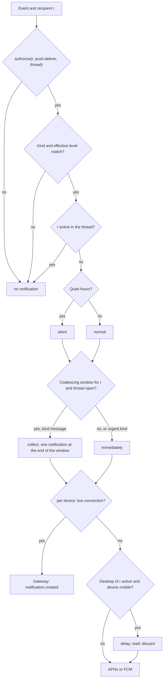
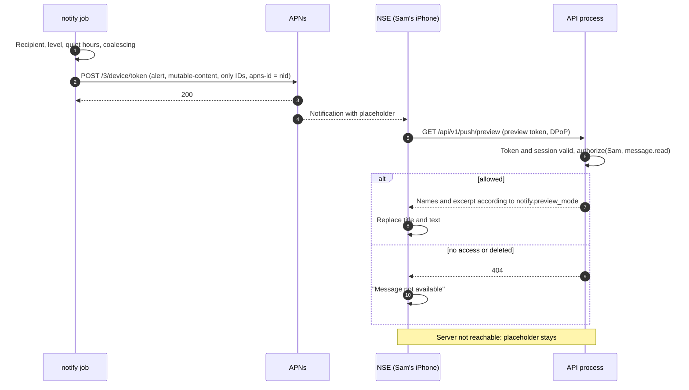

# 13 Push and notifications

Status: draft M0. Normative for the module `notify`, the push adapters and the
notification rules of all clients. Terms: [00-glossary.md](00-glossary.md). Tables:
[03-data-model.md](03-data-model.md) (`notification_preferences`, `quiet_hours`,
`push_registrations`, `read_states`). Actions: [05-actions.md](05-actions.md) (4.9).
Events: [04-sync-protocol.md](04-sync-protocol.md). Client side:
[15-client-architecture.md](15-client-architecture.md). Decision: ADR 0031 (push without content).

All deadlines, windows and limits are named configuration values with a default in section 17.
External facts refer to the source list (section 18).

## 1. Goals

1. **No content at Apple or Google.** Push carries only IDs and a neutral placeholder.
   The app fetches the text itself from its own server (Baseline R-Push, ADR 0031).
2. **Permissions at display time.** Before every push the server checks `push.deliver`; when the
   content is fetched, it checks `message.read` once more. Whoever no longer has access sees nothing.
3. **Little noise.** One notification per thread and window; none if the person is in the thread
   right now; silent during quiet hours.
4. **One place for rules.** Only the server decides whether, how and where to notify.
   Clients display, they do not decide. This also applies to desktop notifications.
5. **Measurable.** Every push has an ID; delivery and fetching are measurable (section 9).

Not a goal: email notifications (Baseline "deliberately never"), push to agents or apps
(they use the gateway or webhooks), background push for data synchronization.

## 2. Kinds of notifications and recipients

A notification has a kind (`kind`). The kind determines the recipients and the minimum level required.

| `kind` | Trigger | Recipient | Applies from level | Note |
|---|---|---|---|---|
| `message` | new message from a person, an app or an agent without an active run; first post of a forum thread | all people with read permission and effective level `all`, except the author | `all` | report channels, section 2.2 |
| `mention` | message mentions the person r | r | `mentions` | also mentions by agents, always immediately |
| `dm` | message in a DM channel | participants except the author | `mentions` | a DM counts as addressed directly to the person |
| `run_done` | run `completed` | the run's triggering person (`runs.triggered_by`) | `mentions` | points to the last agent message of the run; others with `all` get `message` for it |
| `run_failed` | run `failed` | the run's triggering person | `mentions` | not for `cancelled` |
| `input_needed` | run changes to `waiting_input` (question, approval) | the run's triggering person | always, even with `mute` | rationale in 2.1 |
| `security` | a new device of the person waits for device approval | all other active devices of this person | always | account protection: a foreign device is noticed immediately |
| `admin` | reminders from the administration (grant expires, GDPR deadline) | owner or administrators according to [07-permissions.md](07-permissions.md) and [20-privacy.md](20-privacy.md) | switch `notify.admin_enabled` | content only kind and target ID |

A message in a DM channel gives r the kind `dm` and never `message` or `mention`, also when it
mentions r: both kinds need the same level and go at once, and DM channels trigger no agent, so
the run kinds never point at a DM channel either. The decision guards this column: the author
never gets `message`, `mention` or `dm` for their own message, `run_done`, `run_failed` and
`input_needed` reach only the person who triggered the run, and a `dm` notification outside a DM channel
or another kind with thread inside one is invalid input (docs/DECISIONS.md D-M3-17-2).

No notification is created for: edits, deletions, reactions, pins, typing, live box patches,
messages with `silent = true` and messages with `origin IN ('import','system')`. An edit
creates no notification even when it adds a mention (one rule less,
no abuse through mentioning after the fact).

### 2.1 Agent messages during a run

Messages that the agent of an active run writes in the thread do not create their own
`message` notification. At the end of the run exactly one notification is created: `run_done` to the
triggering person, `message` to all others with level `all`; both point to the last agent message of the run.
If the agent mentions a person, `mention` goes out immediately. Reason: a run can write several
intermediate messages; the person wants to know when it is finished.

An agent message is during a run exactly when the newest run anchor before it in the thread
belongs to a run of the same agent that was active (`queued`, `running` or `waiting_input`) at
the message's commit: the consumer `push` reads the last `run.state_changed` of that run with a
smaller log `seq` than the message, never the state of the moment it processes the event. The
log order is the commit order and at most one run is active per thread (R-DM-14), so the newest
anchor names the only candidate. Without an anchor, without a retained state event or with
another agent the message gives the normal `message` hints. The last agent message of a run is
the newest message of its agent after the anchor whose `message.created` was committed before
the event that ended the run; messages written after the end do not move it
(docs/DECISIONS.md D-M3-19-4). At `completed` the person who started the run gets `run_done` and
the others with `all` get `message`; at `failed` the starter gets `run_failed` and the others
`message`; at `cancelled` there is no run kind, so everyone with `all`, the starter included, gets
`message`. In a DM channel this hint goes as `dm` to the participants instead of `message`. A
run that wrote no agent message gives no `message` hint; `run_done`, `run_failed`
and `input_needed` then point at the thread without a message (D-M3-19-3).

`input_needed` ignores `mute`, but not quiet hours: the run waits until exactly this person
answers, and that person started it. Muting should not leave a person's own runs stuck. Other
authorized people (for example with `approve_actions`) see the question in the thread, but get
no push; otherwise whole groups would be woken for every approval.

### 2.2 Report channels

A report channel is a normal channel that agents without a triggering person (cron, background) or
integrations write to through incoming webhooks (for example Alertmanager). These messages are
`message` notifications. So that members without their own setting are notified, this
chapter plans the channel default `channels.default_notification_level` (`all`, `mentions`,
`mute`, nullable; 03). It is set by whoever may perform `channel.update`.

## 3. Settings

### 3.1 Effective level

Levels from [03-data-model.md](03-data-model.md): `all`, `mentions`, `mute`. The effective
level of a person for a thread is the first existing value in this order:

1. own setting for the thread,
2. own setting for the channel,
3. own setting for the space,
4. channel default `channels.default_notification_level`,
5. for DM channels `all`,
6. personal default `user_settings['notify.default_level']`,
7. instance default `notify.user_default_level`.

If `muted_until` of the selected row lies in the future, `mute` applies. The same order is
in [03-data-model.md](03-data-model.md) (`notification_preferences`).

Preferences are set on spaces, channels and threads the person can read, the main thread of a
text channel included. An archived target (an archived space or channel, or a channel in an
archived space) takes no new preference: `409 conflict` with `reason` `target_archived`; deleting
stays possible (docs/DECISIONS.md D-M3-18-2). `muted_until` is stored as given in whole
microseconds, also when it has passed, and has no effect once passed (D-M3-18-3). A write that
changes nothing writes no event and keeps the version. Deleting writes `notification_pref.updated`
with `deleted: true` and the last version plus one; a later write starts at version 1. Archiving a
space or channel removes, in the same transaction, the preferences of it and of every channel and
thread below it, of every person, with one `notification_pref.updated` per removed row (D-M3-18-5).
Lists name only targets the person can still read; the other rows stay stored.

### 3.2 Automatic following

If a person writes in a thread with `kind = 'thread'` (not in the main thread) or creates
it, and has no own setting for this thread yet, the server creates in the same
transaction `notification_preferences(user, 'thread', id, level = 'all')` and writes
`notification_pref.updated`. The app shows this as "Following"; the person can change it. Reason:
whoever writes in a thread or triggers an agent wants to see the answers. In the
main thread this does not apply; otherwise one message would make a person follow the whole channel.

Following only inserts: when the person already has an own row for the thread (`all`,
`mentions` or `mute`), nothing changes and no event is written; agents, apps and messages of
other origins never follow (docs/DECISIONS.md D-M3-19-14).

### 3.3 Personal switches

Keys in `user_settings` (03). This table is normative for all keys `notify.*`; the
other personal keys are in [01-product.md](01-product.md), section 11. Default
without an own setting: section 17.

| Key | Values | Effect |
|---|---|---|
| `notify.default_level` | `all`, `mentions`, `mute` | step 6 in 3.1 |
| `notify.preview_mode` | `full`, `names`, `none` | what the preview endpoint returns (6.4): text and names, only names, only kind |
| `notify.input_needed_breaks_quiet_hours` | bool | `input_needed` is audible even during quiet hours |
| `notify.admin_enabled` | bool | `admin` notifications to owners and administrators |

### 3.4 Quiet hours with time zone

Rows in `quiet_hours`: weekdays as a bit mask (bit 0 = Monday), `start_local`, `end_local`,
`time_zone` (NULL = `users.time_zone`), `enabled`. Check at send time:

1. Convert now into the time zone of the row. This gives an unambiguous weekday and time, even
   on days with a clock change. The server never computes the boundaries as points in time; so there
   are no special cases for skipped or repeated hours.
2. If `start_local < end_local`: quiet if the bit of the weekday is set and
   `start_local <= time < end_local`.
3. If `end_local <= start_local` (across midnight): quiet if the bit of the weekday is set
   and `time >= start_local`, or if the bit of the previous day is set and
   `time < end_local`. A window therefore belongs to the day on which it starts.
   With `start_local = end_local` this is a window of 24 hours from `start_local` on each set
   weekday; screen D9 "all day" stores `00:00` to `00:00` (docs/DECISIONS.md D-M3-17-4).
4. A person is in quiet hours if an enabled row matches.

`time_zone` must be an IANA zone name (`400 validation_failed` with `errors[].code`
`unknown_time_zone`); absent means `users.time_zone`. A put replaces the whole rule. Every write
sends the complete list, ascending by `id`, in `quiet_hours.updated`; the writes of one person run
one after the other (D-M3-18-7). A write that would make that list larger than
`sync.event_payload_max_bytes` is refused with `400 validation_failed` and `errors[].code`
`limit_reached`. A stored zone that no longer loads counts as UTC (D-M3-18-8).

Effect of quiet hours: the notification is delivered silently (iOS `interruption-level: passive` and
priority 5, Android without sound with low priority, desktop without sound). It appears in the
notification center but does not wake anyone. Exception: `input_needed` with
`notify.input_needed_breaks_quiet_hours = true`.

## 4. Decision per recipient

### 4.1 Flow



### 4.2 Permissions

`authorize(r, push.deliver, thread)` with the permissions at decision time (P3). A
mention of a person without read permission creates nothing and reveals nothing
([03-data-model.md](03-data-model.md), `mentions`). Only active people are recipients.

### 4.3 Level and kind

| Effective level | Allowed kinds |
|---|---|
| `all` | all |
| `mentions` | all except `message` |
| `mute` | only `input_needed` (own run), `security`, `admin` |

### 4.4 Active on a device

- **Active in the thread:** a device of r has a gateway connection whose `focus` contains the
  thread, and does not report `idle`. Then r gets no notification for this thread, on no
  device. The field `idle` in the op `focus` ([04-sync-protocol.md](04-sync-protocol.md), 6.2): a
  desktop window that is open but unused should keep receiving live box patches, but
  not count as "person is watching". When a client reports `idle` is defined by
  [15-client-architecture.md](15-client-architecture.md).
  Threads in the `focus` member `background_thread_ids` (control room cards and run graphs,
  addendum of 2026-10-24, R-SY-27) never make a person "Active in the thread"; only `thread_ids`
  counts. `idle` keeps following the window state, so the control room changes neither rule of
  this section.
  As built (M3-23): a connection counts from `catchup.complete` on (phase `live` of
  [04-sync-protocol.md](04-sync-protocol.md) 7.2), only for a human with a device and not while
  it closes; a connection that never sent `focus` has an empty focus and is not `idle`, so a
  connected desktop that never reported `idle` counts as active (docs/DECISIONS.md D-M3-23-2).
- **Desktop active:** a device with `platform IN ('macos','windows')` is connected and not
  `idle`. Then pushes to mobile devices go out only after `notify.mobile_delay_when_desktop_active`.
  If the notification has been read by then (the read position of 03 `read_states`, the greater
  of `last_read_seq` and `threads.unread_floor_seq`, is at least the thread sequence of the
  message; docs/DECISIONS.md D-M3-17-6), it is dropped. Reason: whoever sits at the computer does
  not want the phone to buzz at the same time.
  As built (M3-23): the delayed push is one `notify.push_send` per registration, scheduled at the
  end of the delay (also t0 of section 9), carrying the thread sequence of the message; at send
  time it ends with the skip reason `read` when the read position reached that sequence. Nothing
  else is evaluated again at the end of the delay; a quiet hint stays quiet (docs/DECISIONS.md
  D-M3-23-5).
- **Notifications without thread:** `security` and `admin` point at no thread, so "Active in the
  thread" does not apply to them; "Desktop active" and the delivery path per device do
  (docs/DECISIONS.md D-M3-17-2).

### 4.5 Coalescing

Per recipient and thread, a window `notify.coalesce_window` applies:

1. The first notification goes out immediately. This opens the window.
2. Further `message` notifications within the window are collected. At the end of the window one notification
   goes out with the number of unread messages (the formula "Unread" of
   [03-data-model.md](03-data-model.md), `read_states`: `threads.last_message_seq` minus the
   greater of `last_read_seq` and `threads.unread_floor_seq`),
   which replaces the previous one on the device (6.1 `apns-collapse-id`, 5.2 notification tag).
3. `mention`, `dm`, `input_needed`, `run_done`, `run_failed` and `security` always go out immediately,
   but replace the same slot.
4. The window is open while now is before its end and closed from its end on. A notification with
   thread that goes while no window is open opens one until now plus `notify.coalesce_window`,
   whatever its kind; an urgent kind in an open window leaves it unchanged. With a window length
   of zero no new window opens, so every notification goes at once, except a `message` while a
   window opened earlier is still open.
5. At the window end nothing goes if nothing was collected or the person has read everything,
   and the window stays closed, so the next message goes at once. Otherwise rights, level,
   activity, quiet hours and route are checked again at that time; the notification carries the
   unread count and opens the next window, so one notification per thread and window holds under
   a steady stream (docs/DECISIONS.md D-M3-17-5).

Notifications without thread (`security`, `admin`) open and use no window.

Implementation: one unique, scheduled job per (recipient, thread) in River; River can make jobs
unique by their arguments and run them at a point in time [Q1, verified].

The window lives only in two unique scheduled jobs on the queue `delivery`
([02-architecture.md](02-architecture.md), 12.3): `notify.coalesce_window`, unique per (recipient,
thread, window end), marks an open window and is scheduled at its end, and its run does nothing;
`notify.coalesce_flush`, unique per (recipient, thread, window end), exists exactly when a
`message` hint was collected in that window and is scheduled at the same end. The
end of the open window is the scheduled time of the latest pending marker of (recipient, thread)
when that is after now. A hint that opens a window inserts the marker of the new end; because the
end is part of the marker, a marker of the ending window that River still runs never keeps the
flush or a hint from opening the next window. A collected hint inserts the flush; when one already stands,
the window has already collected (docs/DECISIONS.md D-M3-19-7). The flush runs at the window end
in one transaction: it reads the unread count with the formula of point 2, decides as point 5
says, points at the newest message of the thread (no message ID if there is none), and its t0 of
section 9 is the window end (D-M3-19-8).

### 4.6 Delivery path per device

For every active device of r (`devices.state = 'active'`):

1. If the device currently has a gateway connection, the ephemeral event
   `notification.created` goes over this connection (6.3; 05 section 6). The
   app shows its own notification or an in-app banner. No push for this device.
   As built (M3-23): the round inserts one job `notify.gateway_send` per hint and recipient (unique,
   however many devices are connected); after the commit it checks the rights of that moment and
   publishes `notification.created` once to every live connection of the recipient. A connection
   that ended in between gets nothing and no fallback push (at most once; docs/DECISIONS.md
   D-M3-23-3).
2. Otherwise a push goes to every active push registration of the device (`disabled_at IS NULL`).
3. If the device has neither a connection nor a registration (for example the Windows app is closed),
   nothing is created. Unread counters show it on the next opening.
4. If no active device has a route, there is no notification at all, and it opens no coalescing
   window (docs/DECISIONS.md D-M3-17-6).

## 5. Delivery paths per platform

### 5.1 iOS and macOS: APNs with Notification Service Extension

- **Connection.** HTTP/2 to `api.push.apple.com` or `api.sandbox.push.apple.com`, depending on
  `push_registrations.environment` [Q2, verified]. Request `POST /3/device/<token>` [Q2, verified].
- **Authentication at APNs.** Token method with a `.p8` key: JWT with `ES256`, header `alg` and
  `kid`, claims `iss` (team ID) and `iat` [Q3, verified]. Renew no more often than every 20 and no
  less often than every 60 minutes [Q3, verified]; the server renews every
  `push.apns.jwt_refresh_interval` and does not start if the value lies outside this
  range.
- **Headers.** `apns-push-type: alert`; `apns-id` = `nid` (a UUID in canonical form is
  allowed and appears in error responses [Q2, verified]); `apns-topic` = `push_registrations.app_id`
  (must be in `push.apns.topics`); `apns-priority` 10, for silent notifications 5 [Q2, verified];
  `apns-expiration` = now plus `push.ttl`; `apns-collapse-id` = thread ID (at most 64 bytes
  allowed [Q2, verified]).
- **Notification Service Extension (NSE).** It runs only with `mutable-content: 1` and a
  visible `alert` [Q4, verified] and has about 30 seconds [Q4, verified]. It fetches the content through
  the preview endpoint (6.4) and replaces title and text ([ADR 0056](../adr/0056-native-extensions-without-the-flutter-engine.md)). If the fetch fails (server not
  reachable, for example because the device cannot reach the private network right now), the placeholder
  stays [Q4, verified]. The NSE also exists on macOS [Q5, verified]; the same pattern applies there
  [derived].
- **No token renewal in the NSE.** The NSE never uses refresh tokens. Two processes that
  rotate the same refresh family would trigger the reuse detection and revoke the
  session ([03-data-model.md](03-data-model.md), `refresh_tokens`). That is why the
  preview token (6.4) exists.
- **Device key.** The NSE signs the DPoP proof with the device key, without
  user confirmation. This requires that the DPoP key is usable without biometrics and that
  step-up has a separate path ([08-identity.md](08-identity.md)). This requirement is
  reported in the return report to Team C.
- **Suppressing.** Without a special permission the NSE must show every notification. With the entitlement
  `com.apple.developer.usernotifications.filtering` it can silently discard a notification,
  for example when the message has been deleted in the meantime or access has been revoked; Apple must approve it on
  request [Q6, verified]. Without the entitlement the NSE then shows "Message not
  available". Applying for it is a decision of the instance operator.
- **No background push.** Apple throttles background pushes heavily and advises against more than two
  to three per hour [Q7, verified]. They are not suitable for chat.

The adapter `notify/adapters/apns` (M3-20) connects only through the egress client of
[19-security.md](19-security.md) SEC-NET-1 with HTTP/2 negotiated over TLS; its own targets
are exactly `api.push.apple.com` and `api.sandbox.push.apple.com` on port 443, so an operator
needs no `egress.allowed_hosts` entry. Each environment keeps its own JWT cache: the first send
that needs a token creates it under the environment's lock, every other send reuses it, so an
environment creates at most one JWT per `push.apns.jwt_refresh_interval`, and each creation
reads `push.apns.private_key_ref` again, so a rotated key is used from the next JWT on. The one
exception is `403 ExpiredProviderToken`: the adapter creates one replacement at once and repeats
the request once; a second `ExpiredProviderToken` within the interval is a configuration error,
because a fresh token does not help (the server clock or the key is wrong). A configuration
error pauses that environment for one `push.apns.jwt_refresh_interval`: sends return without a
request, then the first send probes once with a new JWT, and an answer other than a
configuration error ends the pause (docs/DECISIONS.md D-M3-20-4, D-M3-20-5).

### 5.2 Android: FCM data message

- **Sending.** `POST https://fcm.googleapis.com/v1/projects/{project_id}/messages:send` with an
  OAuth 2.0 access token from the service account, scope
  `https://www.googleapis.com/auth/firebase.messaging` [Q8, verified].
- **Only data messages** with own keys, without a `notification` block [Q9, verified]. The
  connection to FCM is encrypted, but not end-to-end [Q9, verified]; therefore only IDs.
- **Priority** `high`, for silent notifications `normal`. FCM can deprioritize a high-priority message without a visible
  notification [Q10, verified]; the app therefore shows a notification for every message of the kinds
  from section 2, with a placeholder if necessary.
- **Lifetime** `android.ttl` = `push.ttl` in the format `"<seconds>s"`; FCM allows at most 28
  days [Q11, verified].
- **No `collapse_key`.** FCM keeps only four different collapse keys per device and chooses
  arbitrarily which ones remain [Q12, verified]; using one key per thread would lose
  notifications. The app replaces notifications itself through a tag equal to the thread ID.
- **Overflow.** Without collapse, FCM stores at most 100 messages for a device; beyond that
  it discards all of them and sends a special message [Q12, verified]. The app then reloads the state
  (unread counters through the normal sync).
- **Time budget.** `onMessageReceived` has only a few seconds; longer work runs as an
  expedited WorkManager job [Q10, verified]. The app fetches the preview (6.4) within this budget.

The adapter `fcm` (`internal/notify/adapters/fcm`, M3-21) implements the port `PushProvider` for
registrations with `provider = fcm`. It is built only when `push.fcm.project_id` is set, and only
in the roles that run `notify.push_send` (`worker`, `all`); without it a send ends with
`no_provider` (docs/DECISIONS.md D-M3-21-2).

- **Connection.** Every request runs through the egress client (egress purpose `push_fcm`) over
  HTTP/1.1 with keep-alive; the FCM HTTP v1 API accepts it [Q8, verified], and HTTP/2 is required
  only for APNs (5.1). The adapter's own host policy allows exactly scheme `https`, port `443` and
  the hosts `fcm.googleapis.com` and `oauth2.googleapis.com`, so an operator needs no
  `egress.allowed_hosts` entry; no redirect is followed and TLS is always verified. Send and token
  requests share one client. Deadline and answer size are `egress.timeout` and
  `egress.max_response_bytes` (D-M3-21-1).
- **OAuth flow.** The access token comes from the service account behind
  `push.fcm.service_account_ref`: a JSON object with `type = service_account`, `client_email`,
  `private_key_id`, `private_key` (one PKCS#8 PEM block holding an RSA key) and, optionally,
  `token_uri`. The adapter signs an assertion with `RS256` (the signer `RS256Signer` of
  `kernel/jose`, ADR 0067 item 2) with the header of exactly `alg = RS256`, `typ = JWT` and
  `kid` = `private_key_id`, and the claims of exactly `iss` = `client_email`,
  `scope = https://www.googleapis.com/auth/firebase.messaging`, `aud` = the token URL, `iat` =
  now in Unix seconds and `exp` = `iat` plus one hour, the longest lifetime Google accepts for an
  assertion [Q17, verified]. It posts it as `application/x-www-form-urlencoded` with exactly
  `grant_type=urn:ietf:params:oauth:grant-type:jwt-bearer` and `assertion` (the JWT bearer grant
  of RFC 7523 2.1) [Q17, verified]. A `200` answer needs a non-empty `access_token`,
  `token_type` `Bearer` (any case) and a positive `expires_in`. The token URL is fixed:
  `https://oauth2.googleapis.com/token`; a service account whose `token_uri` is present and names
  another URL is refused at start (11). Every token request resolves and parses the service
  account again (the secret provider caches it for `secrets.cache_ttl`), so a rotated key is used
  from the next token on without a restart (D-M3-21-3).
- **Token cache.** The access token is reused while now is before the time it was obtained plus
  half its `expires_in`; the first send after that requests a new one. One lock guards the cache
  and the token request runs under it, so however many sends run in parallel, at most one token
  request is in flight. A failed request stores nothing. A send answered `401` with the status
  `UNAUTHENTICATED` (no `THIRD_PARTY_AUTH_ERROR`) drops that token, gets a new one (or the
  replacement a parallel send already got) and sends the same message once more; a second `401`
  for the replacement is a configuration error (D-M3-21-4).
- **Pause.** A configuration error of the credentials (the rows of 7.2 that pause, a token request
  the token endpoint refuses with a `4xx` answer, or a failed resolve or parse of the service
  account at that time) drops the token, writes one Error record and pauses the adapter for
  `push.retry_cap`: meanwhile every send returns `config_error` at once, without a request and
  without a log record, and the job drops the hint (the unread counts carry the state, 7.3). The
  first send at or after the end of the pause requests a new token, reading the key again, and so
  probes once: any other result ends the pause with one Info record, a configuration error starts
  the next pause. A token endpoint that answers `429`, `5xx` or not at all gives a transient
  error and no pause. `SENDER_ID_MISMATCH` and `THIRD_PARTY_AUTH_ERROR` concern one registration
  and never pause the adapter. The pause lives in the process; each worker probes for itself
  (D-M3-21-5).

### 5.3 Windows and desktop through the gateway

- The Windows app keeps running in the notification area, keeps its gateway connection and shows local
  notifications from `notification.created` (Baseline R-Push). macOS uses the same path as long as
  the app is connected, otherwise APNs.
- WNS is "later": it needs package identity for delivery in the background, an
  Entra app registration and a mapping of the package family to the app by email to Microsoft
  [Q13, verified]. If the Windows app is closed, there are no notifications; the user
  documentation says so.

### 5.4 Later

`unifiedpush` (Android without Google services) and `wns` are provided for as values in
`push_registrations.provider`, but without an adapter in the core. The port `PushProvider`
(`Send(ctx, registration, notification) -> Result`) takes them in without a change to the
decision logic.

## 6. Payload and preview

### 6.1 APNs

```json
{
  "aps": {
    "alert": { "title-loc-key": "PUSH_TITLE", "loc-key": "PUSH_BODY_MESSAGE" },
    "mutable-content": 1,
    "thread-id": "0192f1d2-7c4e-7a10-9a3b-2f6c1e0d4a11",
    "category": "MESSAGE",
    "sound": "default",
    "badge": 3,
    "interruption-level": "active"
  },
  "b": {
    "v": 1,
    "nid": "0192f1d3-0a55-7b21-8c4d-5e6f7a8b9c0d",
    "k": "message",
    "i": "0192a000-0000-7000-8000-00000000c0de",
    "t": "0192f1d2-7c4e-7a10-9a3b-2f6c1e0d4a11",
    "m": "0192f1d3-0a44-7f00-b1c2-d3e4f5a6b7c8"
  }
}
```

- Own keys are next to `aps`, never inside it [Q14, verified]. An object `b` holds them
  together.
- Title and text are keys in the app's language files (`title-loc-key`, `loc-key`) [Q14,
  verified]. This way the server knows neither the language of the device nor any text; the app shows the
  placeholder in its language and its branding.
- `loc-key` per kind: `PUSH_BODY_MESSAGE`, `PUSH_BODY_MENTION`, `PUSH_BODY_DM`,
  `PUSH_BODY_RUN_DONE`, `PUSH_BODY_RUN_FAILED`, `PUSH_BODY_INPUT_NEEDED`, `PUSH_BODY_SECURITY`,
  `PUSH_BODY_ADMIN`. `category` correspondingly in upper case (the actions of the notification are defined in
  [15-client-architecture.md](15-client-architecture.md)).
- `interruption-level`: `active`; `passive` during quiet hours; `time-sensitive` only for
  `input_needed` and only if `push.apns.time_sensitive_enabled` is set (the app needs
  the matching Apple capability for this). Allowed values according to Apple: `passive`, `active`,
  `time-sensitive`, `critical` [Q14, verified]; the product never uses `critical`.
- `sound` is missing for silent notifications. `badge`: see section 8.
- `i` is the `instance_id`. It allows an app with several accounts to assign the notification.
- Size: Apple rejects payloads over 4096 bytes [Q14, verified]. The payload here has a fixed
  structure and is far below that; a test holds the limit.

Values (M3-20, docs/DECISIONS.md D-M3-20-6): `thread-id` and `b.t` are the thread ID and both are
absent for a hint without thread (`security`, `admin`); `b.m` is absent without message; `badge`
is written in every hint, also as `0`, which clears the badge; `Count` and the target of a hint
are not carried, the app reads them through the preview and its sync. A quiet hint is `passive`
and has no `sound`, also for `input_needed` with `push.apns.time_sensitive_enabled`: quiet wins.
Before any request the adapter refuses an `app_id` outside `push.apns.topics` as
`topic_mismatch`, a token that is empty or not hex as `token_invalid`, and a payload above
Apple's limit as a program error; it never truncates. The badge sync of section 8 is exactly
`{"aps":{"badge":<n>}}` with `apns-priority: 5` and without `apns-collapse-id`.

### 6.2 FCM

```json
{
  "message": {
    "token": "<registration token>",
    "android": { "priority": "high", "ttl": "86400s" },
    "data": {
      "v": "1",
      "nid": "0192f1d3-0a55-7b21-8c4d-5e6f7a8b9c0d",
      "k": "message",
      "i": "0192a000-0000-7000-8000-00000000c0de",
      "t": "0192f1d2-7c4e-7a10-9a3b-2f6c1e0d4a11",
      "m": "0192f1d3-0a44-7f00-b1c2-d3e4f5a6b7c8",
      "badge": "3",
      "quiet": "0"
    }
  }
}
```

Values in `data` are strings. In addition there is `k = "sync"` with `badge` and
`cleared` (thread IDs, comma-separated) for section 8.

The adapter `fcm` builds the message from fixed structures in this key order, so no other key can
appear (docs/DECISIONS.md D-M3-21-6):

| Key | Value |
|---|---|
| `message.token` | the token of the registration |
| `message.android.priority` | `high`; `normal` for a quiet hint and for the sync form |
| `message.android.ttl` | `push.ttl` in whole seconds plus `s` (`86400s` for `24h`) |
| `data.v` | `1` |
| `data.nid` | the `nid` of the hint |
| `data.k` | the kind (2), or `sync` |
| `data.i` | the `instance_id` |
| `data.t` | the thread ID; absent when the hint has none (`security`, `admin`) |
| `data.m` | the message ID; absent when the hint has none |
| `data.badge` | the badge number of 8 in decimal; always present |
| `data.quiet` | `1` for a quiet hint, else `0` |

IDs are UUIDs in canonical lower-case form and every value in `data` is a JSON string. The count
and the target of a hint are not carried: there is no key for them, and the app reads both through
the preview (6.4) and its own sync, as on APNs (6.1). No `notification` block, no `collapse_key`
(R-PN-08), no `apns`, `webpush` or `fcm_options` block exists anywhere in the message. Checks
before any request (no token is requested): a registration of another provider, an unknown kind,
a missing `nid`, instance ID or badge give `program_error`; an empty token or one with a byte
outside printable ASCII or a space gives `disable` with `token_invalid`. `environment` and
`app_id` are not read: FCM has no sandbox, and a token of another app answers
`SENDER_ID_MISMATCH` (11). The serialized `data` stays under the FCM limit of 4096 bytes for data
messages [Q9, verified]; a message above it gives `program_error` and is never truncated.

The sync form of 8 has `data` of exactly `v`, `nid`, `k = "sync"`, `i`, `badge` and, when threads
were read, `cleared` (their IDs, comma-separated, in the order given); `t`, `m` and `quiet` are
absent and `android.priority` is `normal`. When `cleared` would push `data` over the 4096 byte
limit it is left out entirely and the app keeps those notifications until it opens, the same known
limit 8 states for iOS: the list is complete or absent, never partial.

### 6.3 Gateway event `notification.created`

Ephemeral, only to connections of the recipient (`audience = self`), receive action `push.deliver`
([05-actions.md](05-actions.md) section 6, ephemeral events). Payload: `nid`, `kind`, `thread_id`, `message_id`, `quiet`, `count` and the
preview fields from 6.4. The preview may come along here because the connection is authenticated and
`message.read` has already been checked; there is no third party on the way.

As built (M3-23): the envelope resource is the thread; for a hint without a thread (`security`,
`admin`) it is the recipient (`user`, R-AZ-30), and such a hint goes only to the recipient's own
connections without a `push.deliver` check, because the job checked the recipient rule of R-AZ-30
with the rights of that moment (docs/DECISIONS.md D-M3-23-6). The payload member `target_id` names
the target of a hint without a thread: the waiting device for `security`, the grant or group of
the reminder for `admin`.

As built (M3-22): the preview fields come from the same preview builder as the answer of 6.4
(docs/DECISIONS.md D-M3-22-9, which supersedes D-M3-23-8). The job `notify.gateway_send` builds
them in its first transaction, after its `push.deliver` check (or the recipient rule of R-AZ-30)
passed, and only for a kind that points at a message (`message`, `mention`, `dm`, `run_done`,
`run_failed`, `input_needed`) with a set `message_id`. It reads the recipient's
`notify.preview_mode` with the rules of 6.4; `none` builds nothing. An unknown or deleted message
and a message of kind `run` or `system` build nothing either, and the event still goes out with its
IDs. `names` adds `space_name`, `channel_name`, `thread_title` and `sender_display_name`, each only
when set; `full` also adds `excerpt` and `attachment_count`. The job checks no `message.read`: it
evaluates the recipient as a human without a request (R-AZ-29), the message lies in the thread it
has just checked with `push.deliver` and the rights of that moment, and the hub checks
`push.deliver` again before the frame leaves, so a reader who lost access gets no event and no
name. `image_url` is never part of `notification.created`, in any mode: a fetch ticket is bound to a
session ([12-files.md](12-files.md) 9.2) and the job has none; the live client fetches the image
with a ticket of its own session. Absent members are omitted, never `null` (ADR 0053). A failed
read while the fields are built fails the job, which the queue runs again; logs and spans of the
job never carry a name or a text.

### 6.4 Preview endpoint and preview token

`GET /api/v1/push/preview?nid=<nid>&message_id=<id>&kind=<kind>`

- **Authentication:** preview token in the header `Authorization: DPoP <token>` plus a DPoP proof with the
  device key. The token is created at `push.register`, is issued exactly once, is stored only as an
  HMAC (`push_registrations.preview_token_hash`, 03)
  and is rotated with every new registration. It is valid only for this endpoint.
- **Valid only as long as** the registration is active, the device is `active`, the session of the
  registration (`push_registrations.auth_session_id`, 03) is not revoked and the
  person is active. Logging out (`auth.logout`) disables the registrations of this session with
  `disabled_reason = 'logout'`; after that no more pushes reach this device.
- **Check:** `authorize(r, message.read, message)` with current permissions. No permission, message
  deleted or unknown: `404`. The app then shows "Message not available".
- **Response** depending on `notify.preview_mode`:

| Field | `full` | `names` | `none` |
|---|---|---|---|
| `kind`, `thread_id`, `message_id`, `badge` | yes | yes | yes |
| `space_name`, `channel_name`, `thread_title`, `sender_display_name` | yes | yes | no |
| `excerpt` (text without Markdown, mentions as names, at most `notify.preview_max_chars`) | yes | no | no |
| `attachment_count`, `image_url` (file ticket for `small` of the first image, [12-files.md](12-files.md) 9.2) | yes | no | no |

For `run_done` the endpoint returns the excerpt of the last agent message of the run, for
`input_needed` the text of the question.

The fetch is at the same time the receipt confirmation for the measurement (section 9).

As built (M3-22), the preview token: its form is `bothy_pvw_<random>_<checksum>` of
[ADR 0061](../adr/0061-token-format-with-a-fixed-prefix-and-checksum.md) (256 random bits as 43
Base62 characters, a CRC-32 checksum as 6), and the server stores only the HMAC-SHA-256 with the
pepper of `auth.token_pepper_ref` over the whole token in `preview_token_hash`. It has no expiry
and no refresh of its own (R-PN-07): it ends with its registration (a new registration of the same
app installation, a takeover, `unregisterPush`), its session, its device or its person. On every
other operation the authenticator refuses it with `401 unauthenticated` without a database query
(docs/DECISIONS.md D-M3-22-2).

As built (M3-22), the checks of the endpoint, in this order; the first failure ends the request
(docs/DECISIONS.md D-M3-22-8):

1. The query parameter `kind` (`NotificationKind`) must name a kind that points at a message:
   `message`, `mention`, `dm`, `run_done`, `run_failed` or `input_needed`. `security` and `admin`
   give `400 validation_failed` with `errors[].code` `invalid` at `#query/kind`; a missing or
   unknown value (also `sync`) fails the schema check of the request.
2. Exactly one `Authorization` value with the scheme `DPoP`, otherwise `401 unauthenticated` with
   `WWW-Authenticate: DPoP algs="ES256 EdDSA"`.
3. Form, kind `pvw` and checksum of the token without a database query, then the active
   registration of its HMAC: a malformed, unknown or deactivated token gives `401 unauthenticated`
   with `WWW-Authenticate: DPoP error="invalid_token"`. A deleted or disabled registration answers
   exactly like an unknown token.
4. The session of the registration: an unknown session or one whose device is not the
   registration's gives `401 unauthenticated`; a session without an active refresh family gives
   `401 session_revoked`.
5. The DPoP proof against the key of that session's refresh family (`dpop_jkt`), with `ath` over
   the preview token, so a proof for another token fails: `401 invalid_dpop_proof` or
   `401 use_dpop_nonce` with `DPoP-Nonce`. A proof with the previous nonce passes, and the answer
   carries the current `DPoP-Nonce`.
6. The message: unknown, deleted or of kind `run` or `system` gives `404 not_found` without a
   check of rights. Then `authorize(person, message.read, message)` and
   `authorize(person, push.deliver, thread)` with the rights of the moment, for the person in the
   session of the registration, as a request of that person: owner rights only in a session
   (R-AZ-14), and denials are audited with the person as actor. A decision `unauthenticated` (a
   session, device or person that is no longer active, for example an expired session) gives
   `401 session_revoked`; every other denial gives `404 not_found`, identical to an unknown
   message.

So `401` stands for the token, the session, the device and the person, `404` for rights and
messages. `auth.logout`, `device.revoke` and `user.disable` disable the registration in their own
transaction (7.3), so after them the token already fails at step 3 with `401 unauthenticated`;
steps 4 and 6 catch what ends without such an event while the row stays active, for example an
expired session.

As built (M3-22), the answer: `kind` echoes the parameter, which the app copies from the payload
(`k`, 6.1 and 6.2), because the server keeps no record of a hint (R-PN-09); it only selects labels
on the device, never content. The sync form of 8 carries no message and never reaches this
endpoint. `thread_id` and `message_id` are those of the message, `badge` the badge number of
section 8 for the person at the time of the fetch. The mode is the stored `notify.preview_mode`; an
unset value, or one that is not exactly `full`, `names` or `none`, counts as
`notify.default_preview_mode`. `names` and `full` add `space_name`, `channel_name` and
`thread_title`, each only when the place has it (a DM channel has neither space nor channel name,
a thread may have no title), and `sender_display_name` of the author, also for agents and apps.
`full` adds `excerpt` (absent when empty, for example a voice message), `attachment_count`
(absent when zero) and `image_url`: a fetch ticket of the person's session for the thumbnail
`small` of the first attachment in position order whose MIME type starts with `image/`. Any error
of that ticket (thumbnail not rendered yet, blocked file) leaves `image_url` out and never fails the
preview. The push of `run_done` and `input_needed` points `m` at the last agent message of the run
or at the question, and the endpoint excerpts the message it is given (docs/DECISIONS.md
D-M3-22-9).

As built (M3-22), the excerpt (docs/DECISIONS.md D-M3-22-10), from `content_md`:

1. Mentions: an `@handle` at the start of the text or after an ASCII character that is not a
   letter, a digit or one of `_.-@/`, whose handle (compared without regard to case) belongs to a
   principal in the message's `mentions` rows, becomes that principal's display name. Any other
   `@` text stays, and so does a mention inside code.
2. Markdown: fence lines are dropped and the code text is kept as it is; the backticks of inline
   code and paired emphasis, strong and strike markers are removed (unpaired markers stay); an
   inline link becomes its link text, an image its alt text, an autolink in angle brackets its
   address; leading heading, quote, list and task markers, thematic breaks, table separator rows
   and table pipes are removed; backslash escapes are resolved; HTML stays as literal text.
3. Every control character and every bidi control character is removed, every run of white space
   (line breaks included) becomes one space, and the result is trimmed.
4. A result longer than `notify.preview_max_chars` code points is cut to that number minus one
   code point, trailing spaces removed, followed by U+2026; no code point is ever split.

Only the first eight times `notify.preview_max_chars` code points of `content_md` are parsed (at
most 1000 is allowed for the key), so the cost of an excerpt is bounded by the key and never by
the length of the message; a construct cut at that bound stays as literal text.



## 7. Error handling

### 7.1 APNs

Apple names which errors must not be retried: `BadDeviceToken`,
`DeviceTokenNotForTopic`, `Forbidden`, `ExpiredToken`, `Unregistered`, `PayloadTooLarge`; 5xx
may be retried after 15 minutes, `TooManyRequests` with a delay [Q15, verified].

| Response | Consequence |
|---|---|
| `200` | `last_success_at`, `failure_count = 0` |
| `410 Unregistered`, `410 ExpiredToken` | disable the registration (`token_invalid`). The response carries `timestamp`, from which on the token was invalid [Q15, verified]; if the same token was registered again after that, the new registration stays active [derived] |
| `400 BadDeviceToken` | disable (`token_invalid`); if the environment does not match the registration, also a configuration alert |
| `400 DeviceTokenNotForTopic` | disable (`topic_mismatch`) |
| `403 ExpiredProviderToken` | create a new JWT, retry once |
| `403 InvalidProviderToken`, `MissingProviderToken`, `BadEnvironmentKeyIdInToken`, `UnrelatedKeyIdInToken`, `Forbidden` | configuration error: alert, APNs sending paused, status page "Push disrupted" |
| `429 TooManyProviderTokenUpdates` | bug in the JWT cache: alert |
| `429 TooManyRequests` | retry later (backoff), same device |
| `413 PayloadTooLarge`, other `400` | bug: alert, no retry |
| `500`, `503` | retry after `push.apns.retry_5xx_delay` |

An answer the table does not list follows the listed answer of the same status, because Apple
documents the status as the class and the reason as detail [Q15]: any other `410` deactivates
like `Unregistered`, any other `403` is a configuration error, any other `429` is retried later,
`404`, `405` and any other `4xx` are program errors, any other `5xx` is retried after
`push.apns.retry_5xx_delay`, and a status outside these ranges is a program error. A repeated
`ExpiredProviderToken` is a configuration error (5.1). No answer at all (name resolution,
connection, TLS, HTTP/2, deadline, egress refusal) is a transient failure. "Alarm" means one
Error record with `bothy.push.provider = apns` and `error.type` = the reason of the table or
`other`, plus the outcome `rejected_other`, which the SLO `bothy-push/provider-acceptance` and
`BothyPushAcceptanceBudgetBurn` already count; a pause logs when it begins and when a probe ends
it. One `400 BadDeviceToken` cannot tell a wrong environment from a removed app, so the adapter
writes one Warn record per answer that names the environment and raises no alarm; a mismatch
shows as many such records (docs/DECISIONS.md D-M3-20-7, D-M3-20-8).

### 7.2 FCM

| Response | Consequence |
|---|---|
| `404 UNREGISTERED` | disable (`token_invalid`) [Q16, verified] |
| `400 INVALID_ARGUMENT` because of an invalid token | disable (`token_invalid`) [Q16, verified]; otherwise a bug, alert |
| `403 SENDER_ID_MISMATCH` | disable (`sender_mismatch`), configuration alert [Q16, verified] |
| `401 THIRD_PARTY_AUTH_ERROR` | configuration alert [Q16, verified] |
| `429 QUOTA_EXCEEDED` | backoff, first wait at least one minute [Q16, verified] |
| `503 UNAVAILABLE` | respect `Retry-After`, then exponential backoff with jitter [Q16, verified] |
| `500 INTERNAL` | backoff between `push.retry_base` and `push.retry_cap` [Q16, verified] |

The adapter `fcm` maps every answer onto one result class of 7.3 (docs/DECISIONS.md D-M3-21-7).
The FCM error code is `errorCode` of the detail of type
`type.googleapis.com/google.firebase.fcm.v1.FcmError`; an `INVALID_ARGUMENT` is caused by the token
when the detail of type `type.googleapis.com/google.rpc.BadRequest` holds a `fieldViolations` entry
with `field` `message.token`, or when the `FcmError` detail carries `INVALID_ARGUMENT` and no
`fieldViolations` entry names another field: Google answers an invalid registration token with the
`FcmError` detail alone and a bad field value with a `BadRequest` violation on that field [Q16,
verified]. A missing or broken body leaves the HTTP status and
`error.status` to decide; `error.message` is never read into a log or an error text, because it
may echo request values. Answers the table above does not list follow the nearest listed answer of
the same status, because Google documents the status as the class and the error code as its
detail [Q16, verified]:

| Answer | Class |
|---|---|
| `200` | `accepted` |
| `404 UNREGISTERED`; `400 INVALID_ARGUMENT` with a violation on `message.token`, or with the `FcmError` code `INVALID_ARGUMENT` and no violation on another field | `disable` with `token_invalid` |
| `400 INVALID_ARGUMENT` otherwise (a violation on another field, or no `FcmError` code), any other `400` | `program_error`, alert |
| `403 SENDER_ID_MISMATCH` | `disable` with `sender_mismatch`, configuration alert |
| `401 THIRD_PARTY_AUTH_ERROR` | `config_error`, configuration alert, no pause |
| `401` otherwise (`UNAUTHENTICATED`) | renew the access token and send once more (5.2); a second `401` is `config_error`, alert, pause |
| `403` otherwise (`PERMISSION_DENIED`) | `config_error`, alert, pause |
| `404` otherwise (`NOT_FOUND`: unknown project) | `config_error`, alert, pause |
| `429 QUOTA_EXCEEDED`, any other `429` | `throttled`, wait the `Retry-After` of the answer, at least one minute [Q16, verified] |
| `503 UNAVAILABLE`, `500 INTERNAL`, any other `5xx` | `retry`, with the `Retry-After` of the answer when present |
| any other `4xx`; any other status (`1xx`, `2xx` other than `200`, `3xx`) | `program_error`, alert |
| no answer (DNS, connection, TLS, deadline, egress refusal, oversized body); a token request without answer or answered `429` or `5xx` | transient error, counted as `retry` (7.3) |

`Retry-After` is read as delta seconds or as an HTTP date (RFC 9110 10.2.3) against the clock; a
negative, unreadable or past value counts as absent. Without it the retry delay of 7.3 applies:
its random factor between 0.5 and 1 puts the first retry between half of `push.retry_base` and
`push.retry_base`, and every later one at most `push.retry_cap` after the previous; "backoff
between `push.retry_base` and `push.retry_cap`" above is read with that factor. A `Retry-After`
beyond `push.max_age` ends the hint as `expired`.

"Alert" and "configuration alert" in the tables mean one Error record (`fcm configuration error`,
`fcm program error` or `fcm sender mismatch`) with `bothy.push.provider = fcm` and `error.type` =
the FCM error code when the table names it, else `error.status` when it is `UNAUTHENTICATED`,
`PERMISSION_DENIED` or `NOT_FOUND`, else the OAuth `error` of a refused token request when it is
`invalid_grant`, `invalid_client`, `unauthorized_client`, `invalid_scope` or `invalid_request`,
else `other`; plus the outcome `rejected_other`, which the job records for `config_error` and
`program_error` and which the SLO `bothy-push/provider-acceptance` counts against its budget, so
`BothyPushAcceptanceBudgetBurn` fires. `SENDER_ID_MISMATCH` is `disable` with the outcome
`rejected_token`, which burns no budget: the token belongs to the app of another project, not to a
broken server; its Error record, one per answer, is the configuration alert. A pause logs once when
it begins and once when a probe ends it, not per dropped hint. No log record, span, metric or error
text carries the device token, the assertion, the access token, the `authorization` header, key
material, the client e-mail, the project ID, an ID of the hint, `error.message`, a name or a text
(D-M3-21-8).

### 7.3 Common

- Transient errors increase `failure_count`. From `push.max_consecutive_failures`
  ([03-data-model.md](03-data-model.md)) on, the registration is disabled with
  `repeated_failures`.
- A notification that has not reached the provider after `push.max_age` is discarded.
  An old notification disturbs more than it helps; the unread counter carries the state.
- Device revoked (`device.revoke`): all registrations `device_revoked`, immediately.
- Device tokens never appear in logs, only a short hash prefix.

As built (M3-22): `notify` deactivates registrations in the transaction that ends a session or
revokes a device, through the in-transaction events `identity.SessionEnded` and
`identity.DeviceRevoked`; a veto later in that transaction removes the deactivation with
everything else. A session end sets `disabled_at` on the active registrations of the ended
sessions; the session reasons `device_revoked` and `user_disabled` give `disabled_reason =
'device_revoked'`, every other reason (`logout`, `admin`, `refresh_reuse`, `inactive` and any
later one) gives `logout`, because for a registration "its session ended" is what `logout` stands
for in 6.4. A device revocation sets `device_revoked` on every active registration of the device,
whatever its session. `user.disable` ends the person's sessions with `user_disabled` and revokes
each device in its transaction, so every registration of the person ends there. A row that is
already disabled keeps its first reason. A session that only expires publishes nothing: its
registrations stay active, a preview fetch with them answers `401 session_revoked`, and the next
registration of that app installation takes the token over (docs/DECISIONS.md D-M3-22-7).

The provider adapters map their answers of 7.1 and 7.2 onto one of the following result
classes; the job `notify.push_send` applies the class to the registration row, locked for update
(docs/DECISIONS.md D-M3-19-12):

| Class | Registration | Hint | `bothy.outcome` |
|---|---|---|---|
| `accepted` | `last_success_at = now`, `failure_count = 0` | done | `accepted` |
| `disable` | `disabled_at = now`, `disabled_reason` = `token_invalid`, `topic_mismatch` or `sender_mismatch`; unchanged when the provider names the time since which the token is invalid and the row was created after it (7.1 row `410`) | done | `rejected_token` |
| `retry` | `failure_count + 1`; at `push.max_consecutive_failures` `disabled_at = now` with `repeated_failures` | retried unless deactivated or past `push.max_age` | `provider_error` |
| `throttled` | unchanged (the limit is the server's, not the token's) | retried | `throttled` |
| `config_error`, `program_error` | unchanged | dropped (a retry cannot help; the adapter raises its alert) | `rejected_other` |

A Go error of the provider call counts as `retry`. The pause before the next attempt is
`min(push.retry_cap, push.retry_base * 2^(attempt-1))`, scaled by a random factor between 0.5
and 1 and never below the provider's `Retry-After`; a retry whose time would be later than t0
plus `push.max_age` is dropped as `expired`.

Delivery is at least once with one `nid`. The provider request cannot join a transaction, so the
job reads and checks in one transaction, calls the provider outside any transaction, and records
the result in a second one. A crash between the call and the record runs the job again, so a push
may reach a device twice with the same `nid`; the app replaces it by thread (6.1, 5.2). The `nid`
is one per hint and recipient and is shared by the jobs of that hint's registrations
(D-M3-19-10).

## 8. Badge and sync

Badge number for r = number of threads visible to r with at least one unread mention
(computed from `mentions` and `read_states.last_read_seq`, [03-data-model.md](03-data-model.md),
`read_states`) or (unread and effective level `all`) or (unread DM thread). The server computes it when sending and writes it into `aps.badge` or `data.badge`.

If r reads on another device and the number drops, the server sends a sync to mobile devices at most
once per `notify.badge_sync_min_interval`: iOS a push with only `badge` (without
text; the NSE then does not run [Q4, derived]; push type `alert` [assumed, to be confirmed in a
device test]), Android `k = "sync"` with priority
`normal`, which removes read threads from the notification drawer. On iOS, displayed
notifications stay until the next opening of the app; this is a known limitation.

Computation (docs/DECISIONS.md D-M3-19-15): the job `notify.push_send` counts the badge of the
recipient at send time and sets it on every hint and every sync. A thread counts when the person
can read it (the visible channels through `authz` for the action `push.deliver`, and each counted
thread confirmed with `authorize(r, push.deliver, thread)` in filter mode) and it is unread
(`threads.last_message_seq` above the greater of `read_states.last_read_seq`, 0 without a row,
and `threads.unread_floor_seq`) and it holds an unread mention of r, or its effective level is
`all`, or it lies in a DM channel. A thread the person cannot read never counts, also when a
mention of r is stored there.

The sync: the consumer `push` reads every `read_state.updated` of r. The read lowers the number
exactly when its thread counts at the previous read position of r (the `last_read_seq` of the
newest earlier `read_state.updated` of r for that thread, else 0) and does not count at the new
one; marking a thread unread never lowers it. Then the consumer schedules the job
`notify.badge_sync` of r, unique per person and time: nothing if a sync of r is pending and not
yet due (it carries this read), else at the end of a pending `notify.badge_sync_hold` of r or
now; when the pending sync is already due it may run and have read its events, so the follow-up
goes no earlier than now plus `notify.badge_sync_min_interval`. A sync that finds a hold of an
earlier sync still pending moves itself to the end of that hold. The sync job counts the badge,
collects as `Cleared` the threads of the reads of r since the read that scheduled it that no
longer count (distinct, in event order, the complete list), inserts `notify.badge_sync_hold` of r
at now plus `notify.badge_sync_min_interval` (unique per person and end, so a hold that River
still runs never stops the next one; the running interval is the latest pending hold), and inserts one `notify.push_send` of the kind
`sync` with a new `nid` per active `apns` or `fcm` registration of an active `ios` or `android`
device of r. The sync carries no thread, no message, no quiet flag and no count. So a person gets
at most one sync per `notify.badge_sync_min_interval`, and a read that does not lower the number
gives none.

## 9. Delivery measurement

Every notification has an `nid` (UUIDv7). Measurement points:

| Point | Moment |
|---|---|
| t0 | planned send time: commit of the triggering event, with coalescing or desktop delay the end of the waiting time |
| t1 | the provider has accepted (`200`) or the gateway has written the frame |
| t2 | the preview fetch with this `nid` arrives at the server |

SLIs (targets, windows and thresholds in `docs/observability/slos.md`, Team F):

- **Push sending:** share of notifications with t1 minus t0 below the threshold. Errors at the
  provider count as not met, disabled tokens do not.
- **Push end-to-end (sample):** share of notifications with a preview fetch where t2 minus
  t0 is below the threshold.
- **Confirmation rate:** preview fetches per sent push, per platform. Not a target, but a
  diagnosis: a drop shows that devices do not reach the server (placeholders stay).

The load test `perf/push_handoff` (`make perf`) measures t1 minus t0 for `mention` hints against
Fake-APNs under the sustained load `perf.sustained_messages_per_s`, with t0 read as `occurred_at`
of the triggering transaction and t1 as the `200` of the Fake; the value is held by
`perf.push_handoff_p95` (02 section 17). The operational SLI above stays as written.

Signal names: `docs/observability/signals.md`. Attributes only provider, kind, result, platform;
no person, device or thread IDs.

## 10. Privacy

- Apple and Google see: device token, app identifier, time, size, the IDs in the payload
  and, through `thread-id`, which notifications belong together. UUIDv7 contains a timestamp; that
  reveals no more than the send time itself. They see no names and no text.
- Apple and Google are processors of the instance operator; the template is in
  `docs/compliance/processors-template.md` ([20-privacy.md](20-privacy.md)).
- The content flows only between the own server and the device, after `message.read`.
- `notify.preview_mode` controls what can appear on the lock screen; the
  operating system setting for previews applies in addition.
- Telemetry contains no content and no device tokens ([17-observability.md](17-observability.md)).

## 11. Push keys and white label

- Push credentials are instance configuration of the instance operator: APNs team ID, key ID and `.p8` key
  (reference to the secret provider), allowed topics; FCM project ID and service account key
  (reference). One key set (`push.apns.team_id`, `push.apns.key_id`,
  `push.apns.private_key_ref`) serves both environments; the JWT cache and the pause are kept per
  environment, so a key that Apple restricts to one environment answers
  `BadEnvironmentKeyIdInToken` in the other and pauses only that one [Q3] (docs/DECISIONS.md
  D-M3-20-8).
- Outbound connections: `api.push.apple.com`, `api.sandbox.push.apple.com`,
  `fcm.googleapis.com` and the token endpoint from the service account
  ([16-operations.md](16-operations.md), network rules). The token endpoint is
  `https://oauth2.googleapis.com/token`; a service account whose `token_uri` names another URL is
  refused at start, so a secret file never becomes a second egress configuration (5.2,
  docs/DECISIONS.md D-M3-21-1).
- **White label apps.** An APNs key is valid for the apps of the Apple team that owns it
  [Q3, verified]; an FCM token is valid only for the sender of its Firebase project [Q16, verified].
  An instance can therefore only push to apps whose keys it has. Every instance with its own
  app IDs needs its own push keys and its own builds ([18-release.md](18-release.md)).
- **Central push relay for third-party instances: later.** Reasons: (1) Whoever runs a relay
  would see metadata (times, tokens, IDs) of all connected instances and would become another
  processor for each of them. (2) A relay is a service that someone has to run, with registration
  of the instances, abuse protection and an availability commitment; that contradicts the
  self-hosting approach of the first milestones. (3) A shared app would have to manage several
  instances ([01-product.md](01-product.md)). If it comes: only ID payloads, signed by the
  instance, without content; the port `PushProvider` gets an adapter `relay` for it.

## 12. Execution in the server

1. Notifications are created in the `worker` from the event log, not in the write path: the consumer
   `push` reads, from its cursor in `event_consumer_cursors`, the events that can trigger a
   notification (new message, run state change, waiting device, personal administration events
   such as `access.expiring`). One round creates the jobs with `InsertTx` and advances the
   cursor in the same transaction; so every notification is created exactly once, and none is
   lost ([02-architecture.md](02-architecture.md), section 11.5,
   [ADR 0051](../adr/0051-worker-consumers-of-the-event-log-with-a-cursor.md)). Producers do not know
   `notify`.

   As built (M3-19, [ADR 0051](../adr/0051-worker-consumers-of-the-event-log-with-a-cursor.md),
   [02-architecture.md](02-architecture.md) 11.5): the hints arise in the worker consumer `push`.
   It reads six durable event types from the log in `seq` order and inserts the hint jobs in the round that moves its cursor, so a restart in the
   middle of a round neither doubles nor loses a hint; every other type moves the cursor without
   effect. `message.created` gives `dm` in a DM channel, else `mention` to the mentioned people
   and `message` to the other readers (one hint per person and event; precedence `dm`, `mention`,
   `message`; nothing for a redacted event of a deleted message, for `silent`,
   `origin IN ('import','system')` and the kinds `run` and `system`); `run.state_changed` gives the run kinds and the run's `message` hint of 2.1;
   `access.expiring` gives `admin` to its audience; `gdpr.request_due` (M7-06, R-AZ-35, D-W-108)
   gives `admin` to its audience, the owner, with the request ID as target and no text; `device.pending`, which `identity` writes in
   the transaction that registers a device with state `pending` (R-AZ-31), gives `security` to
   the device's human, routed only to the other active devices of that human; and
   `read_state.updated` gives no hint but triggers the badge sync of section 8. Only active
   humans are recipients (docs/DECISIONS.md D-M3-19-2).

2. The consumer `push` determines the candidates per event: people with read permission on the
   channel (from `authz`), mentioned people, the run's triggering person. A batched query on
   `notification_preferences` fetches the levels for all candidates and the three targets (thread, channel, space).
   `notify` gathers the facts for all candidates of a thread in one query and resolves the level
   with the pure function of point 3 (docs/DECISIONS.md D-M3-18-9).

   As built (M3-19): the readers of a channel come from the port `authz.Recipients.Readers`, a
   superset of the people who can read it; mentioned people and the run starter are candidates
   by name. Every candidate is decided with `authorize(r, push.deliver, thread)` in filter mode,
   with the principal of a check without a request (R-AZ-29: no session, no device, blocks only
   from the person's status), so the superset never leaks; for `security` and `admin` the
   recipient rule of R-AZ-30 decides (docs/DECISIONS.md D-M3-19-1, D-M3-19-5). The other facts
   (levels, quiet hours, switches, devices, registrations, connections) are read in one call per
   port for all candidates of an event; a stored switch that is no boolean counts as unset
   (D-M3-19-6).

3. The decision per recipient (section 4) is a pure function in the domain part of
   `notify`. It gets facts (level, quiet hours, activity, window state) and returns a
   decision. Tests check it as a table.

4. `notify` queries activity and live connections from the gateway through the port `PresenceView`.
   With one `api` process this is memory in the process. With several `api` nodes the
   gateway needs a shared presence state; this belongs to the scaling path in
   [02-architecture.md](02-architecture.md), like the distribution of other ephemeral events.

   As built (M3-19): the port is `presence.View` in `internal/kernel/presence`, because `notify`
   and `gateway` are on the same layer of 02 4.4. Until M3-23 the push path falls back to
   `presence.None`, which reports no connection, so no decision yields the routes over the gateway or the delayed
   push; the default receiver of those routes fails closed and rolls the round back
   (docs/DECISIONS.md D-M3-19-9).
   As built (M3-23): the gateway implements `presence.View` over its hub, and `internal/wire`
   wires it only where the hub and the consumer `push` share the process (docs/DECISIONS.md
   D-M3-23-1):

   | `server.role` | `presence.View` | live routes | publisher of `notify.gateway_send` |
   |---|---|---|---|
   | `all` | the gateway's `PresenceView` | `notify`'s live routes | the gateway's `EphemeralPublisher` |
   | `worker` | `presence.None` | the fail-closed default of M3-19 | none |
   | `api` | not wired (no consumer `push`) | not wired | not wired (no job execution) |

   With separate roles and with several api nodes the worker saw no live connection, so every
   device with an active push registration was reached by push until M7-17.

   As built (M7-17, docs/decisions.d/M7-17.md D-M7-17-6 and D-M7-17-7): the shared presence state
   is the table `gateway_presence` (R-DM-51), which only the gateway reads and writes. Every
   process in role `api`, and in role `all` with `cluster.mode = multi`, writes the counted live
   connections of its hub (the rule of D-M3-23-2, one row per gateway session) every
   `cluster.presence_flush_interval`; the table-backed `presence.View` of the gateway returns, per
   person, one entry per device (its newest fresh row) and ignores rows older than
   `cluster.presence_ttl`. The wiring by role and mode:

   | `server.role`, `cluster.mode` | `presence.View` | live routes | publisher of `notify.gateway_send` |
   |---|---|---|---|
   | `all`, `single` | the gateway's `PresenceView` over the hub | `notify`'s live routes | the gateway's `EphemeralPublisher` |
   | `all`, `multi` | `gateway_presence` (every node) | `notify`'s live routes | the gateway's publisher: the own hub, then `NOTIFY ephemeral` to the other nodes |
   | `worker`, any | `gateway_presence` | `notify`'s live routes | `NOTIFY ephemeral` to the api nodes (02 11.6) |
   | `api`, any | not wired (no consumer `push`) | not wired | not wired (no job execution) |

   The node that holds a connection of the recipient sends `notification.created` after its hub
   admitted the connection again (6.3), so a desktop on any api node gets its hint and the push
   to the phone is delayed exactly as in role `all`. A desktop whose node stopped refreshing its
   rows counts as offline after `cluster.presence_ttl`, so its person gets the push.

5. Per registration one job `notify.push_send` (job catalogue in 02, section 12.3) with
   retries according to section 7. HTTP/2 connections to APNs stay open and are shared; at most `push.max_concurrent_requests` at the same time.

   As built (M3-19): the job is `notify.push_send` on the queue `delivery`, one per active
   registration of a hint, with only IDs and numbers as arguments (the kind as a fixed code that
   is never renumbered). Step 1, in one transaction: the registration is loaded; gone, deactivated
   or on a device that is no longer active ends the job with `no_registration`; older than
   `push.max_age` with `expired`; `push.deliver` with the rights of now (for `security` an active human and a registration not on
   the pending device, for `admin` and a sync an active human, the recipient being the audience
   of the event) denied with `no_access`; no provider
   for the registration's `provider` with `no_provider`; then the badge of section 8. Step 2,
   outside any transaction and under a process-wide limit of `push.max_concurrent_requests`: the
   call of the port `PushProvider` of 5.4. Step 3, in one transaction: the result class of 7.3
   and, for a retry, the same job with the next attempt. A job that skips ends without error. The
   server registers no production provider before the adapters of APNs and FCM exist, so until
   then every job ends with `no_provider` (docs/DECISIONS.md D-M3-19-10, D-M3-19-11).

## 13. Endpoints and actions

`docs/api/openapi.yaml` is binding; this table reflects the state of the spec.

| Method and path | Action | RL class |
|---|---|---|
| `POST /api/v1/me/devices/current/push-registrations` | `push.register` | `rl.write` |
| `DELETE /api/v1/push-registrations/{registration_id}` | `push.unregister` | `rl.write` |
| `GET /api/v1/push/preview` | `message.read` (with preview token) | `rl.read` |
| `GET /api/v1/me/notification-preferences` | `settings.read` | `rl.read` |
| `PUT`, `DELETE /api/v1/me/notification-preferences/{target_kind}/{target_id}` | `notification_pref.update` | `rl.write` |
| `GET /api/v1/me/quiet-hours` | `settings.read` | `rl.read` |
| `POST /api/v1/me/quiet-hours`, `PUT` and `DELETE /api/v1/me/quiet-hours/{rule_id}` | `quiet_hours.update` | `rl.write` |
| `PATCH /api/v1/channels/{id}` with `default_notification_level` | `channel.update` | `rl.admin` |

`push.register` takes `provider`, `token`, `environment`, `app_id` and returns `id` and the
preview token. An already known `(provider, token)` is taken over (the old row is
disabled), because tokens can move between installations.

As built (M3-22): `push.register` registers a push target of the caller's own active device and
binds the row to the person, the device and the caller's session. Another person's device gives
`404`, a principal without a session (agent, app, API token) `403 forbidden` with `reason`
`step_up_not_possible`, a waiting device `403 device_pending` (docs/DECISIONS.md D-M3-22-6). After
that check, provider and fields (docs/DECISIONS.md D-M3-22-3):

- `unifiedpush` and `wns` give `400 validation_failed` with `errors[].code` `not_enabled` at
  `/provider` (no adapter in this server version, 5.4);
- `apns` or `fcm` not enabled on this instance gives `403 feature_disabled` with `reason`
  `push_provider_disabled`, so the app can show why;
- then every field fault in one `400 validation_failed`: the platform of the device must be `ios`
  or `macos` for `apns` and `android` for `fcm` (`invalid` at `/provider`); an absent
  `environment` means `production`, and `sandbox` exists only for `apns` (`invalid` at
  `/environment`); `token` and `app_id` have at most `push.registration_field_max_bytes` bytes
  (`too_long`); within that, an `apns` token is an even number of hexadecimal digits and is stored
  in lower case, an `fcm` token printable ASCII without white space (`pattern_mismatch` at
  `/token`), and an `apns` `app_id` must be one of `push.apns.topics` (`invalid` at `/app_id`).

The takeover deletes the old row, active or disabled and of any person, instead of disabling it:
the unique key `(provider, token)` of 03 covers disabled rows too, so the old and the new row
cannot both exist. Deleting has the effect of disabling for the former owner (no push, its preview
token is gone) and keeps no device token in two places; pending `notify.push_send` jobs of the old
row end with `no_registration`. One current token per app installation: the other active
registrations of the device with the same provider and `app_id` are disabled with `token_invalid`,
because a provider gives one installation one current token (docs/DECISIONS.md D-M3-22-4). The
preview token is returned exactly once; a replay with the same `Idempotency-Key` answers
`409 conflict` with `reason` `one_time_secret` (06 7), and the app registers again with a new key,
which rotates the token. When a concurrent registration of the same token commits first, the
registration runs once more; a second loss answers `409 conflict` (docs/DECISIONS.md D-M3-22-5).
`push.unregister` deletes the registration: an unknown one and one of another person give the
same `404`, and afterwards the token is free and its preview token worthless. Neither action
writes an audit entry or an event; the person's clients see the registrations of a device, without
tokens, in `Device.push_registrations`.

## 14. Tests

| Test | Holds |
|---|---|
| Decision table: kind x effective level x `muted_until` x quiet hours x active x desktop active x window | sections 2 to 4 |
| Payload allow-list: serialized APNs and FCM payloads contain only the keys from 6.1 and 6.2, all values are IDs, numbers or fixed keys; size below the Apple limit | no content at the provider |
| Revocation between event and sending | no push; preview `404` |
| Mention of a person without read permission | no push, no trace in the result |
| `auth.logout`, `device.revoke`, `user.disable` | registrations disabled, preview token worthless, no push |
| Fake APNs (HTTP/2) with every response from 7.1 | disabling, retrying, alert as in the table |
| Fake FCM with every response from 7.2 | as in the table, `Retry-After` respected |
| JWT cache | at most one new JWT per `push.apns.jwt_refresh_interval`; start error outside 20 to 60 minutes |
| Quiet hours in `Europe/Berlin` on both clock change days, across midnight, weekday bits | section 3.4 |
| Ten messages in one thread within one window | at most two pushes, the second with a count |
| Thread in focus on the desktop | no push to the phone |
| Desktop active, message read there before the delay expires | no push to the phone |
| Run with three agent messages | exactly one `run_done` to the triggering person |
| `input_needed` with `mute` | push arrives, silent during quiet hours |
| Automatic following | the first answer in a thread sets `all`; not in the main thread |
| Load test `perf/push_handoff` (`make perf`) | `perf.push_handoff_p95`; every mention gives exactly one push per registration, with IDs, badge and no text |

## 15. Decisions of this chapter

| No. | Decision | Reason |
|---|---|---|
| R-PN-01 | Only the server decides on notifications; desktop notifications come as `notification.created` through the gateway. | One place for rules, no diverging logic in four clients. |
| R-PN-02 | Agent messages during a run are coalesced into one notification at the end of the run. | Runs write intermediate states; what matters is "finished". |
| R-PN-03 | `input_needed` ignores `mute`, not quiet hours. | A person's own runs should not get stuck; the night's rest stays. |
| R-PN-04 | Automatic following in threads when writing. | Answers to a person's own questions and tasks arrive. |
| R-PN-05 | Quiet hours make notifications silent, not muted. | The notification center stays complete; nobody is woken. |
| R-PN-06 | Coalescing: first notification immediately, the rest at the end of the window, one slot per thread. | Low latency for the first notification, little noise after it. |
| R-PN-07 | Own preview token per registration, DPoP-bound, without refresh. | Otherwise the NSE and the app would get each other's refresh family revoked. |
| R-PN-08 | No FCM `collapse_key`; the app replaces by tag. | FCM keeps only four collapse keys per device. |
| R-PN-09 | Notifications are created in the worker consumer `push` with a cursor from the event log, not as a job in the triggering transaction. | Producers do not know their consumers; cursor and jobs commit together, so exactly one notification per event ([ADR 0051](../adr/0051-worker-consumers-of-the-event-log-with-a-cursor.md)). |
| R-PN-10 | Central push relay later; every instance uses its own keys. | No collection point for metadata, no service to run in the first milestones. |
| R-PN-11 | No notification through editing. | Simple, no abuse through mentioning after the fact. |

## 16. Alignment with the core contract

The additions requested during drafting have been decided (integration of 2026-10-10):

| No. | Addition | Decision, location |
|---|---|---|
| 1 | `channels.default_notification_level` and the order of the effective level | adopted, 03 `channels` and `notification_preferences` |
| 2 | `push_registrations.auth_session_id`, `preview_token_hash`, fixed values of `disabled_reason` | adopted, 03 `push_registrations` |
| 3 | ephemeral event `notification.created` | adopted, 05 section 6 |
| 4 | field `idle` in the op `focus` | adopted, 04 section 6.2 |
| 5 | own read action for notification preferences | not adopted: `settings.read` covers all of a person's own personal data (05, R-AZ-21) |

## 17. Configuration values of this chapter

Values from other chapters (reference only): `push.max_consecutive_failures`
([03-data-model.md](03-data-model.md)).

| Name | Default | Meaning |
|---|---|---|
| `push.ttl` | `24h` | lifetime at the provider (`apns-expiration`, `android.ttl`), between 1 second and 28 days (FCM limit) |
| `push.max_age` | `1h` | a notification not yet sent that is older than this is discarded |
| `push.retry_base` | `2s` | base of the backoff |
| `push.retry_cap` | `5m` | largest backoff interval |
| `push.max_concurrent_requests` | `32` | concurrent requests to providers per process |
| `push.registration_field_max_bytes` | `1024` | largest `token` and `app_id` of a push registration in bytes, between 64 and 2048, so a token always fits the unique key `(provider, token)` |
| `push.apns.team_id` | empty | Apple team ID |
| `push.apns.key_id` | empty | key ID of the `.p8` key |
| `push.apns.private_key_ref` | empty | reference to the key in the secret provider |
| `push.apns.topics` | empty | allowed bundle IDs |
| `push.apns.jwt_refresh_interval` | `40m` | renewal of the provider JWT, must be between 20 and 60 minutes |
| `push.apns.retry_5xx_delay` | `15m` | waiting time after `500` or `503` |
| `push.apns.time_sensitive_enabled` | `false` | `time-sensitive` for `input_needed` |
| `push.fcm.project_id` | empty | Firebase project |
| `push.fcm.service_account_ref` | `file:<secrets.dir>/fcm_service_account.json` | reference to the service account key |
| `notify.user_default_level` | `mentions` | level without any setting |
| `notify.default_preview_mode` | `full` | default for `notify.preview_mode` |
| `notify.default_input_needed_breaks_quiet_hours` | `false` | default for the switch of the same name |
| `notify.default_admin_enabled` | `true` | default for `notify.admin_enabled` |
| `notify.coalesce_window` | `60s` | coalescing window per recipient and thread |
| `notify.mobile_delay_when_desktop_active` | `60s` | delay of mobile pushes while the desktop is active |
| `notify.preview_max_chars` | `240` | length of the excerpt in the preview, between 1 and 1000 code points |
| `notify.badge_sync_min_interval` | `60s` | smallest interval between badge syncs per person |

## 18. Sources

Q1 to Q16 retrieved on 2026-10-10, Q17 on 2026-10-23.

- Q1 River README (InsertTx, unique and scheduled jobs): https://github.com/riverqueue/river [verified]
- Q2 Apple, Sending notification requests to APNs: https://developer.apple.com/documentation/usernotifications/sending-notification-requests-to-apns [verified]
- Q3 Apple, Establishing a token-based connection to APNs: https://developer.apple.com/documentation/usernotifications/establishing-a-token-based-connection-to-apns [verified]
- Q4 Apple, Modifying content in newly delivered notifications: https://developer.apple.com/documentation/usernotifications/modifying-content-in-newly-delivered-notifications [verified]
- Q5 Apple, UNNotificationServiceExtension (platforms): https://developer.apple.com/documentation/usernotifications/unnotificationserviceextension [verified]
- Q6 Apple, Entitlement `com.apple.developer.usernotifications.filtering`: https://developer.apple.com/documentation/bundleresources/entitlements/com.apple.developer.usernotifications.filtering [verified]
- Q7 Apple, Pushing background updates to your App: https://developer.apple.com/documentation/usernotifications/pushing-background-updates-to-your-app [verified]
- Q8 Firebase, Send messages with the HTTP v1 API: https://firebase.google.com/docs/cloud-messaging/send/v1-api [verified]
- Q9 Firebase, Message types: https://firebase.google.com/docs/cloud-messaging/customize-messages/set-message-type [verified]
- Q10 Firebase, Message priority on Android: https://firebase.google.com/docs/cloud-messaging/android/message-priority [verified]
- Q11 Firebase, Setting the lifespan of a message: https://firebase.google.com/docs/cloud-messaging/customize-messages/setting-message-lifespan [verified]
- Q12 Firebase, Non-collapsible and collapsible message types: https://firebase.google.com/docs/cloud-messaging/customize-messages/collapsible-message-types [verified]
- Q13 Microsoft, Push notifications quickstart (Windows App SDK): https://learn.microsoft.com/en-us/windows/apps/develop/notifications/push-notifications/push-quickstart [verified]
- Q14 Apple, Generating a remote notification: https://developer.apple.com/documentation/usernotifications/generating-a-remote-notification [verified]
- Q15 Apple, Handling notification responses from APNs: https://developer.apple.com/documentation/usernotifications/handling-notification-responses-from-apns [verified]
- Q16 Firebase, FCM error codes: https://firebase.google.com/docs/cloud-messaging/error-codes [verified]
- Q17 Google, Using OAuth 2.0 for Server to Server Applications: https://developers.google.com/identity/protocols/oauth2/service-account [verified]
