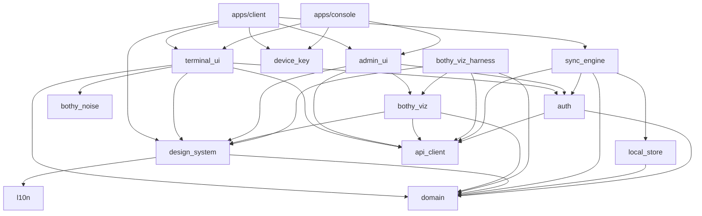
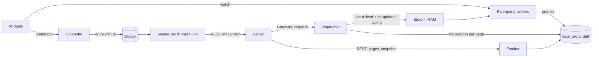
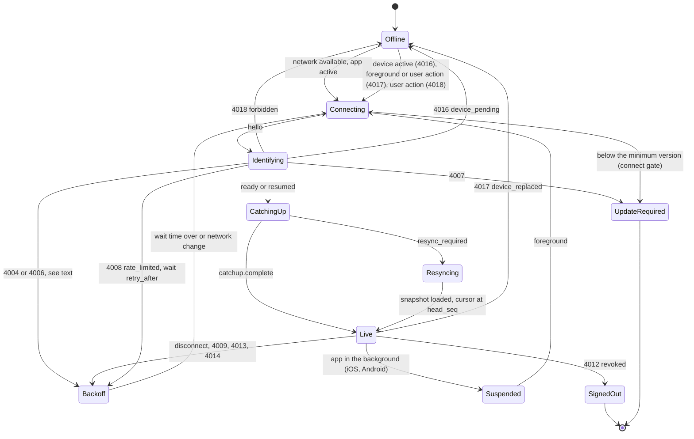
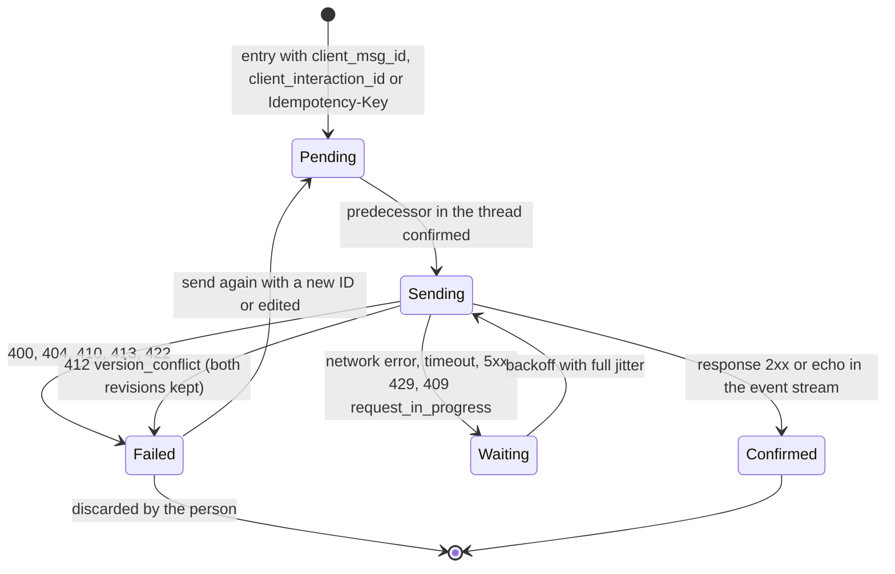
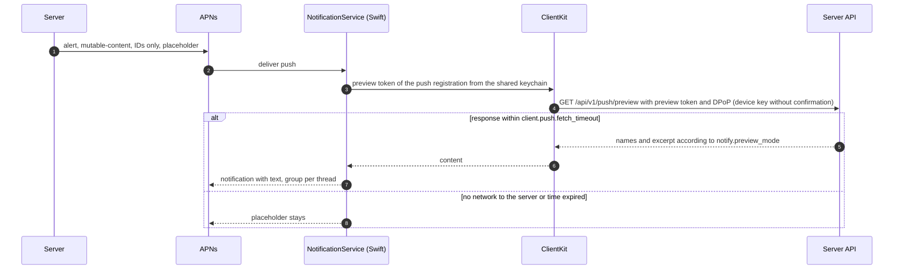

# 15 Client architecture

Status: draft M0. Applies to `apps/client` (iOS, Android, macOS, Windows), `apps/console` (web)
and `packages/`. Terminal: [24-terminal.md](24-terminal.md) (normative for protocol and permissions),
here section 23. Visualizations: [25-visualization.md](25-visualization.md). Terms: [00-glossary.md](00-glossary.md). Sync: [04-sync-protocol.md](04-sync-protocol.md)
(normative for everything stated here about events, cursors and the outbox). Usage:
[01-product.md](01-product.md). Design: [docs/design/](../design/README.md). Decisions:
ADR 0027 (Flutter), ADR 0028 (web only for the console), ADR 0029 (state, local DB, outbox),
ADR 0030 (design tokens), ADR 0044 (branding).

## 1. Principles

1. **No permission logic in the client.** The app shows what the server delivers and allows. It
   hides controls based on server responses and events (for example `access.changed`), never
   based on its own derivation from grants (B7, study A).
2. **The local database is the source of the interface.** Widgets read only from the local
   database and from short-lived in-memory stores. The network writes into the database;
   the interface follows. That gives one path for online, offline and catch-up.
3. **Every write goes through the outbox** with its own ID ([04](04-sync-protocol.md)
   section 13.2). There is no second, "fast" write path.
4. **One code base, native only where the system requires it.** Flutter for all interfaces; Swift,
   Kotlin and C++ only for extensions and system services (Notification Service Extension, Share
   Extension, push service, notification area, keys in secure storage, auto-update).
5. **Pure Dart packages for logic.** Domain, sync and login do not import Flutter. They can be
   tested without a device and also run in a background isolate.

## 2. Platforms

Flutter 3.47 is the current stable version (https://docs.flutter.dev/release/release-notes,
retrieved 2026-10-10 [verified]). Supported minimum versions according to
https://docs.flutter.dev/reference/supported-platforms (retrieved 2026-10-10 [verified]): Android
API 24, iOS 15, macOS 12, Windows 10 and 11.

| Target | Minimum version of the product | Reason |
|---|---|---|
| iOS | 15 | Flutter minimum |
| Android | API 26 | `sentry_flutter` 10 requires API 26 (https://pub.dev/packages/sentry_flutter, retrieved 2026-10-10 [verified]) |
| macOS | 12 | Flutter minimum |
| Windows | 10 version 2004 (build 19041) | Share Target with `ShareTargetActivatedEventArgs` and package identity for notifications require 10.0.19041 (https://learn.microsoft.com/windows/apps/develop/windows-integration/integrate-sharesheet-receive, https://learn.microsoft.com/en-us/windows/apps/desktop/modernize/grant-identity-to-nonpackaged-apps, retrieved 2026-10-10 [verified]) |
| Web (console only) | current Chromium, Firefox, Safari versions | JavaScript build; Wasm usable only in Chromium (https://docs.flutter.dev/platform-integration/web/wasm, retrieved 2026-10-10 [verified]) |
| Linux | not a target | not required; Flutter could do it later |

## 3. Workspace

One Dart pub workspace in the product repo (one shared resolution, one `pubspec.lock`;
pub workspaces exist since Dart 3.6, https://dart.dev/tools/pub/workspaces, retrieved 2026-10-10
[verified]). No Melos: tasks run through the make targets of the repo (quality team).

Workspace root (M4-01): the root `pubspec.yaml` of the repository (`name: bothy_workspace`,
`publish_to: none`) lists the fourteen members below in the `workspace:` list in this order and
pins the exact Flutter version in `environment.flutter`; CI installs that version, and every
member repeats the same `environment` lines, has `resolution: workspace` and `publish_to: none`,
and tracks no lock file of its own. The root `analysis_options.yaml` holds the rules all members
share (strict analysis, `public_member_api_docs` as an error, generated code excluded); each
member includes it after its base set (`package:lints` or `package:flutter_lints`).

```text
apps/
  client/                 Flutter app for iOS, Android, macOS, Windows
    lib/                  App shell, router, layouts per form factor, chat features
    ios/ macos/           Runner, NotificationService, ShareExtension, ClientKit (Swift Package)
    android/              MainActivity, push service, share activity (Kotlin)
    windows/              Runner, notification area, MSIX manifest, Share Target, toast activation (C++)
    integration_test/     Integration tests against the fake server
  console/                Flutter Web: administration, statistics and terminal (ADR 0028, ADR 0070)
packages/
  design_system/          Tokens (generated), theme, components, icons, fonts (Flutter)
  l10n/                   ARB files de and en, generated localization (Flutter)
  domain/                 Entities, value objects, pure rules (Dart)
  api_client/             Client generated from OpenAPI (openapi-generator dart-dio), never by hand (Dart)
  auth/                   Login, tokens, DPoP proofs, step-up, refresh (Dart)
  device_key/             Plugin: keys in secure storage per platform (Flutter plugin, Pigeon)
  local_store/            drift database, schema mirror, migrations, encryption (Dart)
  sync_engine/            Gateway, catch-up, outbox, reconciliation, run documents (Dart)
  admin_ui/               Administration screens for desktop, console and emergency actions on mobile (Flutter)
  bothy_viz/              Visualizations of the statistics: views, primitives, fixtures, harness (Flutter)
  bothy_noise/            Noise handshake NK, transport encryption and frames of the terminal (Dart)
  terminal_ui/            Terminal view: renderer, sessions, pinning, extra keys bar (Flutter)
```

Deviation from the base list of the brief: `auth`, `device_key` and `admin_ui` are additional
packages. Reasons: both apps and the native extensions need the same logic for login and keys;
administration appears in two apps and must not be built twice. `bothy_viz` (addendum
of 2026-10-10) keeps the visualizations from [25-visualization.md](25-visualization.md) in one
place for the desktop app, the mobile app and the console, with its own harness and its own fixtures.
`bothy_noise` and `terminal_ui` (addendum of 2026-10-10) carry the terminal: `bothy_noise` is
pure Dart and checked against public test vectors (24, section 5.2), so that the same crypto layer runs in the app
and in the console; `terminal_ui` keeps the view for the desktop app, the mobile app and the console in one
place (section 23).

### 3.1 Dependency rules



Rules (checked by an architecture test in the gate, ticket "Dependency rules"):

1. `domain`, `api_client`, `auth`, `local_store`, `sync_engine` do not import `package:flutter`.
2. Packages never import from `apps/`.
3. `apps/console` does not depend on `sync_engine` and `local_store` (ADR 0028).
4. Only `device_key` and `apps/client/{ios,macos,android,windows}` contain platform code.
5. `api_client` is generated and checked in; a gate regenerates it and compares (like the
   other generated clients, baseline R-Clients).
6. `bothy_viz` does not depend on `sync_engine` and `local_store`. It gets the live stream through
   the port `LiveFrameSource`: in the desktop app from `sync_engine` (gateway subscription `stats.subscribe`),
   in the console from REST queries of `getStatsLive` ([25-visualization.md](25-visualization.md),
   section 7.1). No package and no app embeds a WebView or an iframe for statistics
   (SEC-VZ-1).
7. `bothy_noise` does not import `package:flutter` and has no dependency with crypto code other
   than `cryptography`. `terminal_ui` does not depend on `sync_engine` and `local_store`; it gets the stream,
   the store of the pinned keys and step-up through ports (section 23.1). Reason: the
   console has neither a gateway nor a local database (rule 3).
8. A member depends on and imports only the members that the diagram reaches from it, directly
   or through other members (the arrows and their transitive closure: `apps/client` may import
   `domain` through `sync_engine`, `auth` may not import `local_store`). The reach is an allow
   list: a new arrow changes this diagram and `tools/arch-check/rules.yaml` in the same change.
9. Every `pubspec.yaml` under `apps/` and `packages/` is a member of the workspace (root
   `workspace:` list) and of `tools/arch-check/rules.yaml`, and every member listed there has
   its manifest.
10. A library named `testing.dart` of any member (and its `lib/src/testing/` folder) is test
    support, for example the fake server `package:sync_engine/testing.dart` and
    `package:design_system/testing.dart`; only the `test/` and `integration_test/` folders
    import or export it, also inside its own member (brief M4-17).

Rule 4 in the check: native sources (`*.swift`, `*.m`, `*.mm`, `*.kt`, `*.java`, `*.cpp`,
`*.cc`, `*.h`) lie only in `packages/device_key` and in `apps/client/{ios,macos,android,windows}`;
`apps/console/web` holds none. Rules 1 and 7 in the check: the pure Dart members import neither
`package:flutter/` nor `dart:ui` and do not depend on the Flutter SDK; `bothy_noise` does not
import `dart:io` in `lib/` (its tests read vector files with it) and has `cryptography` as its
only runtime dependency. `make arch` runs the architecture test `tools/arch-check` for every
member on every run of the gate; each finding names file, line and rule.

## 4. State

Riverpod 3 (`flutter_riverpod` 3.4.3, MIT, publisher dash-overflow.net; https://pub.dev/packages/flutter_riverpod,
retrieved 2026-10-10 [verified]) with code generation (`riverpod_generator`). Rationale and
rejected options: ADR 0029.

| Kind | Provider | Source |
|---|---|---|
| durable data (spaces, channels, threads, messages, read state) | `StreamProvider` per query, `family` by ID | drift queries (`watch`) |
| short-lived data (live box document, typing, agent presence) | `Notifier` per run or thread | store of the `sync_engine` |
| connection, sync state, login | `Notifier` | `sync_engine`, `auth` |
| commands of the interface (send, react, close) | methods of a controller | write into the outbox |
| settings, theme, density, motion | `Provider` | `user_settings` locally plus system values |

Rules: widgets hold no domain state. Screen providers are `autoDispose`; what a
thread in focus needs lives only as long as it is visible (matches the focus op of the gateway). Tests
replace providers through `ProviderContainer` overrides (fake clock, fake transport).

## 5. Data flow



A durable event is applied only if `resource.version` is greater than the local version
([04](04-sync-protocol.md) section 9). That way REST pages and events mix without
conflict, and duplicates after reconnecting are harmless. Exception: `reaction.*` and `pin.*` do not change
the version of the message; they carry absolute values and are applied in `seq` order
(04 section 9, item 3).

## 6. Local database

drift (`drift` 2.35.2, publisher simonbinder.eu; https://pub.dev/packages/drift, retrieved
2026-10-10 [verified]) on SQLite through the package `sqlite3`. The package bundles SQLite through
Dart build hooks; with the option `source: sqlite3mc` it delivers SQLite3MultipleCiphers for encrypted
databases (https://github.com/simolus3/sqlite3.dart/blob/main/sqlite3/doc/hook.md, retrieved
2026-10-10 [verified]). The earlier packages `sqlite3_flutter_libs` and `sqlcipher_flutter_libs`
are marked as end-of-life (pub.dev API, version `0.6.0+eol` and `0.7.0+eol` respectively, retrieved
2026-10-10 [verified]) and are not used.

```yaml
# root pubspec.yaml of the workspace (excerpt)
hooks:
  user_defines:
    sqlite3:
      source: sqlite3mc
```

As built (M4-12): the user define lives in the root `pubspec.yaml`, because build hooks read
user defines only from the workspace root; with the pinned SDK the hook then loads SQLite 3.54.0
as SQLite3MultipleCiphers 2.6.1 (package `sqlite3` 3.7.1, a prebuilt library checked against
the hashes of the package). The cipher is the SQLite3MultipleCiphers default `chacha20`
(ChaCha20-Poly1305); the key is set as the first statement in the raw form
`PRAGMA key = "x'<64 hex>'"`, which that library takes without a key derivation, and the opener
checks the key, the cipher and FTS5 before drift uses the connection
(`packages/local_store/README.md`, docs/DECISIONS.md D-M4-12-1, D-M4-12-2). The offline search
table `search_index` is FTS5 with the tokenizer `unicode61 remove_diacritics 2` and no stemmer
([14](14-search.md) 6, D-M4-12-5). Schema version 1 has every table of 6.1 except
`host_key_pins`, which M4-36 adds with schema version 4 (D-M4-12-8, D-M4-36-2).

### 6.1 Schema mirror

Locally there are copies of the server tables, only with the columns the client sees, plus `version`
for reconciliation. Fields that can only be read with `manage` (channel prompt, skills) are never stored locally.

| Local table | Server table | Note |
|---|---|---|
| `spaces`, `user_space_states` | same name | sidebar |
| `channels`, `forum_tags`, `channel_operators` | `channels` (without `prompt`), `forum_tags` | effective operator as a column |
| `threads`, `thread_tags` | same name | `last_message_seq`, state, title source |
| `messages` | `messages` | without `client_payload_sha256`; with `trigger_state` |
| `message_attachments`, `files` | same name | metadata; bytes in the file cache |
| `reactions_summary` | `reactions` | per message and emoji: count and "me" |
| `my_mentions` | `mentions` | only mentions of the person themselves |
| `message_components` | same name | state, definition |
| `runs` | `runs` | summary from `run.state_changed`; document only in memory |
| `agents`, `principals` | `principals`, `agents` (card) | display, mode badge, reported presence |
| `commands` | `commands` | for suggestions offline |
| `read_states`, `drafts`, `user_settings`, `notification_preferences`, `quiet_hours` | same name | personal sync data |
| `instance` | `instance_settings` (branding, evaluated switches), the limits and the app lock policy of `getInstance` | |

Local only:

| Table | Purpose |
|---|---|
| `outbox` | entries of the outbox (section 7.5) |
| `sync_state` | cursor, `head_seq`, `permission_version`, gateway session, last snapshot |
| `loaded_ranges` | loaded ranges of `thread_seq` per thread; detects gaps ([04](04-sync-protocol.md) section 4) |
| `file_cache` | path, size, last access per file and thumbnail |
| `search_index` | FTS5 index over cached messages for offline search |
| `share_inbox` | share entries taken over from extensions |
| `recent_targets` | recently visited spaces, channels and threads of the quick switcher, per device, never synchronized ([01](01-product.md) D6) |
| `host_key_pins` | pinned Noise keys of the hosts per device (section 23.3); never covered by the cleanup after `client.cache_max_age`, because a lost pin would prevent a warning on a key change |
| `space_view_states` | whether a space is collapsed in the sidebar, per device, never synchronized ([01](01-product.md) 6.7, R-PR-24; [04](04-sync-protocol.md) section 14, R-SY-29); filled once from `user_space_states.collapsed` by schema version 10 |

### 6.2 Migrations

drift workflow with `dart run drift_dev make-migrations`: one stored schema file per schema
version, step-by-step migrations (`stepByStep`) and generated migration tests
(https://drift.simonbinder.eu/migrations/, retrieved 2026-10-10 [verified]). Additional rule: the
cache may be discarded and reloaded during a migration (mirror tables, cursor to
`resync`); `outbox`, `drafts` and `share_inbox` are always migrated without loss, because they contain unsent
work; `host_key_pins` likewise, because they are trust anchors. A test checks this per version.

### 6.3 Encryption and cleanup

- Key: 256 bits of randomness at the first start, in secure storage (section 9), never in plain text
  on disk.
- iOS: file with protection class `NSFileProtectionComplete`; the extensions do not need the database
  (study C recommended "complete"). As built (M5-02, D-M5-02-7): the instance folder, the database
  file and its `-wal` and `-shm` files get the class before the first open (new files in the
  folder inherit it) and again after it; the iOS simulator keeps no protection class, so only a
  device can read it back.
- Android: database in the private app storage, excluded from backups (drift points out
  that Android backups can restore an old database). As built (M5-03, D-M5-03-1):
  `android:allowBackup="false"`, and the data extraction rules (cloud backup and device transfer,
  API 31 and later) and the full backup rules (API 30 and earlier) exclude every domain, so no
  backup or device transfer copies the database, the secure storage or the preferences.
- Cleanup: entries without access since `client.cache_max_age` and everything above `client.cache_max_bytes`
  (oldest first) are removed; never the outbox and drafts.
  As built (M4-12): `CacheCleaner` removes threads (with everything below them) and file cache
  rows by `last_accessed_at`; it never touches `outbox`, `drafts` and `share_inbox`, and never
  the structure rows (spaces, channels, principals, commands, instance) the sidebar needs.
- Access removal ([04](04-sync-protocol.md) section 8.3): on `access.changed` with `removed` the
  dispatcher deletes, in one transaction, all rows of the targets, their files in the cache and their entries in the
  search index. On `4012` the app deletes the database, file cache, keys and tokens.

## 7. Sync engine

`packages/sync_engine` implements [04-sync-protocol.md](04-sync-protocol.md). It is pure Dart
and has ports for clock, network status, transport (WebSocket, HTTP) and login.

### 7.1 Building blocks

| Building block | Task |
|---|---|
| `Connection` | WebSocket (`web_socket_channel`), frames `{op, d}`, heartbeat with random delay, backoff with full jitter (`sync.reconnect_backoff_*`), immediate attempt on a network change and on foreground |
| `Session` | `hello`, `identify` or `resume` with DPoP proof and nonce, `reauth` before token expiry, close codes according to table 6.4 |
| `CatchUp` | apply pages, store `cursor` frames, `catchup.complete`, `resync_required` |
| `Dispatcher` | apply durable events (one transaction per page or per live event), version rule, echo of the outbox, access removal |
| `Fetcher` | REST: snapshot, thread pages (backward from the newest `thread_seq`), filling gaps, run document, files |
| `Outbox` | sending per thread strictly FIFO, threads in parallel; retry, error classes |
| `FocusManager` | report visible threads to the gateway (at most `sync.max_focused_threads`) |
| `RunStore` | run documents in memory; patches according to RFC 6902 (`add`, `replace`, `remove`), rule from [04](04-sync-protocol.md) section 11.3 item 4 |
| `EphemeralStore` | typing (`sync.typing_ttl`), agent presence |
| `StatsSubscription` | the `stats.live` subscription of the connection ([25-visualization.md](25-visualization.md), section 5.1): `stats.subscribe` when live, again after `identify`, not after `resume` (the server restores it); an `error` of `stats.subscribe` ends it with its code and a `stats.unsubscribe`, because the server keeps an earlier subscription on a refusal; a refused `stats.unsubscribe` is sent again after `resume`, and a frame that arrives while none is wanted sends it again; frames go to a stream for `LiveFrameSource` and are never stored (M6-16) |

`SyncEngine` (`lib/src/engine.dart`) is the one composition root the apps use: it builds these
parts and wires their hooks (echo to the outbox, outbox start after `catchup.complete` and pause
on every disconnect, `run.updated` and the run end to the `RunStore`, focused runs into the
focus), so no app wires them itself (M4-17).

Large catch-up pages are decoded in a background isolate as soon as a page
exceeds `client.sync.parse_offload_bytes`; the database runs in its own isolate
(drift).

### 7.2 Connection states



`4004`: the app renews the access token and reconnects; if the refresh fails, it logs out.
`4018`: the app shows the reason and reconnects only on user action; a new token does not help.
`4016`: the device waits for approval; the app polls `GET /api/v1/devices/{id}` (`LoginService.pollPendingDevice`) and reconnects when the device is `active`.
`4017`: a newer connection of the same device is active; the app reconnects only on the return to the foreground or on user action.
`4008`: the app waits the seconds of `retry_after=<seconds>` in the close reason instead of the jitter; without a readable value the normal backoff applies.
`4006`: the app connects with `identify` instead of `resume`.
After an app start the first connection is `identify` with the stored cursor, also inside the resume window: `resumed` carries no snapshot, and the new engine holds no counters until the snapshot of `ready` seeds them (04 14; docs/DECISIONS.md D-M4-30-11).
Every attempt has the deadline `client.sync.connect_timeout` from its start in `Connecting` until `ready` or `resumed`: a socket that does not open, a missing `hello` or a missing answer to `identify` or `resume` ends the attempt, and the app goes to `Backoff` like after a failed connect.

Every state carries a reason beside its phase (`ConnectionState(phase, reason)` of `sync_engine`): `none`, `networkUnavailable`, `devicePending`, `deviceReplaced`, `forbidden`, `rateLimited`, `revoked`, `protocolUnsupported`, `belowMinimumVersion` or `closedByServer(code)`; the interface explains `Offline` and `Backoff` with it. `Offline` with `networkUnavailable` connects when the network returns. The close reactions are one table in code (`closeCodeTable`, docs/DECISIONS.md D-M4-13-2).

Version gate (M7-13, [18-release.md](18-release.md) 9): before every attempt, at the start and on every reconnect, the engine asks its connect gate (`ConnectGate`); the app answers with `getDiscovery` and `client.min_version.<platform>`. A refusal opens no socket and ends in `UpdateRequired` with the reason `belowMinimumVersion`, which never reconnects. A gate without an answer keeps the last decision: it admits the attempt unless that decision refused, and the server stays the second line with `4007`. After a refusal the app closes the instance without deleting its data and shows E1 "App too old" with the update path (section 15).

`Suspended`: on iOS there is no WebSocket in the background; the app closes with `1000` and
reconnects in the foreground with `resume` (Apple DTS in the forum: "WebSocket tasks are not supported in
background sessions", https://developer.apple.com/forums/thread/716118, retrieved 2026-10-10
[verified]). Android behaves the same; push takes over (section 10). macOS and Windows stay
connected as long as the app runs.

### 7.3 Catch-up and reconciliation

1. Connect with the stored cursor; apply pages; store the cursor after each page in the same
   transaction as the page. A gateway page is the run of `dispatch` frames up to the
   next `cursor` frame or `catchup.complete`; it is applied with the cursor of that frame
   (D-M4-14-1). An event whose type has no local table (for example `host.updated` before M4-36)
   or that the client does not know advances the cursor and is skipped (04 6.1).
2. On `resync_required`: empty the mirror tables (not the outbox, drafts, share inbox),
   `GET /api/v1/sync/snapshot`, cursor to `head_seq`, reload open threads. The connection
   stays open and is live from `head_seq`; no reconnect (04, 7.3).
3. After `catchup.complete` the outbox sends in order.
4. Gaps in `thread_seq` (an event does not fit the loaded ranges) are loaded by the fetcher through REST
   before it shows the message.
5. Personal data: the echo of one's own device (`updated_by_device_id`) is ignored; a draft with
   `overwrote_newer` shows a notice; read state only increases.

### 7.4 Live box

Focus on a thread with an active run delivers the whole document once, then patches.
`base_version` equal to local: apply; `version` less than or equal to local: ignore; otherwise a gap:
`GET /api/v1/runs/{id}`. The interface draws at most once per frame (patches are collected per
frame). When the run ends, the `RunStore` discards the document; the collapsed row comes from
the table `runs`.

### 7.5 Outbox



Rules from [04](04-sync-protocol.md) sections 13.2 and 13.3; in addition: after
`client.outbox_stuck_after` in the state `Waiting`, an entry shows the notice "Sending delayed". File uploads are
separate entries before the message that attaches them; the message waits until the upload session
of each of its files is completed (`completeUpload` with `200`, [12](12-files.md) 3.4) and then
attaches them; the check of the server goes on, and the server holds the agent invocation until
the check is final, at most `file.invocation_hold_max`, after which the invocation shows the attachments with their state ([12](12-files.md) 10; ruling D-M4-22-1).

`409 request_in_progress` (the first request with the same `Idempotency-Key` is still running,
04 5.2) is retried like a `5xx` with the same ID. `412 version_conflict` ends in `Failed` with the
`current` revision of the problem kept in the entry; the interface shows both revisions and the
person decides, without an automatic merge (04 13.3). The outcome classes of every other status
are in docs/DECISIONS.md D-M4-15-1.

## 8. Network and login

- **REST:** `api_client` (openapi-generator `dart-dio`, baseline R-Clients) with interceptors for
  DPoP, `Idempotency-Key`, correlation ID, retry only for reads (`Retry-After` plus jitter); the
  outbox retries writes. An outbox executor that reads within an attempt opts out of the read
  retry, so a refused read is retried once, with its entry ([12](12-files.md) 3.8).
- **DPoP:** proof per request (RFC 9449) with the device key, ES256 (section 9); the server nonce
  is taken over. Gateway proof in `identify` ([04](04-sync-protocol.md) R-SY-01).
- **Refresh:** exactly one refresh per refresh family at a time (single flight); the new token is
  stored before it is used. The Share Extension (iOS, macOS) must refresh by itself and
  never shares the family of the app: the app creates a child session with its own family for it
  (`createExtensionSession`, [08](08-identity.md) section 7.4) and puts its tokens into the
  shared keychain group. If the child session is missing or revoked, the extension puts
  the entry into `share_inbox`, and the app creates a new one at the next start. The
  Notification Service Extension never refreshes tokens; it uses the preview token (10.1). Reason: two processes with one family would refresh at the same time, and the second
  refresh, being a reuse, would look like theft and would revoke the family
  ([03](03-data-model.md), `refresh_tokens`).
- **Login:** OIDC with PKCE in the system browser (ASWebAuthenticationSession, Custom Tabs,
  default browser), never in a web view; redirect on mobile through a custom URL scheme from the
  build configuration or through a claimed HTTPS link, on desktop through loopback
  `127.0.0.1` with a free port (RFC 8252, https://www.rfc-editor.org/rfc/rfc8252.txt, retrieved
  2026-10-10 [verified]). Proxy header login needs no browser: the app calls
  `auth.login.complete` behind the proxy. Passkeys in native apps only for instances with a
  public domain (Associated Domains), baseline R-Passkeys; otherwise local accounts with password
  and TOTP as a fallback. As built on Android (M5-03, D-M5-03-3): the Credential Manager's
  platform provider (API 34 and later; no Play services library), only when the App Links host
  of the build equals the instance's host, with `android:apk-key-hash:<hash>` in
  `auth.webauthn_origins` ([08](08-identity.md) 18).
- **Step-up:** native apps sign a server challenge with a second device key that
  requires user confirmation (biometrics or PIN); the web console uses WebAuthn passkeys. For
  `terminal.open` and `terminal.attach` the step-up is fresh and is consumed (08, section
  6.3); for this the console uses only a passkey with `userVerification = required`.
- **Interceptor order:** `packages/auth` fills the auth slot of `createApiClient` with
  `RefreshInterceptor`, `DpopInterceptor` and `StepUpInterceptor` in this order, so a request is
  refreshed before its proof hashes the token, and each interceptor answers only its own problem
  code (`token_expired`, `use_dpop_nonce`, `step_up_required`) with at most one repeat.
- **Signed out:** `401 session_revoked`, a rejected refresh, a revoked pending device, the
  gateway close `4012` and `logout` end in the event `SignedOut(reason)` of `packages/auth` after
  the secret store is cleared; for a revoked session or device (`deleteLocalData`) the app deletes
  the local data of that server (R-SY-14).
- **Terminal stream:** per session its own WebSocket connection next to the gateway (section
  23.2); it never runs through `sync_engine`.

## 9. Secure storage and device key

The Secure Enclave supports only NIST P-256 keys ("only supports P-256 keys",
https://developer.apple.com/documentation/security/protecting-keys-with-the-secure-enclave and
https://developer.apple.com/forums/thread/694855, retrieved 2026-10-10 [verified]); StrongBox on
Android also knows only P-256 as a curve
(https://developer.android.com/privacy-and-security/keystore, retrieved 2026-10-10 [verified]).
That is why all clients use **ES256** for DPoP and step-up, although the data model also allows EdDSA.

| Platform | Device key (DPoP) | Step-up key | Secrets (refresh token, DB key) |
|---|---|---|---|
| iOS | Secure Enclave, P-256, without user confirmation, keychain access group with the extensions, `AfterFirstUnlockThisDeviceOnly` | Secure Enclave, P-256, `.biometryCurrentSet` when biometrics are enrolled (new biometrics invalidate the key, [08](08-identity.md) 6.1), otherwise `.userPresence` (device password); `WhenPasscodeSetThisDeviceOnly` | Keychain through `flutter_secure_storage` (publisher steenbakker.dev); tokens for the extensions in the shared access group with `AfterFirstUnlockThisDeviceOnly`, DB key `WhenUnlockedThisDeviceOnly` |
| macOS | Secure Enclave (Macs with an Apple chip or with Touch Bar and Touch ID according to the Apple documentation), otherwise a keychain key without the enclave, reported to the server as "not hardware-bound" | like iOS; without an enclave a software key whose keychain item carries `.userPresence` | Data Protection keychain |
| Android | Android Keystore, StrongBox if available (`setIsStrongBoxBacked`, fallback on `StrongBoxUnavailableException`), P-256; without StrongBox and trusted execution environment (emulators) a software Keystore key, reported as not hardware-bound | Keystore key with user authentication per operation through `BiometricPrompt`: from API 30 strong biometrics or the device credential (PIN, pattern, password), on API 26 to 29 strong biometrics only, because a per-operation key cannot be unlocked with the device credential there; without enrolled biometrics on those levels there is no step-up key (`not_available`). Invalidated by new biometrics (`setInvalidatedByBiometricEnrollment`) | `flutter_secure_storage` (RSA-OAEP plus AES-GCM, key in the Keystore according to the package documentation) |
| Windows | CNG with Microsoft Platform Crypto Provider (TPM), ECDSA P-256 after a check with `NCryptIsAlgSupported`; without a TPM a software key, reported as not hardware-bound; per user, export policy `0`, the provider fixed at creation (D-M4-11-1) | none: Windows enforces no confirmation per use for a P-256 key that code in the process cannot answer itself, so the plugin reports `not_available` and the step-up falls back to the other methods of [08](08-identity.md) 6 (D-M4-11-2) [verified, see below] | `flutter_secure_storage` (Windows Credential Manager plus AES-GCM files according to the package README [verified through search, source code not read]) |
| Web (console) | none: cookie session according to the backend-for-frontend pattern, tokens only in the server ([08](08-identity.md) section 7.5) | WebAuthn passkey, otherwise a renewed OIDC login or password with TOTP | none in the browser; cookie `HttpOnly` |

Sources: https://pub.dev/packages/flutter_secure_storage (version 11.2.0, retrieved 2026-10-10
[verified]); Microsoft CNG `NCryptCreatePersistedKey` with `MS_PLATFORM_CRYPTO_PROVIDER`
(https://learn.microsoft.com/en-us/windows/win32/api/ncrypt/nf-ncrypt-ncryptcreatepersistedkey,
retrieved 2026-10-10 [verified]); that every TPM 2.0 offers P-256 is [assumed] and is checked at
runtime. Windows step-up (M4-11): strong key protection (`NCRYPT_UI_POLICY_PROPERTY`,
`NCRYPT_UI_FORCE_HIGH_PROTECTION_FLAG`) asks for a password whose behavior "is specified by the
KSP" (https://learn.microsoft.com/en-us/windows/win32/api/certenroll/ne-certenroll-x509privatekeyprotection),
and the Microsoft providers take that password from the process through `NCRYPT_PIN_PROPERTY` and
"cache this value so that the user is only prompted once per process"
(https://learn.microsoft.com/en-us/windows/win32/seccng/key-storage-property-identifiers); Windows
Hello's `KeyCredentialManager` keys are RSA and sign with SHA-256 and PKCS #1
(https://learn.microsoft.com/en-us/windows/apps/develop/security/windows-hello), all retrieved
2026-10-15 [verified]. Not checked on a Windows host.

`packages/device_key` is one Flutter plugin package with a folder per platform and a typed
Pigeon (flutter.dev) interface as its boundary, not a set of federated packages (docs/DECISIONS.md
D-M4-10-1). It offers: create a key, return the public JWK and thumbprint, sign, return an
attestation (if the platform has it), delete the keys of a server. The JWK and the RFC 7638
thumbprint are computed in Dart for every platform; signatures leave the native side in the JOSE
form `R || S` (D-M4-10-2). The Swift and Kotlin parts use the same implementation as the
extensions: on iOS and macOS that is the Swift package `DeviceKeyCore`
(`packages/device_key/darwin/device_key/DeviceKeyCore`, CryptoKit, Security and LocalAuthentication), which the
plugin package and the Notification Service and Share Extensions depend on (D-M4-10-4). Every key
item is a generic password in the Data Protection keychain (also on macOS), never synchronizable,
labelled `<prefix>.<sha256(scope)>.<purpose>`; it holds the enclave-wrapped key blob, or without an
enclave the software key. The DPoP key sits in the keychain access group shared with the
extensions, which the app names in its Info.plist key `DeviceKeyAccessGroup`. Step-up access
control: `.biometryCurrentSet` where biometrics are enrolled, `.userPresence` otherwise (D-M4-10-3),
so a Mac without Touch ID still confirms with the device password. App Attest is not used yet;
the attestation stays empty on iOS and macOS.

On Android the key code is the Kotlin module `devicekeycore`
(`packages/device_key/android/devicekeycore`, class `DeviceKeyCore`, docs/DECISIONS.md D-M5-01-6).
The plugin library compiles the module's sources into itself, so the app's push service (10.2)
and share activity reach the same classes through their dependency on the plugin, without a
second Gradle project. Keys live in the `AndroidKeyStore` under the alias
`<prefix>.<sha256(scope)>.<purpose>`, ES256 only, not exportable; the Keystore is excluded from
backups by the system. `hardwareBound` reports `KeyInfo.securityLevel` (StrongBox or trusted
execution environment) from API 31 and `isInsideSecureHardware` before it (D-M5-01-4). The
attestation is the key's certificate chain from `setAttestationChallenge`, DER certificates leaf
first and concatenated; Android binds the challenge when it creates the key, so the attestation
exists only when the call creates the key (D-M5-01-2). The step-up prompt texts come from Dart
(`packages/l10n`), and `BiometricPrompt` needs the app's activity to be a `FragmentActivity`
(`FlutterFragmentActivity`); the device credential rule per API level of the table above is
D-M5-01-3.

Because the refresh token is bound to the device key (DPoP), a stolen token is worthless without
the device; that lowers the requirement on the storage of the tokens, not on the key.

App lock and database key (M5-08, [08](08-identity.md) 9): the database key is the residual
protection of a lost or borrowed device. It is stored for this device only and, on iOS, with
`WhenUnlockedThisDeviceOnly`, so it is readable only while the device is unlocked, unlike the
tokens (`AfterFirstUnlockThisDeviceOnly`, which the extensions need); on Android it lies in the
Keystore-wrapped store that the backup rules exclude. A copy of the database file is unreadable
without that key (`apps/client/test/lock/database_key_test.dart`). The phone app lock
(`apps/client/lib/lock/`) hides every content behind E6 at a cold start and after
`client.app_lock_after` without use, with the privacy cover and the recent apps protection always
on, and unlocks through `local_auth` (iOS `LAPolicy.deviceOwnerAuthentication`, Android
`BiometricPrompt` with biometrics or the device credential).

Desktop app (M4-18, docs/DECISIONS.md D-M4-18-1): `apps/client/lib/platform/secure_store.dart`
keeps the refresh token, the device ID and the database key of each instance in
`flutter_secure_storage`, every key prefixed with `instance/<instance_id>/`; the only key outside
an instance is the remembered server address (`app/server_address`). On macOS a release build uses
the Data Protection keychain, not synchronized, with `first_unlock_this_device` and the keychain
access group `$(AppIdentifierPrefix)<bundle identifier>`; a debug or profile build keeps the items
in the login keychain, which has no access group, so every app of the person reaches them (an app
signed differently from the writer gets an access prompt). On Windows the package default applies
(a DPAPI-encrypted file in the support folder, which every branding of the runner shares).
Therefore the secrets belong to one app identity (FIX-app-logout, docs/decisions.d/FIX-app-logout.md):
on iOS and macOS they sit under the keychain service `<bundle identifier>.secrets`, on Windows and
Android under the key prefix `<bundle identifier or application ID>/`, and a build with another
identity never reads, lists or deletes them; a new identity starts with enrollment. Secrets of a
build before this rule move into the scope once at the first start and leave the old place: always
where only the app reaches the old store, in a shared store (the macOS login keychain, Windows) only
when the app already has an instance folder under its data root.
The database key is 32 bytes from `Random.secure()`, created at the first start of an instance;
the database is `<application support>/instances/<instance_id>/local.db`, the file cache lives
in the same folder, and the device keys of `packages/device_key` use the `instance_id` as scope.
A wipe (R-SY-14) deletes that folder, both device keys and every secret with the prefix.

## 10. Background behavior and push

The push carries only IDs and a neutral placeholder (baseline R-Push, ADR 0031). Format and
sending: [13-push-notifications.md](13-push-notifications.md).

| Platform | In the foreground | In the background | Push path |
|---|---|---|---|
| iOS | WebSocket | no connection | APNs, visible push with `mutable-content`; the Notification Service Extension fetches the text |
| macOS | WebSocket, also with a closed window, as long as the app runs | like iOS when the app has quit | APNs (Developer ID apps may use APNs, https://developer.apple.com/developer-id/, retrieved 2026-10-10 [verified]); NSE like iOS |
| Android | WebSocket | no connection | FCM data message of high priority with IDs only; an own native service shows a notification immediately and fetches the text |
| Windows | WebSocket | the app in the notification area keeps the connection; local notifications | no push in the M milestones; WNS later (baseline R-Push) |
| Web (console) | REST, fetch on opening | nothing | none |

**Idle (13 4.4).** A desktop client reports `idle: true` in `focus` (04 6.2) while its window is
hidden to the notification area, minimized, or not the foreground window of the system, and
`idle: false` as soon as the window is the foreground window again. There is no timer and no
idle time of the system: the window state alone decides (docs/DECISIONS.md D-M4-30-3). A thread
in `focus` of a connection with `idle: true` counts for live box patches and typing, not as
"Active in the thread".

### 10.1 iOS and macOS: Notification Service Extension

The NSE runs only for pushes with `mutable-content: 1` and a visible `alert` and has about 30
seconds (https://developer.apple.com/documentation/usernotifications/modifying-content-in-newly-delivered-notifications,
retrieved 2026-10-10 [verified according to research]). It is Swift without a Flutter engine, because memory and
time are scarce ([ADR 0056](../adr/0056-native-extensions-without-the-flutter-engine.md)), and uses `ClientKit` (Swift Package in `apps/client`), which the Share
Extension also uses.



If `notify.preview_mode` is `none` ([13-push-notifications.md](13-push-notifications.md)), the NSE fetches nothing. Tapping opens the app through a deep link
(section 11). Whether the NSE reaches a server that is reachable only in the private network depends on the VPN of the
device; that is a device test (risk in the report).

As built (M5-04, docs/decisions.d/M5-04.md):

- **Shared container.** The App Group holds only `notify.preview_mode` (written by the app at
  start and on every change), the `instance_id` of the signed-in account, the value of
  `client.push.fetch_timeout` (the extension has no `AppConfig`), the last `DPoP-Nonce` per
  server and the display counters. The shared keychain group holds, per instance, the preview
  token, the registration ID and the server address, `AfterFirstUnlockThisDeviceOnly` and never
  synchronized; the `dpop` device key sits in the same group. No content, no names and no IDs of
  threads or people are stored outside the encrypted database. Both groups exist only in a build
  signed by a team; without them the NSE keeps every placeholder.
- **Nonce rule.** The NSE starts each fetch with the last nonce of the server from the App Group,
  keeps every `DPoP-Nonce` it receives, and repeats a request once on `401 use_dpop_nonce`.
- **Counters.** The NSE counts per delivered push the duration from receipt to delivery (as
  buckets with the bounds of the app histograms) and whether the placeholder stayed; the app takes
  them at its next start and submits `client.push_display.duration` and `client.push.placeholder`
  (section 17).
- **Content.** The title is "<channel> · <thread title>", only the channel without a title, and
  the placeholder title without a channel name; the body is "<sender>: <excerpt>", the
  placeholder body instead of the excerpt in `names`, the placeholder alone without a sender.
  `404` shows "Message not available". The image of `image_url` is not attached yet.

### 10.2 Android

No Flutter plugin for receiving: an own `FirebaseMessagingService` (Kotlin) immediately shows
a notification with a placeholder, so that FCM does not downgrade the priority, and starts an
expedited WorkManager job that fetches the text and replaces the same notification (FCM:
"several seconds" in `onMessageReceived`, https://firebase.google.com/docs/cloud-messaging/android/message-priority,
retrieved 2026-10-10 [verified according to research]). The service reads the FCM token and passes it through
Pigeon to Dart (`push.register`). Reason against `firebase_messaging` with a Dart background handler:
starting a Flutter engine in the background costs the scarce time, and two services for the same
message collide. Notification channels: Mentions, Questions, All messages, Runs.
Instances without a Firebase project get no push on Android (UnifiedPush later).

As built (M5-03, D-M5-03-4): the app registers the four channels at every start with names and
descriptions from `l10n` in the device language (`createNotificationChannel` creates a missing
channel and updates the texts of an existing one; the importance stays the person's), so they are
in the system settings before the first push. The channel IDs are stable; the kind of a
notification (13 2) decides its channel:

| Channel ID | Name | Importance at creation | Kinds |
|---|---|---|---|
| `mentions` | Mentions | high | `mention`, `dm` |
| `questions` | Questions | high | `input_needed`, `security`, `admin` |
| `messages` | All messages | default | `message`, and every kind this build does not know |
| `runs` | Runs | default | `run_done`, `run_failed` |

A quiet notification (`quiet = 1`, [13](13-push-notifications.md) 3.4) goes into the same channel
with `setSilent(true)`, so the channel settings stay the person's only control. The runner keeps
the mapping for the push service of M5-05, which posts without a Flutter engine.

As built (M5-05, docs/decisions.d/M5-05.md, ADR 0072):

- **Receiving.** `onMessageReceived` ignores a message whose `v` is not `1`, posts the
  localized placeholder (the title and the body of the kind, generated from the ARB files) at
  once into the channel of the kind with the thread ID as tag and group, silently for
  `quiet = 1` (the group alerts only through a summary, and none is posted), records the `nid`
  as the newest of the thread and, unless `notify.preview_mode` is `none` or no preview token is
  stored for the instance `i`, enqueues one expedited `CoroutineWorker` per `nid` (unique work,
  run as normal work when the expedited quota is used up). No network call happens in
  `onMessageReceived`. A hint without a thread (`security`, `admin`) replaces the earlier one of
  its kind.
- **Worker.** It fetches the preview with the preview token and a DPoP proof of the `dpop`
  device key within what is left of `client.push.fetch_timeout` since receipt, only from an
  `https` address with the platform's certificate and host name check and without following a
  redirect, and repeats once on `use_dpop_nonce`. Under the lock of the thread it posts the text
  (or "Message not available" on `404`) only when its `nid` is still the newest of the thread and
  the time since receipt is within `client.push.fetch_timeout`; otherwise, and on any failure, the
  placeholder stays and nothing is retried, because a late text would replace a notification the
  person may have read. It counts the duration and whether the placeholder stayed; the app takes
  the counts at its next start as on iOS.
- **Sync.** `k = "sync"` cancels the notifications whose tag is in `cleared`, sets the badge
  number on the notifications that stay (`setNumber`, for launchers that show it) and never
  starts the worker.
- **Store.** The preview token, the registration ID and the server address per instance, the
  signed-in instance, `notify.preview_mode`, `client.push.fetch_timeout`, the last `DPoP-Nonce`
  per server, the newest `nid` per thread and the display counters live in the runner's own
  preferences file, every value sealed with an AES-GCM key of the Android Keystore that is not a
  device key and needs no user authentication, and key names that would carry an ID use its
  SHA-256. No content and no names are stored; Dart never stores the preview token. Every end of
  the account deletes the instance's entries and the shown push notifications.
- **Firebase.** Only a build whose configuration provides `google-services.json` links the
  Firebase messaging library and enables the service; without it the app builds and runs
  without push and the service stays disabled in the merged manifest (ADR 0072). Automatic
  token creation and analytics collection are off; the app asks for the token when it registers.
- **Permission.** From API 33 the app asks for `POST_NOTIFICATIONS` at the same moment as on
  iOS: once per run after the login, when the person first opens a thread.

### 10.3 Windows

When the window is closed, the app keeps running in the notification area (packages `tray_manager` and
`window_manager`, publisher leanflutter.dev) and keeps the gateway connection. Notifications are local
toasts (`flutter_local_notifications`, publisher dexterx.dev); they need package identity from
MSIX, otherwise `cancel` and `getActiveNotifications` do not work
(https://pub.dev/packages/flutter_local_notifications, retrieved 2026-10-10 [verified]). Start at
login is a setting (default off). An app that has quit gets no notifications; the
settings say so.

**Without package identity (until the MSIX of M7).** The Windows app is unpackaged until M7. Local
toasts work with an app user model ID (the bundle identifier of the build branding) and an
activation GUID derived from it; a click reaches the running app through the activation callback
of `flutter_local_notifications` and opens the thread at the message (section 11). `cancel` and
`getActiveNotifications` need package identity and are skipped with a log line without content;
a thread's notification is replaced by showing the next one under the same notification ID.
"Start at login" is the value `<app name>` under
`HKEY_CURRENT_USER\Software\Microsoft\Windows\CurrentVersion\Run` on Windows (the `Run` key starts the
program every time the user logs on,
https://learn.microsoft.com/en-us/windows/win32/setupapi/run-and-runonce-registry-keys, retrieved
2026-10-23 [verified]) and the login item `SMAppService.mainApp` on macOS ("the main application
as a login item", macOS 13.0 and later,
https://developer.apple.com/documentation/servicemanagement/smappservice/mainapp, retrieved
2026-10-23 [verified]), kept only by the system and off until the person turns it on (D-M4-30-4).

## 11. Deep links and navigation

Router: `go_router` (flutter.dev). One path per target, the same for push, sharing, console and links in
messages:

| Path | Target |
|---|---|
| `/s/{space_id}` | Space |
| `/c/{channel_id}` | Channel (main thread or post list) |
| `/t/{thread_id}?m={message_id}` | Thread, optionally at a message |
| `/running`, `/mentions`, `/search?q=` | Cross-cutting views |
| `/running/{run_id}?t={thread_id}` | Run graph D14 of a run (addendum of 2026-10-24, M4-39); `&from=thread` when opened from the live box, so "back" returns to the thread |
| `/status` | Status page of 16 12 (M7-21); on the phone in the tab Me |
| `/admin/...` | Administration |

From outside: `<scheme>://t/{thread_id}?m={message_id}` with the URL scheme from the build configuration
(ADR 0044); for instances with a public domain additionally Universal Links or App Links. A link
to something invisible shows "Not found or no access". A link from the push waits until
the thread is loaded locally or through REST, and then jumps to the message.

Web console (M6-02, docs/DECISIONS.md D-M6-02-1): the server serves it under `/console/` on the
origin of the API, and its paths are `/console/login`, `/console/login/callback` (OIDC login),
`/console/step-up`, `/console/step-up/callback` (OIDC re-login of the step-up),
`/console/logged-out` (E7), `/console/public-status` (the status page without login, only with
`status.public_enabled`; M7-21) and one path per navigation entry of 01 5.5: `/console/live`,
`/console/stats`, `/console/hosts`, `/console/people`, `/console/groups`, `/console/devices`,
`/console/agents`, `/console/apps`, `/console/audit`, `/console/import`, `/console/instance`,
`/console/status`. The table of these paths (`ConsolePage` in `apps/console/lib/routes.dart`) is
the whole router configuration of the console; it has no path for spaces, channels, threads or
messages (ADR 0028), which a test holds. A thread in the console shows its ID with a copy action
and the note to open it in the app, because `getDiscovery` names no URL scheme of the apps.

Desktop app (M4-18, docs/DECISIONS.md D-M4-18-4 and D-M4-18-7): besides the paths above the
router has `/onboarding/<step>` for E1 to E7 (`server`, `login`, `enroll`, `pending`, `pair`,
`locked`, `signed-out`) and `/settings/...`; every other path needs a login and leads to the
current onboarding screen before it, and a path that arrives before the login is kept and opened
after it. A path that names no target, an ID that is no valid ID and a target that is neither in
the local database nor returned by REST (`404`, `403`) show "Not found or no access". Until the
distribution of M7 reads `branding.yaml`, a desktop build takes its URL scheme, app name, bundle
identifier and default server from `apps/client/branding.example.yaml` (neutral values under
`example.com`, scheme `chat-example`) through `tool/branding_defines.dart`, which writes the
`--dart-define-from-file` input and the native settings: macOS registers the scheme as a URL type
in `Info.plist` and the app delegate hands links to Dart; the Windows runner registers it under
`HKEY_CURRENT_USER\Software\Classes` and a second start with a link hands it to the running window
(`WM_COPYDATA`); both forward over the method channel `bothy/deep_links`.

iPhone app (M5-02, docs/decisions.d/M5-02.md D-M5-02-1 to D-M5-02-3): iPhone only until the iPad
layout of V3 (`TARGETED_DEVICE_FAMILY = 1`, iOS 15). The same router and the same paths as the
desktop; the build's form factor, not the window size, chooses the layout: the phone shows one
shell with the tabs Spaces, Mentions, Running and Me and one navigation stack per tab, built from
the path (Spaces: spaces, channel, thread; Mentions and Running: the view, thread; Me: settings
sections, devices and sessions). A link from outside (`<scheme>://t/{thread_id}?m={message_id}`
from `CFBundleURLTypes`, or a push of M5-04) opens in Spaces with the whole stack; each tab keeps
its last path; the edge swipe goes back (Cupertino page route). The administration has no phone
path ("Not found or no access"; 01 R-PR-07, emergency actions come with M5-09). Flutter's own
deep link handling is off (`FlutterDeepLinkingEnabled` false), so links reach the router only
through `bothy/deep_links`. The OIDC redirect of the iPhone is `<bundle identifier>:/oidc/callback`
(a private-use scheme in reverse domain form, 08 2.2), received by `ASWebAuthenticationSession`;
the operator lists it in `app_redirect_uris` of the provider.

Android app (M5-03, docs/decisions.d/M5-03.md D-M5-03-2 and D-M5-03-6): the same phone shell with
Android controls: Material pages, the top app bar with the up arrow on deeper pages, system back
pops the tab's stack, closes a sheet and leaves the app on a tab's first page. Links of the URL
scheme and, when the build branding names a public domain (`associated_domain`), verified App
Links `https://<domain>/s/...`, `/c/...` and `/t/...` reach a link activity that hands them to the
running app over `bothy/deep_links`; Flutter's own deep link handling is off. The OIDC redirect is
`<application ID>:/oidc/callback`, received from a Custom Tab (the default browser without a
Custom Tabs provider).

## 12. Sharing from other apps

| Platform | Mechanism | Target selection | Sending |
|---|---|---|---|
| iOS | Share Extension (Swift, SwiftUI) | own sheet: recently used targets with write permission from the App Group container, search | directly through `ClientKit` (upload, then a message with `client_msg_id` from the extension); without network into `share_inbox` |
| macOS | Share Extension (Swift), same code as iOS | like iOS | like iOS |
| Android | Activity with `ACTION_SEND` and `ACTION_SEND_MULTIPLE` and concrete MIME types (not `*/*`, https://developer.android.com/training/sharing/receive, retrieved 2026-10-10 [verified according to research]) | Flutter sheet in the app, same target selection | outbox of the app |
| Windows | MSIX `uap:ShareTarget` with concrete file types, activation through `ShareTargetActivatedEventArgs` (https://learn.microsoft.com/windows/apps/develop/windows-integration/integrate-sharesheet-receive, retrieved 2026-10-10 [verified]) | Flutter sheet | outbox; milestone "later" (01-product.md) |

Why the Apple extensions send by themselves: Share Extensions cannot open their own app;
under iOS only Today and iMessage extensions support `NSExtensionContext.open`
(https://developer.apple.com/documentation/foundation/nsextensioncontext/open(_:completionhandler:),
retrieved 2026-10-10 [verified]). Handing over to the app would thus depend on the person
opening it later. The extension creates the `client_msg_id`; if its sending fails, the
app takes over the entry from `share_inbox` with the same ID, and on a duplicate the server returns the original.
Mind the memory limit of the extension: `ClientKit` streams large files from disk, never in
memory.

As built (M5-06, docs/decisions.d/M5-06.md):

- **Child session.** The app creates the extension's child session with
  `createExtensionSession` (`client_component = share_ext`) after the login and at every start
  and return to the foreground when the shared keychain holds no valid one; the shared keychain
  keeps it as one item per instance (`<sha256 of the instance ID>.share_session`, the server
  address, both tokens and their expiry). The extension refreshes only this family, single flight
  in its process, and writes the new item before it uses the new access token; a `401` on the
  refresh or `401 session_revoked` deletes the item. The app never refreshes the child.
- **App Group.** Besides the values of 10.1 the App Group holds the share settings (the instance,
  `client.share.recent_targets`, `file_max_upload_bytes`, `message_max_attachments`), the recent
  targets `{kind, channel_id, thread_id, path}` (the only names in the shared container), the
  staging folder `ShareStaging/<uuid>/` of an open sheet and the share inbox; every end of the
  account deletes the settings, the recent targets, the inbox and the staging folders.
- **Share inbox.** An entry is the folder `ShareInbox/<client_msg_id>/` with the files under
  `files/` and `manifest.json` (version, `client_msg_id`, instance, target, comment, title of a
  new post, creation time, per file name, type, size and the ID of an upload the extension
  completed already; never a token). The extension writes it in a hidden folder with the manifest
  last and renames it, so the app never reads half an entry. Into the inbox go no network, a
  timeout, `5xx`, `429`, `409 request_in_progress` and a missing or revoked child session; every
  other `4xx` is shown in the sheet and nothing is kept.
- **Takeover.** At start and on every return to the foreground the app takes the entries of the
  signed-in instance into `share_inbox` and the outbox: files without a completed upload are
  copied into the outbox's own folder and become upload entries with IDs derived from the
  `client_msg_id`, completed uploads are attached by their file ID, and the message (or forum
  post) keeps the extension's `client_msg_id`; an entry that exists already is not written
  again, then the folder is deleted. A takeover that stopped half way sends nothing twice, and the
  server answers a repeated `client_msg_id` with the original. The `share_inbox` row goes when its
  outbox entry is confirmed or discarded.
- **Android.** `ShareActivity` carries the filters of the concrete types and hands the share to
  the running `MainActivity`; the runner copies the content URIs into the app's cache, and the
  route `/share` shows the same target sheet in Flutter, which sends through the outbox.

## 13. Voice recording

Package `record` (7.1.2, publisher cow-level.ovh): AAC-LC is the only compressed format that
records on all targets; on iOS, Opus is usable only in the CAF container
(https://pub.dev/packages/record, retrieved 2026-10-10 [verified according to research]). Therefore: AAC-LC in an
MP4 container (`.m4a`), mono, bitrate `client.voice.bitrate`, maximum duration `voice.max_duration` ([12-files.md](12-files.md)).
Flow: ask for the microphone permission at the first use; record into a temporary file; on
sending, upload as a file with `kind = voice` on the outbox entry; then `file.transcribe`,
if the channel agent or a service transcribes. Playback at speed 1, 1.5, 2; the
transcript appears as soon as `file.updated` reports it.

Phone (01 5.3 M5): press and hold the microphone to record, swipe left to discard, swipe up to
lock, release to send. The app shows the remaining time and, `client.voice.limit_notice_lead`
before `voice.max_duration`, a notice; the recording stops by itself a margin before the limit
(the frame in progress, the encoder's priming frames and the stop call), so the `mvhd` duration
the server reads never exceeds it, and the stopped recording waits for the person. A recording
whose `mvhd` duration is above the limit is not sent. Accessible button mode (01 8): while an
accessibility service is on, a tap records and a second tap stops, then Send or Discard; the
remaining time is a live region that changes at most once per
`a11y.live_announce_min_interval`, and the notice is announced. The background or a call stops a
running recording and keeps it; nothing is sent without the person. Temporary file rule: a
recording or photo is written into the app's private temporary folder, moved into the outgoing
folder of the instance when the outbox takes it (an upload that waits offline survives the
system emptying the temporary folder), and deleted at once on discard; nothing lies in a shared
or public location.

## 14. File upload

Check the size against `file.max_upload_bytes` before sending (the server checks again). The upload protocol
(parts, resumption, pre-signed URLs) is set by [12-files.md](12-files.md); the client
implements it as an outbox entry with progress, keeps the session of the file in the entry and
resumes it after an abort with the parts that `getUpload` did not confirm, never announcing the
file again; the uploads of a channel go one at a time, and an upload that waits after a refused
attempt shows "Paused, trying again shortly" ([12](12-files.md) 3.8, addendum of 2026-10-30), and
attaches the file as soon as its upload session is completed
(`completeUpload` with `200`, [12](12-files.md) 3.4), not only at `upload_state = complete`: until
the result of the check the message shows the file as "being checked" ([12](12-files.md) 2), and
the server holds the agent invocation, at most `file.invocation_hold_max` ([12](12-files.md) 10; ruling D-M4-22-1). The app uploads photos from the
media library as JPEG: it requests a JPEG representation from the system or converts
by itself ([12-files.md](12-files.md), section 7.1;
[ADR 0047](../adr/0047-remove-image-metadata-losslessly.md)). Reason: the server does not strip HEIC
losslessly; HEIC should reach it only as a deliberately sent file. The app sends all other images
unchanged; the server removes the metadata (baseline
R-Objektspeicher). Preview before sending locally; after sending from `file_thumbnails` through the
server.

On the phone the photo library picker is multi-select: one opening picks several photos, limited
to the free slots of `message_max_attachments` (the limit minus the attachments already in the
composer; with no free slot the picker does not open and the composer shows the count refusal).
The photos become the attachments of one message in the order the picker returns them, all or
none: one photo that cannot be read or converted refuses the whole set, and no temporary file of
it stays. The camera takes one photo per opening (M5-16).

## 15. Auto-update

| Platform | Mechanism | Channels |
|---|---|---|
| macOS | Sparkle 2, natively integrated in the runner (Swift Package), EdDSA-signed archives, Developer ID and notarization | `stable` (default) and `beta` through `sparkle:channel` and `allowedChannels(for:)`; staged rollout with `sparkle:phasedRolloutInterval`; critical updates (https://sparkle-project.org/documentation/publishing/, retrieved 2026-10-10 [verified]) |
| Windows | MSIX with `.appinstaller`: `OnLaunch` with `HoursBetweenUpdateChecks`, `ShowPrompt`, `UpdateBlocksActivation` for forced updates, `AutomaticBackgroundTask` (https://learn.microsoft.com/en-us/windows/msix/app-installer/update-settings, retrieved 2026-10-10 [verified]) | a separate `.appinstaller` file per channel |
| iOS | TestFlight or App Store | groups in TestFlight |
| Android | Play (Internal Testing) or Firebase App Distribution (owner decision, baseline) | test tracks |

The Flutter package `auto_updater` is not used: last published in 2024, on Windows
WinSparkle with DSA (https://pub.dev/packages/auto_updater, retrieved 2026-10-10 [verified]); MSIX brings
updates and package identity anyway. Independent of the channel: if the server closes with `4007`, the
app shows "Update required" with a link to the channel and no longer connects. Feed URLs, keys and
identities come from the build configuration (ADR 0044); signing and publishing:
[18-release.md](18-release.md).

As built (M7-13): the update path of a build is `BRANDING_UPDATE_URL`, which the release steps
write from `distribution.yaml` (`UpdatePath`, `UpdateLauncher` in `apps/client/lib/app/update/`):
the TestFlight or App Store page on iOS, the Play page on Android, `stable.appinstaller` on
Windows, and on macOS Sparkle's own update check over the channel `bothy/updater` with the
download address as the fallback of a build without Sparkle. E1 "App too old", "Update required"
after `4007` and the notice below `client.recommended_version.<platform>` offer it as "Get the
update"; the notice can be dismissed once per recommended version.

## 16. Crash reports

`sentry_flutter` 10.0.0 (publisher sentry.io; Android, iOS, macOS, Windows, Web; Swift Package
Manager instead of CocoaPods; https://pub.dev/packages/sentry_flutter and
https://docs.sentry.io/platforms/dart/guides/flutter/, retrieved 2026-10-10 [verified]).

- Off while the build configuration names no DSN (the build define `CRASH_DSN`); there is no
  instance setting for the target, because no configuration key exists for it
  ([DECISIONS](../DECISIONS.md) D-M4-31-3). The person can turn it off
  (`privacy.crash_reports`, shown only when a target exists).
- No content: `sendDefaultPii` off; `beforeSend` and `beforeBreadcrumb` remove texts,
  file names, URLs with IDs, titles; no screenshots, no Session Replay, no view hierarchy.
- Only technical attributes: app version, platform, device type, hashed instance ID.
- The release pipeline uploads the symbol files ([18-release.md](18-release.md)).
- On Windows, Sentry reports native crashes at the next start; Release Health is not available there
  (https://docs.sentry.io/platforms/dart/guides/flutter/features/, retrieved 2026-10-10 [verified according to research]).

## 17. Telemetry in the client

There is no official OpenTelemetry SDK for Dart; a community SDK is being donated, status open
(https://opentelemetry.io/blog/2026/dart-flutter-opentelemetry/, retrieved 2026-10-10 [verified according to
research]). Therefore the client sends a few fixed metrics, bundled, to its own server, which
passes them on to the OTel Collector (B11: export only through the Collector). The client never talks
directly to a Collector on the internet.

| Metric | Names ([signals.md](../observability/signals.md) 4.6a) |
|---|---|
| Cold start until usable, opening a thread (from the cache), sending until local display | `client.cold_start.duration`, `client.thread_open.duration`, `client.send_local.duration` |
| Frames over budget while scrolling (ratio from both counters) | `client.frames`, `client.frames.over_budget` |
| Catch-up duration, events, `resync_required` | `client.catchup.duration`, `client.catchup.events`, `client.resync` |
| Reconnects by close code, depth of the outbox | `client.reconnects`, `client.outbox.depth` |
| Push until display (NSE or Android service), placeholder instead of text | `client.push_display.duration`, `client.push.placeholder` |

No content, no IDs of threads, channels or people; attributes only platform, app version,
density, theme. The list is closed; the server discards entries with another name or
an unsuitable `kind` one by one and accepts the rest of the batch (`202`). Sending at most every `client.metrics.flush_interval`, can be turned off
(`privacy.client_metrics`). Endpoint `POST /api/v1/client-metrics` with the action
`client_metrics.submit` (05; [ADR 0057](../adr/0057-client-telemetry-through-a-server-endpoint.md)).
Histograms arrive pre-aggregated with the bounds of [signals.md](../observability/signals.md) 4.7;
the server hands their bucket counts to the Collector unchanged as cumulative OTLP histogram data
points (count and bucket counts exact, the sum an upper bound from the bucket bounds, no minimum or
maximum; [DECISIONS](../DECISIONS.md) D-M4-31-1).

## 18. Switches (feature flags)

The app evaluates no switches by itself. The server delivers the switches evaluated for the person
in the snapshot and in `instance.read`; `instance.updated` names changed keys,
and the app reloads the values ([05](05-actions.md) section 6). A switch shows or hides a
feature; it never replaces permissions. At build time there are only platform switches (for example "Sharing on
Windows available"), no secret features.

## 19. Performance targets

Measured on reference devices: an iPhone two generations old, an Android mid-range device with 6 GB RAM,
a Windows laptop with 8 GB RAM, a Mac with a first-generation Apple chip. Tests in the performance level
(section 20) fail if a target is missed.

| Name | Target |
|---|---|
| `client.perf.cold_start_p95` | cold start until a usable sidebar from the cache |
| `client.perf.thread_open_p95` | opening a thread from the cache until the first messages are visible |
| `client.perf.send_local_echo_p95` | sending until the display "sending" |
| `client.perf.patch_to_frame_p95` | live box patch received until drawn |
| `client.perf.jank_ratio_max` | share of frames over budget while scrolling a long thread |
| `client.perf.catchup_events_per_s_min` | applied events per second during catch-up |
| `client.perf.memory_mobile_max` | memory on mobile with five open threads |
| `client.perf.memory_desktop_max` | memory on desktop with twenty threads in focus |
| `client.perf.terminal_frame_to_paint_p95` | terminal `data` frame decrypted until drawn |
| `client.perf.terminal_throughput_min` | bytes per second that the terminal view draws during continuous output without backlog |

Default values are in section 22.

## 20. Test strategy

| Level | What | Tool | Runs |
|---|---|---|---|
| Unit | `domain`, `auth`, `sync_engine` (fake clock, fake transport), `local_store` (SQLite in memory), `bothy_noise` (official Noise test vectors, cross test against recordings of the Go host service, TM-T01, TM-T02) | `dart test` | every run of the gate |
| Contract | generated `api_client` against OpenAPI; gateway frames against the JSON schemas of the AsyncAPI document; shared example frames with the server tests | `dart test` | every run |
| Widget | components, states, semantics, guidelines `textContrastGuideline`, `androidTapTargetGuideline`, `iOSTapTargetGuideline`, `labeledTapTargetGuideline` (https://api.flutter.dev/flutter/flutter_test/meetsGuideline.html, retrieved 2026-10-10 [verified]) | `flutter test` | every run |
| Golden | every core component and every view of `bothy_viz` with its fixtures in light and dark, `comfortable`, `compact`, `touch`, text scaling 1 and 2, de and en | `alchemist` (MIT, betterment.dev): CI goldens with the Ahem font are the same on all machines; platform goldens only on macOS (https://pub.dev/packages/alchemist, retrieved 2026-10-10 [verified]) | every run (CI goldens), macOS runner (platform goldens) |
| Migration | generated drift migration tests plus "outbox survives" | `drift_dev make-migrations` | every run |
| Integration | the whole app against a fake server in Dart (gateway and REST, a subset with fault injection: disconnect, duplicate, delay, `resync_required`, `4012`, `409`, `410`). The fake lives in `packages/sync_engine` as the separate library `package:sync_engine/testing.dart` (world, fault plan, DPoP and contract checks, the scenarios of 04 16 as drivers); the headless tests of `sync_engine` run the same scenarios against `SyncEngine` (M4-17) | `integration_test` | desktop runner per platform |
| E2E on devices | login, push permission, tapping a notification, sharing, offline sending, opening, detaching and reattaching a terminal against a host service in a container, against the real server in the Compose stack; on mobile (`make e2e-mobile`) the stack runs a test build of the server whose push goes to fake APNs and FCM providers in the stack, the runner hands each captured push to the simulator or emulator as the provider would, and the Android service fetches the text from the real server (the simulator's `xcrun simctl push` runs no Notification Service Extension: observed behaviour with Xcode 27.1 and the iOS 27.0 simulator on 2026-10-27, the system log shows the push added without the extension, for which no public Apple source exists; so its text fetch is checked by the ClientKit tests) | `patrol` (Apache-2.0, leancode.co; Android, iOS, macOS, Web; https://pub.dev/packages/patrol, retrieved 2026-10-10 [verified]) for mobile, macOS, console; `integration_test` for Windows, because `patrol` does not support Windows | nightly and before a release |
| Performance | targets from section 19 with a profile build and timeline evaluation | `flutter drive --profile` | nightly |
| Accessibility by hand | VoiceOver, TalkBack, Narrator per release with a checklist | checklist | before a release |

Rationale: `integration_test` cannot operate system dialogs, notifications and share sheets;
exactly these paths are critical here. `patrol` can do it on mobile devices and runs on all targets
except Windows. The fake server makes failure cases reproducible that occur only by chance against a
real server.

Where E2E and performance run on the desktop (M4-34): the E2E level and the performance level
need the Compose stack of the real server next to the app, so a Docker engine on the same host
as a desktop session. GitHub-hosted macOS runners have no Docker engine and Windows runners run
only Windows containers (ADR 0039 allows only hosted runners), so both levels are the local
targets `make e2e-desktop` and `make perf-desktop` on such a host, run before a release and at
the close of a milestone; the stack is started by `infra/compose/e2e.sh` and removed after the
run. The scheduled workflow `e2e-desktop` compiles both suites on macOS and Windows so they cannot
rot. On a host without a desktop session `make e2e-desktop` runs the suite headless with
`E2E_DEVICE=flutter-tester` against the same stack. The performance level measures on the device
it runs on and marks in its summary whether that is a reference device of section 19.

## 21. Decisions of this chapter

| No. | Decision | Reason |
|---|---|---|
| R-CL-01 | Additional packages `auth`, `device_key`, `admin_ui`. | shared logic for two apps and the native extensions; administration is not built twice |
| R-CL-02 | Pub workspace without Melos. | one resolution in the SDK; tasks run through the make targets of the repo; one tool less |
| R-CL-03 | The interface reads only from the local database and short-lived stores. | one path for online, offline, catch-up; testable |
| R-CL-04 | ES256 for all device keys. | Secure Enclave and StrongBox support only P-256 |
| R-CL-05 | Two device keys: DPoP without user confirmation, step-up with it. | DPoP signs every request, also in the NSE; step-up needs a fresh confirmation |
| R-CL-06 | NSE, Share Extension and Android push service native, without a Flutter engine ([ADR 0056](../adr/0056-native-extensions-without-the-flutter-engine.md)). | time and memory limits of the extensions; Apple extensions cannot open the app |
| R-CL-07 | The Share Extension refreshes only the family of its own child session; one refresh per family at a time; the NSE never refreshes and uses the preview token ([ADR 0056](../adr/0056-native-extensions-without-the-flutter-engine.md)). | reuse of a refresh token revokes the family; a lock across processes does not replace separate families (08 section 7.4) |
| R-CL-08 | Local database encrypted (SQLite3MultipleCiphers), iOS protection class `complete`. | a lost device reveals nothing; extensions do not need the DB |
| R-CL-09 | Sparkle natively instead of `auto_updater`; Windows through `.appinstaller`. | package outdated, DSA on Windows; MSIX delivers updates and identity |
| R-CL-10 | Client metrics through the own server to the Collector. | no official Dart OTel SDK; one endpoint with authorization instead of an open Collector |
| R-CL-11 | `patrol` for device E2E, `integration_test` for Windows and fake server tests. | system dialogs and notifications are core paths; `patrol` has no Windows |
| R-CL-12 | Minimum version Windows 10 2004. | Share Target and package identity require build 19041 |
| R-CL-13 | Package `bothy_viz` for all visualizations, without transport code, with a port for the live stream. | The same views in desktop, mobile and console; fixtures and mock servers replace the server in tests ([25-visualization.md](25-visualization.md)). |
| R-CL-14 | Packages `bothy_noise` (pure Dart) and `terminal_ui` (Flutter) with ports for stream, pin store and step-up. | One widget and one crypto layer for desktop, mobile and console; the console has neither a gateway nor a local database. |
| R-CL-15 | Ephemeral Noise key per handshake only in memory; pinned host keys in the encrypted local database, in the console in the storage of the origin with deletion on logout. | The ephemeral key has no purpose after the handshake; pinning needs only the public key, which, however, must not be swappable unnoticed ([ADR 0070](../adr/0070-terminal-in-the-web-console.md)). |
| R-CL-16 | The pin is checked against `getHost` before opening; a mismatch is opened only after explicit confirmation with `pin_changed = true`. | The confirmation must be in the audit of the opening (24, section 5.5); after the opening it would be too late. |
| R-CL-17 | Terminal content never leaves the view: no cache, no local database, no crash reports, no metrics with content; the app switcher image is covered. | The server sees no content; a device must not store it on the side (SEC-TERM-1). |

## 22. Configuration values of this chapter

| Name | Default | Meaning |
|---|---|---|
| `client.cache_max_bytes` | `1GiB` | upper limit for the local database plus file cache; above it the oldest entries are removed |
| `client.sync.parse_offload_bytes` | `262144` | from this page size on, decoding happens in the background isolate |
| `client.sync.connect_timeout` | `30s` | deadline of one connection attempt from its start in `Connecting`, before the socket opens, to `ready` or `resumed`; it also covers a connect that never completes; when it passes, the attempt ends and the backoff applies (7.2) |
| `client.outbox_stuck_after` | `2m` | from then on a waiting entry shows "Sending delayed" |
| `client.push.fetch_timeout` | `20s` | time that the NSE or the Android service uses to fetch the text |
| `client.voice.bitrate` | `64kbps` | bitrate of the AAC recording |
| `client.voice.limit_notice_lead` | `30s` | how long before `voice.max_duration` the phone shows and announces that a recording ends; the recording stops by itself shortly before the limit |
| `client.metrics.flush_interval` | `5m` | the client sends metrics at most this often |
| `client.status_poll_interval` | `30s` | the web console reads the status page again this often (it has no sync engine; the apps follow `status.updated`) |
| `client.perf.cold_start_p95` | `2500ms` | target for cold start |
| `client.perf.thread_open_p95` | `300ms` | target for opening a thread from the cache |
| `client.perf.send_local_echo_p95` | `50ms` | target for the local display on sending |
| `client.perf.patch_to_frame_p95` | `100ms` | target for live box patch to frame |
| `client.perf.jank_ratio_max` | `0.01` | highest share of frames over budget |
| `client.perf.catchup_events_per_s_min` | `2000` | minimum rate during catch-up |
| `client.perf.memory_mobile_max` | `300MiB` | memory on mobile |
| `client.perf.memory_desktop_max` | `500MiB` | memory on desktop |
| `client.perf.terminal_frame_to_paint_p95` | `16ms` | target for terminal frame until drawn |
| `client.perf.terminal_throughput_min` | `1MiB/s` | minimum rate of the terminal view during continuous output |
| `client.terminal.scrollback_lines` | `10000` | lines in the scrollback of the renderer in memory; the buffer for reattaching is in the host service (`host_service.scrollback_bytes`) |
| `client.terminal.font_size_default` | `14` | font size of the terminal view in logical pixels until the person changes it |

`client.share.recent_targets` is in [01-product.md](01-product.md), `voice.max_duration` in
[12-files.md](12-files.md); `terminal.*` and `host_service.*` in [24-terminal.md](24-terminal.md); `client.cache_max_age`, `client.outbox_retry_base` and
`client.outbox_retry_cap` in [04-sync-protocol.md](04-sync-protocol.md).

The apps read these values, every other value of place `App` and the server keys of
D-W-115 and D-W-116 through `AppConfig` in `packages/domain`, generated from and held equal to
the configuration reference ([../operations/configuration.md](../operations/configuration.md),
section 4) by `make codegen-check`.

## 23. Terminal view

Normative for protocol, permissions, limits and tests: [24-terminal.md](24-terminal.md). This
section sets how the clients build it. Usage: [01-product.md](01-product.md), screens
D11, M8, M9 and section 7 (shortcuts in the terminal). Design and colors: component
"Terminal view" in [components.md](../design/components.md), section 12, with the roles
`color.terminal.*`; the theme of the renderer is generated from the tokens.

### 23.1 Packages and ports

| Package | Content | Not |
|---|---|---|
| `bothy_noise` | handshake `Noise_NK_25519_ChaChaPoly_SHA256` as initiator (device) and, only for tests, as responder in its own library `package:bothy_noise/testing.dart`; transport states; prologue from protocol version, session ID and host ID; hash of the ephemeral key for `client_ephemeral_key_hash` (24, section 5.3); encoding of the frames `start`, `data`, `resize`, `close`, `exit`, `replay_begin`, `replay_end` (24, section 5.4); fingerprint according to 24, section 4.3. Primitives from the package `cryptography` (24, section 5.2). | no Flutter, no network, no storage |
| `terminal_ui` | widget with the renderer `xterm` (24, section 12), header with host, LLM login badge, fingerprint and remaining time; tabs per session; dialogs "Open terminal" and "Key changed"; extra keys bar; flow from 23.2 | no permission logic (principle 1), no gateway, no local database |

Ports of `terminal_ui`, implemented per app:

| Port | Desktop app and mobile app | Web console |
|---|---|---|
| `TerminalTransport` (WebSocket per session, text until `identify`, after that only binary frames) | own WebSocket client with `identify` from the access token and the DPoP proof of the device (`auth`) | WebSocket of the browser on the same origin; the cookie session of the upgrade authenticates, `identify` carries no token ([08-identity.md](08-identity.md), section 7.5) |
| `HostKeyPinStore` (per host `noise_public_key`, `key_generation`, fingerprint, first seen) | table `host_key_pins` in `local_store` (encrypted, section 6.3); deleted with all local data on logout | storage of the origin (IndexedDB), deleted on logout ([ADR 0070](../adr/0070-terminal-in-the-web-console.md)) |
| `StepUpPrompt` | step-up device key with biometrics or PIN (section 9) | passkey with `userVerification = required`, otherwise a notice about setting up a passkey |
| `HostEvents` (changes to hosts and to one's own sessions) | `sync_engine`: `host.updated`, `host.presence_changed`, `terminal_session.changed` | reload through REST on opening the view and after every own action; no live update |

As built in the desktop app (M4-36, `apps/client/lib/terminal/`): `IoTerminalTransport` opens
one `web_socket_channel` WebSocket per tab at `wss://<host><stream_path>` and answers
`terminal.hello` with the access token, `device_id` and a DPoP proof of `DpopProofFactory.forGateway`
for the stream URL (`htm = GET`, `htu` the HTTPS form, the nonce of `hello`, `ath`;
D-M4-36-1); `LocalHostKeyPinStore` keeps the pins in `host_key_pins` (schema version 4, migrated
without loss, never cleaned, deleted only by the wipe; D-M4-36-2); `EngineHostEvents` maps
`SyncEngine.hostEvents` (a hub without content and without a table; the app reloads hosts and
sessions through REST, D-M4-36-4); `ApiTerminalServerApi` uses the session's REST client
without the interceptor that answers `401 step_up_required`, so the view runs the step-up
itself (D-M4-36-5); the step-up is `session.stepUp.confirm` with the step-up device key.

### 23.2 Opening, streaming and reattaching

1. The view loads the host (`getHost`) and checks the pin (23.3).
2. It creates an ephemeral X25519 key pair per handshake in memory and computes
   `client_ephemeral_key_hash`. The private part is never stored and is discarded after the
   handshake.
3. Step-up through `StepUpPrompt`, then `openTerminalSession` with profile, size, hash and, if
   confirmed, `pin_changed`. If `noise_public_key` or `key_generation` of the response differs from the
   checked value, the view aborts and closes the session (`closeTerminalSession`).
4. It opens the stream path from the response, sends `identify`, then Noise message 1 with the
   terminal session token, checks message 2 and sends the frame `start`. Only after that does it accept
   input.
5. Input goes as `data` frames, size changes as `resize` (coalesced, at most one
   `resize` per frame). `exit` shows the exit code and does not close the tab by itself.
6. If the stream breaks, the view shows "detached" and reattaches with `attachTerminalSession`:
   new ephemeral key, new handshake; the host service replays the scrollback between
   `replay_begin` and `replay_end`, and the view replaces its screen meanwhile. The server decides whether a new
   step-up is needed (`terminal.quick_reattach_window`, 24, section 6.2);
   the view follows the response `401 step_up_required`.
7. On mobile the app detaches when it moves to the background and covers the view in the
   app switcher (R-PR-12 in 01); in the foreground it reattaches.
8. The view shows close codes of the stream (asyncapi.yaml, channel `terminalStream`) with a reason:
   `4100` session ended, with `close_reason` from the close reason (for example `access_revoked`), no
   new attempt; `4101` token expired or already used, open or attach again with a new step-up;
   `4102` peer missing, attach later; `4103` attached on another
   device, no own new attempt; `4104` handshake or token tampered with (24, section
   5.3), hard warning without a new attempt.

### 23.3 Key pinning

- Without a pin for the host, the view stores `noise_public_key`, `key_generation` and the
  fingerprint after the first successful handshake (24, section 5.5).
- With a pin and the same key: no notice.
- With a pin and a different key: hard warning with both fingerprints (screen D11). Connecting
  only after explicit confirmation; then `pin_changed = true` and a new pin after a successful
  handshake. "Do not connect" opens no session. A higher `key_generation` alone does not change the
  warning: the person must consciously accept even a re-pairing by an owner.
- The pin is per device; the console pins per browser profile. Reason and limits: 24, section 5.1.
  In the console the pin does not protect against a malicious server, because that server delivers the code of the
  console; the view claims nothing else there.

### 23.4 Rendering and input

- Escape sequences according to 24, section 11.2 (SEC-TERM-6): OSC 52 is ignored, hyperlinks
  open only after a click with a visible target and confirmation, queries of the window title and
  the clipboard stay unanswered. The blocks sit in `terminal_ui` before the renderer, so that
  they do not depend on its version (test TM-T14).
- As built (M4-35, docs/decisions.d/M4-35.md): the filter is `EscapeFilter` in `terminal_ui`,
  in front of xterm, on the byte stream of the host before UTF-8 decoding (ESC and every byte of
  a sequence are ASCII, so the byte view and the renderer's decoded view see the same
  sequences); it is pure Dart and independent of the renderer version. Allow list in short:
  text, C0 controls and plain ESC sequences pass; DCS, SOS, PM and APC are dropped with their
  content; CSI passes except window operations and reports (final `t`), status reports other
  than CPR (`CSI 6 n`), device attributes other than DA1 and DA2, `$` requests, DECREQTPARM and
  XTVERSION, so the only answers that reach the host are CPR and DA1/DA2; every OSC (OSC 52,
  titles, color queries) is dropped except OSC 8, which becomes inert text plus a link record
  that opens only after a click on a confirmation showing the target, and only for `https` and
  `http`; CSI sequences that make xterm 4.0.0 throw or hang are dropped too (parameters above
  `EscapeFilter.maxParameterValue`, SGR 38/48 without sub-parameters or with an index above 255,
  REP counts above `EscapeFilter.maxRepeatCount`,
  `CSI 0 X`). A sequence may be split at any byte across frames; memory per sequence is
  bounded; the filter logs nothing. The full list is the doc comment of `EscapeFilter`.
  Second layer: the screen of the view (`TerminalScreen`) leaves `onTitleChange`,
  `onIconChange` and `onPrivateOSC` of xterm unset and catches renderer exceptions, so hostile
  output cannot end the session as tampering.
- As built (M4-35): `buildTerminalTheme` generates the xterm `TerminalTheme` from `DsColors`
  (`color.terminal.*` of docs/design/components.md 12), so the screen follows light and dark
  mode without a color of its own. xterm paints the cursor and the selection over the text,
  has no field for `color.terminal.cursor-text` and paints the underline and bar cursors in the
  wrong row, so its cursor and selection are transparent and the view paints both itself
  (`TerminalMarksPainter`): the cursor cell opaque in `color.terminal.cursor` with its character
  in `color.terminal.cursor-text`, a selected cell opaque in `color.terminal.selection-bg` with
  its character in `color.terminal.fg`, and without the focus a frame in
  `color.terminal.cursor` (D-M4-35-18). Text that the soft keyboard inserts at once with a
  line break or a control character takes the path of a paste (D-M4-35-19). A pasted text
  loses ESC and the other controls except tab and line breaks before it is shown and sent, and
  a link target is only printable ASCII; the confirmation shows its host first.
- xterm state found by M4-35 (2026-10-20; sources in [24-terminal.md](24-terminal.md),
  section 12): version 4.0.0, published 2024-02-27, the latest release. Read in its source: OSC
  0/1/2 call `onTitleChange` and `onIconChange`; every other OSC, OSC 52 and OSC 8 included,
  goes to `onPrivateOSC`; there is no clipboard handler; all three are null by default. It
  answers DA1, DA2, DA3, DSR 5 n, CPR (zero-based, a bug: `ESC[0;0R` at the home position; the
  view adds one to row and column) and
  `CSI 18 t` through `onOutput`, resizes the terminal on `CSI 8;r;c t`, ignores `CSI 20 t` and
  `CSI 21 t`, and does not parse DCS (its content would be printed as text). Bugs: palette index
  15 (SGR 97) resolves to white instead of bright white; selection and block cursor are painted
  over the text, underline and bar cursor in row 0 (the view paints its own);
  `TerminalView.onTapUp` is never called (the view detects link clicks with its
  own pointer listener); the sequences listed above make it throw or hang.
- Copying only by the person (selection and shortcut or menu); pasting more than one line
  shows the text beforehand ("Paste with line breaks?").
- Mobile: extra keys bar according to 01, screen M8; Ctrl and Alt as one-shot or held
  modifiers; a hardware keyboard hides the bar.
- As built (M5-12, docs/decisions.d/M5-12.md): a tap makes Ctrl or Alt one-shot, a second tap
  within the platform's double-tap interval or a long press latches it until the next tap; Ctrl
  turns a letter or one of `@[\]^_` into its control byte and leaves every other key unmodified,
  Alt puts ESC in front, the arrows follow the renderer's cursor key mode (`ESC O` in application
  cursor mode). The phone asks the platform whether a physical keyboard is connected (Android:
  the configuration; iOS: `GCKeyboard`) and hides the bar then. On iOS and Android the soft
  keyboard feeds the terminal through a text input client of `terminal_ui` with suggestions,
  autocorrection, smart dashes and quotes, autofill and personalized learning off (Android:
  `visiblePassword`; iOS: the plain text keyboard, so the person's languages and dictation
  stay), whose field never keeps the input; a third-party keyboard may still record it. A long
  press selects, "Copy" and "Paste" show over a selection, two fingers scroll the scrollback.
  Capture: while the terminal shows, Android keeps `FLAG_SECURE` on the window (no screenshot,
  recording or recent apps picture); iOS replaces the terminal with a notice while the screen is
  recorded or mirrored (`UIScreen.isCaptured`) and cannot block a screenshot. The background,
  the app lock and leaving the terminal (system back on Android) detach; the return attaches
  after the app lock is open (23.2 item 7).
- Desktop: shortcuts according to 01, section 7; Windows shortcuts of the app only with Ctrl+Shift.
- Terminal content never gets into `local_store`, crash reports, client metrics or logs
  (R-CL-17); the scrollback lives only in memory (`client.terminal.scrollback_lines`).

### 23.5 Tests

| Level | What |
|---|---|
| Unit | `bothy_noise`: test vectors, cross test with recordings of the Go host service, a wrong prologue and a wrong key fail (TM-T01, TM-T02); frame codec with an unknown type |
| Widget | blocking of escape sequences (TM-T14); pin warning and `pin_changed` (TM-T18); extra keys with modifiers; semantics |
| Golden | terminal view light and dark, with warning, detached, extra keys bar |
| Integration | against a host service in a container and the fake server: opening, detaching, reattaching with scrollback, revocation (`4100`), other device (`4103`) |
| E2E | desktop (M4), devices (M5), console with enforced CSP (M6, SEC-T05 with an open terminal). Devices: the terminal suite of `make e2e-mobile` (`apps/client/e2e_test/phone/terminal_e2e_test.dart`, brief M5-13) runs with `patrol` on the iOS simulator and the Android emulator against the terminal stack of M2-48 with a real host service in a container, paired through the API: opening from M9 with the step-up, Ctrl+C from the extra keys bar ending a running command, reattaching with the scrollback after a network loss within `terminal.detach_grace`, no terminal content in the app switcher picture (the privacy cover on iOS, `FLAG_SECURE` on Android), and the reattach within `terminal.quick_reattach_window` without and after it with the step-up (TM-T12 from the device) |
| Performance | `client.perf.terminal_frame_to_paint_p95` and `client.perf.terminal_throughput_min` with an output generator in the host service |
