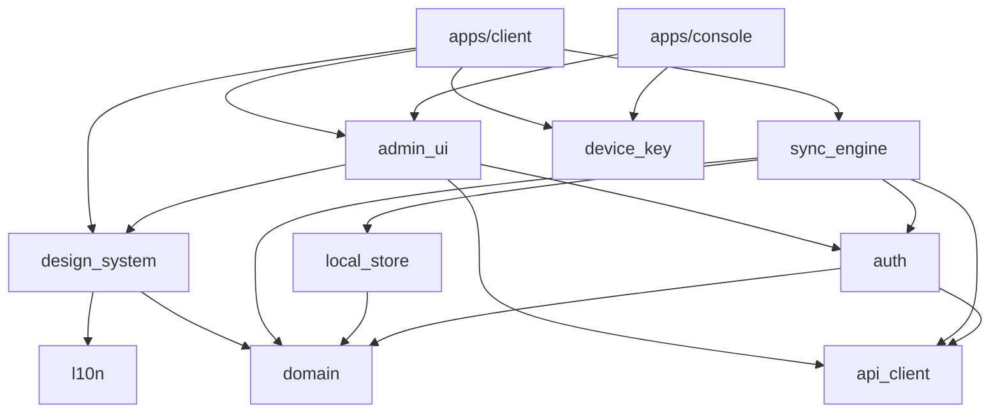
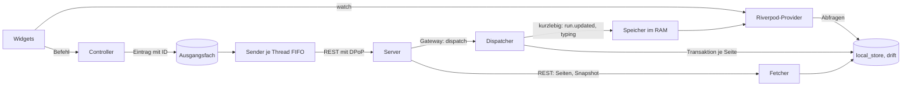
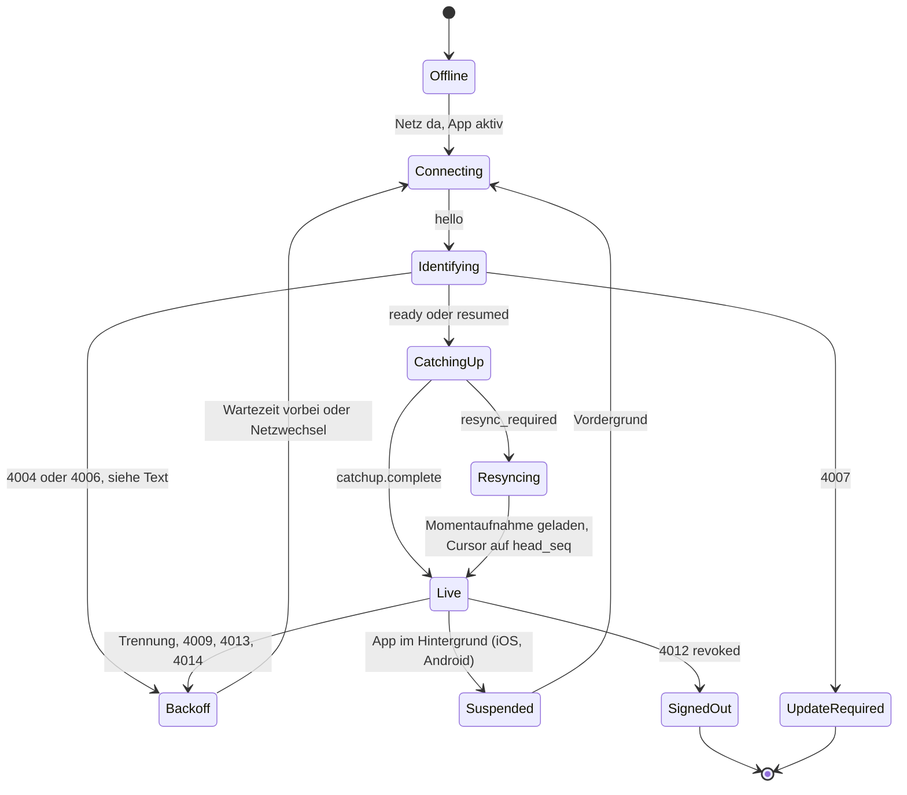
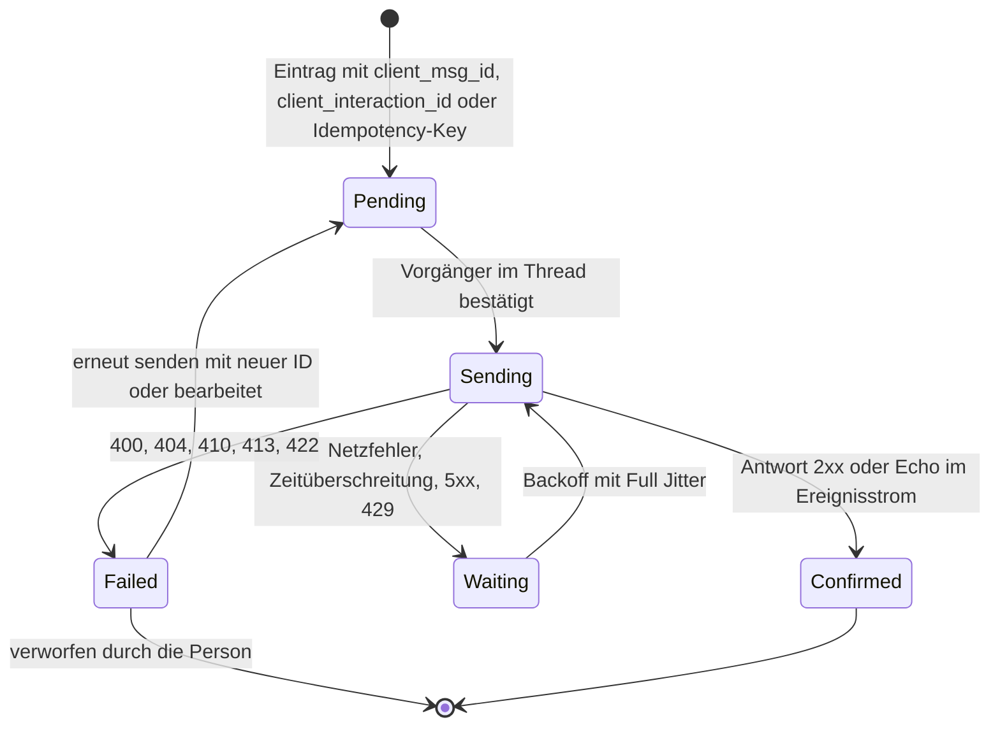
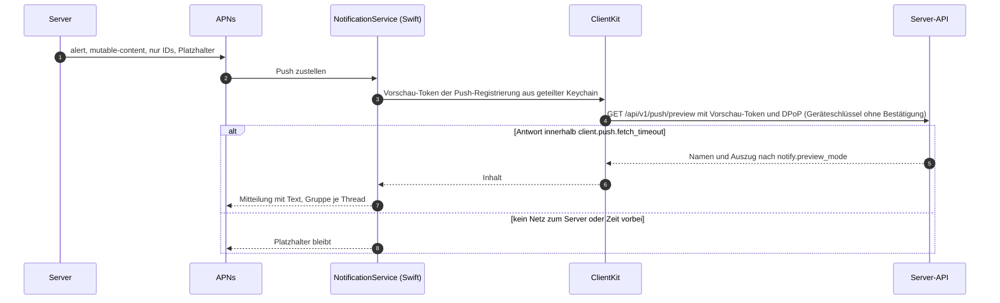

# 15 Client-Architektur

Status: Entwurf M0. Gilt für `apps/client` (iOS, Android, macOS, Windows), `apps/console` (Web)
und `packages/`. Begriffe: [00-glossar.md](00-glossar.md). Sync: [04-sync-protokoll.md](04-sync-protokoll.md)
(normativ für alles, was hier über Ereignisse, Cursor und Ausgangsfach steht). Bedienung:
[01-produkt.md](01-produkt.md). Gestaltung: [docs/design/](../design/README.md). Entscheidungen:
ADR 0027 (Flutter), ADR 0028 (Web nur Konsole), ADR 0029 (Zustand, lokale DB, Ausgangsfach),
ADR 0030 (Design-Tokens), ADR 0044 (Branding).

## 1. Grundsätze

1. **Keine Rechte-Logik im Client.** Die App zeigt an, was der Server liefert und erlaubt. Sie
   blendet Bedienelemente nach Server-Antworten und Ereignissen aus (z. B. `access.changed`), nie
   nach eigener Ableitung aus Freigaben (B7, Studie A).
2. **Die lokale Datenbank ist die Quelle der Oberfläche.** Widgets lesen nur aus der lokalen
   Datenbank und aus kurzlebigen Speichern im Arbeitsspeicher. Netzwerk schreibt in die Datenbank;
   die Oberfläche folgt. So gibt es einen Weg für online, offline und Nachholen.
3. **Jede Schreibung geht durch das Ausgangsfach** mit eigener ID ([04](04-sync-protokoll.md)
   Abschnitt 13.2). Es gibt keinen zweiten, "schnellen" Schreibweg.
4. **Eine Codebasis, nativ nur wo das System es verlangt.** Flutter für alle Oberflächen; Swift,
   Kotlin und C++ nur für Erweiterungen und Systemdienste (Notification Service Extension, Share
   Extension, Push-Dienst, Infobereich, Schlüssel im sicheren Speicher, Auto-Update).
5. **Reine Dart-Pakete für Logik.** Domäne, Sync und Anmeldung importieren kein Flutter. Sie sind
   ohne Gerät testbar und laufen auch in einem Hintergrund-Isolate.

## 2. Plattformen

Flutter 3.47 ist die aktuelle stabile Version (https://docs.flutter.dev/release/release-notes,
abgerufen 2026-10-10 [belegt]). Unterstützte Mindestversionen laut
https://docs.flutter.dev/reference/supported-platforms (abgerufen 2026-10-10 [belegt]): Android
API 24, iOS 15, macOS 12, Windows 10 und 11.

| Ziel | Mindestversion des Produkts | Grund |
|---|---|---|
| iOS | 15 | Flutter-Minimum |
| Android | API 26 | `sentry_flutter` 10 verlangt API 26 (https://pub.dev/packages/sentry_flutter, abgerufen 2026-10-10 [belegt]) |
| macOS | 12 | Flutter-Minimum |
| Windows | 10 Version 2004 (Build 19041) | Share Target mit `ShareTargetActivatedEventArgs` und Paket-Identität für Benachrichtigungen setzen 10.0.19041 voraus (https://learn.microsoft.com/windows/apps/develop/windows-integration/integrate-sharesheet-receive, https://learn.microsoft.com/en-us/windows/apps/desktop/modernize/grant-identity-to-nonpackaged-apps, abgerufen 2026-10-10 [belegt]) |
| Web (nur Konsole) | aktuelle Chromium-, Firefox-, Safari-Versionen | JavaScript-Build; Wasm nur in Chromium nutzbar (https://docs.flutter.dev/platform-integration/web/wasm, abgerufen 2026-10-10 [belegt]) |
| Linux | nicht Ziel | nicht gefordert; Flutter könnte es später |

## 3. Workspace

Ein Dart-Pub-Workspace im Produkt-Repo (eine gemeinsame Auflösung, ein `pubspec.lock`;
Pub-Workspaces gibt es seit Dart 3.6, https://dart.dev/tools/pub/workspaces, abgerufen 2026-10-10
[belegt]). Kein Melos: Aufgaben laufen über die Make-Ziele des Repos (Qualitäts-Team).

```text
apps/
  client/                 Flutter-App für iOS, Android, macOS, Windows
    lib/                  App-Hülle, Router, Layouts je Formfaktor, Chat-Funktionen
    ios/ macos/           Runner, NotificationService, ShareExtension, ClientKit (Swift Package)
    android/              MainActivity, Push-Dienst, Teilen-Activity (Kotlin)
    windows/              Runner, Infobereich, MSIX-Manifest, Share Target, Toast-Aktivierung (C++)
    integration_test/     Integrationstests gegen den Fake-Server
  console/                Flutter Web: nur Verwaltung und Statistik
packages/
  design_system/          Tokens (erzeugt), Theme, Komponenten, Icons, Schriften (Flutter)
  l10n/                   ARB-Dateien de und en, erzeugte Lokalisierung (Flutter)
  domain/                 Entitäten, Wertobjekte, reine Regeln (Dart)
  api_client/             aus OpenAPI erzeugter Client (openapi-generator dart-dio), nie von Hand (Dart)
  auth/                   Anmeldung, Tokens, DPoP-Beweise, Step-up, Refresh (Dart)
  device_key/             Plugin: Schlüssel im sicheren Speicher je Plattform (Flutter-Plugin, Pigeon)
  local_store/            drift-Datenbank, Schema-Spiegel, Migrationen, Verschlüsselung (Dart)
  sync_engine/            Gateway, Nachholen, Ausgangsfach, Abgleich, Lauf-Dokumente (Dart)
  admin_ui/               Verwaltungs-Screens für Desktop, Konsole und Notfall-Aktionen mobil (Flutter)
```

Abweichung von der Grundliste des Auftrags: `auth`, `device_key` und `admin_ui` sind zusätzliche
Pakete. Gründe: Anmeldung und Schlüssel brauchen beide Apps und die nativen Erweiterungen dieselbe
Logik; die Verwaltung erscheint in zwei Apps und darf nicht doppelt entstehen.

### 3.1 Abhängigkeitsregeln



Regeln (geprüft durch einen Architekturtest im Gate, Ticket "Abhängigkeitsregeln"):

1. `domain`, `api_client`, `auth`, `local_store`, `sync_engine` importieren kein `package:flutter`.
2. Pakete importieren nie aus `apps/`.
3. `apps/console` hängt nicht von `sync_engine` und `local_store` ab (ADR 0028).
4. Nur `device_key` und `apps/client/{ios,macos,android,windows}` enthalten Plattform-Code.
5. `api_client` ist erzeugt und eingecheckt; ein Gate erzeugt ihn neu und vergleicht (wie die
   anderen generierten Clients, Baseline R-Clients).

## 4. Zustand

Riverpod 3 (`flutter_riverpod` 3.4.3, MIT, Herausgeber dash-overflow.net; https://pub.dev/packages/flutter_riverpod,
abgerufen 2026-10-10 [belegt]) mit Code-Erzeugung (`riverpod_generator`). Begründung und
verworfene Optionen: ADR 0029.

| Art | Provider | Quelle |
|---|---|---|
| dauerhafte Daten (Bereiche, Kanäle, Threads, Nachrichten, Gelesen-Stand) | `StreamProvider` je Abfrage, `family` nach ID | drift-Abfragen (`watch`) |
| kurzlebige Daten (Live-Box-Dokument, Tippen, Agenten-Präsenz) | `Notifier` je Lauf bzw. Thread | Speicher der `sync_engine` |
| Verbindung, Sync-Zustand, Anmeldung | `Notifier` | `sync_engine`, `auth` |
| Befehle der Oberfläche (senden, reagieren, schließen) | Methoden eines Controllers | schreiben ins Ausgangsfach |
| Einstellungen, Theme, Dichte, Bewegung | `Provider` | `user_settings` lokal plus Systemwerte |

Regeln: Widgets halten keinen fachlichen Zustand. Bildschirm-Provider sind `autoDispose`; was ein
Thread im Fokus braucht, lebt nur, solange er sichtbar ist (passt zum Fokus-Op des Gateways). Tests
ersetzen Provider über `ProviderContainer`-Overrides (Fake-Uhr, Fake-Transport).

## 5. Datenfluss



Ein dauerhaftes Ereignis wird nur angewendet, wenn `resource.version` größer als die lokale Version
ist ([04](04-sync-protokoll.md) Abschnitt 9). Dadurch mischen sich REST-Seiten und Ereignisse ohne
Konflikt, und Doppel nach Wiederverbinden sind harmlos. Ausnahme: `reaction.*` und `pin.*` ändern
die Version der Nachricht nicht; sie tragen absolute Werte und werden in `seq`-Reihenfolge
angewendet (04 Abschnitt 9, Punkt 3).

## 6. Lokale Datenbank

drift (`drift` 2.35.2, Herausgeber simonbinder.eu; https://pub.dev/packages/drift, abgerufen
2026-10-10 [belegt]) auf SQLite über das Paket `sqlite3`. Das Paket bündelt SQLite über
Dart-Build-Hooks; mit der Option `source: sqlite3mc` liefert es SQLite3MultipleCiphers für verschlüsselte
Datenbanken (https://github.com/simolus3/sqlite3.dart/blob/main/sqlite3/doc/hook.md, abgerufen
2026-10-10 [belegt]). Die früheren Pakete `sqlite3_flutter_libs` und `sqlcipher_flutter_libs`
sind als End-of-Life markiert (pub.dev-API, Version `0.6.0+eol` bzw. `0.7.0+eol`, abgerufen
2026-10-10 [belegt]) und werden nicht genutzt.

```yaml
# pubspec.yaml der App (Ausschnitt)
hooks:
  user_defines:
    sqlite3:
      source: sqlite3mc
```

### 6.1 Schema-Spiegel

Lokal liegen Kopien der Server-Tabellen, nur mit den Spalten, die der Client sieht, plus `version`
für den Abgleich. Felder, die nur mit `manage` lesbar sind (Kanal-Prompt, Skills), liegen nie lokal.

| Lokale Tabelle | Server-Tabelle | Bemerkung |
|---|---|---|
| `spaces`, `user_space_states` | gleichnamig | Seitenleiste |
| `channels`, `forum_tags`, `channel_operators` | `channels` (ohne `prompt`), `forum_tags` | wirksamer Bediener als Spalte |
| `threads`, `thread_tags` | gleichnamig | `last_message_seq`, Zustand, Titelquelle |
| `messages` | `messages` | ohne `client_payload_sha256`; mit `trigger_state` |
| `message_attachments`, `files` | gleichnamig | Metadaten; Bytes im Datei-Cache |
| `reactions_summary` | `reactions` | je Nachricht und Zeichen: Zahl und "ich" |
| `my_mentions` | `mentions` | nur Erwähnungen der eigenen Person |
| `message_components` | gleichnamig | Zustand, Definition |
| `runs` | `runs` | Zusammenfassung aus `run.state_changed`; Dokument nur im Speicher |
| `agents`, `principals` | `principals`, `agents` (Karte) | Anzeige, Modus-Abzeichen, gemeldete Präsenz |
| `commands` | `commands` | für Vorschläge offline |
| `read_states`, `drafts`, `user_settings`, `notification_preferences`, `quiet_hours` | gleichnamig | persönliche Sync-Daten |
| `instance` | `instance_settings` (Branding, ausgewertete Schalter) | |

Nur lokal:

| Tabelle | Zweck |
|---|---|
| `outbox` | Einträge des Ausgangsfachs (Abschnitt 7.5) |
| `sync_state` | Cursor, `head_seq`, `permission_version`, Gateway-Sitzung, letzte Momentaufnahme |
| `loaded_ranges` | geladene Bereiche von `thread_seq` je Thread; erkennt Lücken ([04](04-sync-protokoll.md) Abschnitt 4) |
| `file_cache` | Pfad, Größe, letzter Zugriff je Datei und Vorschaubild |
| `search_index` | FTS5-Index über zwischengespeicherte Nachrichten für Offline-Suche |
| `share_inbox` | aus Erweiterungen übernommene Teilen-Einträge |

### 6.2 Migrationen

drift-Workflow mit `dart run drift_dev make-migrations`: je Schema-Version eine gespeicherte
Schema-Datei, schrittweise Migrationen (`stepByStep`) und erzeugte Migrationstests
(https://drift.simonbinder.eu/migrations/, abgerufen 2026-10-10 [belegt]). Zusätzliche Regel: Der
Cache darf bei einer Migration verworfen und neu geladen werden (Spiegel-Tabellen, Cursor auf
`resync`); `outbox`, `drafts` und `share_inbox` werden immer verlustfrei migriert, weil sie nicht
gesendete Arbeit enthalten. Ein Test prüft das je Version.

### 6.3 Verschlüsselung und Aufräumen

- Schlüssel: 256 Bit Zufall beim ersten Start, im sicheren Speicher (Abschnitt 9), nie im Klartext
  auf der Platte.
- iOS: Datei mit Schutzklasse `NSFileProtectionComplete`; die Erweiterungen brauchen die Datenbank
  nicht (Studie C empfahl "complete").
- Android: Datenbank im privaten App-Speicher, von Backups ausgeschlossen (drift weist darauf hin,
  dass Android-Backups eine alte Datenbank zurückspielen können).
- Aufräumen: Einträge ohne Zugriff seit `client.cache_max_age` und alles über `client.cache_max_bytes`
  (älteste zuerst) werden entfernt; nie Ausgangsfach und Entwürfe.
- Entzug ([04](04-sync-protokoll.md) Abschnitt 8.3): Bei `access.changed` mit `removed` löscht der
  Dispatcher in einer Transaktion alle Zeilen der Ziele, ihre Dateien im Cache und ihre Einträge im
  Suchindex. Bei `4012` löscht die App Datenbank, Datei-Cache, Schlüssel und Tokens.

## 7. Sync-Engine

`packages/sync_engine` setzt [04-sync-protokoll.md](04-sync-protokoll.md) um. Sie ist reines Dart
und hat Ports für Uhr, Netzstatus, Transport (WebSocket, HTTP) und Anmeldung.

### 7.1 Bausteine

| Baustein | Aufgabe |
|---|---|
| `Connection` | WebSocket (`web_socket_channel`), Rahmen `{op, d}`, Heartbeat mit Zufallsverzögerung, Backoff mit Full Jitter (`sync.reconnect_backoff_*`), sofortiger Versuch bei Netzwechsel und Vordergrund |
| `Session` | `hello`, `identify` bzw. `resume` mit DPoP-Beweis und Nonce, `reauth` vor Token-Ablauf, Schließ-Codes nach Tabelle 6.4 |
| `CatchUp` | Seiten anwenden, `cursor`-Rahmen speichern, `catchup.complete`, `resync_required` |
| `Dispatcher` | dauerhafte Ereignisse anwenden (eine Transaktion je Seite bzw. je Live-Ereignis), Versionsregel, Echo des Ausgangsfachs, Entzug |
| `Fetcher` | REST: Momentaufnahme, Thread-Seiten (rückwärts ab neuester `thread_seq`), Lücken füllen, Lauf-Dokument, Dateien |
| `Outbox` | Senden je Thread streng FIFO, Threads parallel; Wiederholung, Fehlerklassen |
| `FocusManager` | sichtbare Threads an das Gateway melden (höchstens `sync.max_focused_threads`) |
| `RunStore` | Lauf-Dokumente im Speicher; Patches nach RFC 6902 (`add`, `replace`, `remove`), Regel aus [04](04-sync-protokoll.md) Abschnitt 11.3 Punkt 4 |
| `EphemeralStore` | Tippen (`sync.typing_ttl`), Agenten-Präsenz |

Große Nachhol-Seiten werden in einem Hintergrund-Isolate dekodiert, sobald eine Seite
`client.sync.parse_offload_bytes` überschreitet; die Datenbank läuft in ihrem eigenen Isolate
(drift).

### 7.2 Verbindungszustände



`4004`: die App erneuert den Zugriffstoken und verbindet neu; scheitert der Refresh, meldet sie ab.
`4006`: die App verbindet mit `identify` statt `resume`.

`Suspended`: Auf iOS gibt es keinen WebSocket im Hintergrund; die App schließt mit `1000` und
verbindet im Vordergrund mit `resume` (Apple DTS im Forum: "WebSocket tasks are not supported in
background sessions", https://developer.apple.com/forums/thread/716118, abgerufen 2026-10-10
[belegt]). Android verhält sich gleich; Push übernimmt (Abschnitt 10). macOS und Windows bleiben
verbunden, solange die App läuft.

### 7.3 Nachholen und Abgleich

1. Verbinden mit gespeichertem Cursor; Seiten anwenden; Cursor nach jeder Seite in derselben
   Transaktion wie die Seite speichern.
2. Bei `resync_required`: Spiegel-Tabellen leeren (nicht Ausgangsfach, Entwürfe, Teilen-Eingang),
   `GET /api/v1/sync/snapshot`, Cursor auf `head_seq`, geöffnete Threads neu laden. Die Verbindung
   bleibt offen und ist ab `head_seq` live; kein Neuverbinden (04, 7.3).
3. Nach `catchup.complete` sendet das Ausgangsfach in Reihenfolge.
4. Lücken in `thread_seq` (Ereignis passt nicht an die geladenen Bereiche) lädt der Fetcher per REST
   nach, bevor er die Nachricht anzeigt.
5. Persönliche Daten: Echo des eigenen Geräts (`updated_by_device_id`) wird ignoriert; Entwurf mit
   `overwrote_newer` zeigt einen Hinweis; Gelesen-Stand nur steigend.

### 7.4 Live-Box

Fokus auf einen Thread mit aktivem Lauf liefert einmal das ganze Dokument, danach Patches.
`base_version` gleich lokal: anwenden; `version` kleiner oder gleich lokal: ignorieren; sonst Lücke:
`GET /api/v1/runs/{id}`. Die Oberfläche zeichnet höchstens einmal je Frame (Patches werden je Frame
gesammelt). Endet der Lauf, verwirft der `RunStore` das Dokument; die eingeklappte Zeile kommt aus
der Tabelle `runs`.

### 7.5 Ausgangsfach



Regeln aus [04](04-sync-protokoll.md) Abschnitt 13.2 und 13.3; zusätzlich: Ein Eintrag zeigt nach
`client.outbox_stuck_after` im Zustand `Waiting` den Hinweis "Senden verzögert". Datei-Uploads sind
eigene Einträge vor der Nachricht, die sie anhängt; die Nachricht wartet, bis ihre Dateien
`complete` sind.

## 8. Netzwerk und Anmeldung

- **REST:** `api_client` (openapi-generator `dart-dio`, Baseline R-Clients) mit Interceptoren für
  DPoP, `Idempotency-Key`, Korrelations-ID, Wiederholung nur für Lesezugriffe; Schreibzugriffe
  wiederholt das Ausgangsfach.
- **DPoP:** Beweis je Anfrage (RFC 9449) mit dem Geräteschlüssel, ES256 (Abschnitt 9); Server-Nonce
  wird übernommen. Gateway-Beweis in `identify` ([04](04-sync-protokoll.md) R-SY-01).
- **Refresh:** genau ein Refresh je Refresh-Familie zur Zeit (Single-Flight); das neue Token wird
  gespeichert, bevor es benutzt wird. Die Share Extension (iOS, macOS) muss selbst erneuern und
  teilt nie die Familie der App: Die App legt für sie eine Kind-Sitzung mit eigener Familie an
  (`createExtensionSession`, [08](08-identitaet.md) Abschnitt 7.4) und legt deren Tokens in die
  geteilte Keychain-Gruppe. Fehlt die Kind-Sitzung oder ist sie widerrufen, legt die Erweiterung
  den Eintrag in `share_inbox`, und die App legt beim nächsten Start eine neue an. Die
  Notification Service Extension erneuert nie Tokens; sie nutzt das Vorschau-Token (10.1). Grund: Zwei Prozesse mit einer Familie erneuerten gleichzeitig, und die zweite
  Erneuerung sähe als Wiederverwendung wie Diebstahl aus und sperrte die Familie
  ([03](03-datenmodell.md), `refresh_tokens`).
- **Anmeldung:** OIDC mit PKCE im System-Browser (ASWebAuthenticationSession, Custom Tabs,
  Standard-Browser), nie in einer Web-View; Rückleitung mobil über ein eigenes URL-Schema aus der
  Build-Konfiguration bzw. über einen beanspruchten HTTPS-Link, auf Desktop über Loopback
  `127.0.0.1` mit freiem Port (RFC 8252, https://www.rfc-editor.org/rfc/rfc8252.txt, abgerufen
  2026-10-10 [belegt]). Proxy-Header-Anmeldung braucht keinen Browser: die App ruft
  `auth.login.complete` hinter dem Proxy auf. Passkeys in nativen Apps nur bei Instanzen mit
  öffentlicher Domain (Associated Domains), Baseline R-Passkeys; sonst lokale Konten mit Passwort
  und TOTP als Rückfall.
- **Step-up:** native Apps signieren eine Server-Challenge mit einem zweiten Geräteschlüssel, der
  Nutzerbestätigung verlangt (Biometrie oder PIN); die Web-Konsole nutzt WebAuthn-Passkeys.

## 9. Sichere Speicherung und Geräteschlüssel

Die Secure Enclave unterstützt nur NIST-P-256-Schlüssel ("only supports P-256 keys",
https://developer.apple.com/documentation/security/protecting-keys-with-the-secure-enclave und
https://developer.apple.com/forums/thread/694855, abgerufen 2026-10-10 [belegt]); StrongBox auf
Android kennt als Kurve ebenfalls nur P-256
(https://developer.android.com/privacy-and-security/keystore, abgerufen 2026-10-10 [belegt]).
Darum nutzen alle Clients **ES256** für DPoP und Step-up, obwohl das Datenmodell auch EdDSA erlaubt.

| Plattform | Geräteschlüssel (DPoP) | Step-up-Schlüssel | Geheimnisse (Refresh-Token, DB-Schlüssel) |
|---|---|---|---|
| iOS | Secure Enclave, P-256, ohne Nutzerbestätigung, Keychain-Zugriffsgruppe mit den Erweiterungen, `AfterFirstUnlockThisDeviceOnly` | Secure Enclave, P-256, `.userPresence` | Keychain über `flutter_secure_storage` (Herausgeber steenbakker.dev); Tokens für die Erweiterungen in der geteilten Zugriffsgruppe mit `AfterFirstUnlockThisDeviceOnly`, DB-Schlüssel `WhenUnlockedThisDeviceOnly` |
| macOS | Secure Enclave (Macs mit Apple-Chip oder mit Touch Bar und Touch ID laut Apple-Doku), sonst Keychain-Schlüssel ohne Enclave, dem Server als "nicht hardwaregebunden" gemeldet | wie iOS | Data-Protection-Keychain |
| Android | Android Keystore, StrongBox wenn vorhanden (`setIsStrongBoxBacked`, Rückfall bei `StrongBoxUnavailableException`), P-256 | Keystore-Schlüssel mit Nutzer-Authentifizierung je Operation über `BiometricPrompt` | `flutter_secure_storage` (RSA-OAEP plus AES-GCM, Schlüssel im Keystore laut Paket-Doku) |
| Windows | CNG mit Microsoft Platform Crypto Provider (TPM), ECDSA P-256 nach Prüfung mit `NCryptIsAlgSupported`; ohne TPM Software-Schlüssel, gemeldet als nicht hardwaregebunden | TPM-Schlüssel mit Windows-Hello-Bestätigung [vermutet, Details nicht belegt] | `flutter_secure_storage` (Windows Credential Manager plus AES-GCM-Dateien laut Paket-README [belegt über Suche, Quelltext nicht gelesen]) |
| Web (Konsole) | keiner: Cookie-Sitzung nach dem Backend-for-Frontend-Muster, Tokens nur im Server ([08](08-identitaet.md) Abschnitt 7.5) | WebAuthn-Passkey, sonst erneute OIDC-Anmeldung bzw. Passwort mit TOTP | keine im Browser; Cookie `HttpOnly` |

Belege: https://pub.dev/packages/flutter_secure_storage (Version 11.2.0, abgerufen 2026-10-10
[belegt]); Microsoft CNG `NCryptCreatePersistedKey` mit `MS_PLATFORM_CRYPTO_PROVIDER`
(https://learn.microsoft.com/en-us/windows/win32/api/ncrypt/nf-ncrypt-ncryptcreatepersistedkey,
abgerufen 2026-10-10 [belegt]); dass jeder TPM 2.0 P-256 anbietet, ist [vermutet] und wird zur
Laufzeit geprüft.

`packages/device_key` ist ein föderiertes Flutter-Plugin mit Pigeon (flutter.dev) für typisierte
Kanäle. Es bietet: Schlüssel erzeugen, öffentlichen JWK und Thumbprint liefern, signieren,
Attestierung liefern (falls die Plattform sie hat), Schlüssel löschen. Die Swift- und Kotlin-Teile
nutzen dieselbe Implementierung wie die Erweiterungen.

Weil der Refresh-Token an den Geräteschlüssel gebunden ist (DPoP), ist ein gestohlener Token ohne
das Gerät wertlos; das senkt die Anforderung an den Speicher der Token, nicht an den Schlüssel.

## 10. Hintergrundverhalten und Push

Der Push trägt nur IDs und einen neutralen Platzhalter (Baseline R-Push, ADR 0031). Format und
Versand: [13-push-benachrichtigungen.md](13-push-benachrichtigungen.md).

| Plattform | Im Vordergrund | Im Hintergrund | Push-Weg |
|---|---|---|---|
| iOS | WebSocket | keine Verbindung | APNs, sichtbarer Push mit `mutable-content`; Notification Service Extension holt den Text |
| macOS | WebSocket, auch bei geschlossenem Fenster, solange die App läuft | wie iOS, wenn die App beendet ist | APNs (Developer-ID-Apps dürfen APNs nutzen, https://developer.apple.com/developer-id/, abgerufen 2026-10-10 [belegt]); NSE wie iOS |
| Android | WebSocket | keine Verbindung | FCM-Data-Nachricht hoher Priorität nur mit IDs; eigener nativer Dienst zeigt sofort eine Mitteilung und holt den Text |
| Windows | WebSocket | App im Infobereich hält die Verbindung; lokale Hinweise | kein Push in M-Etappen; WNS später (Baseline R-Push) |
| Web (Konsole) | REST, Abruf beim Öffnen | nichts | keiner |

### 10.1 iOS und macOS: Notification Service Extension

Die NSE läuft nur bei Pushes mit `mutable-content: 1` und sichtbarem `alert` und hat etwa 30
Sekunden (https://developer.apple.com/documentation/usernotifications/modifying-content-in-newly-delivered-notifications,
abgerufen 2026-10-10 [belegt laut Recherche]). Sie ist Swift ohne Flutter-Engine, weil Speicher und
Zeit knapp sind ([ADR 0056](../adr/0056-native-erweiterungen-ohne-flutter-engine.md)), und nutzt `ClientKit` (Swift Package in `apps/client`), das auch die Share
Extension nutzt.



Steht `notify.preview_mode` auf `none` ([13-push-benachrichtigungen.md](13-push-benachrichtigungen.md)), holt die NSE nichts. Antippen öffnet die App per Deep Link
(Abschnitt 11). Ob die NSE einen nur im privaten Netz erreichbaren Server erreicht, hängt am VPN des
Geräts; das ist ein Gerätetest (Risiko im Bericht).

### 10.2 Android

Kein Flutter-Plugin für den Empfang: Ein eigener `FirebaseMessagingService` (Kotlin) zeigt sofort
eine Mitteilung mit Platzhalter, damit FCM die Priorität nicht herabstuft, und startet einen
beschleunigten WorkManager-Auftrag, der den Text holt und dieselbe Mitteilung ersetzt (FCM:
"several seconds" in `onMessageReceived`, https://firebase.google.com/docs/cloud-messaging/android/message-priority,
abgerufen 2026-10-10 [belegt laut Recherche]). Den FCM-Token liest der Dienst und gibt ihn über
Pigeon an Dart (`push.register`). Grund gegen `firebase_messaging` mit Dart-Hintergrund-Handler:
Start einer Flutter-Engine im Hintergrund kostet die knappe Zeit, und zwei Dienste für dieselbe
Nachricht kollidieren. Mitteilungskanäle: Erwähnungen, Rückfragen, Alle Nachrichten, Läufe.
Instanzen ohne Firebase-Projekt bekommen auf Android keinen Push (UnifiedPush später).

### 10.3 Windows

Die App läuft beim Schließen des Fensters im Infobereich weiter (Pakete `tray_manager` und
`window_manager`, Herausgeber leanflutter.dev) und hält die Gateway-Verbindung. Hinweise sind lokale
Toasts (`flutter_local_notifications`, Herausgeber dexterx.dev); sie brauchen Paket-Identität aus
MSIX, sonst funktionieren `cancel` und `getActiveNotifications` nicht
(https://pub.dev/packages/flutter_local_notifications, abgerufen 2026-10-10 [belegt]). Start bei
Anmeldung ist eine Einstellung (Standard aus). Beendete App bekommt keine Hinweise; die
Einstellungen sagen das.

## 11. Deep Links und Navigation

Router: `go_router` (flutter.dev). Ein Pfad pro Ziel, gleich für Push, Teilen, Konsole und Links in
Nachrichten:

| Pfad | Ziel |
|---|---|
| `/s/{space_id}` | Bereich |
| `/c/{channel_id}` | Kanal (Hauptverlauf oder Beitragsliste) |
| `/t/{thread_id}?m={message_id}` | Thread, optional an einer Nachricht |
| `/running`, `/mentions`, `/search?q=` | Querschnitts-Ansichten |
| `/admin/...` | Verwaltung |

Von außen: `<scheme>://t/{thread_id}?m={message_id}` mit dem URL-Schema aus der Build-Konfiguration
(ADR 0044); bei Instanzen mit öffentlicher Domain zusätzlich Universal Links bzw. App Links. Ein Link
auf etwas Unsichtbares zeigt "Nicht gefunden oder kein Zugriff". Ein Link aus dem Push wartet, bis
der Thread lokal oder per REST geladen ist, und springt dann an die Nachricht.

## 12. Teilen aus anderen Apps

| Plattform | Weg | Ziel-Auswahl | Senden |
|---|---|---|---|
| iOS | Share Extension (Swift, SwiftUI) | eigenes Blatt: zuletzt genutzte Ziele mit Schreibrecht aus dem App-Group-Container, Suche | direkt über `ClientKit` (Upload, dann Nachricht mit `client_msg_id` aus der Erweiterung); ohne Netz in `share_inbox` |
| macOS | Share Extension (Swift), gleicher Code wie iOS | wie iOS | wie iOS |
| Android | Activity mit `ACTION_SEND` und `ACTION_SEND_MULTIPLE` und konkreten MIME-Typen (nicht `*/*`, https://developer.android.com/training/sharing/receive, abgerufen 2026-10-10 [belegt laut Recherche]) | Flutter-Blatt in der App, gleiche Ziel-Auswahl | Ausgangsfach der App |
| Windows | MSIX `uap:ShareTarget` mit konkreten Dateitypen, Aktivierung über `ShareTargetActivatedEventArgs` (https://learn.microsoft.com/windows/apps/develop/windows-integration/integrate-sharesheet-receive, abgerufen 2026-10-10 [belegt]) | Flutter-Blatt | Ausgangsfach; Etappe "später" (01-produkt.md) |

Warum die Apple-Erweiterungen selbst senden: Share Extensions können die eigene App nicht öffnen;
`NSExtensionContext.open` unterstützen unter iOS nur Today- und iMessage-Erweiterungen
(https://developer.apple.com/documentation/foundation/nsextensioncontext/open(_:completionhandler:),
abgerufen 2026-10-10 [belegt]). Ein Weiterreichen an die App hinge also davon ab, dass die Person
sie später öffnet. Die Erweiterung erzeugt die `client_msg_id`; scheitert ihr Senden, übernimmt die
App den Eintrag aus `share_inbox` mit derselben ID, und der Server liefert bei Doppel das Original.
Speichergrenze der Erweiterung beachten: große Dateien streamt `ClientKit` von der Platte, nie im
Speicher.

## 13. Sprachaufnahme

Paket `record` (7.1.2, Herausgeber cow-level.ovh): AAC-LC ist das einzige komprimierte Format, das
auf allen Zielen aufnimmt; Opus ist auf iOS nur im CAF-Container nutzbar
(https://pub.dev/packages/record, abgerufen 2026-10-10 [belegt laut Recherche]). Darum: AAC-LC in
MP4-Container (`.m4a`), Mono, Bitrate `client.voice.bitrate`, Höchstdauer `voice.max_duration` ([12-dateien.md](12-dateien.md)).
Ablauf: Rechte des Mikrofons beim ersten Gebrauch erfragen; Aufnahme in eine temporäre Datei; beim
Senden Upload als Datei mit `kind = voice` am Eintrag des Ausgangsfachs; danach `file.transcribe`,
wenn der Kanal-Agent oder ein Dienst transkribiert. Abspielen mit Geschwindigkeit 1, 1.5, 2; das
Transkript erscheint, sobald `file.updated` es meldet.

## 14. Datei-Upload

Größe vor dem Senden gegen `file.max_upload_bytes` prüfen (Server prüft erneut). Upload-Protokoll
(Teile, Wiederaufnahme, vorab signierte URLs) legt [12-dateien.md](12-dateien.md) fest; der Client
setzt es als Eintrag im Ausgangsfach mit Fortschritt um, nimmt nach Abbruch beim letzten bestätigten
Teil wieder auf und hängt die Datei erst an, wenn `upload_state = complete`. Fotos aus der
Mediathek lädt die App als JPEG hoch: Sie fordert beim System eine JPEG-Darstellung an oder wandelt
selbst ([12-dateien.md](12-dateien.md), Abschnitt 7.1;
[ADR 0047](../adr/0047-bild-metadaten-verlustfrei-entfernen.md)). Grund: HEIC entfernt der Server
nicht verlustfrei; es soll ihn nur als bewusst gesendete Datei erreichen. Alle anderen Bilder
sendet die App unverändert; das Entfernen von Metadaten macht der Server (Baseline
R-Objektspeicher). Vorschau vor dem Senden lokal; nach dem Senden aus `file_thumbnails` über den
Server.

## 15. Auto-Update

| Plattform | Weg | Kanäle |
|---|---|---|
| macOS | Sparkle 2, nativ im Runner eingebunden (Swift Package), EdDSA-signierte Archive, Developer ID und Notarisierung | `stable` (Standard) und `beta` über `sparkle:channel` und `allowedChannels(for:)`; gestaffelte Verteilung mit `sparkle:phasedRolloutInterval`; kritische Updates (https://sparkle-project.org/documentation/publishing/, abgerufen 2026-10-10 [belegt]) |
| Windows | MSIX mit `.appinstaller`: `OnLaunch` mit `HoursBetweenUpdateChecks`, `ShowPrompt`, `UpdateBlocksActivation` für erzwungene Updates, `AutomaticBackgroundTask` (https://learn.microsoft.com/en-us/windows/msix/app-installer/update-settings, abgerufen 2026-10-10 [belegt]) | je Kanal eine eigene `.appinstaller`-Datei |
| iOS | TestFlight bzw. App Store | Gruppen in TestFlight |
| Android | Play (Internal Testing) oder Firebase App Distribution (Owner-Entscheidung, Baseline) | Testspuren |

Das Flutter-Paket `auto_updater` wird nicht genutzt: zuletzt 2024 veröffentlicht, auf Windows
WinSparkle mit DSA (https://pub.dev/packages/auto_updater, abgerufen 2026-10-10 [belegt]); MSIX bringt
Updates und Paket-Identität ohnehin mit. Unabhängig vom Kanal: Schließt der Server mit `4007`, zeigt
die App "Update nötig" mit Link auf den Kanal und verbindet nicht mehr. Feed-URLs, Schlüssel und
Identitäten kommen aus der Build-Konfiguration (ADR 0044); Signieren und Veröffentlichen:
[18-release.md](18-release.md).

## 16. Absturzberichte

`sentry_flutter` 10.0.0 (Herausgeber sentry.io; Android, iOS, macOS, Windows, Web; Swift Package
Manager statt CocoaPods; https://pub.dev/packages/sentry_flutter und
https://docs.sentry.io/platforms/dart/guides/flutter/, abgerufen 2026-10-10 [belegt]).

- Aus, solange die Instanz keine DSN in der Build-Konfiguration bzw. den Instanz-Einstellungen
  setzt; die Person kann es abschalten (`privacy.crash_reports`).
- Keine Inhalte: `sendDefaultPii` aus; `beforeSend` und `beforeBreadcrumb` entfernen Texte,
  Dateinamen, URLs mit IDs, Titel; keine Screenshots, kein Session Replay, keine Ansichts-Hierarchie.
- Nur technische Merkmale: App-Version, Plattform, Gerätetyp, gehashte Instanz-ID.
- Symbol-Dateien lädt die Release-Kette hoch ([18-release.md](18-release.md)).
- Auf Windows meldet Sentry native Abstürze beim nächsten Start; Release Health gibt es dort nicht
  (https://docs.sentry.io/platforms/dart/guides/flutter/features/, abgerufen 2026-10-10 [belegt laut Recherche]).

## 17. Telemetrie im Client

Es gibt kein offizielles OpenTelemetry-SDK für Dart; ein Community-SDK wird gespendet, Status offen
(https://opentelemetry.io/blog/2026/dart-flutter-opentelemetry/, abgerufen 2026-10-10 [belegt laut
Recherche]). Darum schickt der Client wenige, feste Kennzahlen gebündelt an den eigenen Server, der
sie an den OTel Collector weitergibt (B11: Export nur über den Collector). Der Client spricht nie
direkt mit einem Collector im Internet.

| Kennzahl | Namen ([signals.md](../observability/signals.md) 4.6a) |
|---|---|
| Kaltstart bis bedienbar, Thread öffnen (aus Cache), Senden bis lokale Anzeige | `client.cold_start.duration`, `client.thread_open.duration`, `client.send_local.duration` |
| Frames über Budget beim Scrollen (Anteil aus beiden Zählern) | `client.frames`, `client.frames.over_budget` |
| Nachhol-Dauer, Ereignisse, `resync_required` | `client.catchup.duration`, `client.catchup.events`, `client.resync` |
| Wiederverbindungen nach Schließ-Code, Tiefe des Ausgangsfachs | `client.reconnects`, `client.outbox.depth` |
| Push bis Anzeige (NSE bzw. Android-Dienst), Platzhalter statt Text | `client.push_display.duration`, `client.push.placeholder` |

Keine Inhalte, keine IDs von Threads, Kanälen oder Personen; Merkmale nur Plattform, App-Version,
Dichte, Theme. Die Liste ist geschlossen; der Server verwirft Einträge mit anderem Namen oder
unpassendem `kind` einzeln und nimmt den Rest des Stapels an (`202`). Senden höchstens alle `client.metrics.flush_interval`, abschaltbar
(`privacy.client_metrics`). Endpunkt `POST /api/v1/client-metrics` mit der Aktion
`client_metrics.submit` (05; [ADR 0057](../adr/0057-client-telemetrie-ueber-einen-server-endpunkt.md)).

## 18. Schalter (Feature-Flags)

Die App wertet keine Schalter selbst aus. Der Server liefert die für die Person ausgewerteten
Schalter in der Momentaufnahme und in `instance.read`; `instance.updated` nennt geänderte Schlüssel,
die App lädt die Werte nach ([05](05-aktionen.md) Abschnitt 6). Ein Schalter blendet eine Funktion
ein oder aus; Rechte ersetzt er nie. Zur Bauzeit gibt es nur Plattform-Schalter (z. B. "Teilen auf
Windows vorhanden"), keine geheimen Funktionen.

## 19. Leistungsziele

Gemessen auf Referenzgeräten: iPhone zwei Generationen alt, Android-Mittelklasse mit 6 GB RAM,
Windows-Laptop mit 8 GB RAM, Mac mit Apple-Chip der ersten Generation. Tests in der Leistungsstufe
(Abschnitt 20) schlagen fehl, wenn ein Ziel verfehlt wird.

| Name | Ziel |
|---|---|
| `client.perf.cold_start_p95` | Kaltstart bis bedienbare Seitenleiste aus dem Cache |
| `client.perf.thread_open_p95` | Thread aus dem Cache öffnen bis erste Nachrichten sichtbar |
| `client.perf.send_local_echo_p95` | Senden bis Anzeige "wird gesendet" |
| `client.perf.patch_to_frame_p95` | Live-Box-Patch empfangen bis gezeichnet |
| `client.perf.jank_ratio_max` | Anteil Frames über Budget beim Scrollen eines langen Threads |
| `client.perf.catchup_events_per_s_min` | angewendete Ereignisse je Sekunde beim Nachholen |
| `client.perf.memory_mobile_max` | Speicher mobil mit fünf geöffneten Threads |
| `client.perf.memory_desktop_max` | Speicher Desktop mit zwanzig Threads im Fokus |

Standardwerte stehen in Abschnitt 22.

## 20. Teststrategie

| Stufe | Was | Werkzeug | Läuft |
|---|---|---|---|
| Unit | `domain`, `auth`, `sync_engine` (Fake-Uhr, Fake-Transport), `local_store` (SQLite im Speicher) | `dart test` | jeder Lauf des Gates |
| Vertrag | erzeugter `api_client` gegen OpenAPI; Gateway-Rahmen gegen die JSON-Schemas des AsyncAPI-Dokuments; gemeinsame Beispiel-Rahmen mit den Server-Tests | `dart test` | jeder Lauf |
| Widget | Komponenten, Zustände, Semantik, Richtlinien `textContrastGuideline`, `androidTapTargetGuideline`, `iOSTapTargetGuideline`, `labeledTapTargetGuideline` (https://api.flutter.dev/flutter/flutter_test/meetsGuideline.html, abgerufen 2026-10-10 [belegt]) | `flutter test` | jeder Lauf |
| Golden | jede Kern-Komponente in hell und dunkel, `comfortable`, `compact`, `touch`, Textskalierung 1 und 2, de und en | `alchemist` (MIT, betterment.dev): CI-Goldens mit Ahem-Schrift sind auf allen Hosts gleich; Plattform-Goldens nur auf macOS (https://pub.dev/packages/alchemist, abgerufen 2026-10-10 [belegt]) | jeder Lauf (CI-Goldens), macOS-Runner (Plattform-Goldens) |
| Migration | erzeugte drift-Migrationstests plus "Ausgangsfach überlebt" | `drift_dev make-migrations` | jeder Lauf |
| Integration | ganze App gegen einen Fake-Server in Dart (Gateway und REST, Teilmenge mit Fehler-Einspielung: Trennung, Doppel, Verzögerung, `resync_required`, `4012`, `409`, `410`) | `integration_test` | Desktop-Runner je Plattform |
| E2E auf Geräten | Anmeldung, Push-Erlaubnis, Antippen einer Mitteilung, Teilen, Offline-Senden, gegen den echten Server im Compose-Stack | `patrol` (Apache-2.0, leancode.co; Android, iOS, macOS, Web; https://pub.dev/packages/patrol, abgerufen 2026-10-10 [belegt]) für Mobil, macOS, Konsole; `integration_test` für Windows, weil `patrol` Windows nicht unterstützt | nächtlich und vor Release |
| Leistung | Ziele aus Abschnitt 19 mit Profil-Build und Timeline-Auswertung | `flutter drive --profile` | nächtlich |
| Barrierefreiheit von Hand | VoiceOver, TalkBack, Narrator je Release mit Prüfliste | Prüfliste | vor Release |

Begründung: `integration_test` kann Systemdialoge, Mitteilungen und Teilen-Blätter nicht bedienen;
genau diese Wege sind hier kritisch. `patrol` kann es auf Mobilgeräten und läuft auf allen Zielen
außer Windows. Der Fake-Server macht Fehlerfälle reproduzierbar, die gegen einen echten Server nur
zufällig auftreten.

## 21. Entscheidungen dieses Kapitels

| Nr | Entscheidung | Grund |
|---|---|---|
| R-CL-01 | Zusätzliche Pakete `auth`, `device_key`, `admin_ui`. | gemeinsame Logik für zwei Apps und die nativen Erweiterungen; Verwaltung nicht doppelt bauen |
| R-CL-02 | Pub-Workspace ohne Melos. | eine Auflösung im SDK; Aufgaben laufen über die Make-Ziele des Repos; ein Werkzeug weniger |
| R-CL-03 | Oberfläche liest nur aus der lokalen Datenbank und kurzlebigen Speichern. | ein Weg für online, offline, Nachholen; testbar |
| R-CL-04 | ES256 für alle Geräteschlüssel. | Secure Enclave und StrongBox können nur P-256 |
| R-CL-05 | Zwei Geräteschlüssel: DPoP ohne Nutzerbestätigung, Step-up mit. | DPoP signiert jede Anfrage, auch in der NSE; Step-up braucht frische Bestätigung |
| R-CL-06 | NSE, Share Extension und Android-Push-Dienst nativ, ohne Flutter-Engine ([ADR 0056](../adr/0056-native-erweiterungen-ohne-flutter-engine.md)). | Zeit- und Speichergrenzen der Erweiterungen; Apple-Erweiterungen können die App nicht öffnen |
| R-CL-07 | Die Share Extension erneuert nur die Familie ihrer eigenen Kind-Sitzung; je Familie ein Refresh zur Zeit; die NSE erneuert nie und nutzt das Vorschau-Token ([ADR 0056](../adr/0056-native-erweiterungen-ohne-flutter-engine.md)). | Wiederverwendung eines Refresh-Tokens sperrt die Familie; eine Sperre über Prozesse hinweg ersetzt keine getrennten Familien (08 Abschnitt 7.4) |
| R-CL-08 | Lokale Datenbank verschlüsselt (SQLite3MultipleCiphers), iOS-Schutzklasse `complete`. | verlorenes Gerät verrät nichts; Erweiterungen brauchen die DB nicht |
| R-CL-09 | Sparkle nativ statt `auto_updater`; Windows über `.appinstaller`. | Paket veraltet, DSA auf Windows; MSIX liefert Updates und Identität |
| R-CL-10 | Client-Kennzahlen über den eigenen Server an den Collector. | kein offizielles Dart-OTel-SDK; ein Endpunkt mit Autorisierung statt offenem Collector |
| R-CL-11 | `patrol` für Geräte-E2E, `integration_test` für Windows und Fake-Server-Tests. | Systemdialoge und Mitteilungen sind Kernwege; `patrol` hat kein Windows |
| R-CL-12 | Mindestversion Windows 10 2004. | Share Target und Paket-Identität verlangen Build 19041 |

## 22. Konfigurationswerte dieses Kapitels

| Name | Standard | Bedeutung |
|---|---|---|
| `client.cache_max_bytes` | `1GiB` | Obergrenze für lokale Datenbank plus Datei-Cache; darüber werden die ältesten Einträge entfernt |
| `client.sync.parse_offload_bytes` | `262144` | ab dieser Seitengröße wird im Hintergrund-Isolate dekodiert |
| `client.outbox_stuck_after` | `2m` | ab dann zeigt ein wartender Eintrag "Senden verzögert" |
| `client.push.fetch_timeout` | `20s` | Zeit, die NSE bzw. Android-Dienst für das Holen des Texts nutzen |
| `client.voice.bitrate` | `64kbps` | Bitrate der AAC-Aufnahme |
| `client.metrics.flush_interval` | `5m` | höchstens so oft sendet der Client Kennzahlen |
| `client.perf.cold_start_p95` | `2500ms` | Ziel Kaltstart |
| `client.perf.thread_open_p95` | `300ms` | Ziel Thread öffnen aus dem Cache |
| `client.perf.send_local_echo_p95` | `50ms` | Ziel lokale Anzeige beim Senden |
| `client.perf.patch_to_frame_p95` | `100ms` | Ziel Live-Box-Patch bis Frame |
| `client.perf.jank_ratio_max` | `0.01` | höchster Anteil Frames über Budget |
| `client.perf.catchup_events_per_s_min` | `2000` | Mindestrate beim Nachholen |
| `client.perf.memory_mobile_max` | `300MiB` | Speicher mobil |
| `client.perf.memory_desktop_max` | `500MiB` | Speicher Desktop |

`client.share.recent_targets` steht in [01-produkt.md](01-produkt.md), `voice.max_duration` in
[12-dateien.md](12-dateien.md); `client.cache_max_age`, `client.outbox_retry_base` und
`client.outbox_retry_cap` in [04-sync-protokoll.md](04-sync-protokoll.md).
