# 16 Operations

Status: draft M0. Normative for deployment, configuration, secrets, backup,
restore, upgrade, environments, feature flags, status page and capacity.
Terms: [00-glossary.md](00-glossary.md). Tables: [03-data-model.md](03-data-model.md).
Sync: [04-sync-protocol.md](04-sync-protocol.md). Actions: [05-actions.md](05-actions.md).
Telemetry: [17-observability.md](17-observability.md). Releases: [18-release.md](18-release.md).
Guides (runbooks) are under [docs/operations/](../operations/configuration.md).

All limits, deadlines and intervals are named configuration values. Their defaults are in
section 14 and collected in the [configuration reference](../operations/configuration.md).

## 1. Goals

1. One command sets up a complete instance on a host with a Docker-compatible runtime
   and starts it (setup wizard, section 3.1).
2. Mac, Linux VM and cloud use the same images. Differences are only in the configuration.
3. Data loss stays below `dr.rpo_target`, restore below `dr.rto_target`. An
   automatic restore test measures both regularly.
4. An upgrade needs no manual work on data. Going back one version is always possible.
5. Secrets are never in images, environment variables, logs, telemetry or OpenTofu state.

## 2. Building blocks of an instance

| Building block | Image | Role |
|---|---|---|
| `api` | `bothy-server` | REST, gateway, fan-out (`bothy serve --role=api`, B1) |
| `worker` | `bothy-server` | Background jobs: scan, thumbnails, push, webhooks, retention, status checks (`--role=worker`) |
| `migrate` | `bothy-server` | one-time run before `api` and `worker`: roles and migrations |
| `secrets-init` | `bothy-server` | one-time run: generate secrets and store them per service (section 5) |
| `postgres` | `bothy-postgres` | PostgreSQL 18 (B3) plus pgBackRest for WAL archiving |
| `backup` | `bothy-postgres` | `bothy-backupd`: pgBackRest repository, logical backup, object backup, restore test |
| `otel-collector` | OpenTelemetry Collector contrib | Telemetry intake, privacy filter, export (B11) |
| `clamav` | ClamAV | Virus scan of uploads, separate process (ADR 0033, Team G) |
| `seaweedfs` | SeaweedFS | optional S3 service for single hosts (R-Objektspeicher) |
| `tailscale` | Tailscale | optional edge with `tailscale serve` (B9) |
| Observability stack | Prometheus, Alertmanager, Loki, Tempo, Grafana | optional local default stack (ADR 0034) |

`bothy-postgres` is the official `postgres:18` plus pgBackRest and `bothy-backupd`. A
separate image is needed because `archive_command` runs in the database container (section 8.2).
Both Bothy images are produced in the release chain from [18-release.md](18-release.md).

The Compose file [infra/compose/compose.yaml](../../infra/compose/compose.yaml) is the
reference for these building blocks. Profiles add optional parts: `direct` or `tailscale` (edge),
`scan`, `s3`, `observability`.



## 3. Deployment targets

| Target | Runtime | Database | Files | Edge | Secrets |
|---|---|---|---|---|---|
| Mac | Docker Desktop or Colima, Compose | Container `postgres` | Volume `files` | `direct` with reverse proxy or `tailscale` | Driver `file` |
| Linux VM | Docker Engine, Compose | Container `postgres` | Volume or S3 service | Reverse proxy, `tailscale` or private network | `file` |
| Azure | VM with Compose | Container or Azure Database for PostgreSQL | Volume or SeaweedFS | Application Gateway or private network | `file`, later `azkv` (Azure Key Vault) |
| AWS | EC2 with Compose | Container or Amazon RDS for PostgreSQL | Amazon S3 | Load balancer or private network | `file`, later `awssm` (AWS Secrets Manager) |
| Hetzner | Cloud server with Compose | Container | Volume or Hetzner Object Storage | Reverse proxy or `tailscale` | `file` |
| Kubernetes | later, Helm (`infra/helm`) | managed service | S3 | Ingress | Driver of the cluster |

Rules:

1. The server has no Mac dependency (B12). The Mac is only a host for containers.
2. On Mac and Windows, Docker runs in a VM. Its memory must suffice for all services.
   ClamAV alone needs at least 3 GiB according to the vendor, better 4 GiB
   (https://docs.clamav.net/manual/Installing/Docker.html, retrieved 2026-10-10) [verified].
3. With a managed PostgreSQL service, the provider takes over WAL archiving and
   point-in-time recovery. `bothy-backupd` then only does the logical backup and the
   object backup (section 8.1).
4. Azure Blob Storage offers no S3 API [assumed, not checked]. The S3 driver (B4) therefore fits
   on Azure only with SeaweedFS or another S3 service. A separate Blob driver is
   an option for chapter 12.
5. Hetzner Object Storage is S3-compatible and supports versioning and Object Lock
   (https://docs.hetzner.com/storage/object-storage, retrieved 2026-10-10) [verified].
6. Whether the managed services of Azure and AWS offer PostgreSQL 18 is not checked
   [assumed]. The module ticket checks it before the implementation.
7. Minimum versions for Compose: Docker Engine 26 (volume `subpath`) and Compose 2.26 (`configs`
   with `content`, `depends_on.required`). Evidence: release notes Docker Engine 26.0
   (https://docs.docker.com/engine/release-notes/26.0/) and Compose reference
   (https://docs.docker.com/reference/compose-file/configs/), retrieved 2026-10-10 [verified].

OpenTofu modules per target are described in [infra/tofu/README.md](../../infra/tofu/README.md).

### 3.1 Installation in one command (setup wizard)

Goal 1 applies to strangers without prior knowledge. The tool is the installation script `install.sh`
(POSIX shell, source `infra/compose/install.sh`), a release artifact of the component `bothy`
next to the installation bundle ([18-release.md](18-release.md), section 2). It is the
setup wizard. The manual path from [install-compose.md](../operations/install-compose.md)
stays equivalent; the script does nothing that the manual path does not also do. The documented
command names the version of the bundle:

```sh
curl -fsSL https://github.com/OWNER/bothy/releases/download/v0.0.0/install.sh | sh
```

Without a terminal (CI, automation), all answers are available as options after `sh -s --`:

```sh
curl -fsSL https://github.com/OWNER/bothy/releases/download/v0.0.0/install.sh \
  | sh -s -- --yes --public-url https://chat.example.com --edge direct --scan on --storage s3 \
      --owner-handle alex --owner-name Alex
```

V1-03 replaces `OWNER`, the release chain replaces the version. No reference to `releases/latest`: in
the monorepo, the newest release is often a different component.

The portability test (11.1) passes exactly the options after `sh -s --` from the second block;
only `--storage` changes per run. Where the options are and how the test is called is defined in
11.1 (interface of `make portability`). The source of the script is a parameter there
(`PORTABILITY_INSTALL_SOURCE`), because GitHub Releases are shown only to people with read
permission on the repository ("Anyone with read access to a repository can view and compare releases",
https://docs.github.com/en/repositories/releasing-projects-on-github/about-releases, retrieved
2026-10-11) [verified]:

| Value | Source | Invocation |
|---|---|---|
| `url` (this is how `portability.yml` runs) | Release URL of the tag without login | the second block, with `OWNER` and version of the tag |
| `release-download` | `gh release download <tag>` with a token with read permission: `install.sh` and the bundle `bothy-compose-<version>.tar.gz` | `sh install.sh --bundle <bundle>` and the same options |

Steps:

1. **Preflight check.** Docker Engine and Compose in the minimum version (section 3, rule 7),
   architecture, memory of the Docker VM (note for the profile `scan`, rule 2), target folder
   (default `./bothy`, option `--dir`) empty or an earlier installation of this script. On
   an error it aborts before it writes anything.
2. **Fetch the bundle.** It downloads the installation bundle of exactly its built-in version from its
   built-in download address (`https://github.com/<repository>/releases/download/v<version>/`, set
   at release time from the name of the repository, 18 section 2.1 rule 3, not from the source with
   `OWNER`), checks its SHA-256 against the built-in value and unpacks it. With `--bundle <file>` it
   takes this file instead of the download; the checksum check stays the same. If `cosign` is in the
   path, it additionally checks the signature from the same address (18, section 6); otherwise it
   names the verification command.
3. **Prompts.** Only with a terminal (input via `/dev/tty`, so that the command works with a pipe):
   public address (`BOTHY_PUBLIC_URL`), edge `direct` or `tailscale` (then `TS_AUTHKEY`
   hidden), virus scan (default on if the memory suffices), file storage `fs` (default,
   volume `files`) or `s3` (profile `s3` with the object storage in the stack, sets
   `BOTHY_STORAGE_DRIVER=s3`), local observability stack (default off), off-site target
   (optional), handle and display name of the first owner. Every prompt has an option
   (`--public-url`, `--edge direct|tailscale`, `--scan on|off`, `--storage fs|s3`,
   `--observability on|off`, `--offsite`, `--owner-handle`, `--owner-name`) and `--yes` takes
   the defaults; if a required value (public address, handle and display name of the owner) is
   missing without a terminal, it aborts instead of guessing.
4. **Write.** `.env` from `.env.example` of the bundle with the answers, mode `0600`;
   `secrets/` with mode `0700`. It takes `BOTHY_VERSION` and `BOTHY_REGISTRY` unchanged
   from the bundle. `BOTHY_VERSION` is the server version, not the script's own version: product and
   server have separate versions ([18-release.md](18-release.md), section 1). The product release
   writes both values into the bundle; no bundle with a placeholder is produced there
   ([18-release.md](18-release.md), section 2.1). No secret in `.env` except the one-time
   `TS_AUTHKEY` (R-OP-05). `secrets-init` generates all generatable secrets on the first start (5.3).
5. **Check and start.** `docker compose config --quiet`, then `docker compose up --no-start`
   (creates networks and containers, starts nothing). With the edge `direct`, it then reads the gateway
   of the Compose network `default` (network name from `docker compose config --format json`, field
   `networks.default.name`; `docker network inspect`, field `IPAM.Config[].Gateway`) and writes
   it as `<gateway>/32` (IPv6 `/128`) into `BOTHY_TRUSTED_PROXIES` of `.env`. Reason: in the profile
   `direct`, the server sees the gateway as the peer, not the reverse proxy; with the
   default (loopback only) it rejects every request via the published port (4.3,
   SEC-TLS-1). Then `docker compose up -d` and `bothy healthcheck` against `/readyz` in the
   API container (like [install-compose.md](../operations/install-compose.md), section 4),
   for at most `install.ready_timeout`. Finally it checks the path from outside:
   `GET /api/v1/instance/discovery` via `127.0.0.1:BOTHY_HTTP_PUBLISH_PORT` (edge `direct`)
   answers with `200`, otherwise it aborts with a hint to `BOTHY_TRUSTED_PROXIES`.
6. **First owner.** `bothy setup bootstrap-owner` with handle and display name
   ([08-identity.md](08-identity.md), section 4). The script shows the enrollment code once
   and writes it to no file and no log.
7. **Finish.** Next steps with command: open the app, enter the server address and enrollment code
   ([01-product.md](01-product.md), section 5.6, E1 and E3); escrow secrets
   (5.4); with an empty off-site target, the warning "local backup only". With the edge `tailscale`, it
   clears `TS_AUTHKEY` in `.env` as soon as the first login has succeeded.

Rules:

1. A second run in the same folder overwrites neither `.env` nor `secrets/`. Only exception:
   if `BOTHY_TRUSTED_PROXIES` is still at the default (loopback only) with the edge `direct`, it sets
   the gateway as in step 5; it leaves any other value as it is. It starts the stack and
   shows the state; with an owner already set up, step 6 is skipped (the command then aborts anyway
   without a change, 08 section 4).
2. The script never calls `sudo` and installs no packages, not even Docker; the preflight check
   names the way. Reason: a script from the network should change nothing outside its folder.
3. Hosts: Linux and macOS. On Windows it runs in WSL 2 with Docker Desktop [derived: there
   is a POSIX shell and the same Docker CLI there; the build ticket verifies it].
4. Every abort ends with an exit code other than `0` and names the step and the reason on
   standard error.
5. Verified by the portability test (11.1): it installs on the fresh runner without a terminal
   with exactly the documented options (second block above, `--yes` and options; only
   `--storage` changes per run). The source of the script is a parameter (table above); with
   `release-download` only `--bundle` is added. ShellCheck checks the script in the gate.

## 4. Network

### 4.1 Basic rules

1. Every published port binds to `127.0.0.1` of the host. In the Compose stack, an edge
   (reverse proxy, load balancer, `tailscale serve`) provides TLS and public reachability. Without an
   edge, the server can terminate TLS itself (`server.tls_cert_ref`, `server.tls_key_ref`;
   [19-security.md](19-security.md), SEC-TLS-2).
2. PostgreSQL is attached only to the internal network `internal` without egress. Its port is never
   published on the host; so it also never collides with a PostgreSQL of the host.
3. Only `api` (OIDC provider), `worker` (push services, webhooks), `backup`
   (off-site target), `otel-collector` (telemetry backend), `clamav` (signatures) and
   Alertmanager need egress.
4. The server loads no foreign URLs (baseline, SSRF). Outgoing webhooks go only to hosts
   from `webhook.allowed_hosts` ([03-data-model.md](03-data-model.md), R-DM-17).

### 4.2 Two listeners

| Listener | Key | Content |
|---|---|---|
| public | `server.listen_addr` | REST and gateway |
| internal | `server.internal_listen_addr` | `/healthz`, `/readyz`, incoming webhooks from services in the stack (Alertmanager) |

`/healthz` only reports that the process is alive. `/readyz` reports ready when the startup
has completed, the database answers, the binary version matches the schema (section 10), an active
signing key exists per purpose, no shutdown has begun and (from M3) the
object storage answers; the names of the checks are in
[02-architecture.md](02-architecture.md), section 15.2. Responses: `GET` and `HEAD`,
`Content-Type: application/json`, `Cache-Control: no-store`; success `200` with
`{"status":"ok"}`, otherwise `503` with `{"status":"unavailable","failed":[<names, sorted>]}`.
The names of the failed checks are the only detail. Every check that queries a
dependency limits itself (the database via `database.acquire_timeout`).
`bothy healthcheck --url` queries only loopback addresses over `http` (exit code `0` on `2xx`, otherwise
`1`) and uses the loopback client of `platform/egress`
([19-security.md](19-security.md), SEC-NET-1).

### 4.3 Edge and identity

| Edge | Login | Condition |
|---|---|---|
| Reverse proxy (profile `direct`) | OIDC or local accounts | `server.trusted_proxies` names the peer that the server sees: in the profile `direct` the gateway of the Compose network, not the proxy itself (Compose variable `BOTHY_TRUSTED_PROXIES`); otherwise SEC-TLS-1 rejects every request, and the client IP for `rl.public_auth` is wrong |
| `tailscale serve` (profile `tailscale`) | Identity provider `trusted_header` | The public listener listens only on `127.0.0.1` in the network namespace of the sidecar |
| private network of the cloud | OIDC | Load balancer or Application Gateway terminates TLS |

The server checks at startup: if a provider `trusted_header` is active and `server.listen_addr`
is not a loopback address, `/readyz` reports the error `trusted_header_requires_loopback` and the
provider stays off (fail closed). Reason: anyone who reaches the listener directly could set the
headers themselves. Tailscale states this explicitly
(https://tailscale.com/kb/1312/serve, retrieved 2026-10-10) [verified]. Details:
[tailscale.md](../operations/tailscale.md).

Access to the host is the root of trust of the instance: whoever can run server commands creates
the first owner (`bothy setup bootstrap-owner`) and issues owner codes for recovery
(`bothy setup issue-enrollment-code`, system action `owner.recover`;
[08-identity.md](08-identity.md), section 4). No path via the API replaces this, and none
bypasses it. Therefore shell access, container runtime and secret provider of the host belong to the
protected core; the instance operator gives them only to people who would also be allowed to be owners.

### 4.4 Terminal: forwarding and host service

Normative together with [24-terminal.md](24-terminal.md).

Edge and proxy:

1. The edge forwards WebSocket upgrades for `/api/v1/terminal/sessions/{session_id}/stream`,
   `/api/v1/hosts/connect` and `/api/v1/hosts/sessions/{session_id}/stream`, with an
   idle timeout above `terminal.host_heartbeat_interval` (otherwise the proxy cuts off quiet
   terminals).
2. With `cluster.mode = multi`, the edge routes both stream paths of the same session by a hash over the
   session ID to the same api node (consistent hashing over the path segment
   `{session_id}`). Both paths have the session ID at the same position after the fixed prefix, so that
   one rule matches both. Without this rule, every second session fails visibly with `4102`
   (ruling T6, TM-T15). With one node, there is nothing to do.
3. The edge does not buffer these connections and writes no content to logs (access log only with
   the route pattern, [19-security.md](19-security.md), SEC-LOG-*).

Installation of the host service on a host:

1. Users without administrator rights: the service user `bothy-host` with the state folder
   `host_service.state_dir` (mode `0700`) and, per person who is to get a terminal on the host,
   a separate session user from `host_service.session_users`, without read permission on that folder (24,
   section 2.2; ruling T12). `bothy-host install --session-user <name>` creates the first one,
   `bothy-host session-user add <name>` (again with administrator rights) each further one, both
   with a home only for this user. `session-user add` restarts the host service afterwards,
   because it reads its configuration only at startup; with the next `report`, the host reports
   the new name, and the owner can assign it without a further step (24, section 2.2
   item 5). `bothy-host session-user remove <name>` (likewise with administrator rights) takes one
   out: the command removes the name from `host_service.session_users` and its entry from
   `host_service.claude_workdirs`, removes the service of its PTY helper, closes its home to
   all other users (mode `0700`, on Windows an ACL only for it and the
   trusted owners) and restarts the host service. Closing the home is necessary
   because HD9 afterwards checks it as the home of a user who is not a session user; an open
   home would otherwise make the start fail (24, section 2.2 item 4). `remove` does not end
   processes of the user. A long-running process that the person set up as the session user
   (crontab, systemd service of the user, LaunchAgent, scheduled task; 24, section 6.5) keeps
   running and can reopen the home; then HD9 refuses the start on the next start or
   `bothy-host doctor`, and the console names the former session user (24, section 2.2, "Reason
   for HD9"). Therefore, right after `remove`, the instance operator removes the long-running
   processes of the user, ends all its processes and deletes it on the host together with its
   home; if the data must be kept, the instance operator first moves the home to a location only
   for administrators. Reason for the home: HD9 no longer checks the home of a deleted user, and a
   user created later with the same user ID would get it [derived]. Locking alone is not enough:
   it ends no running process [derived], and on Linux `passwd -l` locks only the password ("Note
   that this does not disable the account",
   https://manpages.debian.org/bookworm/passwd/passwd.1.en.html, retrieved 2026-10-11
   [verified]). On Linux `userdel` refuses the deletion while a process of the account runs
   ("userdel will not allow you to remove an account if there are running processes which
   belong to this account", https://manpages.debian.org/bookworm/passwd/userdel.8.en.html,
   retrieved 2026-10-11 [verified]); therefore end the processes first. The binding of the name to
   its person stays in the state folder, and `session-user add` rejects a name bound
   there (24, section 2.2 item 3). Other changes to the configuration of the host service
   (working folders in `host_service.claude_workdirs`, profiles, `host_service.claude_bin`) the
   instance operator enters into the configuration and then calls `bothy-host restart` (with
   administrator rights), which restarts the host service. Every restart ends all
   running sessions of the host (24, section 6.2); the instance operator picks a quiet
   time for it. Never reuse a session user
   of another person or a previously assigned name, not even after withdrawing
   and re-pairing the host or after losing the state folder (then
   neither the server nor the host service checks this; 24, section 2.2). The owner assigns the names to the
   people (24, section 3.2). None of these users in `docker`, `lxd`, `libvirt`, `disk`
   or an admin group (HD2). No session user can list a home folder of another
   user: the home of a user who is not a session user is checked by HD9 (otherwise
   the host refuses to start), the home of another session user is checked by HD11 as
   that user's location (otherwise only that user gets no sessions); on macOS, therefore, none is
   in `staff`. No location with code, settings or logins is
   writable for one session user and readable for another (ruling T13, HD11): working folders of the
   profile `claude` are listed in `host_service.claude_workdirs` under the name of exactly one
   session user (a folder that its PTY helper cannot resolve, such as one in the home
   of another user, is removed from its list by HD7 with a warning; 24, section 2.2 item 6),
   belong to it with mode `0700`, no folder above them is writable for another
   session user, and in these folders there is no chain file (`CLAUDE.md`,
   `CLAUDE.local.md`, `AGENTS.md`, `.mcp.json`, `.claude`, `.git`) that belongs to another user or
   that another user can write; programs of the profiles, together with every folder on the way to them,
   belong to a trusted owner (Linux and macOS `root`, Windows `SYSTEM`, `Administrators` or
   `NT SERVICE\TrustedInstaller`; 24, section 2.2 item 6), never to another account, not even
   the account of a person with administrator rights. With `organization`, this includes
   `host_service.claude_bin`, the program of the profile `claude`, on Windows as `.exe`; a
   `claude` in a folder of a package manager that belongs to such an account does not pass
   HD10. The people exchange shared code via git,
   never via a shared folder; outside the configuration too, the instance operator sets up
   no folder that two session users can write (for example via a shared group),
   because HD11 checks only the configured paths.
   On Windows, `bothy-host install` additionally asks whether it may remove the default entry
   `Authenticated Users:(AD)` at the root of the system drive and of every drive that holds
   a location (create folders in the root, 24, section 2.2
   item 6). Consequence of the confirmation: standard users no longer create folders in the root
   of these drives; permissions below it do not change, not even the inherited entry
   `Authenticated Users:(OI)(CI)(IO)(M)`, because the command writes only the DACL of the root, without
   propagation to the folders below (24, section 2.2 item 6). The instance operator therefore removes the
   entry only with this command, not with a tool that can reapply inheritance to the whole
   drive. Without confirmation, the command changes nothing, and
   `bothy-host doctor` refuses the start with the code `drive_root_writable` (HD11). If a location
   on a further drive is added later, the instance operator calls `bothy-host install --drive-root
   <drive>` (with administrator rights); the command performs only this step, with the same
   question. Entries with the names of chain files in the root (such as `C:\.git`, `C:\.claude`)
   that a session user created before are removed by the instance operator according to item 6.
   The instance operator puts working folders into the home of the session user, or resets the ACL
   of a new folder in the root without inheritance, because such a folder otherwise inherits the
   entry `(OI)(CI)(IO)(M)` and is writable for every session user.
2. Operating system services: launchd (macOS), systemd (Linux), Windows service; one for the
   host service, one per session user for its PTY helper; restart on crash, for the
   host service, however, not after a refused start, which it ends with its own exit code
   (24, section 2.2). Both are system services
   (LaunchDaemon, systemd system service, Windows service), not services of a user; the binary,
   the service definitions and the folder of the channel endpoint belong to a trusted owner
   (item 1).
   On Linux and macOS, the service manager creates the endpoint of the channel (socket activation).
   Reason: no session user must be able to replace its helper (24, section 2.2, HD10). The
   installation command `bothy-host install` creates users, folders, local channels and services and needs
   administrator rights once for this; the services then run without them.
3. `bothy-host pair --server <url> --code <code>` pairs (24, section 3.2); `bothy-host doctor`
   checks HD1 to HD11 before every start and on command, on the host with the names of the
   affected session users and an exit code other than 0 as soon as a check fails
   (24, section 2.2).
4. Do not install on the server host. Where it is necessary after all, the owner declares the host as
   a server host; then only owners get a terminal there (07, SR10).
5. For the profile `claude`, with `organization`, the instance operator puts the API key as a file with
   mode `0600` into the state folder. With `personal`, the holder of the login logs in themselves in the account
   of their session user (`/login` or their own token from `claude setup-token` in a
   file of this session user); no subscription login goes into the state folder
   ([24-terminal.md](24-terminal.md), section 7.4). Never as an environment variable of the service.
6. If `doctor` reports HD6 as failed (subscription login with `none` or `organization`), the
   whole host is disabled until HD6 passes in every session user (24, section 7.4). The
   console names every affected session user, also for a hit at startup, for example after
   a restart of the host: then the host service does not start, but reports the result
   first, and the host stays disconnected. If this report does not reach the server, the
   instance operator calls `bothy-host doctor` on the host; it names the same names (24, section 2.2).
   The instance operator removes the login in exactly these accounts (`claude auth logout` as this
   user, or the login file, the token in their startup files or the entry in the
   keychain). If a person repeats this or the login cannot be removed,
   the owner ends their assignment (`host.manage`), and the instance operator takes their
   session user out with `bothy-host session-user remove` and then deletes it together with its
   long-running processes on the host (both according to item 1). Disabling or the end of the
   assignment alone does not end the standstill, because HD6 runs in the PTY helper of every name
   from `host_service.session_users`. Until the deletion, a long-running process of the person can
   reopen their home; then HD9 refuses the start, and the console names the former session user
   (item 1).
   If the person is to get a terminal again later, the instance operator creates a new
   session user for them according to item 1 (24, section 2.2; threat model T-TM-14). After a refused
   start, with HD6 as with every other check, the service manager does not restart the host service
   by itself (item 2): once the violation is fixed, the instance operator starts it with
   `bothy-host restart`; `bothy-host session-user remove` restarts it itself (item 1).
   If `doctor` reports HD11 as failed, only
   the named session user gets no sessions: the instance operator restores ownership and mode of the location,
   checks files in it and the chain files in the folders above it that another
   session user may have written (above all `.claude/`, `CLAUDE.md` and startup files),
   and calls `bothy-host doctor` again; only this call finds entries that another
   session user created in the location, and only such a full run clears a finding of the
   entry scan again (24, section 2.2 item 6; threat model T-TM-13). If
   HD11 reports `entry_scan_timeout` for a session user, the scan of its home did not finish within
   `host_service.entry_scan_timeout`: the instance operator raises the value and calls
   `bothy-host restart`. If the value is not to rise, the instance operator shrinks the home
   with administrator rights, after agreeing with the person, and calls `bothy-host doctor`;
   until then the person cannot reach their home, because they get no sessions. `entry_scan_running` only means that this scan is still running after the start. If the
   report of HD11 names no session user, the violation is at a location for everyone (a
   program or a folder on the way to it): the host accepts no sessions until the
   instance operator has restored ownership and permissions and a run of HD11 passes.
   If the report of HD11 names several session users whose locations are under the same folder,
   the violation is usually in this shared folder on the way, for example a chain file of one
   person in the root of a drive: it shuts down all others (24, section 2.2, "Consequence,
   honestly"). The instance operator removes this entry, and if the folder is still writable for a
   session user, closes it (on Windows at the root with
   `bothy-host install --drive-root`; threat model T-TM-14). If HD11 reports `drive_root_writable`,
   the step from item 1 is missing for this drive; the local output of `bothy-host doctor`
   names the drive.

## 5. Configuration and secrets

### 5.1 Configuration (ADR 0011)

1. Process configuration comes from environment variables and an optional YAML file
   (`BOTHY_CONFIG_FILE` or `--config`). Precedence: command line (only `--role`, `--config`) over
   environment over file over default.
2. Naming rule: the key `a.b_c.d` is called `BOTHY_A__B_C__D` in the environment (a dot becomes `__`).
   The rule is reversible because keys never contain two underscores in a row.
3. Unknown variables with the prefix `BOTHY_` and unknown keys in the file abort the
   start. Reason: a typo must never silently set a security limit to the default.
   The only exceptions are `BOTHY_CONFIG_FILE` and the variables that an effective reference `env:`
   names (5.2). Repository tools with the same prefix (`BOTHY_DENYLIST_*`,
   `BOTHY_CODERABBIT`) do not belong in the environment of a server: maintainers put the path of the
   deny list into `.denylist-path` or set the variable only for the one command, and
   test tools start the server with an explicit environment. Reason: an exception for
   tool names would turn off the typo check for exactly these names.
4. Invalid values (type, range) abort the start. `bothy config check` checks without a start,
   `bothy config print --redacted` shows the effective configuration without secrets.
5. Process configuration is read only at startup. Exception: secrets (5.2).
6. Instance settings (`instance_settings`, for example `branding.*`) and feature flags
   (`feature_flags`) are not process configuration. They change at runtime via the
   admin console with step-up and audit ([05-actions.md](05-actions.md) 4.2).
7. Standard variables of OpenTelemetry (`OTEL_*`) apply unchanged (chapter 17).

The complete list of all keys with environment name, type, default and meaning is in
[docs/operations/configuration.md](../operations/configuration.md).

### 5.2 Secret provider (ADR 0011)

Every secret is a reference `secret_ref` (columns `secret_ref`, `private_key_ref` in
[03-data-model.md](03-data-model.md), keys `*_ref` in the configuration). Form:
`<scheme>:<path>`.

| Scheme | Example | Driver | Write | Status |
|---|---|---|---|---|
| `file` | `file:/run/bothy/secrets/db_app_password` | Read a file | only under `secrets.signing_key_dir` ([ADR 0066](../adr/0066-signing-keys-in-the-writable-key-store.md)) | M1 |
| `env` | `env:BOTHY_SECRET_DB_APP_PASSWORD` | Read an environment variable | no | M1, only where the platform can do nothing else |
| `azkv` | `azkv://vault-name/secret-name` | Azure Key Vault | yes | later |
| `awssm` | `awssm://eu-central-1/bothy/db_app_password` | AWS Secrets Manager | yes | later |

Interface of the driver: `Get(ref) -> (value, version)`, optionally `Put(ref, value)` for
writable drivers. The server keeps read values for at most `secrets.cache_ttl` and reads them
again afterwards; this way a rotation takes effect without a restart. Values never appear in logs, telemetry,
error messages or events. `env:` is allowed but not recommended: environment variables
are inherited by child processes and crash reports.

If a reference is missing for a key `*_ref`, `file:<secrets.dir>/<name>` applies, with the name from
the catalogue in the configuration reference (section "Secrets"). The chapter tables write
this default out. "empty" stands only for secrets without a catalogue entry that belong to a
feature that can be switched off (for example `server.tls_cert_ref`, `server.tls_key_ref`: empty means the
server does not terminate TLS); an enabled feature without a reference aborts the start.

Signing keys of the server are the only exception to reading: the server generates them itself
in `secrets.signing_key_dir` (directory owned by the service user, mode `0700`, files
`0600`) via `Put` of the file driver; every other reference stays read-only ([ADR 0066](../adr/0066-signing-keys-in-the-writable-key-store.md),
[19-security.md](19-security.md) section 10). Reason: scheduled and emergency rotation
need new keys without manual work on the host.

### 5.3 Secrets in the Compose stack

1. The owner puts supplied secrets (push keys, OIDC client secret, access to the
   off-site target, telemetry keys, webhook URLs for alerts) as files into
   `infra/compose/secrets/`. The directory is never in the repository.
2. `secrets-init` generates missing secrets (database passwords, token pepper,
   pseudonym key of the telemetry, keys of the backup) and creates one subdirectory per
   service in the volume `secrets`. Every service mounts only its subdirectory (`subpath`),
   read-only. Signing keys are generated not by `secrets-init` but by the server (5.2).
3. The one canonical copy of every secret is in `_store/` of the volume (directory
   `0700`, files `0400`); the service directories are copies of it. Reconciliation with the files
   supplied by the owner: if an entry is missing, it is generated or taken over, respectively; a supplied
   entry with different content replaces the stored one (the owner's source is authoritative);
   a generated entry with different content in the source aborts, except with `--adopt-source`
   (restore from the bundle, [disaster-recovery.md](../operations/disaster-recovery.md)
   case B). A file of the source without a catalogue entry aborts. A second run without a change
   writes nothing.
4. Ownership and mode of the copies: services with `--owner <service>=<uid>:<gid>` get directory
   `0500` and files `0400` with this owner; `server` and `migrate` need it because the
   file driver reads only its own files with `0400` or `0600` (SEC-SEC-1). The image
   `bothy-server` runs as uid and gid `65532` ([18-release.md](18-release.md), section 7).
   Third-party services without `--owner` (database, backup, collector) get copies owned by
   root with directory `0755` and files `0444`, because their images have their own users; each one
   still sees only its own subdirectory.
5. At the end, `secrets-init` outputs the fingerprints, never the values, and reminds of the
   escrow (5.4). It reports catalogue entries whose generator a later milestone builds as
   `pending` (configuration reference, section "Secrets").

### 5.4 Escrow

Without some secrets, a backup is worthless. The owner exports them after every change in
encrypted form (`bothy secrets export --age-recipient <public key>`) and keeps the
bundle separate from the server and separate from the off-site target. The bundle contains `_store/` and the
key store `secrets.signing_key_dir`.

| Secret | Consequence of loss |
|---|---|
| Token pepper | All API tokens, refresh tokens and incoming webhook tokens become invalid (hashes can no longer be checked) |
| Signing key | Access tokens and invocation tokens invalid; all devices log in again |
| Keys of the backup (pgBackRest, restic) | Backups no longer readable |
| Push keys (APNs, FCM) | No push until the owner generates new keys at the provider |
| Pseudonym key of the telemetry | Old and new pseudonyms can no longer be linked (intended consequence of a rotation) |

## 6. Environments and feature flags

### 6.1 Environments

| Environment | Purpose | Data | Push | Protection |
|---|---|---|---|---|
| `dev` | Development, local tests | synthetic only | APNs sandbox | Relaxations allowed only here, for example HTTP without TLS on loopback |
| `staging` | Acceptance of a release candidate, portability test | synthetic or import from test sources | own keys | like `prod`; banner "Staging" in the apps |
| `prod` | Operations | real data | production | all checks strict |

Rules:

1. The default of `instance.environment` is `prod`. `dev` must set relaxations explicitly.
2. Between environments, the same server version moves, never a newly built image. Compose
   pulls the images by their tag with this version ([18-release.md](18-release.md), section 2.1),
   and a tag in the registry can be moved (RK-91). That is why the acceptance in `staging` records
   the digests of the pulled images (`docker image inspect`, field `RepoDigests`), and `prod`
   compares them after pulling; if one differs, the instance operator does not start the new
   version.
3. Production data is never copied to `dev` or `staging`. There is no
   anonymization tool; a data extract would be a privacy incident (chapter 20).
4. Every environment has its own secrets, its own push keys and its own `instance_id`.

### 6.2 Feature flags

Decision: [ADR 0064](../adr/0064-feature-flag-registration-with-a-cleanup-gate.md).

| Topic | Rule |
|---|---|
| Storage | Table `feature_flags` ([03-data-model.md](03-data-model.md) 4.1): global value plus `rollout` with people and groups for whom the value applies differently |
| Registration | Every flag is registered in code: key, kind (`release` or `option`), description, default, for `release` the version `remove_by` |
| Evaluation | `flags.Enabled(principal, key)` in the server; value = global, inverted if the principal or one of its valid groups is in `rollout`. Unknown keys are off. Clients get the values evaluated for them via REST; `instance.updated` names only changed keys |
| Admin console | List with kind, description, global value, rollout lists and last change; change with `feature_flag.update` (owner, step-up, audit) |
| Cleanup rule | A `release` flag disappears at the latest in version `remove_by`. A check in the gate fails when the server version reaches `remove_by` and the flag is still registered. The migration that removes the code also deletes the row |
| Limit | Flags switch features, never security boundaries, limits or secrets; configuration exists for that |

`option` flags are permanent product switches, for example `dm.enabled`, `voice.enabled`,
`tokens.personal_enabled` ([05-actions.md](05-actions.md)). Guide:
[environments-and-flags.md](../operations/environments-and-flags.md).

## 7. Database

### 7.1 Roles

| Role | Permissions | Used by |
|---|---|---|
| `postgres` | Superuser (`migrate.bootstrap_user`) | only `migrate --bootstrap` and `bothy-backupd` |
| `bothy_owner` | Owner of the database, of the schema `public` and of `jobs.schema`; DDL | `migrate` |
| `bothy_app` | DML; on `audit_events` only `INSERT` and `SELECT` | `api`, `worker`, server commands `bothy setup ...` (they only write rows) |
| `bothy_maint` | Truncating the audit log at the end of the retention period with an anchor entry | Retention job ([03-data-model.md](03-data-model.md) 4.12) |
| `bothy_monitor` | `pg_monitor` | `otel-collector` |

`migrate --bootstrap` creates missing roles idempotently and sets their passwords from the
secrets (`migrate.*_password_ref`). For this, it connects as `migrate.bootstrap_user` with
`migrate.bootstrap_password_ref`; the migrations after that run as `database.user` (`bothy_owner`)
with `database.password_ref`, as without `--bootstrap`. Rules:

1. Per role `CREATE ROLE` or `ALTER ROLE` with `LOGIN NOSUPERUSER NOCREATEDB NOCREATEROLE
   NOREPLICATION NOBYPASSRLS`; the password goes to the database only as a SCRAM-SHA-256 verifier,
   never in plain text.
2. `bothy_owner` owns the database and the schema `public`; `PUBLIC` loses all permissions on
   both; `bothy_app`, `bothy_maint` and `bothy_monitor` get `CONNECT`, the first two
   `USAGE` on `public`; `bothy_monitor` gets `pg_monitor`.
3. No default permissions in the schema `public`: every migration that creates a table grants
   `bothy_app` exactly the permissions that 03 and this chapter provide for (mostly `SELECT, INSERT,
   UPDATE, DELETE`, fewer for example for `audit_events`); a test checks the permissions per table
   against an expectation list. Reason: a forgotten `GRANT` fails loudly in the test, a forgotten
   `REVOKE` would be silent. Exception: in the schema `jobs.schema`, River creates tables itself;
   there default permissions apply for `bothy_app`.
4. `migrate` runs as `bothy_owner` (`database.user`) and checks this before the first migration.

With a managed service, the OpenTofu module creates the roles with the same names and runs
the same statements; `--bootstrap` does not apply there.

DDL in operation (today only partitions of `event_log`) never runs with the permissions of
`bothy_app`. Pattern: a function `SECURITY DEFINER` owned by `bothy_owner`, `search_path` fixed to
the domain schema and `pg_temp`, `EXECUTE` revoked from `PUBLIC` and granted only to `bothy_app`;
names only via `format('%I')`. The function takes only numbers and timestamps as parameters, never
names. Reason: the application role stays with DML, and the only DDL point is narrow and checkable.
Later DDL jobs use the same pattern.

### 7.2 Settings

| Setting | Value | Reason |
|---|---|---|
| `wal_level` | `replica` | WAL archiving |
| `archive_mode` | `on` | PITR |
| `archive_timeout` | `backup.pg.archive_timeout` | limits data loss under low write load |
| Isolation level | `READ COMMITTED` | counter pattern ([04-sync-protocol.md](04-sync-protocol.md) 3.2) |
| `statement_timeout` per application connection | `database.statement_timeout` | no hanging queries |

## 8. Backup and restore

Decision: [ADR 0058](../adr/0058-backup-with-pgbackrest-object-backup-and-restore-test.md) (R-OP-06 to R-OP-10).

### 8.1 What is backed up

| Data | Tool | Frequency | Retention | Target |
|---|---|---|---|---|
| PostgreSQL physical, WAL continuous | pgBackRest | WAL per segment, at the latest after `backup.pg.archive_timeout`; full backup `backup.pg.full_schedule`, differential `backup.pg.diff_schedule` | `backup.pg.retention_full` full backups | repo1 local, repo2 off-site |
| PostgreSQL logical | `pg_dump -Fc` | `backup.logical.schedule` | `backup.logical.retention` | restic off-site |
| Objects, driver `fs` | restic | `backup.objects.schedule` | `backup.objects.retention` | restic off-site |
| Objects, driver `s3` | Versioning and replication of the provider, otherwise a mirror without deletion | as above | as above | second bucket |
| Secrets | `bothy secrets export` (age) | after every change | until replaced | offline with the owner (5.4) |
| Configuration (`.env`, overlays) | the instance operator's own repository | every change | unlimited | repository |

Rationale:

1. pgBackRest (MIT) offers full, differential and incremental backup, encryption of the
   repository, checksums per file with verification on restore and `verify`, multiple repositories
   and retention rules (https://pgbackrest.org/, retrieved 2026-10-10) [verified]. A custom
   script with `pg_basebackup` would have to rebuild all of that.
2. The logical dump is independent of the major version and the provider. It is the tool for
   relocation (section 11) and the last fallback.
3. Files never change (`object_key` unique, no deduplication, R-DM-13). An incremental,
   encrypted backup with snapshots fits; restic checks samples with
   `check --read-data-subset` (https://restic.readthedocs.io/en/stable/045_working_with_repos.html,
   retrieved 2026-10-10) [verified].
4. On 2026-10-04, pgBackRest 2.59.3 fixed a bug that could produce weak keys and
   salts (https://pgbackrest.org/release.html, retrieved 2026-10-10) [verified].
   `bothy-postgres` uses only versions from 2.59.3 on. Whether repositories created before that
   must be re-encrypted is open; for new instances the question does not arise.

### 8.2 Flow

1. `postgres` pushes every WAL segment with `archive-push` over the TLS protocol of pgBackRest
   to the repository host `backup`. The database container needs no egress for this and
   no credentials of the off-site target.
2. `bothy-backupd` starts full and differential backups, `pg_dump`, the object backup and
   `expire` on schedule. Every run writes a manifest: row count per table, `head_seq` of the
   event log, last `seq` and `hash` of the audit log, schema version, server version, number
   and sum of the file sizes.
3. Off-site repositories are encrypted and append-only: Object Lock or an
   append-only access. Only a separate account may delete after the retention period. Reason:
   whoever takes over the server must not be able to delete the backups (ransomware).
4. Every run writes a row into `backup_runs` (03, module `status`) and reports
   metrics (chapter 17). The admin console and the status page read the table.



### 8.3 Automatic restore test

On the schedule `backup.restore_test.schedule`, `bothy-backupd` restores the last backup into
`backup-scratch`, starts a database there only on a Unix socket and checks:

1. `pgbackrest verify` and the checksums during the restore.
2. Schema version and row counts against the manifest.
3. Event log without gaps: per partition `count(*) = max(seq) - min(seq) + 1`, and
   `sequence_counters` is at least as large as every assigned number.
4. Audit chain: the same check as `audit.verify` from the anchor to the end.
5. Sample of `backup.restore_test.sample_threads` threads: `thread_seq` without gaps.
6. Sample of `backup.restore_test.sample_files` files: fetch the object from the object backup,
   SHA-256 against `files.sha256`.
7. Duration of the whole test against `dr.rto_target`.

The result goes into `backup_runs` (kind `restore_test`) and into the metrics. If there has been no
successful test for longer than `backup.restore_test.max_age`, the system raises an alert. Guide:
[backup-restore.md](../operations/backup-restore.md).

### 8.4 Restore and sync

A restore resets the global sequence. R-SY-04 detects this only as long as
`cursor > head_seq` holds. After new writes, the new timeline overtakes old cursors,
and a client would silently skip other events with old numbers.

Solution (03 section 6.7, 04 section 7.5, [ADR 0059](../adr/0059-sync-epoch-after-restore.md)): `instance.sync_epoch` (UUIDv7) names
the timeline. `bothy restore finalize` sets it anew after every restore. `hello`,
`ready` and `GET /api/v1/events` name the epoch; the client stores it with the cursor. If it does
not match, the server answers `resync_required` with the reason `epoch_changed`. The same command
sets all `agent_consumer_cursors.acked_seq`, `webhook_subscriptions.last_delivered_seq` and
`event_consumer_cursors.last_seq` to the new `head_seq` and writes an audit entry. A
relocation without data loss (section 11) does not change the epoch.

## 9. Disaster recovery

Targets: `dr.rpo_target` (data loss) and `dr.rto_target` (time until operation). The runbook
[disaster-recovery.md](../operations/disaster-recovery.md) covers these cases:

| Case | Path |
|---|---|
| Data accidentally deleted or damaged | PITR to a point in time before that, new epoch |
| Host lost | new host, secrets bundle, restore from repo2 and restic, new epoch |
| Off-site target lost | new target, immediate full backup, alert until the first test |
| Signing key compromised | Rotation ([05-actions.md](05-actions.md) `signing_key.rotate`), revoke all sessions |
| Token pepper compromised | new pepper, reissue all API tokens, revoke all sessions |
| Ransomware on the host | treat the host as lost; off-site data is immutable |

## 10. Upgrade

1. Every version brings its migrations; `migrate` runs before `api` and
   `worker` start. If there are pending migrations on an existing schema and no successful
   backup younger than `migrate.recent_backup_max_age`, `migrate` aborts as long as
   `migrate.require_recent_backup` holds. An empty database (first installation) is exempt.
   This check applies from M7-02 on, because it reads `backup_runs`; until then `migrate` checks
   no backup, and the configuration reference lists both keys as planned.
2. Migrations follow expand/contract: version N may only remove what version N-1 no longer
   uses. That way the code of N-1 runs against the schema of N, and the way back is an
   image change without rolling back the database.
3. There are no down migrations in production. The next version corrects errors.
4. The server checks the schema at startup: if it is older than needed, the start aborts with a
   hint to `bothy migrate up`. If it requires a newer server version
   (`instance.min_server_version`, set by `migrate`; 03), the process keeps running but never
   becomes ready (`/readyz` reports `schema_requires_newer_server`). Reason for the difference:
   [02-architecture.md](02-architecture.md), section 15.1. A newer but compatible schema
   is allowed; that is the way back from item 2.
5. A major upgrade of PostgreSQL is a separate step with a maintenance window.

Rules in detail and flow: [upgrade.md](../operations/upgrade.md).

## 11. Relocation and cloud portability

A relocation is a restore on a different target without data loss:

1. Provision the target (OpenTofu), same version, import the secrets bundle.
2. Trial run: restore the last backup, checks from 8.3 green.
3. Maintenance mode `server.maintenance_mode = read_only` on the old instance
   ([ADR 0065](../adr/0065-maintenance-mode-read-only.md)). Actions with `effect: write`
   (05, section 2.7) get `503` with the error code `maintenance` and `Retry-After` (chapter 06
   defines code and format). Clients keep their outbox. ADR 0065, item 4 names the exceptions:
   completion of active runs, token renewal without rotation, emergency revocations and deliveries.
4. Final backup, restore on the target, compare the manifest.
5. Switch DNS and identity: redirect URIs at the OIDC provider, RP ID of the passkeys (the same
   domain keeps the passkeys), Tailscale device. Push keys and app identity stay the same, so
   the push registrations stay valid.
6. Clients reconnect with the same cursor; because no event was lost, the
   epoch stays the same and there is no reload.

If the hostname changes, the apps need the new address. Planned: in maintenance mode, the old
instance reports a `moved_to` via `instance.discovery.read`, signed with the instance key;
the client accepts it only with the same `instance_id` (question to team B, see report).
Guide: [cloud-migration.md](../operations/cloud-migration.md).

### 11.1 Portability test in CI

A test proves portability after every successful release of the product (component
`bothy`, tag `vX.Y.Z`, also beta) and on request (`workflow_dispatch` with a
product tag), not nightly: it checks a published release, on fresh
GitHub-hosted runners
([ADR 0039](../adr/0039-only-github-hosted-runners-public-from-the-first-push.md)). `release.yml` calls `portability.yml` only after the
job `publish`, because only then are `install.sh` and the bundle available under the tag. Server
tags (`server/v*`) do not start it: there is no `install.sh` under them. A server version is checked
by the test of the product release that installs it (`BOTHY_VERSION` in the bundle,
[18-release.md](18-release.md), section 2.1). In both start modes, the job checks out
the product tag under test, not the state from which the run starts: this way
`make portability` and `infra/compose/smoke.sh` match the release. Flow:

1. Fresh Linux runner (amd64 and arm64), Docker only. The server images come, as with every
   installation, by their tag from `BOTHY_REGISTRY` and `BOTHY_VERSION` in the bundle of the tag
   ([18-release.md](18-release.md), section 2.1), not by digest. `install.sh` pulls and starts in
   one run (3.1, step 5); that is why the test pulls and checks them itself beforehand. It reads
   both values from the `.env.example` of the bundle (source `release-download`: from
   `PORTABILITY_RELEASE_DIR`; source `url`: downloaded from the address at which `install.sh`
   looks for the bundle, interface rule 3) and pulls every image that the `compose.yaml` of the
   bundle names with `${BOTHY_VERSION}` (the same list as in [18-release.md](18-release.md),
   section 2.1, rule 4). Then it checks the signature of each of these digests (`docker image
   inspect`, field `RepoDigests`) like an instance operator
   ([release.md](../operations/release.md), section 5; ADR 0036): a digest passes if it can be
   verified with the public key of the private phase from the repository or keyless with the
   identity of the release workflow, because a tag from the private phase carries only the key
   signature even after switching to public
   ([ADR 0062](../adr/0062-release-signatures-while-the-repo-is-private.md), item 5). cosign runs
   for this as a container with a digest pin (ADR 0041), because the runner brings only Docker.
   The cosign project names the image: "Signed release images are available at
   `ghcr.io/sigstore/cosign/cosign`"
   (https://docs.sigstore.dev/cosign/system_config/installation/, retrieved 2026-10-11)
   [verified]. Only then does the test call `install.sh` (step 2). Compose pulls an image only if
   it is missing locally: "Compose pulls the image only if it's not available in the platform
   cache", the default of `pull_policy` without `build`
   (https://docs.docker.com/reference/compose-file/services/, retrieved 2026-10-11) [verified],
   and `compose.yaml` sets neither of the two. So the installation starts the checked images.
   After the installation the test compares the images with which the containers of this
   installation run with the checked ones and fails on a difference; this also catches another
   bundle or a second pull. The result (step 6) names the digests. The
   job does not log in to the registry; it pulls without login like an instance operator, and a
   package that is still private makes it fail
   ([public-switch.md](../quality/public-switch.md) step 21).
2. Installation with the setup wizard (3.1) without a terminal with the documented
   options, source of the script `url` (3.1), once with `--storage fs` (profiles `direct,scan`) and once with `--storage s3` (profiles
   `direct,scan,s3`); afterwards `/readyz` is green and
   `GET /api/v1/instance/discovery` via the published port answers with `200`, without any
   further manual step.
3. Smoke tests via the public API: owner from the setup wizard, space, channel, thread,
   message, WebSocket reception, file upload clean and with the EICAR test file, run of a
   test adapter, search, status page.
4. Trigger a backup, trigger a restore test, all checks green.
5. Receive telemetry via the overlay `local`; privacy canary (chapter 17) not found.
6. Result as a status check on the release, with the digests of the checked server images.

**Interface of `make portability`.** `portability.yml` passes only these three
environment variables and no option of `install.sh`. M7-14 builds the interface, M7-29 defines
the options.

| Variable | Content | Without a value |
|---|---|---|
| `PORTABILITY_TAG` | product tag under test (`vX.Y.Z` or `vX.Y.Z-beta.N`) | `make portability` stays the smoke test from M1-73 (`infra/compose/smoke.sh` with the locally built image, without `install.sh`) |
| `PORTABILITY_INSTALL_SOURCE` | Source of `install.sh` and of the bundle: `url` or `release-download` (table in 3.1) | abort before the test downloads, pulls or installs anything, if `PORTABILITY_TAG` is set |
| `PORTABILITY_RELEASE_DIR` | Folder with `install.sh` and `bothy-compose-<version>.tar.gz` from `gh release download` | with `release-download` abort before the test pulls or installs anything; with `url` not read |

Rules:

1. With `PORTABILITY_TAG`, `make portability` runs the test from `tests/portability`: from
   step 1 reading the bundle, pulling and checking the signatures of the images and the comparison
   after the installation, then the steps 2 to 5 and from step 6 the output of the digests. The
   runner and the status check are provided by `portability.yml`. An invalid value of one of the
   three variables aborts before the test downloads, pulls or installs anything, and names the
   variable.
2. The options after `sh -s --` are stated exactly once, in `tests/portability/install-options`
   (M7-29 creates the file, M7-14 reads it). The check from M7-29 compares them with the
   second block from 3.1; only `--storage` (the test sets it per run) and `--bundle` may
   differ.
3. Source `url`: the test builds the URL of the second block from 3.1 itself, with
   `GITHUB_REPOSITORY` in place of `OWNER/bothy` and `PORTABILITY_TAG` in place of
   `v0.0.0`. GitHub sets `GITHUB_REPOSITORY` in every step to "The owner and repository
   name" (https://docs.github.com/en/actions/reference/workflows-and-actions/variables,
   retrieved 2026-10-11) [verified]; a run outside GitHub Actions sets it itself. The test does
   not read the URL from the documentation of the tag. So for the URL of `install.sh` it does not
   matter whether the tag was created before or after `OWNER` was replaced (V1-03);
   [public-switch.md](../quality/public-switch.md) step 21 takes the last product tag. The same
   holds for everything `install.sh` downloads afterwards: the release set the download address
   of the bundle into `install.sh` at build time and the registry of the images into the bundle,
   both from the repository in which the release ran ([18-release.md](18-release.md), section
   2.1, rules 2 and 3). The test downloads the bundle for step 1 from the same address, built from
   `GITHUB_REPOSITORY` and `PORTABILITY_TAG` like the URL of `install.sh`.
4. Source `release-download`: `sh install.sh --bundle <bundle>` from `PORTABILITY_RELEASE_DIR`
   with the same options; `install.sh` checks the checksum as with the download (3.1, step 2).
5. Logs on failure: if a run fails, the test shows, before it cleans up,
   `docker compose ps --all` and the end of the logs of all services of exactly this
   installation, in the folder into which `install.sh` installed and with the project name under
   which it runs there. Only the test knows folder and project; a later step in `portability.yml`
   would see the checkout instead of the installation and, after the cleanup, no stack any more.
   The smoke test without `PORTABILITY_TAG` does the same (`infra/compose/smoke.sh`, M1-73).

The test belongs to the gate chain of team H (ADR 0038, 0039); this chapter defines the content.

## 12. Status page

| Part | Rule |
|---|---|
| Components | `status_components`; created during setup: `api` (messages and sync), `push`, `files` (files and scan), `search`; one component per agent with `agent_id` |
| Automatic state | The `worker` checks the sources from `health_source` every `status.check_interval` and sets the state. A check fails when it gets no answer or an error ratio is above `status.error_ratio_degraded`; after `status.degrade_after` with failing checks, the state is `degraded`, above `status.error_ratio_outage` or without any answer `major_outage` |
| Incidents | If `major_outage` lasts longer than `status.incident_after`, the `worker` creates an incident (`created_by` NULL). After recovery and `status.resolve_after`, it sets it to `resolved`. The owner can add texts at any time (`status.manage`) |
| Agents | State from `agents.reported_runtime_state` (heartbeat). People see only agents with `agent.read` |
| Visibility | `status.read` for logged-in principals; without login only with `status.public_enabled` |
| Limit | The status page runs in the server. If the whole server fails, the app shows "Server unreachable"; the owner is then reached only via the external alert path (chapter 17, watchdog) |

| `health_source` | Check |
|---|---|
| `api.http` | Share of 5xx since the last check, from all `api` processes |
| `sync.fanout` | Fan-out lag of all `api` processes below `status.fanout_lag_degraded` |
| `push.apns`, `push.fcm` | Error ratio of the sends since the last check, excluding invalid tokens |
| `files.storage` | Write, read and delete a probe object |
| `files.scan` | `PING` to clamd |
| `search.query` | Test query against the index |
| `agent.presence` | State `online` of the agent of the component |

Backup and restore test are not components of the status page, because all people see the
status page. Their state is in the admin console (`backup_runs`) and in the alerts.

## 13. Capacity and resources

Fixed sizes exist only after the load test: M1-72 confirms or changes `database.max_conns` with
measured values, M7-18 fills the capacity table. Until then, start values from the configuration
and this model apply:

| Bottleneck | Metric | Lever |
|---|---|---|
| Serial section at the counter `event_seq` ([04-sync-protocol.md](04-sync-protocol.md) 3.2) | `bothy.db.event_seq.lock_wait` | faster storage for WAL, shorter transactions |
| Connections to the database | `postgresql.backends`, pool metrics | `database.max_conns`, several `api` processes only with a pooler |
| WebSocket connections | `bothy.gateway.connections.active` | more `api` processes; each process reads fan-out itself |
| Fan-out lag | `bothy.event.fanout.lag` | fewer receivers per process |
| ClamAV memory | Container memory | separate host for the scan |

The instance operator estimates the disk space needed with:

```
Database    ≈ messages per day × mean size × days
            + events per day × mean payload × sync.event_retention in days
            + indexes (the load test measures their share)
WAL archive ≈ WAL per day × days until the oldest retained full backup
Files       ≈ uploads per day × mean size × days (plus thumbnails)
Backups     ≈ full backups × database + WAL archive + restic snapshots (deduplicated)
```

The metric `bothy.storage.volume.free` warns in time (alert `BothyVolumeFull`).

## 14. Configuration values of this chapter

Column "Place": Server = configuration reference of the server; Installation script = option of
`install.sh` (3.1), not a variable of the server.

| Name | Place | Default | Meaning |
|---|---|---|---|
| `instance.environment` | Server | `prod` | `dev`, `staging` or `prod` (6.1) |
| `server.role` | Server | `all` | `api`, `worker` or `all` |
| `server.listen_addr` | Server | `127.0.0.1:8080` | public listener (REST, gateway) |
| `server.internal_listen_addr` | Server | `127.0.0.1:8081` | health, readiness, incoming webhooks from the stack |
| `server.public_url` | Server | none, required | Origin under which apps reach the server (scheme, host, optional port; without path, query and fragment, otherwise `bothy config check` fails); basis of `aud`, DPoP `htu` and WebAuthn ([08-identity.md](08-identity.md), sections 7.2 and 7.3) |
| `server.trusted_proxies` | Server | `127.0.0.1/32, ::1/128` | peers whose forwarding and identity headers are honored and that may send plain text ([19-security.md](19-security.md), SEC-TLS-1) |
| `server.maintenance_mode` | Server | `off` | `off` or `read_only` (relocation, upgrade; [ADR 0065](../adr/0065-maintenance-mode-read-only.md)) |
| `secrets.dir` | Server | `/run/bothy/secrets` | base of the default references `file:` |
| `secrets.cache_ttl` | Server | `5m` | how long a read secret stays valid |
| `secrets.signing_key_dir` | Server | `/var/lib/bothy/signing-keys` | writable directory of the private signing keys; owned by the service user, mode `0700` (5.2, [ADR 0066](../adr/0066-signing-keys-in-the-writable-key-store.md)) |
| `server.tls_cert_ref` | Server | empty | reference to the certificate chain (PEM, leaf first); empty: the server does not terminate TLS (SEC-TLS-2) |
| `server.tls_key_ref` | Server | empty | reference to the private key (PEM); only together with `server.tls_cert_ref` |
| `database.host` | Server | `localhost` | host of the database |
| `database.port` | Server | `5432` | port of the database in the server's network |
| `database.name` | Server | `bothy` | database name |
| `database.user` | Server | `bothy_app` | role of the server |
| `database.password_ref` | Server | `file:<secrets.dir>/db_app_password` | reference to the password |
| `database.sslmode` | Server | `verify-full` | TLS to the database; in the internal Compose network `disable` (SEC-TLS-5) |
| `database.sslrootcert` | Server | empty | CA bundle for `verify-full`; empty uses the system roots |
| `database.max_conns` | Server | `20` | size of the connection pool per process (start value until the load test) |
| `migrate.require_recent_backup` | Server | `true` | `migrate` requires a fresh backup |
| `migrate.recent_backup_max_age` | Server | `24h` | how old this backup may be |
| `migrate.lock_timeout` | Server | `5s` | `lock_timeout` per migration step |
| `migrate.bootstrap_user` | Server | `postgres` | superuser login only for `migrate up --bootstrap` |
| `migrate.bootstrap_password_ref` | Server | `file:<secrets.dir>/db_superuser_password` | its password |
| `migrate.owner_password_ref` | Server | `file:<secrets.dir>/db_owner_password` | password that `--bootstrap` sets for `bothy_owner` |
| `migrate.app_password_ref` | Server | `file:<secrets.dir>/db_app_password` | password for `bothy_app` |
| `migrate.maint_password_ref` | Server | `file:<secrets.dir>/db_maint_password` | password for `bothy_maint` |
| `migrate.monitor_password_ref` | Server | `file:<secrets.dir>/db_monitor_password` | password for `bothy_monitor` |
| `backup.pg.full_schedule` | Server | `0 2 * * 0` | schedule of the full backup (cron) |
| `backup.pg.diff_schedule` | Server | `0 2 * * 1-6` | schedule of the differential backup (cron) |
| `backup.pg.archive_timeout` | Server | `60s` | a WAL segment is archived at the latest after this time |
| `backup.pg.retention_full` | Server | `4` | full backups kept in repo2 |
| `backup.pg.local_retention_full` | Server | `1` | full backups kept in repo1 |
| `backup.logical.schedule` | Server | `0 3 * * *` | schedule of `pg_dump` (cron) |
| `backup.logical.retention` | Server | `30d` | retention of the logical backup |
| `backup.objects.schedule` | Server | `30 3 * * *` | schedule of the object backup (cron) |
| `backup.objects.retention` | Server | `90d` | retention of the object snapshots |
| `backup.offsite.target` | Server | empty | off-site target; empty means local only (warning in console and status) |
| `backup.max_age` | Server | `26h` | no successful backup for longer than this: alert |
| `backup.restore_test.schedule` | Server | `0 5 * * 6` | schedule of the restore test (cron) |
| `backup.restore_test.sample_files` | Server | `200` | files checked per test |
| `backup.restore_test.sample_threads` | Server | `200` | threads checked per test |
| `backup.restore_test.max_age` | Server | `8d` | no successful test for longer than this: alert |
| `dr.rpo_target` | Server | `5m` | target for the largest data loss |
| `dr.rto_target` | Server | `4h` | target for the duration of the restore |
| `status.check_interval` | Server | `30s` | interval of the automatic checks |
| `status.degrade_after` | Server | `2m` | how long errors last until `degraded` |
| `status.incident_after` | Server | `5m` | how long `major_outage` lasts until the automatic incident |
| `status.resolve_after` | Server | `10m` | how long the state stays healthy until the automatic resolution |
| `status.error_ratio_degraded` | Server | `0.05` | error ratio from which a check fails |
| `status.error_ratio_outage` | Server | `0.5` | error ratio from which `major_outage` applies |
| `status.fanout_lag_degraded` | Server | `5s` | fan-out lag from which `sync.fanout` fails |
| `install.ready_timeout` | Installation script | `5m` | how long `install.sh` waits for `/readyz` after `docker compose up -d` (option `--ready-timeout`) |

## 15. Decisions of this chapter

| No. | Decision | Reason |
|---|---|---|
| R-OP-01 | Two listeners: public and internal. | Health and internal webhooks need no header trust and no public path. |
| R-OP-02 | Header identity only with the public listener on loopback; otherwise the provider stays off. | Enforces the condition from B9 instead of assuming it. |
| R-OP-03 | Tailscale as a sidecar with a shared network namespace and kernel networking (no userspace mode), instead of `tailscale serve` on the host; in addition, a tailnet policy with port 443 only. | Only this way does the server in the container demonstrably listen on loopback only; whether the userspace mode forwards to loopback is not documented. |
| R-OP-04 | Unknown configuration keys abort the start. | A typo must never silently set a default. |
| R-OP-05 | Secrets as files per service (`subpath`), never as environment variables. | Child processes, crash reports and `docker inspect` show no values; every service sees only its own secrets. |
| R-OP-06 | pgBackRest for physical backup and PITR, `pg_dump` for portability, restic for objects ([ADR 0058](../adr/0058-backup-with-pgbackrest-object-backup-and-restore-test.md)). | Proven tools with checksums, encryption and retention; nothing self-built. |
| R-OP-07 | Own image `bothy-postgres` (postgres:18 plus pgBackRest and `bothy-backupd`). | `archive_command` runs in the database container; one image for both roles keeps the versions equal. |
| R-OP-08 | Repository host `backup` via pgBackRest TLS; the database container stays without egress. | Off-site credentials are only where they are needed. |
| R-OP-09 | Off-site backups append-only; deletion only with a separate account. | A compromised server must not be able to destroy its backups. |
| R-OP-10 | Automatic restore test with manifest comparison, sequence and hash check, samples ([ADR 0058](../adr/0058-backup-with-pgbackrest-object-backup-and-restore-test.md)). | A backup is proven only once it has been restored. |
| R-OP-11 | A restore sets a new sync epoch (03, 04, [ADR 0059](../adr/0059-sync-epoch-after-restore.md)). | Without an epoch, the new timeline silently overtakes old cursors. |
| R-OP-12 | Expand/contract with a way back of exactly one version; no down migrations in production. | Way back without rolling back the database; going back two versions needs a restore. |
| R-OP-13 | `migrate` requires a fresh backup. | Enforces the most important step before every schema change. |
| R-OP-14 | Feature flags with kind `release` and `remove_by`, gate check; flags never for security boundaries ([ADR 0064](../adr/0064-feature-flag-registration-with-a-cleanup-gate.md)). | Prevents dead flags and hidden security switches. |
| R-OP-15 | Status page in the server, automatic states from internal checks, not from Prometheus. | Works without the optional observability stack. |
| R-OP-16 | Production data never in `dev` or `staging`. | No anonymization tool; a data extract would be a privacy incident. |
| R-OP-17 | DDL in operation only via `SECURITY DEFINER` functions of `bothy_owner`; table permissions explicit per migration, no default permissions in `public`. | The application role stays with DML; a missing permission shows up in the test. |
| R-OP-18 | The server generates signing keys in its own writable directory ([ADR 0066](../adr/0066-signing-keys-in-the-writable-key-store.md)). | Rotation without manual work on the host; all other secrets stay read-only. |
| R-OP-19 | Hash routing over the session ID for both stream paths of the terminal as an operational requirement with several nodes. | No broker in the server; one node holds both ends of a session ([24-terminal.md](24-terminal.md), section 9). |
| R-OP-20 | Setup wizard as the POSIX shell script `install.sh` on the host, a release artifact with built-in version, checksum and download address of the bundle (18 2.1); no wizard in the container. | Compose must run on the host; a wizard in the container would need the Docker socket, that is root permissions on the host. The shell exists everywhere Docker runs. |
