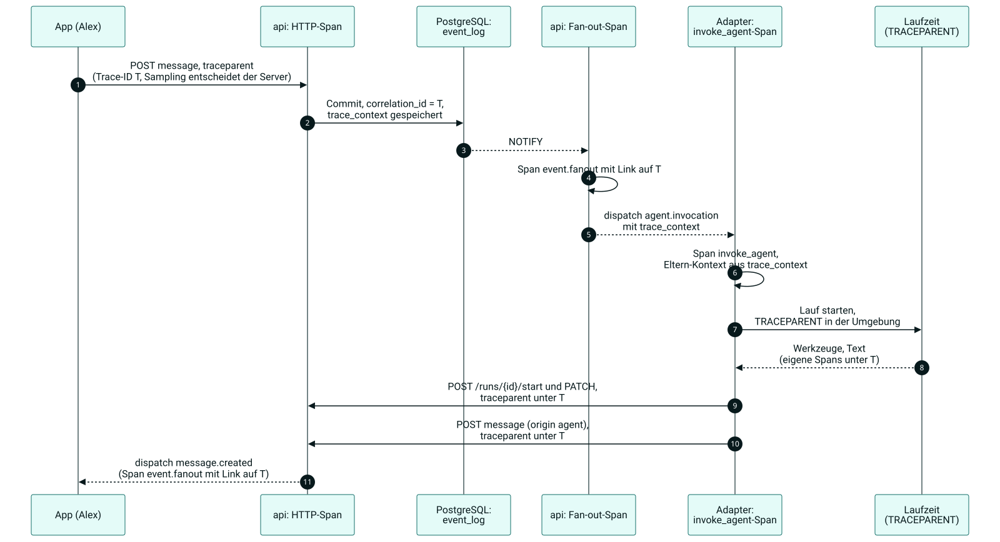

# 17 Observability

Status: draft M0. Normative for telemetry (traces, metrics, logs), privacy of the
telemetry, collector, dashboards, SLOs, alerts, in-app statistics and the boundary to the
audit log. This chapter summarizes the rules; the details are under
[docs/observability/](../observability/signals.md).
Terms: [00-glossary.md](00-glossary.md). Operations: [16-operations.md](16-operations.md).

## 1. Goals

1. An instance operator sees within minutes whether messages arrive, whether agents run and
   whether push works, and follows a request from the app to the agent runtime.
2. Telemetry reveals no content and is not suitable for monitoring individual people.
3. Telemetry never blocks the message path.
4. The backend is replaceable: a switch is configuration, not code.

## 2. Basic rules

| No. | Rule | Source |
|---|---|---|
| 1 | Instrumentation only with OpenTelemetry (Go SDK in the server, OTel SDKs in Python and TypeScript in the adapters). | B11 |
| 2 | Export only to an OpenTelemetry Collector. No process talks directly to a vendor backend. | B11, ADR 0034 |
| 3 | No message content, prompts, file names, search terms, tokens or secrets in telemetry. Enforcement at the source and in the collector (allowlist). | B11, [privacy.md](../observability/privacy.md) |
| 4 | Telemetry is asynchronous with a bounded queue. If it is full, the process drops data and counts `bothy.telemetry.dropped`. An export error never changes the result of a request. If a processor of the SDK drops data without feedback, the README of `platform/otel` names this uncounted point. | R-Telemetrie |
| 5 | `gen_ai.*` attributes are only in one package per codebase (server, SDK). Their status is "Development"; a change of the convention is a change at exactly this place. | R-Telemetrie, [signals.md](../observability/signals.md) 6 |
| 6 | The audit log is not telemetry: its own table, the same transaction, never sampled, never via the collector. | B11, [audit-vs-telemetry.md](../observability/audit-vs-telemetry.md) |
| 7 | The in-app statistics read their own tables, never the telemetry backend. | [admin-statistics.md](../observability/admin-statistics.md) |
| 8 | People appear in telemetry only as a pseudonym (HMAC with `telemetry.pseudonym_key_ref`). Metrics never carry person attributes. | [privacy.md](../observability/privacy.md) |
| 9 | Every attribute of a metric has a finite set of values bounded by the instance operator. IDs are only in spans and logs. | [signals.md](../observability/signals.md) 2 |

## 3. Signals

The catalogue in [signals.md](../observability/signals.md) is the only list of all names,
units and attributes. Summary:

| Area | Core signals |
|---|---|
| REST | `http.server.request.duration` (semantic conventions, stable) |
| Sync | `bothy.delivery.duration`, `bothy.gateway.connect.duration`, `bothy.gateway.catchup.duration`, `bothy.event.fanout.lag`, `bothy.db.event_seq.lock_wait` |
| Agents | `bothy.run.start.latency`, `bothy.run.duration`, `bothy.run.finished`, `bothy.run.steps`, `bothy.run.tokens`, `bothy.run.cost`, `bothy.agent.consumer.lag` |
| Push | `bothy.push.sent`, `bothy.push.skipped`, `bothy.push.fetch` |
| Database | Receiver `postgresql` in the collector, `db.client.operation.duration`, `bothy.db.pool.connections` |
| Backup | `bothy.backup.last_success.timestamp`, `bothy.backup.restore_test.*`, `bothy.storage.volume.*` |

Traces follow a request via W3C Trace Context: app, REST, event log, fan-out, adapter,
runtime. At the public listener, the server starts its own trace and links an
incoming `traceparent` as a span link; it becomes the parent context only with
`telemetry.traces.trust_remote_parent`. `correlation_id` in events and audit is the trace ID
of the triggering request; every request has one, even with `telemetry.enabled = false`.
For passing it on to adapters, the envelope carries the field `trace_context` (W3C `traceparent`,
stored in `event_log.trace_context`; 03, 04 section 2.2).

## 4. Privacy

1. Prohibition at the source: instrumentation sets only attributes from the catalogue.
2. Second line in the collector: `transform/scrub` deletes known content fields, the
   allowlist (`redaction`) removes every other key and replaces values that look like a token or
   an email address with HMAC-SHA-256.
3. Check: a canary test sends content with a secret word through the real path and
   searches for the word in all exported data. A hit breaks the gate.
4. Retention in the local stack: `BOTHY_PROMETHEUS_RETENTION`, `BOTHY_LOKI_RETENTION`,
   `BOTHY_TEMPO_RETENTION` (Compose variables). With external backends, the contract with the
   provider applies; the owner enters it into the record of processing activities (chapter 20).

Details: [privacy.md](../observability/privacy.md).

## 5. Collector and backends

The base [infra/otel/collector.yaml](../../infra/otel/collector.yaml) receives, filters and
distributes. Overlays under `infra/otel/exporters/` attach backends: `local` (Prometheus, Loki,
Tempo), `newrelic`, `grafana`, `datadog`, `azure-monitor`, `sentry`, `none`. Two overlays can
be combined. Details: [collector.md](../observability/collector.md),
[backends.md](../observability/backends.md).

## 6. SLOs and alerts

| SLO | SLI | Target | Alert |
|---|---|---|---|
| `bothy-api/requests-availability` | REST without 5xx | see file | Page and ticket |
| `bothy-sync/delivery-latency` | Live delivery within the threshold | see file | Page and ticket |
| `bothy-sync/reconnect` | Upgrade to `ready` within the threshold | see file | Page and ticket |
| `bothy-push/provider-acceptance` | Acceptance by the provider | see file | Page and ticket |
| `bothy-agents/run-start` | `queued` to `running` within the threshold | see file | Page and ticket |
| `bothy-agents/turn-duration` | completed runs within the threshold | see file | ticket only |

Targets and thresholds are only in the Sloth files under `infra/observability/slo/`; the
table in [slos.md](../observability/slos.md) reproduces them, and a check keeps both equal.
Burn-rate alerts with the multi-window method (start values 14.4, 6 and 1; Sloth adds 3).
Alerts go to an alert channel of the instance and, for `page`, additionally to an external
channel; a watchdog reports a dead alert path. Details: [slos.md](../observability/slos.md),
[alerting.md](../observability/alerting.md).

## 7. Dashboards

Six Grafana dashboards as files under `infra/observability/grafana/dashboards/`, loaded
via file provisioning: server, delivery and sync, agent runs, push, database and
backup, SLO overview. With M7, a seventh dashboard `bothy-live` with the project's own
panel plugin is added ([25-visualization.md](25-visualization.md), section 8). Details:
[dashboards.md](../observability/dashboards.md).

## 8. In-app statistics

The admin console shows usage per space, runs, tool calls, costs and error rates from
its own tables. Counters about people appear only from `privacy.stats_min_group_size` on ([20-privacy.md](20-privacy.md)); values per person
do not exist. Details: [admin-statistics.md](../observability/admin-statistics.md).

### 8.1 Own SLI measurement

For live views and the SLO traffic light of the apps, the server measures by itself
([25-visualization.md](25-visualization.md), section 3; ruling T7):

1. Every measuring point of an SLI (section 6) reports its value twice: to the OTel instrument and
   via `kernel/measure` to the module `stats`. The own measurement counts `count` and
   `good` per minute into the table `stats_minutes` (03, section 4.15); it never reads from the
   telemetry (rule 7, R-OB-08 stays).
2. The boundary for "good" and the target come from the same Sloth files as the Prometheus rules;
   a generator produces them for server and app, a check keeps them equal (25, section 3.3). The
   boundary is a bucket boundary of the histograms (R-OB-06), so both paths count the same
   events as good.
3. The traffic light is called "own measurement" and does not raise alerts. Alerts still come from
   Prometheus (section 6). Deviations are possible: errors before the server (proxy) are missing
   from the own measurement, and a crash loses at most one `stats.flush_interval`.
4. Like the telemetry, the own measurement never blocks the message path (rule 4): counters in
   memory, writing in the background, loss counted in `bothy.stats.flush.dropped`.

### 8.2 Visualizations

The views of the apps and of the console (live topology, backend view, delivery and sync live,
executive page, daily timeline, TV mode) and the Grafana panel plugin `bothy-live-panel` are
governed by [25-visualization.md](25-visualization.md). The plugin reads only metrics and traces
of this chapter; the views of the apps read only the project's own statistics API.

## 9. Apps

1. There is no official OpenTelemetry SDK for Dart
   (https://opentelemetry.io/blog/2026/dart-flutter-opentelemetry/, retrieved 2026-10-10)
   [verified]. The apps therefore send no spans, only fixed metrics via the server
   ([signals.md](../observability/signals.md) 4.6a;
   [ADR 0057](../adr/0057-client-telemetry-through-a-server-endpoint.md)). They set `traceparent` on every request; the
   server links it as a span link, so that app error reports and server traces are connected in a
   way that makes them findable.
2. The server decides the trace ID and sampling (`telemetry.traces.trust_remote_parent`
   is off by default). Reason: a client must neither force everything to be recorded
   nor choose the `correlation_id` that is in the audit.
3. An app sends crash reports only if the publisher of the app has configured a target
   (Sentry, [backends.md](../observability/backends.md)). Reports contain no content; the
   app removes message texts, inputs and URLs with parameters before sending (chapter 15).

## 10. Tests that hold these rules

1. Canary test: content with a secret word through API, adapter and collector; the word must not
   appear in any export (gate).
2. Allowlist check: every attribute key in the code is in the catalogue, every key of the
   collector allowlist is in the catalogue.
3. Cardinality test: metric attributes only from finite sets; no IDs on metrics.
4. Name test: every metric used in dashboards, rules and SLOs is in the catalogue.
5. `make ops-check`: `otelcol-contrib validate` for base, overlays and pairs (check `collector`),
   `promtool check config`, `check rules` and `test rules` (checks `prometheus-config`,
   `prometheus-rules`, `prometheus-rule-tests`), `amtool check-config` with routing (check
   `alertmanager`), Loki, Tempo and OpenTofu (checks `loki`, `tempo`, `tofu`); alert thresholds
   equal to their configuration values (check `alert-thresholds`). Grafana provisioning in the
   portability test.
6. `make ops-check`, checks `slo-docs` and `sloth`: targets and thresholds in
   [slos.md](../observability/slos.md) equal to the Sloth files; generated rules equal to a
   fresh generation.
7. SLI boundary check: the generated boundaries of the own measurement equal to a fresh generation
   from the Sloth files; every SLO has a `sli.*` metric in `stats_minutes` (25, VZ-T02, VZ-T03).

## 11. Configuration values of this chapter

| Name | Default | Meaning |
|---|---|---|
| `telemetry.enabled` | `true` | telemetry on or off |
| `telemetry.traces.sampler_ratio` | `1.0` | share of the traces that the SDK records; the collector then samples again |
| `telemetry.traces.trust_remote_parent` | `false` | `true`: an incoming `traceparent` becomes the parent context (its trace ID becomes `correlation_id`, its sampling flag applies); `false`: span link only, own trace |
| `telemetry.logs.exporter` | `both` | `otlp`, `stdout` or `both` |
| `telemetry.logs.level` | `info` | lowest level that is written |
| `telemetry.pseudonym_key_ref` | `file:<secrets.dir>/telemetry_pseudonym_key` | key for HMAC pseudonyms; at least 32 bytes |
| `telemetry.dashboard_url` | empty | link from the admin console to the telemetry backend |
| `stats.cache_ttl` | `5m` | how long a computed statistics result stays valid |
| `stats.max_range` | `400d` | largest queryable time range |
| `stats.time_zone` | `UTC` | IANA time zone of the day boundaries in statistics, daily aggregates and timeline ([admin-statistics.md](../observability/admin-statistics.md), section 5) |

## 12. Decisions of this chapter

| No. | Decision | Reason |
|---|---|---|
| R-OB-01 | Fan-out in the collector via forward connectors; every backend is an overlay with its own pipelines. | Several backends without list conflicts when merging; without an overlay, the base stays valid. |
| R-OB-02 | Privacy twice: prohibition at the source and allowlist in the collector, checked with a canary test. | An error in the code alone must not leak content to the outside. |
| R-OB-03 | People only as an HMAC pseudonym in spans and logs, never on metrics. | Debugging stays possible, performance monitoring of individual people does not. |
| R-OB-04 | Tail sampling in the collector: all errors, all slow ones, a share of the rest; the SDK records everything. | Errors are never lost through random sampling. |
| R-OB-05 | The server decides the trace ID and sampling, not the client; an incoming `traceparent` is only a span link by default. | A client cannot force full recording and cannot choose the `correlation_id` in the audit. |
| R-OB-06 | Histograms with fixed boundaries; every SLO threshold is a boundary. | An SLI from buckets is exact only at boundaries. |
| R-OB-07 | `correlation_id` is the trace ID of the triggering request. | Events, audit and traces can be connected without a second ID. |
| R-OB-08 | Status page and statistics do not depend on the observability stack. | The stack is optional; operational functions of the app are not. |
| R-OB-09 | Runtime texts in ops artifacts (alert texts, dashboard titles) are English. | Instance operators worldwide; all repository content is English (D-W-94). |
| R-OB-10 | The apps measure SLIs themselves (own measurement in `stats_minutes`) with boundaries from the Sloth files; Prometheus stays the source for alerts. | R-OB-08 forbids reading from the telemetry; one source for boundaries keeps both paths comparable (ruling T7, [25-visualization.md](25-visualization.md)). |
