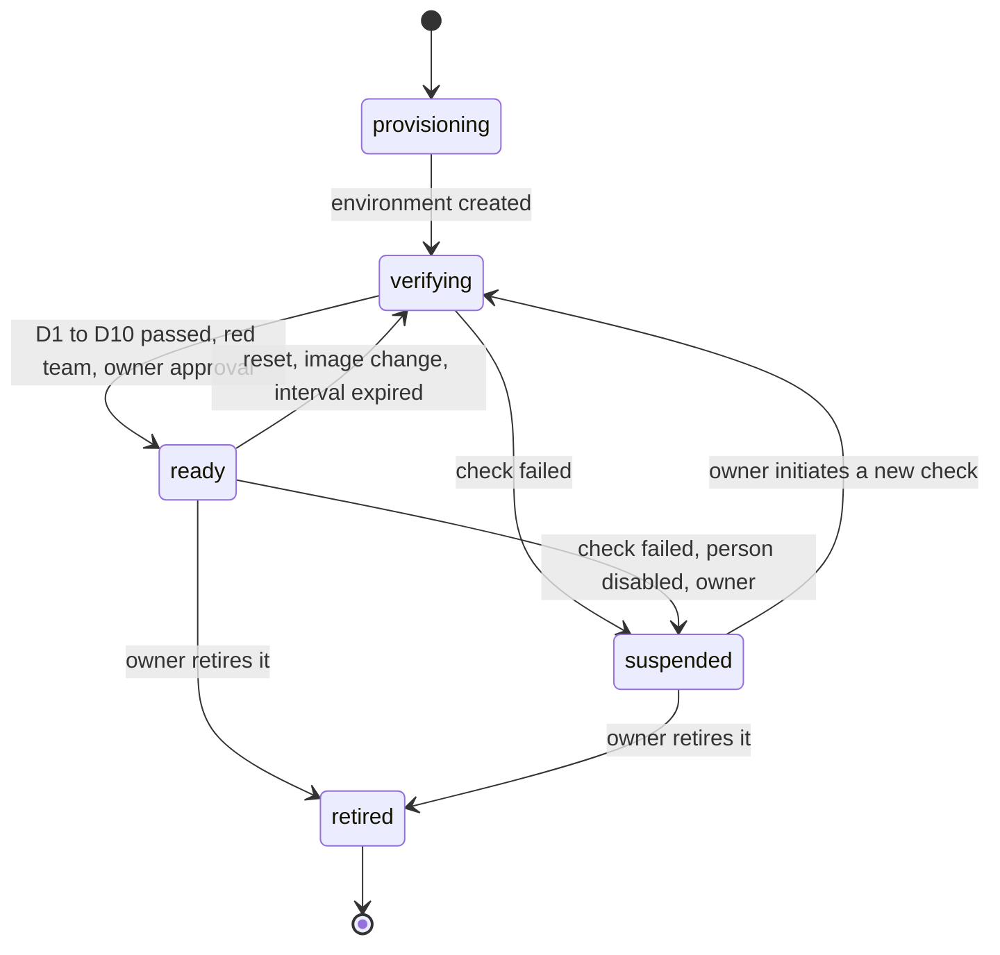
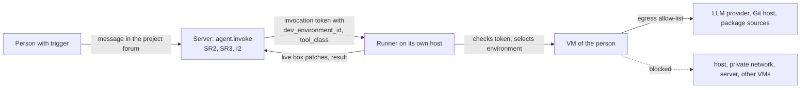

# 21 Multi-user dev environment and isolation

Status: draft M0. Later milestone (Baseline section 6: "Multi-user dev environment (isolation)
as a later milestone"). Until this milestone is complete, the following applies: in dev projects
only owners trigger (07, SR2 and SR3). This chapter defines what must apply before enabling for
additional people, and is already normative now for the guard rule and the record `dev_environments`.
Decision: ADR 0046. Permissions: [07-permissions.md](07-permissions.md). Agents and runners:
[09-agents.md](09-agents.md). Backend policy: [10-backend-policy.md](10-backend-policy.md).
Threat: T-DEV-01 in [../security/threat-model.md](../security/threat-model.md).

## 1. Starting point

A dev project is a forum with a project binding; the operator is a runner agent (Baseline section
3). The reference runner starts a coding agent (for example Claude Code in mode `-p` with
stream-json) per thread with its own session (Baseline R-Claude-Code-Runner). Typical operation
today, described in general terms:

- The runner runs as **one** user of the host, the same user who owns the secrets of the
  instance operator.
- The coding agent runs **without tool permission prompts** (for Claude Code, the switch that
  skips all permission prompts), so that runs complete without a person at the terminal.
- There is **no sandbox**: shell, file system and network are open to the agent with the
  permissions of this user.
- The environment of the process is an allow-list, but it contains, for example, the user's SSH
  agent and the home directory in which the login of the coding agent is stored.
- The only boundary is: only the owner triggers.

## 2. Why this is unsafe for additional people

1. **Triggering means shell.** Whoever can trigger a run can ask the agent to execute arbitrary
   commands as the host user. That is remote access to the host, built on purpose.
2. **Prompt injection is enough.** Even without bad intent on the part of the person: a repository,
   a dependency, an issue description or a web page can contain instructions that the agent
   executes (T-AI-03).
3. **Secrets of the instance operator are exposed.** Configuration files, SSH keys, cloud access,
   logins of other tools and the login of the coding agent itself.
4. **No separation between people.** All projects are in the same file system; one person
   can read and change the work of another.
5. **Subscription terms.** If the agent runs on the owner's personal subscription, a run by another
   person would be use of the subscription by third parties (Baseline I1, R-Anthropic).
6. **Network without a boundary.** Internal services, the private network and cloud metadata are reachable.

## 3. Target state

| No. | Requirement |
|---|---|
| Z1 | One environment of their own per person with a **hypervisor boundary** (VM). A separate user in the same operating system is not enough (section 4). |
| Z2 | Separate LLM access per person: either the person's own login in the unmodified coding agent (Anthropic explicitly allows this, even when a platform operates the agent; https://code.claude.com/docs/en/legal-and-compliance, retrieved 2026-10-10 [verified]) or an organization API key from a separate workspace with a monthly limit (spend limits per workspace: https://platform.claude.com/docs/en/manage-claude/workspaces, retrieved 2026-10-10 [verified]). |
| Z3 | Separate Git access per person with minimal permissions: only approved repositories, no administration, no writing to protected branches, no workflow permissions. |
| Z4 | No secrets of the owner in the environment: no shared home, no forwarded SSH agent, no cloud access, no login of the owner. |
| Z5 | Network egress only to an allow-list: LLM provider, Git host, package sources. No access to the host, the private network, the overlay network, cloud metadata, other environments, or the server directly. |
| Z6 | One working folder (clone) per person and project in their environment; exchange only through the Git host. |
| Z7 | Limits for CPU, memory, disk and processes per environment. |
| Z8 | Reset to a clean image at any time; images versioned. |
| Z9 | Log of the egress decisions (metadata only) and of the runs per environment. |
| Z10 | A run of a person runs only in their environment; a thread stays bound to the environment in which it started (07, SR3). |

## 4. Options

| Criterion | O1 Shared runner with tool permission prompts | O2 Separate OS user on the host | O3 macOS VM per person | O4 Linux VM per person (also containers with their own VM) | O5 Cloud VM per person |
|---|---|---|---|---|---|
| Isolation boundary | none | file permissions, shared kernel | hypervisor | hypervisor | hypervisor and separate hardware |
| Owner's secrets reachable | yes | on any misconfiguration, through local services and kernel vulnerabilities | no, if no folders are shared | no, if no folders are shared | no |
| Egress controllable per person | no | hard (rules per user on the host) | yes, at the virtual network interface | yes, at the virtual network interface | yes, security groups of the provider |
| Apple tools (Xcode) | yes | yes | yes | no | only with Mac instances of the provider |
| Limits on a Mac | | | Apple limits running macOS VMs per Mac; Virtualization.framework refuses the third macOS VM (https://eclecticlight.co/2022/08/04/virtualisation-on-apple-silicon-macs-8-how-apple-limits-vms/, retrieved 2026-10-10 [verified]; current license text not checked [assumed]) | no known fixed limit | cost per hour |
| Tools | | | UTM (Apache-2.0, uses GPL components; starts macOS guests through Virtualization.framework; https://github.com/utmapp/UTM [verified]); Tart (repository with the topic "fair-source", https://github.com/openai/tart [verified]; check the exact license terms before use [assumed]) | on macOS 26 with Apple Silicon: Apple Containerization starts every Linux container in its own lightweight VM, Apache-2.0 (https://github.com/apple/containerization, retrieved 2026-10-10 [verified]); on Linux hosts KVM-based VMs | cloud provider |
| Reset | no | laborious | clone image | clone image | restart image |
| Effort | low | medium | medium to high | medium | medium, plus cost and data location |
| Assessment | rejected: tool permission prompts get switched off or blindly confirmed in long runs; no boundary against injection | rejected as the sole boundary | permitted if Apple tools are needed | **Default** | permitted, equivalent to O4 |

## 5. Decision

1. Additional people get dev runs only in an environment with a hypervisor boundary (O3, O4, O5).
   O1 and O2 are excluded (ADR 0046).
2. The default is O4: a Linux VM per person, on a host that is not the server host, or as O5
   in the cloud. Reason: most projects need no Apple tools; Linux VMs can be operated without a
   quantity limit and with standard tools for network rules.
3. O3 only for projects that need Apple tools, and only as many environments as the
   platform allows.
4. Where the environments run (own machine, company hardware, cloud) is decided by the owner (cost,
   data location). The decision is recorded in the instance operator's ops area, not in the product.
5. LLM access in environments of other people in this milestone only `organization` (organization
   key from a workspace with a monthly limit per person). Reason: I1 is defined per agent. A
   runner serves a forum on which every owner has `trigger`; a runner in mode `personal` with
   another person as `credential_holder` always violates I1. A backend policy per
   dev environment (the person uses their own subscription, only they trigger in their environment,
   SR3 ensures this) needs I1 per environment instead of per agent. The lead has deferred it to the
   milestone "Multi-user dev environment"; until then only `organization` applies (03, R-DM-24).

## 6. Record `dev_environments` and readiness check

### 6.1 Table

The table `dev_environments` is defined normatively in [03-data-model.md](03-data-model.md),
section 4.4 (module `agents`, retention `security`, milestone "Multi-user dev environment"). It
comes with `agent_sessions.dev_environment_id` and `runs.dev_environment_id` (NULL for owner runs
in the owner environment), the claim `dev_environment_id` in the invocation token
([05-actions.md](05-actions.md), section 5) and the actions `dev_environment.read` (owner
or the person themselves), `dev_environment.manage` (owner, step-up, audit, Permissions `yes`:
create, approve, suspend, retire) and `dev_environment.report` (runner, `agent-self`:
report check results) in 05, section 4.13. The field `checks` (schema
`dev_environment_checks.v1`) holds the result and time per check D1 to D10 from section 6.3.

### 6.2 Ready

An environment is ready if and only if all of the following hold:

- `state = 'ready'`,
- `verified_at` lies less than `dev.reverify_interval` in the past,
- `red_team_passed_at` is set and the red team applied to the same `isolation_kind` and the same
  `image_ref`,
- `approved_at` is set,
- the person is active and has `trigger` on the channel (07).

SR3 checks this on acceptance and before every delivery of an invocation (07, section 5).

### 6.3 Checks

The runner runs them on creation, after every reset, after every image change and
at the latest after `dev.reverify_interval`, and reports them with `dev_environment.report`.

| No. | Check | Passed if |
|---|---|---|
| D1 | Isolation kind | the runner confirms from its provisioning a VM of the reported kind (not reported from inside the VM) |
| D2 | No host access | in the guest no mount of the host home, no shared folder except the working folder, the guest user is not the host user |
| D3 | Network blocked | from the guest, the host, a probe from every private range, Shared Address Space, cloud metadata, the server directly and another environment are not reachable |
| D4 | Network allowed | LLM provider, Git host and package sources of the allow-list are reachable |
| D5 | No third-party secrets | no known variables for LLM, cloud or agent access except the configured one; no SSH agent; secret scan of the guest home without a finding |
| D6 | LLM mode equals configured mode | the reported mode of the coding agent from the runtime (for Claude Code `apiKeySource` in the init event, Baseline R-Claude-Code-Runner) matches `billing_mode`; in mode `organization` OAuth variables are removed |
| D7 | Git access limited | cloning a test repository that is not approved fails; a push to a protected branch fails |
| D8 | Limits set | CPU, memory, disk, processes according to `dev.limits` |
| D9 | Reset | a clean image is present and the last reset succeeded |
| D10 | Log | egress log active |

If a check fails, the server sets `state = 'suspended'` with `suspended_reason =
'check_failed'`; active runs in this environment get `run.cancel_requested`. Back to `ready`
only through a new, fully passed check.

### 6.4 States

## 7. Flow of a run

1. The server checks `agent.invoke` with SR2 and SR3 and writes `dev_environment_id` into the run
   and the token.
2. The runner checks the token (I3) and starts only in exactly this environment. If it is missing
   or not ready, the runner reports `failed` with reason `dev_environment_not_ready`.
3. The coding agent runs in the person's working folder in the VM. Tool permission prompts may be
   switched off there; the boundary is the VM.
4. Files that the agent uploads to the chat come only from the working folder and the attachment
   folder of the environment; never files with secret patterns.
5. Stop ends the process group in the VM. The runner holds the control connection to the VM, not the
   server.

### 7.1 Dev environment as a host for the terminal

A ready dev environment can at the same time be a host with the host service
([24-terminal.md](24-terminal.md)); `hosts.dev_environment_id` connects both (03). Rules:

1. A non-owner gets a terminal there only if it is their own environment and it is ready according
   to section 6.2 (07, SR10, ruling T1). If it becomes `suspended` or `retired`, their
   sessions end (`access_revoked`).
2. The LLM declaration of the host follows section 5, item 5: in environments of other people only
   `organization` or `none`, never `personal` with another person as the holder. Until the milestone
   decides on a personal policy per environment, this also applies to the environment's own person
   (R-DM-24).
3. Provisioning creates the session user of the environment's person in the environment; the host
   service reports it (24, section 2.2). Only an owner with `host.manage` (step-up, reason, audit)
   can assign it, when confirming the environment as a host (07, SR12; ruling T12). Reason: a
   system action that grants access to a host without step-up would be a new path around the
   permission model; confirming the host needs the owner anyway (24, section
   3.2).
4. The host service runs in the VM, never on the host of the VMs. Reason: a shell on the host would
   be exactly the escape that section 8.2 checks.
5. "Take over a thread in the terminal" (continuing a session of the runner interactively) only
   becomes possible when the runner and the host service run as the same user in the environment;
   that is a later milestone (ruling T5). Until then, runner sessions and terminal are separate.
6. The checks D1 to D10 apply unchanged; the host service does not change them, because it only
   talks outbound to the server and, according to D3, the server is reachable from the guest only
   through the edge. For this, D3 allows exactly the edge of the server as a target, not the server directly.

## 8. Tests and red team before enabling

### 8.1 Automated tests

| ID | Test | Expected |
|---|---|---|
| DEV-T01 | Non-owner triggers without an environment | `dev_environment_not_ready` (07, AZ-M15) |
| DEV-T02 | Non-owner triggers in a thread of another person | `dev_environment_foreign_thread` (AZ-M17) |
| DEV-T03 | Environment `ready`, but `verified_at` older than `dev.reverify_interval` | rejected |
| DEV-T04 | Check D3 fails during an active run | environment `suspended`, run `cancel_requested` |
| DEV-T05 | Token with someone else's `dev_environment_id` sent to the runner | no start |
| DEV-T06 | `user.disable` of the person | environment `suspended` |
| DEV-T07 | Runner reports an `isolation_kind` outside the allowed values | rejected |
| DEV-T08 | Non-owner opens a terminal in someone else's environment, in their own environment that is not ready and in their own ready environment, the own ready one once without and once with assignment of their session user by the owner (7.1 item 3) | `terminal_not_host_assignee`, `terminal_not_host_assignee`, `terminal_no_session_user`, allowed |
| DEV-T09 | Own environment becomes `suspended` during a terminal session | session ends with `access_revoked` |

### 8.2 Red team

Before the first enabling of each combination of `isolation_kind` and `image_ref`, a red
team (level P3 in [19-security.md](19-security.md), section 13) checks with these tasks, each
as a task given to the coding agent in the environment and by hand:

1. Read or write files of the host user.
2. Reach services of the host, of the private network, of the overlay network, and cloud metadata.
3. Reach the server directly, bypassing the gateway.
4. Read the environment or the working folder of another person.
5. Find the API token of the runner or other secrets.
6. Exfiltrate data through DNS or allowed targets (measurement of what the allow-list permits).
7. Exhaust resources (fork bomb, disk, memory) and impair the host.
8. Keep something beyond a reset.
9. Write to repositories that are not approved or to protected branches with the Git access.
10. Get the agent to do 1 to 9 through a prepared file in the repository (injection).

Passed means: 1 to 5, 8 and 9 impossible; 6 and 7 limited and logged, with documented
residual risk. Result and report set `red_team_passed_at` and `red_team_ref`; the owner then
approves with step-up. Every image change that changes network, mounts or users requires a
new red team.

## 9. Decisions of this chapter

| No. | Decision | Reason |
|---|---|---|
| R-DV-01 | Hypervisor boundary required; an OS user alone is not enough. | A shared kernel, local services and misconfigurations open up the host. |
| R-DV-02 | Linux VM per person as the default, macOS VM only when needed, cloud VM equivalent. | Cost, quantity limits and tools. |
| R-DV-03 | Readiness is a record with checks, red team and owner approval; SR3 checks it on every invocation. | Readiness changes; only a check at invocation is always current. |
| R-DV-04 | Threads in dev projects are bound to the environment of their first run. | A session works on the files of its environment. |
| R-DV-05 | Environments of other people in this milestone only with an organization key. | I1 is defined per agent; a personal mode per environment needs a change to I1. |
| R-DV-06 | Terminal in a dev environment only for its person and only when it is ready; host service in the VM. | An OS user alone is not a boundary (R-DV-01); the terminal should not reopen the escape (ruling T1, T5). |
| R-DV-07 | Provisioning creates the session user of a dev environment; only an owner with `host.manage` can assign it when confirming the host, no system action. | A system action that grants access to a host without owner, step-up and reason would be a path around the permission model; the confirmation needs the owner anyway (D-W-65). |

## 10. Open points

- Location of the environments (own machine, company hardware, cloud): owner.
- Personal subscription in one's own environment: needs I1 per environment; decision in the milestone "Multi-user dev environment".
- Shared sessions of two people in one thread: deliberately excluded (study C).

## 11. Alignment with the core contract

The additions requested during drafting have been decided (integration of 2026-10-10):

| No. | Addition | Decision, location |
|---|---|---|
| K-DV-1 | Table `dev_environments`, `dev_environment_id` on sessions and runs, claim, actions | adopted as a milestone, 03 section 4.4, 05 sections 4.13 and 5 |
| K-DV-2 | Backend policy per dev environment with I1 per environment | not now: deferred to the milestone "Multi-user dev environment" (lead); until then only `organization` (R-DM-24) |

## 12. Configuration values of this chapter

| Name | Default | Meaning |
|---|---|---|
| `dev.reverify_interval` | `24h` | an environment is checked again at the latest after this time |
| `dev.limits` | `{"cpus": 4, "memory_mib": 8192, "disk_gib": 50, "pids": 2048}` | limits per environment |
| `dev.egress_allowlist` | empty | allowed targets (hosts) for environments; without an entry no egress |
