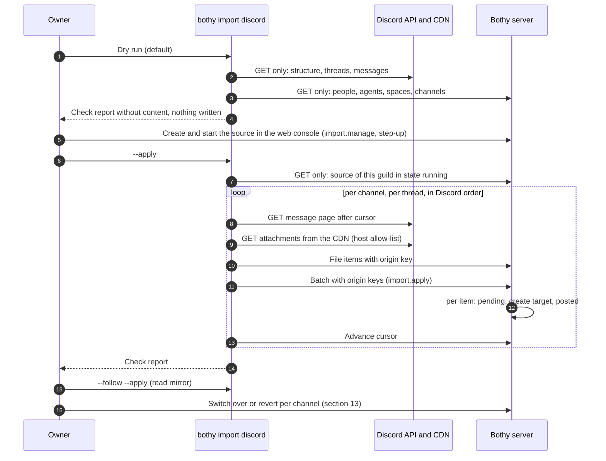
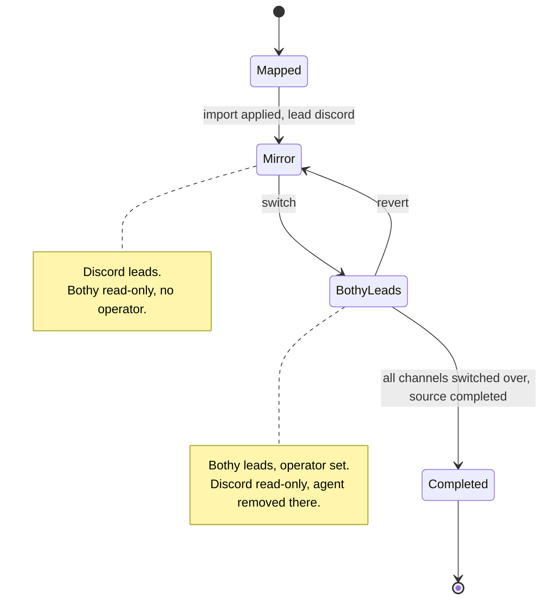

# 22 Import and migration from Discord

Status: draft M0. Normative for the import tool, the import interface of the server and the
migration flow. Terms: [00-glossary.md](00-glossary.md). Tables `import_sources` and
`import_items`: [03-data-model.md](03-data-model.md), section 4.11. Actions `import.read`
and `import.manage`: [05-actions.md](05-actions.md), section 4.12. Decision on the design:
[ADR 0043](../adr/0043-discord-import-read-only-dry-run-origin-key.md). Lessons of the
predecessors: [REUSE.md](../REUSE.md).

All limits, windows and intervals are named configuration values. Their default values are
only in section 19.

## 1. Goal and boundaries

An organization that uses a Discord server with agent bots today moves to Bothy channel by
channel, without loss and without duplicates. Afterwards the old history is in Bothy, with the
original time and the original author, and every thread can continue its earlier agent session.

In scope:

- One-time import of the history (categories, text channels, forums, threads, forum posts,
  messages, attachments, pins, forum tags).
- Read mirror for parallel operation: new Discord messages are pulled into Bothy, only in
  this direction.
- Switching over per channel and reverting per channel.
- Binding of imported threads to earlier agent sessions.

Out of scope:

- Writing to Discord. The tool calls Discord read-only (section 4).
- Taking over Discord roles and channel permissions as grants. Bothy has no roles
  (Baseline section 4); the owner assigns grants deliberately (section 5.1).
- Voice and stage channels, reactions with the people who reacted, keeping edits and deletions
  in sync after copying (sections 6.6 and 12.4).
- Big bang. There is no step that switches over all channels at once.

## 2. Design

The import is a separate process outside the server: the command `bothy import discord` of the
command-line tool `bothy`. It reads Discord and writes through the public API of the
server, like any other client. The server never calls Discord.

Reasons (in detail in ADR 0043):

1. The server never loads external URLs (Baseline section 4, "Deliberately never": SSRF). Only the
   tool loads attachments from the Discord CDN.
2. Extensions never run in the server process (B6). The Discord token is never held by the server.
3. The dry run provably writes nothing, neither in Discord nor in Bothy nor locally.
4. Idempotency and progress are nevertheless kept in the server (`import_items`, `import_sources.cursor`).
   An aborted run resumes on any machine.

Whether `bothy` is the same Go binary as the server is decided by [02-architecture.md](02-architecture.md);
only the process separation matters.

## 3. Flow overview



## 4. Discord access: read only

### 4.1 Endpoints

The tool knows only these calls. The Discord client in the code has no method for any verb other
than `GET` (test in section 16).

| Purpose | Call | Source |
|---|---|---|
| Check token, own bot ID | `GET /users/@me` | [R1] |
| Server name for the report | `GET /guilds/{guild.id}` | [R2] |
| Categories and channels (without threads) | `GET /guilds/{guild.id}/channels` | [R2] |
| Active threads of the server | `GET /guilds/{guild.id}/threads/active` | [R2] |
| Archived public threads per channel, page by page with `before` | `GET /channels/{channel.id}/threads/archived/public` | [R3] |
| Archived private threads per channel; needs `MANAGE_THREADS`, otherwise a note and skip | `GET /channels/{channel.id}/threads/archived/private` | [R3] |
| One channel or thread (check the state in the read mirror) | `GET /channels/{channel.id}` | [R3] |
| Messages forward from the cursor | `GET /channels/{channel.id}/messages?after=…&limit=…` | [R4] |
| Messages before an ID (settle rule in the read mirror) | `GET /channels/{channel.id}/messages?before=…&limit=…` | [R4] |
| Re-read one message (fresh attachment URL) | `GET /channels/{channel.id}/messages?around=…&limit=…` | [R4] |
| Attachments | `GET` on hosts from `import.discord.cdn_hosts` | [R5] |

Deliberately not used: `GET /guilds/{guild.id}/members`, because it requires the privileged intent
`GUILD_MEMBERS` [R2, verified]. Authors are in every message object; the mapping needs nothing
more. Also not used: the pin endpoint; the field `pinned` on the
message object is enough [R4, verified].

Archived threads come newest first by `archive_timestamp` [R3, verified]. The next page
asks with `before` equal to the `archive_timestamp` of the last thread; threads are deduplicated
by their ID; a page without a new ID ends the query, so that the same page never comes endlessly.

The base URL is `import.discord.api_base`. Every request carries a `User-Agent` in the format that
Discord requires for bots [R6, verified]. The bot token goes only to the API base, never to CDN hosts.

### 4.2 Bot, permissions, intents

The import uses a separate Discord bot account, not the token of a productive agent bot.
Reasons: Discord counts rate limits per bot [R7, verified], so an import would otherwise slow down
the answers of the running agents; and the import account needs only read permissions.

- Channel permissions: `VIEW_CHANNEL` and `READ_MESSAGE_HISTORY` [R4, verified]; `MANAGE_THREADS`
  only if archived private threads are to be taken over [R3, verified].
- Intent: `MESSAGE_CONTENT` must be enabled in the developer portal. Without it, Discord delivers
  empty values in `content`, `embeds`, `attachments`, `components` and `poll`, also over REST
  [R8, verified]. For bots below the verification thresholds, the switch in the portal is enough [R8, verified].
- The tool reads the token from the environment (`BOTHY_IMPORT_DISCORD_TOKEN`) or from a file
  (`--discord-token-file`). It never appears in output, report, error text or log
  (test in section 16).

### 4.3 Rate-limit guard

Discord reports limits through headers and `429` with `retry_after` [R7, verified]. The tool:

1. Waits `X-RateLimit-Reset-After` before the next call if `X-RateLimit-Remaining` equals
   `0`.
2. On `429`, waits the time from `retry_after` (body) or `Retry-After` (header) and
   retries at most `import.discord.max_429_retries` times.
3. Aborts if a requested wait time is greater than `import.discord.max_rate_wait`. The
   state remains; a new run resumes.
4. Never retries `401` and `403`. A `403` on a channel ends all further calls for
   this channel in the run. Reason: Discord temporarily blocks an IP after too many responses with
   `401`, `403` or `429` [R7, verified].
5. Likewise respects `429` of the Bothy server (header `Retry-After`).

### 4.4 Preflight check

Before every run, including the dry run:

1. `GET /users/@me` succeeds; the token is a bot token.
2. The server is readable; every category and every mapped channel is visible.
3. Intent probe: among the first `import.discord.preflight_sample` messages by other authors
   in a readable channel, at least one has content, an attachment or an embed. Otherwise abort with
   the note that `MESSAGE_CONTENT` is probably missing. Reason: without this probe, a
   complete import of empty messages would result.
4. The Bothy session belongs to an active owner.
5. Every target person and every target agent of the mapping file exists.

## 5. Mapping

### 5.1 Structure

| Discord (type number [R3, verified]) | Bothy | Rule |
|---|---|---|
| `GUILD_CATEGORY` (4) | space (`space`) | create a new space or use an existing one (mapping file) |
| `GUILD_TEXT` (0), `GUILD_ANNOUNCEMENT` (5) | channel `kind = text` with main thread | messages outside of threads go into the main thread |
| `GUILD_FORUM` (15), `GUILD_MEDIA` (16) | channel `kind = forum` | tags from `available_tags` become `forum_tags` |
| `PUBLIC_THREAD` (11), `PRIVATE_THREAD` (12), `ANNOUNCEMENT_THREAD` (10) | thread `kind = thread` | see 5.1.1 |
| `GUILD_VOICE` (2), `GUILD_STAGE_VOICE` (13) | nothing | counted as skipped in the report |
| Channel without category | space according to `defaults.uncategorized_space` | otherwise skipped |

Rules:

1. The tool only creates. It never deletes, archives or renames items in Bothy. It uses an
   existing space or channel only if the mapping file names it explicitly.
   If a new name collides with an existing name that the import did not create, the run aborts
   before the first write.
2. New channels get no grants. They are thus visible only to owners ("The default is
   nothing"). Channels with `permission_overwrites` in Discord are marked in the report so that the
   owner sets grants deliberately.
3. New channels are read-only in the read mirror (section 12.1). Only the switch-over sets the
   operator (section 13.3).
4. Order: spaces and channels in Discord order (`position`), as `sort_key`.

#### 5.1.1 Threads

- A thread created from a message in a text channel has the same ID as its starter message
  [R3, verified]. In Bothy it becomes a thread with `parent_message_id` equal to the imported
  starter message in the main thread. If that message is missing, `parent_message_id` stays empty.
- A forum post becomes a thread in the forum channel; its start message is the first message.
- The title is the thread name, shortened to `thread.title_max_chars`. If the name is a placeholder
  according to the auto-title rule (REUSE.md, section 5.1), `title_source = auto`, otherwise `manual`.
- `threads.created_at` and `last_activity_at` come from the source (time in the snowflake of the
  thread ID or of the last message, respectively) (03, section 4.11).
- Done: a thread becomes `closed` if `thread_metadata.archived` is exactly `true` and it is not
  in the list of active threads, or if it carries a tag from `import.discord.closed_tags`.
  `closed_at` is `archive_timestamp`. Missing metadata, `false` or a thread in both lists
  count as open. Reason: a thread wrongly left open does no harm; a thread wrongly
  closed hides work.
- `applied_tags` become `thread_tags` up to `thread.max_tags`; further tags are dropped, so the tag
  set of the thread stays editable (M8-11).
- `threads.operator_agent_id` comes from `planned_operator` of the channel in the mapping file, not
  from the effective operator (empty in the read mirror) (03, `threads.operator_agent_id`). Reason: R-DM-12 pins the operator; without this rule every imported
  thread would stay without an agent forever after the switch-over.

### 5.2 Mapping file

A YAML file of the owner, schema `import_source.discord.v1`. The server stores it without
secrets in `import_sources.config`. `bothy import discord init-map` generates a skeleton from the
Discord structure and the authors that the dry run has seen; the owner edits it.

```yaml
version: 1
guild_id: "<guild_id>"
defaults:
  unmapped_human: placeholder      # placeholder | skip
  unmapped_bot: placeholder        # placeholder | skip
  uncategorized_space: skip        # skip | <space key from spaces>
spaces:
  - discord_category: "<category_id>"
    target: {create: {name: "Support"}}          # or {existing: "<space_uuid>"} or skip
channels:
  - discord_channel: "<channel_id>"
    target: {create: {name: "tickets"}}          # space follows the category
    planned_operator: "agent:support-bot"        # or none
    lead: discord                                # discord | bothy (section 12.1)
  - discord_channel: "<channel_id>"
    target: skip
users:
  - discord_user: "<user_id>"
    target: "user:alex"                          # user:<handle> | agent:<handle> | placeholder
  - discord_user: "<bot_user_id>"
    target: "agent:support-bot"
```

Channels that are not named are skipped and counted in the report. An error in the file
(unknown field, unknown handle, duplicate Discord ID) ends the run before any call with
exit code `2`.

### 5.3 People and placeholders

Every author becomes a principal in Bothy:

| Discord author | Target | Rule |
|---|---|---|
| Person with entry `user:<handle>` | existing person | original author |
| Bot with entry `agent:<handle>` | existing agent | original author; the message nevertheless has `origin = import` |
| Without entry or `placeholder` | placeholder person | see below |
| Webhook author | placeholder per webhook ID | as without entry |

Placeholder: a principal `kind = user`, `status = disabled`, without identity, without grants,
`display_name` from `global_name` or `username`, handle `imported-<name>` with a counter on
collision. It can never log in and never trigger. Origin: `import_items` with
`item_kind = user`; the interface shows it as "imported". Placeholders are personal
data of the Discord users (section 14).

Mentions of people become text (`@Name`), not rows in `mentions`. Reason: a
mention creates notifications and counters; an import creates none (section 6.4).

### 5.4 Agents

The tool never creates agents and never sets operators or backend policies. Those are
owner actions with step-up and I1 check (`agent.create`, `channel.operator.set`). The
mapping file names only existing agents.

## 6. Messages

### 6.1 Types

The Discord types `DEFAULT` (0), `REPLY` (19), `CHAT_INPUT_COMMAND` (20),
`THREAD_STARTER_MESSAGE` (21) and `CONTEXT_MENU_COMMAND` (23) are taken over [R4, verified]. All
others (system messages such as a pin notice or "thread created") are counted and skipped. Type 21
is dropped if its starter message is already in the main thread. Empty messages without attachment,
embed, sticker and poll are counted and skipped.

### 6.2 Fields

| Bothy field (`messages`) | Value |
|---|---|
| `author_principal_id` | mapped principal (5.3) |
| `origin` | always `import`; never triggers an agent ([05-actions.md](05-actions.md), section 5) |
| `kind` | `text` |
| `created_at` | `timestamp` of the source |
| `edited_at` | `edited_timestamp` of the source; no revisions |
| `silent` | `true` |
| `trigger_state` | empty |
| `reply_to_message_id` | for type 19, if the referenced message is imported in the same thread; otherwise a quote line in the content, shortened to `import.reply_quote_max_chars` |
| `import_item_id` | row in `import_items` |
| `client_msg_id` | generated by the server; idempotency is carried by the origin key (section 7) |
| `thread_seq` | appended in Discord order (ascending ID) |

The display order comes from `thread_seq`, never from `created_at` ([04-sync-protocol.md](04-sync-protocol.md),
section 10). A thread is therefore appended strictly in Discord order.

### 6.3 Converting content

The target is the Markdown dialect `content_format = 1`. What cannot be mapped stays as
readable text.

| Discord | Bothy |
|---|---|
| `<@USER_ID>` [R6, verified] | `@DisplayName` as text |
| `<@&ROLE_ID>` | `@RoleName` as text |
| `<#CHANNEL_ID>` | `[#name](/c/<channel_id>)` with the in-app path of [15-client-architecture.md](15-client-architecture.md) section 11 when the channel is posted in this source (`channel_id` of Bothy), otherwise `#name` |
| `<:NAME:ID>`, `<a:NAME:ID>` | `:NAME:` |
| `<t:TIMESTAMP:STYLE>` (seconds) | time as ISO 8601 text in UTC |
| Embeds | quote block with title, link and description; images in embeds are not loaded |
| Sticker | `[Sticker: name]` |
| Poll | question and answers as a list with the note "Poll" |
| Forwarded message (`message_snapshots`) | quote block with the content of the snapshot |
| Small-text prefix `-# ` at the start of a line | removed |

The length of a Discord message is far below `message.max_content_bytes`. A message is
never split; the origin key needs no part index. A converted message that is longer all the same
is counted as a failed message in the report and not imported.

### 6.4 No notifications, no unread backlog

1. `messages.silent = true`, no `mentions`, no push, no `trigger_state`.
2. The server writes one `thread.updated` per batch and thread instead of one `message.created` per
   message (04, section 15.8). Clients load the thread through REST
   when they display it. Reason: an import can write a multiple of the normal traffic;
   clients should not receive every message individually.
3. The server sets `threads.unread_floor_seq` to the end of the batch; imported content thus counts
   as unread for no person with read permission (03, `read_states`). Reason: imported content is
   old; it should not light up as unread. One row per thread instead of one per reader keeps the
   batch cheap.
4. Agent adapters get no `agent.invocation` and no `agent.followup` from imported
   messages, because `origin = import` never triggers.

### 6.5 Attachments

For every attachment:

1. If `size` is greater than `import.attachment_max_bytes`, it is not loaded.
2. Otherwise the tool loads `url` with `GET`, only if the scheme is `https` and the host is in
   `import.discord.cdn_hosts`. Without the bot token, without redirects, without a proxy from the
   environment, with a read limit of `import.attachment_max_bytes` plus one byte, timeout `import.http_timeout`.
3. CDN URLs of attachments are signed and expire (`ex`, `is`, `hm`) [R5, verified]. If
   the CDN answers with `403` or `404`, the tool re-reads the message once (fresh URL) and
   tries once more.
4. Error texts show only scheme, host and path; query and fragment are masked. The error body
   of the CDN is never output, because it can contain the signed URL.
5. Success: upload through the import interface (section 8) into the target channel; the file
   goes through the normal virus scan ([12-files.md](12-files.md)); the author is the author of
   the message.
6. If it fails or the attachment is too large: the message gets a line with file name,
   size, reason and jump link `https://discord.com/channels/{guild_id}/{channel_id}/{message_id}`.
   The jump link does not expire [derived: it contains no signature]. The report counts the
   case.

### 6.6 Pins, tags, reactions

- Pins: messages with `pinned = true` [R4, verified] are pinned in Bothy; `pinned_by` is
  the importing owner.
- Forum tags: `available_tags` become `forum_tags` of the channel (matched by name, without duplicates);
  `applied_tags` become `thread_tags`.
- Reactions are not taken over. Discord delivers only counters on the message object; who
  reacted costs one call per emoji and message. Bothy stores reactions per person.
  Status markers of agents would not be a reaction anyway (Baseline section 4). The report
  counts reactions that were not taken over.

## 7. Idempotency and resuming

### 7.1 Origin key

`(source_id, origin_key)` in `import_items` is unique. The Discord server is fixed by the source
and is not part of the key.

| `item_kind` | `origin_key` |
|---|---|
| `space` | `space:<category_id>` |
| `channel` | `channel:<channel_id>` |
| `forum_tag` | `forum_tag:<channel_id>:<tag_id>` (a tag ID is unique only within its forum in the data the tool reads) |
| `thread` | `thread:<thread_id>` |
| `message` | `message:<message_id>` |
| `file` | `file:<attachment_id>` |
| `user` | `user:<user_id>` (also bots and webhooks) |
| `pin` | `pin:<message_id>` |

Discord IDs are snowflakes and always strings in the HTTP API [R6, verified]; the tool checks
that they consist only of digits.

### 7.2 `pending` and `posted`

The server executes every item like this ([03-data-model.md](03-data-model.md), `import_items`):

1. If `(source_id, origin_key)` exists with `posted`, it answers with the existing target. No
   duplicate, no event.
2. Otherwise it writes `pending` and, in the same transaction, creates the target and sets `posted`.
3. Files: `pending` reserves the file ID before the bytes are uploaded; an aborted upload
   with the same key reuses the same ID. `posted` follows when the bytes are
   complete.
4. `content_sha256` stores the hash of the converted content. A later run that sees a
   different hash counts "changed at the source" in the report and changes nothing.

A posted thread applies the changes of section 12.2 step 3; every other posted item answers with
its target and changes nothing. A posted thread item thus renames the thread only while its
`title_source` is `auto`, closes it with `closed_at` or reopens it (clearing `closed_at` and
`closed_by`), and moves `last_activity_at` forward; it never changes the operator, the parent
message or the tags (M8-11).

The answer to such a key carries the stored item with the member `source_changed = true`
(`ImportItem`), and the server raises its counter `server.source_changed` in
`import_sources.stats`; nothing else changes and no other event is written (M8-03). A key that
exists is locked before it is read, so a concurrent batch with the same key waits for the commit of
the other (section 7.4). A batch whose items all existed already writes no event at all, unless its
posted thread item applies a mirror change (section 12.2 step 3), which writes one `thread.updated`
and one `import.progress`.

### 7.3 Cursor

`import_sources.cursor` holds, per Discord channel and thread, the highest fully taken-over
message ID. The tool advances it only after a successful batch. A new run
starts behind the cursor; 7.2 prevents duplicates at the edge. The tool owns the layout of the
object; the server stores it as sent (`setImportCursor` replaces cursor and counters). Besides the
progress it holds the run lease of section 7.4 (member `run` with a run ID and the time of the
last renewal).

### 7.4 Two runs at the same time

Two writing runs of the same source are correct (every item at most once, in order per thread,
because each run processes a thread strictly sequentially and a competing
key waits for the commit of the other), but wasteful. A writing run therefore holds a lease in
the cursor (section 7.3) and renews it at least every `import.follow.poll_interval`; the tool
does not start if another run's lease is younger than `import.lease_stale_after`, except with
`--takeover`, and a run that finds the lease taken over by another run stops writing. The source state `running` does not mean that a run is active: the owner starts
the source in the web console (section 8), and it stays `running` between runs.

## 8. Import interface of the server

Binding is `docs/api/openapi.yaml` (tag `Import`); this table reflects the state of the spec.
All routes are for owners only.

| Operation | Route | Action | Step-up |
|---|---|---|---|
| Create source (`kind = discord`, mapping) | `POST /api/v1/imports` | `import.manage` | yes |
| Start or resume, pause, cancel, complete source | `POST /api/v1/imports/{import_id}/start`, `/pause`, `/cancel`, `/complete` | `import.manage` | yes |
| Change ownership list per channel (`lead`, also sets the read-only flag) | `PUT /api/v1/imports/{import_id}/leads` | `import.manage` | yes |
| Read source, progress, items by state | `GET /api/v1/imports`, `/imports/{import_id}`, `/imports/{import_id}/items` | `import.read` | no |
| Write a batch of items with origin keys (section 7.2) | `POST /api/v1/imports/{import_id}/batches` | `import.apply` | no |
| Create a file item with origin key; the bytes follow through the upload session ([12-files.md](12-files.md)) | `POST /api/v1/imports/{import_id}/files` | `import.apply` | no |
| Upload one part of the file of a file item (rules of `uploadPart`) | `PUT /api/v1/imports/{import_id}/files/{file_id}/parts/{part_number}` | `import.apply` | no |
| Complete the upload of a file item; the item becomes `posted` (rules of `completeUpload`) | `POST /api/v1/imports/{import_id}/files/{file_id}/complete` | `import.apply` | no |
| Update cursor and counters | `PUT /api/v1/imports/{import_id}/cursor` | `import.apply` | no |

There is no dry run on the server: the tool only reads (section 10.2) and
creates no source while doing so.

`import.apply` requires: the principal is an active owner, the source is in state `running`, every
target lies in a channel of this source. No step-up per batch, because the start requires step-up
and a read mirror runs for days. A batch concerns exactly one thread and has at most
`import.batch_max_items` items; it is one transaction. Structure items (spaces, channels,
forum tags, people) come in separate batches without a thread. Every batch writes `import.progress`
and `thread.updated` (section 6.4). Start, cancellation and completion are recorded in the audit log.

States and answers of the interface (M8-03): `startImport` moves `draft` or `paused` to
`running` and sets `started_at` on the first start; `pauseImport` moves `running` to `paused`;
`cancelImport` moves `draft`, `running` or `paused` to `failed` with the counter
`server.cancelled = true` (there is no state `cancelled`); `completeImport` moves `running` or
`paused` to `completed` only when every mapped channel whose target is not `skip` and whose channel
item is `posted` has `lead = bothy` (else `409 conflict` with `reason` `lead_not_bothy`). Repeating
the transition that already happened (start on `running`, pause on `paused`) answers the source
unchanged without an event; every other transition is `409 conflict` with `reason`
`import_state`. `setImportLead` answers `404` for a channel the mapping does not name or maps to
`skip`, `409 conflict` with `reason` `channel_not_imported` while its channel item is not `posted`
and `import_state` for a `completed` or `failed` source. `applyImportBatch` and `setImportCursor`
answer `409 conflict` with `reason` `import_not_running` for a source that is not `running` (also
`paused`); a batch target outside the channels of the source is `409 conflict` with `reason`
`target_outside_source`, a new space or channel whose name a live object holds `409 conflict` with
`reason` `name_collision`. Each refusal of `import.apply` is recorded in the audit log as a denial
with reason `import_not_running`. The mapping of section 5.2 is the schema
`ImportSourceDiscordConfig`; the `data` of the structure items follows `ImportSpaceData`,
`ImportChannelData`, `ImportForumTagData` and `ImportUserData` (`docs/api/openapi.yaml`).

Content items (M8-11): a batch with `thread_origin_key` (`thread:<id>`, or `channel:<id>` for the
main thread of a posted text channel; a forum has none, `400 validation_failed`) holds the
optional thread item of that key first (`ImportThreadData`), then message items
(`ImportMessageData`) and pin items (`ImportPinData`) in source order; any other item kind there,
and a content item in a batch without `thread_origin_key`, is `400 validation_failed` at its
`item_kind`. A thread that is neither posted nor created by the batch is `409 conflict` with
`reason` `thread_not_imported`; a message or file whose author item is skipped or missing is
`409 conflict` with `reason` `author_not_imported`. A file item comes through
`createImportFile` (`ImportFileCreate` with `sha256`), its parts and completion through
`uploadImportFilePart` and `completeImportFile`, which authorize `import.apply` instead of
`file.upload`: `uploadPart` and `completeUpload` are write actions that rule 1.8 refuses in a
read-only mirror channel, while 05 4.12 puts the files of an import under `import.apply`. `setImportCursor` replaces `cursor` and
merges the members of `stats` into `stats.tool`; the server's own counters are under
`stats.server`. `getImport` and `listImports` return the stored `cursor`.

The command line logs in as a device with `platform = cli` through device pairing
(`bothy import login`, [08-identity.md](08-identity.md) sections 5.3 and 6.4). Such a session
can never provide step-up, so every step that needs `import.manage` (create a source with its
mapping file, start, pause, cancel, complete, ownership list) is done by the owner in the web
console ([01-product.md](01-product.md) section 3.7, row "Import from Discord"), and so are
`channel.operator.set` and `channel.read_only.set`. The tool uses only `import.read`,
`import.apply` and read actions.

## 9. Binding to earlier agent sessions

An imported thread can continue the session that it had in the old environment
(example: session ID of Hermes Agent or Claude Code). The flow follows the behavior of a
`/resume`: take over the reference, bind on the first write, exactly once, with compare-and-swap,
without blocking in the error case.

1. **Take over the reference.** `--sessions <file>` provides JSON lines
   `{"discord_thread": "<thread_id>", "agent": "<handle>", "external_session_ref": "<ref>"}`.
   The import creates one `agent_sessions` row per line: `is_current = false`,
   `started = true`, `ended_at` = import time, `end_reason = import`. If `agent` differs from the
   `operator_agent_id` of the thread, the row is dropped and counted in the report.
   The tool checks the whole file before any write (members exactly these and the two of step 7,
   `discord_thread` digits and named once, `agent` an agent of the server, the reference a
   non-empty display text of at most the largest `agent.session_ref_max_bytes`; a violation ends
   the run with exit `2` and names the line, never the reference); a line whose thread is not part
   of the run is ignored and counted in a note, a line whose agent is not the `planned_operator`
   of the thread's channel is dropped and counted as discarded. An accepted line travels with the
   thread item as `earlier_session` (`ImportThreadData`, with the agent's UUID): the server writes
   the row in the batch transaction, also for a thread that an earlier run posted (a later run
   with the file reaches it), and answers `session` on the item: `taken_over`, `already_present`
   (a row of the same thread, agent and reference with `end_reason = import` exists, so a repeated
   run or a second file never adds a row) or `dropped_late` (step 6). A dry run validates and
   counts without writing; `--follow` sends the line with the thread item of a new thread.
2. **Bind on the first trigger.** When a person triggers an agent in the thread for the first time
   and the thread has had no current session since the import, the server creates, in the
   transaction of the run, a current row with the same `external_session_ref`. Audit
   `agent_session.bind`, event `agent_session.changed`.
3. **Compare-and-swap.** The partial index "one current session per thread" lets only one of two
   simultaneous triggers bind; the other sees the bound row. The partial index "an
   external session belongs to at most one thread" prevents an old session from hanging on two
   threads; then step 5 applies.
4. **Resume in the adapter.** The invocation message carries the session with `started = true`; the
   adapter resumes instead of starting fresh. It may resolve the reference (example: Hermes follows
   a compression chain to the live end) and reports the valid reference with
   `agent_session.report` under a version check.
5. **Fail open.** If the runtime no longer knows the old session or the binding fails,
   the adapter starts a new session and reports this. The server ends the bound row
   (`end_reason = rebind`), creates the new one and writes exactly one system message into the
   thread: the earlier session no longer exists; the agent starts without the old history. The
   person's message is never lost.
6. **Never twice.** An import row is bound only as long as the thread has had no
   current session since the import. A later reset (`agent_session.reset`) never binds again.
7. **Cost.** Runtimes that report cumulative session costs need the state before the
   binding as a baseline, otherwise the first run books the old costs again. For this, the file may
   carry `cost_baseline_micros` and `currency` per line (03, `agent_sessions`; `currency` is
   required when the baseline is above 0). The bound session carries both to the adapter in the
   session object of `agent.invocation` (`AgentSession`, present when the baseline is above 0), and
   an adapter that reports differences of session sums starts from it
   ([09-agents.md](09-agents.md) 4.10 and 18.7).

Who may bind is governed by `agent.invoke`: the binding arises only from a permitted trigger
(level `trigger`, I2).

## 10. Tool

### 10.1 Commands

| Command | Effect |
|---|---|
| `bothy import login --server <url>` | logs the tool in as a `cli` device through device pairing; the owner approves the pairing code in the app or the web console; writes only the session file of the tool |
| `bothy import logout` | ends the session on the server and deletes the session file |
| `bothy import discord --guild <id> --map <file>` | dry run: only `GET` against Discord and Bothy, writes nothing, not even a local file (exceptions of the login in rule 5 of 10.2); prints the check report |
| `… --apply` | imports into the source of this guild that the owner created and started in the web console (section 8); without such a running source exit `2` |
| `… --apply --follow` | read mirror as a loop (section 12); without `--apply` one reading round per interval with "would copy" |
| `… --apply --once` | exactly one round of the read mirror; for scheduled calls |
| `bothy import discord init-map --guild <id> --out <file>` | writes a skeleton of the mapping file (only this file) |
| `bothy import discord switch --guild <id> --map <file> --channel <id> --discord-locked` | last mirror round and settle check of the switch-over (section 13.3, step 2); `--discord-locked` is the owner's statement that step 1 is done, without it exit `2` before any call; exit `1` with the counts per reason while the settle rule holds anything back or messages after the cursor were not copied; otherwise prints the owner's steps 3 and 4 for the web console |
| `bothy import discord revert --guild <id> --channel <id>` | only reads Bothy (no lease, no Discord): prints per Bothy thread of the channel the number of messages written in Bothy (origin other than `import`, kind other than `system`, not deleted), the total and the owner's steps of reverting (section 13.4) |
| `bothy import discord status --guild <id>` | source, state, ownership list (per mapped channel the Discord channel ID, the lead, the Bothy channel ID, its read-only state, and `operator ok`, `operator differs from planned` or `no operator`; a lead that disagrees with the read-only flag is flagged `inconsistent`), counters; no names of channels, spaces or people |

Further options: `--channel <id>` (repeatable) narrows the scope; `--only-thread <id>` (repeatable)
selects exactly these threads; `--sessions <file>` (section 9); `--report text|json`;
`--takeover` (7.4); `--discord-token-file <path>`; `--config <file>` (values from section 19);
`--session-file <path>` (the session file of `bothy import login`, below).

Session file: `bothy import login` stores device ID, DPoP key (Ed25519) and token pair in
`<user configuration directory>/bothy/import-session.json` (`os.UserConfigDir`); every
`bothy import` command takes `--session-file <path>` instead. The file has mode `0600` in a
directory with mode `0700`; a file or directory that group or others can read or write is refused
(on Windows the file lives in the user profile and the mode check is skipped). It is written
atomically (temporary file in the same directory, `fsync`, rename). Every refresh holds an
exclusive lock of `<file>.lock` and reads the file again after taking it, so two tool processes
never rotate the same refresh token ([08-identity.md](08-identity.md) section 7.4); the new
refresh token is stored before the new access token is used. `bothy import logout` deletes the
session file under that lock and keeps the lock file. A missing file means "not logged in". No
output, log line or error carries a token, the key or the content of the file.

### 10.2 Rules

1. Dry run is the default. A forgotten switch only reads.
2. An unknown or non-matching ID in `--channel` or `--only-thread` ends the run before
   any write; valid IDs of the same call are then not processed either.
3. Contradictory options (`--follow` with `--once`, `--only-thread` with `--follow`) end with
   exit code `2` without a call to Discord or Bothy.
4. Output never contains message content, file names of attachments, tokens or signed URLs.
5. The only call of a dry run to Bothy that is not a `GET` is `refreshToken` when the access
   token of the session has expired, and the only file it may write is the session file of
   `bothy import login`, to store the rotated refresh token (otherwise the next run would reuse
   a consumed token and revoke the session, [08-identity.md](08-identity.md) section 7.4). Neither
   is import data.

### 10.3 Exit codes

| Code | Meaning |
|---|---|
| `0` | done, or dry run without errors |
| `1` | run aborted (network, rate limit above the limit, server error); the state remains, a new run resumes |
| `2` | invocation, mapping file or preflight check faulty; nothing written |
| `3` | another run holds the lease of the source (without `--takeover`, section 7.4); with `--once` the normal case for scheduled calls |

## 11. Check report

One row per channel, a total at the end. No content, no names of people. A dry run says "would
take over" where an `--apply` run says "taken over".

| Column | Meaning |
|---|---|
| Channel | Discord name and target in Bothy |
| Threads | open, done |
| Messages | taken over, already present, skipped by reason (type, empty) |
| Attachments | taken over, too large, failed |
| People | mapped, placeholders |
| Sessions | references taken over, already present, discarded (agent does not match), late (the thread has had a session since the import) |
| Pins, tags | taken over |
| Reactions | not taken over (number) |
| Notes | `403`, Discord permissions restricted, changed at the source, written in Discord after the switch-over |

The report is also stored in `import_sources.stats` and can be retrieved with `import.read`: the
totals as counters under `stats.tool`, written with the last `setImportCursor` of an `--apply` run
(a dry run writes nothing).

`--report json` prints the same report as one JSON object: `version` (`1`), `mode` (`dry run` or
`apply`), `server` (the name of the Discord server), `channels` (one object per channel with
`channel`, `target`, `counts` and `notes`), `total` (the counts of all channels),
`channels_skipped` (channels not taken over by reason) and `notes`. `counts` has the members
`threads_open`, `threads_done`, `messages_taken`, `messages_present`, `messages_skipped` (by
reason: `type`, `empty`, `starter_in_main`, `author`), `messages_failed`, `messages_held` (held back
by the settle rule of a read mirror round, 12.3; `0` in a full run), `attachments_taken`,
`attachments_too_large`, `attachments_failed`, `people_mapped`, `people_placeholders`,
`sessions_taken`, `sessions_present`, `sessions_discarded`, `sessions_late`, `pins_taken`,
`tags_taken`, `reactions_not_taken` and `source_changed`. A dry run counts an accepted line of a
thread in scope under `sessions_taken` ("would take over"); lines of the sessions file whose thread
is not part of the run appear as one note with their count. The server keeps its own counters
`server.sessions_taken_over`, `server.sessions_already_present` and `server.sessions_dropped_late`.

## 12. Read mirror (parallel operation)

### 12.1 Ownership list

Every mapped channel has exactly one leading place in the source, `lead`:

| `lead` | Discord | Bothy |
|---|---|---|
| `discord` | people and agents work there | channel read-only; the mirror copies new messages |
| `bothy` | read-only (step of the owner in Discord), agent removed there | channel writable, operator set; no mirror |

Read-only in Bothy means: no principal, not even an owner, may create messages,
threads, reactions or interactions in the channel; only `import.apply` writes (`channels.read_only`,
03; 05 rule 1.8). The flag is set by `import.manage` with the ownership list; by hand it is set by
`channel.read_only.set`, which refuses the imported channels of a source that is neither `completed`
nor `failed`, so the ownership list and the flag never disagree. As a result, no agent can be triggered in the mirror, and a
channel never has two leading places.

### 12.2 Round

Every `import.follow.poll_interval`:

1. `GET /guilds/{guild.id}/channels` (contains `last_message_id`) and
   `GET /guilds/{guild.id}/threads/active`.
2. Only channels with `lead = discord` and a `last_message_id` newer than the cursor are read.
3. New threads become threads; renamed threads change the title only with `title_source = auto`;
   archived ones become `closed`, active-again ones `open` (rule from 5.1.1; if a thread is missing
   from the active list, `GET /channels/{channel.id}` confirms the state).
4. Channels with `lead = bothy` in which Discord nevertheless shows new messages appear as a
   warning in the report. Nothing is copied.
5. Errors of a round (network, `5xx`, rate limit above the limit) do not end the mirror; the
   next round waits with backoff up to `import.follow.max_backoff`. Errors of one thread do not hold
   up other threads.

### 12.3 Settle rule

Agents in Discord edit their answer while they work. A half-finished output must
not be copied, because later edits are not kept in sync (12.4). Per thread, the following applies
strictly in order:

1. A message is **busy** if it (or, for type 21, its starter message) carries a
   reaction from `import.follow.busy_reactions` with a counter greater than zero.
2. A message is **unsettled** if the more recent of `timestamp` and `edited_timestamp` lies less
   than `import.follow.settle_after` in the past.
3. What is copied is the beginning of the new messages up to before the first busy or unsettled
   message. Types that are not copied do not stop it.
4. Because agents sometimes set their marker only after the copy, the round additionally checks
   the `import.follow.busy_lookback` messages before the first new one. If one of them is busy,
   the whole thread waits.

### 12.4 What is not kept in sync

Edits and deletions in Discord after copying. Reason: that would mean re-reading old messages
regularly; the settle rule makes the case rare. The report of a later
full run counts "changed at the source" (7.2).

## 13. Migration flow per channel

### 13.1 States



### 13.2 Pilot and parallel operation

1. Dry run over the whole server; check the report; correct the mapping file until there are no
   aborts.
2. Pilot: a few channels with `--channel`, import applied, read mirror on.
3. Parallel operation: Discord leads in all channels. Bothy shows the history read-only.
   Check: counters in the report, spot checks against Discord, attachments, session references.

### 13.3 Switching over a channel

Order, so that two places never lead at the same time:

1. Discord, owner: set the channel read-only; remove the agent from this channel in the Discord
   configuration of its runtime.
2. Tool: one last mirror round for the channel; wait until the settle rule holds nothing
   back any more.
3. Bothy, owner in the web console: `lead = bothy` (`import.manage`), which lifts read-only in
   the same transaction; set the operator (`channel.operator.set`, step-up, I1). The operator
   must be `planned_operator`, otherwise the imported threads have a different agent than the
   channel.
4. Probe: a message in an imported thread triggers the agent; the session binds
   (section 9); the answer appears only in Bothy.

`switch` performs step 2 and ends with exit `1` and the number of held-back messages if
busy or unsettled messages are still in the channel after the last round; otherwise it prints
step 3 for the owner. Step 3 needs step-up, which a `cli` session cannot provide (section 8).
The tool cannot see step 1 (it never writes to Discord and reads no permissions there), so the
flag `--discord-locked` stands for it: the owner confirms with it that the Discord channel is
read-only and the agent removed there; without it `switch` ends with exit `2` before any call.
After the round `switch` reads the channel once more: messages after the cursor that the settle
rule does not hold but the round did not copy (written after it) also end with exit `1`, because
the lock of step 1 is evidently not in place yet.

### 13.4 Reverting a channel

1. Bothy, owner in the web console: `lead = discord`, which sets read-only and cancels active
   runs in the channel in the same transaction; remove the operator.
2. Discord, owner: lift read-only; add the agent there again.
3. The mirror resumes at the cursor.

Messages that were created in Bothy while `lead = bothy` do not go to Discord; the
tool never writes to Discord. `revert` prints their number per thread, so that the owner deliberately
transfers or discards them.

### 13.5 Completion

When all imported channels (channel item `posted`) have `lead = bothy`: end the mirror; source `completed` (`import.manage`, by the
owner in the web console). The
mapping `import_items` remains until the owner has the retention class `import` deleted
([20-privacy.md](20-privacy.md)). After that a repeated import is no longer idempotent;
the web console warns before this step (in the confirmation of the completion).

## 14. Security and privacy

| Topic | Rule |
|---|---|
| Discord token | only in the tool, from the environment or a file; never to Bothy, never to CDN hosts, never in output or log |
| Server-side loading | none; only the tool loads, only `https`, only hosts from `import.discord.cdn_hosts`, without redirects |
| Permissions | import and mirror only by owners; start with step-up; new channels without grants |
| Triggering | `origin = import` never triggers; channels in the mirror are read-only |
| Placeholders | personal data of third-party Discord users; class `account`; deletion through a privacy request |
| Origin | `import_items` (class `import`) contains Discord IDs; deletable after completion |
| Audit | start, pause, cancellation, completion, ownership list, bindings |
| Telemetry | counters and durations of the tool, no content, no Discord IDs |

## 15. Later: Zulip import

The import interface is source-neutral. A Zulip import would be a further command
`bothy import zulip` with its own mapping (channel to channel, topic to thread) and needs
`import_sources.kind = zulip` (additive migration). Not in this scope.

## 16. Tests that hold this chapter

| Test | Proof |
|---|---|
| Dry run only `GET` | fake Discord and fake Bothy count methods: only `GET`; no file in the working and temp folders |
| Discord client without a write method | static check: the client exports no method with a verb other than `GET` |
| No duplicate after a crash | abort between batch and cursor; new run: every item exactly once, order per thread equal to Discord |
| Stored, then error | fake Bothy stores a batch and answers `502`; the retry returns the same target |
| Import never triggers | an imported message in a channel with an operator creates no run, no `agent.invocation` |
| No notification | no push, no `mentions`, `read_states` at the batch end |
| CDN limits | foreign host, `http`, redirect and an oversized response are rejected; token never to the CDN |
| No secret in output | fake responses echo the token and a signed query; output, report and log contain none of them |
| Archive rule | only `archived = true` and not active becomes `closed`; doubt stays open |
| Settle rule | a busy or unsettled message stops the thread; a lookback marker stops it |
| Read-only in the mirror | `message.create` of an owner in the mirror channel is rejected; `import.apply` succeeds |
| Binding once | two simultaneous first triggers bind exactly once; missing old session: new session, exactly one system message |
| Rate limit | `X-RateLimit-Remaining: 0` waits; a wait time above the limit aborts with exit `1`, the state remains |
| Intent probe | a channel with only empty messages by other authors aborts with exit `2` |
| Invalid selection | an unknown ID in `--only-thread` aborts before any write |

## 17. Decisions of this chapter

| No. | Decision | Reason |
|---|---|---|
| R-IM-01 | Import as a separate process through the public API, not as a server job. | No server-side loading of external URLs, Discord token never in the server, B6 (ADR 0043). |
| R-IM-02 | Dry run is the default and writes nowhere. | A forgotten switch must not create anything; the proof is a simple test. |
| R-IM-03 | Separate Discord bot account with read permissions only. | Rate limits per bot; productive agents are not slowed down; least privilege. |
| R-IM-04 | Idempotency through `import_items (source_id, origin_key)`, not through content comparison. | Exact instead of heuristic; a crash at any point leaves no duplicate. |
| R-IM-05 | All imported messages `origin = import`, `silent`, without `mentions`. | Never trigger, never notify. |
| R-IM-06 | Unknown authors become disabled placeholder people. | Every message needs a principal; a placeholder can do nothing. |
| R-IM-07 | Channels in the mirror are read-only, also for owners. | A channel never has two leading places; no agent is triggered twice. |
| R-IM-08 | Imported threads carry the planned operator. | Otherwise they stay without an agent after the switch-over because of R-DM-12. |
| R-IM-09 | Reactions and later edits are not taken over. | Cost per emoji and message; the settle rule makes late edits rare. |
| R-IM-10 | Binding of earlier sessions on the first trigger, exactly once, fail open. | Matches `/resume`; a failure must never silence the person. |
| R-IM-11 | Archived only with `archived = true` and not in the active list. | A thread wrongly left open does no harm, a thread wrongly closed hides work. |
| R-IM-12 | Reverting copies nothing to Discord. | The tool never writes to Discord; the owner decides about the few messages. |

## 18. Alignment with the core contract

The additions requested during drafting are decided (integration of 2026-10-10):

| No. | Addition | Decision, location |
|---|---|---|
| K-IM-1 | Action `import.apply`, RL class `rl.import` | adopted, 05 sections 3, 4.12 and 10 |
| K-IM-2 | `channels.read_only` with an action to set it | adopted, 03 `channels`, 05 rule 1.8 and `channel.read_only.set` (with step-up, because the switch also locks out owners) |
| K-IM-3 | Operator and times of imported threads from the mapping and the source | adopted, 03 section 4.11 |
| K-IM-4 | `thread.updated` per batch; imported content not unread | adopted, 04 section 15.8; instead of advancing the read states per reader, the import sets `threads.unread_floor_seq` (one row per thread) |
| K-IM-5 | Meaning of `end_reason = import`, binding rule, message "resume failed" | adopted, 03 `agent_sessions`, 05 `agent_session.report` (`bind_failed`) |
| K-IM-6 | Baseline for cumulative session costs | adopted, 03 `agent_sessions.cost_baseline_micros` |
| K-IM-7 | I1 targets with threads of the agent, open or done | adopted, 03 section 6.4 |
| K-IM-8 | `forum_tag` as an item kind; state `dry_run` is dropped | adopted, 03 `import_items`, `import_sources` |

## 19. Configuration values of this chapter

Values of the tool, not of the server. They follow the naming rule and the formats of the
[configuration reference](../operations/configuration.md) (section 2): the environment of the tool
(`BOTHY_IMPORT__FOLLOW__BUSY_REACTIONS`) or a separate YAML file with nested keys that `--config`
names (`import: {follow: {busy_reactions: [...]}}`). This file is never the file of the server
(`BOTHY_CONFIG_FILE`): the server does not know `import.*` and aborts its start on unknown keys.
The rate-limit class `rl.import` of the server is in [05-actions.md](05-actions.md),
section 10.

| Name | Default | Meaning |
|---|---|---|
| `import.discord.api_base` | `https://discord.com/api/v10` | Discord API base [R6, verified: v10 current] |
| `import.discord.cdn_hosts` | `cdn.discordapp.com`, `media.discordapp.net` | allowed hosts for attachments |
| `import.discord.page_size` | `100` | messages per page; Discord allows at most 100 [R4, verified] |
| `import.discord.max_429_retries` | `5` | retries after `429` per call |
| `import.discord.max_rate_wait` | `60s` | longest wait before the run aborts |
| `import.discord.preflight_sample` | `20` | messages for the intent probe |
| `import.discord.closed_tags` | empty | forum tags that additionally mark a thread as done |
| `import.attachment_max_bytes` | same as `file.max_upload_bytes` | largest imported attachment |
| `import.http_timeout` | `60s` | time limit per call to Discord and the CDN; also the time limit of each call of the tool to Bothy |
| `import.login_poll_interval` | `5s` | interval between polls of `completePairing` during `bothy import login`; the server limits public auth calls by `ratelimit.rl.public_auth.*` |
| `import.batch_max_items` | `100` | items per batch sent to the server |
| `import.reply_quote_max_chars` | `100` | length of the quote line for replies across threads |
| `import.follow.poll_interval` | `30s` | interval between mirror rounds |
| `import.follow.settle_after` | `60s` | quiet time after the last change |
| `import.follow.busy_reactions` | `👀` | reactions that mean "agent is still working" |
| `import.follow.busy_lookback` | `10` | messages before the first new one that are checked for the marker |
| `import.follow.max_backoff` | `5m` | longest interval after failed rounds |
| `import.lease_stale_after` | `90s` | a run lease renewed less than this long ago blocks a second writing run (section 7.4); larger than `import.follow.poll_interval` |

The values for page size, retries, wait limit, settle rule and backoff are taken over from the
predecessor, tested there against fake servers and not measured against the real Discord
(REUSE.md).

## Sources

All retrieved on 2026-10-10.

- [R1] Discord, User (`GET /users/@me`, fields `bot`, `global_name`, `username`):
  https://docs.discord.com/developers/resources/user [verified]
- [R2] Discord, Guild: https://docs.discord.com/developers/resources/guild [verified]
- [R3] Discord, Channel: https://docs.discord.com/developers/resources/channel [verified]
- [R4] Discord, Message: https://docs.discord.com/developers/resources/message [verified]
- [R5] Discord, Reference (CDN, signed attachment URLs): https://docs.discord.com/developers/reference [verified]
- [R6] Discord, Reference (API base, snowflakes, formatting, User-Agent): https://docs.discord.com/developers/reference [verified]
- [R7] Discord, Rate Limits: https://docs.discord.com/developers/topics/rate-limits [verified]
- [R8] Discord, Gateway (Message Content Intent): https://docs.discord.com/developers/events/gateway [verified]
