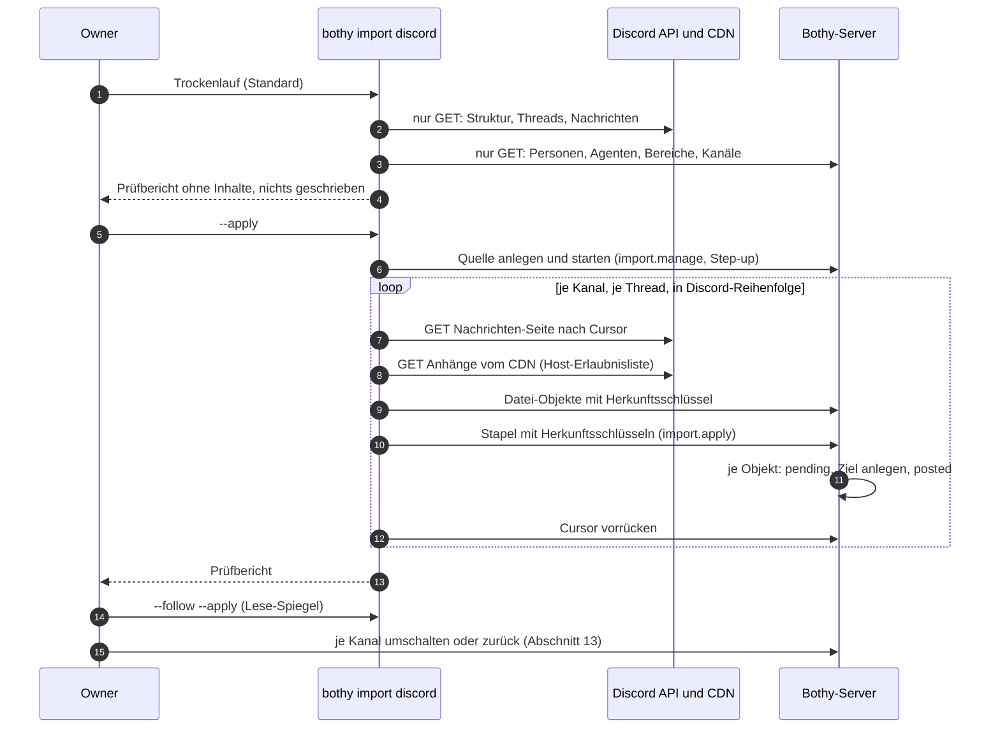
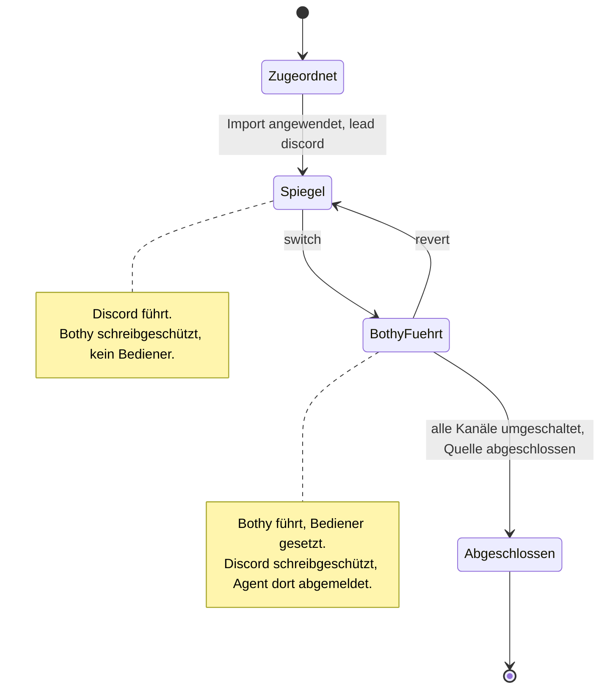

# 22 Import und Migration aus Discord

Status: Entwurf M0. Normativ für das Import-Werkzeug, die Import-Schnittstelle des Servers und den
Migrationsablauf. Begriffe: [00-glossar.md](00-glossar.md). Tabellen `import_sources` und
`import_items`: [03-datenmodell.md](03-datenmodell.md), Abschnitt 4.11. Aktionen `import.read`
und `import.manage`: [05-aktionen.md](05-aktionen.md), Abschnitt 4.12. Entscheidung zur Bauform:
[ADR 0043](../adr/0043-discord-import-nur-lesen-trockenlauf-herkunftsschluessel.md). Lehren der
Vorgänger: [REUSE.md](../REUSE.md).

Alle Grenzen, Fenster und Intervalle sind benannte Konfigurationswerte. Ihre Standardwerte stehen
nur in Abschnitt 19.

## 1. Ziel und Abgrenzung

Eine Organisation, die heute einen Discord-Server mit Agenten-Bots nutzt, zieht Kanal für Kanal
nach Bothy um, ohne Verlust und ohne Doppel. Danach steht der alte Verlauf in Bothy, mit
Original-Zeit und Original-Autor, und jeder Thread kann seine frühere Agenten-Sitzung fortsetzen.

Im Umfang:

- Einmaliger Import der Historie (Kategorien, Text-Kanäle, Foren, Threads, Forum-Beiträge,
  Nachrichten, Anhänge, Pins, Forum-Tags).
- Lese-Spiegel für den Parallelbetrieb: neue Discord-Nachrichten laufen in Bothy nach, nur in
  diese Richtung.
- Umschalten je Kanal und Rückweg je Kanal.
- Bindung importierter Threads an frühere Agenten-Sitzungen.

Nicht im Umfang:

- Schreiben nach Discord. Das Werkzeug ruft Discord nur lesend auf (Abschnitt 4).
- Übernahme von Discord-Rollen und Kanal-Rechten als Freigaben. Rollen gibt es in Bothy nicht
  (Baseline Abschnitt 4); Freigaben vergibt der Owner bewusst (Abschnitt 5.1).
- Sprach- und Bühnenkanäle, Reaktionen mit Personen, Nachführen von Bearbeitungen und Löschungen
  nach dem Kopieren (Abschnitte 6.6 und 12.4).
- Big Bang. Es gibt keinen Schritt, der alle Kanäle auf einmal umschaltet.

## 2. Bauform

Der Import ist ein eigener Prozess außerhalb des Servers: der Befehl `bothy import discord` des
Kommandozeilen-Werkzeugs `bothy`. Er liest Discord und schreibt über die öffentliche API des
Servers, wie jeder andere Client. Der Server ruft Discord nie auf.

Gründe (ausführlich in ADR 0043):

1. Der Server lädt nie fremde URLs (Baseline Abschnitt 4, "Bewusst nie": SSRF). Anhänge vom
   Discord-CDN lädt nur das Werkzeug.
2. Erweiterungen laufen nie im Server-Prozess (B6). Das Discord-Token liegt nie beim Server.
3. Der Trockenlauf schreibt nachweisbar nichts, weder in Discord noch in Bothy noch lokal.
4. Idempotenz und Fortschritt liegen trotzdem im Server (`import_items`, `import_sources.cursor`).
   Ein abgebrochener Lauf setzt auf jedem Rechner fort.

Ob `bothy` dasselbe Go-Binary wie der Server ist, entscheidet [02-architektur.md](02-architektur.md);
wichtig ist nur die Prozess-Trennung.

## 3. Ablauf im Überblick



## 4. Discord-Zugriff: nur lesen

### 4.1 Endpunkte

Das Werkzeug kennt nur diese Aufrufe. Der Discord-Client im Code hat keine Methode für ein anderes
Verb als `GET` (Test in Abschnitt 16).

| Zweck | Aufruf | Quelle |
|---|---|---|
| Token prüfen, eigene Bot-ID | `GET /users/@me` | [R1] |
| Server-Name für den Bericht | `GET /guilds/{guild.id}` | [R2] |
| Kategorien und Kanäle (ohne Threads) | `GET /guilds/{guild.id}/channels` | [R2] |
| Aktive Threads des Servers | `GET /guilds/{guild.id}/threads/active` | [R2] |
| Archivierte öffentliche Threads je Kanal, seitenweise mit `before` | `GET /channels/{channel.id}/threads/archived/public` | [R3] |
| Archivierte private Threads je Kanal; braucht `MANAGE_THREADS`, sonst Hinweis und überspringen | `GET /channels/{channel.id}/threads/archived/private` | [R3] |
| Ein Kanal oder Thread (Zustand prüfen im Lese-Spiegel) | `GET /channels/{channel.id}` | [R3] |
| Nachrichten vorwärts ab Cursor | `GET /channels/{channel.id}/messages?after=…&limit=…` | [R4] |
| Nachrichten vor einer ID (Ruhe-Regel im Lese-Spiegel) | `GET /channels/{channel.id}/messages?before=…&limit=…` | [R4] |
| Eine Nachricht neu lesen (frische Anhang-URL) | `GET /channels/{channel.id}/messages?around=…&limit=…` | [R4] |
| Anhänge | `GET` auf Hosts aus `import.discord.cdn_hosts` | [R5] |

Bewusst nicht benutzt: `GET /guilds/{guild.id}/members`, weil er den privilegierten Intent
`GUILD_MEMBERS` verlangt [R2, belegt]. Autoren stehen in jedem Nachrichten-Objekt; mehr braucht
die Zuordnung nicht. Ebenfalls nicht benutzt: der Pin-Endpunkt; das Feld `pinned` am
Nachrichten-Objekt reicht [R4, belegt].

Archivierte Threads kommen neueste zuerst nach `archive_timestamp` [R3, belegt]. Die nächste Seite
fragt mit `before` gleich dem `archive_timestamp` des letzten Threads; Threads werden über ihre ID
entdoppelt; eine Seite ohne neue ID beendet die Abfrage, damit nie dieselbe Seite endlos kommt.

Basis-URL ist `import.discord.api_base`. Jede Anfrage trägt einen `User-Agent` im Format, das
Discord für Bots verlangt [R6, belegt]. Das Bot-Token geht nur an die API-Basis, nie an CDN-Hosts.

### 4.2 Bot, Rechte, Intents

Der Import nutzt ein eigenes Discord-Bot-Konto, nicht das Token eines produktiven Agenten-Bots.
Gründe: Discord zählt Rate-Limits je Bot [R7, belegt], ein Import würde sonst die Antworten der
laufenden Agenten bremsen; und das Import-Konto braucht nur Leserechte.

- Kanal-Rechte: `VIEW_CHANNEL` und `READ_MESSAGE_HISTORY` [R4, belegt]; `MANAGE_THREADS` nur,
  wenn archivierte private Threads übernommen werden sollen [R3, belegt].
- Intent: `MESSAGE_CONTENT` muss im Entwickler-Portal eingeschaltet sein. Ohne ihn liefert
  Discord leere Werte in `content`, `embeds`, `attachments`, `components` und `poll`, auch über
  REST [R8, belegt]. Für Bots unterhalb der Prüfgrenzen reicht der Schalter im Portal [R8, belegt].
- Das Token liest das Werkzeug aus der Umgebung (`BOTHY_IMPORT_DISCORD_TOKEN`) oder aus einer Datei
  (`--discord-token-file`). Es erscheint nie in Ausgabe, Bericht, Fehlertext oder Log
  (Test in Abschnitt 16).

### 4.3 Rate-Limit-Wächter

Discord meldet Grenzen über Kopfzeilen und `429` mit `retry_after` [R7, belegt]. Das Werkzeug:

1. Wartet vor dem nächsten Aufruf `X-RateLimit-Reset-After`, wenn `X-RateLimit-Remaining` gleich
   `0` ist.
2. Wartet bei `429` die Zeit aus `retry_after` (Körper) oder `Retry-After` (Kopfzeile) und
   wiederholt höchstens `import.discord.max_429_retries` Mal.
3. Bricht ab, wenn eine verlangte Wartezeit größer als `import.discord.max_rate_wait` ist. Der
   Zustand bleibt; ein neuer Lauf setzt fort.
4. Wiederholt `401` und `403` nie. Ein `403` auf einem Kanal beendet alle weiteren Aufrufe für
   diesen Kanal im Lauf. Grund: Discord sperrt eine IP zeitweise nach zu vielen Antworten mit
   `401`, `403` oder `429` [R7, belegt].
5. Respektiert ebenso `429` des Bothy-Servers (Kopfzeile `Retry-After`).

### 4.4 Vorabprüfung

Vor jedem Lauf, auch im Trockenlauf:

1. `GET /users/@me` gelingt; das Token ist ein Bot-Token.
2. Der Server ist lesbar; jede Kategorie und jeder zugeordnete Kanal ist sichtbar.
3. Intent-Probe: Unter den ersten `import.discord.preflight_sample` Nachrichten fremder Autoren
   eines lesbaren Kanals hat mindestens eine Inhalt, Anhang oder Embed. Sonst Abbruch mit dem
   Hinweis, dass `MESSAGE_CONTENT` vermutlich fehlt. Grund: ohne diese Probe entstünde ein
   vollständiger Import aus leeren Nachrichten.
4. Die Bothy-Sitzung gehört einem aktiven Owner.
5. Jede Ziel-Person und jeder Ziel-Agent der Zuordnungsdatei existiert.

## 5. Zuordnung

### 5.1 Struktur

| Discord (Typ-Nummer [R3, belegt]) | Bothy | Regel |
|---|---|---|
| `GUILD_CATEGORY` (4) | Bereich (`space`) | neu anlegen oder vorhandenen Bereich nehmen (Zuordnungsdatei) |
| `GUILD_TEXT` (0), `GUILD_ANNOUNCEMENT` (5) | Kanal `kind = text` mit Hauptverlauf | Nachrichten außerhalb von Threads in den Hauptverlauf |
| `GUILD_FORUM` (15), `GUILD_MEDIA` (16) | Kanal `kind = forum` | Tags aus `available_tags` werden `forum_tags` |
| `PUBLIC_THREAD` (11), `PRIVATE_THREAD` (12), `ANNOUNCEMENT_THREAD` (10) | Thread `kind = thread` | siehe 5.1.1 |
| `GUILD_VOICE` (2), `GUILD_STAGE_VOICE` (13) | nichts | im Bericht als übersprungen gezählt |
| Kanal ohne Kategorie | Bereich laut `defaults.uncategorized_space` | sonst übersprungen |

Regeln:

1. Das Werkzeug legt nur an. Es löscht, archiviert und benennt nie Objekte in Bothy um. Einen
   vorhandenen Bereich oder Kanal benutzt es nur, wenn die Zuordnungsdatei ihn ausdrücklich nennt.
   Trifft ein neuer Name auf einen vorhandenen fremden Namen, bricht der Lauf vor dem ersten
   Schreiben ab.
2. Neue Kanäle bekommen keine Freigaben. Sie sind damit nur für Owner sichtbar ("Standard ist
   nichts"). Kanäle mit `permission_overwrites` in Discord stehen im Bericht markiert, damit der
   Owner Freigaben bewusst setzt.
3. Neue Kanäle stehen im Lese-Spiegel schreibgeschützt (Abschnitt 12.1). Bediener setzt erst das
   Umschalten (Abschnitt 13.3).
4. Reihenfolge: Bereiche und Kanäle in Discord-Reihenfolge (`position`), als `sort_key`.

#### 5.1.1 Threads

- Ein Thread aus einer Nachricht eines Text-Kanals hat dieselbe ID wie seine Ausgangsnachricht
  [R3, belegt]. In Bothy wird er ein Thread mit `parent_message_id` gleich der importierten
  Ausgangsnachricht im Hauptverlauf. Fehlt diese, bleibt `parent_message_id` leer.
- Ein Forum-Beitrag wird ein Thread im Forum-Kanal; seine Startnachricht ist die erste Nachricht.
- Titel ist der Thread-Name, gekürzt auf `thread.title_max_chars`. Ist der Name ein Platzhalter
  nach der Auto-Titel-Regel (REUSE.md, Abschnitt 5.1), wird `title_source = auto`, sonst `manual`.
- `threads.created_at` und `last_activity_at` kommen aus der Quelle (Zeit im Snowflake der
  Thread-ID bzw. der letzten Nachricht) (03, Abschnitt 4.11).
- Erledigt: Ein Thread wird `closed`, wenn `thread_metadata.archived` genau `true` ist und er nicht
  in der Liste aktiver Threads steht, oder wenn er ein Tag aus `import.discord.closed_tags` trägt.
  `closed_at` ist `archive_timestamp`. Fehlende Metadaten, `false` oder ein Thread in beiden Listen
  gelten als offen. Grund: ein zu Unrecht offener Thread schadet nicht, ein zu Unrecht
  geschlossener versteckt Arbeit.
- `threads.operator_agent_id` kommt aus `planned_operator` des Kanals in der Zuordnungsdatei, nicht
  aus dem (im Lese-Spiegel leeren) wirksamen Bediener (03, `threads.operator_agent_id`). Grund: R-DM-12 hält den Bediener fest; ohne diese Regel bliebe jeder importierte
  Thread nach dem Umschalten für immer ohne Agent.

### 5.2 Zuordnungsdatei

Eine YAML-Datei des Owners, Schema `import_source.discord.v1`. Der Server speichert sie ohne
Geheimnisse in `import_sources.config`. `bothy import discord init-map` erzeugt ein Gerüst aus der
Discord-Struktur und den Autoren, die der Trockenlauf gesehen hat; der Owner bearbeitet es.

```yaml
version: 1
guild_id: "<guild_id>"
defaults:
  unmapped_human: placeholder      # placeholder | skip
  unmapped_bot: placeholder        # placeholder | skip
  uncategorized_space: skip        # skip | <Bereichs-Schlüssel aus spaces>
spaces:
  - discord_category: "<category_id>"
    target: {create: {name: "Support"}}          # oder {existing: "<space_uuid>"} oder skip
channels:
  - discord_channel: "<channel_id>"
    target: {create: {name: "tickets"}}          # Bereich folgt der Kategorie
    planned_operator: "agent:support-bot"        # oder none
    lead: discord                                # discord | bothy (Abschnitt 12.1)
  - discord_channel: "<channel_id>"
    target: skip
users:
  - discord_user: "<user_id>"
    target: "user:alex"                          # user:<handle> | agent:<handle> | placeholder
  - discord_user: "<bot_user_id>"
    target: "agent:support-bot"
```

Nicht genannte Kanäle werden übersprungen und im Bericht gezählt. Ein Fehler in der Datei
(unbekanntes Feld, unbekannter Handle, doppelte Discord-ID) beendet den Lauf vor jedem Aufruf mit
Exit-Code `2`.

### 5.3 Personen und Platzhalter

Jeder Autor wird ein Prinzipal in Bothy:

| Discord-Autor | Ziel | Regel |
|---|---|---|
| Mensch mit Eintrag `user:<handle>` | vorhandener Mensch | Original-Autor |
| Bot mit Eintrag `agent:<handle>` | vorhandener Agent | Original-Autor; die Nachricht hat trotzdem `origin = import` |
| ohne Eintrag oder `placeholder` | Platzhalter-Mensch | siehe unten |
| Webhook-Autor | Platzhalter je Webhook-ID | wie ohne Eintrag |

Platzhalter: ein Prinzipal `kind = user`, `status = disabled`, ohne Identität, ohne Freigaben,
`display_name` aus `global_name` oder `username`, Handle `imported-<name>` mit Zähler bei
Kollision. Er kann sich nie anmelden und nie auslösen. Herkunft: `import_items` mit
`item_kind = user`; die Oberfläche zeigt ihn als "importiert". Platzhalter sind personenbezogene
Daten der Discord-Nutzer (Abschnitt 14).

Erwähnungen von Personen werden Text (`@Name`), keine Zeilen in `mentions`. Grund: eine
Erwähnung erzeugt Benachrichtigungen und Zähler; ein Import erzeugt keine (Abschnitt 6.4).

### 5.4 Agenten

Das Werkzeug legt nie Agenten an und setzt nie Bediener oder Backend-Richtlinien. Das sind
Owner-Aktionen mit Step-up und I1-Prüfung (`agent.create`, `channel.operator.set`). Die
Zuordnungsdatei nennt nur vorhandene Agenten.

## 6. Nachrichten

### 6.1 Typen

Übernommen werden die Discord-Typen `DEFAULT` (0), `REPLY` (19), `CHAT_INPUT_COMMAND` (20),
`THREAD_STARTER_MESSAGE` (21) und `CONTEXT_MENU_COMMAND` (23) [R4, belegt]. Alle anderen
(Systemnachrichten wie Pin-Hinweis oder "Thread angelegt") werden gezählt und übersprungen. Typ 21
entfällt, wenn seine Ausgangsnachricht schon im Hauptverlauf steht. Leere Nachrichten ohne Anhang,
Embed, Sticker und Umfrage werden gezählt und übersprungen.

### 6.2 Felder

| Bothy-Feld (`messages`) | Wert |
|---|---|
| `author_principal_id` | zugeordneter Prinzipal (5.3) |
| `origin` | immer `import`; löst nie einen Agenten aus ([05-aktionen.md](05-aktionen.md), Abschnitt 5) |
| `kind` | `text` |
| `created_at` | `timestamp` der Quelle |
| `edited_at` | `edited_timestamp` der Quelle; keine Revisionen |
| `silent` | `true` |
| `trigger_state` | leer |
| `reply_to_message_id` | bei Typ 19, wenn die Bezugsnachricht im selben Thread importiert ist; sonst Zitatzeile im Inhalt, gekürzt auf `import.reply_quote_max_chars` |
| `import_item_id` | Zeile in `import_items` |
| `client_msg_id` | vom Server erzeugt; Idempotenz trägt der Herkunftsschlüssel (Abschnitt 7) |
| `thread_seq` | Anfügen in Discord-Reihenfolge (aufsteigende ID) |

Die Anzeige-Reihenfolge kommt aus `thread_seq`, nie aus `created_at` ([04-sync-protokoll.md](04-sync-protokoll.md),
Abschnitt 10). Ein Thread wird darum streng in Discord-Reihenfolge angefügt.

### 6.3 Inhalt umwandeln

Ziel ist der Markdown-Dialekt `content_format = 1`. Was sich nicht abbilden lässt, bleibt als
lesbarer Text.

| Discord | Bothy |
|---|---|
| `<@USER_ID>` [R6, belegt] | `@Anzeigename` als Text |
| `<@&ROLE_ID>` | `@Rollenname` als Text |
| `<#CHANNEL_ID>` | Verweis auf den importierten Kanal, sonst `#name` |
| `<:NAME:ID>`, `<a:NAME:ID>` | `:NAME:` |
| `<t:TIMESTAMP:STYLE>` (Sekunden) | Zeit als ISO-8601-Text in UTC |
| Embeds | Zitatblock mit Titel, Link und Beschreibung; Bilder in Embeds werden nicht geladen |
| Sticker | `[Sticker: name]` |
| Umfrage | Frage und Antworten als Liste mit Hinweis "Umfrage" |
| weitergeleitete Nachricht (`message_snapshots`) | Zitatblock mit dem Inhalt des Schnappschusses |
| Kleintext-Präfix `-# ` am Zeilenanfang | entfernt |

Die Länge einer Discord-Nachricht liegt weit unter `message.max_content_bytes`. Eine Nachricht wird
nie geteilt; der Herkunftsschlüssel braucht keinen Teil-Index.

### 6.4 Keine Benachrichtigungen, kein Ungelesen-Berg

1. `messages.silent = true`, keine `mentions`, kein Push, kein `trigger_state`.
2. Der Server schreibt je Stapel und Thread ein `thread.updated` statt eines `message.created` je
   Nachricht (04, Abschnitt 15.8). Clients laden den Thread per REST,
   wenn sie ihn anzeigen. Grund: ein Import kann ein Vielfaches des normalen Verkehrs schreiben;
   Clients sollen nicht jede Nachricht einzeln empfangen.
3. Der Server setzt `threads.unread_floor_seq` auf das Ende des Stapels; Importiertes zählt damit
   für keinen Menschen mit Leserecht als ungelesen (03, `read_states`). Grund: Importiertes ist
   alt; es soll nicht als ungelesen leuchten. Eine Zeile je Thread statt einer je Leser hält den
   Stapel billig.
4. Agenten-Adapter bekommen kein `agent.invocation` und kein `agent.followup` aus importierten
   Nachrichten, weil `origin = import` nie auslöst.

### 6.5 Anhänge

Für jeden Anhang:

1. Ist `size` größer als `import.attachment_max_bytes`, wird nicht geladen.
2. Sonst lädt das Werkzeug `url` mit `GET`, nur wenn Schema `https` und Host in
   `import.discord.cdn_hosts`. Ohne Bot-Token, ohne Weiterleitungen, ohne Proxy aus der Umgebung,
   mit Lese-Grenze `import.attachment_max_bytes` plus ein Byte, Zeitlimit `import.http_timeout`.
3. CDN-URLs von Anhängen sind signiert und laufen ab (`ex`, `is`, `hm`) [R5, belegt]. Antwortet
   der CDN mit `403` oder `404`, liest das Werkzeug die Nachricht einmal neu (frische URL) und
   versucht es noch einmal.
4. Fehlertexte zeigen nur Schema, Host und Pfad; Query und Fragment sind maskiert. Der Fehlerkörper
   des CDN wird nie ausgegeben, weil er die signierte URL enthalten kann.
5. Erfolg: Upload über die Import-Schnittstelle (Abschnitt 8) in den Ziel-Kanal; die Datei
   durchläuft den normalen Virenscan ([12-dateien.md](12-dateien.md)); Autor ist der Autor der
   Nachricht.
6. Scheitert es oder ist der Anhang zu groß: Die Nachricht bekommt eine Zeile mit Dateiname,
   Größe, Grund und Sprunglink `https://discord.com/channels/{guild_id}/{channel_id}/{message_id}`.
   Der Sprunglink läuft nicht ab [abgeleitet: er enthält keine Signatur]. Der Bericht zählt den
   Fall.

### 6.6 Pins, Tags, Reaktionen

- Pins: Nachrichten mit `pinned = true` [R4, belegt] werden in Bothy angeheftet; `pinned_by` ist
  der importierende Owner.
- Forum-Tags: `available_tags` werden `forum_tags` des Kanals (Abgleich nach Name, ohne Doppel);
  `applied_tags` werden `thread_tags`.
- Reaktionen werden nicht übernommen. Discord liefert am Nachrichten-Objekt nur Zähler; wer
  reagiert hat, kostet einen Aufruf je Emoji und Nachricht. Bothy speichert Reaktionen je Person.
  Status-Zeichen von Agenten wären ohnehin keine Reaktion (Baseline Abschnitt 4). Der Bericht
  zählt nicht übernommene Reaktionen.

## 7. Idempotenz und Fortsetzen

### 7.1 Herkunftsschlüssel

Eindeutig ist `(source_id, origin_key)` in `import_items`. Der Discord-Server ist durch die Quelle
festgelegt und steht nicht im Schlüssel.

| `item_kind` | `origin_key` |
|---|---|
| `space` | `space:<category_id>` |
| `channel` | `channel:<channel_id>` |
| `thread` | `thread:<thread_id>` |
| `message` | `message:<message_id>` |
| `file` | `file:<attachment_id>` |
| `user` | `user:<user_id>` (auch Bots und Webhooks) |
| `pin` | `pin:<message_id>` |

Discord-IDs sind Snowflakes und in der HTTP-API immer Strings [R6, belegt]; das Werkzeug prüft,
dass sie nur aus Ziffern bestehen.

### 7.2 `pending` und `posted`

Der Server führt jedes Objekt so aus ([03-datenmodell.md](03-datenmodell.md), `import_items`):

1. Gibt es `(source_id, origin_key)` mit `posted`, antwortet er mit dem vorhandenen Ziel. Kein
   Doppel, kein Ereignis.
2. Sonst schreibt er `pending` und legt in derselben Transaktion das Ziel an und setzt `posted`.
3. Dateien: `pending` reserviert die Datei-ID vor dem Hochladen der Bytes; ein abgebrochener Upload
   mit demselben Schlüssel benutzt dieselbe ID erneut. `posted` folgt, wenn die Bytes vollständig
   sind.
4. `content_sha256` speichert den Hash des umgewandelten Inhalts. Ein späterer Lauf, der einen
   anderen Hash sieht, zählt "an der Quelle geändert" im Bericht und ändert nichts.

### 7.3 Cursor

`import_sources.cursor` hält je Discord-Kanal und Thread die höchste vollständig übernommene
Nachrichten-ID. Das Werkzeug rückt ihn erst nach einem erfolgreichen Stapel vor. Ein neuer Lauf
beginnt hinter dem Cursor; Doppel am Rand verhindert 7.2.

### 7.4 Zwei Läufe gleichzeitig

Zwei schreibende Läufe derselben Quelle sind korrekt (jedes Objekt höchstens einmal, je Thread in
Reihenfolge, weil jeder Lauf einen Thread streng nacheinander abarbeitet und ein konkurrierender
Schlüssel auf den Commit des anderen wartet), aber verschwenderisch. Das Werkzeug startet darum
nicht, wenn die Quelle schon `running` ist, außer mit `--takeover`.

## 8. Import-Schnittstelle des Servers

Verbindlich ist `docs/api/openapi.yaml` (Tag `Import`); diese Tabelle gibt den Stand der Spec
wieder. Alle Routen sind nur für Owner.

| Operation | Route | Aktion | Step-up |
|---|---|---|---|
| Quelle anlegen (`kind = discord`, Zuordnung) | `POST /api/v1/imports` | `import.manage` | ja |
| Quelle starten oder fortsetzen, pausieren, abbrechen, abschließen | `POST /api/v1/imports/{import_id}/start`, `/pause`, `/cancel`, `/complete` | `import.manage` | ja |
| Eigentumsliste je Kanal ändern (`lead`, setzt den Schreibschutz mit) | `PUT /api/v1/imports/{import_id}/leads` | `import.manage` | ja |
| Quelle, Fortschritt, Objekte nach Zustand lesen | `GET /api/v1/imports`, `/imports/{import_id}`, `/imports/{import_id}/items` | `import.read` | nein |
| Stapel von Objekten mit Herkunftsschlüsseln schreiben (Abschnitt 7.2) | `POST /api/v1/imports/{import_id}/batches` | `import.apply` | nein |
| Datei-Objekt mit Herkunftsschlüssel anlegen; die Bytes folgen über die Upload-Session ([12-dateien.md](12-dateien.md)) | `POST /api/v1/imports/{import_id}/files` | `import.apply` | nein |
| Cursor und Zähler fortschreiben | `PUT /api/v1/imports/{import_id}/cursor` | `import.apply` | nein |

Einen Trockenlauf gibt es auf dem Server nicht: das Werkzeug liest nur (Abschnitt 10.2) und
legt dabei keine Quelle an.

`import.apply` verlangt: Prinzipal ist aktiver Owner, Quelle im Zustand `running`, jedes Ziel liegt
in einem Kanal dieser Quelle. Kein Step-up je Stapel, weil der Start Step-up verlangt und ein
Lese-Spiegel tagelang läuft. Ein Stapel betrifft genau einen Thread und hat höchstens
`import.batch_max_items` Objekte; er ist eine Transaktion. Strukturobjekte (Bereiche, Kanäle,
Forum-Tags, Personen) kommen in eigenen Stapeln ohne Thread. Jeder Stapel schreibt `import.progress`
und `thread.updated` (Abschnitt 6.4). Start, Abbruch und Abschluss stehen im Audit-Log.

Wie die Kommandozeile sich als Owner anmeldet und Step-up leistet (Gerät `platform = cli`), legt
[08-identitaet.md](08-identitaet.md) fest.

## 9. Bindung an frühere Agenten-Sitzungen

Ein importierter Thread kann die Sitzung fortsetzen, die er in der alten Umgebung hatte
(Beispiel: Sitzungs-ID von Hermes Agent oder Claude Code). Der Ablauf folgt dem Verhalten eines
`/resume`: Referenz übernehmen, beim ersten Schreiben binden, genau einmal, mit Compare-and-swap,
im Fehlerfall ohne Blockade.

1. **Referenz übernehmen.** `--sessions <datei>` liefert JSON-Zeilen
   `{"discord_thread": "<thread_id>", "agent": "<handle>", "external_session_ref": "<ref>"}`.
   Der Import legt je Zeile eine `agent_sessions`-Zeile an: `is_current = false`,
   `started = true`, `ended_at` = Importzeit, `end_reason = import`. Weicht `agent` vom
   `operator_agent_id` des Threads ab, entfällt die Zeile mit Zählung im Bericht.
2. **Binden beim ersten Auslösen.** Löst ein Mensch im Thread zum ersten Mal einen Agenten aus und
   hatte der Thread seit dem Import keine aktuelle Sitzung, legt der Server in der Transaktion des
   Laufs eine aktuelle Zeile mit derselben `external_session_ref` an. Audit `agent_session.bind`,
   Ereignis `agent_session.changed`.
3. **Compare-and-swap.** Der Teilindex "eine aktuelle Sitzung je Thread" lässt nur eine von zwei
   gleichzeitigen Auslösungen binden; die andere sieht die gebundene Zeile. Der Teilindex "eine
   externe Sitzung gehört höchstens einem Thread" verhindert, dass eine alte Sitzung an zwei
   Threads hängt; dann gilt Schritt 5.
4. **Fortsetzen im Adapter.** Die Aufruf-Nachricht trägt die Sitzung mit `started = true`; der
   Adapter setzt fort statt neu zu beginnen. Er darf die Referenz auflösen (Beispiel: Hermes führt
   eine Kompressionskette zum lebenden Ende) und meldet die gültige Referenz mit
   `agent_session.report` unter Versionsprüfung.
5. **Fail open.** Kennt die Laufzeit die alte Sitzung nicht mehr oder scheitert die Bindung,
   startet der Adapter eine neue Sitzung und meldet das. Der Server beendet die gebundene Zeile
   (`end_reason = rebind`), legt die neue an und schreibt genau einmal eine Systemnachricht in den
   Thread: Die frühere Sitzung gibt es nicht mehr; der Agent beginnt ohne alten Verlauf. Die
   Nachricht des Menschen geht nie verloren.
6. **Nie zweimal.** Eine Import-Zeile wird nur gebunden, solange der Thread seit dem Import keine
   aktuelle Sitzung hatte. Ein späteres Zurücksetzen (`agent_session.reset`) bindet nie erneut.
7. **Kosten.** Laufzeiten, die kumulierte Sitzungskosten melden, brauchen den Stand vor der
   Bindung als Sockel, sonst bucht der erste Lauf die alten Kosten noch einmal. Die Datei darf
   dafür `cost_baseline_micros` und `currency` je Zeile tragen (03, `agent_sessions`).

Wer binden darf, regelt `agent.invoke`: Die Bindung entsteht nur aus einer erlaubten Auslösung
(Stufe `trigger`, I2).

## 10. Werkzeug

### 10.1 Befehle

| Befehl | Wirkung |
|---|---|
| `bothy import discord --guild <id> --map <datei>` | Trockenlauf: nur `GET` gegen Discord und Bothy, schreibt nichts, auch keine lokale Datei; druckt den Prüfbericht |
| `… --apply` | legt die Quelle an oder setzt sie fort und importiert |
| `… --apply --follow` | Lese-Spiegel als Schleife (Abschnitt 12); ohne `--apply` eine lesende Runde je Intervall mit "würde kopieren" |
| `… --apply --once` | genau eine Runde des Lese-Spiegels; für zeitgesteuerte Aufrufe |
| `bothy import discord init-map --guild <id> --out <datei>` | schreibt ein Gerüst der Zuordnungsdatei (nur diese Datei) |
| `bothy import discord switch --channel <id>` | Bothy-Seite des Umschaltens (Abschnitt 13.3), druckt die Discord-Schritte |
| `bothy import discord revert --channel <id>` | Bothy-Seite des Rückwegs (Abschnitt 13.4), druckt die Discord-Schritte |
| `bothy import discord status` | Quelle, Zustand, Eigentumsliste, Zähler |

Weitere Optionen: `--channel <id>` (wiederholbar) grenzt ein; `--only-thread <id>` (wiederholbar)
wählt genau diese Threads; `--sessions <datei>` (Abschnitt 9); `--report text|json`;
`--takeover` (7.4); `--discord-token-file <pfad>`.

### 10.2 Regeln

1. Trockenlauf ist der Standard. Ein vergessener Schalter liest nur.
2. Eine unbekannte oder nicht passende ID in `--channel` oder `--only-thread` beendet den Lauf vor
   jedem Schreiben; auch gültige IDs desselben Aufrufs werden dann nicht verarbeitet.
3. Widersprüchliche Optionen (`--follow` mit `--once`, `--only-thread` mit `--follow`) enden mit
   Exit-Code `2` ohne Aufruf an Discord oder Bothy.
4. Ausgabe enthält nie Nachrichteninhalte, Dateinamen von Anhängen, Tokens oder signierte URLs.

### 10.3 Exit-Codes

| Code | Bedeutung |
|---|---|
| `0` | fertig, oder Trockenlauf ohne Fehler |
| `1` | Lauf abgebrochen (Netz, Rate-Limit über der Grenze, Serverfehler); Zustand bleibt, neuer Lauf setzt fort |
| `2` | Aufruf, Zuordnungsdatei oder Vorabprüfung fehlerhaft; nichts geschrieben |
| `3` | Quelle läuft schon (ohne `--takeover`); bei `--once` normaler Fall für zeitgesteuerte Aufrufe |

## 11. Prüfbericht

Je Kanal eine Zeile, am Ende eine Summe. Keine Inhalte, keine Namen von Personen.

| Spalte | Bedeutung |
|---|---|
| Kanal | Discord-Name und Ziel in Bothy |
| Threads | offen, erledigt |
| Nachrichten | übernommen, schon vorhanden, übersprungen nach Grund (Typ, leer) |
| Anhänge | übernommen, zu groß, fehlgeschlagen |
| Personen | zugeordnet, Platzhalter |
| Sitzungen | Referenzen übernommen, verworfen (Agent passt nicht) |
| Pins, Tags | übernommen |
| Reaktionen | nicht übernommen (Zahl) |
| Hinweise | `403`, Discord-Rechte eingeschränkt, an der Quelle geändert, nach dem Umschalten in Discord geschrieben |

Der Bericht steht zusätzlich in `import_sources.stats` und ist mit `import.read` abrufbar.

## 12. Lese-Spiegel (Parallelbetrieb)

### 12.1 Eigentumsliste

Jeder zugeordnete Kanal hat in der Quelle genau einen führenden Ort, `lead`:

| `lead` | Discord | Bothy |
|---|---|---|
| `discord` | Menschen und Agenten arbeiten dort | Kanal schreibgeschützt; der Spiegel kopiert neue Nachrichten |
| `bothy` | schreibgeschützt (Schritt des Owners in Discord), Agent dort abgemeldet | Kanal beschreibbar, Bediener gesetzt; kein Spiegel |

Schreibgeschützt in Bothy heißt: Kein Prinzipal, auch kein Owner, darf im Kanal Nachrichten,
Threads, Reaktionen oder Interaktionen anlegen; nur `import.apply` schreibt (`channels.read_only`,
03; 05 Regel 1.8). Den Schalter setzt `import.manage` mit der Eigentumsliste; von Hand setzt ihn
`channel.read_only.set`. Damit kann im Spiegel kein Agent ausgelöst werden, und ein
Kanal hat nie zwei führende Orte.

### 12.2 Runde

Je `import.follow.poll_interval`:

1. `GET /guilds/{guild.id}/channels` (enthält `last_message_id`) und
   `GET /guilds/{guild.id}/threads/active`.
2. Nur Kanäle mit `lead = discord` und neuerer `last_message_id` als der Cursor werden gelesen.
3. Neue Threads werden Threads; umbenannte Threads ändern den Titel nur bei `title_source = auto`;
   archivierte werden `closed`, wieder aktive `open` (Regel aus 5.1.1; fehlt ein Thread in der
   aktiven Liste, bestätigt `GET /channels/{channel.id}` den Zustand).
4. Kanäle mit `lead = bothy`, in denen Discord trotzdem neue Nachrichten zeigt, erscheinen als
   Warnung im Bericht. Kopiert wird nichts.
5. Fehler einer Runde (Netz, `5xx`, Rate-Limit über der Grenze) beenden nicht den Spiegel; die
   nächste Runde wartet mit Backoff bis `import.follow.max_backoff`. Fehler eines Threads halten
   andere Threads nicht auf.

### 12.3 Ruhe-Regel

Agenten in Discord bearbeiten ihre Antwort, während sie arbeiten. Eine halbfertige Ausgabe darf
nicht kopiert werden, weil spätere Bearbeitungen nicht nachgeführt werden (12.4). Je Thread gilt
streng der Reihe nach:

1. Eine Nachricht ist **beschäftigt**, wenn sie (oder bei Typ 21 ihre Ausgangsnachricht) eine
   Reaktion aus `import.follow.busy_reactions` mit Zähler größer null trägt.
2. Eine Nachricht ist **unruhig**, wenn die jüngere von `timestamp` und `edited_timestamp` weniger
   als `import.follow.settle_after` zurückliegt.
3. Kopiert wird der Anfang der neuen Nachrichten bis vor die erste beschäftigte oder unruhige
   Nachricht. Nicht kopierte Typen halten nicht an.
4. Weil Agenten ihre Markierung manchmal erst nach dem Kopieren setzen, prüft die Runde zusätzlich
   die `import.follow.busy_lookback` Nachrichten vor der ersten neuen. Ist eine davon beschäftigt,
   wartet der ganze Thread.

### 12.4 Was nicht nachgeführt wird

Bearbeitungen und Löschungen in Discord nach dem Kopieren. Grund: Das hieße, alte Nachrichten
regelmäßig neu zu lesen; die Ruhe-Regel macht den Fall selten. Der Bericht eines späteren
Volllaufs zählt "an der Quelle geändert" (7.2).

## 13. Migrationsablauf je Kanal

### 13.1 Zustände



### 13.2 Pilot und Parallelbetrieb

1. Trockenlauf über den ganzen Server; Bericht prüfen; Zuordnungsdatei korrigieren, bis es keine
   Abbrüche gibt.
2. Pilot: wenige Kanäle mit `--channel`, Import angewendet, Lese-Spiegel an.
3. Parallelbetrieb: Discord führt in allen Kanälen. Bothy zeigt den Verlauf schreibgeschützt.
   Prüfen: Zähler im Bericht, Stichproben gegen Discord, Anhänge, Sitzungs-Referenzen.

### 13.3 Umschalten eines Kanals

Reihenfolge, damit nie zwei Orte gleichzeitig führen:

1. Discord, Owner: Kanal schreibgeschützt setzen; Agent in der Discord-Konfiguration seiner
   Laufzeit von diesem Kanal abmelden.
2. Werkzeug: eine letzte Spiegel-Runde für den Kanal; warten, bis die Ruhe-Regel nichts mehr
   zurückhält.
3. Bothy, Owner: `lead = bothy` (`import.manage`); Schreibschutz aufheben; Bediener setzen
   (`channel.operator.set`, Step-up, I1). Der Bediener muss `planned_operator` sein, sonst haben
   die importierten Threads einen anderen Agenten als der Kanal.
4. Probe: eine Nachricht in einem importierten Thread löst den Agenten aus; die Sitzung bindet
   (Abschnitt 9); die Antwort erscheint nur in Bothy.

`switch` führt die Schritte 2 und 3 in dieser Reihenfolge aus und bricht vor Schritt 3 ab, wenn
nach der letzten Runde noch beschäftigte oder unruhige Nachrichten im Kanal stehen.

### 13.4 Rückweg eines Kanals

1. Bothy, Owner: Kanal schreibgeschützt; Bediener entfernen; `lead = discord`. Laufende Läufe im
   Kanal werden abgebrochen.
2. Discord, Owner: Schreibschutz aufheben; Agent dort wieder anmelden.
3. Der Spiegel setzt am Cursor fort.

Nachrichten, die während `lead = bothy` in Bothy entstanden sind, gehen nicht nach Discord; das
Werkzeug schreibt Discord nie. `revert` druckt ihre Zahl je Thread, damit der Owner sie bewusst
überträgt oder verwirft.

### 13.5 Abschluss

Wenn alle Kanäle `lead = bothy` haben: Spiegel beenden; Quelle `completed` (`import.manage`). Die
Zuordnung `import_items` bleibt, bis der Owner die Aufbewahrungsklasse `import` löschen lässt
([20-datenschutz.md](20-datenschutz.md)). Danach ist ein erneuter Import nicht mehr idempotent;
das Werkzeug warnt vor diesem Schritt.

## 14. Sicherheit und Datenschutz

| Thema | Regel |
|---|---|
| Discord-Token | nur im Werkzeug, aus Umgebung oder Datei; nie an Bothy, nie an CDN-Hosts, nie in Ausgabe oder Log |
| Server-seitiges Laden | keines; nur das Werkzeug lädt, nur `https`, nur Hosts aus `import.discord.cdn_hosts`, ohne Weiterleitung |
| Rechte | Import und Spiegel nur durch Owner; Start mit Step-up; neue Kanäle ohne Freigaben |
| Auslösen | `origin = import` löst nie aus; Kanäle im Spiegel sind schreibgeschützt |
| Platzhalter | personenbezogene Daten fremder Discord-Nutzer; Klasse `account`; Löschung über DSGVO-Auftrag |
| Herkunft | `import_items` (Klasse `import`) enthält Discord-IDs; löschbar nach Abschluss |
| Audit | Start, Pause, Abbruch, Abschluss, Eigentumsliste, Bindungen |
| Telemetrie | Zähler und Dauern des Werkzeugs, keine Inhalte, keine Discord-IDs |

## 15. Später: Zulip-Import

Die Import-Schnittstelle ist quellneutral. Ein Zulip-Import wäre ein weiterer Befehl
`bothy import zulip` mit eigener Zuordnung (Kanal zu Kanal, Topic zu Thread) und braucht
`import_sources.kind = zulip` (additive Migration). Nicht in diesem Umfang.

## 16. Tests, die dieses Kapitel halten

| Test | Beweis |
|---|---|
| Trockenlauf nur `GET` | Fake-Discord und Fake-Bothy zählen Methoden: nur `GET`; keine Datei im Arbeits- und Temp-Ordner |
| Discord-Client ohne Schreibmethode | statische Prüfung: der Client exportiert keine Methode mit anderem Verb als `GET` |
| Kein Doppel nach Absturz | Abbruch zwischen Stapel und Cursor; neuer Lauf: jedes Objekt genau einmal, Reihenfolge je Thread gleich Discord |
| Gespeichert, dann Fehler | Fake-Bothy speichert einen Stapel und antwortet `502`; Wiederholung liefert dasselbe Ziel |
| Import löst nie aus | importierte Nachricht in einem Kanal mit Bediener erzeugt keinen Lauf, kein `agent.invocation` |
| Keine Benachrichtigung | kein Push, keine `mentions`, `read_states` auf Stapel-Ende |
| CDN-Grenzen | fremder Host, `http`, Weiterleitung und zu große Antwort werden abgelehnt; Token nie an CDN |
| Kein Geheimnis in Ausgabe | Fake-Antworten spiegeln Token und signierte Query; Ausgabe, Bericht und Log enthalten keines davon |
| Archiv-Regel | nur `archived = true` und nicht aktiv wird `closed`; Zweifel bleibt offen |
| Ruhe-Regel | beschäftigte oder unruhige Nachricht hält den Thread an; Rückblick-Markierung hält an |
| Schreibschutz im Spiegel | `message.create` eines Owners im Spiegel-Kanal wird abgelehnt; `import.apply` gelingt |
| Bindung einmal | zwei gleichzeitige erste Auslösungen binden genau einmal; fehlende alte Sitzung: neue Sitzung, genau eine Systemnachricht |
| Rate-Limit | `X-RateLimit-Remaining: 0` wartet; Wartezeit über der Grenze bricht mit Exit `1` ab, Zustand bleibt |
| Intent-Probe | Kanal mit nur leeren fremden Nachrichten bricht mit Exit `2` ab |
| Ungültige Auswahl | unbekannte ID in `--only-thread` bricht vor jedem Schreiben ab |

## 17. Entscheidungen dieses Kapitels

| Nr | Entscheidung | Grund |
|---|---|---|
| R-IM-01 | Import als eigener Prozess über die öffentliche API, nicht als Server-Job. | Kein server-seitiges Laden fremder URLs, Discord-Token nie im Server, B6 (ADR 0043). |
| R-IM-02 | Trockenlauf ist Standard und schreibt nirgends. | Ein vergessener Schalter darf nichts anlegen; der Beweis ist ein einfacher Test. |
| R-IM-03 | Eigenes Discord-Bot-Konto nur mit Leserechten. | Rate-Limits je Bot; produktive Agenten werden nicht gebremst; geringste Rechte. |
| R-IM-04 | Idempotenz über `import_items (source_id, origin_key)`, nicht über Inhaltsvergleich. | Exakt statt heuristisch; ein Absturz an jeder Stelle hinterlässt kein Doppel. |
| R-IM-05 | Alle importierten Nachrichten `origin = import`, `silent`, ohne `mentions`. | Nie auslösen, nie benachrichtigen. |
| R-IM-06 | Unbekannte Autoren werden gesperrte Platzhalter-Menschen. | Jede Nachricht braucht einen Prinzipal; ein Platzhalter kann nichts tun. |
| R-IM-07 | Kanäle im Spiegel sind schreibgeschützt, auch für Owner. | Ein Kanal hat nie zwei führende Orte; kein Agent wird doppelt ausgelöst. |
| R-IM-08 | Importierte Threads tragen den geplanten Bediener. | Sonst bleiben sie nach dem Umschalten wegen R-DM-12 ohne Agent. |
| R-IM-09 | Reaktionen und spätere Bearbeitungen werden nicht übernommen. | Kosten je Emoji und Nachricht; Ruhe-Regel macht späte Bearbeitungen selten. |
| R-IM-10 | Bindung früherer Sitzungen beim ersten Auslösen, genau einmal, fail open. | Entspricht `/resume`; eine Störung darf den Menschen nie stumm schalten. |
| R-IM-11 | Archiviert nur bei `archived = true` und nicht in der aktiven Liste. | Ein falsch offener Thread schadet nicht, ein falsch geschlossener versteckt Arbeit. |
| R-IM-12 | Der Rückweg kopiert nichts nach Discord. | Das Werkzeug schreibt Discord nie; der Owner entscheidet über die wenigen Nachrichten. |

## 18. Abgleich mit dem Kern-Vertrag

Die beim Entwurf beantragten Ergänzungen sind entschieden (Integration vom 2026-10-10):

| Nr | Ergänzung | Entscheidung, Ort |
|---|---|---|
| K-IM-1 | Aktion `import.apply`, RL-Klasse `rl.import` | übernommen, 05 Abschnitte 3, 4.12 und 10 |
| K-IM-2 | `channels.read_only` mit Aktion zum Setzen | übernommen, 03 `channels`, 05 Regel 1.8 und `channel.read_only.set` (mit Step-up, weil der Schalter auch Owner sperrt) |
| K-IM-3 | Bediener und Zeiten importierter Threads aus Zuordnung und Quelle | übernommen, 03 Abschnitt 4.11 |
| K-IM-4 | `thread.updated` je Stapel; Importiertes nicht ungelesen | übernommen, 04 Abschnitt 15.8; statt Gelesen-Stände je Leser vorzurücken setzt der Import `threads.unread_floor_seq` (eine Zeile je Thread) |
| K-IM-5 | Bedeutung von `end_reason = import`, Bindungsregel, Meldung "Fortsetzen gescheitert" | übernommen, 03 `agent_sessions`, 05 `agent_session.report` (`bind_failed`) |
| K-IM-6 | Sockel für kumulierte Sitzungskosten | übernommen, 03 `agent_sessions.cost_baseline_micros` |
| K-IM-7 | I1-Ziele mit Threads des Agenten, offen oder erledigt | übernommen, 03 Abschnitt 6.4 |
| K-IM-8 | `forum_tag` als Objektart; Zustand `dry_run` entfällt | übernommen, 03 `import_items`, `import_sources` |

## 19. Konfigurationswerte dieses Kapitels

Werte des Werkzeugs (Datei oder Umgebung des Werkzeugs). Die Rate-Limit-Klasse `rl.import` des
Servers steht in [05-aktionen.md](05-aktionen.md), Abschnitt 10.

| Name | Standard | Bedeutung |
|---|---|---|
| `import.discord.api_base` | `https://discord.com/api/v10` | Discord-API-Basis [R6, belegt: v10 aktuell] |
| `import.discord.cdn_hosts` | `cdn.discordapp.com`, `media.discordapp.net` | erlaubte Hosts für Anhänge |
| `import.discord.page_size` | `100` | Nachrichten je Seite; Discord erlaubt höchstens 100 [R4, belegt] |
| `import.discord.max_429_retries` | `5` | Wiederholungen nach `429` je Aufruf |
| `import.discord.max_rate_wait` | `60s` | größte Wartezeit, bevor der Lauf abbricht |
| `import.discord.preflight_sample` | `20` | Nachrichten für die Intent-Probe |
| `import.discord.closed_tags` | leer | Forum-Tags, die einen Thread zusätzlich als erledigt markieren |
| `import.attachment_max_bytes` | wie `file.max_upload_bytes` | größter übernommener Anhang |
| `import.http_timeout` | `60s` | Zeitlimit je Aufruf an Discord und CDN |
| `import.batch_max_items` | `100` | Objekte je Stapel an den Server |
| `import.reply_quote_max_chars` | `100` | Länge der Zitatzeile bei Antworten über Threads hinweg |
| `import.follow.poll_interval` | `30s` | Abstand der Spiegel-Runden |
| `import.follow.settle_after` | `60s` | Ruhezeit nach letzter Änderung |
| `import.follow.busy_reactions` | `👀` | Reaktionen, die "Agent arbeitet noch" bedeuten |
| `import.follow.busy_lookback` | `10` | Nachrichten vor der ersten neuen, die auf Markierung geprüft werden |
| `import.follow.max_backoff` | `5m` | größter Abstand nach fehlgeschlagenen Runden |

Die Werte für Seitengröße, Wiederholungen, Wartegrenze, Ruhe-Regel und Backoff sind aus dem
Vorgänger übernommen, dort gegen Fake-Server getestet und nicht gegen das echte Discord gemessen
(REUSE.md).

## Quellen

Alle abgerufen 2026-10-10.

- [R1] Discord, User (`GET /users/@me`, Felder `bot`, `global_name`, `username`):
  https://docs.discord.com/developers/resources/user [belegt]
- [R2] Discord, Guild: https://docs.discord.com/developers/resources/guild [belegt]
- [R3] Discord, Channel: https://docs.discord.com/developers/resources/channel [belegt]
- [R4] Discord, Message: https://docs.discord.com/developers/resources/message [belegt]
- [R5] Discord, Reference (CDN, signierte Anhang-URLs): https://docs.discord.com/developers/reference [belegt]
- [R6] Discord, Reference (API-Basis, Snowflakes, Formatierung, User-Agent): https://docs.discord.com/developers/reference [belegt]
- [R7] Discord, Rate Limits: https://docs.discord.com/developers/topics/rate-limits [belegt]
- [R8] Discord, Gateway (Message Content Intent): https://docs.discord.com/developers/events/gateway [belegt]
