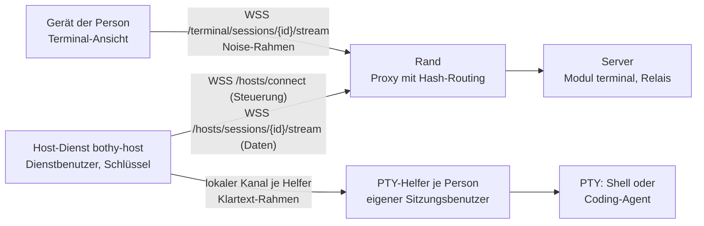
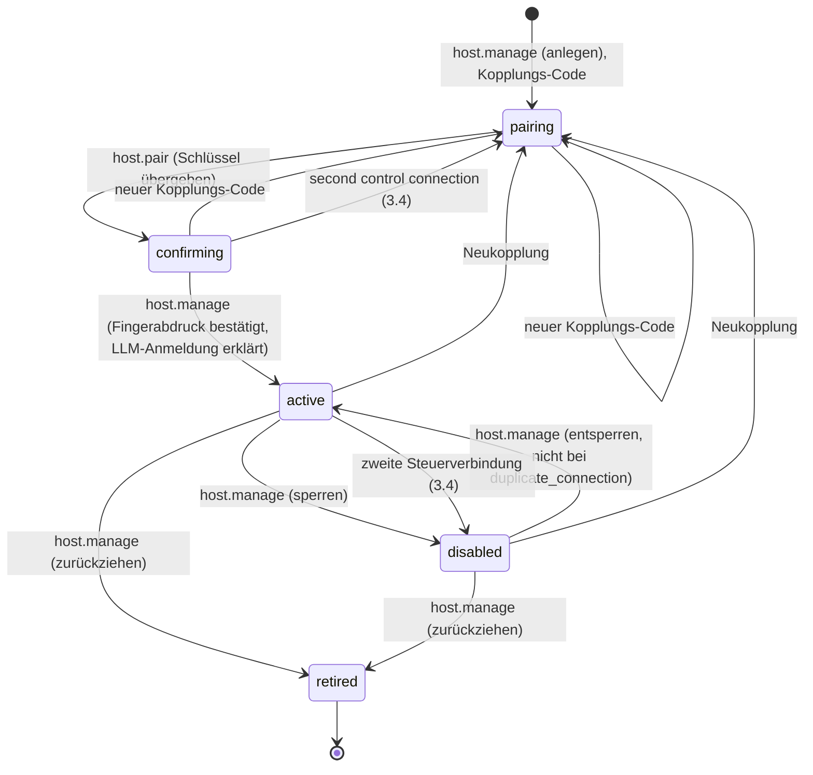

# 24 Terminal

Status: Entwurf M0, Nachtrag vom 2026-10-10. Normativ für das Modul `terminal`, den Host-Dienst
`bothy-host`, die Terminal-Ansicht der Apps und der Web-Konsole und für jede Prüfung, die eine
Terminal-Sitzung erlaubt.
Begriffe: [00-glossar.md](00-glossar.md). Tabellen: [03-datenmodell.md](03-datenmodell.md)
(`hosts`, `host_session_users`, `terminal_sessions`, `grants`). Ereignisse: [04-sync-protokoll.md](04-sync-protokoll.md).
Aktionen: [05-aktionen.md](05-aktionen.md), Abschnitt 4.14. Rechte und Schutzregeln:
[07-rechte.md](07-rechte.md) (SR10, SR11, SR12). Step-up: [08-identitaet.md](08-identitaet.md),
Abschnitt 6.3. Invariante I6: [10-backend-richtlinie.md](10-backend-richtlinie.md), Abschnitt 3.
Bedrohungen: [../security/threat-model.md](../security/threat-model.md), Abschnitt 6.7.
Entscheidungen: [ADR 0068](../adr/0068-terminal-ueber-host-dienst-mit-noise-strom-und-invariante-i6.md),
[ADR 0070](../adr/0070-terminal-in-der-web-konsole.md).

Alle Grenzen, Fristen und Intervalle sind benannte Konfigurationswerte. Ihre Standardwerte stehen
nur in Abschnitt 17.

## 1. Zweck und Grenzen

Das Terminal ist Pflichtbestandteil des Produkts. Eine berechtigte Person öffnet in der Desktop-App,
in der mobilen App oder in der Web-Konsole eine echte Terminal-Sitzung auf einem angebundenen
Rechner: eine Login-Shell oder eine interaktive Sitzung eines Coding-Agenten (z. B. Claude Code).

Sicherheit ist eingebaut, nicht abschaltbar:

1. Nur Menschen mit dem Zusatzrecht `terminal` auf dem Rechner öffnen ein Terminal, und nur mit
   einem eigenen Sitzungsbenutzer dort (Abschnitt 2.2). Owner haben das Recht implizit, außer I6
   sperrt (Abschnitt 7).
2. Jede Öffnung verlangt einen frischen Step-up, der genau für diese Öffnung gilt (Abschnitt 8).
3. Der Inhalt läuft Ende-zu-Ende verschlüsselt zwischen Gerät und Rechner; der Server vermittelt und
   entscheidet, liest aber nichts (Abschnitt 5).
4. Jede Sitzung steht im Audit-Log, mit Leerlauf-Abbruch und Höchstdauer (Abschnitte 10 und 12).
5. Auf dem Rechner laufen Host-Dienst und Sitzungen als getrennte Benutzer ohne
   Administratorrechte. Jede Person hat auf jedem Rechner ihren eigenen Sitzungsbenutzer, den nie
   eine andere Person bekommt (Ruling T12), und kein Ort mit Code, Einstellungen oder Anmeldungen
   ist für einen Sitzungsbenutzer schreibbar und für einen anderen lesbar (Ruling T13). Die
   Sitzungen erreichen die Schlüssel des Rechners nicht und können den PTY-Helfer nicht ersetzen
   (Abschnitt 2.2).

Nicht in dieser Fassung: Dateiübertragung und Zwischenablage über den Kanal, Aufzeichnung von
Inhalten, gemeinsame Sitzungen mehrerer Menschen, Terminal für Agenten oder Apps, Übernahme eines
Threads des Runners ins Terminal (Abschnitt 11.3).

Anti-Ziele: ein Weg am Rechte-Modell vorbei; Terminal-Inhalte im Server, in der Telemetrie, im
Audit, in der Suche, im Push oder im Kontext eines Agenten; ein Weg, über das Terminal das
persönliche Abo eines anderen Menschen zu nutzen.

## 2. Bausteine

### 2.1 Überblick

| Baustein | Ort | Aufgabe |
|---|---|---|
| Modul `terminal` | Server, Rolle `api` | Rechner, Kopplung, Sitzungen, Sitzungs-Marken, Relais der Ströme |
| Host-Dienst `bothy-host` | angebundener Rechner (macOS, Linux, Windows; auch eine Dev-VM aus [21-dev-isolation.md](21-dev-isolation.md)), Dienstbenutzer | Schlüssel, Steuerverbindung zum Server, Noise-Gegenstelle, Selbstprüfung |
| PTY-Helfer `bothy-host pty-helper` | derselbe Rechner, je Sitzungsbenutzer ein Helfer unter diesem Benutzer; gestartet vom Dienstverwalter des Betriebssystems aus einer Binärdatei, die kein Sitzungsbenutzer ändern kann | PTY je Sitzung seiner Person, Profile, Prüfungen im Konto der Sitzungen (HD6, HD8, HD9, HD11); kennt keine Schlüssel |
| Terminal-Ansicht | Desktop-App, mobile App, Web-Konsole | Darstellung, Eingabe, Noise-Gegenstelle, Schlüssel-Pinning |
| Paket `packages/bothy_noise` | Dart | Noise-Handshake `NK`, geprüft gegen öffentliche Testvektoren (5.2) |

### 2.2 Host-Dienst `bothy-host`

- Eigenes kleines Go-Binary im Ordner `services/host`, nicht der Server (Ruling L1 gilt für den
  Server). Eigene Version und eigener Release-Kanal ([18-release.md](18-release.md)).
- Benutzer des Betriebssystems, alle ohne Administratorrechte, je als Dienst des
  Betriebssystems (launchd, systemd oder Windows-Dienst; [16-betrieb.md](16-betrieb.md),
  Abschnitt 4.4):
    - der **Dienstbenutzer** `bothy-host`: besitzt den Zustandsordner mit den Schlüsseln (4.2), hält
      Steuer- und Datenverbindungen und spricht Noise;
    - je Person ein **Sitzungsbenutzer** aus `host_service.session_users`: Unter ihm läuft der
      PTY-Helfer dieser Person und damit jede ihrer Shells und jeder ihrer Coding-Agenten. Kein
      Sitzungsbenutzer hat Leserecht auf den Zustandsordner.
- Den Dienstbenutzer und jeden PTY-Helfer verbindet ein eigener lokaler Kanal (Unix-Socket bzw.
  Named Pipe), dessen Zugriffsrechte nur diese zwei Benutzer zulassen. Über den Kanal laufen nur
  die entschlüsselten Rahmen aus 5.4, Steuerbefehle (Sitzung starten, beenden, Größe) und die
  Ergebnisse der Prüfungen, die der Helfer ausführt (dazu die Identitäten seiner Arbeitsordner für
  HD7, Punkt 6), nie die Schlüssel des Rechners. Grund: Eine Shell läuft mit allen Rechten ihres Benutzers. Liefe sie als
  Dienstbenutzer, könnte jede Person mit einem Terminal die Schlüssel kopieren, sich von anderswo
  als Rechner anmelden und jede spätere Sitzung mitlesen, auch die von Ownern.
- **Ein Sitzungsbenutzer je Person und Rechner, nie geteilt** (Ruling T12):
    1. Der Server hält je Rechner die Zuordnung Person zu Sitzungsbenutzer (`host_session_users`,
       [03-datenmodell.md](03-datenmodell.md)). Der Owner legt sie bei der Bestätigung (3.2) oder
       später mit `host.manage` an (Step-up, Grund, Audit); wer den Rechner lesen darf
       (`host.read`), sieht die gültigen Zuordnungen. Ohne gültige Zuordnung bekommt eine Person
       auf dem Rechner kein Terminal, auch ein Owner nicht (SR12 in [07-rechte.md](07-rechte.md);
       `403 terminal_denied` mit `reason: no_session_user`).
    2. Eine Person hat je Rechner höchstens eine gültige Zuordnung. Ein Sitzungsbenutzer gehört
       höchstens einer Person, auch über die Zeit: Endet eine Zuordnung, bleibt sein Name für diesen
       Rechner belegt, und keine andere Person bekommt ihn (`409 conflict` mit
       `reason: session_user_taken`). Eine Person bekommt nach dem Ende ihrer Zuordnung einen neuen
       Sitzungsbenutzer, nie einen gebrauchten.
    3. Die Sitzungs-Marke nennt den Sitzungsbenutzer (`osu`, 5.3). Der Host-Dienst startet die PTY
       nur im Helfer dieses Benutzers und nur, wenn er in `host_service.session_users` steht. Er
       merkt sich im Zustandsordner, welcher Person (`sub`) er jeden Sitzungsbenutzer zuerst gegeben
       hat, und lehnt eine Marke mit einer anderen Person für denselben Sitzungsbenutzer ab
       (`session_user_mismatch`). So hält der Rechner die Regel auch dann, wenn die Zuordnung im
       Server falsch ist. Geht diese Datei verloren (neuer Zustandsordner), lernt er die Bindungen
       neu; die Zuordnung im Server gilt weiter. `bothy-host session-user remove` nimmt einen
       Sitzungsbenutzer aus `host_service.session_users` und `host_service.claude_workdirs`,
       entfernt seinen PTY-Helfer, schließt sein Home für alle anderen Benutzer (Punkt 4) und
       startet den Host-Dienst neu ([16-betrieb.md](16-betrieb.md), Abschnitt 4.4); seine Bindung
       bleibt im Zustandsordner, und `bothy-host session-user add` lehnt einen Namen ab, der dort
       schon an eine Person gebunden ist.

        Grenze, ehrlich: "Nie geteilt, auch über die Zeit" gilt je Rechner-Eintrag (`hosts.id`) und je
        Zustandsordner. Wird ein Rechner zurückgezogen und als neuer Eintrag gekoppelt, sind seine
        früheren Namen im Server wieder frei; geht der Zustandsordner verloren, kennt der Host-Dienst
        die früheren Bindungen nicht mehr. Ein Sitzungsbenutzer mit den Anmeldedaten einer früheren
        Person kann dann einer anderen Person zugeordnet werden, ohne dass Server oder Host-Dienst es
        merken [abgeleitet]. Davor schützt in diesen Fällen nur der Betreiber: Er vergibt einen früher
        benutzten Namen nie neu, sondern legt mit `bothy-host session-user add` einen neuen an, nimmt
        den alten mit `bothy-host session-user remove` heraus und löscht ihn danach samt seinen
        Dauerläufern ([16-betrieb.md](16-betrieb.md), Abschnitt 4.4 Punkt 1;
        Bedrohungsmodell T-TM-08 und T-TM-11).

    4. Die Home-Ordner der Sitzungsbenutzer sind gegeneinander verschlossen. Das Home eines
       Sitzungsbenutzers ist ein Ort dieses Sitzungsbenutzers (Punkt 6) und gibt keinem anderen
       Lese- oder Ausführrecht; das prüft HD11, und ein Verstoß sperrt nur diesen
       Sitzungsbenutzer, mit seinem Namen. Die Home-Ordner aller anderen Benutzer des Rechners,
       auch das des Dienstbenutzers und das eines früheren Sitzungsbenutzers, kann kein
       Sitzungsbenutzer auflisten (HD9). Darum schließt `bothy-host session-user remove` das Home
       des Benutzers, den es herausnimmt (Punkt 3). Ein Dauerläufer dieses Benutzers (6.5) kann
       es danach wieder öffnen; darum löscht der Betreiber den Benutzer nach `remove` ("Grund für
       HD9" unter der Tabelle der Prüfungen). "All other users" in HD9 means `root`, the service
       user, every former session user and every person account of the platform; other system
       accounts (Linux below `UID_MIN`, macOS below 501, `nobody`) are skipped (D-M2-42-6).
    5. Der Host-Dienst meldet die Namen aus `host_service.session_users` beim Einlösen des
       Kopplungs-Codes (`host.pair`) und mit jedem `report` (`hosts.reported_session_users`, nur Namen
       und die Anzeigenamen der Arbeitsordner nach HD7, nie Pfade). Er liest seine Konfiguration,
       also auch `host_service.session_users` und `host_service.claude_workdirs`, nur beim Start;
       eine Änderung wirkt erst nach einem Neustart. `bothy-host session-user add` und `remove`
       starten ihn dafür selbst neu; jede andere Änderung der Konfiguration (etwa Arbeitsordner,
       Profile, `host_service.claude_bin`) wirkt nach `bothy-host restart`
       ([16-betrieb.md](16-betrieb.md), Abschnitt 4.4). Jeder Neustart beendet die laufenden
       Sitzungen des Rechners (6.2). Nach jeder Anmeldung der Steuerverbindung schickt er `report`,
       bevor er ein `session.open` annimmt, und der Server schickt `session.open` erst nach diesem
       `report`. Der Server ordnet nur einen gemeldeten Namen zu (sonst `400 validation_failed` mit
       `errors[].code = session_user_not_on_host`), und eine Zuordnung wirkt für SR12 nur, solange der
       Rechner ihren Namen meldet. Grund: Ein Tippfehler oder ein noch nicht angelegter Benutzer soll
       bei der Zuordnung auffallen, nicht erst beim Öffnen als Manipulationswarnung `4104` (R-TM-16).
       Ein Name muss einem gemeldeten Namen genau gleichen, auch in Groß- und Kleinschreibung, weil
       der Host-Dienst `osu` genau mit `host_service.session_users` vergleicht; die Eindeutigkeit je
       Rechner gilt dagegen ohne Groß- und Kleinschreibung (03, `host_session_users`;
       docs/DECISIONS.md D-M2-39-9).

       Server values and declaration on the host (M2-45, D-M2-45-2, D-M2-45-3): the server
       values the host service applies come with the `hello` of every data connection:
       `clock_leeway_ms` (`auth.clock_leeway`), `idle_timeout_ms` (`terminal.idle_timeout`) and
       `detach_grace_ms` (`terminal.detach_grace`). The host service uses those of the data
       connection that carries a handshake: the leeway for the checks of `exp` and `jti` (5.3),
       idle and detach for the timers of that session (6.2, 6.3); every attach refreshes them. A
       `hello` with a negative leeway or without a positive idle or detach value closes that data
       connection with `4002`. The declaration comes only from `ready` (D-M2-42-15); the server
       sends `ready` again after a committed change of the declaration, the host service stores
       it, evaluates HD6 again and sends `report`; a running session keeps its profile and
       environment, and new openings and attaches use the new offer.
    6. **Keine geteilten Orte** (Ruling T13): Auf dem Rechner gibt es keinen Ort, den ein
       Sitzungsbenutzer schreiben und ein anderer lesen oder ausführen kann, wenn er Code,
       Einstellungen oder Anmeldungen trägt. Für die Orte, die der Host-Dienst kennt, heißt das:
        - Orte eines Sitzungsbenutzers sind sein Home, der `CLAUDE_CONFIG_DIR` des Profils `claude`
          (bei `organization` ein fester Ordner in seinem Home, bei `personal` der Wert aus seiner
          Login-Shell, der in seinem Home liegen muss; 7.4) und seine Arbeitsordner.
          `host_service.claude_workdirs` nennt die Arbeitsordner je Sitzungsbenutzer; jeder
          Arbeitsordner gehört genau einem Sitzungsbenutzer. Steht ein Ordner dort bei zwei
          Sitzungsbenutzern, streicht HD7 ihn aus beiden Listen. Das Profil `claude` bietet einer
          Person nur die Arbeitsordner ihres eigenen Sitzungsbenutzers an, und zwar genau seine Liste
          nach HD7, die der Host-Dienst meldet (Punkt 5); in dieser Liste zählt der Index der
          Sitzungs-Marke (5.3). Diese Orte gehören ihrem Sitzungsbenutzer oder einem
          vertrauenswürdigen Besitzer (unten) und sind nur für ihn zugänglich (Modus `0700` bzw. eine
          ACL ohne Eintrag für andere Sitzungsbenutzer).
        - Jeder Ordner auf dem Weg zu einem Ort eines Sitzungsbenutzers ist für keinen anderen
          Sitzungsbenutzer schreibbar und gehört keinem anderen. Lesen und durchqueren dürfen andere
          diese Ordner (etwa `/home`), den Ort selbst nicht.
        - In jedem dieser Ordner gehören die Einträge, die der Coding-Agent oder git aus den Ordnern
          über einem Arbeitsordner laden, keinem anderen Sitzungsbenutzer und sind für keinen anderen
          schreibbar. Diese **Kettendateien** sind `CLAUDE.md`, `CLAUDE.local.md`, `AGENTS.md`,
          `.mcp.json` und die Ordner `.claude` und `.git` mit allem darin.
        - Kein Eintrag in einem Ort eines Sitzungsbenutzers gehört einem anderen Sitzungsbenutzer.
        - Orte für alle sind die Programme: die Binärdatei des Helfers, `host_service.claude_bin`
          (bei `organization` zugleich das Programm des Profils `claude`, 11.1) und das Programm jedes
          Profils `command`. Sie und jeder Ordner auf dem Weg zu ihnen gehören einem
          vertrauenswürdigen Besitzer und sind für keinen Sitzungsbenutzer schreibbar (dieselbe Regel
          wie HD10). Grund: Ein solches Programm läuft in jedem Sitzungsbenutzer. Ein anderes Konto
          als Besitzer reicht nicht, auch wenn es kein Sitzungsbenutzer ist, etwa das Konto einer
          Person mit Administratorrechten, dem ein Ordner eines Paketverwalters gehört: Wer an dieses
          Konto kommt, ändert ein Programm aller Personen, und HD11 kann nicht prüfen, wer das ist
          [abgeleitet].
        - **Vertrauenswürdiger Besitzer** ist unter Linux und macOS `root`, unter Windows `SYSTEM`,
          `Administrators` oder `NT SERVICE\TrustedInstaller`. Grund für Windows: Nur
          `TrustedInstaller` darf die geschützten Dateien und Ordner des Systems ändern ("Permission
          for full access to modify WRP-protected resources is restricted to TrustedInstaller",
          https://learn.microsoft.com/en-us/windows/win32/wfp/protected-file-list, abgerufen
          2026-10-11 [belegt]), und Microsoft nennt Dateien mit "TrustedInstaller as its owner"
          und das Konto `NT SERVICE\TrustedInstaller`
          (https://learn.microsoft.com/en-us/archive/blogs/irenak/sysk-277-how-to-bring-back-the-trustedinstaller,
          abgerufen 2026-10-11 [belegt]). Dass `C:\Program Files` und `C:\Windows\System32` mit
          Standardrechten diesem Konto gehören und `C:\` ihm oder `SYSTEM`, ist [vermutet: Berichte
          von Nutzern]; M2-42 misst es. Alle drei Konten haben auf dem Rechner ohnehin volle Rechte;
          ihnen zu trauen fügt keine Partei hinzu [abgeleitet].
        - **Schreibbar** heißt bei einer Datei: Inhalt, Attribute, Rechte oder Besitz ändern oder
          sie löschen; bei einem Ordner zusätzlich: einen Eintrag anlegen, löschen oder umbenennen.
          Unter Linux und macOS zählt das Recht `w` aus dem Modus, unter Linux auch aus der ACL, für
          den Sitzungsbenutzer, eine seiner Gruppen oder alle anderen. Unter macOS zählen dazu diese
          Rechte aus der ACL eines Eintrags für den Sitzungsbenutzer, eine seiner Gruppen oder
          `everyone`: bei Dateien `write` ("Open for writing") und `append` ("Open for writing, but
          in a fashion that only allows writes into areas of the file not previously written"), bei
          Ordnern `add_file`, `add_subdirectory` und `delete_child`, bei beiden `delete`,
          `writeattr`, `writeextattr`, `writesecurity` und `chown` (chmod(1) von macOS,
          wiedergegeben unter https://ss64.com/mac/chmod.html, abgerufen 2026-10-11 [belegt]).
          Unter Windows zählt jedes Recht, das die ACL dem Sitzungsbenutzer oder einer
          Gruppe in seinem Token gibt (auch `Everyone`, `Authenticated Users` und `Users`): bei
          Ordnern `FILE_ADD_FILE` ("For a directory, the right to create a file in the
          directory"), `FILE_ADD_SUBDIRECTORY` ("the right to create a subdirectory") und
          `FILE_DELETE_CHILD`, bei Dateien `FILE_WRITE_DATA` und `FILE_APPEND_DATA`, bei beiden
          `FILE_WRITE_ATTRIBUTES`, `FILE_WRITE_EA`, `DELETE`, `WRITE_DAC` und `WRITE_OWNER`
          (https://learn.microsoft.com/en-us/windows/win32/fileio/file-access-rights-constants,
          abgerufen 2026-10-11 [belegt]); `GENERIC_WRITE` und `GENERIC_ALL` zählen mit den Rechten,
          die sie umfassen. Ein Eintrag, der nur vererbt wird (`IO`), zählt für den Ordner selbst
          nicht. Grund: Wer in einem Ordner Einträge anlegen kann, legt dort eine Kettendatei oder
          einen Ordner mit dem Namen eines Ortes an; wer an eine Datei anhängen kann, ergänzt etwa
          eine `CLAUDE.md` um eigene Anweisungen; wer Rechte oder Besitz ändern kann, gibt sich
          jedes andere Recht [abgeleitet]. Attribute und erweiterte Attribute zählen mit: Keine der
          Quellen sagt, welche davon für das Laden und Starten folgenlos sind, und ein Recht zu viel
          in der Liste sperrt nur, eines zu wenig öffnet einen Ort [abgeleitet].
        - **Pfadauflösung:** HD7, HD10 und HD11 lösen jeden Pfad vor der Prüfung vollständig auf,
          unter Linux und macOS wie `realpath` ("an absolute pathname that resolves to the same
          directory entry, whose resolution does not involve '.', '..', or symbolic links",
          https://pubs.opengroup.org/onlinepubs/9799919799/functions/realpath.html, abgerufen
          2026-10-11 [belegt]), unter Windows mit `GetFinalPathNameByHandle` ("A final path is the
          path that is returned when a path is fully resolved",
          https://learn.microsoft.com/en-us/windows/win32/api/fileapi/nf-fileapi-getfinalpathnamebyhandlew,
          abgerufen 2026-10-11 [belegt]). HD10 und HD11 prüfen danach jeden Ordner der aufgelösten
          Kette, jede Komponente des Pfads, wie er in der Konfiguration steht, und jeden Verweis
          (symbolischer Link, unter Windows auch Verzeichnisverbindung), dem die Auflösung folgt,
          samt dem Ordner, in dem er liegt. Ein Verweis zählt dabei wie ein Eintrag seines Ordners
          und wie sein Ziel: Ein Verweis von `root` auf dem Weg zu einem Ort von B, der in einen
          Ordner von A zeigt, besteht nicht.
          Dasselbe gilt für eine Kettendatei, die ein Verweis ist, und für Verweise in `.claude` und
          `.git`. Auflösen kann nur, wer den Pfad öffnen darf: Die Orte eines Sitzungsbenutzers
          (Home, `CLAUDE_CONFIG_DIR`, Arbeitsordner) löst sein PTY-Helfer als dieser
          Sitzungsbenutzer auf, denn sie sind nur für ihn zugänglich (oben), mit Modus `0700` auch
          nicht für den Dienstbenutzer [abgeleitet]; die Orte für alle löst der Dienstbenutzer auf.
          Lässt sich ein Pfad nicht auflösen, weil er fehlt, ein Verweis ins Leere zeigt oder ein
          Ordner auf dem Weg für den auflösenden Benutzer verschlossen ist (etwa das Home eines
          anderen Sitzungsbenutzers), gilt er als nicht vorhanden: Ein Arbeitsordner fällt aus der
          Liste seines Sitzungsbenutzers, ein Profil `command` mit diesem Programm fällt weg (HD7,
          Warnung); `host_service.claude_bin` gilt für HD6 und das Profil `claude` als leer, und ein
          `CLAUDE_CONFIG_DIR` bei `personal` zählt wie einer außerhalb des Home (7.4); lässt sich
          das Home selbst nicht auflösen, besteht HD11 für diesen Sitzungsbenutzer nicht. Grund: Was nicht aufgelöst ist,
          ist nicht geprüft. Ein Arbeitsordner oder Programm, das nie angeboten wird, verbindet keine
          Konten; den ganzen Sitzungsbenutzer wegen eines fehlenden Ordners zu sperren, wäre mehr als
          nötig. Einen Verweis ins Leere als vorhanden zu werten, wäre gefährlich: Sein Ziel kann ein
          anderer später anlegen [abgeleitet].
          HD7 vergleicht Ordner nach ihrer Identität im Dateisystem, nicht nach der
          Schreibweise: unter Linux und macOS Gerät und Inode ("A file identity is uniquely
          determined by the combination of st_dev and st_ino",
          https://pubs.opengroup.org/onlinepubs/9799919799/basedefs/sys_stat.h.html, abgerufen
          2026-10-11 [belegt]), unter Windows Seriennummer des Volumes und die 128-Bit-Datei-ID aus
          `FILE_ID_INFO` ("The file identifier and the volume serial number uniquely identify a
          file on a single computer",
          https://learn.microsoft.com/en-us/windows/win32/api/winbase/ns-winbase-file_id_info,
          abgerufen 2026-10-11 [belegt]), abgefragt mit `GetFileInformationByHandleEx` und
          `FileIdInfo` (vorhanden ab Windows 8: "This value is not supported before Windows 8",
          https://learn.microsoft.com/en-us/windows/win32/api/minwinbase/ne-minwinbase-file_info_by_handle_class,
          abgerufen 2026-10-11 [belegt]). Die 64-Bit-Datei-ID aus `BY_HANDLE_FILE_INFORMATION`
          reicht nicht: "The 64-bit identifier in this structure is not guaranteed to be unique on
          ReFS"
          (https://learn.microsoft.com/en-us/windows/win32/api/fileapi/ns-fileapi-by_handle_file_information,
          abgerufen 2026-10-11 [belegt]). Jeder PTY-Helfer meldet dem Host-Dienst über den lokalen
          Kanal je Arbeitsordner seiner Liste nur diese Identität, nie einen Inhalt; der Host-Dienst
          vergleicht die Werte aller Helfer und bildet daraus beim Start die Listen nach HD7. So
          erkennt HD7 denselben Ordner auch hinter einem Verweis oder in anderer Groß- und
          Kleinschreibung. Der PTY-Helfer startet das Profil `claude` im
          aufgelösten Arbeitsordner, und HD6 und das Profil rufen `host_service.claude_bin` über
          den aufgelösten Pfad auf, also genau das, was HD10 und HD11 geprüft haben. Grund: Eine
          Prüfung nur des angegebenen Pfads ohne Auflösung ließe einen Verweis durch, der einem
          vertrauenswürdigen Besitzer gehört und in einen Ordner einer anderen Person zeigt
          [abgeleitet].
        - **Laufwerkswurzel unter Windows:** Die Wurzel eines Laufwerks liegt auf dem Weg zu jedem Ort
          darauf. Mit Standardrechten darf dort jeder angemeldete Benutzer Ordner anlegen: Die
          DISA-Prüfliste für Windows 11 nennt für `C:\` die Einträge
          `NT AUTHORITY\Authenticated Users:(AD)` ("Create folders / append data - This folder
          only") und `NT AUTHORITY\Authenticated Users:(OI)(CI)(IO)(M)` ("Modify - Subfolders and
          files only") (https://www.stigaview.com/products/win11/v2r3/WN11-00-000095/, abgerufen
          2026-10-11 [belegt]). Eine Person könnte so `C:\.git` oder `C:\.claude` anlegen, also
          Kettendateien über jedem Ort; dasselbe Muster beschreibt Git für Windows: "Those untrusted
          parties could create the folder `C:\.git`"
          (https://github.com/git-for-windows/git/security/advisories/GHSA-vw2c-22j4-2fh2,
          abgerufen 2026-10-11 [belegt]). Darum entfernt `bothy-host install` nach Bestätigung des
          Betreibers den Eintrag `(AD)` an der Wurzel des Systemlaufwerks und jedes Laufwerks, auf
          dem ein Ort liegt ([16-betrieb.md](16-betrieb.md), Abschnitt 4.4). Der Eintrag gilt nur
          für die Wurzel selbst. Der Befehl schreibt dafür die DACL genau dieses Ordners neu, mit
          allen anderen Einträgen in derselben Reihenfolge und denselben Steuerbits, und zwar mit
          `SetFileSecurityW` ("Note that security applied to a directory is not inherited by its
          children",
          https://learn.microsoft.com/en-us/windows/win32/api/securitybaseapi/nf-securitybaseapi-setfilesecurityw,
          abgerufen 2026-10-11 [belegt]), nie mit `SetNamedSecurityInfo` oder `SetSecurityInfo`.
          Diese beiden wenden bei jedem Setzen einer DACL die Vererbung neu auf alles darunter an
          ("If you are setting the discretionary access control list (DACL) [...] the system
          automatically propagates any inheritable access control entries (ACEs) to existing child
          objects",
          https://learn.microsoft.com/en-us/windows/win32/api/aclapi/nf-aclapi-setnamedsecurityinfow;
          "the system imposes the current inheritance model on the ACLs of all objects in the
          hierarchy below the target object",
          https://learn.microsoft.com/en-us/windows/win32/secauthz/automatic-propagation-of-inheritable-aces;
          beide abgerufen 2026-10-11 [belegt]), an der Wurzel also auf das ganze Laufwerk;
          `SetNamedSecurityInfo` ordnet dabei in den Ordnern darunter geerbte Einträge hinter die
          eigenen (Quelle zu `SetNamedSecurityInfo` oben [belegt]). Microsoft nennt
          `SetFileSecurityW` veraltet ("This function is obsolete", Quelle zu `SetFileSecurityW`
          oben [belegt]); gewählt ist es trotzdem, weil seine Doku als einzige der genannten
          ausdrücklich sagt, dass nichts an die Kinder geht. Weil die
          vererbbaren Einträge der Wurzel gleich bleiben, ändert sich darunter kein Recht
          [abgeleitet]. Den Eintrag `(OI)(CI)(IO)(M)` lässt der Befehl stehen: Er gibt auf der
          Wurzel selbst kein Recht, und seine Entfernung nähme nach den Regeln der Vererbung jedem
          bestehenden Ordner darunter seine geerbte Kopie ("If you remove an inheritable ACE from a
          parent object, automatic inheritance removes any copies of the ACE that were inherited by
          child objects", Quelle zur automatischen Vererbung oben [belegt]); bestehende Programme
          verlören so ihre Schreibrechte.
          Ordner, die diesen Eintrag erben, sind für jeden Sitzungsbenutzer schreibbar; HD11 findet
          sie, wenn sie auf dem Weg zu einem Ort liegen. Ist die Wurzel eines Laufwerks mit einem
          geprüften Ort für einen Sitzungsbenutzer schreibbar, meldet HD11 dafür den eigenen Code
          `drive_root_writable`, damit der Betreiber den Schritt aus 16 Abschnitt 4.4 findet; die
          lokale Ausgabe von `bothy-host doctor` nennt das Laufwerk, an den Server geht nur der Code.
          Für ein Laufwerk, auf dem erst später ein Ort dazukommt, macht
          `bothy-host install --drive-root <Laufwerk>` nur diesen Schritt. Die
          Folge ist dieselbe wie bei jedem Verstoß an diesen Orten; an der Wurzel des
          Systemlaufwerks heißt das immer "Start verweigert", weil die Binärdatei des Helfers dort
          liegt, also ein Ort für alle.

        HD11 prüft das mit einer Regel für jeden konfigurierten Pfad, statt jeden Ort einzeln zu
        regeln; HD10 prüft für den Helfer und `host_service.claude_bin` zusätzlich Gegenstelle und
        Interpreter. Die vier Begriffe oben (vertrauenswürdiger Besitzer, schreibbar, Pfadauflösung,
        Laufwerkswurzel) gelten für diesen Punkt und für HD7, HD10 und HD11 gleich. Gemeinsamen Code tauschen Personen über git aus, nie über einen gemeinsamen
        Ordner (Bedrohungsmodell T-TM-13).

    Grund: Die Anmeldedaten eines Sitzungsbenutzers (Dateien im Home, Schlüsselbund, ein Token in
    seinen Startdateien) gehören so genau einer Person. Eine Abo-Anmeldung, die jemand in seiner
    Sitzung anlegt, erreicht keine Sitzung eines anderen Menschen, solange kein Ort die Konten wieder
    verbindet (Punkt 6). Das ist die tragende Durchsetzung
    von "keine fremde Abo-Anmeldung" (7.4); HD6 ist nur eine Zusatzprüfung. Ein geteilter
    Sitzungsbenutzer machte jede Anmeldung für alle Terminal-Nutzer des Rechners nutzbar, und eine
    Prüfung im Konto dieses Benutzers ließe sich mit seinen eigenen Rechten fälschen oder umgehen.

    Grund für T13: Getrennte Konten helfen nur, wenn kein Ort sie wieder verbindet. Ein gemeinsamer
    Arbeitsordner war so ein Ort. Claude Code liest die Projekt-Einstellungen
    `.claude/settings.json` und `.claude/settings.local.json` des Arbeitsordners; Einstellungsdateien
    tragen unter anderem "`permissions`, `hooks`, and credential helpers such as `apiKeyHelper`",
    "The reload covers user, project, local, and managed settings", und "most `env` values apply
    only after each teammate trusts the folder" (https://code.claude.com/docs/en/settings,
    abgerufen 2026-10-11 [belegt]). Außerdem gilt: "CLAUDE.md and CLAUDE.local.md files in the
    directory hierarchy above the working directory are loaded at launch"
    (https://code.claude.com/docs/en/memory, abgerufen 2026-10-11 [belegt]). Schreibt Person A dort,
    laufen ihre Hooks und ihr `apiKeyHelper` als Sitzungsbenutzer von B, ihre Anweisungen steuern
    Bs Agenten, und nach der Vertrauensabfrage setzt sie auch Umgebungsvariablen wie
    `CLAUDE_CODE_OAUTH_TOKEN` in Bs Sitzung [abgeleitet]. Das ist Codeausführung über die Grenze
    zwischen Personen und ein zweiter Weg für fremde Anmeldungen. Ein gemeinsamer
    `CLAUDE_CONFIG_DIR` wäre derselbe Ort für Anmeldungen: Ein `/login` darin erreichte alle
    Personen. Statt jeden Fund einzeln zu schließen, gilt eine Regel mit einer Prüfung für alle
    Pfade.

    Grund für die Kettendateien: Was der Coding-Agent aus den Ordnern über
    dem Arbeitsordner lädt, wirkt wie ein Ort von B, auch wenn der Ordner selbst niemandem sonst
    gehört. Neben `CLAUDE.md` und `CLAUDE.local.md` lädt Claude Code ohne solche Dateien "every
    `AGENTS.md` and `.claude/AGENTS.md` in your working directory and the directories above it"
    (https://code.claude.com/docs/en/memory, abgerufen 2026-10-11 [belegt]). Startet es in einem
    Unterordner eines git-Repositorys, liest es `.claude/settings.local.json` "at the repository
    root" (https://code.claude.com/docs/en/settings, abgerufen 2026-10-11 [belegt]); `.mcp.json`
    liegt "in project root" (https://code.claude.com/docs/en/mcp, abgerufen 2026-10-11 [belegt]),
    und dieser kann über dem Arbeitsordner liegen [abgeleitet]. git sucht sein Repository ebenfalls
    in den Ordnern darüber; die Doku nennt "directories that Git should not chdir up into while
    looking for a repository directory" (https://git-scm.com/docs/git, abgerufen 2026-10-11
    [belegt]). Hooks eines solchen Repositorys liefen dann in der Sitzung von B [abgeleitet]. Eine
    Regel für alle Einträge dieser Ordner ginge nicht: In `/home` liegen die Home-Ordner der anderen
    Sitzungsbenutzer, und sie gehören ihnen.

    Grenze, ehrlich: HD11 prüft die Orte, die die Konfiguration nennt, und das Home jedes
    Sitzungsbenutzers, nicht jeden Ordner des Rechners. Den `CLAUDE_CONFIG_DIR` bei `personal`, den
    die Login-Shell des Inhabers setzt, deckt das Home nur, weil der PTY-Helfer das Profil `claude`
    allein mit einem Wert im Home startet (7.4). Allgemein schreibbare Ordner wie `/tmp` sind
    nach T13 kein Ort für Code, Einstellungen oder Anmeldungen; ein Programm, das trotzdem von dort
    lädt, deckt HD11 nicht ab [abgeleitet]. Wechselt eine Person in ihrer Shell selbst in einen
    Ordner außerhalb dieser Orte, den ein anderer Sitzungsbenutzer schreiben kann, und startet dort
    den Coding-Agenten, sieht HD11 das nicht; solche Ordner richtet der Betreiber nach T13 nicht ein
    ([16-betrieb.md](16-betrieb.md), Abschnitt 4.4). Unter Windows ist das auch jeder Ordner, den
    ein Administrator direkt in der Wurzel eines Laufwerks anlegt, solange er den vererbten Eintrag
    `Authenticated Users:(OI)(CI)(IO)(M)` trägt (Punkt 6). Die Kettendateien sind die Namen, die die
    genannten Quellen am 2026-10-11 nennen; lädt eine spätere Fassung des Coding-Agenten weitere
    Dateien aus der Ordnerkette, prüft HD11 sie erst, wenn die Liste ergänzt ist. Öffnet ein
    Sitzungsbenutzer seine eigenen Orte für andere, sieht HD11 das bei der nächsten Prüfung, und gar
    nicht, wenn er sie vorher wieder schließt. Einen Eintrag, den ein anderer Sitzungsbenutzer in
    dieser Zeit dort anlegt, findet HD11 erst beim nächsten Start des Dienstes oder Aufruf von
    `bothy-host doctor`, weil nur diese Prüfung jeden Eintrag eines Ortes durchläuft. Was er in eine
    schon vorhandene, für ihn schreibbare Datei schreibt, erkennt HD11 gar nicht an Besitz oder
    Modus. Nach einem Treffer prüft der Betreiber den Ort ([16-betrieb.md](16-betrieb.md), Abschnitt
    4.4).

    Folge, ehrlich: Liegt eine Kettendatei, die einem Sitzungsbenutzer A gehört oder die er
    schreiben kann, in einem Ordner auf dem Weg zu den Orten mehrerer Sitzungsbenutzer (etwa der
    Wurzel eines Laufwerks oder einem gemeinsamen Elternordner der Arbeitsordner), besteht HD11 für
    jeden anderen dieser Sitzungsbenutzer nicht. Eine Person kann so den Rechner für die anderen
    stilllegen. Anlegen kann A einen solchen Eintrag nur, solange der
    Ordner für A schreibbar ist; das meldet HD11 selbst als Verstoß an jedem dieser Orte, und unter
    Windows schließt `bothy-host install` die Wurzel (Punkt 6). Es bleibt ein Eintrag aus der Zeit
    davor, etwa ein `C:\.git`, das A vor der Installation angelegt hat. Der Stillstand endet, wenn
    der Betreiber den Eintrag entfernt ([16-betrieb.md](16-betrieb.md), Abschnitt 4.4;
    Bedrohungsmodell T-TM-14).

- Jeder PTY-Helfer läuft als sein Sitzungsbenutzer, aber dieser steuert ihn nicht. Sonst
  könnte eine Shell den Helfer beenden, einen eigenen an seine Stelle setzen, die Ergebnisse von
  HD6, HD8, HD9 und HD11 fälschen und den Klartext jeder späteren Sitzung lesen. Darum gilt:
    1. `bothy-host install` (einmal mit Administratorrechten, [16-betrieb.md](16-betrieb.md),
       Abschnitt 4.4) legt je Sitzungsbenutzer einen Helfer als Dienst des Systems an, der unter
       diesem Sitzungsbenutzer läuft: systemd-Systemdienst mit `User=` und Socket-Aktivierung, launchd-LaunchDaemon mit
       `UserName` und `Sockets`, Windows-Dienst mit dem Konto des Sitzungsbenutzers. Binärdatei,
       Dienst-Definition und der Ordner mit dem Endpunkt des Kanals gehören einem
       vertrauenswürdigen Besitzer (2.2 Punkt 6) und sind für keinen Sitzungsbenutzer schreibbar;
       stoppen oder neu konfigurieren kann er den Dienst nicht (HD10).
    2. Den Endpunkt des Kanals legt unter Linux und macOS der Dienstverwalter an und reicht ihn an
       den Helfer weiter; ein Prozess des Sitzungsbenutzers kann ihn nicht neu anlegen. Unter Windows
       legt der Helfer die Named Pipe an.
    3. `bothy-host` prüft beim Verbinden die Gegenstelle doppelt: Benutzer über die Anmeldedaten des
       Prozesses, die das Betriebssystem liefert, und Prozess-ID gleich der Prozess-ID, die der
       Dienstverwalter für den Helfer-Dienst dieses Sitzungsbenutzers meldet. Passt eins nicht, schickt er keinen Rahmen und
       meldet HD10 nicht bestanden, mit dem Namen dieses Sitzungsbenutzers (Regel für Namen unter
       der Tabelle der Prüfungen).
    4. Der Helfer schützt seinen Speicher vor anderen Prozessen desselben Benutzers: unter Linux
       `PR_SET_DUMPABLE = 0`, unter macOS Hardened Runtime ohne `get-task-allow`, unter Windows eine
       Prozess-DACL ohne Zugriffsrechte für den Sitzungsbenutzer. Für Linux belegt: Ein Prozess
       desselben Benutzers darf sich nur an einen Prozess hängen, der "dumpable" ist
       (https://www.kernel.org/doc/html/latest/admin-guide/LSM/Yama.html, abgerufen 2026-10-10
       [belegt]); für macOS und Windows [vermutet], das Bau-Ticket belegt es mit TM-T26.

    Grenze, ehrlich: Prozesse eines Sitzungsbenutzers erreichen die Shells derselben
    Benutzerkennung, zum Beispiel über das PTY-Gerät, das diesem Sitzungsbenutzer gehört
    [abgeleitet]. Alle Sitzungen einer Person auf einem Rechner teilen sich also einen
    Vertrauensbereich; Sitzungen verschiedener Personen trennt die Benutzerkennung (T12). Diese
    Trennung ist keine vollständige Grenze zwischen Personen (gemeinsamer Kernel, lokale Lücken des
    Betriebssystems; [ADR 0046](../adr/0046-mehrbenutzer-dev-umgebung-nur-mit-abschottung.md)). Darum
    gilt SR10 weiter, und die App warnt einen Owner, der auf dem Rechner eines anderen Menschen ein
    Terminal öffnet (8.4; Bedrohungsmodell T-TM-12).

- `bothy-host doctor` prüft vor jedem Start und auf Befehl (voller Lauf); HD6 und HD11 laufen
  zusätzlich vor jedem Start einer PTY und alle `host_service.credential_check_interval` (7.4),
  HD11 dabei ohne die Prüfung der Einträge:

| Prüfung | Bestanden, wenn | Folge bei Verstoß |
|---|---|---|
| HD1 Benutzer | `host_service.session_users` nennt mindestens einen Benutzer; kein Benutzer des Host-Dienstes ist `root`, `Administrator` oder `SYSTEM`; alle Sitzungsbenutzer sind verschieden, und keiner ist der Dienstbenutzer | Start verweigert |
| HD2 Gruppen | kein Benutzer des Host-Dienstes (Dienstbenutzer und jeder Sitzungsbenutzer) ist in einer gesperrten Gruppe: fest `admin`, `sudo`, `wheel`, `Administrators`, `docker`, `lxd`, `libvirt`, `disk`, dazu `host_service.extra_forbidden_groups`; unter Linux ist zusätzlich der Socket des Docker-Daemons für keinen von ihnen schreibbar | Start verweigert |
| HD3 sudo | kein passwortloses `sudo` für einen von ihnen (`sudo -n true` scheitert) | Start verweigert |
| HD4 Zustandsordner | `host_service.state_dir` gehört dem Dienstbenutzer, Modus `0700`; Schlüsseldatei `0600` (Windows: DPAPI, Abschnitt 4.2) | Start verweigert |
| HD5 Server-Host | erkennt, ob derselbe Rechner den Server betreibt (Abschnitt 2.3) | Warnung; Sitzungen nur für Owner (SR10) |
| HD6 LLM-Anmeldung | Abschnitt 7.4, im Konto jedes Sitzungsbenutzers; Zusatzprüfung, nicht die tragende Grenze (T12) | bei `none` oder `organization` und erkannter Abo-Anmeldung: Start verweigert bzw. Sitzungen beendet (7.4); die Meldung nennt jeden betroffenen Sitzungsbenutzer mit eigenem Eintrag |
| HD7 Profile | jedes Profil verweist auf ein vorhandenes Programm, Profile `command` mit absolutem Pfad, das Profil `claude` bei `organization` auf `host_service.claude_bin` (leer oder als leer geltend nach 7.4: das Profil fällt weg, 11.1); jeder Schlüssel in `host_service.claude_workdirs` ist ein Name aus `host_service.session_users`, jeden Arbeitsordner kann der PTY-Helfer seines Sitzungsbenutzers auflösen, und jeder steht bei genau einem Sitzungsbenutzer, verglichen nach Auflösung und Identität im Dateisystem, die jeder Helfer für seine Liste meldet (2.2 Punkt 6) | Profil fällt weg, Warnung; bei `host_service.claude_workdirs` fällt nur der falsche Teil weg: ein Schlüssel, der kein Name aus `host_service.session_users` ist, mit seiner Liste, ein Ordner, den der Helfer seines Sitzungsbenutzers nicht auflösen kann, aus dessen Liste, ein Ordner bei zwei Sitzungsbenutzern aus beiden Listen. Gemeldet und für `wdi` benutzt werden die Listen danach (2.2 Punkte 5 und 6) |
| HD8 Trennung | der Dienstbenutzer prüft selbst Besitz, Modus und ACL von `host_service.state_dir` und der Schlüsseldatei (kein Eintrag für einen Sitzungsbenutzer oder eine seiner Gruppen); zusätzlich versucht jeder PTY-Helfer beim Start, beide zu lesen, und scheitert | Start verweigert |
| HD9 Fremde Home-Ordner | jeder PTY-Helfer versucht beim Start, den Inhalt jedes Home-Ordners eines anderen lokalen Benutzers aufzulisten, den das Betriebssystem führt und der kein Sitzungsbenutzer ist (auch den des Dienstbenutzers und den eines früheren Sitzungsbenutzers), und scheitert bei jedem; das Home eines Sitzungsbenutzers prüft HD11 als dessen Ort (2.2 Punkt 4). Accounts checked (D-M2-42-6): `root`, the service user, every former session user and every person account (Linux: a UID from `UID_MIN` to `UID_MAX` of `/etc/login.defs`; macOS: a `UniqueID` of at least 501; Windows: every account with a profile under `ProfileList`); all other system accounts are skipped, because their homes are system folders every user may list by design | Start verweigert; die lokale Ausgabe von `bothy-host doctor` nennt jeden Benutzer, dessen Home sich auflisten lässt; die Meldung an den Server nennt davon nur frühere Sitzungsbenutzer, je einen mit eigenem Eintrag, sonst nur den Code (unter der Tabelle) |
| HD10 Helfer-Integrität | der Dienstbenutzer prüft: Binärdatei des Helfers, jede Dienst-Definition, jeder Ordner eines Kanal-Endpunkts und, wenn gesetzt, `host_service.claude_bin` (das Programm für HD6 und bei `organization` des Profils `claude`, 7.4; unter Windows eine `.exe`) mit jedem Ordner auf dem Weg dorthin und, wenn die Datei mit `#!` beginnt, dem Interpreter, den die feste Suchliste aus 7.4 findet, und jedem Ordner dieser Suchliste, gehören nach Auflösung einem vertrauenswürdigen Besitzer und sind für keinen Sitzungsbenutzer schreibbar (beides je Plattform nach 2.2 Punkt 6); die Gegenstelle jedes Kanals ist der Prozess, den der Dienstverwalter für den Helfer dieses Sitzungsbenutzers meldet; unter Linux ist `kernel.yama.ptrace_scope` mindestens `1` | Start verweigert; bei einem Verstoß im Betrieb wie HD6 (7.4): keine neuen Sitzungen, laufende enden mit `host_policy_violation` und `close_detail = helper_untrusted`; bei einer falschen Gegenstelle nennt die Meldung den Sitzungsbenutzer dieses Kanals (unter der Tabelle) |
| HD11 Geteilte Orte | eine Regel für jeden Pfad aus der Konfiguration des Host-Dienstes (Arbeitsordner, `host_service.claude_bin` und Programme der Profile, dazu die Binärdatei des Helfers; den Zustandsordner prüfen HD4 und HD8) und jeden Ort eines Sitzungsbenutzers (2.2 Punkt 6; den `CLAUDE_CONFIG_DIR` bei `personal` deckt das Home, 7.4); jeder Pfad nach Auflösung, "schreibbar" und "vertrauenswürdiger Besitzer" je Plattform nach 2.2 Punkt 6; eine schreibbare Laufwerkswurzel unter Windows mit dem Code `drive_root_writable`. Ort eines Sitzungsbenutzers: Besitz, Modus, ACL und Gruppen des Ortes, jedes Ordners auf dem Weg dorthin und der Kettendateien in diesen Ordnern geben keinem anderen Sitzungsbenutzer Schreibrecht und gehören keinem anderen; der Ort selbst gibt anderen Sitzungsbenutzern auch kein Lese- oder Ausführrecht; das prüft sein PTY-Helfer. Ort für alle: der Ort und jeder Ordner auf dem Weg dorthin gehören einem vertrauenswürdigen Besitzer und sind für keinen Sitzungsbenutzer schreibbar (wie HD10); das prüft der Dienstbenutzer. Beim Start des Dienstes und auf Befehl zusätzlich die Prüfung der Einträge: kein Eintrag in einem Ort eines Sitzungsbenutzers gehört einem anderen Sitzungsbenutzer; sie läuft je Sitzungsbenutzer in seinem PTY-Helfer, begrenzt durch `host_service.entry_scan_timeout` (unter der Tabelle) | Verstoß an einem Ort eines Sitzungsbenutzers: dieser bekommt keine Sitzungen, laufende enden mit `host_policy_violation` und `close_detail = shared_location`, bis HD11 für ihn besteht; die Meldung nennt ihn. Verstoß an einem Ort für alle: Start verweigert; im Betrieb keine neuen Sitzungen, und alle laufenden enden mit `host_policy_violation` und `close_detail = shared_location`, bis HD11 besteht; die Meldung nennt keinen Sitzungsbenutzer. Ein Fund der Prüfung der Einträge gilt, bis ein späterer voller Lauf ihn nicht mehr findet (unter der Tabelle) |

  Prüfung der Einträge (HD11): Sie geht durch jeden Eintrag jedes Ortes eines Sitzungsbenutzers,
  also durch sein ganzes Home, und läuft darum je Sitzungsbenutzer in seinem eigenen PTY-Helfer.
  Beim Start des Dienstes wartet jeder Sitzungsbenutzer nur auf seinen eigenen Lauf: Bis dieser
  fertig ist, besteht HD11 für ihn nicht (Code `entry_scan_running`), und er bekommt keine
  Sitzungen: Eine Öffnung scheitert wie bei einem Fund mit `open_failed` und
  `close_detail = shared_location`, und die Konsole zeigt den Code aus `reported_doctor`. Die
  anderen bekommen ihre Sitzungen, sobald ihr eigener Lauf fertig ist. Auf Befehl läuft die Prüfung
  neben dem Betrieb, und bis zu ihrem Ende gilt das bisherige Ergebnis. Ist ein Lauf nach
  `host_service.entry_scan_timeout` nicht fertig, bricht der Helfer ihn ab; HD11 besteht dann für
  diesen Sitzungsbenutzer nicht (Code `entry_scan_timeout`, mit seinem Namen), mit derselben Folge
  wie bei einem Fund. Einen Fund, auch einen Abbruch, hebt nur ein späterer voller Lauf auf, der
  fertig wird und nichts mehr findet, also ein Start des Dienstes oder `bothy-host doctor`. Die
  Läufe vor jeder PTY und alle `host_service.credential_check_interval` prüfen die Einträge nicht
  und heben einen solchen Fund nie auf. Grund: Die Dauer hängt von der Größe des Home ab, und ein
  großes Home soll nur seinen eigenen Sitzungsbenutzer aufhalten, nicht den Rechner. Ein
  abgebrochener Lauf hat nicht jeden Eintrag gesehen, und nur diese Prüfung sieht, ob ein
  gefundener Eintrag noch da ist.

  Grund für die Sperrliste in HD2: Einige Gruppen geben Rechte auf root-Niveau, ohne Administrator
  zu heißen. Docker schreibt: "The `docker` group grants root-level privileges to the user."
  (https://docs.docker.com/engine/install/linux-postinstall/, abgerufen 2026-10-10 [belegt]). Für
  `lxd` sagt die LXD-Doku, lokaler Zugriff auf den Daemon sei voller Zugriff und nur Benutzern zu
  geben, denen man root anvertrauen würde
  (https://canonical.com/lxd/docs/default/explanation/security/index.html.md, abgerufen 2026-10-10
  [belegt]). `libvirt` (Steuerung von VMs mit Zugriff auf Geräte des Rechners) und `disk` (roher
  Zugriff auf Datenträger) stehen aus demselben Grund auf der Liste [abgeleitet]. Die feste Liste kann der
  Betreiber nicht kürzen; `host_service.extra_forbidden_groups` ergänzt sie, weil Distributionen
  weitere solche Gruppen haben.

  Grund für HD9: Die Shell einer Person darf keine Dateien anderer Benutzer des Rechners lesen.
  Which accounts count (D-M2-42-6): `root`, the service user, every former session user and every
  person account; system accounts below `UID_MIN` (Linux) or below 501 (macOS) and `nobody` are
  skipped, because their homes are system folders that every user may list by design (macOS
  `nobody` `/var/empty`, `_www` `/Library/WebServer`; Debian `daemon` `/usr/sbin`) and hold no
  files of a person.
  Unter macOS sind Benutzer standardmäßig in der Gruppe `staff`, und die CIS-Prüfliste schreibt:
  "By default, macOS allows all valid users into the top level of every other user's home folder"
  (https://www.tenable.com/audits/items/CIS_Apple_macOS_12.0_Monterey_v4.0.0_L1.audit:da3f5b54f52fa5be1eb1f2bbc291c7c0,
  abgerufen 2026-10-10 [belegt]). Ein Sitzungsbenutzer in `staff` besteht HD9 auf einem
  macOS-Rechner mit Standardrechten darum nicht [abgeleitet]; `bothy-host install` legt ihn dort
  ohne `staff` an, den Weg belegt das Bau-Ticket. HD9 prüft das Ergebnis statt der Gruppe, weil
  Gruppen und Rechte der Home-Ordner je Plattform und Rechner verschieden sind; derselbe Lesetest
  gilt unter Linux und Windows. HD9 prüft nur Home-Ordner von Benutzern, die keine
  Sitzungsbenutzer sind. Das Home eines Sitzungsbenutzers prüft HD11 als dessen Ort (2.2 Punkt 4):
  Öffnet eine Person ihr eigenes Home für andere, ist das ein Fehler in ihrem Konto, und HD11
  sperrt nur ihren Sitzungsbenutzer und nennt ihn. Prüfte HD9 auch dieses Home, schlüge es im
  Helfer jedes anderen Sitzungsbenutzers an und verweigerte den Start des ganzen Rechners, ohne
  die Person zu nennen; eine Person könnte den Rechner so mit einer Änderung der Rechte ihres
  Home stilllegen. Die Home-Ordner der übrigen Benutzer kann keine Person mit Terminal ändern,
  mit einer Ausnahme: das Home eines früheren Sitzungsbenutzers. `bothy-host session-user remove`
  schließt es (2.2 Punkt 3), beendet aber keine Prozesse dieses Benutzers. Ein Dauerläufer, den
  die Person als Sitzungsbenutzer eingerichtet hat (6.5), läuft weiter und kann das Home wieder
  öffnen, denn es gehört weiter ihrem Benutzer. Dann verweigert HD9 beim nächsten Start oder beim
  nächsten `bothy-host doctor` den Start des ganzen Rechners. Darum nennt die Meldung an den
  Server diesen früheren Sitzungsbenutzer (unten), die Konsole dazu die Person seiner Zuordnung,
  und der Betreiber löscht den Benutzer gleich nach `remove` samt seinen Dauerläufern
  ([16-betrieb.md](16-betrieb.md), Abschnitt 4.4 Punkt 1); danach führt das Betriebssystem ihn
  nicht mehr, und HD9 prüft sein Home nicht mehr. Ehrlich offen bleibt der Weg zwischen `remove`
  und dem Löschen. Die Folge bleibt auch für dieses Home "Start verweigert": HD9 sieht nicht, wer
  ein Home geöffnet hat, und ein offenes Home zeigt die Dateien einer Person, die kein Terminal
  mehr bekommt.

  Grund für HD10: Ergebnisse aus dem Konto des Sitzungsbenutzers zählen nur, wenn der Helfer echt
  ist. Darum prüft der Dienstbenutzer die Echtheit selbst, und HD8 hat einen Teil, der nicht vom
  Helfer abhängt. Die Linux-Doku zu Yama beschreibt Stufe `1` als "restricted ptrace": Anhängen
  darf nur ein Prozess mit einer festgelegten Beziehung, standardmäßig ein Vorfahre (gleiche
  Quelle [belegt]). Dann kann ein Dauerläufer des Sitzungsbenutzers sich nicht an Shells späterer
  Sitzungen hängen.

  `doctor` meldet nur Ergebnis und Code je Prüfung an den Server (`hosts.reported_doctor`), nie
  Inhalte, Pfade oder Werte. Regel für Namen: Kann eine Person mit Terminal, auch eine
  frühere, einen Verstoß herbeiführen, nennt die Meldung das Konto, in dem der Betreiber suchen
  muss, je Konto mit einem eigenen Eintrag und dessen Namen (`session_user`); Prüfung und Name
  sind zusammen eindeutig. Das sind: bei HD6 das Konto mit der Abo-Anmeldung, bei HD11 an einem
  Ort eines Sitzungsbenutzers dieser Sitzungsbenutzer, bei HD10 mit einer falschen Gegenstelle
  der Sitzungsbenutzer dieses Kanals und bei HD9 jeder frühere Sitzungsbenutzer, dessen Home sich
  auflisten lässt. Früher heißt: Der Host-Dienst hat den Namen im Zustandsordner an eine Person
  gebunden (2.2 Punkt 3), und er steht nicht mehr in `host_service.session_users`. Die übrigen
  Verstöße, die den Start verweigern oder Sitzungen beenden, kann keine Person mit Terminal
  herbeiführen; sie liegen in Konfiguration, Gruppen, `sudo`, Rechten des Zustandsordners und der
  Laufwerkswurzel oder im Besitz der Programme, und ihre Einträge nennen kein Konto. Namen anderer Benutzer des Rechners
  gehen nie an den Server; ein Verstoß bei ihnen steht dort in einem Eintrag ohne Namen, und die
  Ausgabe auf dem Rechner nennt sie (unten). Grund für den Namen: HD6, HD9 und HD10 legen mit
  einem solchen Verstoß den ganzen Rechner still (7.4, "Grund für HD9", HD10 in der Tabelle), und
  HD6 kann in mehreren Konten zugleich anschlagen; der Betreiber muss jedes Konto kennen, in dem
  er suchen muss, und die Konsole nennt dazu die Person der Zuordnung. Eine neue Prüfung folgt
  derselben Regel. Der Name ist kein Geheimnis, der Server kennt ihn aus der Zuordnung; die Namen
  anderer Benutzer braucht er nicht, und deren Home kann keine Person mit Terminal ändern. Grenze: Nach
  dem Verlust des Zustandsordners kennt der Host-Dienst die früheren Bindungen nicht mehr (2.2
  Punkt 3, Grenze); ein früherer Sitzungsbenutzer aus der Zeit davor steht dann ohne Namen in der
  Meldung, und nur die Ausgabe auf dem Rechner nennt ihn.

  Ausgabe auf dem Rechner: `bothy-host doctor` gibt je Prüfung Ergebnis und Code aus, bei HD6,
  HD10 und HD11 die Namen nach der Regel für Namen, bei HD9 jeden Benutzer, dessen Home sich
  auflisten lässt, und bei `drive_root_writable` das Laufwerk; nie Inhalte oder Werte. Der
  Exit-Code ist ungleich 0, sobald eine Prüfung nicht besteht; Warnungen allein ändern ihn nicht.
  Läuft der Host-Dienst, führt der Befehl (mit Administratorrechten) den vollen Lauf im laufenden
  Dienst aus und gibt dessen Ergebnis aus, und der Dienst meldet es mit `report`; den Weg dorthin
  belegt das Bau-Ticket. Findet dieser Lauf einen Verstoß, dessen Folge "Start verweigert" ist,
  außer bei HD6, HD10 und HD11, die im Betrieb ihre eigene Folge haben, beendet sich der
  Host-Dienst wie bei einem verweigerten Start (unten), und seine Sitzungen enden wie bei jedem
  Neustart (6.2). Läuft er nicht, prüft der Befehl allein.

  Meldung bei verweigertem Start: Verweigert `doctor` beim Start des Dienstes den Start, startet
  der Host-Dienst keine PTY und nimmt keine Sitzung an. Ist er gekoppelt, meldet er das Ergebnis
  vorher noch: Er meldet sich über die Steuerverbindung an, schickt `report`, schließt die
  Verbindung, ohne ein `session.open` anzunehmen, und beendet sich. So nennt die Konsole auch bei
  einem Treffer beim Start, etwa nach einem Neustart des Rechners oder nach
  `bothy-host session-user remove`, jeden betroffenen Sitzungsbenutzer; erreicht der Host-Dienst
  den Server nicht oder kann er sich nicht anmelden (etwa weil seine Schlüssel nicht lesbar sind),
  nennt ihn die Ausgabe auf dem Rechner. Grund: Sonst zeigte die Konsole den Rechner nur als
  getrennt, mit dem Ergebnis aus der Zeit davor. Eine Sitzung gibt es dabei nicht; das ist, was
  Ruling T2 verlangt.

  Ein verweigerter Start ist kein Absturz: Der Host-Dienst endet dann mit einem eigenen Exit-Code,
  nach dem ihn der Dienstverwalter nicht von selbst neu startet (so legt es die Dienst-Definition
  aus `bothy-host install` fest; den Weg je Plattform belegt das Bau-Ticket). Wieder gestartet
  wird er erst mit `bothy-host restart`, nachdem der Betreiber den Verstoß behoben hat
  ([16-betrieb.md](16-betrieb.md), Abschnitt 4.4 Punkt 6). Grund: Keiner der Verstöße mit der
  Folge "Start verweigert" behebt sich ohne Eingriff [abgeleitet]; ein Neustart durch den
  Dienstverwalter meldete den Rechner nur in einer Schleife immer wieder an.

- Verbindung nur ausgehend vom Host-Dienst zum Server, über WebSocket mit TLS. Der Rechner öffnet
  keinen Port. Grund: funktioniert hinter NAT, im privaten Netz und in der Cloud gleich.

#### Build details of the host service (M2-42)

The following paragraphs record how `bothy-host` implements this section; the rows
`D-M2-42-<n>` in docs/DECISIONS.md give the reasons.

- **Configuration file** (D-M2-42-3): one YAML file nested like the key names
  (`host_service: {session_users: [...], ...}`), decoded strictly like the server configuration;
  unknown keys, duplicate keys and wrong types are errors naming the key, never the value. Paths:
  Linux `/etc/bothy-host/config.yaml`, macOS `/Library/Application Support/bothy-host/config.yaml`,
  Windows `%ProgramFiles%\bothy-host\config.yaml`. The file chooses every program of every session
  user, so the file and every folder on the way are a place HD10 checks (trusted owner, writable by
  no session user). An invalid file makes `run` log `config_invalid` with the key and exit `78`.
- **State directory** (D-M2-42-4): besides the keys, the bindings and the API key of
  `organization` (`claude_api_key`, read by the sessions), it holds the pairing record
  (`pairing.json`: server URL, host ID, instance ID, fingerprint) and the last declaration
  (`declaration.json`), both without secrets and without a subscription login, and on Linux and
  macOS the admin endpoint `admin.sock`. Every file is written atomically with mode `0600`.
- **Declaration from `ready`** (D-M2-42-15): the host service learns `hosts.llm_credentials` only
  from `ready`; the server sends `ready` again on every change of the declaration, and the host
  service treats each `ready` as the current declaration and evaluates HD6 again. Until a `ready`
  was ever stored the declaration is unknown, and no session is possible.
- **Peer check of the local channel** (D-M2-42-11): with socket activation the operating system
  reports the service manager as the peer of a connecting client. On Linux and macOS the helper
  therefore creates a `socketpair`, passes one end with `SCM_RIGHTS` over the accepted connection,
  and all further messages run over that pair; `bothy-host` compares user ID and process ID of
  the peer of its end (`SO_PEERCRED`, `LOCAL_PEERCRED` with `LOCAL_PEERPID`) with the session user
  and the main PID the service manager reports. On Windows it compares
  `GetNamedPipeServerProcessId` and the owner of the pipe (the account that created the server
  end) with the process ID of `QueryServiceStatusEx` and the session user. No message flows before the check. A platform whose
  platform run of TM-T26 has not proven the mechanism fails HD10 with `peer_check_unavailable`.
- **Exit policy** (D-M2-42-14): a refused start ends with exit code `78` (`EX_CONFIG`). systemd:
  `Restart=on-failure` with `RestartPreventExitStatus=78`, and no `NoNewPrivileges=` or any option
  that implies it, because under the no_new_privs flag every `sudo -n true` fails and would hide a
  sudo rule from HD3. launchd: `KeepAlive` `{Crashed: true}` with `GOTRACEBACK=crash`, so a Go
  crash is restarted and an exit with a code is not. Windows: failure actions restart a crash,
  `FailureActionsOnNonCrashFailures` is false, and a refused start stops with
  `ERROR_SERVICE_SPECIFIC_ERROR` and the service-specific code `78`.

**Codes of `doctor`** (D-M2-42-6, -8, -9, -10). One entry per check, or per named account by the
rule for names, with the first code that applies in the order of the list. A warning keeps the
check passed.

| Check | Codes |
|---|---|
| HD1 | `session_users_empty`, `session_user_duplicate` (names compared without case), `session_user_is_service_user`, `privileged_user`, `user_missing`, `session_user_name_invalid` |
| HD2 | `forbidden_group`, `docker_socket_writable` |
| HD3 | `passwordless_sudo` (Windows: no probe, passes without code) |
| HD4 | `state_dir_owner`, `state_dir_mode`, `key_file_unprotected` |
| HD5 | warning `server_host_detected` |
| HD6 | `subscription_login_detected`, `auth_status_unknown`, warning `declaration_unknown`, warning `auth_status_unchecked` |
| HD7 | warnings `workdir_dropped`, `claude_profile_unavailable`, `profile_dropped` |
| HD8 | `state_access_for_session_user`, `helper_reads_state` |
| HD9 | `foreign_home_listable` |
| HD10 | `helper_untrusted`, `claude_bin_untrusted`, `peer_mismatch`, `helper_unreachable`, `peer_check_unavailable`, `ptrace_scope_low`, `helper_unprotected` |
| HD11 | `home_unresolvable`, `shared_location`, `foreign_entry`, `entry_scan_timeout`, `entry_scan_running` (per session user); `drive_root_writable`, `program_location_untrusted` (place for all) |

`peer_mismatch` and `helper_unreachable` name the session user of that channel.

### 2.3 Server-Host

Läuft der Host-Dienst auf dem Rechner, der den Server betreibt, erreicht eine Shell dort den
Secret-Provider, die Datenbank und die Sicherungen. Darum gilt ein Rechner als Server-Host, wenn
eines zutrifft:

- Der Owner erklärt es bei der Bestätigung (Pflichtfrage, `hosts.declared_server_host`).
- Der Host-Dienst meldet es (`hosts.reported_is_server_host`): Die Adresse aus `server.public_url`
  löst auf eine Adresse einer eigenen Netzschnittstelle oder auf Loopback auf, oder die Gegenstelle
  der Steuerverbindung ist eine lokale Adresse [abgeleitet: eine Heuristik, die einen Server hinter
  einem fremden Rand nicht erkennt].

Dann gilt:

- Warnung in Konsole und Rechner-Karte;
- `bothy-host` verweigert Sitzungen, deren Marke `own = false` trägt (Abschnitt 5.3), und der
  Server prüft dasselbe vorher (SR10).

Erkennt der Host-Dienst den Server-Host nicht, schützt SR10 trotzdem: Nicht-Owner bekommen nur
Rechner, deren Inhaber sie sind, und der Owner weist den Server-Host niemandem zu.

## 3. Rechner und Lebenszyklus

### 3.1 Zustände

Nur `active` erlaubt Sitzungen. Jeder Übergang aus `active` beendet alle Sitzungen des Rechners
(Grund in Abschnitt 10.3) und erhöht die Rechte-Version, weil er wirksame Rechte ändert. Sperren
durch den Owner setzt `hosts.disabled_reason = 'owner'`; ein Rechner mit `duplicate_connection`
(3.4) lässt sich nicht entsperren, nur neu koppeln (`409 invalid_state_transition`).

### 3.2 Kopplung

1. Der Owner legt den Rechner an (`host.manage`, Step-up, Audit) mit Name, optionalem Inhaber
   (`assigned_user_id`) und Grund. Er bekommt genau einmal einen Kopplungs-Code im Format
   `bothy_hpc_<zufall>_<prüfsumme>` ([ADR 0061](../adr/0061-token-format-mit-festem-praefix-und-pruefsumme.md));
   gespeichert wird nur der HMAC. Gültigkeit `terminal.pairing_code_ttl`, einmalig.
2. Auf dem Rechner ruft der Betreiber `bothy-host pair --server <url> --code <code>` auf. Der
   Host-Dienst erzeugt lokal ein statisches X25519-Schlüsselpaar (Noise) und ein
   Ed25519-Schlüsselpaar (Anmeldung beim Server), legt beide privat im Zustandsordner ab
   (Abschnitt 4.2) und sendet die öffentlichen Schlüssel mit dem Code, seinen Profilen und den
   Namen seiner Sitzungsbenutzer (`host.pair`, öffentlich, `rl.public_auth`). Der Rechner wird
   `confirming`.
3. `bothy-host pair` zeigt lokal den Fingerabdruck (Abschnitt 4.3). Der Owner tippt die ersten
   `terminal.fingerprint_confirm_chars` Zeichen in der App ein, erklärt dabei die
   LLM-Anmeldung des Rechners (Abschnitt 7) und ordnet Personen ihre Sitzungsbenutzer zu (2.2).
   Die App bietet dafür nur die Namen an, die der Rechner gemeldet hat
   (`hosts.reported_session_users`); einen anderen Namen lehnt der Server mit
   `400 validation_failed` ab (`errors[].code = session_user_not_on_host`). Erst dann wird der
   Rechner `active` (`host.manage`, Step-up, Audit). Zuordnungen lassen sich später mit
   `host.manage` ergänzen oder beenden, mit derselben Prüfung gegen die letzte Meldung. Grund für
   das Eintippen: Ein blind bestätigter Rechner wäre eine Einladung an jeden, der den Code
   abgefangen hat (wie R-ID-08 für Geräte).

Ein falscher Fingerabdruck ergibt `409 fingerprint_mismatch`, der Rechner bleibt `confirming`;
nach `terminal.fingerprint_max_attempts` Fehlversuchen fällt er auf `pairing` zurück, und die
Schlüssel verfallen.

Einzelheiten der Kopplung (M2-41, docs/DECISIONS.md D-M2-41-1 bis D-M2-41-16):

- **Code.** Gespeichert wird `HMAC-SHA-256` mit dem Pepper aus `auth.token_pepper_ref` über die
  ganze Zeichenkette des Codes, dieselbe Ableitung wie `api_tokens.token_hash`. Jeder Code, der
  nicht wirkt, ergibt `401 unauthenticated` mit demselben Körper: falsche Form oder Prüfsumme (ohne
  Datenbankzugriff abgewiesen), unbekannt, benutzt, ersetzt oder abgelaufen. Ablehnungen gehen
  zusammengefasst ins Audit (`host.pair`, `unauthenticated`). Eine Wiederholung nach verlorener
  Antwort bekommt ebenfalls `401`; der Betreiber bittet um einen neuen Code.
- **Schlüssel.** `noise_public_key` ist striktes base64url ohne Auffüllung mit genau 32 Byte und
  kein Punkt kleiner Ordnung (`errors[].code = invalid_key`); `auth_public_jwk` hat genau `kty`
  (`OKP`), `crv` (`Ed25519`) und `x` (32 Byte, sonst `invalid_key`), jedes andere Glied, vor allem
  das private `d`, ist `unknown_member` unter `/auth_public_jwk/<name>`. Gespeichert wird das JWK,
  wie der Server es baut, und sein Fingerabdruck nach RFC 7638 als `auth_jkt`.
- **Meldung.** Mindestens ein Sitzungsbenutzer (`empty`, sonst kann der Rechner nie ein Terminal
  geben, HD1); Namen nach dem Muster von 03, höchstens `host.os_user_max_chars` Zeichen
  (`too_long`), ohne Rücksicht auf Groß- und Kleinschreibung verschieden (`duplicate`);
  Arbeitsordner, Profilnamen, Anzeigenamen und `os_version` Anzeigetexte (SEC-IN-4) mit höchstens
  `terminal.report_label_max_chars` Zeichen; Profilnamen verschieden (`duplicate`); jede Liste
  höchstens `terminal.report_max_entries` Einträge (`limit_reached`); `host_version` SemVer ohne
  `v` (`invalid_format`). Jeder Befund ist `400 validation_failed` mit Zeiger in den Körper; der
  Code bleibt gültig. `reported_session_users` wird genau wie gemeldet gespeichert, in der
  gemeldeten Reihenfolge; `pairing_code_hash` und `pairing_expires_at` werden `NULL`.
- **Präfix.** `fingerprint_prefix` wird in Großbuchstaben verglichen; er hat genau
  `terminal.fingerprint_confirm_chars` Zeichen aus dem Crockford-Alphabet, sonst
  `400 validation_failed` mit `errors[].code = invalid_format` unter `/fingerprint_prefix`, und
  der Versuch zählt nicht. `I`, `L`, `O` und `U` werden nicht umgedeutet. Der Vergleich mit dem
  Anfang des Fingerabdrucks ohne Bindestriche läuft in konstanter Zeit, vor jeder Zuordnung und
  jeder Erklärung.
- **Fehlversuche.** Ein falscher Präfix erhöht `hosts.fingerprint_failures` ohne neue Version (der
  Zähler ist nicht Teil von `Host`, dasselbe `If-Match` gilt weiter) und antwortet mit
  `attempts_remaining`. Der Versuch zählt auch mit `Idempotency-Key`; eine Wiederholung mit
  demselben Schlüssel bekommt die gespeicherte Antwort und zählt nicht erneut (02 Abschnitt 8.4).
- **Rückfall.** Beim Fehlversuch, der `terminal.fingerprint_max_attempts` erreicht, wird der
  Rechner `pairing`: die drei Schlüsselspalten `NULL`, `key_fingerprint` bleibt (3.3),
  `pairing_code_hash` ist der HMAC eines frischen Codes, der nie gezeigt wird, mit
  `pairing_expires_at` gleich jetzt, `fingerprint_failures = 0`, neue Version, `host.updated` mit
  `key_changed = true`, `attempts_remaining = 0`. Weiter geht es nur mit
  `issueHostPairingCode`.

### 3.3 Neukopplung

Ein neuer Kopplungs-Code für einen bestehenden Rechner (`host.manage`) setzt ihn auf `pairing`,
verwirft die gespeicherten Schlüssel sofort, schließt seine Verbindungen und beendet seine
Sitzungen (`host_rekeyed`). `hosts.key_generation` steigt beim nächsten `host.pair`, weil sie die
gespeicherten Schlüssel zählt, die Geräte zusammen mit `noise_public_key` pinnen. Der
Audit-Eintrag `pairing_code` nennt den alten, der nächste `host.pair` alten und neuen
Fingerabdruck; jeder aktive Owner bekommt das Ereignis `host.updated` mit `key_changed = true`.
Clients sehen beim nächsten Öffnen einen anderen Schlüssel und warnen hart (Abschnitt 5.5).

Einzelheiten (M2-41): Aus `pairing` ersetzt der neue Code nur den alten; aus `confirming`,
`active` und `disabled` verwirft er auch die Schlüssel, aus `disabled` (auch
`duplicate_connection`, 3.4) löscht er `disabled_reason` und `disabled_at`; `retired` ergibt
`409 invalid_state_transition`. `key_changed` steht genau dann, wenn gespeicherte Schlüssel
verworfen wurden. Ohne Schlüssel fehlen `key_fingerprint` und `noise_public_key` in `Host`;
`key_fingerprint` bleibt aber gespeichert, und ein `host.pair` mit genau diesen Schlüsseln ergibt
`409 conflict` mit `reason: host_key_reused` (der Code bleibt gültig). Ein Anmeldeschlüssel eines
anderen Rechners ergibt `409 conflict` mit `reason: host_key_in_use`. Grenze: Der Server behält
keinen verworfenen Schlüssel, ein Host-Dienst, der nur einen der beiden Schlüssel behält, fällt
nicht auf; `bothy-host pair` erzeugt beide bei jeder Kopplung neu (M2-42).

### 3.4 Zweite Steuerverbindung

Je Rechner gilt genau eine Steuerverbindung. Meldet sich eine zweite mit demselben Anmeldeschlüssel
an, während die ältere noch besteht, prüft der Server die ältere mit einem WebSocket-Ping (mit
`cluster.mode = multi` über `NOTIFY ephemeral` an den Knoten der älteren Verbindung, 03, Abschnitt
6.6):

- Antwortet die ältere nicht innerhalb von `terminal.host_duplicate_probe_timeout`, gilt sie als
  tot; der Server schließt sie mit `4009` und nimmt die neue an. Das ist der übliche Fall nach
  einem Netzwechsel.
- Antwortet die ältere, laufen zwei Host-Dienste mit denselben Schlüsseln. Das ist ein Hinweis auf
  kopierte Schlüssel. Der Server schließt beide Verbindungen mit `4112`, setzt den Rechner auf
  `disabled` mit `hosts.disabled_reason = 'duplicate_connection'`, beendet alle Sitzungen
  (`host_disabled`), schreibt einen Audit-Eintrag (`host.connect`, Code `duplicate_connection`) und
  sendet `host.updated` an alle Owner. Weiter geht es nur mit einer Neukopplung (3.3).

Grund: Stilles Verdrängen der älteren Verbindung würde einem Angreifer mit kopierten Schlüsseln
erlauben, den echten Rechner zu verdrängen und jede spätere Sitzung zu empfangen.

Build details (M2-43, docs/DECISIONS.md D-M2-43-6 and D-M2-43-7):

- **Unconfirmed host.** 03 allows `disabled` only after the confirmation. A live duplicate of a
  host in `confirming` takes the fallback of 3.2 instead: the host returns to `pairing`, its keys
  are dropped (`key_fingerprint` stays), `host.updated` carries `key_changed = true`, and both
  connections close with `4112`. For an unconfirmed host `pairing` without keys is the only state
  from which only a new pairing helps.
- **Audit of both outcomes.** A dead older connection that is replaced writes one allow entry
  `host.connect` with `code: stale_connection_replaced`; a live duplicate writes one deny entry
  `host.connect` with the reason `host_duplicate_connection` (07 4.1) and `code:
  duplicate_connection`.
- **One node.** Until M2-47 builds the routing of control connections across nodes, the probe
  runs only within the node that holds the older connection; the registry sits behind the port
  `ControlLinks`, so M2-47 adds the path across nodes without changing callers.

Several nodes (M2-47, docs/DECISIONS.md D-M2-47-7). With `cluster.mode = multi` the probe runs on
the node of the older connection, which the bullet "One node" above left to this ticket:

- **Order of two connections.** Every node gives each accepted control connection a connection ID
  (`conn_id`), a UUIDv7 from the clock of the accepting node; the older of two connections of a host
  is the one with the smaller ID. The order across nodes rests on the clocks of the nodes: servers
  run with synchronized clocks, and only overlapping connections of one host are compared. A node
  ignores the announcement of its own connections; two connections of a host on one node stay the
  local case of M2-43.
- **Rule b (the node of the older connection probes).** A node that holds a control connection of
  the host older than an announced one (`terminal.host_present`, section 9) runs the probe above
  on it, at most one probe per connection at a time. No answer within
  `terminal.host_duplicate_probe_timeout`: it closes its connection with `4009`, writes the audit
  entry of a replaced connection and withdraws it (`terminal.host_gone`). An answer: the duplicate
  verdict above in one unit of work, which stages `terminal.host_close`, so every node closes the
  control connections of the host with the code of the state it reads (`4112` for `disabled` with
  `duplicate_connection`; a host in `confirming` falls back to `pairing`, so the other nodes close
  with `4110` and the probing node closes its own connections with `4112`, D-M2-47-13).
- **Rule c (the node of the newer connection answers).** A node that hears the announcement of an
  older connection while it holds a newer one announces its own at once, so the node of the older
  one probes it after rule b. Every connection announces itself again after each `heartbeat`, which
  repeats a lost announcement.
- **Probation.** A new control connection gets no `session.open` before the end of its probation:
  twice `terminal.host_duplicate_probe_timeout` after its first announcement (the probe window of
  the other node plus the same again for notification and commit). A `session.open` due during the
  probation waits and is checked again at its end against the database (the session not `closed`,
  the host still `active`, the connection still the open one of the host); the session's own
  `terminal.open_timeout` keeps running. Reason: otherwise a host service with copied keys on
  another node could receive `session.open` and finish the handshake before the probe decides
  (T-TM-05).

### 3.5 Control connection

Built by M2-43 (docs/DECISIONS.md D-M2-43-1 to D-M2-43-15). The host service holds exactly one
outgoing control connection at `wss://<instance>/api/v1/hosts/connect` (asyncapi `hostControl`):
JSON text frames `{op, d}` of at most `sync.ws_max_frame_bytes`, decoded strictly (no duplicate
or unknown member, valid UTF-8, a `d` that matches its schema). Only the host service opens it,
only outgoing and only over TLS with certificate verification; it opens no listener.

**Login.** Right after the upgrade the server sends `hello` with `protocol_versions`, a
`challenge` of 32 random bytes (base64url without padding), `server_time`,
`heartbeat_interval_ms` (`terminal.host_heartbeat_interval`), `heartbeat_miss_limit`
(`terminal.host_heartbeat_miss_limit`) and the JWKS of purpose `terminal` (keys `next`, `active`
and `retiring`). The server decides `identify` in this order, the first match wins:

1. No frame within `terminal.host_auth_timeout` after `hello`, or another valid host op first:
   `4113`. A frame that fails decoding: `4002`.
2. `protocol_version` not supported: `4114`, before the proof is looked at.
3. `live_sessions` absent, `session_id` present, or `host_version` not SemVer 2.0.0: `4002`.
4. The proof: a compact JWS with exactly three parts, header `alg` exactly `EdDSA`, `typ` exactly
   `host-auth+jwt`, `kid` present, payload exactly the claims `challenge`, `host_id` and `iat`. No
   host with `identify.host_id`, a host in `pairing` (keys dropped) or a `kid` other than
   `hosts.auth_jkt` (the RFC 7638 thumbprint of the login key): `4110`, run `bothy-host pair`
   again. A signature that does not verify with `hosts.auth_public_jwk`, a different `challenge`,
   a `host_id` claim other than `identify.host_id`, an `iat` before `hello.server_time` minus
   `auth.clock_leeway` or after now plus `auth.clock_leeway`, or any malformed part: `4113`.
5. `authorize(host, host.connect)` (right `host-self`, 07): a host `disabled` or `retired` gives
   `4111`.
6. The duplicate check of 3.4, then one unit of work: the reconciliation of `live_sessions`
   (6.2), `reported_host_version` (a change raises `hosts.version` and writes `host.updated`) and
   `last_seen_at`.
7. The server registers the connection, reads `state` and `auth_jkt` once more (a change
   committed meanwhile closes with its code) and sends `ready {host_id, state, llm_credentials}`.

Every later op authorizes `host.connect` again and closes on a denial with the code of the list
above, so a state change on another node still ends the connection at its next op.

**Frames after the login.** A binary frame, invalid JSON, a frame over the limit (reason
`frame_too_large`), an unknown op, a server op sent by the host or a second `identify` close with
`4002` (`hostControl` names no `4001`); a full outbound queue (`sync.outbound_queue_max`) or a
missed write deadline (`gateway.write_timeout`) with `4014`; a panic or an internal error with
`4000`.

**Report.** After `ready` the host service sends `report` before it accepts any `session.open`,
and the server sends `session.open` only after the first applied `report` after `ready`. The
server checks the report: every check `hd1_user` to `hd11_shared_locations` at least once;
`check` and `session_user` unique together; `session_user` only on entries with `ok = false`;
session user names unique without regard to case, each a name of 03 of at most
`host.os_user_max_chars` characters; profile names unique; display names, working directories and
`os_version` display texts of at most `terminal.report_label_max_chars` characters; each list at
most `terminal.report_max_entries` entries. Unlike `host.pair` an empty list of session users is
allowed, because a refused start must still report HD1. An invalid report gets `error {op:
report, code: validation_failed}`, stores nothing and keeps the connection. A report equal to the
stored one writes nothing. Otherwise the server writes the changed `reported_*` columns in one
unit of work with one `host.updated`, the lists exactly as reported and in their order. A changed
list of session users is rights state (03 4.3): it raises `permission_version` and ends the
sessions of every person whose name is no longer reported with `access_revoked` (SR12). A report
that turns `reported_is_server_host` on ends the sessions of every person who is not an active
owner with `access_revoked` (SR10), without a new rights version. One allow entry `host.connect`
is written only when the server-host flag, the check results or the session users changed.

**Connected.** `Host.connected` is true from the first applied `report` after `ready` until the
connection ends: "connected" means usable for sessions. Each change travels as the ephemeral
event `host.presence_changed {host_id, connected}` to everyone with `host.read`.

**Heartbeat.** `heartbeat {active_sessions}` is answered with `heartbeat_ack {server_time}`;
`active_sessions` changes nothing. The server closes with `4009` when no `heartbeat` arrived for
`terminal.host_heartbeat_interval` times (`terminal.host_heartbeat_miss_limit` + 1) since `ready`
or the last `heartbeat`. `last_seen_at` is written at the login and on a heartbeat when older than
`identity.last_active_granularity`, without an event and without a new version.

**Session reports.** `session.started` turns an `opening` session of this host `active`; a
`closed` one gets `session.close` with its stored reason. `session.ended` accepts from the host
only `client_closed`, `process_exited` (with `exit_code`), `idle_timeout`, `detach_expired`,
`open_failed` and `host_policy_violation`; `close_detail` is required exactly for `open_failed`
(any detail) and `host_policy_violation` (`subscription_login_detected`, `helper_untrusted`,
`shared_location`). An invalid end gets `error` with `validation_failed`; an unknown session or
one of another host gets `error` with `not_found` and `session.close` with `access_revoked`; a
`closed` session is not changed.

**Loss and shutdown.** When the connection ends for any reason other than a close that comes
with a state change of the host (`4110`, `4111`, `4112`), every `active` session of the host
becomes `detached` (6.2) unless a newer connection of the host is open on this node, and
`connected` turns false. At shutdown every connection closes with `4013`.

**Host service.** The host service dials only `wss://` (from an `https` server URL) with the
system roots, proxy from the environment, and never skips the verification. It picks the highest
protocol version both sides support (none: it stops and logs "update the host service or the
server"). It sends `heartbeat` every `heartbeat_interval_ms` and treats `heartbeat_interval_ms`
times (`heartbeat_miss_limit` + 1) without a frame of the server as a dead connection.
`is_server_host` is HD5 or the peer of the connection is an address of the host itself (2.3). Its
reaction per close code: `1000`, `1001`, `4000`, `4002`, `4009`, `4014`, `4113` and any unknown
code reconnect with exponential backoff with full jitter from
`host_service.reconnect_backoff_base` to `host_service.reconnect_backoff_cap`, reset after a
`ready`; `4013` reconnects after a random delay below `host_service.reconnect_backoff_base`;
`4008` waits the `retry_after` of the close reason, else the cap; `4111` ends all PTYs and waits
the cap before each attempt; `4110`, `4112` and `4114` end all PTYs and stop the service with the
exit code of a refused start, which no service definition restarts. On a refused start (2.2) the
host service logs in with empty `live_sessions`, retrying with the backoff for at most
`host_service.reconnect_backoff_cap` in total, sends exactly one `report` and closes with `1000`
over the same connection.

## 4. Schlüssel

### 4.1 Zwei Schlüsselpaare je Rechner

| Schlüssel | Algorithmus | Zweck | Server kennt |
|---|---|---|---|
| Noise-Schlüssel | X25519 | statischer Schlüssel des Rechners im Noise-Muster `NK` | öffentlichen Teil (`hosts.noise_public_key`) |
| Anmeldeschlüssel | Ed25519 | Anmeldung der Steuer- und Datenverbindungen | öffentlichen Teil (`hosts.auth_public_jwk`, `hosts.auth_jkt`) |

Grund für zwei Schlüssel: Der Anmeldeschlüssel beweist dem Server den Rechner, der Noise-Schlüssel
beweist ihn dem Gerät. Ein Fehler in einem Pfad gibt den anderen nicht preis.

### 4.2 Ablage auf dem Rechner

Private Schlüssel liegen als Datei im Zustandsordner `host_service.state_dir` mit Modus `0600`
(Ordner `0700`), im Besitz des Dienstbenutzers. Unter Windows verschlüsselt der Host-Dienst die
Datei mit DPAPI im Kontext seines Dienstbenutzers. Einen Schlüsselbund des Betriebssystems nutzt er
nur, wo der Dienstbenutzer eine entsperrte Sitzung hat. Grund: Der Schlüsselbund eines
Dienstbenutzers ohne Anmeldesitzung ist nicht entsperrt (Ruling T10).

Files of the state directory (D-M2-42-4): `keys` (both private keys; on Windows a DPAPI blob of
`CryptProtectData` without `CRYPTPROTECT_LOCAL_MACHINE`), `pairing.json`, `bindings.json`,
`declaration.json`, `claude_api_key` (only at `organization`) and on Linux and macOS `admin.sock`.
`pair` generates both key pairs locally and stores them only after the server accepted them.

Kein Sitzungsbenutzer kann den Zustandsordner lesen (HD8). Wer auf dem Rechner zum
Dienstbenutzer aufsteigt, hat die Schlüssel trotzdem; dann zeigt 3.4 den zweiten Host-Dienst an,
sobald beide gleichzeitig verbunden sind. Ist der echte Rechner in dieser Zeit aus, bleibt der
Diebstahl bis zu seiner Rückkehr unbemerkt (Bedrohungsmodell T-TM-05).

### 4.3 Fingerabdruck

`key_fingerprint = base32_crockford(SHA-256("bothy-host-fp/1" || noise_public_key ||
auth_public_key_raw))`, Anzeige in Gruppen zu vier Zeichen. Beide Schlüssel stehen darin, weil ein
Wechsel jedes der beiden eine Neukopplung ist.

Einzelheiten (docs/DECISIONS.md D-M2-38-11): `noise_public_key` ist der rohe X25519-Schlüssel,
`auth_public_key_raw` der rohe Ed25519-Schlüssel (das dekodierte `x` des JWK), je 32 Byte.
Crockford-Base32 mit dem Alphabet `0123456789ABCDEFGHJKMNPQRSTVWXYZ`: 5-Bit-Gruppen ab dem
höchstwertigen Bit, die letzte Gruppe rechts mit Null-Bits aufgefüllt, Großbuchstaben, ohne
Auffüllzeichen und ohne Prüfzeichen. Die 32 Byte des Hashs ergeben 52 Zeichen, angezeigt als 13
Gruppen zu vier, verbunden mit `-` (die Form von `key_fingerprint` in `openapi.yaml`). Bekannter
Vektor: Noise-Schlüssel mit den Bytes `0x00` bis `0x1f` und Anmeldeschlüssel mit `0x20` bis `0x3f`
ergeben `F0CC-6QS6-RF5D-3BSH-CAZQ-PXMR-J8RA-AHK5-1HF0-9S02-1GW6-BW3J-HK90`. Server, Host-Dienst
und Apps prüfen ihre Berechnung gegen `services/host/testdata/noise/fingerprint.json`.

## 5. Ende-zu-Ende-Strom

### 5.1 Schutzziel

Der Server ist Relais und Autorisierungspunkt. Die Ende-zu-Ende-Verschlüsselung schützt den Inhalt
gegen: Relais und Proxy, Logs, einen Abzug der Datenbank oder der Sicherungen, einen mitlesenden
api-Prozess.

Sie schützt **nicht** gegen einen bösartigen Server-Betreiber. Grund: Das Muster `NK` beweist nur,
dass die Gegenstelle den Schlüssel besitzt, den der Server bei der Kopplung verteilt hat; ein
bösartiger Server kann einen eigenen Schlüssel verteilen und Sitzungen erlauben. Das Produkt setzt
den Server ohnehin als vertrauenswürdig voraus ([19-sicherheit.md](19-sicherheit.md), Abschnitt 1).
Gegenmittel: Schlüssel-Pinning je Gerät (5.5) und die Option `host_service.require_local_confirm`
(Abschnitt 6.4). Ruling T3.

In der Web-Konsole wirkt das Pinning gegen einen bösartigen Server nicht: Der Server liefert den
Code der Konsole selbst und kann eine Fassung ohne Pin-Prüfung schicken. Dort bleibt gegen diesen
Gegner nur `host_service.require_local_confirm`. Das Pinning der Konsole fängt nur einen
Schlüsselwechsel ab, den ein ehrlicher Server meldet (Neukopplung), und darum löscht die Konsole
ihre Pins beim Abmelden ohne Verlust an Schutz ([ADR 0070](../adr/0070-terminal-in-der-web-konsole.md)).

### 5.2 Protokoll

Noise Protocol Framework, Revision 34 (https://noiseprotocol.org/noise.html, abgerufen
2026-10-10 [belegt]), Protokollname `Noise_NK_25519_ChaChaPoly_SHA256`.

| Element | Festlegung | Grund |
|---|---|---|
| Muster | `NK`: `<- s`, `...`, `-> e, es`, `<- e, ee` [belegt, Abschnitt 7.5 der Spezifikation] | Das Gerät kennt den statischen Schlüssel des Rechners aus der Kopplung; der Rechner kennt das Gerät nicht, ihn überzeugt die Sitzungs-Marke |
| Prolog | `"bothy-terminal/1"` \|\| Sitzungs-ID (16 Byte) \|\| Rechner-ID (16 Byte); die IDs in der Oktett-Reihenfolge von RFC 9562, also die Bytes so, wie die Textform sie von links nach rechts nennt (docs/DECISIONS.md D-M2-38-7) | Abweichender Prolog lässt den Handshake scheitern (Abschnitt 6 der Spezifikation [belegt]); bindet Handshake an Protokollversion, Sitzung und Rechner |
| Nachricht 1 (Gerät an Rechner) | `-> e, es`, Nutzlast: Sitzungs-Marke (5.3) | Die Nutzlast ist nur an den Rechner verschlüsselt und laut Spezifikation wiederholbar (Abschnitt 7.7, Ziel-Eigenschaft 2 [belegt]); die Einmal-Marke schließt das |
| Nachricht 2 (Rechner an Gerät) | `<- e, ee`, Nutzlast: `{"v":1,"host_version":...,"profile":...}` | Gerät weiß danach, dass es mit dem Inhaber des statischen Schlüssels spricht |
| Erste Transportnachricht des Geräts | Rahmen `start` mit Spalten und Zeilen | erst danach startet die PTY (Ruling T9) |
| Größe | jede Noise-Nachricht höchstens 65535 Byte [belegt, Abschnitt 3 der Spezifikation] | Grenze der Spezifikation; ein WebSocket-Binärrahmen trägt genau eine Noise-Nachricht |
| Diffie-Hellman | ein Ergebnis aus 32 Null-Bytes (öffentlicher Schlüssel kleiner Ordnung) lässt den Handshake scheitern, in Go und Dart (docs/DECISIONS.md D-M2-38-9) | ein solches gemeinsames Geheimnis hängt nicht vom privaten Schlüssel ab; ein Angreifer hätte es gewählt |
| Nach einem Fehler | nach einem gescheiterten Handshake-Schritt oder einer gescheiterten Entschlüsselung verweigert das Objekt jeden weiteren Aufruf; jede Richtung verweigert die Nonce 2^64 - 1 (Abschnitt 5.1 der Spezifikation [belegt]; docs/DECISIONS.md D-M2-38-8) | eine gescheiterte Authentifizierung ist Manipulation (5.3, `4104`); Weitermachen ließe ein Relais Proben senden |

Bibliotheken:

- Go: `github.com/flynn/noise`, BSD-3-Clause (https://github.com/flynn/noise/blob/master/LICENSE,
  abgerufen 2026-10-10 [belegt]); kennt `HandshakeNK`, `DH25519`, `CipherChaChaPoly`,
  `HashSHA256` und `Config.Prologue` (https://pkg.go.dev/github.com/flynn/noise, abgerufen
  2026-10-10 [belegt], Version v1.1.0 vom 2024-02-02). Der Pflegezustand der Bibliothek ist nicht
  belegt [vermutet: wenig Aktivität]; der Konformitätstest TM-T01 mit den Testvektoren unten hält
  sie, und das Bau-Ticket prüft vor der Aufnahme Lizenz und Stand mit dem Lizenz-Gate. Gepinnt in
  `services/host/go.mod`: `github.com/flynn/noise` v1.1.0 (neueste Version laut Go-Modul-Proxy am
  2026-10-12 [belegt]) mit `golang.org/x/crypto` v0.58.0 und `golang.org/x/sys` v0.49.0;
  `tools/ci/tests/test_bothy_noise_package.py` hält diese Versionen gleich `go.mod` und
  `pubspec.lock`.
- Dart: X25519, ChaCha20-Poly1305, SHA-256 und HMAC-SHA-256 aus dem Paket `cryptography` (die HKDF
  der Noise-Spezifikation baut `bothy_noise` selbst aus HMAC, Abschnitt 4.3 der Spezifikation), Apache-2.0,
  Version 2.9.0 (https://pub.dev/packages/cryptography, abgerufen 2026-10-10 [belegt]; neueste
  Version am 2026-10-12, gepinnt in `pubspec.lock` (root of the Dart workspace, M4-01)); der
  Handshake selbst als eigenes kleines Paket `packages/bothy_noise`, geprüft gegen dieselben
  Testvektoren. In der Web-Konsole nutzt `cryptography` die Web Crypto API, sonst reines Dart
  (gleiche Quelle [belegt]).

Testvektoren: Die Spezifikation selbst enthält keine. Das Noise-Wiki verweist auf Vektor-Dateien
anderer Projekte (https://github.com/noiseprotocol/noise_wiki/wiki/Test-vectors, abgerufen
2026-10-10 [belegt]). TM-T01 nutzt zwei davon, die beide einen Eintrag für
`Noise_NK_25519_ChaChaPoly_SHA256` enthalten:
`vectors/cacophony.txt` aus https://github.com/centromere/cacophony und
`tests/vector/noise-c-basic.txt` aus https://github.com/rweather/noise-c (beide abgerufen
2026-10-10 [belegt]). Das Bau-Ticket legt die Dateien mit Commit-Hash und Lizenz unter
`services/host/testdata/noise/` ab und nutzt sie für Go und Dart. Sie liegen unverändert, aber mit
gzip komprimiert unter `vectors/`, mit Herkunft, Commit, Lizenz und Prüfsumme des Inhalts in
`services/host/testdata/noise/README.md` (docs/DECISIONS.md D-M2-38-15); cacophony liegt heute
unter https://github.com/haskell-cryptography/cacophony (GitHub leitet um). Die Aufzeichnungen
für TM-T02 liegen in `services/host/testdata/noise/recordings/` (`go.json` von Go, `dart.json` von
Dart).

### 5.3 Sitzungs-Marke

Der Server stellt nach `terminal.open` bzw. `terminal.attach` eine Sitzungs-Marke aus: eine
kompakte JWS nach dem JOSE-Profil ([ADR 0067](../adr/0067-jose-profil-mit-der-standardbibliothek.md)),
Kopf `alg = EdDSA`, `kid`, `typ = terminal-session+jwt`, signiert mit einem Server-Schlüssel mit
Zweck `terminal` (03, `server_signing_keys`). Der Host-Dienst holt die öffentlichen Schlüssel über
die Steuerverbindung (`hello` trägt die JWKS des Zwecks).

| Claim | Inhalt |
|---|---|
| `iss` | `instance.instance_id` |
| `aud` | Rechner-ID |
| `sub` | Prinzipal-ID des Menschen |
| `sid` | Sitzungs-ID; gleich der Sitzungs-ID im Prolog |
| `jti`, `iat`, `exp` | UUIDv7 der Marke, Ausstellung, Ablauf (`iat + terminal.session_token_ttl`) |
| `dev` | Geräte-ID |
| `prf` | Name des Profils |
| `cek` | SHA-256 des ephemeren öffentlichen Schlüssels des Geräts (base64url), den das Gerät beim Öffnen meldet |
| `own` | `true`, wenn die Person zur Zeit der Ausstellung aktiver Owner ist |
| `osu` | Name des Sitzungsbenutzers der Person auf diesem Rechner (`host_session_users.os_user`, 2.2) |
| `wdi` | nur beim Profil der Art `claude` und `att = open`: Index des Arbeitsordners in der Liste von `osu` (11.1) |
| `att` | `open` oder `attach` |

Der Host-Dienst prüft in dieser Reihenfolge und bricht sonst ohne PTY ab: Signatur mit einem
Schlüssel aus der JWKS, `typ`, `aud` gleich eigener ID, `sid` gleich Prolog, `exp` nicht
überschritten (Toleranz `auth.clock_leeway`), `jti` nie gesehen (er merkt jede `jti` bis zu ihrem
`exp`, Ruling T9), `cek` gleich dem Hash des `e` aus Nachricht 1, `prf` ist ein eigenes Profil,
`osu` steht in `host_service.session_users` und ist keiner anderen Person (`sub`) gebunden (2.2),
beim Profil `claude` ist `wdi` ein Index in die Liste der Arbeitsordner von `osu` nach HD7, die er
mit dem letzten `report` gemeldet hat (2.2 Punkte 5 und 6; nie in die eines anderen
Sitzungsbenutzers, Ruling T13), und auf
dem Server-Host `own = true`. Er meldet den Grund als `close_detail` (10.3); der Server
schließt den Strom des Geräts danach mit genau einem Code:

| Fall | `close_detail` | Schließ-Code | Verhalten des Geräts |
|---|---|---|---|
| `exp` überschritten | `token_expired` | `4101` | mit neuem Step-up neu öffnen bzw. anhängen |
| `jti` schon gesehen | `token_replayed` | `4101` | wie oben |
| Signatur, `kid`, `typ`, `aud`, `sid` oder `cek` falsch | `token_invalid` | `4104` | harte Warnung, kein neuer Versuch |
| Handshake gescheitert (Prolog, Schlüssel) | `handshake_failed` | `4104` | wie oben |
| Profil unbekannt oder `wdi` kein Arbeitsordner von `osu` | `profile_unknown` | `4104` | wie oben |
| `osu` nicht in `host_service.session_users` | `session_user_unknown` | `4104` | wie oben |
| `osu` schon einer anderen Person gebunden | `session_user_mismatch` | `4104` | wie oben |
| Server-Host ohne `own = true` | `server_host_owner_only` | `4104` | wie oben |

Grund für die Teilung: Eine abgelaufene oder verbrauchte Marke entsteht auch ohne Angriff (langsames
Netz, doppelter Klick); alles andere deutet auf Manipulation. Ein Name, den der Rechner nicht
meldet, fällt schon bei der Zuordnung (`400 validation_failed`) oder beim Öffnen (SR12, `403
terminal_denied` mit `reason: no_session_user`) auf (2.2 Punkt 5). Weil der Host-Dienst nach
jeder Anmeldung zuerst `report` schickt und seine Sitzungsbenutzer und Arbeitsordner erst nach
einem Neustart ändert, deuten `session_user_unknown` (eine Marke mit einem Namen, den der Rechner
in seinem letzten `report` nicht gemeldet hat) und `profile_unknown` bei einem `wdi` außerhalb der
gemeldeten Liste von `osu` nur auf einen Fehler oder eine Manipulation im Server.
Grund für `cek`: Ein Relais kann die Marke nicht in einen eigenen Handshake setzen, weil der Hash
an den ephemeren Schlüssel des Geräts gebunden ist.

Refusal by the host service (M2-44, D-M2-44-6): the host service refuses a handshake by closing
its data connection with `4101` (`token_expired`, `token_replayed`) or `4104` (every other detail
of the table above) and the `close_detail` code as the close reason; on `4104` for a started
session it also ends the PTY. The relay hands the same code and reason to the device stream, and an
opening without a PTY ends with `open_failed` and that detail. A refusal reported through
`session.ended` instead reaches the device with the same code (`StreamCodeForEnd`), so the device
gets exactly one code either way.

Check order on the host (M2-45, D-M2-45-5, D-M2-45-6): for every message 1 on a data connection
the host service runs these steps; the first failure wins and nothing after it runs:

| Step | Check | `close_detail` |
|---|---|---|
| 0 | `ReadMessage1` with the prologue (session ID of `session.open`, own host ID) and the static Noise key | `handshake_failed` |
| 1 | compact JWS (exactly two dots, base64url without padding), header with `alg` exactly `EdDSA`, a `kid` and `typ`, no `crit`, `jku`, `x5u`, `x5c`, `zip` or `jwk`; the Ed25519 key with that `kid` from the `jwks` of the `hello` of this data connection verifies the signature; the claims of the table above with their JSON types, no `null` member, no trailing data | `token_invalid` |
| 2 | `typ = terminal-session+jwt` | `token_invalid` |
| 3 | `aud` = own host ID | `token_invalid` |
| 4 | `sid` = session ID of the prologue | `token_invalid` |
| 5 | now at most `exp` plus the leeway of `hello` (2.2 point 5) | `token_expired` |
| 6 | `jti` not seen; it is remembered now until `exp` plus the leeway | `token_replayed` |
| 7 | `cek` = hash of the `e` of message 1 | `token_invalid` |
| 8 | `att = open` needs a session ID without a live PTY; `att = attach` needs a session ID with a live PTY whose `sub`, `osu` and `prf` equal the claims | `token_invalid` |
| 9 | `prf` names a profile the host service offers now | `profile_unknown` |
| 10 | `osu` in `host_service.session_users` | `session_user_unknown` |
| 11 | `osu` unbound (it is bound to `sub` now) or bound to `sub` | `session_user_mismatch` |
| 12 | `wdi` present exactly for a profile of kind `claude` with `att = open`, and an index into the list of `osu` after HD7 that the host service reported | `profile_unknown` |
| 13 | `own = true` when this host detected that it is the server host (HD5 or the server of the control connection is this machine) | `server_host_owner_only` |

Steps 8 and 12 add what the list above leaves open: which session an `attach` may name, and when
`wdi` may be present; a mismatch can only come from a fault or a manipulation of the server
(R-TM-16). `iss` and `iat` are not compared: the key from the JWKS of this server binds the
issuer. Step 6 records the `jti` before the later steps run, so a replay of a token that failed
later is still `token_replayed`. The `jti` memory lives only in memory: after a restart of the
host service every earlier session is ended (`host_restarted`, 6.2), so only a server that sends
`session.open` for an ended session could replay, which 5.1 excludes from the protection goal.
Step 11 writes `bindings.json` under a lock before step 12, so two first openings of one session
user by two people never both bind; the binding stays when a later step fails, because the
server never gives a session user to another person (T12). An `attach` for a session whose end
the host service already reported is no refusal: it closes that data connection with `1000` and
reports nothing new. The host module verifies the token with its own smaller implementation of
the profile of ADR 0067 (D-M2-45-5).

JWKS refresh (M2-43, D-M2-43-11): `heartbeat_ack` carries `jwks` whenever the set of purpose
`terminal` differs from the last set sent on the connection, and the host service replaces its
set. A scheduled rotation publishes the `next` key `agent.jwks_max_age` before it signs, so a
long-lived connection learns it in time. Limit: after an emergency rotation a host service may
refuse new session tokens for at most one heartbeat interval plus `signing_key.cache_ttl`.

### 5.4 Rahmen

Jede WebSocket-Binärnachricht ist genau eine Noise-Nachricht. Nach dem Handshake trägt jede
Transportnachricht einen Rahmen:

| Typ (1 Byte) | Name | Richtung | Inhalt |
|---|---|---|---|
| `0x01` | `start` | Gerät an Rechner | Spalten, Zeilen (je 2 Byte); einmal, als erste Transportnachricht |
| `0x02` | `data` | beide | Bytes der PTY bzw. Eingabe |
| `0x03` | `resize` | Gerät an Rechner | Spalten, Zeilen |
| `0x04` | `close` | Gerät an Rechner | Sitzung beenden |
| `0x05` | `exit` | Rechner an Gerät | Exitcode des Prozesses (4 Byte, vorzeichenbehaftet) |
| `0x06` | `replay_begin`, `0x07` `replay_end` | Rechner an Gerät | umschließen den Rückblick-Puffer beim Wiederanhängen |

Steuerdaten liegen in der verschlüsselten Nutzlast; das Relais sieht nur Länge und Zeitpunkt.
Ein unbekannter Typ beendet die Sitzung (Schließ-Code `4104`). Textrahmen sind auf diesen
Verbindungen verboten (`4002`).

Kodierung (docs/DECISIONS.md D-M2-38-10): Alle Zahlen sind Big-Endian. `start` und `resize`
tragen genau 4 Byte, erst Spalten, dann Zeilen, je 1 bis 65535 (wie `TerminalSessionOpen`).
`data` trägt 1 bis 65518 Byte; ein leeres `data` zählte als Eingabe ohne Eingabe (6.3). `close`,
`replay_begin` und `replay_end` tragen keinen Inhalt. `exit` trägt genau 4 Byte, eine
vorzeichenbehaftete 32-Bit-Zahl im Zweierkomplement. Ein Rahmen ist höchstens 65519 Byte lang,
der größte Klartext einer Transportnachricht. Richtungen wie in der Tabelle; jeder Fehler beim
Lesen eines Rahmens (leer, zu lang, unbekannter Typ, falsche Richtung, falscher Inhalt) beendet
die Sitzung wie ein unbekannter Typ (`4104`).

Fault of the stream on the host (M2-45, D-M2-45-8): a first transport message other than
`start`, a failed decryption, a frame that `frame.Decode` refuses, a second `start`, or any such
fault later in the session ends the session on the host: the PTY ends with its tree, and the host
service sends `session.ended` with `close_reason = open_failed` and
`close_detail = handshake_failed`, also for a session that already ran. The server closes both
sides through its end path, and the device gets `4104` (6.1, 10.3). Reason: 03 has no
`close_reason` for a fault of the encrypted stream after the opening, and the server accepts no
other reason from a host; `open_failed` with `handshake_failed` keeps the manipulation signal of
`4104` without a change of the core contract. `start` sets the size of a new PTY or resizes the
PTY of an attach; `data` goes to the PTY, `resize` resizes it, `close` ends the session with
`client_closed`. When the process exits, the host service sends `exit` with the exit code
(Unix: the exit status, or 128 plus the signal number after a signal; Windows: the exit code of
the process), ends the tree and sends `session.ended` with `process_exited` and `exit_code`.

### 5.5 Schlüssel-Pinning im Gerät

Jedes Gerät speichert beim ersten erfolgreichen Öffnen einer Sitzung auf einem Rechner dessen
`noise_public_key` und `key_generation` im lokalen Speicher. Liefert der Server später einen
anderen Schlüssel, zeigt die App eine harte Warnung mit beiden Fingerabdrücken und verbindet erst
nach ausdrücklicher Bestätigung durch die Person; die Bestätigung steht im Audit
(`terminal.open` mit `pin_changed = true`). Grund: Ein Schlüsselwechsel ohne Neukopplung wäre ein
Hinweis auf einen Angriff des Servers selbst (5.1). In der Web-Konsole schützt das Pinning nicht
gegen den Server selbst (5.1).

## 6. Sitzungen

### 6.1 Öffnen

Diagramm: [seq-8-terminal-oeffnen.svg](../architecture/seq-8-terminal-oeffnen.svg) (Quelle
[seq-8-terminal-oeffnen.mmd](../architecture/seq-8-terminal-oeffnen.mmd)).

1. Das Gerät erbringt einen Step-up (08, Abschnitt 6.3) und ruft
   `POST /api/v1/hosts/{host_id}/terminal/sessions` mit Profil, Größe und dem Hash seines
   ephemeren Schlüssels (`client_ephemeral_key_hash`), beim Profil `claude` dazu mit dem Index
   des Arbeitsordners in der gemeldeten Liste des eigenen Sitzungsbenutzers (`workdir_index`,
   11.1).
2. `authorize(person, terminal.open, host)`: Recht `terminal` (07, Abschnitt 2.12), SR10, SR11
   (I6), SR12 (gültige Zuordnung eines Sitzungsbenutzers, dessen Namen der Rechner meldet),
   frischer und unverbrauchter Step-up, Grenzen (`terminal.max_sessions_per_person`,
   `terminal.max_sessions_per_host`), Rechner `active` und verbunden, Profil bekannt, beim Profil
   `claude` ein Arbeitsordner des eigenen Sitzungsbenutzers.
3. In einer Transaktion: Step-up verbrauchen (08, Abschnitt 6.3), Zeile in `terminal_sessions`
   mit `state = 'opening'` und dem Sitzungsbenutzer der Person (`host_session_user_id`), Audit, Ereignis `terminal_session.changed`. Antwort: Sitzungs-ID,
   Marke, Stream-Pfad, `noise_public_key`, `key_fingerprint`, `key_generation`.
4. Der Server weist den Host-Dienst über die Steuerverbindung an (`session.open` mit Sitzungs-ID
   und Datenpfad). Der Host-Dienst öffnet die Datenverbindung
   `/api/v1/hosts/sessions/{session_id}/stream`. M2-44: exactly one data connection per
   `session.open` (D-M2-44-4); `session.open` goes only over a control connection whose `report`
   was applied, after the commit and after a recheck of the decision (D-M2-44-8); a send that fails
   after the commit does not fail the request, the deadline of step 6 ends the opening.
5. Das Gerät öffnet `/api/v1/terminal/sessions/{session_id}/stream` und sendet Nachricht 1.
6. Das Relais verbindet beide Seiten, sobald beide da sind; kommt eine Seite nicht innerhalb von
   `terminal.open_timeout`, endet die Sitzung mit `open_failed`. M2-44 (D-M2-44-5): the server
   cannot see the handshake, so the deadline (grant time plus `terminal.open_timeout`) is met by
   `session.started` for a session that never started and by the pairing for a started one; at the
   deadline an opening ends with `open_failed` and `close_detail = open_timeout` (the device gets
   `4102` without a host side, else `4100`). On a host whose last `report` says
   `require_local_confirm = true` the pairing meets the deadline of an opening, because the consent
   window `host_service.local_confirm_timeout` (6.4) may be longer; the host service bounds the
   rest itself and ends a refused or unanswered opening with `session.ended` `open_failed`; a
   pairing that ends before `session.started` gives the slot a new deadline of
   `terminal.open_timeout` from that moment.
   M2-47 (D-M2-47-8, D-M2-47-14): each side of the relay has its own timer of
   `terminal.open_timeout` from the acceptance of its `identify`, and what happens to a side
   without its counterpart follows the phase rule of section 9.
7. Nach Nachricht 2 und dem Rahmen `start` startet der Host-Dienst die PTY; er meldet
   `session.started` über die Steuerverbindung; der Server setzt `state = 'active'`. M2-44: a
   `session.started` without a paired device side makes the session `detached` at once. M2-45
   (D-M2-45-7, D-M2-45-12, D-M2-45-15): on the host the order is message 2 with the payload
   `{"v":1,"host_version":"<version>","profile":"<prf>"}`, then the first transport message
   `start`, awaited until `HostSessionOpen.expires_at` (only this wait), then the gate (HD6 and
   HD11 of 7.4), then the local confirmation with `host_service.require_local_confirm` (6.4),
   then the PTY in the helper of `osu`, then `session.started` once; an attach sends none.
   Without `start` until `expires_at` no PTY starts, and the host service sends `session.ended`
   with `open_failed` and `open_timeout`. Every failure after message 2 and before the PTY runs
   sends `session.ended` with `open_failed` and its `close_detail`, and the host service keeps
   the data connection open: the server ends the session and closes both sides (host side
   `4100`), so the device gets the code of the end (`4104` for `handshake_failed`, else `4100`)
   and not `4102`. Only when the server has not closed the data connection within the length of
   the opening window (`HostSessionOpen.expires_at` minus the arrival of that `session.open`)
   after the report does the host service close it with `1000`. The same holds for every
   `session.ended` the host service sends while it holds the data connection.

### 6.2 Trennen und Wiederanhängen

- Bricht die Verbindung des Geräts ab, bleibt die PTY auf dem Rechner `terminal.detach_grace`
  lang bestehen; der Server setzt `state = 'detached'`. Der Rückblick-Puffer liegt nur im Speicher
  des Host-Dienstes (`host_service.scrollback_bytes`), nie im Server.
- Wiederanhängen (`terminal.attach`) gibt eine neue Marke und erzeugt einen neuen Noise-Handshake
  mit neuem ephemerem Schlüssel; der Host-Dienst spielt den Rückblick-Puffer zwischen
  `replay_begin` und `replay_end` ein. Die alte Marke ist damit wertlos (der Server speichert nur die
  aktuelle `jti`).
- Step-up: Von einem anderen Gerät derselben Person immer frisch. Vom selben Gerät in derselben
  Anmeldesitzung innerhalb von `terminal.quick_reattach_window` nach der Trennung ohne neuen
  Step-up. Grund: Mobilnetze brechen oft kurz ab; eine Passkey-Abfrage je Funkloch würde zum
  blinden Bestätigen erziehen. Die Ausnahme gilt nur für dasselbe Gerät, dessen Schlüssel die
  Anfrage beweist, und darum nie in der Web-Konsole (`client_component = 'console'`): Dort gibt es
  keinen Geräteschlüssel, nur das Cookie der Konsole. Die Konsole braucht für jedes Anhängen einen
  frischen Passkey ([ADR 0070](../adr/0070-terminal-in-der-web-konsole.md)).
- Hängt ein anderes Gerät an, schließt der Server die ältere Verbindung mit `4103`.
- Bricht die Steuer- oder Datenverbindung des Host-Dienstes ab, setzt der Server die Sitzung auf
  `detached`. Der Host-Dienst hält die PTY und öffnet die Datenverbindung neu, sobald das Gerät
  anhängt (`session.open`); das Gerät hängt danach mit `terminal.attach` neu an. M2-44
  (D-M2-44-4): every grant (open or attach) sends one `session.open`, and the host service opens
  exactly one data connection per `session.open`, so a new handshake always runs on a fresh pair
  of connections. Between grants a data connection without an expectation on the node gets `1000`.
- Attach to a session in `opening` (M2-44, D-M2-44-4): the PTY never started, so the token says
  `att = open`; for a `claude` profile it carries the `wdi` of the opening, which the relay slot of
  this node keeps for the life of the opening (03 does not store it); the grant restarts the opening
  with a new deadline. Without that slot (another node, a restart) the attach answers `409
  invalid_state_transition`.
- Startet der Host-Dienst neu (`bothy-host restart`, `bothy-host session-user add` oder `remove`,
  ein Absturz, ein Neustart des Rechners), enden alle Sitzungen des Rechners. Jeder PTY-Helfer
  beendet seine PTYs samt Prozessbaum (6.5), sobald sein Kanal zum Host-Dienst abbricht. Bei der
  Anmeldung der Steuerverbindung nennt der Host-Dienst die Sitzungen, die er kennt (`live_sessions`
  in `identify`): deren PTY noch läuft oder deren Ende er noch nicht melden konnte; dieses Ende
  meldet er danach mit `session.ended`. Nach einem Neustart kennt er keine. Der Server beendet jede
  andere Sitzung des Rechners im Zustand `active` oder `detached` mit `host_restarted`. Grund: Der neue
  Prozess liest seine Konfiguration neu und prüft beim Start alles neu (2.2); eine Sitzung aus der
  Zeit davor liefe ungeprüft unter der alten Konfiguration weiter, etwa mit einem entfernten
  Arbeitsordner. Ihr Rückblick-Puffer lag im Speicher des alten Prozesses. Die Liste in `identify`
  braucht keinen Zustand im Server und trennt einen Neustart von einem Netzabbruch, nach dem die
  PTYs weiterlaufen.
- Nach `terminal.detach_grace` ohne Anhängen beendet der Host-Dienst die PTY, der Server schließt
  die Sitzung mit `detach_expired`.
- A session listed in `live_sessions` that is `closed` for this host, unknown, or of another host
  gets `session.close` right after `ready`, with the stored `close_reason`, else `access_revoked`
  (M2-43, D-M2-43-8): a PTY the server no longer allows ends at the next login, fail closed for IDs
  the server does not know. Listed sessions in `opening`, `active` or `detached` stay; their end
  comes with `session.ended`.
- Reactions of the host service (M2-45, D-M2-45-4): it opens at most one data connection for
  each `session.open` (none for one it cannot use) and never one on its own. A `session.open` for a session ID without a live
  PTY is an opening, one for a session ID with a live PTY an attach; a newer `session.open` for
  the same session replaces the older data connection, which the host service closes with
  `1000`. `session.close` and a close of the data connection by the server with `4100` end the
  PTY with its tree at once (6.5), or abandon an opening without a PTY; the host service stops
  the timers of the session, drops its scrollback, removes it from `live_sessions` and sends no
  `session.ended`, because the server closed the session already. A `session.close` for a
  session the host service does not know changes nothing. Every other close of the data
  connection by the server (`1000`, `4002`, `4013`, `4014` or a code of the login) and its loss,
  while the PTY lives, make the session detached on the host: idle keeps counting, the detach
  timer of `terminal.detach_grace` starts, and the host service waits for the next
  `session.open`; it never redials a data connection on its own. When the detach timer runs out
  the session ends with `detach_expired`.
- Replay on the host (M2-45, D-M2-45-14): the host service keeps per session a ring buffer of
  `host_service.scrollback_bytes` with the newest PTY output, only in its memory, and keeps
  filling it while no device is attached, so the program never blocks on a full PTY. After a
  successful attach (checks of 5.3, `start`, local confirmation) it resizes the PTY to the size
  of `start`, sends `replay_begin`, the buffer as it was when `start` arrived in `data` frames,
  `replay_end`, then the output that arrived since `start` up to `host_service.scrollback_bytes`
  (later output of that interval stays only in the ring buffer), then the live output. When the
  buffer has wrapped, the replay starts after its first line feed, so no half line, half UTF-8
  sequence or half escape sequence opens it; a wrapped buffer without a line feed replays
  nothing. A refusal with `4101` leaves a live PTY of that session detached; every refusal with
  `4104` of a `session.open` whose session has a live PTY (an attach or an open, also
  `handshake_failed` before the token is read) ends that PTY with its tree without
  `session.ended`. A faulty first frame or a denied local confirmation of an attach ends the
  session with `open_failed`; an attach without `start` until `expires_at` closes its data
  connection with `1000` and leaves the session detached.
- Broken channel to a helper (M2-45, D-M2-45-16): when the local channel to a PTY helper breaks,
  the helper ends its PTYs with their trees (D-W-90), and the host service ends their sessions
  with `session.ended` `process_exited` without an exit code.

### 6.3 Grenzen

| Grenze | Wert | Wirkung |
|---|---|---|
| Leerlauf | `terminal.idle_timeout` | ohne Eingabe des Geräts (Rahmen `data`, `resize`); Ende `idle_timeout` |
| Höchstdauer | `terminal.max_session_duration` | ab `opened_at`, auch über Wiederanhängen hinweg; Ende `max_duration` |
| Sitzungen je Person | `terminal.max_sessions_per_person` | nicht `closed`; Ablehnung `terminal_session_limit` |
| Sitzungen je Rechner | `terminal.max_sessions_per_host` | dasselbe |
| Puffer im Relais | `terminal.relay_buffer_max_bytes` je Richtung | voll: Verbindung des langsamen Endes mit `4014` schließen, Sitzung `detached` |
| Rate-Limit | `rl.terminal` je Mensch, `rl.host` je Rechner | 05, Abschnitt 3 |

Den Leerlauf misst der Host-Dienst, weil nur er die Rahmentypen sieht; er meldet das Ende über die
Steuerverbindung. Der Server misst zusätzlich die Zeit ohne Bytes vom Gerät im Relais und beendet
nach `terminal.idle_timeout` plus `terminal.idle_grace` selbst. Grund: Ein manipulierter
Host-Dienst darf eine Sitzung nicht beliebig offen halten. Der Job `terminal.sweep`
([02-architektur.md](02-architektur.md), Abschnitt 12.3) prüft dieselben Grenzen in der Datenbank
und fängt Sitzungen eines ausgefallenen Knotens auf.

Idle on the host (M2-45, D-M2-45-2): the host service takes `terminal.idle_timeout` and
`terminal.detach_grace` from `idle_timeout_ms` and `detach_grace_ms` of the `hello` of the data
connection of the last handshake of a session (2.2 point 5). Idle is the time since the last
input frame of the device (`data` or `resize`), also across a detach; when it reaches the value
the session ends with `idle_timeout`.

Limits in the relay (M2-46, D-M2-46-7, D-M2-46-18): the relay of the api process that holds a
side of a session ends it itself, without the host service, through the one end function with
source `server`. Idle is measured from the latest of the last binary message from the device that
this process saw after `identify` (the server cannot see frame types, so every device byte
counts), the stored `last_input_at`, `started_at` and `opened_at`, in every state that is not
`closed`; the session ends with `idle_timeout` at that instant plus `terminal.idle_timeout` plus
`terminal.idle_grace`. The maximum is `opened_at` plus `terminal.max_session_duration`, unchanged
by reattaching (`max_duration`); in `detached` the detach limit is `detached_at` plus
`terminal.detach_grace` (`detach_expired`). The instant itself ends a session, one tick before it
keeps it; when device input moved the idle deadline meanwhile, the relay waits for the new one.
The relay learns `started_at` and `detached_at` from the committed `terminal_session.changed` of
the log tail.

Persistence of `last_input_at`, `bytes_in` and `bytes_out` (M2-46, D-M2-46-7): the relay writes
the counts it has not written yet, as additions to the row, at most once per `terminal.idle_grace`
while bytes flow and when a pairing or the session is released; only for sessions that are not
`closed`, `last_input_at` only forward, without a new `version` and without an event (like
reactions, 04 9 point 3). A failed periodic write keeps the counts for the next one, and the end
adds the counts the committing process has not written yet, so no byte is counted twice. The stored value therefore lags the true
last input by less than `terminal.idle_grace`, and the job `terminal.sweep`, which ends at the
stored value plus `terminal.idle_timeout` plus `terminal.idle_grace`, never ends a session before
`terminal.idle_timeout` of real inactivity.

Order of the checks of `terminal.sweep` (M2-46, D-M2-46-8; [02-architektur.md](02-architektur.md),
section 12.3): for every session that is not `closed` the first match ends it, security reasons
before limits: host not `active` (`host_disabled`, `host_retired`, `host_rekeyed` for `pairing` and
`confirming`); login session ended (`session_revoked`); `opening` past the last grant plus
`terminal.open_timeout` (`open_failed` with `open_timeout`), except on a host whose last `report`
says `require_local_confirm = true`, where the pairing meets the open deadline and the host service
bounds start and consent; `max_duration`; `detach_expired`; `idle_timeout` with the stored
`last_input_at`. The last grant is the UUIDv7 time of `token_jti`, which every grant renews and
which the server generates on its own clock, so no column is needed; `opened_at` would be wrong,
because an attach to an `opening` restarts the opening. A session whose login session was revoked
or passed `expires_at` ends with `session_revoked` (07 4.1 "session revoked or expired"): no event
marks the expiry, so the sweep finds it, as `authz.expiry_sweep` finds expired grants.

Session limits (M2-46, D-M2-46-10, D-M2-46-17): `terminal.open` counts the sessions of the person
and of the host that are not `closed` and is refused with `terminal_session_limit` (`403
terminal_denied`, `reason` `session_limit`) when a count is at least the value of
`terminal.max_sessions_per_person` or `terminal.max_sessions_per_host`. Attaching creates no
session and is not counted. The counts are exact under concurrency: the unit of work of the
opening takes an advisory lock for the person first, then consumes the step-up (the first row
lock), locks the host row and counts again; when the locked counts differ from those of the
decision, the opening starts again with a new decision, at most `database.tx_retry_max` times,
then `503 unavailable`. A denial rolls back, so the step-up stays unconsumed.

Rate limits of the terminal channels (M2-46, D-M2-46-11; 05 3, 02 9.1): `openTerminalSession`
and `attachTerminalSession` count against `rl.terminal` of the person (`429 rate_limited` with
`Retry-After`); the device stream counts against the same bucket at `identify`, after the
credential check; control and data connections of the host service count against `rl.host` of the
host, after the proof check. A failed check of presented credentials on these channels (device
stream `4004` or `4012`, host proof `4110` or `4113`) consumes one token of `rl.public_auth` of the
client address; while that bucket is empty, a connection that presents credentials is closed
before the check. Every channel closes an empty bucket with `4008` and the close text
`retry_after=<seconds>`.

### 6.4 Lokale Bestätigung

Mit `host_service.require_local_confirm = true` fragt der Host-Dienst vor dem Start jeder PTY auf
dem Rechner nach (Benachrichtigung des Betriebssystems an die angemeldete Person des Rechners) und
startet erst nach Zustimmung innerhalb von `host_service.local_confirm_timeout`. Standard ist aus.
Grund: Rückfall gegen einen bösartigen Server-Betreiber (5.1), nur sinnvoll, wenn jemand am Rechner
sitzt.

Built by M2-45 (D-M2-45-15):

- **Agent.** The host service cannot show anything in the desktop session of another user, so
  the person at the machine runs the confirmation agent `bothy-host confirm-agent` in their
  desktop session, started at their login by an autostart entry the operator creates
  ([16-betrieb.md](16-betrieb.md), section 4.4). It shows a dialog with "deny" as the default:
  macOS `/usr/bin/osascript` with `display dialog` and `giving up after`; Linux
  `/usr/bin/zenity --question --timeout`, else `/usr/bin/kdialog --warningyesno`; Windows
  `MessageBoxW` with `MB_YESNO`, `MB_DEFBUTTON2` and `MB_SYSTEMMODAL`. Without a dialog program
  it denies and logs `no_dialog_tool`. The text names open or attach, the profile and the
  session user, nothing else.
- **Endpoint.** The host service opens it only with `host_service.require_local_confirm = true`:
  Linux `/run/bothy-host-confirm/confirm.sock` (folder from `RuntimeDirectory=bothy-host-confirm`
  of the unit of the host service, owned by the service user), macOS
  `/Library/Application Support/bothy-host/confirm/confirm.sock` (folder created by `install`,
  owned by the service user), Windows the named pipe `\\.\pipe\bothy-host-confirm` with
  `PIPE_REJECT_REMOTE_CLIENTS`. The socket has mode `0666`; the pipe gives interactive users
  read and write access. It is never a TCP or UDP listener.
- **Peer rule.** Access is decided by the user of the connected process, at the connection and
  again before every request, not by the mode: it is neither the service user, nor in
  `host_service.session_users`, nor a former session user in `bindings.json`, and it owns the
  active console session (Linux: the user of the active session on `seat0` from `loginctl`;
  macOS: the owner of `/dev/console`; Windows: the user of the active console session, and the
  session of the peer's token is that session). Otherwise the connection is closed and logged
  with `confirm_peer_refused`. Reason: a long-running process of a session user must never
  approve a PTY, and the option means the person sitting at the machine.
- **Protocol.** JSON lines; the service sends
  `{"op":"confirm","id","kind":"open"|"attach","profile","session_user","timeout_ms"}` and
  `{"op":"cancel","id"}`, the agent answers `{"op":"answer","id","allow"}`. A request goes to
  every accepted agent; the first answer wins and the others get `cancel`.
- **What is confirmed.** Before every PTY start (after `start` and the gate, 6.1 step 7) and
  before every replay of an attach (after `start`), because an attach hands the scrollback and
  the live stream to the attaching device, exactly what the option guards against a malicious
  server. No accepted agent, no answer within `host_service.local_confirm_timeout` or a denial
  give `open_failed` with `local_confirm_denied`; a denied attach ends the session.
- **Deadline.** On a host whose last `report` says `require_local_confirm = true`, the server
  deadline of an opening (grant time plus `terminal.open_timeout`) is met by the pairing of both
  sides, not by `session.started`, because `host_service.local_confirm_timeout` may be longer
  than `terminal.open_timeout` (6.1 step 6). The host service bounds the rest itself: `start`
  until `HostSessionOpen.expires_at`, the consent within `host_service.local_confirm_timeout`,
  and it ends a refused or unanswered opening with `session.ended` `open_failed`
  (`open_timeout` or `local_confirm_denied`).

### 6.5 Ende einer Sitzung auf dem Rechner

Der PTY-Helfer startet jede Sitzung in einer eigenen Prozessgruppe und Sitzung des Betriebssystems
(`setsid`); unter Linux zusätzlich in einer eigenen cgroup (systemd-Scope des Sitzungsbenutzers),
unter Windows in einem Job Object mit `JOB_OBJECT_LIMIT_KILL_ON_JOB_CLOSE`. Endet eine Sitzung,
gleich aus welchem Grund, beendet er den ganzen Baum: unter Linux alle Prozesse der cgroup, unter
Windows das Job Object, unter macOS die Prozessgruppe und danach jeden Prozess des
Sitzungsbenutzers, dessen Elternkette auf die Sitzung zurückgeht. Grund: Ohne das liefe ein mit
`nohup`, `setsid` oder `disown` gestarteter Prozess nach einem Entzug weiter.

Built by M2-45 (D-M2-45-13): every end, whatever its reason, kills the whole tree at once,
without a grace period, because every end is either the person's `close` or an enforcement that
8.3 wants immediately. The helper starts every PTY in its own POSIX session with a controlling
terminal (`Setsid`, `Setctty`) or, on Windows, in a pseudo console (ConPTY).

- **Linux.** Instead of a systemd scope of the session user, the unit of each PTY helper has
  `Delegate=yes`: a session user without a login session has no user manager that could hold a
  scope, and a delegated subtree of the helper's system unit gives the same cgroup per session.
  systemd documents the option as "Turns on delegation of further resource control partitioning
  to processes of the unit" and "Units where this is enabled may create and manage their own
  private subhierarchy of control groups"
  (https://www.freedesktop.org/software/systemd/man/latest/systemd.resource-control.html,
  retrieved 2026-10-20 [verified]). At its start the helper moves itself into the leaf
  `<its cgroup>/helper`, because cgroup v2 keeps processes out of inner nodes, and fails when it
  may not create cgroups there. Each session gets the cgroup `<its cgroup>/s-<session id>`; the
  child is cloned straight into it (`CLONE_INTO_CGROUP`), so no user code runs outside it, and a
  kernel that refuses that makes the start fail (`pty_failed`). The end writes `cgroup.kill`,
  falls back to `SIGKILL` of every PID in `cgroup.procs` until none is left, and removes the
  cgroup. systemd also kills the whole subtree when the helper unit stops or restarts.
- **macOS.** At the end the helper takes snapshots of the process table and kills every process
  of its user whose POSIX session or process group is the session's or whose parent chain in the
  snapshot leads to the session leader, until a snapshot finds none. Because launchd does not end
  process groups created with `setsid` when the helper exits, the helper keeps a run file of its
  live sessions (leader PID with its start time, process group, POSIX session; mode `0600`) in
  the folder `<home>/.config/bothy-host/run` of its session user (mode `0700`); at its start it
  ends every recorded tree by its POSIX session and process group, also when the leader is gone,
  and skips only an entry whose leader PID now names another process (another start time).
  Limit, honestly: a process that
  left the session with `setsid` after its parent ended is not found; it runs in the person's own
  session user like a long-running process (Grenze below, T12).
- **Windows.** The leader is created suspended with the pseudo console attribute, assigned to a
  new Job Object with `JOB_OBJECT_LIMIT_KILL_ON_JOB_CLOSE` and without
  `JOB_OBJECT_LIMIT_BREAKAWAY_OK`, and only then resumed, so no process of the session runs
  outside the job and `CREATE_BREAKAWAY_FROM_JOB` fails inside it. The end calls
  `TerminateJobObject` and `ClosePseudoConsole`; the job handle belongs to the helper, so the tree
  also ends when the helper dies.
- **Exit code** of `exit` and `session.ended`: Unix the exit status, or 128 plus the signal number
  after a signal; Windows the exit code of the process.
- **Broken channel.** Every helper ends all its PTYs with their trees as soon as its channel to
  the host service breaks, then waits for the next connection (D-W-90).

Grenze: Dauerläufer, die eine Person als Sitzungsbenutzer einrichtet (crontab, systemd-Dienste des
Benutzers, LaunchAgent, geplante Aufgabe), beendet das nicht; sie laufen außerhalb jedes
Sitzungsbaums. Sie laufen im Sitzungsbenutzer dieser Person, den keine andere Person je bekommt
(2.2, T12), und erreichen über keinen geteilten Ort eine andere Person (T13), darum keine Sitzung
eines anderen Menschen. Nach `bothy-host session-user remove` können sie aber das Home ihres
Benutzers wieder öffnen, das `remove` geschlossen hat; dann verweigert HD9 den Start des ganzen
Rechners, und die Meldung nennt diesen früheren Sitzungsbenutzer (2.2, "Grund für HD9"). Die
Konsole zeigt beim Entzug einer Person, die nicht Owner ist, den Hinweis, ihren Sitzungsbenutzer
mit `bothy-host session-user remove` aus dem Host-Dienst zu nehmen und danach auf dem Rechner
samt seinen Dauerläufern zu löschen; Sperren allein beendet sie nicht
([16-betrieb.md](16-betrieb.md), Abschnitt 4.4 Punkt 1; 2.2 Punkt 3; Bedrohungsmodell T-TM-11).
Die Schlüssel erreichen solche Prozesse nicht (2.2).

### 6.6 Zustand einer Sitzung

| `state` | Bedeutung |
|---|---|
| `opening` | angelegt, Handshake läuft |
| `active` | PTY läuft, Gerät verbunden |
| `detached` | PTY läuft, kein Gerät verbunden; Wiederanhängen möglich |
| `closed` | beendet; `close_reason` gesetzt |

## 7. LLM-Anmeldung und Invariante I6

### 7.1 Warum

Anthropic verbietet, Abo-Anmeldedaten für andere Personen zu nutzen
(https://code.claude.com/docs/en/legal-and-compliance, abgerufen 2026-10-10 [belegt]; Wortlaut in
[10-backend-richtlinie.md](10-backend-richtlinie.md), Abschnitt 2). Ein Terminal erlaubt jede
Nutzung der Anmeldung, die der Sitzungsbenutzer der Person auf dem Rechner hat. Darum bekommt jede
Person ihren eigenen Sitzungsbenutzer (2.2, T12): Eine Anmeldung darin nutzt nur sie. Das Produkt
kann den Inhalt der Anmeldung nicht prüfen. Darum erklärt der Owner zusätzlich je Rechner, welche
Anmeldung dort vorgesehen ist, und der Server erzwingt, wer dann ein Terminal öffnen darf.

### 7.2 Erklärung

`hosts.llm_credentials`, gesetzt bei der Bestätigung (3.2) und später mit `host.manage` (Step-up,
Audit, Rechte `ja`):

| Wert | Bedeutung |
|---|---|
| `none` | Auf dem Rechner gibt es keine LLM-Anmeldung. Das Profil `claude` wird nicht angeboten. |
| `personal` | Die Anmeldung ist das persönliche Abo genau eines Menschen (`hosts.credential_holder_id`). Dieser Mensch meldet sich selbst im Konto seines Sitzungsbenutzers an; der Host-Dienst fasst die Anmeldung nicht an (7.4). |
| `organization` | Die Anmeldung ist ein Organisations-API-Schlüssel aus dem Zustandsordner des Host-Dienstes. |

Der Owner erklärt sie mit `setHostLlmCredentials` (`PUT /api/v1/hosts/{host_id}/llm-credentials`,
M2-40): `credential_holder_id` genau bei `personal`, ein Mensch, der nicht gelöscht ist (fehlt er bei
`personal`: `errors[].code = required`; bei `none` oder `organization` gesendet: `not_allowed`;
unbekannt, kein Mensch oder gelöscht: `unknown_user`), mit Pflichtgrund und `If-Match`. Dieselbe
Erklärung, die der Rechner schon hat, antwortet `200` ohne neue Version, ohne Ereignis und ohne
neue Rechte-Version (Audit mit `no_change`). Ein `retired` Rechner antwortet `409 conflict`, weil
`retired` endgültig ist (3.1); jeder andere Zustand nimmt die Erklärung an, und `confirmHost`
(M2-41) setzt sie bei der Bestätigung erneut (docs/DECISIONS.md D-M2-40-7).

### 7.3 Invariante I6

**I6:** Ist `llm_credentials = personal`, darf nur `credential_holder_id` ein Terminal auf dem
Rechner öffnen oder anhängen. Das gilt auch für andere Owner (Owner-Ausnahme, Ruling T2). Auf
einem solchen Rechner gibt es nur eine Einzel-Freigabe `terminal` an den Inhaber der Anmeldung,
keine Gruppen-Freigaben und keine Freigaben an andere Menschen.

Prüfstellen:

1. **Transaktional** in `grant.create` mit Ziel `host` und in `host.manage` (Bestätigung,
   Wechsel der Erklärung, Wechsel des Inhabers der Anmeldung): Würde danach ein anderer Prinzipal
   als `credential_holder_id` eine gültige Freigabe `terminal` auf dem Rechner haben, rollt die
   Transaktion zurück: `409 i6_violation` (Entscheidung `invariant_violation`), Audit `deny` (03,
   Abschnitt 6.8). `authz` prüft I6 bei jeder Rechte-Änderung wie I1 (M2-40), für jeden Rechner
   mit `personal`: So fängt die Prüfung auch `user.enable` einer Person, deren ruhende Freigabe auf
   einem Rechner, der inzwischen `personal` ist, wieder gültig würde (docs/DECISIONS.md D-M2-40-5).
2. **Bei jedem `terminal.open` und `terminal.attach`**: SR11 in 07, fail closed.
3. **Beim Wechsel** auf `personal` oder des Inhabers beendet dieselbe Transaktion alle Sitzungen
   anderer Menschen auf dem Rechner (`i6_violation`).

Abgrenzung zu I1 ([ADR 0024](../adr/0024-backend-richtlinie-personal-organization-mit-invariante.md),
Ruling L22): I1 kennt keine Owner-Ausnahme, weil Owner auf allen Zielen `trigger` erben und ein
Agent auf vielen Zielen ausgelöst wird. Ein Terminal ist Zugriff auf einen bestimmten Rechner, keine
vererbte Stufe. Ohne Owner-Ausnahme wäre ein persönlicher Rechner bei zwei Ownern unmöglich. Die
Ausnahme schränkt Owner ein; sie erweitert nichts. [ADR 0068](../adr/0068-terminal-ueber-host-dienst-mit-noise-strom-und-invariante-i6.md)
hält das fest.

### 7.4 Durchsetzung auf dem Rechner

- Tragend ist der eigene Sitzungsbenutzer je Person (2.2, Ruling T12): Eine Abo-Anmeldung, die
  in einem Sitzungsbenutzer entsteht, nutzt nur die Person, der er zugeordnet ist; keine Sitzung
  eines anderen Menschen läuft dort. Das hängt an keinem Ergebnis von HD6 und gilt auch dann, wenn
  HD6 gefälscht oder abgeschaltet ist. Es setzt voraus, dass kein Ort die Konten wieder verbindet
  (Ruling T13, 2.2 Punkt 6); das hält die Einrichtung, und HD11 prüft es für jeden konfigurierten
  Pfad. HD6 ist eine Zusatzprüfung: Sie deckt eine
  Erklärung des Owners auf, die nicht zum Rechner passt, und meldet sie. Ein leerer
  `host_service.claude_bin` oder ein gefälschtes Ergebnis von HD6 schwächt die Durchsetzung nicht.
- `bothy-host doctor` (HD6) fragt den Coding-Agenten nach seiner aktiven Anmeldung, nie nach Werten:
  bei Claude Code `claude auth status` mit dem Feld `authMethod` (`none`, `claude.ai`,
  `oauth_token`, `api_key`, `api_key_helper`, `third_party`;
  https://code.claude.com/docs/en/cli-reference, abgerufen 2026-10-10 [belegt]). Zusätzlich meldet
  er nur das Vorhandensein bekannter Anmeldeorte: `~/.claude/.credentials.json` unter Linux,
  `%USERPROFILE%\.claude\.credentials.json` unter Windows, unter macOS der Schlüsselbund mit
  Rückfall auf dieselbe Datei, `CLAUDE_CONFIG_DIR`, `CLAUDE_CODE_OAUTH_TOKEN`
  (https://code.claude.com/docs/en/authentication, abgerufen 2026-10-10 [belegt]). Den Namen des
  Schlüsselbund-Eintrags nennt die Quelle nicht; der Host-Dienst prüft ihn darum nur über
  `claude auth status` [vermutet: kein dokumentierter Weg ohne den Agenten].
- HD6 ruft den Coding-Agenten nie über den `PATH` des Sitzungsbenutzers auf, sondern nur über den
  absoluten Pfad `host_service.claude_bin`, mit einer Umgebung, die der PTY-Helfer selbst setzt:
  `HOME` bzw. `USERPROFILE` und `CLAUDE_CONFIG_DIR` der jeweiligen Prüfung, keine Startdateien
  des Sitzungsbenutzers und eine feste Suchliste als `PATH`, nämlich der Ordner, in dem
  `host_service.claude_bin` laut Konfiguration steht (aufgelöst nach 2.2 Punkt 6, nicht der
  Ordner, auf den ein Verweis `claude` zeigt), dann `/usr/bin` und `/bin` (Windows:
  `%SystemRoot%\System32`). Grund für den konfigurierten Ordner: Ihn hat der Betreiber gewählt,
  und HD10 prüft ihn ohnehin als Ordner auf dem Weg zu `host_service.claude_bin`; der Ordner des
  Ziels eines Verweises hinge davon ab, wie ein Paketverwalter installiert [abgeleitet].
  HD10 prüft die Datei, jeden Ordner auf dem Weg dorthin, jeden Ordner der Suchliste und bei
  einem Skript (erste Zeile `#!`) den Interpreter, bei `#!/usr/bin/env node` also `env` und das
  `node`, das `env` in dieser Suchliste findet, wie die Binärdatei des Helfers: Besitz durch
  einen vertrauenswürdigen Besitzer, für keinen Sitzungsbenutzer schreibbar, alles nach
  Auflösung (2.2 Punkt 6). Jeden Ordner der Suchliste prüft HD10, damit niemand in einem
  früheren Ordner der Liste einen anderen Interpreter vor den geprüften legt. Findet die
  Suchliste den Interpreter nicht, gilt `host_service.claude_bin` für HD6 und das Profil als leer
  (unten): HD6 ruft nichts auf, und bei `organization` gibt es kein Profil `claude`; HD10 prüft
  die Datei und ihre Ordner trotzdem. Grund: Der `PATH` des Profils
  geht nach der Suchliste weiter; `env` fände den Interpreter dann in einem Ordner, den HD10 nie
  geprüft hat, und dieses Programm liefe in jedem Sitzungsbenutzer [abgeleitet]. Module,
  die der Interpreter danach lädt, prüft HD10 nicht [abgeleitet: ihr Suchweg hängt vom
  Interpreter ab]; eine Installation in einem Ordner eines vertrauenswürdigen Besitzers hält auch
  sie außer Reichweite. Unter Windows ist `host_service.claude_bin` eine `.exe`; eine Stapeldatei
  (`.cmd`, `.bat`) besteht HD10 nicht, weil sie kein `#!` trägt und ihr Interpreter und die
  Programme, die sie startet, sonst ungeprüft blieben [abgeleitet]. Claude Code liegt unter
  Windows als `claude.exe` vor (https://code.claude.com/docs/en/setup, abgerufen 2026-10-11
  [belegt]). Ist der Wert leer oder gilt er als leer (der Interpreter fehlt in der Suchliste,
  oder der Pfad lässt sich nicht auflösen, 2.2 Punkt 6), fragt HD6 nur die Anmeldeorte ab, und
  `doctor` warnt mit `auth_status_unchecked` (kein Startverbot); unter macOS bleibt der
  Schlüsselbund dann ungeprüft, und bei `organization` gibt es kein Profil `claude` (HD7,
  Warnung; 11.1). Grund: Ein Sitzungsbenutzer kann ein Programm in seinem `PATH` oder in seinen
  Startdateien durch eines ersetzen, das die Abo-Anmeldung verschweigt. Restgrenze: Dieselbe
  Benutzerkennung kann die Daten ändern, die das echte Programm liest, etwa eine Anmeldung nur
  zwischen zwei Prüfungen anlegen (Bedrohungsmodell T-TM-08, RK-84). Beides trifft nur das Konto
  der Person selbst, weil sie ihren Sitzungsbenutzer mit niemandem teilt (T12).
- Bei `none` oder `organization` und erkannter Abo-Anmeldung in einem Sitzungsbenutzer
  (`authMethod` gleich `claude.ai` oder `oauth_token`, oder eine der Anmeldedateien vorhanden)
  startet `bothy-host` nicht (Ruling T2). Vorher meldet er das Ergebnis mit jedem betroffenen
  Sitzungsbenutzer an den Server, und `bothy-host doctor` nennt dieselben Namen auf dem Rechner
  (2.2, Meldung bei verweigertem Start).
- Prüfstellen: Jeder PTY-Helfer führt HD6 im Konto seines Sitzungsbenutzers aus, und zwar beim
  Start des Dienstes, vor jedem Start einer PTY und alle `host_service.credential_check_interval`;
  jedes Mal im Home des Sitzungsbenutzers und im `CLAUDE_CONFIG_DIR` des Profils `claude` (bei
  `organization` der feste Ordner im Home desselben Sitzungsbenutzers, siehe unten). Grund:
  In einer laufenden Shell kann jemand `claude` starten und sich mit `/login` per Abo anmelden. Die
  Anmeldung landet im Home seines eigenen Sitzungsbenutzers und erreicht keine Sitzung eines
  anderen Menschen (T12, T13); sie widerspricht aber der Erklärung des Owners, und HD6 macht das
  sichtbar, damit der Owner die Erklärung berichtigt oder die Anmeldung entfernen lässt.
- Treffer während des Betriebs: Der Host-Dienst lehnt neue Sitzungen ab (`open_failed` mit
  `close_detail = subscription_login_detected`), beendet alle laufenden Sitzungen des Rechners
  (`close_reason = host_policy_violation`, gleiches `close_detail`) und meldet das Ergebnis über
  `report` an den Server (HD6 nicht bestanden, je betroffenem Sitzungsbenutzer ein Eintrag mit
  seinem Namen, 2.2). Der Server schreibt einen Audit-Eintrag (`host.connect`) und sendet
  `host.updated` an alle Owner; die Konsole zeigt jeden dieser Sitzungsbenutzer und die Person
  seiner Zuordnung. Sitzungen gibt es erst wieder, wenn HD6 in jedem Sitzungsbenutzer aus
  `host_service.session_users` besteht.
  Folge, ehrlich: Eine einzelne Person mit Terminal kann so den Rechner für alle stilllegen, etwa
  mit `/login` in ihrer eigenen Sitzung. Das bleibt so, weil Ruling T2 bei Widerspruch zur
  Erklärung den Start des Host-Dienstes verbietet. Der Stillstand endet auf einem von zwei Wegen
  ([16-betrieb.md](16-betrieb.md), Abschnitt 4.4; Bedrohungsmodell T-TM-14): Der Betreiber
  entfernt die Anmeldung im genannten Sitzungsbenutzer, oder der Owner beendet dessen Zuordnung
  und der Betreiber nimmt den Sitzungsbenutzer mit `bothy-host session-user remove` aus dem
  Host-Dienst (2.2 Punkt 3); danach läuft HD6 in diesem Konto nicht mehr. Danach löscht der
  Betreiber den Benutzer samt seinen Dauerläufern, sonst kann einer davon das Home wieder öffnen
  und über HD9 den Rechner erneut stilllegen (2.2, "Grund für HD9"). Den Benutzer nur auf dem
  Rechner zu sperren oder nur seine Zuordnung zu beenden, reicht nicht: Sein PTY-Helfer läuft
  weiter, und HD6 prüft jeden Namen aus `host_service.session_users`.
- Das Profil `claude` baut seine Umgebung wie der Runner ([09-agenten.md](09-agenten.md),
  Abschnitt 18.3): bei `organization` `ANTHROPIC_API_KEY` aus dem Zustandsordner (der Host-Dienst
  reicht den Wert beim Start über den lokalen Kanal an den PTY-Helfer), ein eigener
  `CLAUDE_CONFIG_DIR` ohne Abo-Anmeldung, die OAuth-Variablen entfernt; bei `personal` keine
  API-Schlüssel; bei `none` gibt es das Profil nicht. Bei `organization` startet das Profil genau
  den aufgelösten Pfad von `host_service.claude_bin`, den HD10 geprüft hat, und der `PATH` des
  Profils beginnt mit der festen Suchliste von HD6, damit ein `#!/usr/bin/env node` denselben
  Interpreter findet, den HD10 geprüft hat; weil der Wert ohne Interpreter in der Suchliste als
  leer gilt (oben), sucht `env` nie im übrigen `PATH`. Ist `host_service.claude_bin` leer oder
  gilt er als leer, bietet der Host-Dienst das Profil bei `organization` nicht an (HD7,
  Warnung). Grund: Dieses Programm läuft
  in jedem Sitzungsbenutzer und ist darum ein Ort für alle (2.2 Punkt 6); ein `claude` aus einem
  `PATH` könnte in einem Ordner liegen, der einem anderen Konto gehört. Bei `organization` setzt
  der PTY-Helfer den
  `CLAUDE_CONFIG_DIR` auf den festen Ordner `.config/bothy-host/claude` im Home des
  Sitzungsbenutzers der Person (unter Windows `%USERPROFILE%\.config\bothy-host\claude`); er
  gehört diesem Sitzungsbenutzer und hat Modus `0700` bzw. eine ACL nur für ihn, nie ein Ordner
  für den ganzen Rechner (Ruling T13, HD11). Bei `personal` gilt der eigene des Sitzungsbenutzers
  aus seiner Login-Shell (siehe unten); den wählt der Inhaber, und nur er öffnet dort ein Terminal
  (I6). Er muss nach Auflösung (2.2 Punkt 6) im Home des Sitzungsbenutzers liegen; ist er nicht
  gesetzt, gilt der Standardordner des Coding-Agenten in diesem Home. Vor jedem Start des Profils
  fragt der PTY-Helfer nur diesen Wert in einer eigenen Login-Shell des Sitzungsbenutzers ab (nie
  eine andere Variable, also nie ein Token), prüft ihn
  und setzt ihn im Startbefehl nach den Startdateien wieder auf genau diesen Wert; so läuft der
  Coding-Agent mit dem geprüften Ordner. Liegt der Wert außerhalb des Home oder lässt er sich
  nicht auflösen (er fehlt, oder ein Verweis zeigt ins Leere; 2.2 Punkt 6), startet das Profil
  nicht (`open_failed` mit `close_detail = shared_location`); das Profil `shell` bleibt, damit der
  Inhaber seine Startdateien berichtigen oder den Ordner anlegen kann. Im Home schützt ihn das Home selbst, das HD11 als
  Ort dieses Sitzungsbenutzers prüft. Grund: Ein gemeinsamer Ordner wäre ein Ort, an dem ein
  `/login` einer Person alle anderen erreicht. Bei `personal` gibt es zwar nur Sitzungen des
  Inhabers (I6), aber Dauerläufer anderer Sitzungsbenutzer laufen weiter (6.5), und nach einem
  Wechsel auf `organization` bekommen andere Personen wieder Sitzungen; ein lesbarer Ordner
  außerhalb des Home gäbe ihnen die Abo-Anmeldung des Inhabers [abgeleitet]. Grenze: Den Wert
  setzen die Startdateien des Inhabers. Die Prüfung fängt eine Fehleinrichtung ab, nicht den
  Inhaber selbst; in seiner Shell kann er den Coding-Agenten mit jedem Ordner starten (2.2,
  Grenze).
- Bei `personal` fasst `bothy-host` keine Anmeldung an: Der Dienstbenutzer öffnet, liest, kopiert
  und übergibt sie nie, und der Zustandsordner enthält nur die Schlüssel des Rechners, die Bindungen der
  Sitzungsbenutzer an Personen (nur IDs und Namen, 2.2) und bei `organization` den API-Schlüssel. Der Inhaber meldet sich selbst im Konto seines
  Sitzungsbenutzers mit dem unveränderten Coding-Agenten an, entweder in einer Sitzung mit
  `/login` oder mit einem langlebigen Token aus `claude setup-token`, das er in einer Datei des
  Sitzungsbenutzers ablegt und in dessen Login-Shell als `CLAUDE_CODE_OAUTH_TOKEN` setzt. Das
  Profil `claude` startet bei `personal` über die Login-Shell des Sitzungsbenutzers das `claude`
  aus deren `PATH`, mit dessen eigenem `CLAUDE_CONFIG_DIR` im Home (oben), damit diese Anmeldung
  gilt. Programm und Ordner wählt der Inhaber; weil nur er auf diesem Rechner Sitzungen bekommt
  (I6), ist dieses Programm kein Ort für alle. Die Anmeldung gehört dem
  Sitzungsbenutzer des Inhabers; nur der Inhaber erreicht sie, weil I6 nur ihm Sitzungen gibt und
  T12 diesen Sitzungsbenutzer nur ihm zuordnet. Belege
  (abgerufen 2026-10-10): `claude setup-token` "Prints the token to the terminal without saving
  it" (https://code.claude.com/docs/en/cli-reference [belegt]); das Token ist ein einjähriges
  OAuth-Token für Umgebungen ohne Browser, das nur Modellanfragen kann
  (https://code.claude.com/docs/en/authentication [belegt]). Ob `/login` für einen Benutzer ohne
  Anmeldesitzung unter macOS den Schlüsselbund nutzen kann, sagt die Quelle nicht; lehnt der
  Schlüsselbund das Schreiben ab, legt der Coding-Agent die Anmeldung in der Datei ab (Beleg im
  nächsten Punkt, M2-45). Ob das Token für eine interaktive Sitzung desselben
  Menschen gedacht ist, sagt die Quelle ebenfalls nicht; das ist die Owner-Frage OQ-03 (Ruling T10,
  enger gefasst in D-W-17).
- OQ-03 check before the build (M2-45, D-M2-45-1), pages retrieved 2026-10-20:
    - Path A, a token from `claude setup-token` in `CLAUDE_CODE_OAUTH_TOKEN`: "For CI pipelines,
      scripts, or other environments where interactive browser login isn't available, generate a
      one-year OAuth token with `claude setup-token`"; "It does not save the token anywhere; copy
      it and set it as the `CLAUDE_CODE_OAUTH_TOKEN` environment variable wherever you want to
      authenticate"; "This token authenticates with your Claude subscription and requires a Pro,
      Max, Team, or Enterprise plan." (https://code.claude.com/docs/en/authentication
      [verified]). "`claude setup-token` | Generate a long-lived OAuth token for CI and scripts.
      Prints the token to the terminal without saving it. Requires a Claude subscription."
      (https://code.claude.com/docs/en/cli-reference [verified]).
    - Path B, `/login` with the login in a file of the home or in the keychain: "On Linux,
      credentials are stored in `~/.claude/.credentials.json` with file mode `0600`."; "On
      Windows, credentials are stored in `%USERPROFILE%\.claude\.credentials.json` and inherit
      the access controls of your user profile directory"; "On macOS, credentials are stored in
      the encrypted macOS Keychain. When the Keychain rejects the write, such as when it's locked
      in an SSH session, Claude Code stores your login in `~/.claude/.credentials.json` with file
      mode `0600` instead, the same storage it uses on Linux."; "If you've set the
      `CLAUDE_CONFIG_DIR` environment variable, Claude Code keeps the `.credentials.json` file
      under that directory instead, including the file the macOS fallback writes, and keys the
      macOS Keychain entry to that directory too" (https://code.claude.com/docs/en/authentication
      [verified]).
    - Use by the subscriber: "OAuth authentication is intended exclusively for purchasers of
      Claude Free, Pro, Max, Team, and Enterprise subscription plans and is designed to support
      ordinary use of Claude Code and other native Anthropic applications."; "Nor does it prevent
      an end user from signing in to the unmodified Claude Code binary with their own Claude
      subscription, including where a platform hosts Claude Code as described under Can customers
      offer Claude Code in their products? above."; "Advertised usage limits for Pro and Max plans
      assume ordinary, individual usage of Claude Code and the Agent SDK."
      (https://code.claude.com/docs/en/legal-and-compliance [verified]). No sentence of the three
      pages restricts a token of `claude setup-token` or a `/login` to non-interactive use; the
      authentication page recommends the token "for CI pipelines and scripts where browser login
      isn't available" [verified 2026-10-20].
    - Finding: path A and path B are documented, so the profile `claude` with `personal` is
      built as described above. Whether the owner wants it stays the owner question OQ-03.
- Start of `claude` with `personal` (M2-45, D-M2-45-9, D-M2-45-10): before every start the PTY
  helper runs the login-shell probe of HD6 as the session user, bounded by
  `host_service.auth_status_timeout`; the probe prints only whether `CLAUDE_CODE_OAUTH_TOKEN` is
  set and the value of `CLAUDE_CONFIG_DIR`, never a token (Windows: from the `Environment` key of
  the user's registry hive, where only the presence of the value `CLAUDE_CODE_OAUTH_TOKEN` is
  read, and `%NAME%` references of the stored value are expanded from the user's environment
  block). Unset means the default folder `<home>/.claude`. The helper resolves the value as the
  session user; it must be absolute and lie in the home or below it after resolution. A value
  outside, a link leading outside, a dangling link or a missing folder give `open_failed` with
  `shared_location`; a timeout or a failed shell give `pty_failed`. The start command sets the
  checked value again after the start files (Unix: `export CLAUDE_CONFIG_DIR=<quoted value>; exec
  claude` or `unset CLAUDE_CONFIG_DIR; exec claude`, with the forms of `fish` and `csh` for those
  shells; Windows: `powershell.exe -NoLogo -Command` with `$env:CLAUDE_CONFIG_DIR = '<value>'` or
  `Remove-Item Env:\CLAUDE_CONFIG_DIR -ErrorAction SilentlyContinue`, then `& claude`); the
  working directory is the one of `wdi`, and no key is set.
- Start of `claude` with `organization` (M2-45, D-M2-45-11): the service user reads the key file
  `claude_api_key` of `host_service.state_dir` for each such start and sends the value only in
  that `pty.start` of the local channel; a missing or empty file gives `pty_failed`. The helper
  puts it only into the environment of that child as `ANTHROPIC_API_KEY` and clears it from the
  start request and the start environment after the start; it never reaches a log, a file or
  another start. `CLAUDE_CONFIG_DIR` is
  `<home>/.config/bothy-host/claude` (Windows `%USERPROFILE%\.config\bothy-host\claude`) and must
  resolve to exactly that folder, else `shared_location`. The program is the resolved
  `host_service.claude_bin` of the last check of the helper, and `PATH` is the search list of HD6
  followed by the cleaned `PATH` of the profile without the folders of the search list. The
  `pty.start` names the declaration and the path of the working directory that `wdi` names in the
  list after HD7; the helper starts only when that path is in the working directories of its last
  check and its identity equals the one it reported then, else `shared_location`. On Windows the
  environment block of the session user contains every user and system variable, so the helper
  removes `ANTHROPIC_AUTH_TOKEN`, `CLAUDE_CODE_OAUTH_TOKEN`, `ANTHROPIC_PROFILE`,
  `CLAUDE_CODE_USE_BEDROCK`, `CLAUDE_CODE_USE_VERTEX` and `CLAUDE_CODE_USE_FOUNDRY` from it; on
  Unix they are never on the allow list (11.1).
- Gate in operation (M2-45, D-M2-45-12): before every PTY start (after `start`, before the local
  confirmation) the host service runs one `Light` run that asks only the helper of `osu` (HD6 and
  HD11 without the entry scan) together with its own checks, including HD11 for the places for
  all; the other helpers keep their last answer, whose age the periodic `Light` run of every
  helper each `host_service.credential_check_interval` bounds. Consequences: HD10 failed or a
  failed peer check of a session channel give `helper_untrusted` (no new session, all running
  sessions end with `host_policy_violation`); HD6 failed gives `subscription_login_detected`
  (all end); HD11 failed at a place for all gives `shared_location` (all end); HD11 failed for
  one session user gives `shared_location` for that session user only; any other finding that
  refuses a start refuses new sessions with `pty_failed` and ends no running session (the
  `doctor` run of the administrator ends the service for those, M2-42). Every change of the
  result sends `report`.
- Fail closed and unknown declaration (D-M2-42-9): a value of `authMethod` outside the six of
  the list, an output that is not JSON, a timeout after `host_service.auth_status_timeout` or an
  exit code other than `0` and `1` gives `auth_status_unknown`, which counts like a finding. Before
  any `ready` was stored the declaration is unknown: a finding then gives the warning
  `declaration_unknown`, and the local output names the accounts. `host_service.auth_status_timeout`
  also bounds the probe of the login shell, which prints only whether `CLAUDE_CODE_OAUTH_TOKEN` is
  set.
- Grund: Das Produkt sammelt, speichert und vermittelt keine Claude.ai-Zugangsdaten
  ([10-backend-richtlinie.md](10-backend-richtlinie.md), Abschnitt 2, Folgerung 3; I5). Ein Token im
  Zustandsordner des Host-Dienstes, das der Host-Dienst in die Sitzung reicht, wäre genau das.
- Grenze: Wer eine Sitzung des Profils `claude` hat, kann den API-Schlüssel bzw. das Token aus der
  Umgebung seines eigenen Prozesses lesen. Das lässt sich bei einem interaktiven Agenten nicht
  verhindern. Darum: bei `organization` ein eigener Schlüssel je Rechner mit Ausgabengrenze beim
  Anbieter, und nach dem Entzug einer Person, die nicht Owner ist, ein neuer Schlüssel
  (Bedrohungsmodell T-TM-08; Hinweis der Konsole wie in 6.5).

## 8. Rechte

### 8.1 Ziel `host` und Zusatzrecht `terminal`

- Neues Ziel `host` in `grants.target_kind` (03). Auf diesem Ziel gibt es keine Stufe
  (`grants.level` fehlt) und genau ein Zusatzrecht: `terminal`. Empfänger nur `user` und `group`,
  nie `agent` oder `app` (Check). Das Ziel `host` liegt außerhalb des Baums `instance` ->
  `space` -> `channel`; eine Freigabe auf die Instanz gibt kein Terminal.
- Freigaben auf Rechner legt nur der Owner an; `manage` gibt es auf Rechnern nicht.
- Owner haben `terminal` auf jedem Rechner implizit, außer I6 sperrt (7.3).

### 8.2 Schutzregeln

Die Regeln stehen in [07-rechte.md](07-rechte.md):

- **SR10 Terminal nur auf eigenem Rechner** (Ruling T1): Wer nicht Owner ist, bekommt ein Terminal
  nur auf einem Rechner, dessen Inhaber er ist (`hosts.assigned_user_id`), oder auf seiner eigenen
  bereiten Dev-Umgebung (`hosts.dev_environment_id`, Etappe "Mehrbenutzer-Dev-Umgebung"). Auf dem
  Server-Host nur Owner. Freigaben an andere sind anlegbar; die Vorschau sagt, dass sie nicht
  wirken (Hinweis `terminal_not_effective`). Grund: [21-dev-isolation.md](21-dev-isolation.md)
  verwirft den OS-Benutzer als alleinige Grenze zwischen Personen, und ein gemeinsames Home teilt
  LLM-Anmeldungen.
- **SR11 I6** (7.3).
- **SR12 Eigener Sitzungsbenutzer** (Ruling T12): `terminal.open` und `terminal.attach` nur mit
  einer gültigen Zuordnung der Person zu einem Sitzungsbenutzer dieses Rechners
  (`host_session_users`), dessen Namen der Rechner meldet (`hosts.reported_session_users`), auch
  für Owner; sonst `terminal_denied` mit `reason: no_session_user`.
  Grund: Ohne eigenen Sitzungsbenutzer liefe die Sitzung in einem Konto, dessen Anmeldungen auch
  ein anderer Mensch nutzt (2.2).
- Agenten und Apps öffnen nie ein Terminal: Die Aktionen verlangen einen Menschen in einer Sitzung;
  ein Agent, den Prompt-Injection steuert, erreicht keinen Rechner.

### 8.3 Entzug

Entzug der Freigabe, Ablauf, Austritt aus der Gruppe, Entzug der Owner-Rolle, Sperre der Person
oder des Geräts, Widerruf oder Ende der Anmeldesitzung, Abmeldung, Sperre oder Neukopplung des
Rechners, Ende der Zuordnung des Sitzungsbenutzers oder ein `report` ohne seinen Namen (SR12) und
ein Wechsel, der SR10 oder I6 verletzt: Laufende Sitzungen enden sofort (fail closed
wie Ruling L23). Der Server schließt die Verbindungen (`4100`) und weist den Host-Dienst an, die
Sitzung zu beenden; der PTY-Helfer beendet den ganzen Prozessbaum (6.5). `close_reason` nennt den
Grund (Abschnitt 10.3).

M2-46 (D-M2-46-1 to D-M2-46-6): every kind of revocation ends the sessions in the transaction that
causes it, through the one end function of the module; the first committed end wins, and a later
report or job for a closed session changes nothing. Revocations from outside `terminal` arrive
through three in-transaction subscriptions of the module: `authorize.AccessChanged` (a removed
target of kind `host` ends that person's sessions on the host; a lost owner status ends every
session that SR10 no longer allows), `identity.DeviceRevoked` (the sessions whose current
`device_id` is the device) and `identity.SessionEnded` (the sessions of the ended login sessions,
with `logout`, `user_disabled`, `device_revoked` or `session_revoked`). After the commit every api
process that holds a connection of the session closes it with `4100` and the `close_reason` as
close text, and the process holding the host's control connection sends `session.close`; a host
service that was offline gets it at its next login (`live_sessions`, 6.2). An established stream
ends with `4100` and the reason also after an identity revocation, while `4012` stays the answer
at `identify` when the credential is already revoked (04 6.4); the client learns the identity
revocation from its gateway connection.

### 8.4 Owner auf dem Rechner eines anderen Menschen

Öffnet oder hängt ein Owner auf einem Rechner an, dessen `hosts.assigned_user_id` ein anderer
Mensch ist, zeigt der Client vor dem Step-up eine Warnung: Die Sitzung läuft zwar im eigenen
Sitzungsbenutzer des Owners (T12), aber auf einem Rechner, den dieser Mensch nutzt und einrichtet; mit einer
lokalen Rechteausweitung können seine Prozesse sie mitlesen und steuern (2.2, Grenze).
Erst nach ausdrücklicher Bestätigung fordert der Client den Step-up an. Der Server setzt im
Audit-Eintrag von `terminal.open` bzw. `terminal.attach` selbst `foreign_assignee = true`, weil er
Inhaber und Person kennt. Grund: SR10 schützt Nicht-Owner voreinander,
aber Owner haben `terminal` überall; ohne Warnung würde ein Owner Passwörter auf einem Rechner
tippen, den ein anderer Mensch kontrolliert, und die Trennung der Sitzungsbenutzer ist keine
vollständige Grenze (Bedrohungsmodell T-TM-12).

## 9. Mehrere Knoten

Mit `cluster.mode = multi` ([02-architektur.md](02-architektur.md), Abschnitt 16) gilt (Ruling T6):

1. Die Steuerverbindung des Host-Dienstes landet auf einem beliebigen Knoten. Der Knoten, der
   `terminal.open` bearbeitet, schickt die Anweisung `session.open` über `NOTIFY ephemeral` nur
   mit IDs an den Knoten der Steuerverbindung (03, Abschnitt 6.6).
2. Der Host-Dienst öffnet je Sitzung eine eigene Datenverbindung auf
   `/api/v1/hosts/sessions/{session_id}/stream`; das Gerät verbindet sich mit
   `/api/v1/terminal/sessions/{session_id}/stream`.
3. Der Proxy leitet beide Pfade derselben Sitzung per Hash über die Sitzungs-ID auf denselben
   Knoten (Betriebsanforderung in [16-betrieb.md](16-betrieb.md), Abschnitt 4.4). Dort verbindet
   das Relais die beiden Seiten im Speicher.
4. Landet eine Seite auf einem anderen Knoten, findet sie innerhalb von `terminal.open_timeout`
   keine Gegenseite und schließt mit `4102`; der Knoten zählt das in der Kennzahl
   `bothy.terminal.relay.unpaired` ([signals.md](../observability/signals.md)) und meldet `/readyz`
   weiter bereit. Grund: Eine Fehlkonfiguration des Proxys soll
   sichtbar scheitern, nicht still Daten über einen Broker leiten.

Grund: [02-architektur.md](02-architektur.md) verbietet einen Broker, und das Ereignis-Log taugt
nicht für Byte-Ströme. Mit einem Knoten ist alles trivial.

Build details (M2-47; the rows `D-M2-47-<n>` of [DECISIONS.md](../DECISIONS.md) give the reasons).
With `cluster.mode = single` nothing of this runs and no `NOTIFY` is sent; one node uses the same
handler with a local transport (D-M2-47-4).

**Signals between nodes** (D-M2-47-3, R-TM-31). A use case that acts on a live connection after its
commit stages a signal in its transaction; with several nodes it is a `NOTIFY ephemeral` in that
transaction, which PostgreSQL delivers only after the commit and never after a rollback, and every
node, the sender included, receives it through its listener. A signal is compact JSON with exactly
`kind`, `host_id` and, per kind, `session_id` or `conn_id`, each a UUID; never a token, `jti`,
profile, name, path, address or byte of a stream (03, section 6.6). Decoding is strict: unknown or
missing members, a value that is no UUID or an unknown kind with the prefix `terminal.` drop the
payload with one log record; a kind outside that prefix is ignored, because M7-17 adds its own kinds
to the channel. A receiver always reads the state from the database, so a signal that arrives late,
twice, out of order or forged causes nothing the committed rows do not allow.

| Kind | Sent by | Receivers |
|---|---|---|
| `terminal.session_open` (`host_id`, `session_id`) | the units of `terminal.open` and `terminal.attach` (in their transaction) | every api node registers the expectation of a session of that host that is not `closed`, with the device of the row and its own receipt time as the grant time of the deadline, so the node the edge hashes the session to holds it, whichever node served the request; the node with an eligible control connection of an `active` host also sends `session.open` (D-M2-47-12), after the probation of 3.4 |
| `terminal.host_close` (`host_id`) | every transition out of `active`, a re-pairing, the fallback of the confirmation after `terminal.fingerprint_max_attempts` and the duplicate verdict of 3.4 (in their transaction) | every node closes the control connections of the host it holds with the code of the state read now: `4110` back in `pairing`, `4111` `disabled` or `retired`, `4112` `disabled` with `duplicate_connection`; a host that may stay connected keeps them (D-M2-47-13) |
| `terminal.host_present` (`host_id`, `conn_id`) | the node of a control connection after its first `report` and after each `heartbeat` (outside any unit) | every other node renews the entry in its presence view; rules b and c of 3.4 |
| `terminal.host_gone` (`host_id`, `conn_id`) | the node of a control connection when it closes (outside any unit) | every node removes this one entry |
| `terminal.session_paired` (`host_id`, `session_id`) | the node whose relay pairs both sides of a session in `opening` on a host with `require_local_confirm = true` (outside any unit) | every other node marks its expectation of that session as paired elsewhere |

The end of a session has no signal. Every end, from any module, process or node, writes
`terminal_session.changed` in its transaction; the log tail of every api process (02, section 11.2)
hands it to the relay, which closes the device stream and the host data connection held there and
sends `session.close` on the node of the control connection. That path reaches every api process in
both modes, also for an end committed in a worker; data connections and device streams of a host
that leaves `active` close the same way, because the transition ends the sessions in the same
transaction.

**Presence across nodes** (D-M2-47-6). "Host connected" (6.1 point 2, 13) is an eligible control
connection on this node or a counting entry of another node in the node's presence view. An entry
counts while no more than `terminal.host_heartbeat_interval` times
`terminal.host_heartbeat_miss_limit` has passed since its last `terminal.host_present`: the silence
after which the holder closes the connection itself. A node that dies without `terminal.host_gone`
keeps its entries counting for at most that window; an opening let through in it ends `open_failed`
with `close_detail = open_timeout`. After a start or a reconnect of the listener the view is
complete within one `terminal.host_heartbeat_interval`; until then an opening may get
`409 host_unavailable` for a host connected elsewhere, which the next attempt corrects.

**The lone side and the phase rule** (D-M2-47-8, D-M2-47-14, D-M2-47-15). The same rules hold on one
node and on several. A side whose `identify` was accepted and that finds no counterpart on its
node has its own timer of `terminal.open_timeout` from that acceptance; at the deadline, inclusive,
it is unpaired, closes with `4102`, is counted in `bothy.terminal.relay.unpaired` with
`bothy.terminal.side` (`client` or `host`) and writes one log record without any ID. A side that
was paired once never counts as unpaired. What else happens depends on the phase of the session as
the node knows it (phase rule):

- `opening`: a lone device stream and a lone host data connection both close with `4102`, and the
  session ends `open_failed` with `close_detail = open_timeout`. The end is a compare-and-swap on
  `opening`, so when both sides time out on two nodes the second end writes nothing (one audit
  entry `terminal.terminate`, one event).
- started (`active` or `detached`): a lone device stream closes with `4102` and the session stays
  `detached` (attach again later); a host data connection waits for an attaching device until the
  session ends (`terminal.detach_grace`) and is not unpaired.

A node counts a session as started once it has seen `session.started` (only the node of the control
connection does), once its log tail delivered `terminal_session.changed` with `active` or
`detached` (D-M2-47-22), or once the deadline of its expectation read a state other than `opening`
from the database. A side that reaches a node before `terminal.session_open` did builds the
expectation of the current grant from the row; an expectation carries its grant (the token `jti`),
and the same grant again changes nothing, so the signal and the side may arrive in either order
(D-M2-47-21). A node that still relays both sides of a started session makes it `active` again when
another node detached it because its control connection of the host ended (D-M2-47-25). The deadline of an expectation waits while an unpaired side is present, because that
side's own timer decides; an expectation without sides ends a session still in `opening` through the
same compare-and-swap. On a host whose last `report` says `require_local_confirm = true` an
expectation without sides that received `terminal.session_paired` only removes itself at its
deadline, because the pairing met the opening deadline on its own node and the host service bounds
consent itself (6.1 step 6). With several nodes `session.started` detaches a session only on the
node that paired it. Frames of a lone side never leave its node: not into the database, the event
log, a signal or another node. No readiness check is involved; `/readyz` stays ready.

**Listener** (D-M2-47-5). Every api process (roles `api` and `all`) with `cluster.mode = multi`
holds one connection of its own with `LISTEN ephemeral` (application name
`bothy-terminal-ephemeral`), reads the notifications in order and hands each terminal signal to the
relay. The worker sends signals but runs no listener, because it holds no connection. On the loss
of the connection the listener logs once, tries again at once and then every
`database.listen_reconnect_backoff_cap`. Only after `LISTEN` succeeded again, so nothing committed
in between is missed later, the node reconciles: it reads the state of the hosts of all its control
connections and relay sides, closes the control connections of every host that is no longer
`active` with the codes above, and announces each of its eligible control connections at once. The
listener is a soft dependency like the `LISTEN` of the log tail (02, section 14.4): no readiness
check, `/readyz` unchanged; it stops with the log tail (02, section 15.3).

What is lost while a node's `LISTEN ephemeral` connection is down: `NOTIFY` keeps no backlog, so the
node misses every signal sent meanwhile. Its control connections of a host disabled, retired or
re-paired elsewhere stay open until the reconciliation (the sessions of that host still end on every
node through the log tail, which has its own `LISTEN` and poll); an opening whose `session.open` should
go through its control connection is not sent and ends `open_failed` with
`close_detail = open_timeout` (its sides still build their expectation from the row); its presence view ages, so its entries expire after the window above
and a newer control connection on another node is probed only after the reconnect and the next
announcement; a missed `terminal.session_paired` lets a side-less expectation end an opening that
waits for local confirmation on another node. Signals the node itself sends still reach the other
nodes.

**Edge requirement.** Several nodes need an edge that routes both stream paths of a session by
consistent hashing over `{session_id}` to one node, with the timeouts of
[16-betrieb.md](16-betrieb.md), section 4.4; `infra/compose/compose.multi-node.yaml` with
`infra/compose/edge/nginx.conf` is the example. A side the edge sends elsewhere fails visibly with
`4102` after `terminal.open_timeout` (TM-T15).

## 10. Audit, Ereignisse, Datenschutz

### 10.1 Audit

| Aktion | Wann | Details (`audit_details.v1`) |
|---|---|---|
| `host.manage` | jede Änderung | `host_id` (Ressource), `operation` (`create`, `update`, `pairing_code`, `confirm`, `llm_credentials`, `state`, `session_user`), alte und neue Werte als Codes (`from_assigned_user_id`, `to_assigned_user_id`, `name_changed`, `from_state`, `to_state`, `disabled_reason`), bei `session_user` je Zuordnung oder Ende ein Eintrag mit `change` (`assigned`, `revoked`), `user_id` und dem Namen des Sitzungsbenutzers im reservierten Feld `os_user`; bei `pairing_code` `from_state`, `to_state`, `old_fingerprint` (wenn Schlüssel verworfen wurden), `key_generation`, `sessions_ended`; bei `confirm` `result` (`confirmed`, `fingerprint_mismatch`, `fingerprint_max_attempts`), `fingerprint`, `key_generation`, `attempts_remaining` (bei Fehlversuchen), `llm_credentials`, `credential_holder_id`, `declared_server_host`; `reason`; ohne Wirkung `no_change`; nie der Name des Rechners, der Code, sein HMAC oder ein Schlüssel; Fingerabdrücke klein ohne Bindestriche |
| `host.pair` | Erlaubnis und Ablehnung | `host_id`, `fingerprint`, `old_fingerprint` (wenn einer gespeichert war), `key_generation`, `platform`; Ablehnungen zusammengefasst mit `unauthenticated` |
| `host.connect` | Ablehnungen; Erlaubnis nur beim Wechsel von `reported_is_server_host`, `reported_doctor` oder `reported_session_users`; zweite Steuerverbindung (3.4) | `host_id`, Prüfcodes, mit dem Namen jedes Kontos, das die Meldung nennt (Regel für Namen, 2.2: bei HD6, HD10 und HD11 Sitzungsbenutzer, bei HD9 frühere), hinzugekommene und weggefallene Namen der Sitzungsbenutzer, Code `duplicate_connection` |
| `terminal.open`, `terminal.attach` | Erlaubnis und Ablehnung | `host_id`, `session_id`, `profile`, `device_id`, `pin_changed`, `foreign_assignee` |
| `terminal.close` | Erlaubnis und Ablehnung | `session_id`, wer schloss |
| `terminal.stream` | Ablehnungen (z. B. `identify` von einem Gerät, das nicht zur aktuellen Marke gehört) | `session_id`, `device_id`, Grund-Code |
| `terminal.terminate` | jedes Ende durch den Server oder den Rechner | Akteur `system`; `session_id`, `close_reason`, `close_detail` (wenn gesetzt), `bytes_in`, `bytes_out`, `duration_ms` |

Nie im Audit: Terminal-Inhalte, Befehle, Umgebungsvariablen, Pfade, Profil-Befehlszeilen.

### 10.2 Ereignisse

Dauerhaft im Ereignis-Log ([05-aktionen.md](05-aktionen.md), Abschnitt 6): `host.updated` (an alle
mit `host.read`) und `terminal_session.changed` (persönlich an die Person der Sitzung).
Kurzlebig: `host.presence_changed` (verbunden, getrennt). Der Strom selbst ist kein Ereignis und
steht nie im Ereignis-Log. Grund: Das Log ist für Zustände, nicht für Byte-Ströme, und alles im Log
lesen Server und Sicherungen im Klartext.

### 10.3 Gründe für das Ende (`terminal_sessions.close_reason`)

| Code | Auslöser |
|---|---|
| `client_closed` | Rahmen `close` oder `terminal.close` durch die Person |
| `closed_by_owner` | `terminal.close` durch einen Owner |
| `process_exited` | Prozess der PTY beendet |
| `idle_timeout`, `max_duration`, `detach_expired` | Grenzen aus 6.2 und 6.3 |
| `access_revoked` | Entzug nach 8.3 (Freigabe, Gruppe, Owner-Rolle, SR10, Ende der Zuordnung oder Name nicht mehr gemeldet nach SR12) |
| `i6_violation` | Wechsel der Erklärung oder des Inhabers (7.3) |
| `host_disabled`, `host_retired`, `host_rekeyed` | Zustandswechsel des Rechners (3.1, 3.3) |
| `host_restarted` | Neustart des Host-Dienstes: er nennt die Sitzung bei der Anmeldung nicht mehr (6.2) |
| `user_disabled`, `device_revoked`, `session_revoked`, `logout` | Identität (08) |
| `open_failed` | Handshake, Marke, Zeitüberschreitung beim Öffnen oder Ablehnung durch den Host-Dienst; Code in `close_detail` |
| `host_policy_violation` | Prüfung des Host-Dienstes während des Betriebs nicht bestanden (HD6, HD10, HD11; 2.2, 7.4); Code in `close_detail` |

What the host service sends (M2-45, D-M2-45-8, D-M2-45-16): only `client_closed`,
`process_exited`, `idle_timeout`, `detach_expired`, `open_failed` and `host_policy_violation`.
A fault of the encrypted stream after the opening, also in a running session, is `open_failed`
with `handshake_failed` (5.4); a session whose helper channel broke ends with `process_exited`
without an exit code.

`close_detail` nimmt nur Codes aus einer geschlossenen Liste: `token_invalid`, `token_expired`,
`token_replayed`, `handshake_failed`, `profile_unknown`, `session_user_unknown`, `session_user_mismatch`,
`server_host_owner_only`, `local_confirm_denied`, `subscription_login_detected`, `helper_untrusted`,
`shared_location`, `pty_failed`, `open_timeout`.

M2-46 (D-M2-46-2): `close_detail` is set exactly with `open_failed` (any code of the list) and
`host_policy_violation` (`subscription_login_detected`, `helper_untrusted`, `shared_location`),
and never with another reason, for every writer: host reports, the relay, the job
`terminal.sweep` and every end by the server; any other pair is an internal error and never stored.

### 10.4 Datenschutz

- Inhaltsaufzeichnung gibt es nicht. `terminal_sessions` hält nur Metadaten mit Aufbewahrungsklasse
  `security` ([20-datenschutz.md](20-datenschutz.md)).
- Telemetrie: nur Zähler und Dauer ohne IDs von Menschen und ohne Rechnernamen; keine Spans je
  Rahmen.
- Kein Agent liest Terminal-Inhalte; Suche, Push und Lauf-Kontext kennen das Terminal nicht.
- Ob Nachweispflichten eine Aufzeichnung verlangen, ist eine Owner-Frage
  (Voreinstellung: nein, nur Metadaten).

## 11. Profile

### 11.1 Definition

Profile stehen in der Konfiguration des Host-Dienstes (`host_service.profiles`), nicht im Server.
Der Server kennt nur Name, Anzeigename und Art aus der Meldung des Host-Dienstes
(`hosts.reported_profiles`, Schema `host_profiles.v1`). Ein Client kann keine Befehlszeile
schicken.

| Profil | Art | Start |
|---|---|---|
| `shell` | `shell` | Login-Shell des Sitzungsbenutzers, Arbeitsordner sein Home |
| `claude` | `claude` | unveränderter Coding-Agent: bei `organization` genau `host_service.claude_bin` (leer oder als leer geltend nach 7.4: kein Profil `claude`, HD7 mit Warnung), bei `personal` `claude` über die Login-Shell des Inhabers (7.4); in einem Arbeitsordner, den die Person aus den Arbeitsordnern ihres eigenen Sitzungsbenutzers in `host_service.claude_workdirs` wählt (2.2 Punkt 6), gestartet im aufgelösten Pfad; Umgebung nach 7.4 |
| weitere | `command` | fester Befehl aus der Konfiguration mit absolutem Programmpfad (HD7, HD11) |

Die Umgebung jedes Profils ist eine Erlaubnisliste wie beim Runner (09, Abschnitt 18.2) plus
`TERM`. Login-Shells (Profil `shell`, Profil `claude` bei `personal`, 7.4) lesen danach die
eigenen Startdateien des Sitzungsbenutzers; was dort steht, gehört ihm, nicht dem Host-Dienst.
Der Arbeitsordner des Profils `claude` steht als Index in der Anfrage
(`workdir_index`), nie als Pfad. Der Index zählt nur in der Liste des eigenen Sitzungsbenutzers in
`hosts.reported_session_users`, die nur Anzeigenamen trägt; die Marke trägt ihn als `wdi`, und der
Host-Dienst löst ihn in genau der Liste von `osu` auf, die er gemeldet hat, also nach HD7 (2.2
Punkt 6, 5.3, Ruling T13).

Start specifications on the host (M2-45, D-M2-45-9, D-M2-45-10): every environment is built
from scratch, never by removing from an inherited one, and `TERM` is `xterm-256color` for every
profile, because the renderer of the clients is `xterm` (12).

- Unix allow list: `HOME`, `USER`, `LOGNAME` and `SHELL` of the session user, `PATH` cleaned
  from the helper's own environment (only absolute, existing folders that are not writable by
  group or others, judged after resolution as the session user, without duplicates), and `LANG`,
  `LC_*` and `TMPDIR` from the helper's environment when present, then `TERM`.
- Windows: the environment block of the helper's token without inheritance (the user and system
  variables, the equivalent of a login) plus `TERM`.
- `shell`: the login shell of the session user, working directory the home. Unix: the shell of
  the user database, started with `argv[0]` set to `-` plus the base name of the shell (the
  convention of login(1)); a shell that is not an absolute path listed in `/etc/shells` gives
  `pty_failed`. Windows: `%SystemRoot%\System32\WindowsPowerShell\v1.0\powershell.exe -NoLogo`.
- `command`: the resolved path of `program` with `args`, working directory the home.
- `claude`: 7.4 ("Start of `claude` with `organization`" and "with `personal`"); the profile is
  offered with `organization` only with a usable `host_service.claude_bin`, with `personal` as
  long as OQ-03 found a documented login path, never with `none` or an unknown declaration, and
  only when at least one session user has a working directory after HD7.

### 11.2 Darstellung

Escape-Sequenzen, die das Gerät verlassen oder Daten zurücksenden, sind im Renderer standardmäßig
gesperrt: OSC 52 (Zwischenablage), OSC 8 (Hyperlinks öffnen ohne Bestätigung), Antworten auf
Abfragen von Fenstertiteln. Hyperlinks zeigt die Ansicht mit Ziel und öffnet sie erst nach Klick und
Bestätigung (SEC-TERM-6 in 19).

### 11.3 Claude-Code-Sitzungen

"Claude-Code-Sitzung" heißt in dieser Fassung: interaktives `claude` im Terminal, getrennt vom
Runner (Ruling T5). Einen Thread des Runners im Terminal übernehmen geht erst, wenn Runner und
Host-Dienst in einer Dev-Umgebung als derselbe Benutzer laufen (Etappe nach V2). Grund: Der Runner
sperrt Sitzungen und läuft mit Geheimnissen des Betreibers ([21-dev-isolation.md](21-dev-isolation.md),
Abschnitt 1).

## 12. Clients

| Client | Etappe | Besonderheit |
|---|---|---|
| Desktop (macOS, Windows) | M4 | Hardware-Tastatur, Tastenkürzel ohne Konflikt mit der Shell (Kürzel der App nur mit Modifikator der Plattform) |
| Mobil (iOS, Android) | M5 | Sondertasten-Leiste: Esc, Tab, Ctrl, Alt, Pfeile, `\|`, `~`, `/`, `-`; Hardware-Tastatur |
| Web-Konsole | M6 | Step-up nur per Passkey mit `userVerification = required` ([ADR 0070](../adr/0070-terminal-in-der-web-konsole.md)); gleiche CSP (19, Abschnitt 5) |

Ein Flutter-Widget für alle Clients. Renderer: Paket `xterm` von TerminalStudio, MIT, Version
4.0.0, für Android, iOS, Linux, macOS, Web und Windows (https://pub.dev/packages/xterm, abgerufen
2026-10-10 [belegt]). Die letzte Veröffentlichung liegt laut pub.dev rund zwei Jahre zurück
[belegt]. Check of the build ticket M4-35 on 2026-10-20 [belegt]:

- Release: 4.0.0 is the latest, published 2024-02-27, MIT; it depends on `convert`, `meta`,
  `quiver`, `equatable` ^2.0.3 and `zmodem` 0.0.6 (MIT) (https://pub.dev/packages/xterm,
  https://pub.dev/api/packages/xterm).
- Maintenance: the repository https://github.com/TerminalStudio/xterm.dart is not archived,
  last push 2025-06-19, 109 open issues and pull requests.
- Security reports: none. OSV (https://api.osv.dev, query for ecosystem `Pub`, package `xterm`)
  lists no vulnerability; the GitHub advisory database
  (https://github.com/advisories?query=ecosystem%3Apub+xterm) has no entry; the issues hold no
  security report for OSC 52, OSC 8, hyperlinks, the clipboard or titles.
- Behaviour and bugs of 4.0.0, read in its source:
  [15-client-architektur.md](15-client-architektur.md), section 23.4.

The package is taken as is; the locks of 11.2 live in `terminal_ui` in front of the renderer and
hold with own tests (TM-T14), independent of the renderer version (docs/DECISIONS.md D-M4-35).

Jeder Client zeigt: Sitzungsliste je Rechner mit Zustand, Wiederanhängen, Fingerabdruck des
Rechners, Abzeichen der LLM-Anmeldung ("Persönlich", "Organisation", "Keine"), Restzeit bis zur
Höchstdauer.

PTY auf dem Rechner: Unix-PTY auf macOS und Linux; Windows über ConPTY (`CreatePseudoConsole`),
verfügbar ab Windows 10 Version 1809 und Windows Server 2019
(https://learn.microsoft.com/en-us/windows/console/createpseudoconsole, abgerufen 2026-10-10
[belegt]). Die Mindestversion Windows 10 2004 der Apps (Ruling L12) liegt darüber.

## 13. Fehler

| Problem-Code | Status | Wann |
|---|---|---|
| `terminal_denied` | `403` | Recht vorhanden, aber Schutzregel oder Grenze sperrt; `reason`: `not_host_assignee`, `server_host_owner_only`, `i6_holder_only`, `no_session_user`, `session_limit`, `profile_unknown` |
| `step_up_required` | `401` | Step-up fehlt, ist älter als `terminal.step_up_max_age`, schon verbraucht oder in der Konsole nicht per Passkey (`reason: passkey_required`) |
| `host_unavailable` | `409` | Rechner nicht `active` oder Host-Dienst nicht verbunden |
| `fingerprint_mismatch` | `409` | Bestätigung mit falschem Fingerabdruck; `attempts_remaining` nennt die verbleibenden Versuche, `0` heißt Rückfall auf `pairing` (3.2) |
| `i6_violation` | `409` | Änderung würde I6 verletzen (`hint`) |
| `conflict` | `409` | Zuordnung eines Sitzungsbenutzers, der auf dem Rechner schon einer Person gehört oder gehörte, oder zweite gültige Zuordnung derselben Person (`reason: session_user_taken`, 2.2); `host.pair` mit dem Anmeldeschlüssel eines anderen Rechners (`reason: host_key_in_use`) oder mit den verworfenen Schlüsseln dieses Rechners (`reason: host_key_reused`, 3.3) |
| `validation_failed` | `400` | Zuordnung eines Namens, den der Rechner nicht meldet (`errors[].code = session_user_not_on_host`, 2.2 Punkt 5); Inhaber, Person einer Zuordnung oder Inhaber der LLM-Anmeldung unbekannt, kein Mensch oder gelöscht (`errors[].code = unknown_user`); `assigned_user_id` zusammen mit `clear_assigned_user = true` (`errors[].code = mutually_exclusive`); `credential_holder_id` bei `none` oder `organization` (`errors[].code = not_allowed`, 7.2) |
| `not_found` | `404` | kein Leserecht auf den Rechner oder die Sitzung |

Schließ-Codes der Terminal-Kanäle (Quelle der Namen und Client-Reaktionen auf Englisch:
`x-close-codes` der Kanäle `terminalStream`, `hostControl` und `hostData` in
[asyncapi.yaml](../api/asyncapi.yaml)); dazu gelten die dort genannten Codes aus 04 Abschnitt 6.4:

| Code | Name | Kanal | Bedeutung und Reaktion |
|---|---|---|---|
| `4000` | `unknown_error` | Steuer- und Datenverbindung | internal error of the server (a panic, an error without a better code); reconnect with backoff (M2-43) |
| `4100` | `terminal_closed` | Strom, Datenverbindung | Sitzung beendet, Grund in `close_reason` (10.3); nicht neu verbinden, der Host-Dienst beendet die PTY |
| `4101` | `terminal_token_stale` | Strom; Datenverbindung, vom Host-Dienst (M2-44) | Sitzungs-Marke abgelaufen (`token_expired`) oder schon benutzt (`token_replayed`); mit neuem Step-up neu öffnen bzw. anhängen (5.3) |
| `4102` | `terminal_host_unavailable` | Strom, Datenverbindung (M2-47) | Gegenseite fehlt (Host-Dienst getrennt oder auf diesem Knoten keine Gegenseite, 9); Sitzung `detached`, später anhängen. M2-47 (D-M2-47-8), phase rule of 9: an `opening` session ended `open_failed` with `close_detail = open_timeout` (open again), a `detached` one stays `detached` (attach again later); on the data connection: do not reopen it, wait for the next `session.open` |
| `4103` | `terminal_replaced` | Strom | ein anderes Gerät hat angehängt (6.2); nicht von selbst neu verbinden |
| `4104` | `terminal_handshake_failed` | Strom; Datenverbindung, vom Host-Dienst (M2-44) | jeder andere Fehler der Marke oder des Handshakes (5.3); harte Warnung, kein neuer Versuch |
| `4110` | `host_unpaired` | Steuer- und Datenverbindung | Schlüssel unbekannt oder durch eine Neukopplung ersetzt (3.3); anhalten, `bothy-host pair` erneut ausführen |
| `4111` | `host_disabled` | Steuer- und Datenverbindung | Rechner `disabled` oder `retired` (3.1); alle PTYs beenden, erst nach langem Backoff neu verbinden |
| `4112` | `host_duplicate` | Steuer- und Datenverbindung | zweite lebende Steuerverbindung mit denselben Schlüsseln (3.4); Rechner gesperrt, nicht neu verbinden |
| `4113` | `host_auth_failed` | Steuer- und Datenverbindung | Signatur über die Herausforderung aus `hello` ungültig oder zu spät (`terminal.host_auth_timeout`); Uhr und Schlüssel prüfen, mit Backoff neu verbinden |
| `4114` | `host_version_unsupported` | Steuer- und Datenverbindung | Version unter der Mindestversion ([18-release.md](18-release.md)); Host-Dienst aktualisieren, nicht neu verbinden |

Reactions of the host service on a data connection (M2-45, D-M2-45-4, D-M2-45-7): the server
closes it with `4100` when the session ended; the host service ends the PTY with its tree and
sends no `session.ended`. Every other close by the server (`1000`, `4002`, `4013`, `4014`, a code
of the login) and a lost connection leave a live PTY detached until the next `session.open` or
`terminal.detach_grace` (6.2); the host service never redials. The host service itself closes a
data connection with `4101` or `4104` and the `close_detail` as close reason when it refuses a
handshake (5.3), with `1000` when a newer `session.open` replaces it or when the server has not
closed it within the opening window after a `session.ended` (6.1 step 7), and with `4002` when its
`hello` lacks a usable server value (2.2 point 5).

## 14. Tests

| ID | Test | Erwartet |
|---|---|---|
| TM-T01 | Konformität des Handshakes in Go und Dart mit den Einträgen für `Noise_NK_25519_ChaChaPoly_SHA256` aus den Vektor-Dateien in 5.2 | gleiche Bytes |
| TM-T02 | Gegenseitiger Handshake Go gegen Dart, mit falschem Prolog, falschem statischem Schlüssel, vertauschter Rechner-ID | nur der richtige gelingt |
| TM-T03 | Relais spielt Nachricht 1 erneut ein (gleiche Marke) | Host-Dienst lehnt ab (`token_replayed`, `4101`), keine zweite PTY |
| TM-T04 | Marke mit falschem `aud`, `sid`, `cek`, fremder `kid`, `typ` der Aufruf-Marke; abgelaufene Marke | keine PTY; `4104` mit `token_invalid`; abgelaufen `4101` mit `token_expired` |
| TM-T05 | Nachricht 1 und 2 vollständig, aber kein `start` | keine PTY |
| TM-T06 | Relais-Mitschnitt, Server-Logs, Datenbank-Abzug und Telemetrie nach einer Sitzung mit Kanarienwert | Kanarie nirgends (19, SEC-T10) |
| TM-T07 | `terminal.open` ohne Step-up, mit zu altem, mit schon verbrauchtem, in der Konsole mit Passwort-Step-up | `401 step_up_required` |
| TM-T08 | Nicht-Owner mit Freigabe auf fremdem Rechner, auf eigenem Rechner, auf dem Server-Host | `403 terminal_denied` `not_host_assignee`, erlaubt, `403 terminal_denied` `server_host_owner_only` |
| TM-T09 | I6: Freigabe an zweiten Menschen, Freigabe an Gruppe, Umschalten auf `personal` mit bestehender Freigabe an andere, zweiter Owner öffnet | `409 i6_violation` bzw. `403 terminal_denied` `i6_holder_only` |
| TM-T10 | Entzug je Art aus 8.3 während einer aktiven Sitzung, in der ein Hintergrundprozess mit `setsid` bzw. `nohup` (Windows: abgelöster Kindprozess) läuft | Verbindungen geschlossen, PTY und Hintergrundprozess beendet, `close_reason` richtig, Audit |
| TM-T11 | Leerlauf, Höchstdauer, Trennung über `terminal.detach_grace`, manipulierter Host-Dienst ohne Leerlauf-Meldung | Ende mit richtigem Grund, auch ohne Meldung des Host-Dienstes |
| TM-T12 | Wiederanhängen: anderes Gerät ohne Step-up, gleiches Gerät innerhalb und nach `terminal.quick_reattach_window`, Web-Konsole innerhalb des Fensters ohne Passkey | `401`, erlaubt, `401`, `401` mit `reason: passkey_required` |
| TM-T13 | `bothy-host doctor` als root, in Gruppe `sudo`, in Gruppe `docker`, mit schreibbarem Docker-Socket, mit passwortlosem sudo, mit Abo-Anmeldung bei `organization`, mit gleichem Dienst- und Sitzungsbenutzer, mit leerem `host_service.session_users`, mit zwei gleichen Sitzungsbenutzern | Start verweigert mit Code |
| TM-T14 | Renderer: OSC 52, OSC 8, Titel-Abfrage | nichts in die Zwischenablage, kein Link ohne Bestätigung, keine Antwort |
| TM-T15 | Zwei api-Knoten mit Hash-Routing; dann ohne Hash-Routing | Sitzung läuft; ohne Routing `4102` und Kennzahl |
| TM-T16 | Chaos: Neustart des Servers, Netzabbruch des Geräts, Netzabbruch des Host-Dienstes während einer Sitzung; danach Neustart des Host-Dienstes (`bothy-host restart`) während einer Sitzung, in der ein Hintergrundprozess läuft | PTY überlebt bis `terminal.detach_grace`, Wiederanhängen spielt den Rückblick ein; nach dem Neustart des Host-Dienstes endet die Sitzung mit `host_restarted`, PTY und Hintergrundprozess sind beendet, und das Anhängen scheitert (6.2) |
| TM-T17 | Agent- oder App-Token ruft eine Terminal-Aktion | `403 forbidden` mit `reason` `subject_kind_not_allowed`, Audit |
| TM-T18 | Neukopplung: Gerät mit gepinntem alten Schlüssel öffnet | harte Warnung, Verbindung erst nach Bestätigung, Audit `pin_changed` |
| TM-T19 | Kopplung mit falschem Fingerabdruck bis `terminal.fingerprint_max_attempts` | Rechner zurück auf `pairing`, Schlüssel verworfen |
| TM-T20 | Kopplungs-Code zweimal, abgelaufen, mit falscher Prüfsumme | abgelehnt; falsche Prüfsumme ohne Datenbankzugriff |
| TM-T21 | Stillstand durch HD6 (T-TM-14): (a) in einer Shell-Sitzung auf einem Rechner mit `organization` meldet sich eine erste Person per Abo an; danach öffnet eine zweite Person; (b) auch die zweite Person meldet sich in ihrem Konto per Abo an; (c) der Betreiber entfernt die Anmeldung der zweiten Person, sperrt den Sitzungsbenutzer der ersten nur auf dem Rechner, danach beendet der Owner ihre Zuordnung; (d) der Betreiber nimmt diesen Sitzungsbenutzer mit `bothy-host session-user remove` heraus, dessen Home für alle lesbar ist; (e) `bothy-host session-user add` mit dem entfernten Namen; (f) `bothy-host session-user add` mit einem neuen Namen, während die zweite Person eine Sitzung hat, danach ordnet der Owner den neuen Namen einer dritten Person zu; (g) bei angehaltenem Host-Dienst liegt im Konto der zweiten Person eine Abo-Anmeldedatei, danach startet der Rechner neu; danach entfernt der Betreiber die Datei und ruft `bothy-host restart` auf | (a) laufende Sitzungen enden mit `host_policy_violation`, die Öffnung scheitert mit `subscription_login_detected`, Audit und `host.updated`; `reported_doctor` nennt bei HD6 den Sitzungsbenutzer der ersten Person; (b) `reported_doctor` hat zwei Einträge HD6 mit je einem der beiden Namen; (c) der Rechner bleibt gesperrt, `reported_doctor` nennt weiter den ersten Namen; (d) das Home des entfernten Sitzungsbenutzers ist danach nur für ihn zugänglich, der Neustart besteht HD9 und HD6, der Rechner meldet den Namen nicht mehr, die zweite Person öffnet wieder, die erste bekommt `403 terminal_denied` mit `reason: no_session_user`; (e) abgelehnt, weil der Name im Zustandsordner an die erste Person gebunden ist; (f) die Sitzung der zweiten Person endet mit `host_restarted`, nach dem nächsten `report` steht der neue Name ohne weiteren Schritt in `reported_session_users`, und die Zuordnung gelingt; (g) `bothy-host` startet nicht, meldet vorher aber `report`: `reported_doctor` nennt bei HD6 den Namen der zweiten Person, und die Konsole zeigt ihn mit der Person, während der Rechner getrennt bleibt; `bothy-host doctor` auf dem Rechner nennt denselben Namen und endet mit einem Exit-Code ungleich 0; der Dienstverwalter startet den Host-Dienst nicht von selbst neu (genau eine Anmeldung im Server); nach `bothy-host restart` besteht HD6, und die zweite Person öffnet wieder |
| TM-T22 | Aus einer Sitzung `host_service.state_dir` und die Schlüsseldatei lesen; PTY-Helfer mit Leserecht auf den Ordner starten | Zugriff verweigert; Start verweigert (HD8) |
| TM-T23 | Zweite Steuerverbindung mit denselben Schlüsseln, ältere antwortet; dann ältere antwortet nicht | Rechner `disabled` mit `duplicate_connection`, beide mit `4112` geschlossen, Audit; ohne Antwort ältere mit `4009` geschlossen, neue angenommen |
| TM-T24 | Fremde Home-Ordner (2.2 Punkt 4): `bothy-host doctor` mit einem Sitzungsbenutzer, der den Home-Ordner eines Benutzers auflisten kann, der kein Sitzungsbenutzer ist (unter macOS: Mitglied von `staff` bei Standardrechten der Home-Ordner); dann ohne dieses Recht; dann richtet Sitzungsbenutzer A in einer Sitzung einen Dauerläufer ein (Eintrag in seiner crontab, unter Windows eine geplante Aufgabe), der sein Home zu einer festen Zeit nach dem folgenden `remove` wieder für alle öffnet, und öffnet sein Home für alle anderen, während B eine Sitzung hat; danach startet der Host-Dienst neu; danach nimmt der Betreiber A mit `bothy-host session-user remove` heraus; danach öffnet der Dauerläufer das Home von A, und der Betreiber ruft `bothy-host doctor` auf; danach entfernt der Betreiber die Dauerläufer von A, beendet seine Prozesse, löscht A samt Home und ruft `bothy-host restart` auf | Start verweigert mit Code (HD9), die Ausgabe auf dem Rechner nennt den Benutzer mit dem lesbaren Home, der Eintrag in `reported_doctor` nennt keinen Namen; ohne das Recht bestanden; mit dem offenen Home von A HD11 nicht bestanden mit dem Namen von A, nur die Sitzungen von A enden, die von B läuft weiter; nach dem Neustart startet der Rechner, HD9 besteht, und HD11 nennt weiter A; nach `session-user remove` ist das Home von A nur für A zugänglich, und der Start besteht HD9; mit dem wieder geöffneten Home besteht HD9 nicht, `doctor` endet mit einem Exit-Code ungleich 0, der Host-Dienst meldet `report` und beendet sich, `reported_doctor` hat einen Eintrag HD9 mit dem Namen von A, und die Konsole nennt ihn mit der Person seiner Zuordnung; nach dem Löschen und `bothy-host restart` besteht HD9, und B öffnet wieder |
| TM-T25 | `llm_credentials = personal`, Kanarien-Token in der Datei des Sitzungsbenutzers; Profil `claude` starten und beenden | Kanarie weder im Zustandsordner noch im lokalen Kanal noch in Meldungen an den Server; der Dienstbenutzer öffnet keine Datei im Home des Sitzungsbenutzers (Mitschnitt der Systemaufrufe); `claude auth status` in der Sitzung meldet `oauth_token` |
| TM-T26 | Ein Prozess des Sitzungsbenutzers beendet den Helfer und lauscht auf dem Endpunkt des Kanals bzw. legt die Named Pipe zuerst an; ein zweiter versucht, sich an den laufenden Helfer zu hängen (`ptrace`, `task_for_pid`, `OpenProcess` mit Schreibrecht); Owner öffnet auf dem Rechner eines anderen Menschen | der falsche Helfer bekommt keinen Rahmen und keinen Klartext, HD10 nicht bestanden, und `reported_doctor` nennt bei HD10 diesen Sitzungsbenutzer, keine Sitzung; das Anhängen scheitert; der Client zeigt die Warnung vor dem Step-up (Widget-Test), Audit `foreign_assignee = true` |
| TM-T27 | `llm_credentials = organization`, Abo-Anmeldung im Konto eines Sitzungsbenutzers; ein Programm `claude` im `PATH` und in den Startdateien des Sitzungsbenutzers meldet `authMethod = api_key`; danach `host_service.claude_bin` auf eine Datei, die der Sitzungsbenutzer schreiben kann; danach `host_service.claude_bin` als Skript mit `#!/usr/bin/env node`, ein falsches `node` im `PATH` des Sitzungsbenutzers, dann ein `node` in der Suchliste, das der Sitzungsbenutzer schreiben kann; dann unter Linux das geprüfte `node` im Ordner von `host_service.claude_bin`, aber `/bin` für den Sitzungsbenutzer schreibbar | HD6 ruft nur `host_service.claude_bin` auf und erkennt die Abo-Anmeldung, keine Sitzung; mit der schreibbaren Datei HD10 nicht bestanden; das falsche `node` läuft nie (Mitschnitt der Prozessstarts); mit dem schreibbaren Interpreter und mit dem schreibbaren Ordner der Suchliste HD10 nicht bestanden (7.4) |
| TM-T28 | Ein Sitzungsbenutzer je Person (T12): (a) Owner und Rechner-Inhaber mit Freigabe `terminal`, beide ohne Zuordnung, öffnen; (b) Owner ordnet einen Sitzungsbenutzer, der schon einer Person gehört oder gehörte, einer zweiten Person zu, und gibt einer Person eine zweite gültige Zuordnung; (c) Marke mit `osu` außerhalb von `host_service.session_users`; Marke mit `osu`, den der Host-Dienst schon einer anderen `sub` gegeben hat (Zuordnung in der Datenbank am Server vorbei geändert); (d) macOS, `llm_credentials = organization`, `host_service.claude_bin` leer, A ist Owner, B ist Rechner-Inhaber mit Freigabe `terminal`, beide mit eigener Zuordnung; A startet in ihrer Shell-Sitzung ein `claude` aus ihrem `PATH` und meldet sich mit `/login` per Abo an (Schlüsselbund), danach öffnet B auf demselben Rechner eine Shell und ruft dort `claude auth status` auf; (e) `confirmHost` und `updateHost` mit einem Namen, den der Rechner nicht meldet; danach entfernt der Betreiber einen zugeordneten Namen aus `host_service.session_users`, und seine Person öffnet | (a) `403 terminal_denied` mit `reason: no_session_user`, Audit; (b) `409 conflict` mit `reason: session_user_taken`, nichts geändert; (c) keine PTY, `4104` mit `session_user_unknown` bzw. `session_user_mismatch`; (d) `doctor` warnt mit `auth_status_unchecked`, und der Rechner meldet kein Profil `claude` (HD7, Warnung); die Sitzung von B läuft in Bs eigenem Sitzungsbenutzer, `claude auth status` in Bs Sitzung meldet `authMethod = none`, und Bs Helfer kann Home und Schlüsselbund von A nicht lesen (HD11 für das Home von A); (e) `400 validation_failed` mit `errors[].code = session_user_not_on_host`, nichts gespeichert; nach dem nächsten `report` `403 terminal_denied` mit `reason: no_session_user`, kein `4104` |
| TM-T29 | Keine geteilten Orte (T13): (a) ein Arbeitsordner von B, den A schreiben kann, und A legt dort `.claude/settings.json` mit einem Hook und einem `apiKeyHelper` an, danach öffnet B das Profil `claude` dort; (b) ein Ordner über einem Arbeitsordner von B, den A schreiben kann; (c) ein Arbeitsordner unter zwei Sitzungsbenutzern in `host_service.claude_workdirs`, in der Liste von B davor, danach ein weiterer Ordner von B; (d) ein `CLAUDE_CONFIG_DIR` des Profils `claude` von B, den A lesen kann; (e) ein Eintrag im Arbeitsordner von B, der A gehört; danach entfernt der Betreiber ihn, ein periodischer Lauf vergeht, dann ruft er `bothy-host doctor` auf; danach ein Home von B, dessen Prüfung der Einträge beim Start länger als `host_service.entry_scan_timeout` dauert, und A öffnet während dieses Laufs; (f) das Programm eines Profils `command`, das ein Sitzungsbenutzer schreiben kann; eines, das einem anderen Benutzer des Rechners gehört, der weder Sitzungsbenutzer noch vertrauenswürdiger Besitzer ist; eines in einem Ordner, der einem solchen Benutzer gehört; bei `organization` dieselben drei Fälle für `host_service.claude_bin`, etwa in einem Ordner eines Paketverwalters, der dem Konto einer Person mit Administratorrechten gehört; unter Windows `host_service.claude_bin` als `.cmd`; dazu das Programm eines Profils `command`, das erst im Betrieb für einen Sitzungsbenutzer schreibbar wird, während A und B Sitzungen haben; (g) B schickt einen `workdir_index` außerhalb der eigenen Liste; eine Marke mit `wdi` außerhalb der Liste von `osu` (Server am Host-Dienst vorbei); (h) in einem Ordner über einem Arbeitsordner von B eine `CLAUDE.md`, die A gehört; dort eine `CLAUDE.md` von `root`, die A schreiben kann; dort ein Ordner `.claude`, der A gehört; (i) Windows 10 und Windows 11 mit Standardrechten an `C:\`, Helfer unter `C:\Program Files\bothy-host`, `host_service.claude_bin` unter `C:\Program Files`, Home und Arbeitsordner von B unter `C:\Users`, dazu ein Testordner in `C:\`, dessen DACL einen geerbten Eintrag vor einem eigenen trägt: `doctor` vor `bothy-host install`; `install` mit abgelehnter, dann mit gegebener Bestätigung; danach versucht A `mkdir C:\.git`; danach ein `C:\.git`, das A vor der Installation angelegt hat; (j) ein Arbeitsordner von B, dessen konfigurierter Pfad über einen Verweis von `root` in einen Ordner von A führt, den B durchqueren kann; über einem Arbeitsordner von B eine `CLAUDE.md` als Verweis von `root` auf eine Datei von A; derselbe Arbeitsordner bei A und bei B außerhalb der Home-Ordner, bei B über einen Verweis, unter macOS und Windows zusätzlich in anderer Groß- und Kleinschreibung; B hat weitere Arbeitsordner in seinem Home, und ein Arbeitsordner von B führt über einen Verweis in einen Arbeitsordner von A im Home von A (Modus `0700`), ein anderer fehlt; (k) `llm_credentials = personal`, die Login-Shell des Inhabers setzt `CLAUDE_CONFIG_DIR` auf einen Ordner außerhalb seines Home, danach auf einen Verweis im Home, der nach außerhalb zeigt, danach auf einen Verweis im Home, der ins Leere zeigt, danach auf einen Ordner im Home; (l) `llm_credentials = organization`, ein anderes `claude` im `PATH` des Sitzungsbenutzers und des Dienstes, B öffnet das Profil `claude`; danach `host_service.claude_bin` als Skript mit `#!/usr/bin/env node`, kein `node` in der Suchliste, ein `node` nur im übrigen `PATH` des Profils, B öffnet das Profil `claude` | (a), (b), (d), (e) und (h) HD11 nicht bestanden mit dem Namen von B, B bekommt keine Sitzung (`open_failed` mit `shared_location`, laufende enden mit `host_policy_violation`), Hook und `apiKeyHelper` laufen nie (Mitschnitt der Prozessstarts), andere Sitzungsbenutzer bekommen weiter Sitzungen; bei (e) bleibt B nach dem Entfernen des Eintrags über den periodischen Lauf hinaus gesperrt und bekommt erst nach `bothy-host doctor` wieder Sitzungen, und mit dem langen Lauf besteht HD11 für B nicht (`entry_scan_timeout` mit dem Namen von B), während A schon vor dem Ende dieses Laufs eine Sitzung bekommt; (c) HD7 nicht bestanden, der Ordner fehlt in beiden Listen, `pair` und `report` melden die Listen ohne ihn, und der Index des weiteren Ordners in der gemeldeten Liste von B startet `claude` in genau diesem Ordner; (f) in allen Fällen Start verweigert (HD10, HD11); im Betrieb lehnt der Rechner neue Sitzungen ab, die von A und B enden mit `host_policy_violation` und `shared_location`, die Meldung nennt keinen Sitzungsbenutzer, und nach der Berichtigung öffnen beide nach dem nächsten periodischen Lauf wieder; (g) `403 terminal_denied` mit `reason: profile_unknown`; mit der Marke keine PTY, `4104` mit `profile_unknown`; (i) vor `install` und nach abgelehnter Bestätigung HD11 nicht bestanden mit `drive_root_writable`, Start verweigert, die ACL von `C:\` unverändert; nach der Bestätigung fehlt an `C:\` nur der Eintrag `(AD)`, die übrigen Einträge stehen in derselben Reihenfolge mit denselben Steuerbits, und die Sicherheitsbeschreibung jedes direkten Unterordners von `C:\` ist vorher und nachher gleich, auch die des Testordners, den eine Weitergabe der Vererbung umgeordnet oder geschützt hätte (2.2 Punkt 6), HD10 und HD11 bestehen, `mkdir C:\.git` als A scheitert; mit dem alten `C:\.git` HD11 nicht bestanden für jeden anderen Sitzungsbenutzer mit seinem Namen, nach Entfernen des Eintrags bestanden (T-TM-14); (j) die ersten beiden wie (a), der dritte wie (c); der Ordner im Home von A und der fehlende Ordner fehlen nur in der gemeldeten Liste von B (HD7, Warnung), die Liste von A behält ihren Ordner, HD11 besteht für A und B, und B öffnet das Profil `claude` in seinen Arbeitsordnern im Home (sie hat sein PTY-Helfer aufgelöst); (k) in den ersten drei Fällen startet das Profil `claude` nicht (`open_failed` mit `shared_location`), das Profil `shell` öffnet; im vierten läuft `claude` mit genau diesem Ordner als `CLAUDE_CONFIG_DIR`; (l) es startet genau der aufgelöste Pfad von `host_service.claude_bin`, das andere `claude` nie (Mitschnitt der Prozessstarts); mit dem Skript ohne `node` in der Suchliste meldet der Rechner kein Profil `claude` (HD7, Warnung), `doctor` warnt mit `auth_status_unchecked`, das Öffnen scheitert mit `403 terminal_denied` und `reason: profile_unknown`, und das `node` aus dem übrigen `PATH` läuft nie (Mitschnitt der Prozessstarts) |

Die Fälle aus TM-T07 bis TM-T10, TM-T17 und TM-T28 (a) stehen zusätzlich in der Testmatrix von 07
(AZ-M54 bis AZ-M61).

## 15. Etappen

| Etappe | Inhalt |
|---|---|
| M2 | Modul `terminal` (Rechner, Kopplung, Sitzungen, Relais), `bothy-host` (PTY für macOS, Linux, Windows; `doctor`; Profile), Noise und Sitzungs-Marke, I6 und Rechte, Konformitäts- und Chaos-Tests, Red Team Terminal |
| M4 | Terminal-Ansicht der Desktop-App |
| M5 | Terminal-Ansicht der mobilen App mit Sondertasten |
| M6 | Terminal in der Web-Konsole ([ADR 0070](../adr/0070-terminal-in-der-web-konsole.md)) |
| Mehrbenutzer-Dev-Umgebung | `hosts.dev_environment_id`, SR10 für eigene Umgebungen |

Red-Team-Punkte am Ende von M2, M4, M5 und M6 (Bedrohungsmodell, Abschnitt 6.7).

## 16. Entscheidungen dieses Kapitels

| Nr | Entscheidung | Grund |
|---|---|---|
| R-TM-01 | Eigener Host-Dienst mit nur ausgehender Verbindung statt SSH oder eingehendem Port. | Geht hinter NAT und ohne Tailscale-Pflicht; der Server bleibt Autorisierungspunkt. |
| R-TM-02 | Noise `NK` mit Prolog und Einmal-Marke im ersten Paket. | Kleiner, geprüfter Standard mit Testvektoren; Marke und `cek` schließen Wiedereinspielen und Relais-Tausch. |
| R-TM-03 | Schutzziel ehrlich ohne bösartigen Server; Pinning je Gerät und lokale Bestätigung als Rückfall. | NK beweist nur den verteilten Schlüssel (Ruling T3). |
| R-TM-04 | Ziel `host` ohne Stufe, nur Zusatzrecht `terminal`, nur für Menschen und Gruppen. | Stufen haben auf einem Rechner keine Bedeutung; Agenten und Apps nie. |
| R-TM-05 | SR10: Nicht-Owner nur auf dem eigenen Rechner. | OS-Benutzer allein ist keine Grenze zwischen Personen (Ruling T1, ADR 0046). |
| R-TM-06 | I6 mit Owner-Ausnahme, transaktional und bei jedem Öffnen. | Persönliche Abos nur für die eigene Nutzung; persönliche Rechner bei mehreren Ownern möglich (Ruling T2). |
| R-TM-07 | Step-up je Öffnung frisch und verbraucht; schnelles Wiederanhängen vom selben Gerät ohne neuen Step-up, nie in der Web-Konsole. | Owner verlangt Bestätigung beim Öffnen; Funklöcher sollen nicht zum blinden Bestätigen erziehen. |
| R-TM-08 | Profile nur in der Konfiguration des Host-Dienstes. | Ein Client kann keine Befehlszeile einschleusen. |
| R-TM-09 | Getrennte Datenverbindung je Sitzung und Hash-Routing im Proxy für mehrere Knoten. | Kein Broker (02); ein Knoten hält beide Enden (Ruling T6). |
| R-TM-10 | Kein Inhalt in Log, Audit, Telemetrie; keine Aufzeichnung in dieser Fassung. | Datensparsamkeit; Aufzeichnung ist eine Owner-Frage. |
| R-TM-11 | Leerlauf misst der Host-Dienst, der Server prüft zusätzlich grob. | Nur der Host-Dienst sieht Rahmentypen; ein manipulierter Host-Dienst darf Sitzungen nicht offen halten. |
| R-TM-12 | Dienstbenutzer mit den Schlüsseln und Sitzungsbenutzer für die PTYs getrennt, verbunden über einen lokalen Kanal. | Eine Shell hätte sonst die Schlüssel des Rechners und könnte ihn nach einem Entzug von anderswo vertreten. |
| R-TM-13 | Eine zweite lebende Steuerverbindung sperrt den Rechner, statt die ältere zu verdrängen. | Kopierte Schlüssel werden sichtbar; stilles Verdrängen gäbe einem Angreifer alle späteren Sitzungen. |
| R-TM-14 | HD6 vor jeder PTY und periodisch; Treffer beendet alle Sitzungen des Rechners; die Meldung nennt jeden betroffenen Sitzungsbenutzer mit eigenem Eintrag. | Eine Abo-Anmeldung kann während einer Sitzung entstehen (I6, Ruling T2). Weil so eine Person den Rechner für alle stilllegen kann, muss der Betreiber wissen, in welchem Konto er sucht (D-W-64, Bedrohungsmodell T-TM-14). |
| R-TM-15 | Jede Sitzung in eigener Prozessgruppe, cgroup bzw. Job Object; das Ende beendet den ganzen Baum. | Entzug soll auch Hintergrundprozesse beenden; Dauerläufer bleiben als ehrlich genannte Grenze. |
| R-TM-16 | Abgelaufene oder verbrauchte Marke `4101`, jeder andere Fehler der Marke oder des Handshakes `4104`. | Ein Fall ohne Angriff darf nicht als Manipulation gemeldet werden. |
| R-TM-17 | HD9 prüft mit einem Lesetest, dass der Sitzungsbenutzer keinen Home-Ordner eines Benutzers auflisten kann, der kein Sitzungsbenutzer ist, statt Gruppen zu prüfen; das Home eines Sitzungsbenutzers prüft HD11 als dessen Ort. | Unter macOS öffnet die Standardgruppe `staff` fremde Home-Ordner; welche Gruppe oder welche Rechte das auf anderen Plattformen tun, ist je Rechner verschieden, das Ergebnis des Lesetests nicht. Ein offenes Home eines Sitzungsbenutzers ist ein Fehler in dessen Konto: HD11 sperrt nur ihn und nennt ihn, statt dass HD9 den Start des ganzen Rechners verweigert (D-W-88). HD9 lists the homes of `root`, the service user, every former session user and every person account; other system accounts have system folders as homes that every user may list by design (D-M2-42-6). |
| R-TM-18 | Der PTY-Helfer ist ein Systemdienst unter dem Sitzungsbenutzer mit Binärdatei, Definition und Kanal-Endpunkt im Besitz eines vertrauenswürdigen Besitzers (2.2 Punkt 6); `bothy-host` prüft die Gegenstelle über Benutzer und Prozess-ID des Dienstverwalters (HD10); Owner bekommen auf dem Rechner eines anderen Menschen eine Warnung mit Bestätigung. | Ein Helfer, den der Sitzungsbenutzer ersetzen kann, fälscht Prüfungen und liest spätere Sitzungen mit; dieselbe Benutzerkennung bleibt ein gemeinsamer Vertrauensbereich (D-W-18). |
| R-TM-19 | Bei `personal` fasst `bothy-host` keine Abo-Anmeldung an; der Inhaber meldet sich selbst im Konto seines Sitzungsbenutzers an. | Das Produkt speichert und vermittelt keine Claude.ai-Zugangsdaten (10, Folgerung 3; D-W-17). |
| R-TM-20 | HD6 fragt den Coding-Agenten nur über den absoluten Pfad `host_service.claude_bin` mit fester Suchliste ab; HD10 prüft Datei, Ordnerkette und Interpreter wie den Helfer. | Ein Programm im `PATH` des Sitzungsbenutzers kann er selbst ersetzen und die Abo-Anmeldung verschweigen lassen (D-W-45, D-W-57). |
| R-TM-21 | Ein Sitzungsbenutzer je Person und Rechner, nie geteilt, auch nicht nach dem Ende einer Zuordnung; ohne Zuordnung kein Terminal (SR12); der Host-Dienst bindet jeden Sitzungsbenutzer an die erste Person. HD6 ist nur Zusatzprüfung. | Dritte Runde derselben Fehlerklasse: ein Orakel im Konto eines geteilten Benutzers ist fälschbar oder abgeschaltet; nur getrennte Konten machen "keine fremde Abo-Anmeldung" unabhängig von einer Prüfung wahr (Ruling T12, D-W-57). |
| R-TM-22 | Keine geteilten Orte zwischen Sitzungsbenutzern: Arbeitsordner und `CLAUDE_CONFIG_DIR` je Sitzungsbenutzer, der Index des Arbeitsordners (`wdi`) zählt nur in der gemeldeten Liste von `osu` nach HD7, Programme samt Ordnerkette im Besitz eines vertrauenswürdigen Besitzers, eine Prüfung HD11 für jeden konfigurierten Pfad samt Ordnerkette und Kettendateien. | Ein gemeinsamer Arbeitsordner oder Konfigurationsordner verband die getrennten Konten wieder; eine allgemeine Regel statt eines Flickens je Ort (Ruling T13, D-W-62). |
| R-TM-23 | Der Host-Dienst meldet die Namen seiner Sitzungsbenutzer; der Server ordnet nur gemeldete Namen zu, und eine Zuordnung wirkt nur, solange der Name gemeldet wird. | Ein Tippfehler soll nicht als Manipulationswarnung `4104` auffallen (R-TM-16, D-W-63). |
| R-TM-24 | `bothy-host session-user remove` nimmt einen Sitzungsbenutzer aus `host_service.session_users` und `host_service.claude_workdirs`, entfernt seinen PTY-Helfer, schließt sein Home und startet den Host-Dienst neu; die Bindung an seine Person bleibt, und `session-user add` lehnt einen gebundenen Namen ab. | HD6 läuft in jedem Namen aus `host_service.session_users`; Sperren des Benutzers oder Ende der Zuordnung beenden den Stillstand durch eine Abo-Anmeldung nicht (D-W-67). Der Name bleibt belegt (T12). |
| R-TM-25 | HD7, HD10 und HD11 benutzen je Plattform feste Begriffe: vertrauenswürdige Besitzer (Linux und macOS `root`; Windows `SYSTEM`, `Administrators`, `NT SERVICE\TrustedInstaller`); "schreibbar" schließt bei Ordnern Anlegen, Löschen und Umbenennen von Einträgen und bei allem das Anhängen und das Ändern von Attributen, Rechten und Besitz ein; jeder Pfad wird vor der Prüfung vollständig aufgelöst, Orte eines Sitzungsbenutzers von seinem PTY-Helfer, Orte für alle vom Dienstbenutzer; ein Pfad, der sich nicht auflösen lässt, gilt als nicht vorhanden; Verweise zählen wie ihr Ziel, HD7 vergleicht Ordner nach ihrer Identität, die jeder Helfer meldet (unter Windows mit der 128-Bit-Datei-ID). Unter Windows entfernt `bothy-host install` nach Bestätigung den Eintrag `Authenticated Users:(AD)` an der Wurzel jedes Laufwerks mit einem Ort und schreibt dabei nur die DACL der Wurzel, ohne Weitergabe an die Ordner darunter; sonst meldet HD11 `drive_root_writable`. | Ohne diese Festlegung bestünde HD11 unter Windows mit Standardrechten nie, oder eine Person könnte mit einem Ordner `C:\.git` alle anderen sperren; die Systemordner gehören `TrustedInstaller`; eine Prüfung ohne Auflösung ließe einen Verweis in den Ordner einer anderen Person durch; der Dienstbenutzer kommt in die Orte eines Sitzungsbenutzers nicht hinein; eine Weitergabe der Vererbung änderte das ganze Laufwerk (D-W-80, D-W-83, D-W-84, D-W-86, D-W-87). |
| R-TM-26 | Das Profil `claude` startet bei `organization` genau `host_service.claude_bin` (leer: kein Profil) mit der Suchliste von HD6 vorn im `PATH`; die Suchliste beginnt mit dem konfigurierten Ordner von `host_service.claude_bin`, HD10 prüft jeden ihrer Ordner, und findet sie den Interpreter eines Skripts nicht, gilt der Wert für HD6 und das Profil als leer. Bei `personal` startet es `claude` über die Login-Shell des Inhabers, und dessen `CLAUDE_CONFIG_DIR` muss sich auflösen lassen und im Home liegen. | Das Programm läuft in jedem Sitzungsbenutzer und ist ein Ort für alle; ohne Interpreter in der Suchliste fände `env` einen ungeprüften im übrigen `PATH`; ein `CLAUDE_CONFIG_DIR` außerhalb des Home wäre ein Ort mit Anmeldung, den HD11 nicht kennt (D-W-81, D-W-82, D-W-85). |
| R-TM-27 | Ein Neustart des Host-Dienstes beendet alle Sitzungen des Rechners (`host_restarted`); der Host-Dienst nennt bei der Anmeldung die Sitzungen, die er noch kennt (`live_sessions`). `session-user add` und `remove` starten ihn selbst neu, jede andere Änderung der Konfiguration wirkt nach `bothy-host restart`. | Der neue Prozess liest die Konfiguration neu und prüft alles neu; eine Sitzung aus der Zeit davor liefe ungeprüft unter der alten weiter. Ohne Neustart nach `add` lehnte der Server den neuen Namen ab, bis jemand von Hand neu startet (D-W-90). |
| R-TM-28 | HD11 im Betrieb: ein Verstoß an einem Ort für alle beendet alle Sitzungen und lässt keine neuen zu; die Prüfung der Einträge läuft je Sitzungsbenutzer, nur er wartet auf sie, `host_service.entry_scan_timeout` begrenzt sie, und ihren Fund hebt nur ein späterer voller Lauf auf. | Für einen Ort für alle war im Betrieb keine Folge festgelegt; ein großes Home soll nur seinen Sitzungsbenutzer aufhalten, und nur diese Prüfung sieht, ob ein Eintrag noch da ist (D-W-89). |
| R-TM-29 | `bothy-host doctor` nennt auf dem Rechner die betroffenen Namen und endet mit einem Exit-Code ungleich 0; verweigert es beim Start den Start, meldet der Host-Dienst das Ergebnis vorher mit `report` und beendet sich ohne Sitzung, mit eigenem Exit-Code, nach dem ihn der Dienstverwalter nicht neu startet. | Sonst zeigte die Konsole nach einem Treffer beim Start nur einen getrennten Rechner, und die Namen aus HD6 und HD11 erreichten den Betreiber nicht; ein Neustart behebt keinen dieser Verstöße (D-W-91). |
| R-TM-30 | Regel für Namen: Kann eine Person mit Terminal, auch eine frühere, einen Verstoß herbeiführen, nennt die Meldung an den Server das Konto, in dem der Betreiber suchen muss (HD6, HD10 mit falscher Gegenstelle, HD11 an einem Ort eines Sitzungsbenutzers, HD9 bei einem früheren Sitzungsbenutzer); Namen anderer Benutzer gehen nie an den Server. Nach `bothy-host session-user remove` löscht der Betreiber den Benutzer samt seinen Dauerläufern; Sperren allein reicht nicht. | Ein Dauerläufer eines früheren Sitzungsbenutzers kann dessen Home nach `remove` wieder öffnen und so über HD9 den Start des ganzen Rechners verhindern, und ein Prozess einer Person, der sich an die Stelle ihres Helfers setzt, legt über HD10 den Rechner still; ohne Namen fände der Betreiber das Konto nur auf dem Rechner. Eine Regel statt einer Ergänzung je Prüfung. Sperren beendet keinen laufenden Prozess (D-W-92). |
| R-TM-31 | Signals between api nodes through `NOTIFY ephemeral` only with kind and IDs, also for state transitions, probe and presence; the end of a session reaches every node through the log tail; one path for one and for several nodes (M2-47, D-M2-47-3, D-M2-47-4). | The receiver reads the state from the database, so a late, repeated, reordered or forged signal causes nothing the committed rows do not allow, and no token or content leaves a node; the log tail already reaches every api process in both modes, also for an end committed in a worker, so a second path for ends would act twice; one handler for both modes keeps the single-node behaviour the multi-node behaviour with a local transport. |

## 17. Konfigurationswerte dieses Kapitels

Spalte "Ort": Server = Konfigurationsreferenz des Servers; Host-Dienst = Konfiguration von
`bothy-host` auf dem Rechner.

| Name | Ort | Standard | Bedeutung |
|---|---|---|---|
| `terminal.pairing_code_ttl` | Server | `15m` | Gültigkeit eines Kopplungs-Codes für einen Rechner |
| `terminal.fingerprint_confirm_chars` | Server | `8` | so viele Zeichen des Fingerabdrucks tippt der Owner bei der Bestätigung |
| `terminal.fingerprint_max_attempts` | Server | `3` | Fehlversuche bei der Bestätigung, danach Rückfall auf `pairing` |
| `terminal.report_label_max_chars` | Server | `100` | längster Profilname, Anzeigename, Name eines Arbeitsordners und Betriebssystem-Version, die ein Rechner meldet (3.2) |
| `terminal.report_max_entries` | Server | `64` | höchstens so viele Einträge je gemeldeter Liste: Profile, Sitzungsbenutzer, Arbeitsordner eines Sitzungsbenutzers (3.2) |
| `terminal.step_up_max_age` | Server | `60s` | so jung muss der Step-up für `terminal.open` und `terminal.attach` sein |
| `terminal.session_token_ttl` | Server | `30s` | Gültigkeit einer Sitzungs-Marke |
| `terminal.open_timeout` | Server | `20s` | Frist, bis beide Seiten im Relais verbunden sind und der Handshake steht |
| `terminal.detach_grace` | Server | `15m` | so lange bleibt eine getrennte Sitzung anhängbar |
| `terminal.quick_reattach_window` | Server | `60s` | Wiederanhängen vom selben Gerät ohne neuen Step-up innerhalb dieser Zeit nach der Trennung |
| `terminal.idle_timeout` | Server | `30m` | ohne Eingabe des Geräts endet die Sitzung |
| `terminal.idle_grace` | Server | `2m` | Zuschlag, nach dem der Server selbst wegen Leerlaufs beendet |
| `terminal.max_session_duration` | Server | `12h` | Höchstdauer einer Sitzung |
| `terminal.max_sessions_per_person` | Server | `5` | offene Sitzungen je Mensch |
| `terminal.max_sessions_per_host` | Server | `10` | offene Sitzungen je Rechner |
| `terminal.relay_buffer_max_bytes` | Server | `262144` | Puffer des Relais je Richtung und Sitzung |
| `terminal.host_heartbeat_interval` | Server | `20s` | Abstand der Heartbeats der Steuerverbindung (in `hello` gemeldet) |
| `terminal.host_heartbeat_miss_limit` | Server | `3` | fehlende Heartbeats bis zum Schließen der Steuerverbindung |
| `terminal.host_auth_timeout` | Server | `10s` | Frist zwischen `hello` und `identify` der Steuer- und Datenverbindung |
| `terminal.sweep_interval` | Server | `30s` | Abstand des Jobs `terminal.sweep` ([02-architektur.md](02-architektur.md), Abschnitt 12.3) |
| `terminal.host_duplicate_probe_timeout` | Server | `5s` | so lange wartet der Server auf die Antwort der älteren Steuerverbindung (3.4) |
| `host_service.state_dir` | Host-Dienst | `/var/lib/bothy-host` (Windows: `%ProgramData%\bothy-host`) | Zustandsordner mit den Schlüsseln des Rechners, den Bindungen der Sitzungsbenutzer an Personen und bei `organization` dem API-Schlüssel des Profils `claude`; also the pairing record and the last declaration from `ready`, both without secrets (D-M2-42-4); nie eine Abo-Anmeldung (7.4) |
| `host_service.session_users` | Host-Dienst | leer | Sitzungsbenutzer dieses Rechners, je Person einer; je Eintrag ein PTY-Helfer; nie der Dienstbenutzer; leer heißt: HD1 nicht bestanden; gelesen nur beim Start, geändert mit `bothy-host session-user add` und `remove`, die den Host-Dienst dafür neu starten (2.2) |
| `host_service.extra_forbidden_groups` | Host-Dienst | leer | weitere Gruppen, die HD2 zusätzlich zur festen Liste sperrt |
| `host_service.credential_check_interval` | Host-Dienst | `60s` | Abstand der Prüfungen HD6 und HD11 während des Betriebs (2.2, 7.4) |
| `host_service.entry_scan_timeout` | Host-Dienst | `10m` | Höchstdauer der Prüfung der Einträge von HD11 je Sitzungsbenutzer; danach bricht sein PTY-Helfer sie ab, und HD11 besteht für ihn nicht (`entry_scan_timeout`, 2.2) |
| `host_service.auth_status_timeout` | Host-Dienst | `30s` | bound of one call of `claude auth status` and of the login shell probe of HD6; a timeout gives `auth_status_unknown` (7.4, D-M2-42-3) |
| `host_service.profiles` | Host-Dienst | `[shell]` | angebotene Profile (11.1) |
| `host_service.claude_bin` | Host-Dienst | leer | absoluter Pfad des Coding-Agenten, den HD6 für `claude auth status` aufruft und den das Profil `claude` bei `organization` startet; gehört mit Ordnerkette, Interpreter und den Ordnern der Suchliste einem vertrauenswürdigen Besitzer (2.2 Punkt 6, HD10); unter Windows eine `.exe`; leer heißt: HD6 prüft nur die Anmeldeorte und warnt, bei `organization` gibt es kein Profil `claude`, die Durchsetzung trägt der eigene Sitzungsbenutzer (7.4); für HD6 und das Profil gilt der Wert auch als leer, wenn sich der Pfad nicht auflösen lässt oder die Suchliste den Interpreter eines Skripts nicht findet |
| `host_service.claude_workdirs` | Host-Dienst | leer | Arbeitsordner des Profils `claude` je Sitzungsbenutzer (Name aus `host_service.session_users` -> Liste von Ordnern mit Anzeigenamen; gemeldet werden nur die Anzeigenamen); jeder Ordner gehört genau diesem Sitzungsbenutzer (Ruling T13, HD7, HD11); ein Ordner bei zwei Sitzungsbenutzern fällt aus beiden Listen, gemeldet und für `wdi` benutzt wird die Liste danach; gelesen nur beim Start, eine Änderung wirkt nach `bothy-host restart`; ohne Eintrag kein Profil `claude` für diesen Sitzungsbenutzer, leer heißt kein Profil `claude` |
| `host_service.scrollback_bytes` | Host-Dienst | `1048576` | Rückblick-Puffer je Sitzung, nur im Speicher |
| `host_service.require_local_confirm` | Host-Dienst | `false` | jede PTY erst nach Zustimmung am Rechner (6.4) |
| `host_service.local_confirm_timeout` | Host-Dienst | `60s` | Frist für die Zustimmung am Rechner |
| `host_service.reconnect_backoff_base` | Host-Dienst | `1s` | first delay of the exponential backoff with full jitter before a new control connection (3.5) |
| `host_service.reconnect_backoff_cap` | Host-Dienst | `5m` | largest delay of that backoff; also the total time the login of a refused start keeps trying (3.5) |

Werte anderer Kapitel, auf die dieses Kapitel verweist: `auth.clock_leeway`
([08-identitaet.md](08-identitaet.md)), `cluster.mode` ([02-architektur.md](02-architektur.md)),
`ratelimit.rl.terminal.*` und `ratelimit.rl.host.*` ([05-aktionen.md](05-aktionen.md)),
`retention.security_after_end` ([20-datenschutz.md](20-datenschutz.md)).
