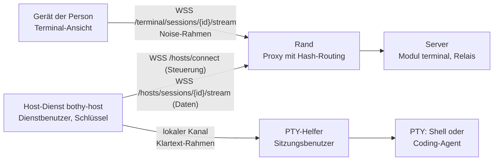
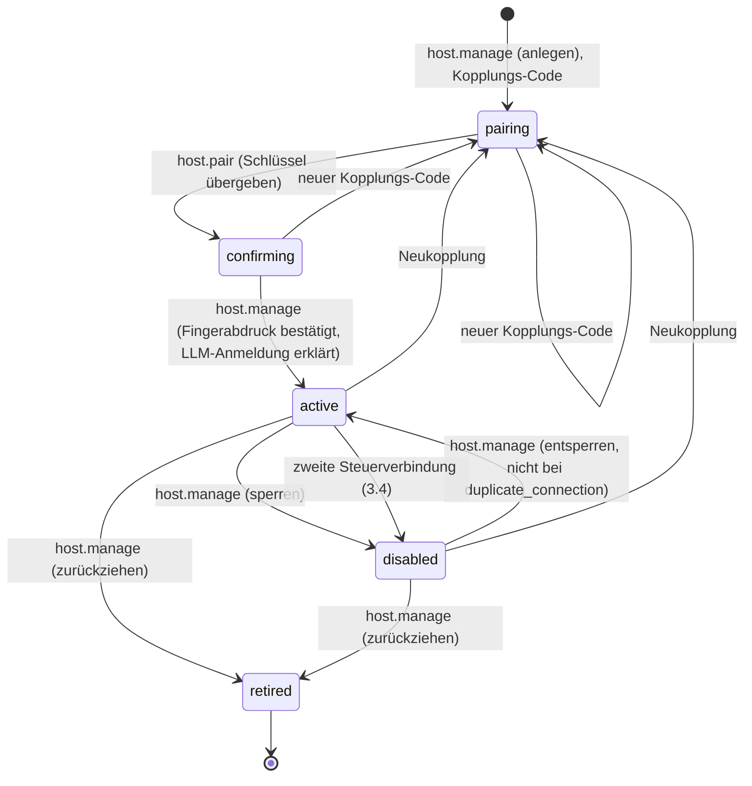

# 24 Terminal

Status: Entwurf M0, Nachtrag vom 2026-10-10. Normativ für das Modul `terminal`, den Host-Dienst
`bothy-host`, die Terminal-Ansicht der Apps und der Web-Konsole und für jede Prüfung, die eine
Terminal-Sitzung erlaubt.
Begriffe: [00-glossar.md](00-glossar.md). Tabellen: [03-datenmodell.md](03-datenmodell.md)
(`hosts`, `terminal_sessions`, `grants`). Ereignisse: [04-sync-protokoll.md](04-sync-protokoll.md).
Aktionen: [05-aktionen.md](05-aktionen.md), Abschnitt 4.14. Rechte und Schutzregeln:
[07-rechte.md](07-rechte.md) (SR10, SR11). Step-up: [08-identitaet.md](08-identitaet.md),
Abschnitt 6.3. Invariante I6: [10-backend-richtlinie.md](10-backend-richtlinie.md), Abschnitt 3.
Bedrohungen: [../security/threat-model.md](../security/threat-model.md), Abschnitt 6.7.
Entscheidungen: [ADR 0068](../adr/0068-terminal-ueber-host-dienst-mit-noise-strom-und-invariante-i6.md),
[ADR 0070](../adr/0070-terminal-in-der-web-konsole.md).

Alle Grenzen, Fristen und Intervalle sind benannte Konfigurationswerte. Ihre Standardwerte stehen
nur in Abschnitt 17.

## 1. Zweck und Grenzen

Das Terminal ist Pflichtbestandteil des Produkts. Eine berechtigte Person öffnet in der Desktop-App,
in der mobilen App oder in der Web-Konsole eine echte Terminal-Sitzung auf einem angebundenen
Rechner: eine Login-Shell oder eine interaktive Sitzung eines Coding-Agenten (z. B. Claude Code).

Sicherheit ist eingebaut, nicht abschaltbar:

1. Nur Menschen mit dem Zusatzrecht `terminal` auf dem Rechner öffnen ein Terminal. Owner haben es
   implizit, außer I6 sperrt (Abschnitt 7).
2. Jede Öffnung verlangt einen frischen Step-up, der genau für diese Öffnung gilt (Abschnitt 8).
3. Der Inhalt läuft Ende-zu-Ende verschlüsselt zwischen Gerät und Rechner; der Server vermittelt und
   entscheidet, liest aber nichts (Abschnitt 5).
4. Jede Sitzung steht im Audit-Log, mit Leerlauf-Abbruch und Höchstdauer (Abschnitte 10 und 12).
5. Auf dem Rechner laufen Host-Dienst und Sitzungen als zwei getrennte Benutzer ohne
   Administratorrechte; die Sitzungen erreichen die Schlüssel des Rechners nicht (Abschnitt 2.2).

Nicht in dieser Fassung: Dateiübertragung und Zwischenablage über den Kanal, Aufzeichnung von
Inhalten, gemeinsame Sitzungen mehrerer Menschen, Terminal für Agenten oder Apps, Übernahme eines
Threads des Runners ins Terminal (Abschnitt 11.3).

Anti-Ziele: ein Weg am Rechte-Modell vorbei; Terminal-Inhalte im Server, in der Telemetrie, im
Audit, in der Suche, im Push oder im Kontext eines Agenten; ein Weg, über das Terminal das
persönliche Abo eines anderen Menschen zu nutzen.

## 2. Bausteine

### 2.1 Überblick

| Baustein | Ort | Aufgabe |
|---|---|---|
| Modul `terminal` | Server, Rolle `api` | Rechner, Kopplung, Sitzungen, Sitzungs-Marken, Relais der Ströme |
| Host-Dienst `bothy-host` | angebundener Rechner (macOS, Linux, Windows; auch eine Dev-VM aus [21-dev-isolation.md](21-dev-isolation.md)), Dienstbenutzer | Schlüssel, Steuerverbindung zum Server, Noise-Gegenstelle, Selbstprüfung |
| PTY-Helfer `bothy-host pty-helper` | derselbe Rechner, Sitzungsbenutzer | PTY je Sitzung, Profile, Prüfungen im Konto der Sitzungen (HD6, HD8); kennt keine Schlüssel |
| Terminal-Ansicht | Desktop-App, mobile App, Web-Konsole | Darstellung, Eingabe, Noise-Gegenstelle, Schlüssel-Pinning |
| Paket `packages/bothy_noise` | Dart | Noise-Handshake `NK`, geprüft gegen öffentliche Testvektoren (5.2) |

### 2.2 Host-Dienst `bothy-host`

- Eigenes kleines Go-Binary im Ordner `services/host`, nicht der Server (Ruling L1 gilt für den
  Server). Eigene Version und eigener Release-Kanal ([18-release.md](18-release.md)).
- Zwei Benutzer des Betriebssystems, beide ohne Administratorrechte, je als Dienst des
  Betriebssystems (launchd, systemd oder Windows-Dienst; [16-betrieb.md](16-betrieb.md),
  Abschnitt 4.4):
  - der **Dienstbenutzer** `bothy-host`: besitzt den Zustandsordner mit den Schlüsseln (4.2), hält
    Steuer- und Datenverbindungen und spricht Noise;
  - der **Sitzungsbenutzer** `host_service.session_user`: Unter ihm läuft der PTY-Helfer und damit
    jede Shell und jeder Coding-Agent. Er hat kein Leserecht auf den Zustandsordner.
- Beide verbindet ein lokaler Kanal (Unix-Socket bzw. Named Pipe), dessen Zugriffsrechte nur diese
  zwei Benutzer zulassen; jede Seite prüft die Gegenstelle über die Anmeldedaten des Prozesses, die
  das Betriebssystem liefert. Über den Kanal laufen nur die entschlüsselten Rahmen aus 5.4 und
  Steuerbefehle (Sitzung starten, beenden, Größe), nie Schlüssel. Grund: Eine Shell läuft mit allen
  Rechten ihres Benutzers. Liefe sie als Dienstbenutzer, könnte jede Person mit einem Terminal die
  Schlüssel kopieren, sich von anderswo als Rechner anmelden und jede spätere Sitzung mitlesen, auch
  die von Ownern. Wie der PTY-Helfer auf jeder Plattform ohne Administratorrechte und ohne setuid
  gestartet wird (eigener Dienst des Sitzungsbenutzers), belegt das Bau-Ticket.
- `bothy-host doctor` prüft vor jedem Start und auf Befehl; HD6 läuft zusätzlich vor jedem Start
  einer PTY und alle `host_service.credential_check_interval` (7.4):

| Prüfung | Bestanden, wenn | Folge bei Verstoß |
|---|---|---|
| HD1 Benutzer | beide Benutzer nicht `root`, nicht `Administrator`, nicht `SYSTEM`, und Dienstbenutzer und Sitzungsbenutzer sind verschieden | Start verweigert |
| HD2 Gruppen | keiner der beiden Benutzer ist in einer gesperrten Gruppe: fest `admin`, `sudo`, `wheel`, `Administrators`, `docker`, `lxd`, `libvirt`, `disk`, dazu `host_service.extra_forbidden_groups`; unter Linux ist zusätzlich der Socket des Docker-Daemons für keinen der beiden schreibbar | Start verweigert |
| HD3 sudo | kein passwortloses `sudo` für einen der beiden (`sudo -n true` scheitert) | Start verweigert |
| HD4 Zustandsordner | `host_service.state_dir` gehört dem Dienstbenutzer, Modus `0700`; Schlüsseldatei `0600` (Windows: DPAPI, Abschnitt 4.2) | Start verweigert |
| HD5 Server-Host | erkennt, ob derselbe Rechner den Server betreibt (Abschnitt 2.3) | Warnung; Sitzungen nur für Owner (SR10) |
| HD6 LLM-Anmeldung | Abschnitt 7.4, im Konto des Sitzungsbenutzers | bei `none` oder `organization` und erkannter Abo-Anmeldung: Start verweigert bzw. Sitzungen beendet (7.4) |
| HD7 Profile | jedes Profil verweist auf ein vorhandenes Programm; Arbeitsordner des Profils `claude` liegen in `host_service.claude_workdirs` | Profil fällt weg, Warnung |
| HD8 Trennung | der PTY-Helfer versucht beim Start, `host_service.state_dir` und die Schlüsseldatei zu lesen, und scheitert | Start verweigert |

  Grund für die Sperrliste in HD2: Einige Gruppen geben Rechte auf root-Niveau, ohne Administrator
  zu heißen. Docker schreibt: "The `docker` group grants root-level privileges to the user."
  (https://docs.docker.com/engine/install/linux-postinstall/, abgerufen 2026-10-10 [belegt]). Für
  `lxd` sagt die LXD-Doku, lokaler Zugriff auf den Daemon sei voller Zugriff und nur Benutzern zu
  geben, denen man root anvertrauen würde
  (https://canonical.com/lxd/docs/default/explanation/security/index.html.md, abgerufen 2026-10-10
  [belegt]). `libvirt` (Steuerung von VMs mit Zugriff auf Geräte des Rechners) und `disk` (roher
  Zugriff auf Datenträger) stehen aus demselben Grund auf der Liste [abgeleitet]. Die feste Liste kann der
  Betreiber nicht kürzen; `host_service.extra_forbidden_groups` ergänzt sie, weil Distributionen
  weitere solche Gruppen haben.

  `doctor` meldet nur Ergebnis und Code je Prüfung an den Server (`hosts.reported_doctor`), nie
  Inhalte, Pfade oder Werte.

- Verbindung nur ausgehend vom Host-Dienst zum Server, über WebSocket mit TLS. Der Rechner öffnet
  keinen Port. Grund: funktioniert hinter NAT, im privaten Netz und in der Cloud gleich.

### 2.3 Server-Host

Läuft der Host-Dienst auf dem Rechner, der den Server betreibt, erreicht eine Shell dort den
Secret-Provider, die Datenbank und die Sicherungen. Darum gilt ein Rechner als Server-Host, wenn
eines zutrifft:

- Der Owner erklärt es bei der Bestätigung (Pflichtfrage, `hosts.declared_server_host`).
- Der Host-Dienst meldet es (`hosts.reported_is_server_host`): Die Adresse aus `server.public_url`
  löst auf eine Adresse einer eigenen Netzschnittstelle oder auf Loopback auf, oder die Gegenstelle
  der Steuerverbindung ist eine lokale Adresse [abgeleitet: eine Heuristik, die einen Server hinter
  einem fremden Rand nicht erkennt].

Dann gilt:

- Warnung in Konsole und Rechner-Karte;
- `bothy-host` verweigert Sitzungen, deren Marke `own = false` trägt (Abschnitt 5.3), und der
  Server prüft dasselbe vorher (SR10).

Erkennt der Host-Dienst den Server-Host nicht, schützt SR10 trotzdem: Nicht-Owner bekommen nur
Rechner, deren Inhaber sie sind, und der Owner weist den Server-Host niemandem zu.

## 3. Rechner und Lebenszyklus

### 3.1 Zustände

Nur `active` erlaubt Sitzungen. Jeder Übergang aus `active` beendet alle Sitzungen des Rechners
(Grund in Abschnitt 10.3) und erhöht die Rechte-Version, weil er wirksame Rechte ändert. Sperren
durch den Owner setzt `hosts.disabled_reason = 'owner'`; ein Rechner mit `duplicate_connection`
(3.4) lässt sich nicht entsperren, nur neu koppeln (`409 invalid_state_transition`).

### 3.2 Kopplung

1. Der Owner legt den Rechner an (`host.manage`, Step-up, Audit) mit Name, optionalem Inhaber
   (`assigned_user_id`) und Grund. Er bekommt genau einmal einen Kopplungs-Code im Format
   `bothy_hpc_<zufall>_<prüfsumme>` ([ADR 0061](../adr/0061-token-format-mit-festem-praefix-und-pruefsumme.md));
   gespeichert wird nur der HMAC. Gültigkeit `terminal.pairing_code_ttl`, einmalig.
2. Auf dem Rechner ruft der Betreiber `bothy-host pair --server <url> --code <code>` auf. Der
   Host-Dienst erzeugt lokal ein statisches X25519-Schlüsselpaar (Noise) und ein
   Ed25519-Schlüsselpaar (Anmeldung beim Server), legt beide privat im Zustandsordner ab
   (Abschnitt 4.2) und sendet die öffentlichen Schlüssel mit dem Code (`host.pair`, öffentlich,
   `rl.public_auth`). Der Rechner wird `confirming`.
3. `bothy-host pair` zeigt lokal den Fingerabdruck (Abschnitt 4.3). Der Owner tippt die ersten
   `terminal.fingerprint_confirm_chars` Zeichen in der App ein und erklärt dabei die
   LLM-Anmeldung des Rechners (Abschnitt 7). Erst dann wird der Rechner `active`
   (`host.manage`, Step-up, Audit). Grund für das Eintippen: Ein blind bestätigter Rechner wäre
   eine Einladung an jeden, der den Code abgefangen hat (wie R-ID-08 für Geräte).

Ein falscher Fingerabdruck ergibt `409 fingerprint_mismatch`, der Rechner bleibt `confirming`;
nach `terminal.fingerprint_max_attempts` Fehlversuchen fällt er auf `pairing` zurück, und die
Schlüssel verfallen.

### 3.3 Neukopplung

Ein neuer Kopplungs-Code für einen bestehenden Rechner (`host.manage`) setzt ihn auf `pairing`,
verwirft die gespeicherten Schlüssel sofort, schließt seine Verbindungen und beendet seine
Sitzungen (`host_rekeyed`). `hosts.key_generation` steigt. Der Audit-Eintrag nennt alten und neuen
Fingerabdruck; jeder aktive Owner bekommt das Ereignis `host.updated` mit `key_changed = true`.
Clients sehen beim nächsten Öffnen einen anderen Schlüssel und warnen hart (Abschnitt 5.5).

### 3.4 Zweite Steuerverbindung

Je Rechner gilt genau eine Steuerverbindung. Meldet sich eine zweite mit demselben Anmeldeschlüssel
an, während die ältere noch besteht, prüft der Server die ältere mit einem WebSocket-Ping (mit
`cluster.mode = multi` über `NOTIFY ephemeral` an den Knoten der älteren Verbindung, 03, Abschnitt
6.6):

- Antwortet die ältere nicht innerhalb von `terminal.host_duplicate_probe_timeout`, gilt sie als
  tot; der Server schließt sie mit `4009` und nimmt die neue an. Das ist der übliche Fall nach
  einem Netzwechsel.
- Antwortet die ältere, laufen zwei Host-Dienste mit denselben Schlüsseln. Das ist ein Hinweis auf
  kopierte Schlüssel. Der Server schließt beide Verbindungen mit `4112`, setzt den Rechner auf
  `disabled` mit `hosts.disabled_reason = 'duplicate_connection'`, beendet alle Sitzungen
  (`host_disabled`), schreibt einen Audit-Eintrag (`host.connect`, Code `duplicate_connection`) und
  sendet `host.updated` an alle Owner. Weiter geht es nur mit einer Neukopplung (3.3).

Grund: Stilles Verdrängen der älteren Verbindung würde einem Angreifer mit kopierten Schlüsseln
erlauben, den echten Rechner zu verdrängen und jede spätere Sitzung zu empfangen.

## 4. Schlüssel

### 4.1 Zwei Schlüsselpaare je Rechner

| Schlüssel | Algorithmus | Zweck | Server kennt |
|---|---|---|---|
| Noise-Schlüssel | X25519 | statischer Schlüssel des Rechners im Noise-Muster `NK` | öffentlichen Teil (`hosts.noise_public_key`) |
| Anmeldeschlüssel | Ed25519 | Anmeldung der Steuer- und Datenverbindungen | öffentlichen Teil (`hosts.auth_public_jwk`, `hosts.auth_jkt`) |

Grund für zwei Schlüssel: Der Anmeldeschlüssel beweist dem Server den Rechner, der Noise-Schlüssel
beweist ihn dem Gerät. Ein Fehler in einem Pfad gibt den anderen nicht preis.

### 4.2 Ablage auf dem Rechner

Private Schlüssel liegen als Datei im Zustandsordner `host_service.state_dir` mit Modus `0600`
(Ordner `0700`), im Besitz des Dienstbenutzers. Unter Windows verschlüsselt der Host-Dienst die
Datei mit DPAPI im Kontext seines Dienstbenutzers. Einen Schlüsselbund des Betriebssystems nutzt er
nur, wo der Dienstbenutzer eine entsperrte Sitzung hat. Grund: Der Schlüsselbund eines
Dienstbenutzers ohne Anmeldesitzung ist nicht entsperrt (Ruling T10).

Der Sitzungsbenutzer kann den Zustandsordner nicht lesen (HD8). Wer auf dem Rechner zum
Dienstbenutzer aufsteigt, hat die Schlüssel trotzdem; dann zeigt 3.4 den zweiten Host-Dienst an,
sobald beide gleichzeitig verbunden sind. Ist der echte Rechner in dieser Zeit aus, bleibt der
Diebstahl bis zu seiner Rückkehr unbemerkt (Bedrohungsmodell T-TM-05).

### 4.3 Fingerabdruck

`key_fingerprint = base32_crockford(SHA-256("bothy-host-fp/1" || noise_public_key ||
auth_public_key_raw))`, Anzeige in Gruppen zu vier Zeichen. Beide Schlüssel stehen darin, weil ein
Wechsel jedes der beiden eine Neukopplung ist.

Einzelheiten (docs/DECISIONS.md D-M2-38-11): `noise_public_key` ist der rohe X25519-Schlüssel,
`auth_public_key_raw` der rohe Ed25519-Schlüssel (das dekodierte `x` des JWK), je 32 Byte.
Crockford-Base32 mit dem Alphabet `0123456789ABCDEFGHJKMNPQRSTVWXYZ`: 5-Bit-Gruppen ab dem
höchstwertigen Bit, die letzte Gruppe rechts mit Null-Bits aufgefüllt, Großbuchstaben, ohne
Auffüllzeichen und ohne Prüfzeichen. Die 32 Byte des Hashs ergeben 52 Zeichen, angezeigt als 13
Gruppen zu vier, verbunden mit `-` (die Form von `key_fingerprint` in `openapi.yaml`). Bekannter
Vektor: Noise-Schlüssel mit den Bytes `0x00` bis `0x1f` und Anmeldeschlüssel mit `0x20` bis `0x3f`
ergeben `F0CC-6QS6-RF5D-3BSH-CAZQ-PXMR-J8RA-AHK5-1HF0-9S02-1GW6-BW3J-HK90`. Server, Host-Dienst
und Apps prüfen ihre Berechnung gegen `services/host/testdata/noise/fingerprint.json`.

## 5. Ende-zu-Ende-Strom

### 5.1 Schutzziel

Der Server ist Relais und Autorisierungspunkt. Die Ende-zu-Ende-Verschlüsselung schützt den Inhalt
gegen: Relais und Proxy, Logs, einen Abzug der Datenbank oder der Sicherungen, einen mitlesenden
api-Prozess.

Sie schützt **nicht** gegen einen bösartigen Server-Betreiber. Grund: Das Muster `NK` beweist nur,
dass die Gegenstelle den Schlüssel besitzt, den der Server bei der Kopplung verteilt hat; ein
bösartiger Server kann einen eigenen Schlüssel verteilen und Sitzungen erlauben. Das Produkt setzt
den Server ohnehin als vertrauenswürdig voraus ([19-sicherheit.md](19-sicherheit.md), Abschnitt 1).
Gegenmittel: Schlüssel-Pinning je Gerät (5.5) und die Option `host_service.require_local_confirm`
(Abschnitt 6.4). Ruling T3.

In der Web-Konsole wirkt das Pinning gegen einen bösartigen Server nicht: Der Server liefert den
Code der Konsole selbst und kann eine Fassung ohne Pin-Prüfung schicken. Dort bleibt gegen diesen
Gegner nur `host_service.require_local_confirm`. Das Pinning der Konsole fängt nur einen
Schlüsselwechsel ab, den ein ehrlicher Server meldet (Neukopplung), und darum löscht die Konsole
ihre Pins beim Abmelden ohne Verlust an Schutz ([ADR 0070](../adr/0070-terminal-in-der-web-konsole.md)).

### 5.2 Protokoll

Noise Protocol Framework, Revision 34 (https://noiseprotocol.org/noise.html, abgerufen
2026-10-10 [belegt]), Protokollname `Noise_NK_25519_ChaChaPoly_SHA256`.

| Element | Festlegung | Grund |
|---|---|---|
| Muster | `NK`: `<- s`, `...`, `-> e, es`, `<- e, ee` [belegt, Abschnitt 7.5 der Spezifikation] | Das Gerät kennt den statischen Schlüssel des Rechners aus der Kopplung; der Rechner kennt das Gerät nicht, ihn überzeugt die Sitzungs-Marke |
| Prolog | `"bothy-terminal/1"` \|\| Sitzungs-ID (16 Byte) \|\| Rechner-ID (16 Byte); die IDs in der Oktett-Reihenfolge von RFC 9562, also die Bytes so, wie die Textform sie von links nach rechts nennt (docs/DECISIONS.md D-M2-38-7) | Abweichender Prolog lässt den Handshake scheitern (Abschnitt 6 der Spezifikation [belegt]); bindet Handshake an Protokollversion, Sitzung und Rechner |
| Nachricht 1 (Gerät an Rechner) | `-> e, es`, Nutzlast: Sitzungs-Marke (5.3) | Die Nutzlast ist nur an den Rechner verschlüsselt und laut Spezifikation wiederholbar (Abschnitt 7.7, Ziel-Eigenschaft 2 [belegt]); die Einmal-Marke schließt das |
| Nachricht 2 (Rechner an Gerät) | `<- e, ee`, Nutzlast: `{"v":1,"host_version":...,"profile":...}` | Gerät weiß danach, dass es mit dem Inhaber des statischen Schlüssels spricht |
| Erste Transportnachricht des Geräts | Rahmen `start` mit Spalten und Zeilen | erst danach startet die PTY (Ruling T9) |
| Größe | jede Noise-Nachricht höchstens 65535 Byte [belegt, Abschnitt 3 der Spezifikation] | Grenze der Spezifikation; ein WebSocket-Binärrahmen trägt genau eine Noise-Nachricht |
| Diffie-Hellman | ein Ergebnis aus 32 Null-Bytes (öffentlicher Schlüssel kleiner Ordnung) lässt den Handshake scheitern, in Go und Dart (docs/DECISIONS.md D-M2-38-9) | ein solches gemeinsames Geheimnis hängt nicht vom privaten Schlüssel ab; ein Angreifer hätte es gewählt |
| Nach einem Fehler | nach einem gescheiterten Handshake-Schritt oder einer gescheiterten Entschlüsselung verweigert das Objekt jeden weiteren Aufruf; jede Richtung verweigert die Nonce 2^64 - 1 (Abschnitt 5.1 der Spezifikation [belegt]; docs/DECISIONS.md D-M2-38-8) | eine gescheiterte Authentifizierung ist Manipulation (5.3, `4104`); Weitermachen ließe ein Relais Proben senden |

Bibliotheken:

- Go: `github.com/flynn/noise`, BSD-3-Clause (https://github.com/flynn/noise/blob/master/LICENSE,
  abgerufen 2026-10-10 [belegt]); kennt `HandshakeNK`, `DH25519`, `CipherChaChaPoly`,
  `HashSHA256` und `Config.Prologue` (https://pkg.go.dev/github.com/flynn/noise, abgerufen
  2026-10-10 [belegt], Version v1.1.0 vom 2024-02-02). Der Pflegezustand der Bibliothek ist nicht
  belegt [vermutet: wenig Aktivität]; der Konformitätstest TM-T01 mit den Testvektoren unten hält
  sie, und das Bau-Ticket prüft vor der Aufnahme Lizenz und Stand mit dem Lizenz-Gate. Gepinnt in
  `services/host/go.mod`: `github.com/flynn/noise` v1.1.0 (neueste Version laut Go-Modul-Proxy am
  2026-10-12 [belegt]) mit `golang.org/x/crypto` v0.58.0 und `golang.org/x/sys` v0.49.0;
  `tools/ci/tests/test_bothy_noise_package.py` hält diese Versionen gleich `go.mod` und
  `pubspec.lock`.
- Dart: X25519, ChaCha20-Poly1305, SHA-256 und HMAC-SHA-256 aus dem Paket `cryptography` (die HKDF
  der Noise-Spezifikation baut `bothy_noise` selbst aus HMAC, Abschnitt 4.3 der Spezifikation), Apache-2.0,
  Version 2.9.0 (https://pub.dev/packages/cryptography, abgerufen 2026-10-10 [belegt]; neueste
  Version am 2026-10-12, gepinnt in `packages/bothy_noise/pubspec.lock`); der
  Handshake selbst als eigenes kleines Paket `packages/bothy_noise`, geprüft gegen dieselben
  Testvektoren. In der Web-Konsole nutzt `cryptography` die Web Crypto API, sonst reines Dart
  (gleiche Quelle [belegt]).

Testvektoren: Die Spezifikation selbst enthält keine. Das Noise-Wiki verweist auf Vektor-Dateien
anderer Projekte (https://github.com/noiseprotocol/noise_wiki/wiki/Test-vectors, abgerufen
2026-10-10 [belegt]). TM-T01 nutzt zwei davon, die beide einen Eintrag für
`Noise_NK_25519_ChaChaPoly_SHA256` enthalten:
`vectors/cacophony.txt` aus https://github.com/centromere/cacophony und
`tests/vector/noise-c-basic.txt` aus https://github.com/rweather/noise-c (beide abgerufen
2026-10-10 [belegt]). Das Bau-Ticket legt die Dateien mit Commit-Hash und Lizenz unter
`services/host/testdata/noise/` ab und nutzt sie für Go und Dart. Sie liegen unverändert, aber mit
gzip komprimiert unter `vectors/`, mit Herkunft, Commit, Lizenz und Prüfsumme des Inhalts in
`services/host/testdata/noise/README.md` (docs/DECISIONS.md D-M2-38-15); cacophony liegt heute
unter https://github.com/haskell-cryptography/cacophony (GitHub leitet um). Die Aufzeichnungen
für TM-T02 liegen in `services/host/testdata/noise/recordings/` (`go.json` von Go, `dart.json` von
Dart).

### 5.3 Sitzungs-Marke

Der Server stellt nach `terminal.open` bzw. `terminal.attach` eine Sitzungs-Marke aus: eine
kompakte JWS nach dem JOSE-Profil ([ADR 0067](../adr/0067-jose-profil-mit-der-standardbibliothek.md)),
Kopf `alg = EdDSA`, `kid`, `typ = terminal-session+jwt`, signiert mit einem Server-Schlüssel mit
Zweck `terminal` (03, `server_signing_keys`). Der Host-Dienst holt die öffentlichen Schlüssel über
die Steuerverbindung (`hello` trägt die JWKS des Zwecks).

| Claim | Inhalt |
|---|---|
| `iss` | `instance.instance_id` |
| `aud` | Rechner-ID |
| `sub` | Prinzipal-ID des Menschen |
| `sid` | Sitzungs-ID; gleich der Sitzungs-ID im Prolog |
| `jti`, `iat`, `exp` | UUIDv7 der Marke, Ausstellung, Ablauf (`iat + terminal.session_token_ttl`) |
| `dev` | Geräte-ID |
| `prf` | Name des Profils |
| `cek` | SHA-256 des ephemeren öffentlichen Schlüssels des Geräts (base64url), den das Gerät beim Öffnen meldet |
| `own` | `true`, wenn die Person zur Zeit der Ausstellung aktiver Owner ist |
| `att` | `open` oder `attach` |

Der Host-Dienst prüft in dieser Reihenfolge und bricht sonst ohne PTY ab: Signatur mit einem
Schlüssel aus der JWKS, `typ`, `aud` gleich eigener ID, `sid` gleich Prolog, `exp` nicht
überschritten (Toleranz `auth.clock_leeway`), `jti` nie gesehen (er merkt jede `jti` bis zu ihrem
`exp`, Ruling T9), `cek` gleich dem Hash des `e` aus Nachricht 1, `prf` ist ein eigenes Profil,
und auf dem Server-Host `own = true`. Er meldet den Grund als `close_detail` (10.3); der Server
schließt den Strom des Geräts danach mit genau einem Code:

| Fall | `close_detail` | Schließ-Code | Verhalten des Geräts |
|---|---|---|---|
| `exp` überschritten | `token_expired` | `4101` | mit neuem Step-up neu öffnen bzw. anhängen |
| `jti` schon gesehen | `token_replayed` | `4101` | wie oben |
| Signatur, `kid`, `typ`, `aud`, `sid` oder `cek` falsch | `token_invalid` | `4104` | harte Warnung, kein neuer Versuch |
| Handshake gescheitert (Prolog, Schlüssel) | `handshake_failed` | `4104` | wie oben |
| Profil unbekannt | `profile_unknown` | `4104` | wie oben |
| Server-Host ohne `own = true` | `server_host_owner_only` | `4104` | wie oben |

Grund für die Teilung: Eine abgelaufene oder verbrauchte Marke entsteht auch ohne Angriff (langsames
Netz, doppelter Klick); alles andere deutet auf Manipulation. Grund für `cek`: Ein Relais kann die Marke
nicht in einen eigenen Handshake setzen, weil der Hash an den ephemeren Schlüssel des Geräts
gebunden ist.

### 5.4 Rahmen

Jede WebSocket-Binärnachricht ist genau eine Noise-Nachricht. Nach dem Handshake trägt jede
Transportnachricht einen Rahmen:

| Typ (1 Byte) | Name | Richtung | Inhalt |
|---|---|---|---|
| `0x01` | `start` | Gerät an Rechner | Spalten, Zeilen (je 2 Byte); einmal, als erste Transportnachricht |
| `0x02` | `data` | beide | Bytes der PTY bzw. Eingabe |
| `0x03` | `resize` | Gerät an Rechner | Spalten, Zeilen |
| `0x04` | `close` | Gerät an Rechner | Sitzung beenden |
| `0x05` | `exit` | Rechner an Gerät | Exitcode des Prozesses (4 Byte, vorzeichenbehaftet) |
| `0x06` | `replay_begin`, `0x07` `replay_end` | Rechner an Gerät | umschließen den Rückblick-Puffer beim Wiederanhängen |

Steuerdaten liegen in der verschlüsselten Nutzlast; das Relais sieht nur Länge und Zeitpunkt.
Ein unbekannter Typ beendet die Sitzung (Schließ-Code `4104`). Textrahmen sind auf diesen
Verbindungen verboten (`4002`).

Kodierung (docs/DECISIONS.md D-M2-38-10): Alle Zahlen sind Big-Endian. `start` und `resize`
tragen genau 4 Byte, erst Spalten, dann Zeilen, je 1 bis 65535 (wie `TerminalSessionOpen`).
`data` trägt 1 bis 65518 Byte; ein leeres `data` zählte als Eingabe ohne Eingabe (6.3). `close`,
`replay_begin` und `replay_end` tragen keinen Inhalt. `exit` trägt genau 4 Byte, eine
vorzeichenbehaftete 32-Bit-Zahl im Zweierkomplement. Ein Rahmen ist höchstens 65519 Byte lang,
der größte Klartext einer Transportnachricht. Richtungen wie in der Tabelle; jeder Fehler beim
Lesen eines Rahmens (leer, zu lang, unbekannter Typ, falsche Richtung, falscher Inhalt) beendet
die Sitzung wie ein unbekannter Typ (`4104`).

### 5.5 Schlüssel-Pinning im Gerät

Jedes Gerät speichert beim ersten erfolgreichen Öffnen einer Sitzung auf einem Rechner dessen
`noise_public_key` und `key_generation` im lokalen Speicher. Liefert der Server später einen
anderen Schlüssel, zeigt die App eine harte Warnung mit beiden Fingerabdrücken und verbindet erst
nach ausdrücklicher Bestätigung durch die Person; die Bestätigung steht im Audit
(`terminal.open` mit `pin_changed = true`). Grund: Ein Schlüsselwechsel ohne Neukopplung wäre ein
Hinweis auf einen Angriff des Servers selbst (5.1). In der Web-Konsole schützt das Pinning nicht
gegen den Server selbst (5.1).

## 6. Sitzungen

### 6.1 Öffnen

Diagramm: [seq-8-terminal-oeffnen.svg](../architecture/seq-8-terminal-oeffnen.svg) (Quelle
[seq-8-terminal-oeffnen.mmd](../architecture/seq-8-terminal-oeffnen.mmd)).

1. Das Gerät erbringt einen Step-up (08, Abschnitt 6.3) und ruft
   `POST /api/v1/hosts/{host_id}/terminal/sessions` mit Profil, Größe und dem Hash seines
   ephemeren Schlüssels (`client_ephemeral_key_hash`).
2. `authorize(person, terminal.open, host)`: Recht `terminal` (07, Abschnitt 2.12), SR10, SR11
   (I6), frischer und unverbrauchter Step-up, Grenzen (`terminal.max_sessions_per_person`,
   `terminal.max_sessions_per_host`), Rechner `active` und verbunden, Profil bekannt.
3. In einer Transaktion: Step-up verbrauchen (08, Abschnitt 6.3), Zeile in `terminal_sessions`
   mit `state = 'opening'`, Audit, Ereignis `terminal_session.changed`. Antwort: Sitzungs-ID,
   Marke, Stream-Pfad, `noise_public_key`, `key_fingerprint`, `key_generation`.
4. Der Server weist den Host-Dienst über die Steuerverbindung an (`session.open` mit Sitzungs-ID
   und Datenpfad). Der Host-Dienst öffnet die Datenverbindung
   `/api/v1/hosts/sessions/{session_id}/stream`.
5. Das Gerät öffnet `/api/v1/terminal/sessions/{session_id}/stream` und sendet Nachricht 1.
6. Das Relais verbindet beide Seiten, sobald beide da sind; kommt eine Seite nicht innerhalb von
   `terminal.open_timeout`, endet die Sitzung mit `open_failed`.
7. Nach Nachricht 2 und dem Rahmen `start` startet der Host-Dienst die PTY; er meldet
   `session.started` über die Steuerverbindung; der Server setzt `state = 'active'`.

### 6.2 Trennen und Wiederanhängen

- Bricht die Verbindung des Geräts ab, bleibt die PTY auf dem Rechner `terminal.detach_grace`
  lang bestehen; der Server setzt `state = 'detached'`. Der Rückblick-Puffer liegt nur im Speicher
  des Host-Dienstes (`host_service.scrollback_bytes`), nie im Server.
- Wiederanhängen (`terminal.attach`) gibt eine neue Marke und erzeugt einen neuen Noise-Handshake
  mit neuem ephemerem Schlüssel; der Host-Dienst spielt den Rückblick-Puffer zwischen
  `replay_begin` und `replay_end` ein. Die alte Marke ist damit wertlos (der Server speichert nur die
  aktuelle `jti`).
- Step-up: Von einem anderen Gerät derselben Person immer frisch. Vom selben Gerät in derselben
  Anmeldesitzung innerhalb von `terminal.quick_reattach_window` nach der Trennung ohne neuen
  Step-up. Grund: Mobilnetze brechen oft kurz ab; eine Passkey-Abfrage je Funkloch würde zum
  blinden Bestätigen erziehen. Die Ausnahme gilt nur für dasselbe Gerät, dessen Schlüssel die
  Anfrage beweist, und darum nie in der Web-Konsole (`client_component = 'console'`): Dort gibt es
  keinen Geräteschlüssel, nur das Cookie der Konsole. Die Konsole braucht für jedes Anhängen einen
  frischen Passkey ([ADR 0070](../adr/0070-terminal-in-der-web-konsole.md)).
- Hängt ein anderes Gerät an, schließt der Server die ältere Verbindung mit `4103`.
- Bricht die Steuer- oder Datenverbindung des Host-Dienstes ab, setzt der Server die Sitzung auf
  `detached`. Der Host-Dienst hält die PTY und baut die Datenverbindung nach dem Wiederverbinden
  neu auf; das Gerät hängt danach mit `terminal.attach` neu an.
- Nach `terminal.detach_grace` ohne Anhängen beendet der Host-Dienst die PTY, der Server schließt
  die Sitzung mit `detach_expired`.

### 6.3 Grenzen

| Grenze | Wert | Wirkung |
|---|---|---|
| Leerlauf | `terminal.idle_timeout` | ohne Eingabe des Geräts (Rahmen `data`, `resize`); Ende `idle_timeout` |
| Höchstdauer | `terminal.max_session_duration` | ab `opened_at`, auch über Wiederanhängen hinweg; Ende `max_duration` |
| Sitzungen je Person | `terminal.max_sessions_per_person` | nicht `closed`; Ablehnung `terminal_session_limit` |
| Sitzungen je Rechner | `terminal.max_sessions_per_host` | dasselbe |
| Puffer im Relais | `terminal.relay_buffer_max_bytes` je Richtung | voll: Verbindung des langsamen Endes mit `4014` schließen, Sitzung `detached` |
| Rate-Limit | `rl.terminal` je Mensch, `rl.host` je Rechner | 05, Abschnitt 3 |

Den Leerlauf misst der Host-Dienst, weil nur er die Rahmentypen sieht; er meldet das Ende über die
Steuerverbindung. Der Server misst zusätzlich die Zeit ohne Bytes vom Gerät im Relais und beendet
nach `terminal.idle_timeout` plus `terminal.idle_grace` selbst. Grund: Ein manipulierter
Host-Dienst darf eine Sitzung nicht beliebig offen halten. Der Job `terminal.sweep`
([02-architektur.md](02-architektur.md), Abschnitt 12.3) prüft dieselben Grenzen in der Datenbank
und fängt Sitzungen eines ausgefallenen Knotens auf.

### 6.4 Lokale Bestätigung

Mit `host_service.require_local_confirm = true` fragt der Host-Dienst vor dem Start jeder PTY auf
dem Rechner nach (Benachrichtigung des Betriebssystems an die angemeldete Person des Rechners) und
startet erst nach Zustimmung innerhalb von `host_service.local_confirm_timeout`. Standard ist aus.
Grund: Rückfall gegen einen bösartigen Server-Betreiber (5.1), nur sinnvoll, wenn jemand am Rechner
sitzt.

### 6.5 Ende einer Sitzung auf dem Rechner

Der PTY-Helfer startet jede Sitzung in einer eigenen Prozessgruppe und Sitzung des Betriebssystems
(`setsid`); unter Linux zusätzlich in einer eigenen cgroup (systemd-Scope des Sitzungsbenutzers),
unter Windows in einem Job Object mit `JOB_OBJECT_LIMIT_KILL_ON_JOB_CLOSE`. Endet eine Sitzung,
gleich aus welchem Grund, beendet er den ganzen Baum: unter Linux alle Prozesse der cgroup, unter
Windows das Job Object, unter macOS die Prozessgruppe und danach jeden Prozess des
Sitzungsbenutzers, dessen Elternkette auf die Sitzung zurückgeht. Grund: Ohne das liefe ein mit
`nohup`, `setsid` oder `disown` gestarteter Prozess nach einem Entzug weiter.

Grenze: Dauerläufer, die eine Person als Sitzungsbenutzer einrichtet (crontab, systemd-Dienste des
Benutzers, LaunchAgent, geplante Aufgabe), beendet das nicht; sie laufen außerhalb jedes
Sitzungsbaums. Darum zeigt die Konsole beim Entzug einer Person, die nicht Owner ist, den Hinweis,
Autostart und geplante Aufgaben des Sitzungsbenutzers auf dem Rechner zu prüfen oder die Umgebung
neu aufzusetzen (Bedrohungsmodell T-TM-11). Die Schlüssel erreichen solche Prozesse nicht (2.2).

### 6.6 Zustand einer Sitzung

| `state` | Bedeutung |
|---|---|
| `opening` | angelegt, Handshake läuft |
| `active` | PTY läuft, Gerät verbunden |
| `detached` | PTY läuft, kein Gerät verbunden; Wiederanhängen möglich |
| `closed` | beendet; `close_reason` gesetzt |

## 7. LLM-Anmeldung und Invariante I6

### 7.1 Warum

Anthropic verbietet, Abo-Anmeldedaten für andere Personen zu nutzen
(https://code.claude.com/docs/en/legal-and-compliance, abgerufen 2026-10-10 [belegt]; Wortlaut in
[10-backend-richtlinie.md](10-backend-richtlinie.md), Abschnitt 2). Ein Terminal erlaubt jede
Nutzung der Anmeldung, die der OS-Benutzer des Host-Dienstes hat. Das Produkt kann den Inhalt dieser
Anmeldung nicht prüfen. Darum erklärt der Owner sie je Rechner, und der Server erzwingt, wer dann
ein Terminal öffnen darf.

### 7.2 Erklärung

`hosts.llm_credentials`, gesetzt bei der Bestätigung (3.2) und später mit `host.manage` (Step-up,
Audit, Rechte `ja`):

| Wert | Bedeutung |
|---|---|
| `none` | Auf dem Rechner gibt es keine LLM-Anmeldung. Das Profil `claude` wird nicht angeboten. |
| `personal` | Die Anmeldung ist das persönliche Abo genau eines Menschen (`hosts.credential_holder_id`). |
| `organization` | Die Anmeldung ist ein Organisations-API-Schlüssel aus dem Zustandsordner des Host-Dienstes. |

### 7.3 Invariante I6

**I6:** Ist `llm_credentials = personal`, darf nur `credential_holder_id` ein Terminal auf dem
Rechner öffnen oder anhängen. Das gilt auch für andere Owner (Owner-Ausnahme, Ruling T2). Auf
einem solchen Rechner gibt es nur eine Einzel-Freigabe `terminal` an den Inhaber der Anmeldung,
keine Gruppen-Freigaben und keine Freigaben an andere Menschen.

Prüfstellen:

1. **Transaktional** in `grant.create` mit Ziel `host` und in `host.manage` (Bestätigung,
   Wechsel der Erklärung, Wechsel des Inhabers der Anmeldung): Würde danach ein anderer Prinzipal
   als `credential_holder_id` eine gültige Freigabe `terminal` auf dem Rechner haben, rollt die
   Transaktion zurück: `409 invariant_violation` mit Code `i6_violation`, Audit `deny` (03,
   Abschnitt 6.8).
2. **Bei jedem `terminal.open` und `terminal.attach`**: SR11 in 07, fail closed.
3. **Beim Wechsel** auf `personal` oder des Inhabers beendet dieselbe Transaktion alle Sitzungen
   anderer Menschen auf dem Rechner (`i6_violation`).

Abgrenzung zu I1 ([ADR 0024](../adr/0024-backend-richtlinie-personal-organization-mit-invariante.md),
Ruling L22): I1 kennt keine Owner-Ausnahme, weil Owner auf allen Zielen `trigger` erben und ein
Agent auf vielen Zielen ausgelöst wird. Ein Terminal ist Zugriff auf einen bestimmten Rechner, keine
vererbte Stufe. Ohne Owner-Ausnahme wäre ein persönlicher Rechner bei zwei Ownern unmöglich. Die
Ausnahme schränkt Owner ein; sie erweitert nichts. [ADR 0068](../adr/0068-terminal-ueber-host-dienst-mit-noise-strom-und-invariante-i6.md)
hält das fest.

### 7.4 Durchsetzung auf dem Rechner

- `bothy-host doctor` (HD6) fragt den Coding-Agenten nach seiner aktiven Anmeldung, nie nach Werten:
  bei Claude Code `claude auth status` mit dem Feld `authMethod` (`none`, `claude.ai`,
  `oauth_token`, `api_key`, `api_key_helper`, `third_party`;
  https://code.claude.com/docs/en/cli-reference, abgerufen 2026-10-10 [belegt]). Zusätzlich meldet
  er nur das Vorhandensein bekannter Anmeldeorte: `~/.claude/.credentials.json` unter Linux,
  `%USERPROFILE%\.claude\.credentials.json` unter Windows, unter macOS der Schlüsselbund mit
  Rückfall auf dieselbe Datei, `CLAUDE_CONFIG_DIR`, `CLAUDE_CODE_OAUTH_TOKEN`
  (https://code.claude.com/docs/en/authentication, abgerufen 2026-10-10 [belegt]). Den Namen des
  Schlüsselbund-Eintrags nennt die Quelle nicht; der Host-Dienst prüft ihn darum nur über
  `claude auth status` [vermutet: kein dokumentierter Weg ohne den Agenten].
- Bei `none` oder `organization` und erkannter Abo-Anmeldung (`authMethod` gleich `claude.ai` oder
  `oauth_token`, oder eine der Anmeldedateien vorhanden) startet `bothy-host` nicht (Ruling T2).
- Prüfstellen: Der PTY-Helfer führt HD6 im Konto des Sitzungsbenutzers aus, und zwar beim Start des
  Dienstes, vor jedem Start einer PTY und
  alle `host_service.credential_check_interval`; jedes Mal im Home des Sitzungsbenutzers und im
  `CLAUDE_CONFIG_DIR` des Profils `claude`. Grund: In einer laufenden Shell kann jemand `claude`
  starten und sich mit `/login` per Abo anmelden; die Anmeldung landet im Home des gemeinsamen
  Sitzungsbenutzers, und jede spätere Sitzung anderer Menschen nutzte dieses persönliche Abo.
- Treffer während des Betriebs: Der Host-Dienst lehnt neue Sitzungen ab (`open_failed` mit
  `close_detail = subscription_login_detected`), beendet alle laufenden Sitzungen des Rechners
  (`close_reason = host_policy_violation`, gleiches `close_detail`) und meldet das Ergebnis über
  `report` an den Server (HD6 nicht bestanden). Der Server schreibt einen Audit-Eintrag
  (`host.connect`) und sendet `host.updated` an alle Owner. Sitzungen gibt es erst wieder, wenn HD6
  besteht, also die Abo-Anmeldung entfernt ist.
- Das Profil `claude` baut seine Umgebung wie der Runner ([09-agenten.md](09-agenten.md),
  Abschnitt 18.3): bei `organization` `ANTHROPIC_API_KEY` aus dem Zustandsordner (der Host-Dienst
  reicht den Wert beim Start über den lokalen Kanal an den PTY-Helfer), ein eigener
  `CLAUDE_CONFIG_DIR` ohne Abo-Anmeldung, die OAuth-Variablen entfernt; bei `personal` keine
  API-Schlüssel; bei `none` gibt es das Profil nicht.
- Dienstbenutzer ohne Anmeldesitzung: Die Abo-Anmeldung des Inhabers kommt bei `personal` als
  langlebiges Token aus `claude setup-token` in die Variable `CLAUDE_CODE_OAUTH_TOKEN`, gelesen aus
  einer Datei im Zustandsordner (Modus `0600`). Die Quelle beschreibt das Token als einjähriges
  OAuth-Token für Umgebungen ohne Browser, das nur Modellanfragen kann (gleiche Quelle [belegt]).
  Ob dieser Weg für eine interaktive Sitzung desselben Menschen gedacht ist, sagt die Quelle nicht
  [vermutet: ja, weil es die eigene Nutzung bleibt]; das Bau-Ticket prüft es vor dem Bau gegen die
  aktuelle Doku (Ruling T10).
- Das Produkt liest, speichert und überträgt diese Anmeldung nie (I5). Der Host-Dienst reicht die
  Datei nur in die Umgebung des Profils.
- Grenze: Wer eine Sitzung des Profils `claude` hat, kann den API-Schlüssel bzw. das Token aus der
  Umgebung seines eigenen Prozesses lesen. Das lässt sich bei einem interaktiven Agenten nicht
  verhindern. Darum: bei `organization` ein eigener Schlüssel je Rechner mit Ausgabengrenze beim
  Anbieter, und nach dem Entzug einer Person, die nicht Owner ist, ein neuer Schlüssel
  (Bedrohungsmodell T-TM-08; Hinweis der Konsole wie in 6.5).

## 8. Rechte

### 8.1 Ziel `host` und Zusatzrecht `terminal`

- Neues Ziel `host` in `grants.target_kind` (03). Auf diesem Ziel gibt es keine Stufe
  (`grants.level` fehlt) und genau ein Zusatzrecht: `terminal`. Empfänger nur `user` und `group`,
  nie `agent` oder `app` (Check). Das Ziel `host` liegt außerhalb des Baums `instance` ->
  `space` -> `channel`; eine Freigabe auf die Instanz gibt kein Terminal.
- Freigaben auf Rechner legt nur der Owner an; `manage` gibt es auf Rechnern nicht.
- Owner haben `terminal` auf jedem Rechner implizit, außer I6 sperrt (7.3).

### 8.2 Schutzregeln

Die Regeln stehen in [07-rechte.md](07-rechte.md):

- **SR10 Terminal nur auf eigenem Rechner** (Ruling T1): Wer nicht Owner ist, bekommt ein Terminal
  nur auf einem Rechner, dessen Inhaber er ist (`hosts.assigned_user_id`), oder auf seiner eigenen
  bereiten Dev-Umgebung (`hosts.dev_environment_id`, Etappe "Mehrbenutzer-Dev-Umgebung"). Auf dem
  Server-Host nur Owner. Freigaben an andere sind anlegbar; die Vorschau sagt, dass sie nicht
  wirken (Hinweis `terminal_not_effective`). Grund: [21-dev-isolation.md](21-dev-isolation.md)
  verwirft den OS-Benutzer als alleinige Grenze zwischen Personen, und ein gemeinsames Home teilt
  LLM-Anmeldungen.
- **SR11 I6** (7.3).
- Agenten und Apps öffnen nie ein Terminal: Die Aktionen verlangen einen Menschen in einer Sitzung;
  ein Agent, den Prompt-Injection steuert, erreicht keinen Rechner.

### 8.3 Entzug

Entzug der Freigabe, Ablauf, Austritt aus der Gruppe, Entzug der Owner-Rolle, Sperre der Person
oder des Geräts, Widerruf oder Ende der Anmeldesitzung, Abmeldung, Sperre oder Neukopplung des
Rechners und ein Wechsel, der SR10 oder I6 verletzt: Laufende Sitzungen enden sofort (fail closed
wie Ruling L23). Der Server schließt die Verbindungen (`4100`) und weist den Host-Dienst an, die
Sitzung zu beenden; der PTY-Helfer beendet den ganzen Prozessbaum (6.5). `close_reason` nennt den
Grund (Abschnitt 10.3).

## 9. Mehrere Knoten

Mit `cluster.mode = multi` ([02-architektur.md](02-architektur.md), Abschnitt 16) gilt (Ruling T6):

1. Die Steuerverbindung des Host-Dienstes landet auf einem beliebigen Knoten. Der Knoten, der
   `terminal.open` bearbeitet, schickt die Anweisung `session.open` über `NOTIFY ephemeral` nur
   mit IDs an den Knoten der Steuerverbindung (03, Abschnitt 6.6).
2. Der Host-Dienst öffnet je Sitzung eine eigene Datenverbindung auf
   `/api/v1/hosts/sessions/{session_id}/stream`; das Gerät verbindet sich mit
   `/api/v1/terminal/sessions/{session_id}/stream`.
3. Der Proxy leitet beide Pfade derselben Sitzung per Hash über die Sitzungs-ID auf denselben
   Knoten (Betriebsanforderung in [16-betrieb.md](16-betrieb.md), Abschnitt 4.4). Dort verbindet
   das Relais die beiden Seiten im Speicher.
4. Landet eine Seite auf einem anderen Knoten, findet sie innerhalb von `terminal.open_timeout`
   keine Gegenseite und schließt mit `4102`; der Knoten zählt das in der Kennzahl
   `bothy.terminal.relay.unpaired` ([signals.md](../observability/signals.md)) und meldet `/readyz`
   weiter bereit. Grund: Eine Fehlkonfiguration des Proxys soll
   sichtbar scheitern, nicht still Daten über einen Broker leiten.

Grund: [02-architektur.md](02-architektur.md) verbietet einen Broker, und das Ereignis-Log taugt
nicht für Byte-Ströme. Mit einem Knoten ist alles trivial.

## 10. Audit, Ereignisse, Datenschutz

### 10.1 Audit

| Aktion | Wann | Details (`audit_details.v1`) |
|---|---|---|
| `host.manage` | jede Änderung | `host_id`, Vorgang (`create`, `update`, `pairing_code`, `confirm`, `llm_credentials`, `state`), alte und neue Werte als Codes, Fingerabdrücke bei Neukopplung, `reason` |
| `host.pair` | Erlaubnis und Ablehnung | `host_id`, Fingerabdruck |
| `host.connect` | Ablehnungen; Erlaubnis nur beim Wechsel von `reported_is_server_host` oder `reported_doctor`; zweite Steuerverbindung (3.4) | `host_id`, Prüfcodes, Code `duplicate_connection` |
| `terminal.open`, `terminal.attach` | Erlaubnis und Ablehnung | `host_id`, `session_id`, `profile`, `device_id`, `pin_changed` |
| `terminal.close` | Erlaubnis und Ablehnung | `session_id`, wer schloss |
| `terminal.stream` | Ablehnungen (z. B. `identify` von einem Gerät, das nicht zur aktuellen Marke gehört) | `session_id`, `device_id`, Grund-Code |
| `terminal.terminate` | jedes Ende durch den Server oder den Rechner | `session_id`, `close_reason`, `close_detail`, `bytes_in`, `bytes_out`, Dauer |

Nie im Audit: Terminal-Inhalte, Befehle, Umgebungsvariablen, Pfade, Profil-Befehlszeilen.

### 10.2 Ereignisse

Dauerhaft im Ereignis-Log ([05-aktionen.md](05-aktionen.md), Abschnitt 6): `host.updated` (an alle
mit `host.read`) und `terminal_session.changed` (persönlich an die Person der Sitzung).
Kurzlebig: `host.presence_changed` (verbunden, getrennt). Der Strom selbst ist kein Ereignis und
steht nie im Ereignis-Log. Grund: Das Log ist für Zustände, nicht für Byte-Ströme, und alles im Log
lesen Server und Sicherungen im Klartext.

### 10.3 Gründe für das Ende (`terminal_sessions.close_reason`)

| Code | Auslöser |
|---|---|
| `client_closed` | Rahmen `close` oder `terminal.close` durch die Person |
| `closed_by_owner` | `terminal.close` durch einen Owner |
| `process_exited` | Prozess der PTY beendet |
| `idle_timeout`, `max_duration`, `detach_expired` | Grenzen aus 6.2 und 6.3 |
| `access_revoked` | Entzug nach 8.3 (Freigabe, Gruppe, Owner-Rolle, SR10) |
| `i6_violation` | Wechsel der Erklärung oder des Inhabers (7.3) |
| `host_disabled`, `host_retired`, `host_rekeyed` | Zustandswechsel des Rechners (3.1, 3.3) |
| `user_disabled`, `device_revoked`, `session_revoked`, `logout` | Identität (08) |
| `open_failed` | Handshake, Marke, Zeitüberschreitung beim Öffnen oder Ablehnung durch den Host-Dienst; Code in `close_detail` |
| `host_policy_violation` | Prüfung des Host-Dienstes während des Betriebs nicht bestanden (7.4); Code in `close_detail` |

`close_detail` nimmt nur Codes aus einer geschlossenen Liste: `token_invalid`, `token_expired`,
`token_replayed`, `handshake_failed`, `profile_unknown`, `server_host_owner_only`, `local_confirm_denied`,
`subscription_login_detected`, `pty_failed`, `open_timeout`.

### 10.4 Datenschutz

- Inhaltsaufzeichnung gibt es nicht. `terminal_sessions` hält nur Metadaten mit Aufbewahrungsklasse
  `security` ([20-datenschutz.md](20-datenschutz.md)).
- Telemetrie: nur Zähler und Dauer ohne IDs von Menschen und ohne Rechnernamen; keine Spans je
  Rahmen.
- Kein Agent liest Terminal-Inhalte; Suche, Push und Lauf-Kontext kennen das Terminal nicht.
- Ob Nachweispflichten eine Aufzeichnung verlangen, ist eine Owner-Frage
  (Voreinstellung: nein, nur Metadaten).

## 11. Profile

### 11.1 Definition

Profile stehen in der Konfiguration des Host-Dienstes (`host_service.profiles`), nicht im Server.
Der Server kennt nur Name, Anzeigename und Art aus der Meldung des Host-Dienstes
(`hosts.reported_profiles`, Schema `host_profiles.v1`). Ein Client kann keine Befehlszeile
schicken.

| Profil | Art | Start |
|---|---|---|
| `shell` | `shell` | Login-Shell des Sitzungsbenutzers, Arbeitsordner sein Home |
| `claude` | `claude` | unveränderter Coding-Agent (`claude`) im Arbeitsordner, den die Person aus `host_service.claude_workdirs` wählt; Umgebung nach 7.4 |
| weitere | `command` | fester Befehl aus der Konfiguration |

Die Umgebung jedes Profils ist eine Erlaubnisliste wie beim Runner (09, Abschnitt 18.2) plus
`TERM`. Der Arbeitsordner des Profils `claude` steht als Index in der Anfrage, nie als Pfad.

### 11.2 Darstellung

Escape-Sequenzen, die das Gerät verlassen oder Daten zurücksenden, sind im Renderer standardmäßig
gesperrt: OSC 52 (Zwischenablage), OSC 8 (Hyperlinks öffnen ohne Bestätigung), Antworten auf
Abfragen von Fenstertiteln. Hyperlinks zeigt die Ansicht mit Ziel und öffnet sie erst nach Klick und
Bestätigung (SEC-TERM-6 in 19).

### 11.3 Claude-Code-Sitzungen

"Claude-Code-Sitzung" heißt in dieser Fassung: interaktives `claude` im Terminal, getrennt vom
Runner (Ruling T5). Einen Thread des Runners im Terminal übernehmen geht erst, wenn Runner und
Host-Dienst in einer Dev-Umgebung als derselbe Benutzer laufen (Etappe nach V2). Grund: Der Runner
sperrt Sitzungen und läuft mit Geheimnissen des Betreibers ([21-dev-isolation.md](21-dev-isolation.md),
Abschnitt 1).

## 12. Clients

| Client | Etappe | Besonderheit |
|---|---|---|
| Desktop (macOS, Windows) | M4 | Hardware-Tastatur, Tastenkürzel ohne Konflikt mit der Shell (Kürzel der App nur mit Modifikator der Plattform) |
| Mobil (iOS, Android) | M5 | Sondertasten-Leiste: Esc, Tab, Ctrl, Alt, Pfeile, `\|`, `~`, `/`, `-`; Hardware-Tastatur |
| Web-Konsole | M6 | Step-up nur per Passkey mit `userVerification = required` ([ADR 0070](../adr/0070-terminal-in-der-web-konsole.md)); gleiche CSP (19, Abschnitt 5) |

Ein Flutter-Widget für alle Clients. Renderer: Paket `xterm` von TerminalStudio, MIT, Version
4.0.0, für Android, iOS, Linux, macOS, Web und Windows (https://pub.dev/packages/xterm, abgerufen
2026-10-10 [belegt]). Die letzte Veröffentlichung liegt laut pub.dev rund zwei Jahre zurück
[belegt]; das Bau-Ticket prüft vor der Aufnahme Pflegezustand und offene Sicherheitsmeldungen und
hält die Sperren aus 11.2 mit eigenen Tests (TM-T14).

Jeder Client zeigt: Sitzungsliste je Rechner mit Zustand, Wiederanhängen, Fingerabdruck des
Rechners, Abzeichen der LLM-Anmeldung ("Persönlich", "Organisation", "Keine"), Restzeit bis zur
Höchstdauer.

PTY auf dem Rechner: Unix-PTY auf macOS und Linux; Windows über ConPTY (`CreatePseudoConsole`),
verfügbar ab Windows 10 Version 1809 und Windows Server 2019
(https://learn.microsoft.com/en-us/windows/console/createpseudoconsole, abgerufen 2026-10-10
[belegt]). Die Mindestversion Windows 10 2004 der Apps (Ruling L12) liegt darüber.

## 13. Fehler

| Problem-Code | Status | Wann |
|---|---|---|
| `terminal_denied` | `403` | Recht vorhanden, aber Schutzregel oder Grenze sperrt; `reason`: `not_host_assignee`, `server_host_owner_only`, `i6_holder_only`, `session_limit`, `profile_unknown` |
| `step_up_required` | `401` | Step-up fehlt, ist älter als `terminal.step_up_max_age`, schon verbraucht oder in der Konsole nicht per Passkey (`reason: passkey_required`) |
| `host_unavailable` | `409` | Rechner nicht `active` oder Host-Dienst nicht verbunden |
| `fingerprint_mismatch` | `409` | Bestätigung mit falschem Fingerabdruck |
| `i6_violation` | `409` | Änderung würde I6 verletzen (`hint`) |
| `not_found` | `404` | kein Leserecht auf den Rechner oder die Sitzung |

## 14. Tests

| ID | Test | Erwartet |
|---|---|---|
| TM-T01 | Konformität des Handshakes in Go und Dart mit den Einträgen für `Noise_NK_25519_ChaChaPoly_SHA256` aus den Vektor-Dateien in 5.2 | gleiche Bytes |
| TM-T02 | Gegenseitiger Handshake Go gegen Dart, mit falschem Prolog, falschem statischem Schlüssel, vertauschter Rechner-ID | nur der richtige gelingt |
| TM-T03 | Relais spielt Nachricht 1 erneut ein (gleiche Marke) | Host-Dienst lehnt ab (`token_replayed`, `4101`), keine zweite PTY |
| TM-T04 | Marke mit falschem `aud`, `sid`, `cek`, fremder `kid`, `typ` der Aufruf-Marke; abgelaufene Marke | keine PTY; `4104` mit `token_invalid`; abgelaufen `4101` mit `token_expired` |
| TM-T05 | Nachricht 1 und 2 vollständig, aber kein `start` | keine PTY |
| TM-T06 | Relais-Mitschnitt, Server-Logs, Datenbank-Abzug und Telemetrie nach einer Sitzung mit Kanarienwert | Kanarie nirgends (19, SEC-T10) |
| TM-T07 | `terminal.open` ohne Step-up, mit zu altem, mit schon verbrauchtem, in der Konsole mit Passwort-Step-up | `401 step_up_required` |
| TM-T08 | Nicht-Owner mit Freigabe auf fremdem Rechner, auf eigenem Rechner, auf dem Server-Host | `403 terminal_denied` `not_host_assignee`, erlaubt, `403` `server_host_owner_only` |
| TM-T09 | I6: Freigabe an zweiten Menschen, Freigabe an Gruppe, Umschalten auf `personal` mit bestehender Freigabe an andere, zweiter Owner öffnet | `409 i6_violation` bzw. `403 terminal_denied` `i6_holder_only` |
| TM-T10 | Entzug je Art aus 8.3 während einer aktiven Sitzung, in der ein Hintergrundprozess mit `setsid` bzw. `nohup` (Windows: abgelöster Kindprozess) läuft | Verbindungen geschlossen, PTY und Hintergrundprozess beendet, `close_reason` richtig, Audit |
| TM-T11 | Leerlauf, Höchstdauer, Trennung über `terminal.detach_grace`, manipulierter Host-Dienst ohne Leerlauf-Meldung | Ende mit richtigem Grund, auch ohne Meldung des Host-Dienstes |
| TM-T12 | Wiederanhängen: anderes Gerät ohne Step-up, gleiches Gerät innerhalb und nach `terminal.quick_reattach_window`, Web-Konsole innerhalb des Fensters ohne Passkey | `401`, erlaubt, `401`, `401` mit `reason: passkey_required` |
| TM-T13 | `bothy-host doctor` als root, in Gruppe `sudo`, in Gruppe `docker`, mit schreibbarem Docker-Socket, mit passwortlosem sudo, mit Abo-Anmeldung bei `organization`, mit gleichem Dienst- und Sitzungsbenutzer | Start verweigert mit Code |
| TM-T14 | Renderer: OSC 52, OSC 8, Titel-Abfrage | nichts in die Zwischenablage, kein Link ohne Bestätigung, keine Antwort |
| TM-T15 | Zwei api-Knoten mit Hash-Routing; dann ohne Hash-Routing | Sitzung läuft; ohne Routing `4102` und Kennzahl |
| TM-T16 | Chaos: Neustart des Servers, Netzabbruch des Geräts, Netzabbruch des Host-Dienstes während einer Sitzung | PTY überlebt bis `terminal.detach_grace`, Wiederanhängen spielt den Rückblick ein |
| TM-T17 | Agent- oder App-Token ruft eine Terminal-Aktion | `403` `subject_kind_not_allowed`, Audit |
| TM-T18 | Neukopplung: Gerät mit gepinntem alten Schlüssel öffnet | harte Warnung, Verbindung erst nach Bestätigung, Audit `pin_changed` |
| TM-T19 | Kopplung mit falschem Fingerabdruck bis `terminal.fingerprint_max_attempts` | Rechner zurück auf `pairing`, Schlüssel verworfen |
| TM-T20 | Kopplungs-Code zweimal, abgelaufen, mit falscher Prüfsumme | abgelehnt; falsche Prüfsumme ohne Datenbankzugriff |
| TM-T21 | In einer Shell-Sitzung auf einem Rechner mit `organization` meldet sich jemand per Abo an; danach öffnet eine zweite Person | laufende Sitzungen enden mit `host_policy_violation`, die Öffnung scheitert mit `subscription_login_detected`, Audit und `host.updated` |
| TM-T22 | Aus einer Sitzung `host_service.state_dir` und die Schlüsseldatei lesen; PTY-Helfer mit Leserecht auf den Ordner starten | Zugriff verweigert; Start verweigert (HD8) |
| TM-T23 | Zweite Steuerverbindung mit denselben Schlüsseln, ältere antwortet; dann ältere antwortet nicht | Rechner `disabled` mit `duplicate_connection`, beide mit `4112` geschlossen, Audit; ohne Antwort ältere mit `4009` geschlossen, neue angenommen |

Die Fälle aus TM-T07 bis TM-T10 und TM-T17 stehen zusätzlich in der Testmatrix von 07 (AZ-M54 bis
AZ-M60).

## 15. Etappen

| Etappe | Inhalt |
|---|---|
| M2 | Modul `terminal` (Rechner, Kopplung, Sitzungen, Relais), `bothy-host` (PTY für macOS, Linux, Windows; `doctor`; Profile), Noise und Sitzungs-Marke, I6 und Rechte, Konformitäts- und Chaos-Tests, Red Team Terminal |
| M4 | Terminal-Ansicht der Desktop-App |
| M5 | Terminal-Ansicht der mobilen App mit Sondertasten |
| M6 | Terminal in der Web-Konsole ([ADR 0070](../adr/0070-terminal-in-der-web-konsole.md)) |
| Mehrbenutzer-Dev-Umgebung | `hosts.dev_environment_id`, SR10 für eigene Umgebungen |

Red-Team-Punkte am Ende von M2, M4, M5 und M6 (Bedrohungsmodell, Abschnitt 6.7).

## 16. Entscheidungen dieses Kapitels

| Nr | Entscheidung | Grund |
|---|---|---|
| R-TM-01 | Eigener Host-Dienst mit nur ausgehender Verbindung statt SSH oder eingehendem Port. | Geht hinter NAT und ohne Tailscale-Pflicht; der Server bleibt Autorisierungspunkt. |
| R-TM-02 | Noise `NK` mit Prolog und Einmal-Marke im ersten Paket. | Kleiner, geprüfter Standard mit Testvektoren; Marke und `cek` schließen Wiedereinspielen und Relais-Tausch. |
| R-TM-03 | Schutzziel ehrlich ohne bösartigen Server; Pinning je Gerät und lokale Bestätigung als Rückfall. | NK beweist nur den verteilten Schlüssel (Ruling T3). |
| R-TM-04 | Ziel `host` ohne Stufe, nur Zusatzrecht `terminal`, nur für Menschen und Gruppen. | Stufen haben auf einem Rechner keine Bedeutung; Agenten und Apps nie. |
| R-TM-05 | SR10: Nicht-Owner nur auf dem eigenen Rechner. | OS-Benutzer allein ist keine Grenze zwischen Personen (Ruling T1, ADR 0046). |
| R-TM-06 | I6 mit Owner-Ausnahme, transaktional und bei jedem Öffnen. | Persönliche Abos nur für die eigene Nutzung; persönliche Rechner bei mehreren Ownern möglich (Ruling T2). |
| R-TM-07 | Step-up je Öffnung frisch und verbraucht; schnelles Wiederanhängen vom selben Gerät ohne neuen Step-up, nie in der Web-Konsole. | Owner verlangt Bestätigung beim Öffnen; Funklöcher sollen nicht zum blinden Bestätigen erziehen. |
| R-TM-08 | Profile nur in der Konfiguration des Host-Dienstes. | Ein Client kann keine Befehlszeile einschleusen. |
| R-TM-09 | Getrennte Datenverbindung je Sitzung und Hash-Routing im Proxy für mehrere Knoten. | Kein Broker (02); ein Knoten hält beide Enden (Ruling T6). |
| R-TM-10 | Kein Inhalt in Log, Audit, Telemetrie; keine Aufzeichnung in dieser Fassung. | Datensparsamkeit; Aufzeichnung ist eine Owner-Frage. |
| R-TM-11 | Leerlauf misst der Host-Dienst, der Server prüft zusätzlich grob. | Nur der Host-Dienst sieht Rahmentypen; ein manipulierter Host-Dienst darf Sitzungen nicht offen halten. |
| R-TM-12 | Dienstbenutzer mit den Schlüsseln und Sitzungsbenutzer für die PTYs getrennt, verbunden über einen lokalen Kanal. | Eine Shell hätte sonst die Schlüssel des Rechners und könnte ihn nach einem Entzug von anderswo vertreten. |
| R-TM-13 | Eine zweite lebende Steuerverbindung sperrt den Rechner, statt die ältere zu verdrängen. | Kopierte Schlüssel werden sichtbar; stilles Verdrängen gäbe einem Angreifer alle späteren Sitzungen. |
| R-TM-14 | HD6 vor jeder PTY und periodisch; Treffer beendet alle Sitzungen des Rechners. | Eine Abo-Anmeldung kann während einer Sitzung entstehen (I6, Ruling T2). |
| R-TM-15 | Jede Sitzung in eigener Prozessgruppe, cgroup bzw. Job Object; das Ende beendet den ganzen Baum. | Entzug soll auch Hintergrundprozesse beenden; Dauerläufer bleiben als ehrlich genannte Grenze. |
| R-TM-16 | Abgelaufene oder verbrauchte Marke `4101`, jeder andere Fehler der Marke oder des Handshakes `4104`. | Ein Fall ohne Angriff darf nicht als Manipulation gemeldet werden. |

## 17. Konfigurationswerte dieses Kapitels

Spalte "Ort": Server = Konfigurationsreferenz des Servers; Host-Dienst = Konfiguration von
`bothy-host` auf dem Rechner.

| Name | Ort | Standard | Bedeutung |
|---|---|---|---|
| `terminal.pairing_code_ttl` | Server | `15m` | Gültigkeit eines Kopplungs-Codes für einen Rechner |
| `terminal.fingerprint_confirm_chars` | Server | `8` | so viele Zeichen des Fingerabdrucks tippt der Owner bei der Bestätigung |
| `terminal.fingerprint_max_attempts` | Server | `3` | Fehlversuche bei der Bestätigung, danach Rückfall auf `pairing` |
| `terminal.step_up_max_age` | Server | `60s` | so jung muss der Step-up für `terminal.open` und `terminal.attach` sein |
| `terminal.session_token_ttl` | Server | `30s` | Gültigkeit einer Sitzungs-Marke |
| `terminal.open_timeout` | Server | `20s` | Frist, bis beide Seiten im Relais verbunden sind und der Handshake steht |
| `terminal.detach_grace` | Server | `15m` | so lange bleibt eine getrennte Sitzung anhängbar |
| `terminal.quick_reattach_window` | Server | `60s` | Wiederanhängen vom selben Gerät ohne neuen Step-up innerhalb dieser Zeit nach der Trennung |
| `terminal.idle_timeout` | Server | `30m` | ohne Eingabe des Geräts endet die Sitzung |
| `terminal.idle_grace` | Server | `2m` | Zuschlag, nach dem der Server selbst wegen Leerlaufs beendet |
| `terminal.max_session_duration` | Server | `12h` | Höchstdauer einer Sitzung |
| `terminal.max_sessions_per_person` | Server | `5` | offene Sitzungen je Mensch |
| `terminal.max_sessions_per_host` | Server | `10` | offene Sitzungen je Rechner |
| `terminal.relay_buffer_max_bytes` | Server | `262144` | Puffer des Relais je Richtung und Sitzung |
| `terminal.host_heartbeat_interval` | Server | `20s` | Abstand der Heartbeats der Steuerverbindung (in `hello` gemeldet) |
| `terminal.host_heartbeat_miss_limit` | Server | `3` | fehlende Heartbeats bis zum Schließen der Steuerverbindung |
| `terminal.host_auth_timeout` | Server | `10s` | Frist zwischen `hello` und `identify` der Steuer- und Datenverbindung |
| `terminal.sweep_interval` | Server | `30s` | Abstand des Jobs `terminal.sweep` ([02-architektur.md](02-architektur.md), Abschnitt 12.3) |
| `terminal.host_duplicate_probe_timeout` | Server | `5s` | so lange wartet der Server auf die Antwort der älteren Steuerverbindung (3.4) |
| `host_service.state_dir` | Host-Dienst | `/var/lib/bothy-host` (Windows: `%ProgramData%\bothy-host`) | Zustandsordner mit Schlüsseln und Anmeldedateien des Profils `claude` |
| `host_service.session_user` | Host-Dienst | `bothy-session` | Benutzer, unter dem PTY-Helfer und Sitzungen laufen; nie der Dienstbenutzer (2.2) |
| `host_service.extra_forbidden_groups` | Host-Dienst | leer | weitere Gruppen, die HD2 zusätzlich zur festen Liste sperrt |
| `host_service.credential_check_interval` | Host-Dienst | `60s` | Abstand der Prüfung HD6 während des Betriebs (7.4) |
| `host_service.profiles` | Host-Dienst | `[shell]` | angebotene Profile (11.1) |
| `host_service.claude_workdirs` | Host-Dienst | leer | erlaubte Arbeitsordner des Profils `claude`; leer heißt kein Profil `claude` |
| `host_service.scrollback_bytes` | Host-Dienst | `1048576` | Rückblick-Puffer je Sitzung, nur im Speicher |
| `host_service.require_local_confirm` | Host-Dienst | `false` | jede PTY erst nach Zustimmung am Rechner (6.4) |
| `host_service.local_confirm_timeout` | Host-Dienst | `60s` | Frist für die Zustimmung am Rechner |

Werte anderer Kapitel, auf die dieses Kapitel verweist: `auth.clock_leeway`
([08-identitaet.md](08-identitaet.md)), `cluster.mode` ([02-architektur.md](02-architektur.md)),
`ratelimit.rl.terminal.*` und `ratelimit.rl.host.*` ([05-aktionen.md](05-aktionen.md)),
`retention.security_after_end` ([20-datenschutz.md](20-datenschutz.md)).
