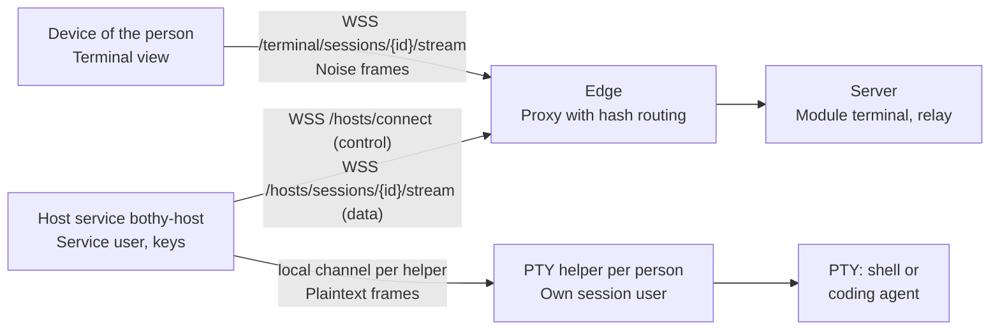
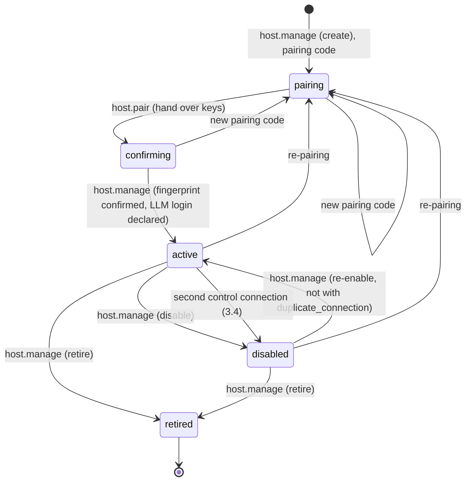

# 24 Terminal

Status: draft M0, addendum of 2026-10-10. Normative for the module `terminal`, the host service
`bothy-host`, the terminal view of the apps and of the web console and for every check that allows
a terminal session.
Terms: [00-glossary.md](00-glossary.md). Tables: [03-data-model.md](03-data-model.md)
(`hosts`, `host_session_users`, `terminal_sessions`, `grants`). Events: [04-sync-protocol.md](04-sync-protocol.md).
Actions: [05-actions.md](05-actions.md), section 4.14. Permissions and guard rules:
[07-permissions.md](07-permissions.md) (SR10, SR11, SR12). Step-up: [08-identity.md](08-identity.md),
section 6.3. Invariant I6: [10-backend-policy.md](10-backend-policy.md), section 3.
Threats: [../security/threat-model.md](../security/threat-model.md), section 6.7.
Decisions: [ADR 0068](../adr/0068-terminal-through-a-host-service-with-noise-stream-and-invariant-i6.md),
[ADR 0070](../adr/0070-terminal-in-the-web-console.md).

All limits, deadlines and intervals are named configuration values. Their default values are
only in section 17.

## 1. Purpose and limits

The terminal is a mandatory part of the product. An authorized person opens a real terminal
session on a connected host in the desktop app, in the mobile app or in the web console: a login
shell or an interactive session of a coding agent (for example Claude Code).

Security is built in and cannot be switched off:

1. Only people with the capability `terminal` on the host open a terminal, and only with
   their own session user there (section 2.2). Owners have the permission implicitly, unless I6
   blocks it (section 7).
2. Every opening requires a fresh step-up that applies to exactly this opening (section 8).
3. The content runs end-to-end encrypted between device and host; the server mediates and
   decides, but reads nothing (section 5).
4. Every session is in the audit log, with idle timeout and maximum duration (sections 10 and 12).
5. On the host, the host service and the sessions run as separate users without
   administrator permissions. Every person has their own session user on every host, which no
   other person ever gets (ruling T12), and no location with code, settings or logins
   is writable for one session user and readable for another (ruling T13). The
   sessions cannot reach the keys of the host and cannot replace the PTY helper
   (section 2.2).

Not in this version: file transfer and clipboard over the channel, recording of
content, shared sessions of several people, terminal for agents or apps, taking over a
thread of the runner into the terminal (section 11.3).

Anti-goals: a way around the permission model; terminal content in the server, in telemetry, in the
audit, in search, in push or in the context of an agent; a way to use the personal
subscription of another person via the terminal.

## 2. Building blocks

### 2.1 Overview

| Building block | Place | Task |
|---|---|---|
| Module `terminal` | Server, role `api` | Hosts, pairing, sessions, terminal session tokens, relay of the streams |
| Host service `bothy-host` | connected host (macOS, Linux, Windows; also a dev VM from [21-dev-isolation.md](21-dev-isolation.md)), service user | Keys, control connection to the server, Noise peer, self-check |
| PTY helper `bothy-host pty-helper` | the same host, one helper per session user, running as that user; started by the service manager of the operating system from a binary that no session user can change | PTY per session of its person, profiles, checks in the account of the sessions (HD6, HD8, HD9, HD11); knows no keys |
| Terminal view | Desktop app, mobile app, web console | Rendering, input, Noise peer, key pinning |
| Package `packages/bothy_noise` | Dart | Noise handshake `NK`, checked against public test vectors (5.2) |

### 2.2 Host service `bothy-host`

- Its own small Go binary in the folder `services/host`, not the server (Ruling L1 applies to the
  server). Its own version and its own release channel ([18-release.md](18-release.md)).
- Operating system users, all without administrator privileges, each as a service of the
  operating system (launchd, systemd or Windows service; [16-operations.md](16-operations.md),
  section 4.4):
    - the **service user** `bothy-host`: owns the state directory with the keys (4.2), holds
      control and data connections and speaks Noise;
    - one **session user** per person from `host_service.session_users`: the PTY helper of this
      person runs under it, and with it each of their shells and each of their coding agents. No
      session user has read permission on the state directory.
- A separate local channel (Unix socket or named pipe) connects the service user and each PTY
  helper; its access permissions admit only these two users. Over the channel run only
  the decrypted frames from 5.4, control commands (start session, end session, size) and the
  results of the checks that the helper runs (plus the identities of its working directories for
  HD7, item 6), never the keys of the host. Reason: A shell runs with all permissions of its user. If it ran as the
  service user, any person with a terminal could copy the keys, log in from elsewhere
  as the host and read along in every later session, including those of owners.
- **One session user per person and host, never shared** (Ruling T12):
    1. The server holds, per host, the assignment of person to session user (`host_session_users`,
       [03-data-model.md](03-data-model.md)). The owner creates it at the confirmation (3.2) or
       later with `host.manage` (step-up, reason, audit); whoever may read the host
       (`host.read`) sees the valid assignments. Without a valid assignment a person gets no
       terminal on the host, not even an owner (SR12 in [07-permissions.md](07-permissions.md);
       `403 terminal_denied` with `reason: no_session_user`).
    2. A person has at most one valid assignment per host. A session user belongs to at most
       one person, also over time: When an assignment ends, its name stays taken for this
       host, and no other person gets it (`409 conflict` with
       `reason: session_user_taken`). After the end of their assignment, a person gets a new
       session user, never a used one.
    3. The terminal session token names the session user (`osu`, 5.3). The host service starts the PTY
       only in the helper of this user and only if the user is listed in `host_service.session_users`. It
       records in the state directory to which person (`sub`) it first gave each session user,
       and rejects a token with a different person for the same session user
       (`session_user_mismatch`). This way the host keeps the rule even if the assignment in the
       server is wrong. If this file is lost (new state directory), it learns the bindings
       anew; the assignment in the server stays valid. `bothy-host session-user remove` takes a
       session user out of `host_service.session_users` and `host_service.claude_workdirs`,
       removes its PTY helper, closes its home for all other users (item 4) and
       restarts the host service ([16-operations.md](16-operations.md), section 4.4); its binding
       stays in the state directory, and `bothy-host session-user add` rejects a name that is
       already bound to a person there.

        Limit, honestly: "Never shared, also over time" applies per host entry (`hosts.id`) and per
        state directory. If a host is retired and paired as a new entry, its
        earlier names are free again in the server; if the state directory is lost, the host service
        no longer knows the earlier bindings. A session user with the credentials of an earlier
        person can then be assigned to another person without the server or the host service
        noticing [derived]. In these cases only the instance operator protects against this: they never reassign a
        previously used name, but create a new one with `bothy-host session-user add`, take
        the old one out with `bothy-host session-user remove` and then delete it together with its
        long-running processes ([16-operations.md](16-operations.md), section 4.4 item 1;
        threat model T-TM-08 and T-TM-11).

    4. The home folders of the session users are closed against each other. The home of a
       session user is a location of this session user (item 6) and gives no other user
       read or execute permission; HD11 checks this, and a violation blocks only this
       session user, with its name. The home folders of all other users of the host,
       including that of the service user and that of a former session user, cannot be listed by any
       session user (HD9). That is why `bothy-host session-user remove` closes the home
       of the user it takes out (item 3). A long-running process of this user (6.5) can reopen
       it afterwards; that is why the instance operator deletes the user after `remove` ("Reason
       for HD9" below the table of checks).
    5. The host service reports the names from `host_service.session_users` when redeeming the
       pairing code (`host.pair`) and with every `report` (`hosts.reported_session_users`, only names
       and the display names of the working directories according to HD7, never paths). It reads its configuration,
       including `host_service.session_users` and `host_service.claude_workdirs`, only at start;
       a change takes effect only after a restart. `bothy-host session-user add` and `remove`
       restart it themselves for this; every other change of the configuration (for example working directories,
       profiles, `host_service.claude_bin`) takes effect after `bothy-host restart`
       ([16-operations.md](16-operations.md), section 4.4). Every restart ends the running
       sessions of the host (6.2). After every login of the control connection it sends `report`
       before it accepts a `session.open`, and the server sends `session.open` only after this
       `report`. The server assigns only a reported name (otherwise `400 validation_failed` with
       `errors[].code = session_user_not_on_host`), and an assignment takes effect for SR12 only as long as the
       host reports its name. Reason: A typo or a user not yet created should be noticed
       at the assignment, not only at opening as the tampering warning `4104` (R-TM-16).
    6. **No shared locations** (Ruling T13): On the host there is no location that one
       session user can write and another can read or execute, if it carries code,
       settings or logins. For the locations that the host service knows, this means:
        - Locations of a session user are its home, the `CLAUDE_CONFIG_DIR` of the profile `claude`
          (with `organization` a fixed folder in its home, with `personal` the value from its
          login shell, which must lie in its home; 7.4) and its working directories.
          `host_service.claude_workdirs` names the working directories per session user; each
          working directory belongs to exactly one session user. If a folder is listed there for two
          session users, HD7 removes it from both lists. The profile `claude` offers a
          person only the working directories of their own session user, namely exactly its list
          after HD7 that the host service reports (item 5); the index of the
          terminal session token (5.3) counts in this list. These locations belong to their session user or to a
          trusted owner (below) and are accessible only to that session user (mode `0700` or an
          ACL without an entry for other session users).
        - Every folder on the path to a location of a session user is writable by no other
          session user and belongs to no other. Others may read and traverse
          these folders (for example `/home`), but not the location itself.
        - In each of these folders, the entries that the coding agent or git load from the folders
          above a working directory belong to no other session user and are writable by no other.
          These **chain files** are `CLAUDE.md`, `CLAUDE.local.md`, `AGENTS.md`,
          `.mcp.json` and the folders `.claude` and `.git` with everything in them.
        - No entry in a location of a session user belongs to another session user.
        - Locations for all are the programs: the binary of the helper, `host_service.claude_bin`
          (with `organization` also the program of the profile `claude`, 11.1) and the program of every
          profile `command`. They and every folder on the path to them belong to a
          trusted owner and are writable by no session user (the same rule
          as HD10). Reason: Such a program runs in every session user. Another account
          as owner is not enough, even if it is not a session user, for example the account of a
          person with administrator privileges who owns a folder of a package manager: Whoever gets into this
          account changes a program of all people, and HD11 cannot check who that is
          [derived].
        - **Trusted owner** is, under Linux and macOS, `root`, under Windows `SYSTEM`,
          `Administrators` or `NT SERVICE\TrustedInstaller`. Reason for Windows: Only
          `TrustedInstaller` may change the protected files and folders of the system ("Permission
          for full access to modify WRP-protected resources is restricted to TrustedInstaller",
          https://learn.microsoft.com/en-us/windows/win32/wfp/protected-file-list, retrieved
          2026-10-11 [verified]), and Microsoft names files with "TrustedInstaller as its owner"
          and the account `NT SERVICE\TrustedInstaller`
          (https://learn.microsoft.com/en-us/archive/blogs/irenak/sysk-277-how-to-bring-back-the-trustedinstaller,
          retrieved 2026-10-11 [verified]). That `C:\Program Files` and `C:\Windows\System32`, with
          default permissions, belong to this account and `C:\` to it or to `SYSTEM` is [assumed: reports
          from users]; M2-42 measures it. All three accounts have full permissions on the host anyway;
          trusting them adds no party [derived].
        - **Writable** means, for a file: changing content, attributes, permissions or ownership, or
          deleting it; for a folder additionally: creating, deleting or renaming an entry.
          Under Linux and macOS the permission `w` from the mode counts, under Linux also from the ACL, for
          the session user, one of its groups or all others. Under macOS these
          permissions from the ACL of an entry for the session user, one of its groups or
          `everyone` count as well: for files `write` ("Open for writing") and `append` ("Open for writing, but
          in a fashion that only allows writes into areas of the file not previously written"), for
          folders `add_file`, `add_subdirectory` and `delete_child`, for both `delete`,
          `writeattr`, `writeextattr`, `writesecurity` and `chown` (chmod(1) of macOS,
          reproduced at https://ss64.com/mac/chmod.html, retrieved 2026-10-11 [verified]).
          Under Windows every permission counts that the ACL gives the session user or a
          group in its token (including `Everyone`, `Authenticated Users` and `Users`): for
          folders `FILE_ADD_FILE` ("For a directory, the right to create a file in the
          directory"), `FILE_ADD_SUBDIRECTORY` ("the right to create a subdirectory") and
          `FILE_DELETE_CHILD`, for files `FILE_WRITE_DATA` and `FILE_APPEND_DATA`, for both
          `FILE_WRITE_ATTRIBUTES`, `FILE_WRITE_EA`, `DELETE`, `WRITE_DAC` and `WRITE_OWNER`
          (https://learn.microsoft.com/en-us/windows/win32/fileio/file-access-rights-constants,
          retrieved 2026-10-11 [verified]); `GENERIC_WRITE` and `GENERIC_ALL` count with the permissions
          they include. An entry that is only passed on by inheritance (`IO`) does not count for the folder itself.
          Reason: Whoever can create entries in a folder creates a chain file there or
          a folder with the name of a location; whoever can append to a file extends, for example,
          a `CLAUDE.md` with their own instructions; whoever can change permissions or ownership gives themselves
          any other permission [derived]. Attributes and extended attributes count as well: None of the
          sources says which of them are without effect for loading and starting, and one permission too many
          in the list only blocks, one too few opens a location [derived].
        - **Path resolution:** HD7, HD10 and HD11 fully resolve every path before the check,
          under Linux and macOS like `realpath` ("an absolute pathname that resolves to the same
          directory entry, whose resolution does not involve '.', '..', or symbolic links",
          https://pubs.opengroup.org/onlinepubs/9799919799/functions/realpath.html, retrieved
          2026-10-11 [verified]), under Windows with `GetFinalPathNameByHandle` ("A final path is the
          path that is returned when a path is fully resolved",
          https://learn.microsoft.com/en-us/windows/win32/api/fileapi/nf-fileapi-getfinalpathnamebyhandlew,
          retrieved 2026-10-11 [verified]). HD10 and HD11 then check every folder of the resolved
          chain, every component of the path as it is written in the configuration, and every link
          (symbolic link, under Windows also directory junction) that the resolution follows,
          together with the folder in which it lies. A link counts both as an entry of its folder
          and as its target: A link owned by `root` on the path to a location of B that points into a
          folder of A does not pass.
          The same applies to a chain file that is a link, and to links in `.claude` and
          `.git`. Only whoever may open the path can resolve it: The locations of a session user
          (home, `CLAUDE_CONFIG_DIR`, working directories) are resolved by its PTY helper as this
          session user, because they are accessible only to that user (above), with mode `0700` not even
          to the service user [derived]; the locations for all are resolved by the service user.
          If a path cannot be resolved because it is missing, a link points nowhere or a
          folder on the path is closed to the resolving user (for example the home of another
          session user), it counts as not present: A working directory drops out of the
          list of its session user, a profile `command` with this program is dropped (HD7,
          warning); `host_service.claude_bin` counts as empty for HD6 and the profile `claude`, and a
          `CLAUDE_CONFIG_DIR` with `personal` counts like one outside the home (7.4); if
          the home itself cannot be resolved, HD11 does not pass for this session user. Reason: What is not resolved
          is not checked. A working directory or program that is never offered connects no
          accounts; blocking the whole session user because of a missing folder would be more than
          necessary. Treating a link that points nowhere as present would be dangerous: Someone else can
          create its target later [derived].
          HD7 compares folders by their identity in the file system, not by their
          spelling: under Linux and macOS device and inode ("A file identity is uniquely
          determined by the combination of st_dev and st_ino",
          https://pubs.opengroup.org/onlinepubs/9799919799/basedefs/sys_stat.h.html, retrieved
          2026-10-11 [verified]), under Windows the serial number of the volume and the 128-bit file ID from
          `FILE_ID_INFO` ("The file identifier and the volume serial number uniquely identify a
          file on a single computer",
          https://learn.microsoft.com/en-us/windows/win32/api/winbase/ns-winbase-file_id_info,
          retrieved 2026-10-11 [verified]), queried with `GetFileInformationByHandleEx` and
          `FileIdInfo` (available from Windows 8: "This value is not supported before Windows 8",
          https://learn.microsoft.com/en-us/windows/win32/api/minwinbase/ne-minwinbase-file_info_by_handle_class,
          retrieved 2026-10-11 [verified]). The 64-bit file ID from `BY_HANDLE_FILE_INFORMATION`
          is not enough: "The 64-bit identifier in this structure is not guaranteed to be unique on
          ReFS"
          (https://learn.microsoft.com/en-us/windows/win32/api/fileapi/ns-fileapi-by_handle_file_information,
          retrieved 2026-10-11 [verified]). Every PTY helper reports to the host service over the local
          channel, per working directory of its list, only this identity, never any content; the host service
          compares the values of all helpers and builds the lists according to HD7 from them at start. This way
          HD7 detects the same folder also behind a link or in a different upper and
          lower case. The PTY helper starts the profile `claude` in the
          resolved working directory, and HD6 and the profile call `host_service.claude_bin` via
          the resolved path, that is, exactly what HD10 and HD11 checked. Reason: A
          check of only the given path without resolution would let through a link that belongs to a
          trusted owner and points into a folder of another person
          [derived].
        - **Drive root under Windows:** The root of a drive lies on the path to every location
          on it. With default permissions every logged-in user may create folders there: The
          DISA checklist for Windows 11 names for `C:\` the entries
          `NT AUTHORITY\Authenticated Users:(AD)` ("Create folders / append data - This folder
          only") and `NT AUTHORITY\Authenticated Users:(OI)(CI)(IO)(M)` ("Modify - Subfolders and
          files only") (https://www.stigaview.com/products/win11/v2r3/WN11-00-000095/, retrieved
          2026-10-11 [verified]). A person could thus create `C:\.git` or `C:\.claude`, that is,
          chain files above every location; Git for Windows describes the same pattern: "Those untrusted
          parties could create the folder `C:\.git`"
          (https://github.com/git-for-windows/git/security/advisories/GHSA-vw2c-22j4-2fh2,
          retrieved 2026-10-11 [verified]). That is why `bothy-host install`, after confirmation by the
          instance operator, removes the entry `(AD)` at the root of the system drive and of every drive on
          which a location lies ([16-operations.md](16-operations.md), section 4.4). The entry applies only
          to the root itself. For this the command rewrites the DACL of exactly this folder, with
          all other entries in the same order and with the same control bits, and it does so with
          `SetFileSecurityW` ("Note that security applied to a directory is not inherited by its
          children",
          https://learn.microsoft.com/en-us/windows/win32/api/securitybaseapi/nf-securitybaseapi-setfilesecurityw,
          retrieved 2026-10-11 [verified]), never with `SetNamedSecurityInfo` or `SetSecurityInfo`.
          These two reapply inheritance to everything below on every setting of a DACL
          ("If you are setting the discretionary access control list (DACL) [...] the system
          automatically propagates any inheritable access control entries (ACEs) to existing child
          objects",
          https://learn.microsoft.com/en-us/windows/win32/api/aclapi/nf-aclapi-setnamedsecurityinfow;
          "the system imposes the current inheritance model on the ACLs of all objects in the
          hierarchy below the target object",
          https://learn.microsoft.com/en-us/windows/win32/secauthz/automatic-propagation-of-inheritable-aces;
          both retrieved 2026-10-11 [verified]), at the root therefore to the whole drive;
          `SetNamedSecurityInfo` in doing so orders inherited entries behind the explicit ones in the
          folders below (source for `SetNamedSecurityInfo` above [verified]). Microsoft calls
          `SetFileSecurityW` obsolete ("This function is obsolete", source for `SetFileSecurityW`
          above [verified]); it is chosen anyway because its documentation is the only one of those named that
          says explicitly that nothing goes to the children. Because the
          inheritable entries of the root stay the same, no permission changes below
          [derived]. The command leaves the entry `(OI)(CI)(IO)(M)` in place: It gives no permission on the
          root itself, and by the rules of inheritance its removal would take from every
          existing folder below its inherited copy ("If you remove an inheritable ACE from a
          parent object, automatic inheritance removes any copies of the ACE that were inherited by
          child objects", source on automatic inheritance above [verified]); existing programs
          would thus lose their write permissions.
          Folders that inherit this entry are writable for every session user; HD11 finds
          them when they lie on the path to a location. If the root of a drive with a
          checked location is writable for a session user, HD11 reports its own code
          `drive_root_writable` for it, so that the instance operator finds the step from 16 section 4.4; the
          local output of `bothy-host doctor` names the drive, only the code goes to the server.
          For a drive on which a location is added only later,
          `bothy-host install --drive-root <drive>` performs only this step. The
          consequence is the same as for every violation at these locations; at the root of the
          system drive this always means "Start refused", because the binary of the helper lies
          there, that is, a location for all.

        HD11 checks this with one rule for every configured path instead of regulating every location
        separately; HD10 additionally checks peer and interpreter for the helper and `host_service.claude_bin`.
        The four terms above (trusted owner, writable, path resolution,
        drive root) apply equally to this item and to HD7, HD10 and HD11. People exchange shared code via git, never via a shared
        folder (threat model T-TM-13).

    Reason: The credentials of a session user (files in the home, keychain, a token in
    its startup files) thus belong to exactly one person. A subscription login that someone creates in their
    session reaches no session of another person as long as no location connects the accounts again
    (item 6). This is the load-bearing enforcement
    of "no other person's subscription login" (7.4); HD6 is only an additional check. A shared
    session user would make every login usable for all terminal users of the host, and a
    check in the account of this user could be forged or bypassed with its own permissions.

    Reason for T13: Separate accounts help only if no location connects them again. A shared
    working directory was such a location. Claude Code reads the project settings
    `.claude/settings.json` and `.claude/settings.local.json` of the working directory; settings files
    carry among other things "`permissions`, `hooks`, and credential helpers such as `apiKeyHelper`",
    "The reload covers user, project, local, and managed settings", and "most `env` values apply
    only after each teammate trusts the folder" (https://code.claude.com/docs/en/settings,
    retrieved 2026-10-11 [verified]). In addition: "CLAUDE.md and CLAUDE.local.md files in the
    directory hierarchy above the working directory are loaded at launch"
    (https://code.claude.com/docs/en/memory, retrieved 2026-10-11 [verified]). If person A writes there,
    their hooks and their `apiKeyHelper` run as the session user of B, their instructions steer
    B's agents, and after the trust prompt they also set environment variables such as
    `CLAUDE_CODE_OAUTH_TOKEN` in B's session [derived]. This is code execution across the boundary
    between people and a second path for logins of other people. A shared
    `CLAUDE_CONFIG_DIR` would be the same location for logins: A `/login` in it would reach all
    people. Instead of closing each such find separately, one rule with one check for all
    paths applies.

    Reason for the chain files: What the coding agent loads from the folders above
    the working directory acts like a location of B, even if the folder itself belongs to nobody
    else. Besides `CLAUDE.md` and `CLAUDE.local.md`, Claude Code loads, without such files, "every
    `AGENTS.md` and `.claude/AGENTS.md` in your working directory and the directories above it"
    (https://code.claude.com/docs/en/memory, retrieved 2026-10-11 [verified]). If it starts in a
    subfolder of a git repository, it reads `.claude/settings.local.json` "at the repository
    root" (https://code.claude.com/docs/en/settings, retrieved 2026-10-11 [verified]); `.mcp.json`
    lies "in project root" (https://code.claude.com/docs/en/mcp, retrieved 2026-10-11 [verified]),
    and that root can lie above the working directory [derived]. git also searches for its repository
    in the folders above; the documentation names "directories that Git should not chdir up into while
    looking for a repository directory" (https://git-scm.com/docs/git, retrieved 2026-10-11
    [verified]). Hooks of such a repository would then run in the session of B [derived]. A
    rule for all entries of these folders would not work: `/home` holds the home folders of the other
    session users, and they belong to them.

    Limit, honestly: HD11 checks the locations that the configuration names and the home of every
    session user, not every folder of the host. The `CLAUDE_CONFIG_DIR` with `personal`, which the
    login shell of the holder sets, is covered by the home only because the PTY helper starts the
    profile `claude` only with a value in the home (7.4). Generally writable folders such as `/tmp` are,
    according to T13, no location for code, settings or logins; a program that loads from there anyway
    is not covered by HD11 [derived]. If a person in their shell changes by themselves into a
    folder outside these locations that another session user can write, and starts the
    coding agent there, HD11 does not see that; according to T13 the instance operator does not set up such folders
    ([16-operations.md](16-operations.md), section 4.4). Under Windows this also covers every folder that
    an administrator creates directly in the root of a drive, as long as it carries the inherited entry
    `Authenticated Users:(OI)(CI)(IO)(M)` (item 6). The chain files are the names that the
    cited sources name on 2026-10-11; if a later version of the coding agent loads further
    files from the folder chain, HD11 checks them only once the list is extended. If a
    session user opens its own locations for others, HD11 sees that at the next check, and not
    at all if it closes them again before. An entry that another session user creates there in
    this time is found by HD11 only at the next start of the service or call of `bothy-host doctor`,
    because only this check goes through every entry of a location. What the other user writes into an
    already existing file that is writable for it, HD11 does not detect at all from ownership or
    mode. After a hit the instance operator checks the location ([16-operations.md](16-operations.md), section
    4.4).

    Consequence, honestly: If a chain file that belongs to a session user A or that A can
    write lies in a folder on the path to the locations of several session users (for example the
    root of a drive or a shared parent folder of the working directories), HD11 does not pass for
    any other of these session users. A person can thus shut down the host for the others.
    A can create such an entry only as long as the
    folder is writable for A; HD11 itself reports that as a violation at each of these locations, and under
    Windows `bothy-host install` closes the root (item 6). What remains is an entry from the time
    before, for example a `C:\.git` that A created before the installation. The standstill ends when
    the instance operator removes the entry ([16-operations.md](16-operations.md), section 4.4;
    threat model T-TM-14).

- Every PTY helper runs as its session user, but that user does not control it. Otherwise
  a shell could end the helper, put its own in its place, forge the results of
  HD6, HD8, HD9 and HD11 and read the plaintext of every later session. Therefore:
    1. `bothy-host install` (once with administrator privileges, [16-operations.md](16-operations.md),
       section 4.4) creates, per session user, a helper as a system service that runs under
       this session user: systemd system service with `User=` and socket activation, launchd LaunchDaemon with
       `UserName` and `Sockets`, Windows service with the account of the session user. Binary,
       service definition and the folder with the endpoint of the channel belong to a
       trusted owner (2.2 item 6) and are writable by no session user;
       the session user cannot stop or reconfigure the service (HD10).
    2. Under Linux and macOS the service manager creates the endpoint of the channel and passes it to
       the helper; a process of the session user cannot recreate it. Under Windows
       the helper creates the named pipe.
    3. `bothy-host` checks the peer twice when connecting: the user via the process credentials
       that the operating system supplies, and the process ID equal to the process ID that the service
       manager reports for the helper service of this session user. If either does not match, it sends
       no frame and reports HD10 as not passed, with the name of this session user (rule for names
       below the table of checks).
    4. The helper protects its memory against other processes of the same user: under Linux
       `PR_SET_DUMPABLE = 0`, under macOS Hardened Runtime without `get-task-allow`, under Windows a
       process DACL without access permissions for the session user. Verified for Linux: A process
       of the same user may attach only to a process that is "dumpable"
       (https://www.kernel.org/doc/html/latest/admin-guide/LSM/Yama.html, retrieved 2026-10-10
       [verified]); for macOS and Windows [assumed], the build ticket proves it with TM-T26.

    Limit, honestly: Processes of a session user reach the shells of the same
    user ID, for example via the PTY device that belongs to this session user
    [derived]. All sessions of one person on a host therefore share one
    trust zone; sessions of different people are separated by the user ID (T12). This
    separation is not a complete boundary between people (shared kernel, local gaps of the
    operating system; [ADR 0046](../adr/0046-multi-user-dev-environment-only-with-isolation.md)). That is why
    SR10 still applies, and the app warns an owner who opens a terminal on the host of another person
    (8.4; threat model T-TM-12).

- `bothy-host doctor` checks before every start and on command (full run); HD6 and HD11 run
  additionally before every start of a PTY and every `host_service.credential_check_interval` (7.4),
  HD11 here without the check of the entries:

| Check | Passes if | Consequence of a violation |
|---|---|---|
| HD1 Users | `host_service.session_users` names at least one user; no user of the host service is `root`, `Administrator` or `SYSTEM`; all session users are different, and none is the service user | Start refused |
| HD2 Groups | no user of the host service (service user and every session user) is in a forbidden group: fixed `admin`, `sudo`, `wheel`, `Administrators`, `docker`, `lxd`, `libvirt`, `disk`, plus `host_service.extra_forbidden_groups`; under Linux, in addition, the socket of the Docker daemon is writable for none of them | Start refused |
| HD3 sudo | no passwordless `sudo` for any of them (`sudo -n true` fails) | Start refused |
| HD4 State directory | `host_service.state_dir` belongs to the service user, mode `0700`; key file `0600` (Windows: DPAPI, section 4.2) | Start refused |
| HD5 Server host | detects whether the same host runs the server (section 2.3) | Warning; sessions only for owners (SR10) |
| HD6 LLM login | section 7.4, in the account of every session user; additional check, not the load-bearing boundary (T12) | with `none` or `organization` and a detected subscription login: start refused or sessions ended, respectively (7.4); the message names every affected session user with its own entry |
| HD7 Profiles | every profile refers to an existing program, profiles `command` with an absolute path, the profile `claude` with `organization` to `host_service.claude_bin` (empty or counting as empty according to 7.4: the profile is dropped, 11.1); every key in `host_service.claude_workdirs` is a name from `host_service.session_users`, the PTY helper of its session user can resolve every working directory, and each is listed for exactly one session user, compared after resolution and by the identity in the file system that each helper reports for its list (2.2 item 6) | Profile is dropped, warning; with `host_service.claude_workdirs` only the wrong part is dropped: a key that is not a name from `host_service.session_users`, with its list; a folder that the helper of its session user cannot resolve, from that user's list; a folder with two session users, from both lists. The lists after this step are reported and used for `wdi` (2.2 items 5 and 6) |
| HD8 Separation | the service user itself checks ownership, mode and ACL of `host_service.state_dir` and the key file (no entry for a session user or one of its groups); in addition every PTY helper tries at start to read both, and fails | Start refused |
| HD9 Other users' home folders | every PTY helper tries at start to list the content of every home folder of another local user that the operating system keeps and that is not a session user (including that of the service user and that of a former session user), and fails for each; the home of a session user is checked by HD11 as its location (2.2 item 4) | Start refused; the local output of `bothy-host doctor` names every user whose home can be listed; of these, the message to the server names only former session users, each with its own entry, otherwise only the code (below the table) |
| HD10 Helper integrity | the service user checks: the binary of the helper, every service definition, every folder of a channel endpoint and, if set, `host_service.claude_bin` (the program for HD6 and, with `organization`, of the profile `claude`, 7.4; under Windows an `.exe`) with every folder on the path to it and, if the file begins with `#!`, the interpreter that the fixed search list from 7.4 finds, and every folder of this search list, belong after resolution to a trusted owner and are writable by no session user (both per platform according to 2.2 item 6); the peer of every channel is the process that the service manager reports for the helper of this session user; under Linux `kernel.yama.ptrace_scope` is at least `1` | Start refused; on a violation during operation as with HD6 (7.4): no new sessions, running ones end with `host_policy_violation` and `close_detail = helper_untrusted`; with a wrong peer the message names the session user of this channel (below the table) |
| HD11 Shared locations | one rule for every path from the configuration of the host service (working directories, `host_service.claude_bin` and programs of the profiles, plus the binary of the helper; the state directory is checked by HD4 and HD8) and every location of a session user (2.2 item 6; the `CLAUDE_CONFIG_DIR` with `personal` is covered by the home, 7.4); every path after resolution, "writable" and "trusted owner" per platform according to 2.2 item 6; a writable drive root under Windows with the code `drive_root_writable`. Location of a session user: ownership, mode, ACL and groups of the location, of every folder on the path to it and of the chain files in these folders give no other session user write permission and belong to no other; the location itself also gives other session users no read or execute permission; its PTY helper checks this. Location for all: the location and every folder on the path to it belong to a trusted owner and are writable by no session user (like HD10); the service user checks this. At the start of the service and on command, in addition, the check of the entries: no entry in a location of a session user belongs to another session user; it runs per session user in its PTY helper, limited by `host_service.entry_scan_timeout` (below the table) | Violation at a location of a session user: this user gets no sessions, running ones end with `host_policy_violation` and `close_detail = shared_location`, until HD11 passes for it; the message names it. Violation at a location for all: start refused; during operation no new sessions, and all running ones end with `host_policy_violation` and `close_detail = shared_location`, until HD11 passes; the message names no session user. A finding of the check of the entries stands until a later full run no longer finds it (below the table) |

  Check of the entries (HD11): It goes through every entry of every location of a session user,
  that is, through its whole home, and therefore runs per session user in its own PTY helper.
  At the start of the service each session user waits only for its own run: Until this run
  is finished, HD11 does not pass for it (code `entry_scan_running`), and it gets no
  sessions: An opening fails as with a finding, with `open_failed` and
  `close_detail = shared_location`, and the console shows the code from `reported_doctor`. The
  others get their sessions as soon as their own run is finished. On command the check runs
  alongside operation, and until it ends the previous result applies. If a run is not finished after
  `host_service.entry_scan_timeout`, the helper aborts it; HD11 then does not pass for
  this session user (code `entry_scan_timeout`, with its name), with the same consequence
  as with a finding. A finding, including an abort, is cleared only by a later full run that
  finishes and finds nothing anymore, that is, a start of the service or `bothy-host doctor`. The
  runs before every PTY and every `host_service.credential_check_interval` do not check the entries
  and never clear such a finding. Reason: The duration depends on the size of the home, and a
  large home should hold up only its own session user, not the host. An
  aborted run has not seen every entry, and only this check sees whether a
  found entry is still there.

  Reason for the deny list in HD2: Some groups give root-level permissions without being called
  administrator. Docker writes: "The `docker` group grants root-level privileges to the user."
  (https://docs.docker.com/engine/install/linux-postinstall/, retrieved 2026-10-10 [verified]). For
  `lxd` the LXD documentation says that local access to the daemon is full access and should be given only to users
  one would trust with root
  (https://canonical.com/lxd/docs/default/explanation/security/index.html.md, retrieved 2026-10-10
  [verified]). `libvirt` (control of VMs with access to devices of the host) and `disk` (raw
  access to storage media) are on the list for the same reason [derived]. The instance operator cannot
  shorten the fixed list; `host_service.extra_forbidden_groups` extends it because distributions
  have further such groups.

  Reason for HD9: The shell of a person must not read files of other users of the host.
  Under macOS, users are in the group `staff` by default, and the CIS checklist states:
  "By default, macOS allows all valid users into the top level of every other user's home folder"
  (https://www.tenable.com/audits/items/CIS_Apple_macOS_12.0_Monterey_v4.0.0_L1.audit:da3f5b54f52fa5be1eb1f2bbc291c7c0,
  retrieved 2026-10-10 [verified]). A session user in `staff` therefore does not pass HD9 on a
  macOS host with default permissions [derived]; `bothy-host install` creates it there without
  `staff`, and the build ticket proves the way to do this. HD9 checks the result instead of the
  group, because groups and permissions of the home folders differ per platform and host; the same read test
  applies under Linux and Windows. HD9 checks only home folders of users that are not
  session users. The home of a session user is checked by HD11 as its location (2.2 item 4):
  If a person opens their own home for others, that is an error in their account, and HD11
  blocks only their session user and names it. If HD9 also checked this home, it would trigger in the
  helper of every other session user and refuse the start of the whole host, without
  naming the person; a person could thus shut down the host with a change of the permissions of their
  home. No person with a terminal can change the home folders of the remaining users,
  with one exception: the home of a former session user. `bothy-host session-user remove`
  closes it (2.2 item 3), but ends no processes of this user. A long-running process that the
  person set up as the session user (6.5) keeps running and can reopen the home, because it still
  belongs to their user. Then HD9 refuses the start of the whole host at the next start or at the
  next `bothy-host doctor`. That is why the message to the server names this former session user
  (below), the console also the person of its assignment, and the instance operator deletes the
  user right after `remove` together with its long-running processes
  ([16-operations.md](16-operations.md), section 4.4 item 1); after that the operating system no
  longer keeps it, and HD9 no longer checks its home. Honestly open remains the path between
  `remove` and the deletion. The consequence stays "Start refused" for this home too: HD9 does not
  see who opened a home, and an open home shows the files of a person who no longer gets a
  terminal.

  Reason for HD10: Results from the account of the session user count only if the helper is
  genuine. That is why the service user checks the authenticity itself, and HD8 has a part that
  does not depend on the helper. The Linux documentation on Yama describes level `1` as "restricted ptrace": only a
  process with a defined relationship may attach, by default an ancestor (same
  source [verified]). Then a long-running process of the session user cannot attach to shells of later
  sessions.

  `doctor` reports to the server only the result and code per check (`hosts.reported_doctor`), never
  content, paths or values. Rule for names: If a person with a terminal, also a former one, can
  cause a violation, the message names the account in which the instance operator has to search,
  each account with its own entry and its name (`session_user`); check and name together are
  unique. These are: for HD6 the account with the subscription login, for HD11 at a location of a
  session user this session user, for HD10 with a wrong peer the session user of this channel, and
  for HD9 every former session user whose home can be listed. Former means: the host service has
  bound the name to a person in the state directory (2.2 item 3), and it is no longer in
  `host_service.session_users`. The remaining violations that refuse the start or end sessions
  cannot be caused by a person with a terminal; they lie in configuration, groups, `sudo`,
  permissions of the state directory and of the drive root, or in the ownership of the programs,
  and their entries name no account. Names of other users of the host never go to the server; a
  violation for them stands there in an entry without a name, and the output on the host names
  them (below). Reason for the name: HD6, HD9 and HD10 shut down the whole host with such a
  violation (7.4, "Reason for HD9", HD10 in the table), and HD6 can trigger in several accounts at
  once; the instance operator must know every account in which they have to search, and the
  console also names the person of the assignment. A new check follows the same rule. The name is
  no secret, the server knows it from the assignment; it does not need the names of other users,
  and no person with a terminal can change their home. Limit: after the loss of the state
  directory, the host service no longer knows the former bindings (2.2 item 3, limit); a former
  session user from the time before then stands in the message without a name, and only the
  output on the host names them.

  Output on the host: `bothy-host doctor` prints, per check, the result and code, for HD6,
  HD10 and HD11 the names according to the rule for names, for HD9 every user whose home can be
  listed, and for `drive_root_writable` the drive; never content or values. The
  exit code is not 0 as soon as a check fails; warnings alone do not change it.
  If the host service is running, the command (with administrator privileges) performs the full run in the running
  service and prints its result, and the service reports it with `report`; the build ticket proves
  the way to do this. If this run finds a violation whose consequence is "Start refused",
  except for HD6, HD10 and HD11, which have their own consequence during operation, the
  host service exits as with a refused start (below), and its sessions end as with every
  restart (6.2). If it is not running, the command checks by itself.

  Message on a refused start: If `doctor` refuses the start when the service starts, the
  host service starts no PTY and accepts no session. If it is paired, it still reports the result
  first: It logs in over the control connection, sends `report`, closes the
  connection without accepting a `session.open`, and exits. This way the console names, even for
  a hit at start, for example after a restart of the host or after
  `bothy-host session-user remove`, every affected session user; if the host service does not reach
  the server or cannot log in (for example because its keys are not readable),
  the output on the host names them. Reason: Otherwise the console would show the host only as
  disconnected, with the result from the time before. No session exists in this case; that is what
  Ruling T2 requires.

  A refused start is not a crash: The host service then ends with its own exit code,
  after which the service manager does not restart it by itself (the service definition
  from `bothy-host install` sets this; the build ticket proves the method per platform). It is started again
  only with `bothy-host restart`, after the instance operator has fixed the violation
  ([16-operations.md](16-operations.md), section 4.4 item 6). Reason: None of the violations with the
  consequence "Start refused" fixes itself without intervention [derived]; a restart by the
  service manager would only log the host in again and again in a loop.

- Connection only outbound from the host service to the server, via WebSocket with TLS. The host opens
  no port. Reason: works the same behind NAT, in the private network and in the cloud.

### 2.3 Server host

If the host service runs on the host that runs the server, a shell there reaches the
secret provider, the database and the backups. That is why a host counts as the server host if
one of the following applies:

- The owner declares it at the confirmation (mandatory question, `hosts.declared_server_host`).
- The host service reports it (`hosts.reported_is_server_host`): the address from `server.public_url`
  resolves to an address of one of its own network interfaces or to loopback, or the peer
  of the control connection is a local address [derived: a heuristic that does not detect a server
  behind another party's edge].

Then the following applies:

- warning in the console and on the host card;
- `bothy-host` refuses sessions whose token carries `own = false` (section 5.3), and the
  server checks the same beforehand (SR10).

If the host service does not detect the server host, SR10 still protects: non-owners only get
hosts whose assignee they are, and the owner assigns the server host to nobody.

## 3. Hosts and lifecycle

### 3.1 States

Only `active` allows sessions. Every transition out of `active` ends all sessions of the host
(reason in section 10.3) and increments the permission version, because it changes effective
permissions. Disabling by the owner sets `hosts.disabled_reason = 'owner'`; a host with
`duplicate_connection` (3.4) cannot be re-enabled, only re-paired (`409 invalid_state_transition`).

### 3.2 Pairing

1. The owner creates the host (`host.manage`, step-up, audit) with a name, an optional assignee
   (`assigned_user_id`) and a reason. They receive a pairing code exactly once, in the format
   `bothy_hpc_<random>_<checksum>` ([ADR 0061](../adr/0061-token-format-with-a-fixed-prefix-and-checksum.md));
   only the HMAC is stored. Validity `terminal.pairing_code_ttl`, single use.
2. On the host, the instance operator runs `bothy-host pair --server <url> --code <code>`. The
   host service generates locally a static X25519 key pair (Noise) and an Ed25519 key pair
   (authentication with the server), stores both privately in the state directory
   (section 4.2) and sends the public keys with the code, its profiles and the names of its
   session users (`host.pair`, public, `rl.public_auth`). The host becomes `confirming`.
3. `bothy-host pair` shows the fingerprint locally (section 4.3). The owner types the first
   `terminal.fingerprint_confirm_chars` characters into the app, declares the LLM login of the
   host while doing so (section 7) and assigns people their session users (2.2).
   For this, the app offers only the names that the host has reported
   (`hosts.reported_session_users`); the server rejects any other name with
   `400 validation_failed` (`errors[].code = session_user_not_on_host`). Only then does the host
   become `active` (`host.manage`, step-up, audit). Assignments can be added or ended later with
   `host.manage`, with the same check against the last report. Reason for the typing: a host
   confirmed blindly would be an invitation to anyone who intercepted the code (like R-ID-08 for
   devices).

A wrong fingerprint results in `409 fingerprint_mismatch`, and the host stays `confirming`;
after `terminal.fingerprint_max_attempts` failed attempts it falls back to `pairing`, and the
keys expire.

### 3.3 Re-pairing

A new pairing code for an existing host (`host.manage`) sets it to `pairing`,
discards the stored keys immediately, closes its connections and ends its
sessions (`host_rekeyed`). `hosts.key_generation` increases. The audit entry names the old and the
new fingerprint; every active owner receives the event `host.updated` with `key_changed = true`.
Clients see a different key the next time they open a session and show a hard warning (section 5.5).

### 3.4 Second control connection

Exactly one control connection applies per host. If a second one logs in with the same
authentication key while the older one still exists, the server checks the older one with a
WebSocket ping (with `cluster.mode = multi` through `NOTIFY ephemeral` to the node of the older
connection, 03, section 6.6):

- If the older one does not answer within `terminal.host_duplicate_probe_timeout`, it counts as
  dead; the server closes it with `4009` and accepts the new one. That is the usual case after
  a network change.
- If the older one answers, two host services are running with the same keys. That is a sign of
  copied keys. The server closes both connections with `4112`, sets the host to
  `disabled` with `hosts.disabled_reason = 'duplicate_connection'`, ends all sessions
  (`host_disabled`), writes an audit entry (`host.connect`, code `duplicate_connection`) and
  sends `host.updated` to all owners. The only way forward is a re-pairing (3.3).

Reason: silently displacing the older connection would allow an attacker with copied keys
to displace the real host and to receive every later session.

## 4. Keys

### 4.1 Two key pairs per host

| Key | Algorithm | Purpose | Server knows |
|---|---|---|---|
| Noise key | X25519 | static key of the host in the Noise pattern `NK` | public part (`hosts.noise_public_key`) |
| Authentication key | Ed25519 | authentication of the control and data connections | public part (`hosts.auth_public_jwk`, `hosts.auth_jkt`) |

Reason for two keys: the authentication key proves the host to the server, the Noise key
proves it to the device. An error in one path does not give away the other.

### 4.2 Storage on the host

Private keys are stored as a file in the state directory `host_service.state_dir` with mode
`0600` (directory `0700`), owned by the service user. On Windows, the host service encrypts the
file with DPAPI in the context of its service user. It uses a keychain of the operating system
only where the service user has an unlocked session. Reason: the keychain of a
service user without a login session is not unlocked (Ruling T10).

No session user can read the state directory (HD8). Anyone who escalates to the
service user on the host still has the keys; then 3.4 reveals the second host service
as soon as both are connected at the same time. If the real host is off during that time, the
theft stays unnoticed until it returns (threat model T-TM-05).

### 4.3 Fingerprint

`key_fingerprint = base32_crockford(SHA-256("bothy-host-fp/1" || noise_public_key ||
auth_public_key_raw))`, displayed in groups of four characters. Both keys are included, because a
change of either of them is a re-pairing.

Details (docs/DECISIONS.md D-M2-38-11): `noise_public_key` is the raw X25519 key,
`auth_public_key_raw` the raw Ed25519 key (the decoded `x` of the JWK), 32 bytes each.
Crockford Base32 with the alphabet `0123456789ABCDEFGHJKMNPQRSTVWXYZ`: 5-bit groups from the most
significant bit, the last group padded on the right with zero bits, upper case, without padding
characters and without check characters. The 32 bytes of the hash give 52 characters, shown as 13
groups of four joined with `-` (the form of `key_fingerprint` in `openapi.yaml`). Known vector:
a Noise key with the bytes `0x00` to `0x1f` and an authentication key with `0x20` to `0x3f` give
`F0CC-6QS6-RF5D-3BSH-CAZQ-PXMR-J8RA-AHK5-1HF0-9S02-1GW6-BW3J-HK90`. Server, host service and apps
check their computation against `services/host/testdata/noise/fingerprint.json`.

## 5. End-to-end stream

### 5.1 Protection goal

The server is the relay and the authorization point. The end-to-end encryption protects the content
against: relay and proxy, logs, a dump of the database or of the backups, an
api process that reads along.

It does **not** protect against a malicious instance operator of the server. Reason: the pattern
`NK` only proves that the peer holds the key that the server distributed at pairing; a
malicious server can distribute its own key and allow sessions. The product assumes
a trustworthy server anyway ([19-security.md](19-security.md), section 1).
Mitigations: key pinning per device (5.5) and the option `host_service.require_local_confirm`
(section 6.4). Ruling T3.

In the web console, pinning does not work against a malicious server: the server delivers the
code of the console itself and can send a version without the pin check. There, only
`host_service.require_local_confirm` remains against this adversary. The pinning of the console
only catches a key change that an honest server reports (re-pairing), and that is why the console
deletes its pins at logout without any loss of protection ([ADR 0070](../adr/0070-terminal-in-the-web-console.md)).

### 5.2 Protocol

Noise Protocol Framework, revision 34 (https://noiseprotocol.org/noise.html, retrieved
2026-10-10 [verified]), protocol name `Noise_NK_25519_ChaChaPoly_SHA256`.

| Element | Choice | Reason |
|---|---|---|
| Pattern | `NK`: `<- s`, `...`, `-> e, es`, `<- e, ee` [verified, section 7.5 of the specification] | The device knows the static key of the host from the pairing; the host does not know the device, it is convinced by the terminal session token |
| Prologue | `"bothy-terminal/1"` \|\| session ID (16 bytes) \|\| host ID (16 bytes); the IDs in the octet order of RFC 9562, that is the bytes as the text form names them from left to right (docs/DECISIONS.md D-M2-38-7) | A different prologue makes the handshake fail (section 6 of the specification [verified]); binds the handshake to protocol version, session and host |
| Message 1 (device to host) | `-> e, es`, payload: terminal session token (5.3) | The payload is encrypted only to the host and, according to the specification, can be replayed (section 7.7, destination property 2 [verified]); the single-use token closes this gap |
| Message 2 (host to device) | `<- e, ee`, payload: `{"v":1,"host_version":...,"profile":...}` | Afterwards the device knows that it is talking to the holder of the static key |
| First transport message of the device | frame `start` with columns and rows | only then does the PTY start (Ruling T9) |
| Size | every Noise message at most 65535 bytes [verified, section 3 of the specification] | limit of the specification; one WebSocket binary frame carries exactly one Noise message |
| Diffie-Hellman | a result of 32 zero bytes (public key of small order) makes the handshake fail, in Go and Dart (docs/DECISIONS.md D-M2-38-9) | such a shared secret does not depend on the private key; an attacker would have chosen it |
| After a failure | after a failed handshake step or a failed decryption the object refuses every further call; each direction refuses the nonce 2^64 - 1 (section 5.1 of the specification [verified]; docs/DECISIONS.md D-M2-38-8) | a failed authentication is tampering (5.3, `4104`); going on would let a relay send probes |

Libraries:

- Go: `github.com/flynn/noise`, BSD-3-Clause (https://github.com/flynn/noise/blob/master/LICENSE,
  retrieved 2026-10-10 [verified]); supports `HandshakeNK`, `DH25519`, `CipherChaChaPoly`,
  `HashSHA256` and `Config.Prologue` (https://pkg.go.dev/github.com/flynn/noise, retrieved
  2026-10-10 [verified], version v1.1.0 of 2024-02-02). The maintenance state of the library is not
  verified [assumed: little activity]; the conformance test TM-T01 with the test vectors below
  holds it, and the build ticket checks license and state with the license gate before adopting it.
  Pinned in `services/host/go.mod`: `github.com/flynn/noise` v1.1.0 (latest version according to the
  Go module proxy on 2026-10-12 [verified]) with `golang.org/x/crypto` v0.58.0 and
  `golang.org/x/sys` v0.49.0; `tools/ci/tests/test_bothy_noise_package.py` keeps these versions
  equal to `go.mod` and `pubspec.lock`.
- Dart: X25519, ChaCha20-Poly1305, SHA-256 and HMAC-SHA-256 from the package `cryptography` (the
  HKDF of the Noise specification is built by `bothy_noise` itself from HMAC, section 4.3 of the
  specification), Apache-2.0, version 2.9.0 (https://pub.dev/packages/cryptography, retrieved
  2026-10-10 [verified]; latest version on 2026-10-12, pinned in `packages/bothy_noise/pubspec.lock`); the
  handshake itself as a separate small package `packages/bothy_noise`, checked against the same
  test vectors. In the web console, `cryptography` uses the Web Crypto API, otherwise pure Dart
  (same source [verified]).

Test vectors: the specification itself contains none. The Noise wiki refers to vector files
of other projects (https://github.com/noiseprotocol/noise_wiki/wiki/Test-vectors, retrieved
2026-10-10 [verified]). TM-T01 uses two of them, both of which contain an entry for
`Noise_NK_25519_ChaChaPoly_SHA256`:
`vectors/cacophony.txt` from https://github.com/centromere/cacophony and
`tests/vector/noise-c-basic.txt` from https://github.com/rweather/noise-c (both retrieved
2026-10-10 [verified]). The build ticket stores the files with commit hash and license under
`services/host/testdata/noise/` and uses them for Go and Dart. They are stored unchanged, but
compressed with gzip, under `vectors/`, with origin, commit, license and checksum of the content in
`services/host/testdata/noise/README.md` (docs/DECISIONS.md D-M2-38-15); cacophony now lives at
https://github.com/haskell-cryptography/cacophony (GitHub redirects). The recordings for TM-T02
are in `services/host/testdata/noise/recordings/` (`go.json` from Go, `dart.json` from Dart).

### 5.3 Terminal session token

After `terminal.open` or `terminal.attach`, the server issues a terminal session token: a
compact JWS according to the JOSE profile ([ADR 0067](../adr/0067-jose-profile-with-the-standard-library.md)),
header `alg = EdDSA`, `kid`, `typ = terminal-session+jwt`, signed with a server key with
purpose `terminal` (03, `server_signing_keys`). The host service fetches the public keys over
the control connection (`hello` carries the JWKS of the purpose).

| Claim | Content |
|---|---|
| `iss` | `instance.instance_id` |
| `aud` | host ID |
| `sub` | principal ID of the person |
| `sid` | session ID; equal to the session ID in the prologue |
| `jti`, `iat`, `exp` | UUIDv7 of the token, issuance, expiry (`iat + terminal.session_token_ttl`) |
| `dev` | device ID |
| `prf` | name of the profile |
| `cek` | SHA-256 of the ephemeral public key of the device (base64url), which the device reports when opening |
| `own` | `true` if the person is an active owner at the time of issuance |
| `osu` | name of the person's session user on this host (`host_session_users.os_user`, 2.2) |
| `wdi` | only with a profile of kind `claude` and `att = open`: index of the working directory in the list of `osu` (11.1) |
| `att` | `open` or `attach` |

The host service checks in this order and otherwise aborts without a PTY: signature with a
key from the JWKS, `typ`, `aud` equal to its own ID, `sid` equal to the prologue, `exp` not
exceeded (tolerance `auth.clock_leeway`), `jti` never seen (it remembers every `jti` until its
`exp`, Ruling T9), `cek` equal to the hash of the `e` from message 1, `prf` is one of its own
profiles, `osu` is in `host_service.session_users` and is not bound to another person (`sub`)
(2.2), with the profile `claude`, `wdi` is an index into the list of working directories of `osu`
according to HD7 that it reported with the last `report` (2.2 items 5 and 6; never into that of
another session user, Ruling T13), and on
the server host `own = true`. It reports the reason as `close_detail` (10.3); the server
then closes the stream of the device with exactly one code:

| Case | `close_detail` | Close code | Behavior of the device |
|---|---|---|---|
| `exp` exceeded | `token_expired` | `4101` | open or attach again with a new step-up |
| `jti` already seen | `token_replayed` | `4101` | as above |
| signature, `kid`, `typ`, `aud`, `sid` or `cek` wrong | `token_invalid` | `4104` | hard warning, no new attempt |
| handshake failed (prologue, key) | `handshake_failed` | `4104` | as above |
| profile unknown or `wdi` not a working directory of `osu` | `profile_unknown` | `4104` | as above |
| `osu` not in `host_service.session_users` | `session_user_unknown` | `4104` | as above |
| `osu` already bound to another person | `session_user_mismatch` | `4104` | as above |
| server host without `own = true` | `server_host_owner_only` | `4104` | as above |

Reason for the split: an expired or used-up token also occurs without an attack (slow
network, double click); everything else points to tampering. A name that the host does not
report already shows up at the assignment (`400 validation_failed`) or at opening (SR12, `403
terminal_denied` with `reason: no_session_user`) (2.2 item 5). Because the host service, after
every login, first sends `report` and changes its session users and working directories only after
a restart, `session_user_unknown` (a token with a name that the host did not report
in its last `report`) and `profile_unknown` with a `wdi` outside the
reported list of `osu` point only to an error or tampering in the server.
Reason for `cek`: a relay cannot put the token into its own handshake, because the hash
is bound to the ephemeral key of the device.

### 5.4 Frames

Every WebSocket binary message is exactly one Noise message. After the handshake, every
transport message carries one frame:

| Type (1 byte) | Name | Direction | Content |
|---|---|---|---|
| `0x01` | `start` | device to host | columns, rows (2 bytes each); once, as the first transport message |
| `0x02` | `data` | both | bytes of the PTY or of the input |
| `0x03` | `resize` | device to host | columns, rows |
| `0x04` | `close` | device to host | end the session |
| `0x05` | `exit` | host to device | exit code of the process (4 bytes, signed) |
| `0x06` | `replay_begin`, `0x07` `replay_end` | host to device | enclose the scrollback buffer on reattach |

Control data lies in the encrypted payload; the relay sees only length and timing.
An unknown type ends the session (close code `4104`). Text frames are forbidden on these
connections (`4002`).

Encoding (docs/DECISIONS.md D-M2-38-10): all numbers are big-endian. `start` and `resize`
carry exactly 4 bytes, first columns, then rows, each 1 to 65535 (as in `TerminalSessionOpen`).
`data` carries 1 to 65518 bytes; an empty `data` would count as input without input (6.3). `close`,
`replay_begin` and `replay_end` carry no content. `exit` carries exactly 4 bytes, a signed 32-bit
number in two's complement. A frame is at most 65519 bytes long, the largest plaintext of a
transport message. Directions as in the table; every error while reading a frame (empty, too
long, unknown type, wrong direction, wrong content) ends the session like an unknown type
(`4104`).

### 5.5 Key pinning on the device

On the first successful opening of a session on a host, every device stores the host's
`noise_public_key` and `key_generation` in local storage. If the server later delivers a
different key, the app shows a hard warning with both fingerprints and connects only
after explicit confirmation by the person; the confirmation is recorded in the audit
(`terminal.open` with `pin_changed = true`). Reason: a key change without re-pairing would be a
sign of an attack by the server itself (5.1). In the web console, pinning does not protect
against the server itself (5.1).

## 6. Sessions

### 6.1 Opening

Diagram: [seq-8-open-terminal.svg](../architecture/seq-8-open-terminal.svg) (source
[seq-8-open-terminal.mmd](../architecture/seq-8-open-terminal.mmd)).

1. The device performs a step-up (08, section 6.3) and calls
   `POST /api/v1/hosts/{host_id}/terminal/sessions` with profile, size and the hash of its
   ephemeral key (`client_ephemeral_key_hash`), with the profile `claude` also with the index
   of the working directory in the reported list of the person's own session user (`workdir_index`,
   11.1).
2. `authorize(person, terminal.open, host)`: permission `terminal` (07, section 2.12), SR10, SR11
   (I6), SR12 (valid assignment of a session user whose name the host reports),
   fresh and unconsumed step-up, limits (`terminal.max_sessions_per_person`,
   `terminal.max_sessions_per_host`), host `active` and connected, profile known, with the profile
   `claude` a working directory of the person's own session user.
3. In one transaction: consume the step-up (08, section 6.3), row in `terminal_sessions`
   with `state = 'opening'` and the session user of the person (`host_session_user_id`), audit, event `terminal_session.changed`. Response: session ID,
   token, stream path, `noise_public_key`, `key_fingerprint`, `key_generation`.
4. The server instructs the host service over the control connection (`session.open` with session ID
   and data path). The host service opens the data connection
   `/api/v1/hosts/sessions/{session_id}/stream`.
5. The device opens `/api/v1/terminal/sessions/{session_id}/stream` and sends message 1.
6. The relay connects both sides as soon as both are there; if one side does not arrive within
   `terminal.open_timeout`, the session ends with `open_failed`.
7. After message 2 and the frame `start`, the host service starts the PTY; it reports
   `session.started` over the control connection; the server sets `state = 'active'`.

### 6.2 Detach and reattach

- If the connection of the device breaks, the PTY on the host stays alive for
  `terminal.detach_grace`; the server sets `state = 'detached'`. The scrollback buffer lives only in
  the memory of the host service (`host_service.scrollback_bytes`), never in the server.
- Reattaching (`terminal.attach`) issues a new token and creates a new Noise handshake
  with a new ephemeral key; the host service plays back the scrollback buffer between
  `replay_begin` and `replay_end`. The old token is thereby worthless (the server stores only the
  current `jti`).
- Step-up: from another device of the same person, always fresh. From the same device in the same
  login session within `terminal.quick_reattach_window` after the disconnect, without a new
  step-up. Reason: mobile networks often drop briefly; a passkey prompt for every dead spot would
  train people to confirm blindly. The exception applies only to the same device, whose key proves
  the request, and that is why it never applies in the web console (`client_component = 'console'`):
  there is no device key there, only the cookie of the console. The console needs a
  fresh passkey for every attach ([ADR 0070](../adr/0070-terminal-in-the-web-console.md)).
- If another device attaches, the server closes the older connection with `4103`.
- If the control or data connection of the host service breaks, the server sets the session to
  `detached`. The host service keeps the PTY and rebuilds the data connection after
  reconnecting; the device then reattaches with `terminal.attach`.
- If the host service restarts (`bothy-host restart`, `bothy-host session-user add` or `remove`,
  a crash, a restart of the host), all sessions of the host end. Every PTY helper
  ends its PTYs including their process tree (6.5) as soon as its channel to the host service
  breaks. When the control connection logs in, the host service names the sessions that it knows
  (`live_sessions` in `identify`): those whose PTY is still running or whose end it could not yet
  report; it reports this end afterwards with `session.ended`. After a restart it knows none. The
  server ends every other session of the host in state `active` or `detached` with
  `host_restarted`. Reason: the new process reads its configuration again and checks everything
  again at start (2.2); a session from the time before would continue unchecked under the old
  configuration, for example with a removed working directory. Its scrollback buffer was in the
  memory of the old process. The list in `identify` needs no state in the server and separates a
  restart from a network drop, after which the PTYs keep running.
- After `terminal.detach_grace` without an attach, the host service ends the PTY, and the server
  closes the session with `detach_expired`.

### 6.3 Limits

| Limit | Value | Effect |
|---|---|---|
| Idle | `terminal.idle_timeout` | without input from the device (frames `data`, `resize`); end `idle_timeout` |
| Maximum duration | `terminal.max_session_duration` | from `opened_at`, also across reattaches; end `max_duration` |
| Sessions per person | `terminal.max_sessions_per_person` | not `closed`; rejection `terminal_session_limit` |
| Sessions per host | `terminal.max_sessions_per_host` | the same |
| Buffer in the relay | `terminal.relay_buffer_max_bytes` per direction | full: close the connection of the slow end with `4014`, session `detached` |
| Rate limit | `rl.terminal` per person, `rl.host` per host | 05, section 3 |

The host service measures idle time, because only it sees the frame types; it reports the end over
the control connection. The server additionally measures the time without bytes from the device in
the relay and ends the session itself after `terminal.idle_timeout` plus `terminal.idle_grace`.
Reason: a tampered host service must not keep a session open indefinitely. The job `terminal.sweep`
([02-architecture.md](02-architecture.md), section 12.3) checks the same limits in the database
and catches sessions of a failed node.

### 6.4 Local confirmation

With `host_service.require_local_confirm = true`, the host service asks on the host before the start
of every PTY (a notification of the operating system to the person logged in on the host) and
starts only after consent within `host_service.local_confirm_timeout`. The default is off.
Reason: fallback against a malicious instance operator of the server (5.1), only useful if someone
sits at the host.

### 6.5 End of a session on the host

The PTY helper starts every session in its own process group and its own session of the operating
system (`setsid`); under Linux additionally in its own cgroup (systemd scope of the session user),
under Windows in a Job Object with `JOB_OBJECT_LIMIT_KILL_ON_JOB_CLOSE`. When a session ends,
for whatever reason, it ends the whole tree: under Linux all processes of the cgroup, under
Windows the Job Object, under macOS the process group and then every process of the
session user whose parent chain leads back to the session. Reason: without this, a process started
with `nohup`, `setsid` or `disown` would keep running after a revocation.

Limit: long-running processes that a person sets up as a session user (crontab, systemd services of
the user, LaunchAgent, scheduled task) are not ended by this; they run outside every
session tree. They run in the session user of this person, which no other person ever gets
(2.2, T12), and reach no other person through any shared location (T13), so they reach no session
of another person. After `bothy-host session-user remove`, however, they can reopen the home of
their user that `remove` closed; then HD9 refuses the start of the whole host, and the message
names this former session user (2.2, "Reason for HD9"). When the access of a person who is not an
owner is revoked, the console shows the notice to take their session user out of the host service
with `bothy-host session-user remove` and then to delete it on the host together with its
long-running processes; locking alone does not end them ([16-operations.md](16-operations.md),
section 4.4 item 1; 2.2 item 3; threat model T-TM-11). The keys are out of reach of such processes (2.2).

### 6.6 State of a session

| `state` | Meaning |
|---|---|
| `opening` | created, handshake running |
| `active` | PTY running, device connected |
| `detached` | PTY running, no device connected; reattach possible |
| `closed` | ended; `close_reason` set |

## 7. LLM login and invariant I6

### 7.1 Why

Anthropic forbids using subscription credentials for other people
(https://code.claude.com/docs/en/legal-and-compliance, retrieved 2026-10-10 [verified]; wording in
[10-backend-policy.md](10-backend-policy.md), section 2). A terminal allows any use of
the login that the person's session user has on the host. That is why every
person gets their own session user (2.2, T12): a login in it is used only by them. The product
cannot check the content of the login. That is why the owner additionally declares per host which
login is intended there, and the server enforces who may then open a terminal.

### 7.2 Declaration

`hosts.llm_credentials`, set at the confirmation (3.2) and later with `host.manage` (step-up,
audit, permissions `yes`):

| Value | Meaning |
|---|---|
| `none` | There is no LLM login on the host. The profile `claude` is not offered. |
| `personal` | The login is the personal subscription of exactly one person (`hosts.credential_holder_id`). This person logs in themselves in the account of their session user; the host service does not touch the login (7.4). |
| `organization` | The login is an organization API key from the state directory of the host service. |

### 7.3 Invariant I6

**I6:** If `llm_credentials = personal`, only `credential_holder_id` may open or attach a terminal
on the host. This also applies to other owners (owner exception, Ruling T2). On
such a host there is only an individual grant `terminal` to the holder of the login,
no group grants and no grants to other people.

Enforcement points:

1. **Transactionally** in `grant.create` with target `host` and in `host.manage` (confirmation,
   change of the declaration, change of the holder of the login): if afterwards a principal other
   than `credential_holder_id` would have a valid grant `terminal` on the host, the
   transaction rolls back: `409 i6_violation` (decision `invariant_violation`), audit `deny` (03,
   section 6.8).
2. **On every `terminal.open` and `terminal.attach`**: SR11 in 07, fail closed.
3. **On a change** to `personal` or of the holder, the same transaction ends all sessions of
   other people on the host (`i6_violation`).

Distinction from I1 ([ADR 0024](../adr/0024-backend-policy-personal-organization-with-invariant.md),
Ruling L22): I1 has no owner exception, because owners inherit `trigger` on all targets and an
agent is triggered on many targets. A terminal is access to a specific host, not an
inherited level. Without the owner exception, a personal host would be impossible with two owners.
The exception restricts owners; it extends nothing. [ADR 0068](../adr/0068-terminal-through-a-host-service-with-noise-stream-and-invariant-i6.md)
records this.

### 7.4 Enforcement on the host

- The load-bearing element is the separate session user per person (2.2, Ruling T12): a
  subscription login that is created in a session user is used only by the person to whom that
  session user is assigned; no session of another person runs there. This does not depend on any
  result of HD6 and also applies if HD6 is faked or switched off. It requires that no location
  connects the accounts again (Ruling T13, 2.2 item 6); the setup holds this, and HD11 checks it
  for every configured path. HD6 is an additional check: it uncovers a
  declaration of the owner that does not match the host, and reports it. An empty
  `host_service.claude_bin` or a faked result of HD6 does not weaken the enforcement.
- `bothy-host doctor` (HD6) asks the coding agent for its active login, never for values:
  with Claude Code, `claude auth status` with the field `authMethod` (`none`, `claude.ai`,
  `oauth_token`, `api_key`, `api_key_helper`, `third_party`;
  https://code.claude.com/docs/en/cli-reference, retrieved 2026-10-10 [verified]). In addition, it
  reports only the presence of known login locations: `~/.claude/.credentials.json` under Linux,
  `%USERPROFILE%\.claude\.credentials.json` under Windows, under macOS the keychain with
  fallback to the same file, `CLAUDE_CONFIG_DIR`, `CLAUDE_CODE_OAUTH_TOKEN`
  (https://code.claude.com/docs/en/authentication, retrieved 2026-10-10 [verified]). The source
  does not name the keychain entry; the host service therefore checks it only through
  `claude auth status` [assumed: no documented way without the agent].
- HD6 never calls the coding agent through the `PATH` of the session user, but only through the
  absolute path `host_service.claude_bin`, with an environment that the PTY helper sets itself:
  `HOME` or `USERPROFILE` and `CLAUDE_CONFIG_DIR` of the respective check, no startup files
  of the session user and a fixed search list as `PATH`, namely the folder in which
  `host_service.claude_bin` lies according to the configuration (resolved according to 2.2 item 6,
  not the folder that a link `claude` points to), then `/usr/bin` and `/bin` (Windows:
  `%SystemRoot%\System32`). Reason for the configured folder: the instance operator chose it,
  and HD10 checks it anyway as a folder on the way to `host_service.claude_bin`; the folder of the
  target of a link would depend on how a package manager installs [derived].
  HD10 checks the file, every folder on the way there, every folder of the search list and, for
  a script (first line `#!`), the interpreter, so with `#!/usr/bin/env node` both `env` and the
  `node` that `env` finds in this search list, like the binary of the helper: ownership by
  a trusted owner, writable for no session user, everything after
  resolution (2.2 item 6). HD10 checks every folder of the search list so that nobody places a
  different interpreter in an earlier folder of the list ahead of the checked one. If the
  search list does not find the interpreter, `host_service.claude_bin` counts as empty for HD6 and
  the profile (below): HD6 calls nothing, and with `organization` there is no profile `claude`;
  HD10 still checks the file and its folders. Reason: the `PATH` of the profile
  continues after the search list; `env` would then find the interpreter in a folder that HD10
  never checked, and this program would run in every session user [derived]. Modules
  that the interpreter then loads are not checked by HD10 [derived: their search path depends on
  the interpreter]; an installation in a folder of a trusted owner also keeps
  them out of reach. Under Windows, `host_service.claude_bin` is an `.exe`; a batch file
  (`.cmd`, `.bat`) does not pass HD10, because it carries no `#!` and its interpreter and the
  programs it starts would otherwise remain unchecked [derived]. Claude Code is available under
  Windows as `claude.exe` (https://code.claude.com/docs/en/setup, retrieved 2026-10-11
  [verified]). If the value is empty or counts as empty (the interpreter is missing from the
  search list, or the path cannot be resolved, 2.2 item 6), HD6 queries only the login locations,
  and `doctor` warns with `auth_status_unchecked` (no start ban); under macOS the
  keychain then remains unchecked, and with `organization` there is no profile `claude` (HD7,
  warning; 11.1). Reason: a session user can replace a program in their `PATH` or in their
  startup files with one that conceals the subscription login. Residual limit: the same
  user ID can change the data that the real program reads, for example create a login only
  between two checks (threat model T-TM-08, RK-84). Both affect only the account
  of the person themselves, because they share their session user with nobody (T12).
- With `none` or `organization` and a detected subscription login in a session user
  (`authMethod` equal to `claude.ai` or `oauth_token`, or one of the credential files present),
  `bothy-host` does not start (Ruling T2). Before that, it reports the result with every affected
  session user to the server, and `bothy-host doctor` names the same names on the host
  (2.2, "Message on a refused start").
- Enforcement points: every PTY helper runs HD6 in the account of its session user, namely at the
  start of the service, before every start of a PTY and every `host_service.credential_check_interval`;
  each time in the home of the session user and in the `CLAUDE_CONFIG_DIR` of the profile `claude`
  (with `organization` the fixed folder in the home of the same session user, see below). Reason:
  in a running shell someone can start `claude` and log in with a subscription via `/login`. The
  login lands in the home of their own session user and reaches no session of another
  person (T12, T13); but it contradicts the declaration of the owner, and HD6 makes this
  visible so that the owner corrects the declaration or has the login removed.
- Hit during operation: the host service rejects new sessions (`open_failed` with
  `close_detail = subscription_login_detected`), ends all running sessions of the host
  (`close_reason = host_policy_violation`, same `close_detail`) and reports the result through
  `report` to the server (HD6 failed, one entry per affected session user with
  its name, 2.2). The server writes an audit entry (`host.connect`) and sends
  `host.updated` to all owners; the console shows each of these session users and the person
  of its assignment. There are sessions again only when HD6 passes in every session user from
  `host_service.session_users`.
  Consequence, stated honestly: a single person with a terminal can thus shut down the host for
  everyone, for example with `/login` in their own session. This stays so, because Ruling T2
  forbids the start of the host service on a contradiction to the declaration. The standstill ends
  in one of two ways ([16-operations.md](16-operations.md), section 4.4; threat model T-TM-14): the
  instance operator removes the login in the named session user, or the owner ends its assignment
  and the instance operator takes the session user out of the host service with
  `bothy-host session-user remove` (2.2 item 3); after that, HD6 no longer runs in this account.
  Then the instance operator deletes the user together with its long-running processes; otherwise
  one of them can reopen the home and bring the host to a standstill again through HD9 (2.2,
  "Reason for HD9").
  Only locking the user on the host or only ending its assignment is not enough: its PTY helper
  keeps running, and HD6 checks every name from `host_service.session_users`.
- The profile `claude` builds its environment like the runner ([09-agents.md](09-agents.md),
  section 18.3): with `organization`, `ANTHROPIC_API_KEY` from the state directory (the host
  service passes the value at start over the local channel to the PTY helper), its own
  `CLAUDE_CONFIG_DIR` without a subscription login, the OAuth variables removed; with `personal`
  no API keys; with `none` the profile does not exist. With `organization`, the profile starts
  exactly the resolved path of `host_service.claude_bin` that HD10 checked, and the `PATH` of the
  profile begins with the fixed search list of HD6, so that a `#!/usr/bin/env node` finds the same
  interpreter that HD10 checked; because the value counts as empty without an interpreter in the
  search list (above), `env` never searches the rest of the `PATH`. If `host_service.claude_bin` is
  empty or counts as empty, the host service does not offer the profile with `organization` (HD7,
  warning). Reason: this program runs
  in every session user and is therefore a location for everyone (2.2 item 6); a `claude` from a
  `PATH` could lie in a folder that belongs to another account. With `organization`, the PTY
  helper sets the
  `CLAUDE_CONFIG_DIR` to the fixed folder `.config/bothy-host/claude` in the home of the
  session user of the person (under Windows `%USERPROFILE%\.config\bothy-host\claude`); it
  belongs to this session user and has mode `0700` or an ACL only for it, never a folder
  for the whole host (Ruling T13, HD11). With `personal`, the session user's own value from its
  login shell applies (see below); the holder chooses it, and only the holder opens a terminal there
  (I6). After resolution (2.2 item 6) it must lie in the home of the session user; if it is not
  set, the default folder of the coding agent in this home applies. Before every start of the
  profile, the PTY helper queries only this value in a separate login shell of the session user
  (never another variable, so never a token), checks it
  and sets it again to exactly this value in the start command after the startup files; this way
  the coding agent runs with the checked folder. If the value lies outside the home or cannot be
  resolved (it is missing, or a link points nowhere; 2.2 item 6), the profile does not start
  (`open_failed` with `close_detail = shared_location`); the profile `shell` remains, so that the
  holder can correct their startup files or create the folder. In the home, the home itself
  protects it, which HD11 checks as a location of this session user. Reason: a shared folder would
  be a location at which a `/login` of one person reaches all others. With `personal` there are
  only sessions of the holder (I6), but long-running processes of other session users keep running
  (6.5), and after a change to `organization` other people get sessions again; a readable folder
  outside the home would give them the subscription login of the holder [derived]. Limit: the
  value is set by the startup files of the holder. The check catches a misconfiguration, not the
  holder themselves; in their shell they can start the coding agent with any folder (2.2,
  limit).
- With `personal`, `bothy-host` does not touch any login: the service user never opens, reads,
  copies or passes it on, and the state directory contains only the keys of the host, the bindings
  of the session users to people (only IDs and names, 2.2) and, with `organization`, the API key.
  The holder logs in themselves in the account of their
  session user with the unmodified coding agent, either in a session with
  `/login` or with a long-lived token from `claude setup-token`, which they store in a file of the
  session user and set as `CLAUDE_CODE_OAUTH_TOKEN` in its login shell. With `personal`, the
  profile `claude` starts, through the login shell of the session user, the `claude`
  from its `PATH`, with the session user's own `CLAUDE_CONFIG_DIR` in the home (above), so that
  this login applies. The holder chooses program and folder; because only the holder gets sessions
  on this host (I6), this program is not a location for everyone. The login belongs to the
  session user of the holder; only the holder reaches it, because I6 gives sessions only to the
  holder and T12 assigns this session user only to the holder. Evidence
  (retrieved 2026-10-10): `claude setup-token` "Prints the token to the terminal without saving
  it" (https://code.claude.com/docs/en/cli-reference [verified]); the token is a one-year
  OAuth token for environments without a browser that can only make model requests
  (https://code.claude.com/docs/en/authentication [verified]). Whether `/login` can use the
  keychain under macOS for a user without a login session, the source does not say [assumed:
  no; then the path through the token remains]. Whether the token is intended for an interactive
  session of the same person, the source does not say either; that is the owner question OQ-03
  (Ruling T10, narrowed in D-W-17).
- Reason: the product does not collect, store or broker Claude.ai credentials
  ([10-backend-policy.md](10-backend-policy.md), section 2, consequence 3; I5). A token in
  the state directory of the host service that the host service passes into the session would be
  exactly that.
- Limit: anyone who has a session of the profile `claude` can read the API key or the token from
  the environment of their own process. This cannot be prevented with an interactive agent.
  Therefore: with `organization` a separate key per host with a spending limit at the
  provider, and after the access of a person who is not an owner is revoked, a new key
  (threat model T-TM-08; console notice as in 6.5).

## 8. Permissions

### 8.1 Target `host` and capability `terminal`

- New target `host` in `grants.target_kind` (03). On this target there is no level
  (`grants.level` is absent) and exactly one capability: `terminal`. Recipients only `user` and
  `group`, never `agent` or `app` (check). The target `host` lies outside the tree `instance` ->
  `space` -> `channel`; a grant on the instance gives no terminal.
- Only the owner creates grants on hosts; `manage` does not exist on hosts.
- Owners have `terminal` implicitly on every host, unless I6 blocks it (7.3).

### 8.2 Protection rules

The rules are in [07-permissions.md](07-permissions.md):

- **SR10 Terminal only on own host** (Ruling T1): a non-owner gets a terminal
  only on a host whose assignee they are (`hosts.assigned_user_id`), or on their own
  ready dev environment (`hosts.dev_environment_id`, milestone "Multi-user dev environment"). On
  the server host only owners. Grants to others can be created; the preview says that they do not
  take effect (hint `terminal_not_effective`). Reason: [21-dev-isolation.md](21-dev-isolation.md)
  rejects the OS user as the sole boundary between people, and a shared home shares
  LLM logins.
- **SR11 I6** (7.3).
- **SR12 Own session user** (Ruling T12): `terminal.open` and `terminal.attach` only with
  a valid assignment of the person to a session user of this host
  (`host_session_users`) whose name the host reports (`hosts.reported_session_users`), also
  for owners; otherwise `terminal_denied` with `reason: no_session_user`.
  Reason: without a separate session user, the session would run in an account whose logins
  another person also uses (2.2).
- Agents and apps never open a terminal: the actions require a person in a session;
  an agent that is controlled by prompt injection reaches no host.

### 8.3 Revocation

Revocation of the grant, expiry, leaving the group, removal of the owner role, disabling of the
person or revocation of the device, revocation or end of the login session, logout, disabling or
re-pairing of the host, end of the assignment of the session user or a `report` without its name
(SR12), and a change that violates SR10 or I6: running sessions end immediately (fail closed
like Ruling L23). The server closes the connections (`4100`) and instructs the host service to end
the session; the PTY helper ends the whole process tree (6.5). `close_reason` names the
reason (section 10.3).

### 8.4 Owner on another person's host

If an owner opens or attaches on a host whose `hosts.assigned_user_id` is another
person, the client shows a warning before the step-up: the session does run in the owner's own
session user (T12), but on a host that this person uses and sets up; with a
local privilege escalation, that person's processes can read along and control it (2.2, limit).
Only after explicit confirmation does the client request the step-up. The server itself sets
`foreign_assignee = true` in the audit entry of `terminal.open` or `terminal.attach`, because it
knows the assignee and the person. Reason: SR10 protects non-owners from each other,
but owners have `terminal` everywhere; without a warning, an owner would type passwords on a host
that another person controls, and the separation of the session users is not a
complete boundary (threat model T-TM-12).

## 9. Multiple nodes

With `cluster.mode = multi` ([02-architecture.md](02-architecture.md), section 16), the following
applies (Ruling T6):

1. The control connection of the host service lands on any node. The node that
   handles `terminal.open` sends the instruction `session.open` through `NOTIFY ephemeral`, only
   with IDs, to the node of the control connection (03, section 6.6).
2. The host service opens a separate data connection per session on
   `/api/v1/hosts/sessions/{session_id}/stream`; the device connects to
   `/api/v1/terminal/sessions/{session_id}/stream`.
3. The proxy routes both paths of the same session by a hash over the session ID to the same
   node (operational requirement in [16-operations.md](16-operations.md), section 4.4). There
   the relay connects the two sides in memory.
4. If one side lands on another node, it finds no counterpart within `terminal.open_timeout`
   and closes with `4102`; the node counts this in the metric
   `bothy.terminal.relay.unpaired` ([signals.md](../observability/signals.md)) and keeps reporting
   `/readyz` as ready. Reason: a misconfiguration of the proxy should
   fail visibly, not silently route data through a broker.

Reason: [02-architecture.md](02-architecture.md) forbids a broker, and the event log is not suitable
for byte streams. With one node, everything is trivial.

## 10. Audit, events, privacy

### 10.1 Audit

| Action | When | Details (`audit_details.v1`) |
|---|---|---|
| `host.manage` | every change | `host_id`, operation (`create`, `update`, `pairing_code`, `confirm`, `llm_credentials`, `state`, `session_user`), old and new values as codes, with `session_user` the person and the name of the session user per assignment or end, fingerprints on re-pairing, `reason` |
| `host.pair` | allow and deny | `host_id`, fingerprint |
| `host.connect` | denials; allow only on a change of `reported_is_server_host`, `reported_doctor` or `reported_session_users`; second control connection (3.4) | `host_id`, check codes, with the name of every account that the message names (rule for names, 2.2: for HD6, HD10 and HD11 session users, for HD9 former ones), added and removed names of the session users, code `duplicate_connection` |
| `terminal.open`, `terminal.attach` | allow and deny | `host_id`, `session_id`, `profile`, `device_id`, `pin_changed`, `foreign_assignee` |
| `terminal.close` | allow and deny | `session_id`, who closed |
| `terminal.stream` | denials (for example `identify` from a device that does not belong to the current token) | `session_id`, `device_id`, reason code |
| `terminal.terminate` | every end by the server or the host | `session_id`, `close_reason`, `close_detail`, `bytes_in`, `bytes_out`, duration |

Never in the audit: terminal content, commands, environment variables, paths, profile command lines.

### 10.2 Events

Durable in the event log ([05-actions.md](05-actions.md), section 6): `host.updated` (to everyone
with `host.read`) and `terminal_session.changed` (personally to the person of the session).
Ephemeral: `host.presence_changed` (connected, disconnected). The stream itself is not an event and
never appears in the event log. Reason: the log is for states, not for byte streams, and the server
and the backups read everything in the log in plain text.

### 10.3 Reasons for ending (`terminal_sessions.close_reason`)

| Code | Trigger |
|---|---|
| `client_closed` | frame `close` or `terminal.close` by the person |
| `closed_by_owner` | `terminal.close` by an owner |
| `process_exited` | process of the PTY ended |
| `idle_timeout`, `max_duration`, `detach_expired` | limits from 6.2 and 6.3 |
| `access_revoked` | revocation according to 8.3 (grant, group, owner role, SR10, end of the assignment or name no longer reported according to SR12) |
| `i6_violation` | change of the declaration or of the holder (7.3) |
| `host_disabled`, `host_retired`, `host_rekeyed` | state change of the host (3.1, 3.3) |
| `host_restarted` | restart of the host service: it no longer names the session at login (6.2) |
| `user_disabled`, `device_revoked`, `session_revoked`, `logout` | identity (08) |
| `open_failed` | handshake, token, timeout on opening or rejection by the host service; code in `close_detail` |
| `host_policy_violation` | check of the host service failed during operation (HD6, HD10, HD11; 2.2, 7.4); code in `close_detail` |

`close_detail` takes only codes from a closed list: `token_invalid`, `token_expired`,
`token_replayed`, `handshake_failed`, `profile_unknown`, `session_user_unknown`, `session_user_mismatch`,
`server_host_owner_only`, `local_confirm_denied`, `subscription_login_detected`, `helper_untrusted`,
`shared_location`, `pty_failed`, `open_timeout`.

### 10.4 Privacy

- There is no content recording. `terminal_sessions` holds only metadata with retention class
  `security` ([20-privacy.md](20-privacy.md)).
- Telemetry: only counters and durations without IDs of people and without host names; no spans
  per frame.
- No agent reads terminal content; search, push and run context do not know the terminal.
- Whether record-keeping obligations require a recording is an owner question
  (default: no, only metadata).

## 11. Profiles

### 11.1 Definition

Profiles are in the configuration of the host service (`host_service.profiles`), not in the server.
The server knows only name, display name and kind from the report of the host service
(`hosts.reported_profiles`, schema `host_profiles.v1`). A client cannot send a command
line.

| Profile | Kind | Start |
|---|---|---|
| `shell` | `shell` | login shell of the session user, working directory its home |
| `claude` | `claude` | unmodified coding agent: with `organization` exactly `host_service.claude_bin` (empty or counting as empty according to 7.4: no profile `claude`, HD7 with warning), with `personal` `claude` through the login shell of the holder (7.4); in a working directory that the person chooses from the working directories of their own session user in `host_service.claude_workdirs` (2.2 item 6), started in the resolved path; environment according to 7.4 |
| others | `command` | fixed command from the configuration with an absolute program path (HD7, HD11) |

The environment of every profile is an allow list like for the runner (09, section 18.2) plus
`TERM`. Login shells (profile `shell`, profile `claude` with `personal`, 7.4) then read the
session user's own startup files; what is there belongs to the session user, not to the host
service. The working directory of the profile `claude` is in the request as an index
(`workdir_index`), never as a path. The index counts only in the list of the person's own session
user in `hosts.reported_session_users`, which carries only display names; the token carries it as
`wdi`, and the host service resolves it in exactly the list of `osu` that it reported, that is,
according to HD7 (2.2 item 6, 5.3, Ruling T13).

### 11.2 Rendering

Escape sequences that leave the device or send data back are blocked by default in the renderer:
OSC 52 (clipboard), OSC 8 (opening hyperlinks without confirmation), answers to queries of window
titles. The view shows hyperlinks with their target and opens them only after a click and
confirmation (SEC-TERM-6 in 19).

### 11.3 Claude Code sessions

In this version, "Claude Code session" means: interactive `claude` in the terminal, separate from
the runner (Ruling T5). Taking over a thread of the runner in the terminal is possible only once
the runner and the host service run as the same user in a dev environment (milestone after V2).
Reason: the runner locks sessions and runs with secrets of the instance operator
([21-dev-isolation.md](21-dev-isolation.md), section 1).

## 12. Clients

| Client | Milestone | Special feature |
|---|---|---|
| Desktop (macOS, Windows) | M4 | hardware keyboard, keyboard shortcuts without conflict with the shell (app shortcuts only with the platform modifier) |
| Mobile (iOS, Android) | M5 | extra keys bar: Esc, Tab, Ctrl, Alt, arrows, `\|`, `~`, `/`, `-`; hardware keyboard |
| Web console | M6 | step-up only by passkey with `userVerification = required` ([ADR 0070](../adr/0070-terminal-in-the-web-console.md)); same CSP (19, section 5) |

One Flutter widget for all clients. Renderer: package `xterm` by TerminalStudio, MIT, version
4.0.0, for Android, iOS, Linux, macOS, Web and Windows (https://pub.dev/packages/xterm, retrieved
2026-10-10 [verified]). According to pub.dev, the last release was about two years ago
[verified]; before adopting it, the build ticket checks the maintenance state and open security
advisories, and it holds the blocks from 11.2 with its own tests (TM-T14).

Every client shows: session list per host with state, reattach, fingerprint of the
host, badge of the LLM login ("Personal", "Organization", "None"), remaining time until the
maximum duration.

PTY on the host: Unix PTY on macOS and Linux; Windows through ConPTY (`CreatePseudoConsole`),
available from Windows 10 version 1809 and Windows Server 2019
(https://learn.microsoft.com/en-us/windows/console/createpseudoconsole, retrieved 2026-10-10
[verified]). The minimum version Windows 10 2004 of the apps (Ruling L12) is above that.

## 13. Errors

| Problem code | Status | When |
|---|---|---|
| `terminal_denied` | `403` | permission present, but a guard rule or a limit blocks; `reason`: `not_host_assignee`, `server_host_owner_only`, `i6_holder_only`, `no_session_user`, `session_limit`, `profile_unknown` |
| `step_up_required` | `401` | step-up missing, older than `terminal.step_up_max_age`, already consumed or, in the console, not by passkey (`reason: passkey_required`) |
| `host_unavailable` | `409` | host not `active` or host service not connected |
| `fingerprint_mismatch` | `409` | confirmation with a wrong fingerprint |
| `i6_violation` | `409` | change would violate I6 (`hint`) |
| `conflict` | `409` | assignment of a session user that on the host already belongs or belonged to a person, or a second valid assignment of the same person (`reason: session_user_taken`, 2.2) |
| `validation_failed` | `400` | assignment of a name that the host does not report (`errors[].code = session_user_not_on_host`, 2.2 item 5) |
| `not_found` | `404` | no read permission on the host or the session |

Close codes of the terminal channels (source of the names and client reactions in English:
`x-close-codes` of the channels `terminalStream`, `hostControl` and `hostData` in
[asyncapi.yaml](../api/asyncapi.yaml)); in addition, the codes from 04 section 6.4 named there apply:

| Code | Name | Channel | Meaning and reaction |
|---|---|---|---|
| `4100` | `terminal_closed` | stream, data connection | session ended, reason in `close_reason` (10.3); do not reconnect, the host service ends the PTY |
| `4101` | `terminal_token_stale` | stream | terminal session token expired (`token_expired`) or already used (`token_replayed`); open or attach again with a new step-up (5.3) |
| `4102` | `terminal_host_unavailable` | stream | counterpart missing (host service disconnected or no counterpart on this node, 9); session `detached`, attach later |
| `4103` | `terminal_replaced` | stream | another device has attached (6.2); do not reconnect automatically |
| `4104` | `terminal_handshake_failed` | stream | any other error of the token or of the handshake (5.3); hard warning, no new attempt |
| `4110` | `host_unpaired` | control and data connection | key unknown or replaced by a re-pairing (3.3); stop, run `bothy-host pair` again |
| `4111` | `host_disabled` | control and data connection | host `disabled` or `retired` (3.1); end all PTYs, reconnect only after a long backoff |
| `4112` | `host_duplicate` | control and data connection | second live control connection with the same keys (3.4); host disabled, do not reconnect |
| `4113` | `host_auth_failed` | control and data connection | signature over the challenge from `hello` invalid or too late (`terminal.host_auth_timeout`); check clock and keys, reconnect with backoff |
| `4114` | `host_version_unsupported` | control and data connection | version below the minimum version ([18-release.md](18-release.md)); update the host service, do not reconnect |

## 14. Tests

| ID | Test | Expected |
|---|---|---|
| TM-T01 | Conformance of the handshake in Go and Dart with the entries for `Noise_NK_25519_ChaChaPoly_SHA256` from the vector files in 5.2 | identical bytes |
| TM-T02 | Mutual handshake Go against Dart, with a wrong prologue, a wrong static key, a swapped host ID | only the correct one succeeds |
| TM-T03 | Relay replays message 1 (same token) | host service rejects (`token_replayed`, `4101`), no second PTY |
| TM-T04 | Token with a wrong `aud`, `sid`, `cek`, a foreign `kid`, the `typ` of the invocation token; expired token | no PTY; `4104` with `token_invalid`; expired: `4101` with `token_expired` |
| TM-T05 | Messages 1 and 2 complete, but no `start` | no PTY |
| TM-T06 | Relay capture, server logs, database dump and telemetry after a session with a canary value | canary nowhere (19, SEC-T10) |
| TM-T07 | `terminal.open` without step-up, with one that is too old, with one already consumed, in the console with a password step-up | `401 step_up_required` |
| TM-T08 | Non-owner with a grant on someone else's host, on their own host, on the server host | `403 terminal_denied` `not_host_assignee`, allowed, `403 terminal_denied` `server_host_owner_only` |
| TM-T09 | I6: grant to a second person, grant to a group, switching to `personal` with an existing grant to others, a second owner opens | `409 i6_violation` or `403 terminal_denied` `i6_holder_only`, respectively |
| TM-T10 | Revocation of each kind from 8.3 during an active session in which a background process runs with `setsid` or `nohup` (Windows: detached child process) | connections closed, PTY and background process ended, `close_reason` correct, audit |
| TM-T11 | Idle, maximum duration, detach beyond `terminal.detach_grace`, tampered host service without an idle report | end with the correct reason, also without a report from the host service |
| TM-T12 | Reattach: another device without step-up, the same device within and after `terminal.quick_reattach_window`, web console within the window without a passkey | `401`, allowed, `401`, `401` with `reason: passkey_required` |
| TM-T13 | `bothy-host doctor` as root, in group `sudo`, in group `docker`, with a writable Docker socket, with passwordless sudo, with a subscription login with `organization`, with the same service and session user, with an empty `host_service.session_users`, with two identical session users | start refused with a code |
| TM-T14 | Renderer: OSC 52, OSC 8, title query | nothing into the clipboard, no link without confirmation, no response |
| TM-T15 | Two api nodes with hash routing; then without hash routing | session runs; without routing `4102` and a metric |
| TM-T16 | Chaos: restart of the server, network loss of the device, network loss of the host service during a session; then a restart of the host service (`bothy-host restart`) during a session in which a background process runs | PTY survives up to `terminal.detach_grace`, reattaching replays the scrollback; after the restart of the host service the session ends with `host_restarted`, PTY and background process are ended, and attaching fails (6.2) |
| TM-T17 | Agent or app token calls a terminal action | `403 forbidden` with `reason` `subject_kind_not_allowed`, audit |
| TM-T18 | Re-pairing: a device with a pinned old key opens | hard warning, connection only after confirmation, audit `pin_changed` |
| TM-T19 | Pairing with a wrong fingerprint up to `terminal.fingerprint_max_attempts` | host back to `pairing`, key discarded |
| TM-T20 | Pairing code twice, expired, with a wrong checksum | rejected; wrong checksum without database access |
| TM-T21 | Standstill through HD6 (T-TM-14): (a) in a shell session on a host with `organization`, a first person logs in with a subscription; then a second person opens; (b) the second person also logs in with a subscription in their account; (c) the instance operator removes the login of the second person, locks the session user of the first only on the host, then the owner ends their assignment; (d) the instance operator takes this session user out with `bothy-host session-user remove`, whose home is readable by all; (e) `bothy-host session-user add` with the removed name; (f) `bothy-host session-user add` with a new name while the second person has a session, then the owner assigns the new name to a third person; (g) while the host service is stopped, a subscription login file lies in the account of the second person, then the host restarts; then the instance operator removes the file and calls `bothy-host restart` | (a) running sessions end with `host_policy_violation`, opening fails with `subscription_login_detected`, audit and `host.updated`; `reported_doctor` names, for HD6, the session user of the first person; (b) `reported_doctor` has two HD6 entries, each with one of the two names; (c) the host stays blocked, `reported_doctor` still names the first name; (d) the home of the removed session user is then accessible only to that user, the restart passes HD9 and HD6, the host no longer reports the name, the second person opens again, the first gets `403 terminal_denied` with `reason: no_session_user`; (e) rejected, because the name is bound to the first person in the state directory; (f) the session of the second person ends with `host_restarted`, after the next `report` the new name is in `reported_session_users` without any further step, and the assignment succeeds; (g) `bothy-host` does not start, but sends `report` first: `reported_doctor` names, for HD6, the name of the second person, and the console shows it with the person while the host stays disconnected; `bothy-host doctor` on the host names the same name and ends with an exit code other than 0; the service manager does not restart the host service on its own (exactly one login at the server); after `bothy-host restart` HD6 passes, and the second person opens again |
| TM-T22 | Read `host_service.state_dir` and the key file from a session; start a PTY helper with read permission on the directory | access denied; start refused (HD8) |
| TM-T23 | Second control connection with the same keys, the older one answers; then the older one does not answer | host `disabled` with `duplicate_connection`, both closed with `4112`, audit; without an answer the older one closed with `4009`, the new one accepted |
| TM-T24 | Foreign home folders (2.2 item 4): `bothy-host doctor` with a session user who can list the home folder of a user who is not a session user (under macOS: member of `staff` with default permissions on the home folders); then without this permission; then session user A, in a session, sets up a long-running process (an entry in their crontab, under Windows a scheduled task) that reopens their home to everyone at a fixed time after the following `remove`, and opens their home to all others while B has a session; then the host service restarts; then the instance operator takes A out with `bothy-host session-user remove`; then the long-running process opens the home of A, and the instance operator calls `bothy-host doctor`; then the instance operator removes the long-running processes of A, ends its processes, deletes A together with its home and calls `bothy-host restart` | start refused with a code (HD9), the output on the host names the user with the readable home, the entry in `reported_doctor` names no name; without the permission passed; with the open home of A, HD11 not passed with the name of A, only the sessions of A end, the one of B keeps running; after the restart the host starts, HD9 passes, and HD11 still names A; after `session-user remove` the home of A is accessible only to A, and the start passes HD9; with the reopened home HD9 does not pass, `doctor` ends with an exit code other than 0, the host service reports `report` and exits, `reported_doctor` has an entry HD9 with the name of A, and the console names it with the person of its assignment; after the deletion and `bothy-host restart` HD9 passes, and B opens again |
| TM-T25 | `llm_credentials = personal`, canary token in the file of the session user; start and end profile `claude` | canary neither in the state directory nor in the local channel nor in messages to the server; the service user opens no file in the home of the session user (system call trace); `claude auth status` in the session reports `oauth_token` |
| TM-T26 | A process of the session user ends the helper and listens on the endpoint of the channel, or creates the named pipe first; a second one tries to attach to the running helper (`ptrace`, `task_for_pid`, `OpenProcess` with write access); an owner opens on another person's host | the fake helper gets no frame and no plaintext, HD10 not passed, and `reported_doctor` names this session user for HD10, no session; attaching fails; the client shows the warning before the step-up (widget test), audit `foreign_assignee = true` |
| TM-T27 | `llm_credentials = organization`, subscription login in the account of a session user; a program `claude` in the `PATH` and in the startup files of the session user reports `authMethod = api_key`; then `host_service.claude_bin` pointing to a file that the session user can write; then `host_service.claude_bin` as a script with `#!/usr/bin/env node`, a fake `node` in the `PATH` of the session user, then a `node` in the search list that the session user can write; then, under Linux, the checked `node` in the folder of `host_service.claude_bin`, but `/bin` writable for the session user | HD6 calls only `host_service.claude_bin` and detects the subscription login, no session; with the writable file HD10 not passed; the fake `node` never runs (trace of the process starts); with the writable interpreter and with the writable folder of the search list HD10 not passed (7.4) |
| TM-T28 | One session user per person (T12): (a) owner and host assignee with grant `terminal`, both without an assignment, open; (b) the owner assigns a session user that already belongs or belonged to one person to a second person, and gives a person a second valid assignment; (c) token with an `osu` outside `host_service.session_users`; token with an `osu` that the host service has already given to another `sub` (assignment changed in the database, bypassing the server); (d) macOS, `llm_credentials = organization`, `host_service.claude_bin` empty, A is owner, B is host assignee with grant `terminal`, both with their own assignment; A starts a `claude` from their `PATH` in their shell session and logs in with a subscription using `/login` (keychain), then B opens a shell on the same host and calls `claude auth status` there; (e) `confirmHost` and `updateHost` with a name that the host does not report; then the instance operator removes an assigned name from `host_service.session_users`, and its person opens | (a) `403 terminal_denied` with `reason: no_session_user`, audit; (b) `409 conflict` with `reason: session_user_taken`, nothing changed; (c) no PTY, `4104` with `session_user_unknown` or `session_user_mismatch`, respectively; (d) `doctor` warns with `auth_status_unchecked`, and the host reports no profile `claude` (HD7, warning); B's session runs in B's own session user, `claude auth status` in B's session reports `authMethod = none`, and B's helper cannot read the home and keychain of A (HD11 for the home of A); (e) `400 validation_failed` with `errors[].code = session_user_not_on_host`, nothing stored; after the next `report` `403 terminal_denied` with `reason: no_session_user`, no `4104` |
| TM-T29 | No shared locations (T13): (a) a working directory of B that A can write, and A creates `.claude/settings.json` there with a hook and an `apiKeyHelper`, then B opens the profile `claude` there; (b) a folder above a working directory of B that A can write; (c) a working directory under two session users in `host_service.claude_workdirs`, placed first in the list of B, followed by a further folder of B; (d) a `CLAUDE_CONFIG_DIR` of the profile `claude` of B that A can read; (e) an entry in the working directory of B that belongs to A; then the instance operator removes it, a periodic run passes, then they call `bothy-host doctor`; then a home of B whose check of the entries at start takes longer than `host_service.entry_scan_timeout`, and A opens during this run; (f) the program of a profile `command` that a session user can write; one that belongs to another user of the host who is neither a session user nor a trusted owner; one in a folder that belongs to such a user; with `organization` the same three cases for `host_service.claude_bin`, for example in a folder of a package manager that belongs to the account of a person with administrator rights; under Windows `host_service.claude_bin` as a `.cmd`; in addition, the program of a profile `command` that becomes writable for a session user only during operation, while A and B have sessions; (g) B sends a `workdir_index` outside their own list; a token with a `wdi` outside the list of `osu` (server bypassing the host service); (h) in a folder above a working directory of B, a `CLAUDE.md` that belongs to A; there a `CLAUDE.md` of `root` that A can write; there a folder `.claude` that belongs to A; (i) Windows 10 and Windows 11 with default permissions on `C:\`, helper under `C:\Program Files\bothy-host`, `host_service.claude_bin` under `C:\Program Files`, home and working directory of B under `C:\Users`, plus a test folder in `C:\` whose DACL carries an inherited entry before an explicit one: `doctor` before `bothy-host install`; `install` with the confirmation refused, then with it given; then A tries `mkdir C:\.git`; then a `C:\.git` that A created before the installation; (j) a working directory of B whose configured path leads, through a link owned by `root`, into a folder of A that B can traverse; above a working directory of B, a `CLAUDE.md` as a link owned by `root` to a file of A; the same working directory for A and for B outside the home folders, for B through a link, under macOS and Windows additionally in different upper and lower case; B has further working directories in their home, and one working directory of B leads through a link into a working directory of A in the home of A (mode `0700`), another one is missing; (k) `llm_credentials = personal`, the login shell of the holder sets `CLAUDE_CONFIG_DIR` to a folder outside their home, then to a link in the home that points outside, then to a link in the home that points nowhere, then to a folder in the home; (l) `llm_credentials = organization`, another `claude` in the `PATH` of the session user and of the service, B opens the profile `claude`; then `host_service.claude_bin` as a script with `#!/usr/bin/env node`, no `node` in the search list, a `node` only in the remaining `PATH` of the profile, B opens the profile `claude` | (a), (b), (d), (e) and (h) HD11 not passed with the name of B, B gets no session (`open_failed` with `shared_location`, running ones end with `host_policy_violation`), hook and `apiKeyHelper` never run (trace of the process starts), other session users still get sessions; with (e), B stays blocked after the removal of the entry beyond the periodic run and gets sessions again only after `bothy-host doctor`, and with the long run HD11 does not pass for B (`entry_scan_timeout` with the name of B), while A already gets a session before the end of this run; (c) HD7 not passed, the folder is missing from both lists, `pair` and `report` report the lists without it, and the index of the further folder in the reported list of B starts `claude` in exactly this folder; (f) in all cases start refused (HD10, HD11); during operation the host rejects new sessions, those of A and B end with `host_policy_violation` and `shared_location`, the report names no session user, and after the correction both open again after the next periodic run; (g) `403 terminal_denied` with `reason: profile_unknown`; with the token no PTY, `4104` with `profile_unknown`; (i) before `install` and after a refused confirmation HD11 not passed with `drive_root_writable`, start refused, the ACL of `C:\` unchanged; after the confirmation only the entry `(AD)` is missing at `C:\`, the remaining entries stand in the same order with the same control bits, and the security descriptor of every direct subfolder of `C:\` is the same before and after, including that of the test folder, which a propagation of the inheritance would have reordered or protected (2.2 item 6), HD10 and HD11 pass, `mkdir C:\.git` as A fails; with the old `C:\.git` HD11 not passed for every other session user with their name, passed after the entry is removed (T-TM-14); (j) the first two like (a), the third like (c); the folder in the home of A and the missing folder are missing only from the reported list of B (HD7, warning), the list of A keeps its folder, HD11 passes for A and B, and B opens the profile `claude` in their working directories in the home (their PTY helper resolved them); (k) in the first three cases the profile `claude` does not start (`open_failed` with `shared_location`), the profile `shell` opens; in the fourth `claude` runs with exactly this folder as `CLAUDE_CONFIG_DIR`; (l) exactly the resolved path of `host_service.claude_bin` starts, the other `claude` never (trace of the process starts); with the script without `node` in the search list the host reports no profile `claude` (HD7, warning), `doctor` warns with `auth_status_unchecked`, opening fails with `403 terminal_denied` and `reason: profile_unknown`, and the `node` from the remaining `PATH` never runs (trace of the process starts) |

The cases from TM-T07 to TM-T10, TM-T17 and TM-T28 (a) also appear in the test matrix of 07
(AZ-M54 to AZ-M61).

## 15. Milestones

| Milestone | Content |
|---|---|
| M2 | Module `terminal` (hosts, pairing, sessions, relay), `bothy-host` (PTY for macOS, Linux, Windows; `doctor`; profiles), Noise and terminal session token, I6 and permissions, conformance and chaos tests, red team terminal |
| M4 | Terminal view of the desktop app |
| M5 | Terminal view of the mobile app with extra keys |
| M6 | Terminal in the web console ([ADR 0070](../adr/0070-terminal-in-the-web-console.md)) |
| Multi-user dev environment | `hosts.dev_environment_id`, SR10 for own environments |

Red team points at the end of M2, M4, M5 and M6 (threat model, section 6.7).

## 16. Decisions of this chapter

| No. | Decision | Reason |
|---|---|---|
| R-TM-01 | Separate host service with only an outbound connection instead of SSH or an inbound port. | Works behind NAT and without requiring Tailscale; the server remains the authorization point. |
| R-TM-02 | Noise `NK` with a prologue and a one-time token in the first packet. | Small, reviewed standard with test vectors; token and `cek` close off replay and relay swapping. |
| R-TM-03 | Protection goal stated honestly, without the malicious server; pinning per device and local confirmation as a fallback. | NK proves only the distributed key (Ruling T3). |
| R-TM-04 | Target `host` without a level, only the capability `terminal`, only for people and groups. | Levels have no meaning on a host; agents and apps never. |
| R-TM-05 | SR10: non-owners only on their own host. | An OS user alone is no boundary between people (Ruling T1, ADR 0046). |
| R-TM-06 | I6 with an owner exception, transactional and on every opening. | Personal subscriptions only for one's own use; personal hosts possible with several owners (Ruling T2). |
| R-TM-07 | Step-up fresh and consumed per opening; quick reattach from the same device without a new step-up, never in the web console. | The owner requires confirmation when opening; dead zones should not train people to confirm blindly. |
| R-TM-08 | Profiles only in the configuration of the host service. | A client cannot inject a command line. |
| R-TM-09 | Separate data connection per session and hash routing in the proxy for several nodes. | No broker (02); one node holds both ends (Ruling T6). |
| R-TM-10 | No content in log, audit, telemetry; no recording in this version. | Data minimization; recording is a question for the owner. |
| R-TM-11 | The host service measures idle time, the server additionally checks roughly. | Only the host service sees frame types; a tampered host service must not keep sessions open. |
| R-TM-12 | Service user with the keys and session user for the PTYs separated, connected through a local channel. | Otherwise a shell would have the keys of the host and could impersonate it from elsewhere after a revocation. |
| R-TM-13 | A second live control connection disables the host instead of displacing the older one. | Copied keys become visible; silent displacement would give an attacker all later sessions. |
| R-TM-14 | HD6 before every PTY and periodically; a hit ends all sessions of the host; the report names every affected session user with its own entry. | A subscription login can come into being during a session (I6, Ruling T2). Because one person can thus bring the host to a standstill for everyone, the instance operator must know in which account to search (D-W-64, threat model T-TM-14). |
| R-TM-15 | Every session in its own process group, cgroup or Job Object; the end ends the whole tree. | Revocation should also end background processes; long-running processes remain as an honestly stated limit. |
| R-TM-16 | Expired or consumed token `4101`, every other error of the token or of the handshake `4104`. | A case without an attack must not be reported as tampering. |
| R-TM-17 | HD9 checks with a read test that the session user cannot list the home folder of any user who is not a session user, instead of checking groups; HD11 checks the home of a session user as that user's location. | Under macOS the default group `staff` opens foreign home folders; which group or which permissions do that on other platforms differs per host, the result of the read test does not. An open home of a session user is an error in that user's account: HD11 blocks only that user and names them, instead of HD9 refusing the start of the whole host (D-W-88). |
| R-TM-18 | The PTY helper is a system service under the session user, with binary, definition and channel endpoint owned by a trusted owner (2.2 item 6); `bothy-host` verifies the peer through user and process ID from the service manager (HD10); owners get a warning with confirmation on another person's host. | A helper that the session user can replace forges checks and reads later sessions along; the same user ID remains a shared trust zone (D-W-18). |
| R-TM-19 | With `personal`, `bothy-host` does not touch any subscription login; the holder logs in themselves in the account of their session user. | The product stores and brokers no Claude.ai credentials (10, consequence 3; D-W-17). |
| R-TM-20 | HD6 queries the coding agent only through the absolute path `host_service.claude_bin` with a fixed search list; HD10 checks file, folder chain and interpreter like the helper. | The session user can replace a program in their `PATH` themselves and make it conceal the subscription login (D-W-45, D-W-57). |
| R-TM-21 | One session user per person and host, never shared, not even after an assignment ends; without an assignment no terminal (SR12); the host service binds every session user to the first person. HD6 is only an additional check. | Third round of the same error class: an oracle in the account of a shared user can be forged or is switched off; only separate accounts make "no other person's subscription login" true independently of any check (Ruling T12, D-W-57). |
| R-TM-22 | No shared locations between session users: working directories and `CLAUDE_CONFIG_DIR` per session user, the index of the working directory (`wdi`) counts only in the reported list of `osu` after HD7, programs including their folder chain owned by a trusted owner, one check HD11 for every configured path including folder chain and chain files. | A shared working directory or configuration folder connected the separated accounts again; one general rule instead of a patch per location (Ruling T13, D-W-62). |
| R-TM-23 | The host service reports the names of its session users; the server assigns only reported names, and an assignment takes effect only as long as the name is reported. | A typo should not show up as a tampering warning `4104` (R-TM-16, D-W-63). |
| R-TM-24 | `bothy-host session-user remove` takes a session user out of `host_service.session_users` and `host_service.claude_workdirs`, removes its PTY helper, closes its home and restarts the host service; the binding to its person stays, and `session-user add` rejects a bound name. | HD6 runs in every name from `host_service.session_users`; locking the user or ending the assignment does not end the standstill caused by a subscription login (D-W-67). The name stays taken (T12). |
| R-TM-25 | HD7, HD10 and HD11 use fixed terms per platform: trusted owners (Linux and macOS `root`; Windows `SYSTEM`, `Administrators`, `NT SERVICE\TrustedInstaller`); "writable" includes, for folders, creating, deleting and renaming entries and, for everything, appending and changing attributes, permissions and ownership; every path is fully resolved before the check, locations of a session user by their PTY helper, locations for all by the service user; a path that cannot be resolved counts as not present; links count like their target, HD7 compares folders by their identity, which every helper reports (under Windows with the 128-bit file ID). Under Windows, `bothy-host install`, after confirmation, removes the entry `Authenticated Users:(AD)` at the root of every drive with a location and writes only the DACL of the root, without propagation to the folders below; otherwise HD11 reports `drive_root_writable`. | Without this ruling HD11 would never pass under Windows with default permissions, or one person could block all others with a folder `C:\.git`; the system folders belong to `TrustedInstaller`; a check without resolution would let a link into another person's folder pass; the service user cannot get into the locations of a session user; a propagation of the inheritance would change the whole drive (D-W-80, D-W-83, D-W-84, D-W-86, D-W-87). |
| R-TM-26 | With `organization`, the profile `claude` starts exactly `host_service.claude_bin` (empty: no profile) with the search list of HD6 at the front of `PATH`; the search list starts with the configured folder of `host_service.claude_bin`, HD10 checks each of its folders, and if it does not find the interpreter of a script, the value counts as empty for HD6 and the profile. With `personal` it starts `claude` through the login shell of the holder, and the holder's `CLAUDE_CONFIG_DIR` must be resolvable and lie in the home. | The program runs in every session user and is a location for all; without an interpreter in the search list, `env` would find an unchecked one in the remaining `PATH`; a `CLAUDE_CONFIG_DIR` outside the home would be a location with a login that HD11 does not know (D-W-81, D-W-82, D-W-85). |
| R-TM-27 | A restart of the host service ends all sessions of the host (`host_restarted`); at login the host service names the sessions it still knows (`live_sessions`). `session-user add` and `remove` restart it themselves, every other change of the configuration takes effect after `bothy-host restart`. | The new process reads the configuration again and checks everything again; a session from the time before would continue unchecked under the old one. Without a restart after `add`, the server would reject the new name until someone restarts by hand (D-W-90). |
| R-TM-28 | HD11 during operation: a violation at a location for all ends all sessions and allows no new ones; the check of the entries runs per session user, only that user waits for it, `host_service.entry_scan_timeout` limits it, and only a later full run lifts its finding. | For a location for all no consequence during operation was defined; a large home should hold up only its own session user, and only this check sees whether an entry is still there (D-W-89). |
| R-TM-29 | `bothy-host doctor` names the affected names on the host and ends with an exit code other than 0; if it refuses the start at startup, the host service first reports the result with `report` and exits without a session, with its own exit code after which the service manager does not restart it. | Otherwise, after a hit at start, the console would show only a disconnected host, and the names from HD6 and HD11 would not reach the instance operator; a restart fixes none of these violations (D-W-91). |
| R-TM-30 | Rule for names: If a person with a terminal, also a former one, can cause a violation, the message to the server names the account in which the instance operator has to search (HD6, HD10 with a wrong peer, HD11 at a location of a session user, HD9 for a former session user); names of other users never go to the server. After `bothy-host session-user remove` the instance operator deletes the user together with its long-running processes; locking alone is not enough. | A long-running process of a former session user can reopen its home after `remove` and so prevent the start of the whole host through HD9, and a process of a person that takes the place of their helper brings the host to a standstill through HD10; without a name the instance operator would find the account only on the host. One rule instead of an addition per check. Locking ends no running process (D-W-109). |

## 17. Configuration values of this chapter

Column "Place": Server = configuration reference of the server; Host service = configuration of
`bothy-host` on the host.

| Name | Place | Default | Meaning |
|---|---|---|---|
| `terminal.pairing_code_ttl` | Server | `15m` | Validity of a pairing code for a host |
| `terminal.fingerprint_confirm_chars` | Server | `8` | this many characters of the fingerprint the owner types for the confirmation |
| `terminal.fingerprint_max_attempts` | Server | `3` | failed attempts at the confirmation, then fallback to `pairing` |
| `terminal.step_up_max_age` | Server | `60s` | the step-up for `terminal.open` and `terminal.attach` must be at most this old |
| `terminal.session_token_ttl` | Server | `30s` | Validity of a terminal session token |
| `terminal.open_timeout` | Server | `20s` | Deadline until both sides are connected in the relay and the handshake is complete |
| `terminal.detach_grace` | Server | `15m` | this long a detached session stays attachable |
| `terminal.quick_reattach_window` | Server | `60s` | Reattach from the same device without a new step-up within this time after the detach |
| `terminal.idle_timeout` | Server | `30m` | without input from the device for this long, the session ends |
| `terminal.idle_grace` | Server | `2m` | Extra time after which the server itself ends the session because of idleness |
| `terminal.max_session_duration` | Server | `12h` | Maximum duration of a session |
| `terminal.max_sessions_per_person` | Server | `5` | open sessions per person |
| `terminal.max_sessions_per_host` | Server | `10` | open sessions per host |
| `terminal.relay_buffer_max_bytes` | Server | `262144` | Buffer of the relay per direction and session |
| `terminal.host_heartbeat_interval` | Server | `20s` | Interval of the heartbeats of the control connection (reported in `hello`) |
| `terminal.host_heartbeat_miss_limit` | Server | `3` | missing heartbeats until the control connection is closed |
| `terminal.host_auth_timeout` | Server | `10s` | Deadline between `hello` and `identify` of the control and data connection |
| `terminal.sweep_interval` | Server | `30s` | Interval of the job `terminal.sweep` ([02-architecture.md](02-architecture.md), section 12.3) |
| `terminal.host_duplicate_probe_timeout` | Server | `5s` | this long the server waits for the answer of the older control connection (3.4) |
| `host_service.state_dir` | Host service | `/var/lib/bothy-host` (Windows: `%ProgramData%\bothy-host`) | State directory with the keys of the host, the bindings of the session users to people and, with `organization`, the API key of the profile `claude`; never a subscription login (7.4) |
| `host_service.session_users` | Host service | empty | Session users of this host, one per person; one PTY helper per entry; never the service user; empty means: HD1 not passed; read only at start, changed with `bothy-host session-user add` and `remove`, which restart the host service for this (2.2) |
| `host_service.extra_forbidden_groups` | Host service | empty | further groups that HD2 blocks in addition to the fixed list |
| `host_service.credential_check_interval` | Host service | `60s` | Interval of the checks HD6 and HD11 during operation (2.2, 7.4) |
| `host_service.entry_scan_timeout` | Host service | `10m` | Maximum duration of the check of the entries of HD11 per session user; after that their PTY helper aborts it, and HD11 does not pass for them (`entry_scan_timeout`, 2.2) |
| `host_service.profiles` | Host service | `[shell]` | offered profiles (11.1) |
| `host_service.claude_bin` | Host service | empty | absolute path of the coding agent that HD6 calls for `claude auth status` and that the profile `claude` starts with `organization`; belongs, with folder chain, interpreter and the folders of the search list, to a trusted owner (2.2 item 6, HD10); under Windows an `.exe`; empty means: HD6 checks only the login locations and warns, with `organization` there is no profile `claude`, enforcement rests on the person's own session user (7.4); for HD6 and the profile the value also counts as empty if the path cannot be resolved or the search list does not find the interpreter of a script |
| `host_service.claude_workdirs` | Host service | empty | Working directories of the profile `claude` per session user (name from `host_service.session_users` -> list of folders with display names; only the display names are reported); each folder belongs to exactly this session user (Ruling T13, HD7, HD11); a folder with two session users drops out of both lists, the list after that is reported and used for `wdi`; read only at start, a change takes effect after `bothy-host restart`; without an entry no profile `claude` for this session user, empty means no profile `claude` |
| `host_service.scrollback_bytes` | Host service | `1048576` | Scrollback buffer per session, only in memory |
| `host_service.require_local_confirm` | Host service | `false` | every PTY only after consent on the host (6.4) |
| `host_service.local_confirm_timeout` | Host service | `60s` | Deadline for the consent on the host |

Values of other chapters that this chapter refers to: `auth.clock_leeway`
([08-identity.md](08-identity.md)), `cluster.mode` ([02-architecture.md](02-architecture.md)),
`ratelimit.rl.terminal.*` and `ratelimit.rl.host.*` ([05-actions.md](05-actions.md)),
`retention.security_after_end` ([20-privacy.md](20-privacy.md)).
