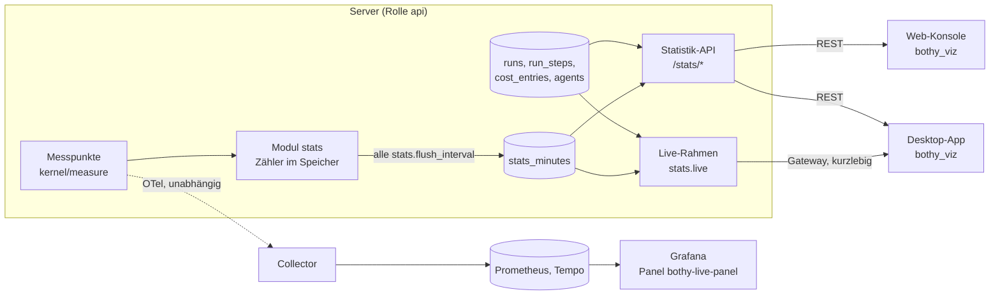

# 25 Visualisierung

Status: Entwurf M0, Nachtrag vom 2026-10-10. Normativ für die eigene Messung des Servers
(Minuten-Aggregate und SLI-Zähler), den Live-Strom `stats.live`, das Paket
`packages/bothy_viz`, die Visualisierungen in Apps und Web-Konsole, das Grafana-Panel-Plugin
`plugins/grafana-bothy-live` und die optionale Einbettung von Grafana in die Web-Konsole.
Begriffe: [00-glossar.md](00-glossar.md). Tabelle: [03-datenmodell.md](03-datenmodell.md)
(`stats_minutes`, Abschnitt 4.15). Live-Strom: [04-sync-protokoll.md](04-sync-protokoll.md),
Abschnitt 12. Aktionen: [05-aktionen.md](05-aktionen.md) (`stats.read`, `cost.read.aggregate`).
Statistik und Telemetrie: [17-observability.md](17-observability.md),
[admin-statistics.md](../observability/admin-statistics.md),
[dashboards.md](../observability/dashboards.md). Datenschutz:
[20-datenschutz.md](20-datenschutz.md). Entscheidung:
[ADR 0069](../adr/0069-visualisierung-auf-zwei-ebenen-ohne-iframes-in-apps.md).

Alle Grenzen, Fristen und Intervalle sind benannte Konfigurationswerte. Ihre Standardwerte stehen
nur in Abschnitt 15.

## 1. Zweck und Grenzen

Wer Bothy betreibt oder einen Bereich verwaltet, sieht auf einen Blick, was die Agenten gerade tun,
worauf sie laufen, ob Nachrichten ankommen und was es kostet. Es gibt zwei Ebenen in einer
Designsprache:

| Ebene | Ort | Daten | Zweck |
|---|---|---|---|
| a | Desktop-App, mobile App (iOS, Android), Web-Konsole; TV-Modus nur Desktop-App und Konsole | eigene Statistik-API und `stats.live` aus eigenen Tabellen | Produktfunktion, folgt den Rechten der Instanz |
| b | Grafana des Betreibers | OTel-Metriken und Traces aus dem Collector (17) | Betrieb, folgt den Rechten von Grafana |

Regeln:

1. Ebene a hängt nie vom Observability-Stack ab (R-OB-08, 17 Regel 7). Sie liest nur eigene
   Tabellen und eigene Zähler des Servers (Abschnitt 3).
2. Keine Werte je Person. Kein Diagramm, kein Strom und keine Tabelle dieser Ebene gruppiert nach
   Menschen oder nennt den Auslöser eines Laufs, auch nicht mit `privacy.per_person_stats_enabled`.
3. Keine Inhalte: keine Nachrichtentexte, Titel, Prompts, Schritt-Titel oder Schritt-Details.
   Werkzeuge erscheinen nur mit ihrem Namen (`run_steps.name`).
4. Keine iframes und keine WebViews mit Grafana in iOS, Android, macOS und Windows (Abschnitt 9).
5. Beide Ebenen nutzen dieselben Farben, Schriften und Formen; die Werte entstehen aus
   `design/tokens/` (Abschnitt 10), nie als Kopie.

Anti-Ziele: Leistungsüberwachung einzelner Menschen; ein zweiter Weg an `authorize` vorbei; ein
Grafana-Login als Voraussetzung für die Statistik der App; Daten der Ebene b in der App.

## 2. Überblick



Die Messpunkte melden jeden Wert zweimal: an die Telemetrie (OTel-Histogramm oder -Zähler, 17) und
an die eigene Messung. Die beiden Wege teilen nichts außer dem Messpunkt; fällt einer aus, misst
der andere weiter.

## 3. Eigene Messung

### 3.1 Grundsatz

Der Server zählt selbst, was Ebene a braucht, und schreibt es als Minuten-Aggregat in
`stats_minutes` (03, Abschnitt 4.15). Grund: Die Statistik darf nicht aus der Telemetrie lesen
(R-OB-08), und viele Werte (Zustell-Latenz, Wiederverbinden, Annahme beim Push-Anbieter) stehen in
keiner Fachtabelle (Ruling T7).

Der Querschnitts-Port `kernel/measure` ([02-architektur.md](02-architektur.md), Abschnitt 4.5)
hat genau eine Methode `Record(metric, key, value)`; das Modul `stats` implementiert ihn. Jeder
Messpunkt ruft ihn neben seinem OTel-Instrument auf. Ein Aufruf schreibt nie in die Datenbank,
sondern erhöht einen Zähler im Speicher des Prozesses.

### 3.2 Metriken

Die Liste ist geschlossen (`CHECK` in 03). Spalten: `count` Anzahl, `sum` Summe (Millisekunden bzw.
Mikro-Einheiten), `good` Anzahl guter Ereignisse eines SLI.

| `metric` | Messpunkt (Modul) | `count` | `sum` | `good` | `dimension` | Kanal, Agent |
|---|---|---|---|---|---|---|
| `messages_created` | `messaging`, nach Commit | Nachrichten | | | `human`, `agent`, `app`, `import` | Kanal |
| `threads_created` | `messaging` | Threads | | | leer | Kanal |
| `runs_started` | `runs`, Übergang nach `running` | Läufe | | | `billing_mode_used` (`personal`, `organization`) | Kanal, Agent |
| `runs_finished` | `runs`, Endzustand | Läufe | Dauer in ms | | `completed`, `failed`, `cancelled` | Kanal, Agent |
| `tool_calls` | `runs`, Schritt `tool_call` beendet | Aufrufe | Dauer in ms | | `completed`, `failed` | Kanal, Agent |
| `approval_cards` | `runs`, Freigabe-Karte ([09-agenten.md](09-agenten.md), Abschnitt 11.5) | Karten | | | `requested`, `approved`, `denied`, `expired` | Kanal, Agent |
| `cost` | `billing`, gültige Buchung | Buchungen | Betrag in Mikro-Einheiten | | `personal`, `organization`; Spalte `currency` | Kanal, Agent |
| `invocations_denied` | `runs`, Ablehnung vor Zustellung (I2) oder Lauf `failed` mit `billing_mode_mismatch` (I3) | Ablehnungen | | | `i2_denied`, `billing_mode_mismatch` | Kanal, Agent |
| `billing_mode_switches` | `agents`, `agent.billing_mode.set` und `.set_all` | Wechsel | | | neuer Modus | Agent |
| `catchups` | `gateway`, Nachholen beendet | Nachholvorgänge | Dauer in ms | | leer | keine |
| `resyncs` | `gateway`, `resync_required` gesendet | Vorgänge | | | Grund-Code aus 04, Abschnitt 7.3 | keine |
| `slow_consumer_closes` | `gateway`, Schließen mit `4014` | Schließungen | | | leer | keine |
| `sli.api_availability` | `platform/httpserver`, Antwort einer REST-Anfrage | Anfragen ohne `/api/v1/gateway` | | ohne `5xx` | leer | keine |
| `sli.delivery_latency` | `gateway`, Schreiben eines `dispatch`-Rahmens eines dauerhaften Ereignisses (live) | Zustellungen | Dauer in ms | Dauer bis Schwelle | leer | keine |
| `sli.reconnect` | `gateway`, `ready` oder `resumed` oder Abbruch | Verbindungen ohne `client_error` | Dauer in ms | `ok` bis Schwelle | leer | keine |
| `sli.push_acceptance` | `notify`, Antwort des Push-Anbieters | Sendungen ohne `rejected_token` | | `accepted` | Anbieter (Werte von `bothy.push.provider`, [signals.md](../observability/signals.md)) | keine |
| `sli.run_start` | `runs`, Verlassen von `queued` | Läufe ohne `cancelled` | Dauer in ms | `started` bis Schwelle | leer | Kanal, Agent |
| `sli.turn_duration` | `runs`, Lauf `completed` | abgeschlossene Läufe | Dauer in ms | bis Schwelle | leer | Kanal, Agent |

Die sechs `sli.*`-Metriken entsprechen genau den SLOs aus
[slos.md](../observability/slos.md); "gut" und "alle" sind dort definiert und hier gleich gezählt.
Werkzeugnamen stehen nicht in `stats_minutes` (offene Menge); Werkzeug-Statistik kommt weiter aus
`run_steps` ([admin-statistics.md](../observability/admin-statistics.md)).

### 3.3 Grenzen aus den Sloth-Dateien

Ziele und Schwellen stehen nur in den Sloth-Dateien unter `infra/observability/slo/`
(17, Abschnitt 6). Die Zuordnung eines SLO zu seiner Metrik der eigenen Messung steht ebenfalls
dort: Jedes SLO trägt das Label `bothy_sli_metric` mit dem Namen der `sli.*`-Metrik aus 3.2 (z. B.
`requests-availability` das Label `bothy_sli_metric: sli.api_availability`). Die Tabelle in
[slos.md](../observability/slos.md), Abschnitt 2, gibt die Zuordnung wieder. Die Labels setzt das
Bau-Ticket des Generators (PLAN M6-11) und erzeugt dabei die Prometheus-Regeln neu. Grund: Die
Namen von SLO und Metrik passen nicht mechanisch zusammen, und eine zweite Zuordnungsliste würde
auseinanderlaufen.

Ein Generator `tools/observability/sli_bounds.py` liest je SLO den Namen, die Metrik aus
`bothy_sli_metric`, das Ziel (`objective`), die Schwelle (Wert von `le` in `error_query`, falls
vorhanden) und den Zeitraum (Sloth-Standard 30 Tage, [slos.md](../observability/slos.md)
Abschnitt 1) und schreibt:

- `services/server/internal/stats/domain/slibounds.gen.go` (Schwellen für `good`, Ziele für die
  Ampel);
- `packages/bothy_viz/lib/src/slo/slo_catalog.g.dart` (Namen und Anzeige, keine Schwellen; die
  Werte liefert der Server in `getStatsSlo`).

Beide Dateien tragen "DO NOT EDIT"; ein Check im Gate erzeugt sie neu und vergleicht. Grund: Eine
Schwelle an zwei Stellen würde auseinanderlaufen; die Sloth-Datei ist schon die Quelle für
Prometheus, Alarme und [slos.md](../observability/slos.md). Ein zweiter Check verlangt, dass jedes
SLO genau ein Label `bothy_sli_metric` trägt, dass dessen Wert im `CHECK` von `stats_minutes.metric`
steht und dass jede `sli.*`-Metrik genau einem SLO zugeordnet ist.

### 3.4 Schreiben

1. Jeder api- und worker-Prozess hält Zähler je Schlüssel `(Minute, metric, channel_id, agent_id,
   dimension, currency)` im Speicher.
2. Alle `stats.flush_interval` schreibt ein Hintergrund-Job des Prozesses die Zähler mit einem
   additiven Upsert (`INSERT ... ON CONFLICT ... DO UPDATE SET count = count + excluded.count`, gleich
   für `sum` und `good`) in einer eigenen kurzen Transaktion und leert sie. Mehrere Prozesse und
   mehrere Knoten addieren in dieselbe Zeile; es gibt keinen Koordinator.
3. Die Messung blockiert nie den Fachpfad. Ist die Datenbank nicht erreichbar oder liegen mehr als
   `stats.flush_queue_max` Schlüssel im Speicher, verwirft der Prozess die ältesten Zähler und zählt
   `bothy.stats.flush.dropped` ([signals.md](../observability/signals.md), Abschnitt 4.3b).
4. Beim geordneten Herunterfahren schreibt der Prozess einmal vor dem Ende. Ein harter Absturz
   verliert höchstens die Zähler eines `stats.flush_interval`. Die Ampel nennt sich darum "eigene
   Messung" und ist kein Abrechnungsbeleg.
5. Fachliche Zähler (`messages_created`, `runs_*`, `cost` usw.) messen dasselbe wie die Fachtabellen,
   sind aber kein Ersatz für sie: Lange Zeiträume und Exporte rechnen weiter aus den Fachtabellen
   ([admin-statistics.md](../observability/admin-statistics.md)).

### 3.5 Aufbewahrung

`stats_minutes` hat die Aufbewahrungsklasse `stats` mit der Frist `retention.stats_minutes`
([20-datenschutz.md](20-datenschutz.md)). Die Tabelle ist nach Tag partitioniert; der Job
`stats.retention` hängt ganze Partitionen ab. `bothy config check` lehnt eine Frist kürzer als den
längsten SLO-Zeitraum aus 3.3 ab, weil die Ampel sonst einen zu kurzen Zeitraum zeigte.

## 4. Rechte und Datenschutz

| Sicht | Aktion | Wer | Filter |
|---|---|---|---|
| Instanz (alle Ansichten, Ampel) | `stats.read` auf `instance` | Owner | alle Kanäle |
| Bereich (Live-Topologie, Timeline, Backend-Ansicht ohne Kosten) | `stats.read` auf `space` | `manage` auf dem Bereich | nur Kanäle, die `authz` für den Prinzipal liefert (P2) |
| Kosten in jeder Ansicht | zusätzlich `cost.read.aggregate` auf demselben Ziel | Owner; Bereich mit `manage` | wie oben |
| SLO-Ampel | `stats.read` auf `instance` | Owner | Instanz-Werte ohne Kanal |

Regeln:

1. Jede Abfrage und jeder Live-Rahmen filtert auf die sichtbaren Kanäle des Empfängers. Zeilen ohne
   Kanal (`sli.*`, `catchups`, `resyncs`, `slow_consumer_closes`, `billing_mode_switches`) sieht
   nur, wer `stats.read` auf der Instanz hat.
2. Kostenfelder fehlen in Antwort und Rahmen, wenn `cost.read.aggregate` auf dem Ziel nicht erlaubt
   ist (Filtermodus, kein Fehler). Kosten im Modus `personal` tragen immer den Zusatz "nur
   Information" ([admin-statistics.md](../observability/admin-statistics.md), Abschnitt 2).
3. Mindestgruppe: Live-Rahmen, Timeline und `stats_minutes` enthalten keine Zähler über Menschen.
   Zahlen zu Menschen (aktive Menschen) zeigt nur die Executive-Seite aus `getUsageStats`, mit der
   Regel `privacy.stats_min_group_size` aus [admin-statistics.md](../observability/admin-statistics.md),
   Abschnitt 3.
4. In einem Kanal mit nur einem Menschen lässt sich aus Läufen auf diesen Menschen schließen. Die
   Ansichten nennen den Auslöser nie; der Owner kann den Live-Strom mit `stats.live_enabled`
   abschalten (Mitbestimmung, [20-datenschutz.md](20-datenschutz.md), Abschnitt 9).
5. Clients enthalten keine Rechte-Logik (15, Grundsatz 1): Sie zeigen, was der Server liefert.

## 5. Live-Strom `stats.live`

### 5.1 Ablauf

1. **Abo.** Ein Client sendet auf dem Gateway `stats.subscribe {space_id?}` (ohne `space_id`: ganze
   Instanz). Der Server prüft `authorize(principal, stats.read, instance | space)`; bei Ablehnung
   antwortet er mit `error` (Code `forbidden` bzw. `not_found`), die Verbindung bleibt. Je Verbindung
   gilt höchstens ein Abo; ein neues ersetzt das alte. `stats.unsubscribe` beendet es. `resume`
   stellt das Abo wieder her (04, Abschnitt 6.3).
2. **Rahmen.** Solange das Abo besteht, sendet der Server alle `stats.live_interval` das kurzlebige
   Ereignis `stats.live` mit einem Live-Rahmen (5.2). Kurzlebig heißt: kein `seq`, nicht im Log,
   nicht nachholbar (04, Abschnitt 2.1). Ein verlorener Rahmen wird durch den nächsten ersetzt.
3. **Rechte.** Jeder Rahmen läuft durch den Zustellmodus von `authorize` mit der Empfangs-Aktion
   `stats.read` (05, Abschnitt 6). Verliert der Empfänger das Recht (`access.changed`), endet das Abo;
   der Server sendet einmal `error` mit Code `forbidden` und Bezug auf `stats.subscribe`.
4. **Bau.** Jeder api-Knoten baut je Intervall genau einen Basis-Rahmen für die Instanz, nur wenn es
   mindestens ein Abo gibt, und filtert ihn je Verbindung im Speicher (Kanäle, Kosten). Grund: Die
   Last hängt von der Zahl der Intervalle ab, nicht von der Zahl der Zuschauer. Höchstens
   `stats.live_max_subscribers` Abos je Knoten; darüber antwortet `stats.subscribe` mit `error`
   `rate_limited`.
5. **Quellen des Rahmens.** Zustände (aktive Läufe, offene Freigabe-Karten, Präsenz der Agenten)
   liest der Knoten aus `runs`, `run_steps` und `agents` über deren Ports bzw. aus dem Präsenz-Speicher
   (04, Abschnitt 12). Raten liest er aus `stats_minutes` (letzte volle Minute und laufende Minute).
   Mit `cluster.mode = multi` sind Raten damit über alle Knoten gleich, aber um bis zu
   `stats.flush_interval` verzögert.
6. **Abgeschaltet.** Mit `stats.live_enabled = false` lehnt der Server `stats.subscribe` und
   `getStatsLive` mit `403 feature_disabled` ab.

Die Web-Konsole hält keine Gateway-Verbindung (15, Abschnitt 3.1, Regel 3; ADR 0028). Sie holt
denselben Rahmen per `GET /api/v1/stats/live` alle `viz.live_poll_interval`. Der Server gibt dabei
den zuletzt gebauten Basis-Rahmen aus (kein Neubau je Anfrage). Grund: ein Rahmen-Schema für beide
Wege, kein Gateway-Code in der Konsole.

### 5.2 Live-Rahmen (`StatsLiveFrame`)

Schema in [openapi.yaml](../api/openapi.yaml) (`StatsLiveFrame`); Englisch nach L5. Inhalt:

| Feld | Inhalt |
|---|---|
| `at` | Zeit des Rahmens (Server-Uhr) |
| `interval_ms` | `stats.live_interval` |
| `scope` | `instance` oder `space` mit `space_id` |
| `runs` | aktive Läufe (`queued`, `running`, `waiting_input`) in sichtbaren Kanälen, höchstens `stats.live_max_runs`, neueste zuerst; je Lauf: `run_id`, `thread_id`, `channel_id`, `space_id`, `agent_id`, `state`, `queued_at`, `started_at`, `billing_mode` (Ist, sonst Soll), aktueller Schritt (`kind`, `name`), `approval_pending`, Kosten bisher (`cost_micros`, `currency`, `cost_is_estimate`; nur mit `cost.read.aggregate`) |
| `runs_truncated` | `true`, wenn mehr Läufe aktiv sind als `stats.live_max_runs` |
| `agents` | je Agent mit Lauf oder Bediener-Rolle in sichtbaren Kanälen: `agent_id`, Präsenz (`online`, `degraded`, `offline`), `billing_mode` (Soll), `reported_billing_mode` (Ist, fehlt bei Adaptern, die je Lauf folgen), `rate_limit` mit `state` und `resets_at` (09, Abschnitt 4.8) |
| `rates` | je Metrik aus 3.2 ohne `sli.*`: Summe der letzten vollen Minute und der laufenden Minute bis `at`, in sichtbaren Kanälen; Kosten nur mit `cost.read.aggregate` |
| `sli` | nur bei Instanz-Sicht: je `sli.*` Anteil gut und Anzahl der letzten `stats.live_sli_window` |
| `connections` | Gateway-Verbindungen dieses Knotens nach Art (`user`, `agent`, `app`); nur bei Instanz-Sicht und `cluster.mode = single`, sonst fehlt das Feld |

Ein Rahmen ist höchstens `sync.event_payload_max_bytes` groß. Wird er größer, kürzt der Server die
Liste `runs` und setzt `runs_truncated`; er setzt nie `truncated` (04, Abschnitt 2.2), weil es nichts
nachzuladen gibt.

## 6. Ansichten (Ebene a)

Jede Ansicht hat eine Tabellenansicht mit denselben Daten als Alternative für Screenreader
(Abschnitt 7.4). Etappe: M6 (Abschnitt 13).

### 6.1 Live-Topologie

Zeigt in Bahnen je Bereich die Kanäle mit laufenden Agenten. Ein Lauf ist eine Karte mit Agent,
Zustand (Farbe und Icon wie die Live-Box, [components.md](../design/components.md) Abschnitt 2),
aktuellem Werkzeug als Werkzeug-Chip, Abzeichen der Backend-Richtlinie, Kosten im Modus
`organization` und einem Hinweis "Freigabe wartet", wenn eine Freigabe-Karte offen ist. Klick auf
eine Karte öffnet den Thread per Deep Link (Konsole: "In der App öffnen"). Daten: `stats.live`.

```text
+---------------------------------------------------------------------------------------------+
| Live   Bereich [alle v]                                     12:04:31   [Tabelle] [TV]         |
+---------------------------------------------------------------------------------------------+
| Engineering  | #backend   [Agent Runner | running | Werkzeug: Bash | Org | 0,42 USD Schätzung] |
|              | #infra     [Agent Ops    | waiting_input | Freigabe wartet | Persönlich]         |
| Support      | #tickets   [Agent Helfer | queued | Persönlich]                                 |
| Research     | (keine aktiven Läufe)                                                         |
+---------------------------------------------------------------------------------------------+
| Raten letzte Minute: Nachrichten 14 | Läufe gestartet 3 | Werkzeugaufrufe 41 | Fehler 0       |
+---------------------------------------------------------------------------------------------+
```

### 6.2 Backend-Ansicht

Zeigt je Agent, worauf er läuft (Ruling T8): Abrechnungsart Soll (`agents.billing_mode`) und Ist
(`reported_billing_mode` bzw. `billing_mode_used` der Läufe), unterstützte Modi, Wechsel im
Zeitraum (`billing_mode_switches`), Ablehnungen durch I2 und I3 (`invocations_denied`), Kosten je
Modus (`cost`) und den vom Adapter gemeldeten Rate-Limit-Zustand (`rate_limit` mit `state` und
`resets_at`). Die Ansicht
ist produktneutral: keine Namen von Laufzeiten einer Instanz, keine Abos, keine Zugangsdaten (I5).
Daten: `getStatsBackends`, live ergänzt durch `stats.live` (`agents`).

Abweichung vom Wortlaut des Owners: Eine Ansicht für ein Werkzeug, das mehrere persönliche Abos
rotiert, gibt es im Produkt nicht. Grund: Das Produkt kennt keine Zugangsdaten (I5), und das
Rotieren über mehrere Abos passt nicht zu den Bedingungen des Anbieters
([10-backend-richtlinie.md](10-backend-richtlinie.md), Abschnitt 2). Solche Daten sind höchstens
eine private Erweiterung außerhalb des Produkts über die öffentliche API (Ruling T8, DECISIONS).

### 6.3 Zustellung und Sync live

Zeigt Zustellungen je Sekunde und den Anteil innerhalb der Schwelle (`sli.delivery_latency`),
Wiederverbinden (`sli.reconnect`), Nachholvorgänge mit Dauer (`catchups`), `resync_required` nach
Grund (`resyncs`), Schließungen wegen langsamer Clients (`slow_consumer_closes`), Annahme beim
Push-Anbieter (`sli.push_acceptance`) und, mit einem Knoten, die offenen Verbindungen
(`connections`). Nur Instanz-Sicht (Owner). Daten: `stats.live`, für den Verlauf `getStatsTimeline`.

### 6.4 Executive-Seite

Eine Seite für den Überblick, auch mobil:

| Kachel | Daten |
|---|---|
| Nutzung (Nachrichten, neue Threads, aktive Menschen mit Mindestgruppe) | `getUsageStats` |
| Läufe und Fehlerrate | `getRunStats`, `getErrorStats` |
| Kosten je Modus mit "Schätzung" bzw. "nur Information" | `getCostStats` |
| SLO-Ampel "eigene Messung" | `getStatsSlo` |

Ampel je SLO aus `stats_minutes` über den SLO-Zeitraum (3.3): Anteil gut, verbleibendes
Fehlerbudget `1 - (1 - Anteil) / (1 - Ziel)`.

| Farbe | Bedingung | Text |
|---|---|---|
| grün | Restbudget mindestens `stats.slo_warn_budget_ratio` | "im Ziel" |
| gelb | Restbudget größer 0 und kleiner `stats.slo_warn_budget_ratio` | "Budget knapp" |
| rot | Restbudget 0 oder kleiner | "Ziel verfehlt" |
| grau | weniger als `stats.slo_min_events` Ereignisse im Zeitraum | "zu wenig Daten" |

Farbe nie allein: Icon und Text je Zustand. Die Kachel trägt immer das Etikett "eigene Messung" mit
Hinweis: Werte können von Prometheus abweichen, weil die eigene Messung im Prozess zählt (ein
Fehler im Proxy fehlt dort) und bei einem Absturz höchstens ein `stats.flush_interval` verliert.
Burn-Rate-Alarme bleiben in Prometheus (17, Abschnitt 6); die Ampel alarmiert nicht.

### 6.5 Abspielbare Tages-Timeline

Spielt einen gewählten Zeitraum bis `stats.timeline_max_range` minutengenau ab: Raten aus
`stats_minutes` als Flächen, darüber die Läufe als Balken je Kanal und Agent (Beginn, Ende,
Endzustand). Steuerung: Start, Pause, Sprung, Geschwindigkeit aus `viz.timeline_speeds`. Daten:
`getStatsTimeline`; der Client lädt einmal und spielt lokal ab. Grenzen: höchstens
`stats.timeline_max_runs` Läufe (`runs_truncated`), Zeitraum innerhalb von `retention.stats_minutes`;
Tagesgrenzen nach der Zeitzone der Instanz ([admin-statistics.md](../observability/admin-statistics.md),
Abschnitt 5, Punkt 4).

### 6.6 TV-Modus

Vollbild, dunkles Theme, Dichte `comfortable` mit Schrift eine Stufe größer, rotiert durch die gewählten Ansichten alle
`viz.tv_rotation_interval`, ohne Bedienelemente; Tastatur oder Klick beendet ihn. Er läuft in der
Sitzung der angemeldeten Person und zeigt nur, was diese sieht. Kosten zeigt er nur mit
`viz.tv_show_costs`. Bewegung folgt `motion.*`; mit reduzierter Bewegung wechselt er ohne
Übergang. Desktop-App und Web-Konsole; nicht mobil.

Ein eigenes Kiosk-Token ohne Person gibt es in dieser Fassung nicht. Grund: Ein Token, das ohne
Gerätebindung die Instanz-Statistik liest, wäre ein Zugang ohne Mensch und ohne Step-up; ein
Bildschirm im Büro braucht eine normale Anmeldung eines Menschen mit `stats.read`.

## 7. Paket `packages/bothy_viz`

### 7.1 Aufbau

Flutter-Paket im Pub-Workspace (15, Abschnitt 3). Abhängigkeiten: `design_system`, `l10n`, `domain`,
`api_client`. Nicht: `sync_engine`, `local_store`.

| Teil | Inhalt |
|---|---|
| `lib/src/model/` | Ansichtsmodelle aus den generierten Typen von `api_client` (`StatsLiveFrame`, `StatsTimeline`, `StatsSloReport`, `StatsBackendReport`) |
| `lib/src/sources/` | Port `LiveFrameSource` (Strom von Rahmen) und `StatsQuerySource` (REST); Umsetzungen liefern die Apps |
| `lib/src/views/` | die sechs Ansichten aus Abschnitt 6, je mit Tabellenansicht |
| `lib/src/marks/` | Grundformen: Bahn, Lauf-Karte, Fläche, Balken, Ampel, Kennzahl-Kachel; alle mit `CustomPainter` und Semantik |
| `lib/src/slo/` | `slo_catalog.g.dart` (3.3) |
| `fixtures/` | JSON-Fixtures je Ansicht und Zustand (leer, normal, Last, gekürzt, ohne Kostenrecht, offline) |
| `harness/` | Flutter-App für Desktop und Web, die jede Ansicht aus den Fixtures zeigt, mit Schaltern für Theme, Dichte, Textgröße, Sprache und Zeitraffer |

`LiveFrameSource` setzt die Desktop-App und die mobile App über `sync_engine` um (Gateway,
`stats.subscribe`; mobil nur im Vordergrund, weil die App im Hintergrund trennt), die Web-Konsole
über REST-Abfrage von `getStatsLive` (5.1). Grund: Die Ansichten kennen keinen
Transport; Fixtures, Schein-Server und echter Server sind austauschbar.

Keine Diagramm-Bibliothek: Die Grundformen sind eigene `CustomPainter`. Grund: Die Formen (Bahnen,
Lauf-Karten mit Live-Box-Farben) gibt es in keiner Bibliothek; eigene Formen halten Tokens,
Semantik und Golden-Tests in der Hand. Eine Bibliothek kann das Bau-Ticket mit Lizenzprüfung
vorschlagen, wenn eine Ansicht sonst unverhältnismäßig wird.

### 7.2 Vertrag

1. Alle Typen kommen aus dem erzeugten `api_client` (openapi-generator `dart-dio`, Baseline
   R-Clients). Es gibt keinen handgeschriebenen Typ für Statistik-Daten.
2. Jede Fixture-Datei wird im Gate gegen das Schema aus [openapi.yaml](../api/openapi.yaml)
   geprüft (Ticket "Fixture-Check"). Ändert sich ein Schema, scheitert der Check, bis die Fixtures
   angepasst sind.
3. Dieselben Fixtures liefert der Schein-Server der Integrationstests (15, Abschnitt 20).

### 7.3 Tests

Golden-Tests wie in 15, Abschnitt 20 (`alchemist`, CI-Goldens auf allen Hosts gleich): jede Ansicht
mit jeder Fixture in hell und dunkel, `comfortable`, `compact` und `touch`, Textskalierung 1 und 2,
de und en (gleiche Matrix wie 15, Abschnitt 20).
Dazu Widget-Tests für Semantik und Tabellenansicht und ein Leistungstest für die Live-Topologie mit
`stats.live_max_runs` Läufen (Ziel `viz.perf.frame_build_p95`).

### 7.4 Barrierefreiheit

- Jede Ansicht hat einen Schalter "Als Tabelle" mit denselben Werten und Spaltenköpfen.
- Zustände tragen Icon und Text, nie nur Farbe.
- Live-Werte werden nicht laufend vorgelesen; der Screenreader liest Änderungen der Ampel und das
  Ende eines Laufs (höflich), nicht jeden Rahmen.
- Reduzierte Bewegung: keine animierten Übergänge, Timeline springt.

## 8. Ebene b: Grafana-Panel-Plugin

### 8.1 Aufbau

- Ordner `plugins/grafana-bothy-live`, Plugin-ID `bothy-live-panel`, Typ Panel, TypeScript und React,
  erzeugt mit `@grafana/create-plugin` (`npx @grafana/create-plugin@latest`; Grafana nennt Panel-,
  Datenquellen- und App-Plugins als Arten und den Ordner `<orgName>-<pluginName>-<pluginType>`;
  https://grafana.com/developers/plugin-tools/, abgerufen 2026-10-10 [belegt]).
- Eigene Version und eigenes Changelog ([18-release.md](18-release.md), Komponente
  `grafana-bothy-live`).
- Das Panel nutzt die Datenquellen von Grafana (Prometheus, Tempo aus
  [datasources.yaml](../../infra/observability/grafana/provisioning/datasources/datasources.yaml)); es
  spricht nie mit dem Bothy-Server. Grund: Ebene b gehört dem Betrieb und den Rechten von Grafana.

### 8.2 Ansichten aus Metriken

Metriken tragen keine IDs (17, Regel 9). Die Ansichten zeigen darum Agenten und Zustände, keine
Kanäle und keine Läufe einzeln; Einzelheiten führen über Exemplare zu Tempo.

| Ansicht (Ebene a) | im Plugin | Metriken ([signals.md](../observability/signals.md)) |
|---|---|---|
| Live-Topologie | Bahnen je Agent mit aktiven Läufen nach Zustand, Werkzeugschritte je Minute, Kosten | `bothy.run.active`, `bothy.run.steps`, `bothy.run.cost` |
| Backend-Ansicht | Modus je Agent, Abweichungen, Ablehnungen, Kosten je Modus | `bothy.run.start.latency` (Attribut `bothy.billing_mode`), `bothy.agent.billing_mode_mismatch`, `bothy.agent.invocation.denied`, `bothy.run.cost`; Rate-Limit-Zustand nur in Ebene a |
| Zustellung und Sync | Latenz, Verbinden, Nachholen, Fan-out-Verzug | `bothy.delivery.duration`, `bothy.gateway.connect.duration`, `bothy.gateway.catchup.duration`, `bothy.event.fanout.lag` |
| Executive-Seite | SLO-Ampel aus den Recording-Regeln | `slo:sli_error:ratio_rate30d`, `slo:period_error_budget_remaining:ratio`, `slo:objective:ratio` |
| Timeline | Abspielen über den Zeitraum des Dashboards | dieselben |
| TV-Modus | Kiosk-Modus von Grafana [vermutet: URL-Parameter `kiosk`; das Bau-Ticket prüft es gegen die Doku der eingesetzten Version] | |

Die Abfragen stehen in `plugins/grafana-bothy-live/queries.yaml`; daraus erzeugt ein Skript
`src/queries.gen.ts`. Der Namens-Test aus 17, Abschnitt 10 prüft jede Metrik darin gegen den
Katalog. Die sechs Datei-Dashboards bleiben ([dashboards.md](../observability/dashboards.md)); ein
siebtes Dashboard `bothy-live.json` nutzt das Panel.

### 8.3 Verteilung

1. Bis V1 ist das Plugin unsigniert und wird lokal provisioniert: Der Compose-Stack legt den Build
   nach `/var/lib/grafana/plugins/bothy-live-panel` und setzt
   `GF_PLUGINS_ALLOW_LOADING_UNSIGNED_PLUGINS=bothy-live-panel`, genau diese ID (Ruling T11).
   Grafana lädt unsignierte Plugins standardmäßig nicht; die Einstellung
   `allow_loading_unsigned_plugins` im Abschnitt `[plugins]` nimmt eine kommagetrennte Liste von
   Plugin-IDs, und Grafana rät davon ab
   (https://grafana.com/docs/grafana/latest/setup-grafana/configure-grafana/, abgerufen 2026-10-10
   [belegt, Wortlaut über die Websuche]; https://grafana.com/docs/grafana/latest/administration/plugin-management/plugin-sign/,
   abgerufen 2026-10-10 [belegt]). Grafana protokolliert dann "Running an unsigned plugin" (gleiche
   Quelle [belegt]). Unsignierte Plugins laufen nicht in Grafana Cloud (gleiche Quelle [belegt]).
2. Signaturstufen: Private (nur eigene Grafana, gebunden an `root_url` über `--rootUrls`, nicht im
   Katalog), Community (Abhängigkeiten quelloffen, nicht gewinnorientiert, im Katalog) und Commercial
   (https://grafana.com/docs/grafana/latest/administration/plugin-management/plugin-sign/ und
   https://grafana.com/developers/plugin-tools/publish-a-plugin/sign-a-plugin, abgerufen 2026-10-10
   [belegt]). Jede Signatur braucht ein Access-Policy-Token mit Scope `plugins:write` aus einem
   Grafana-Cloud-Konto; der erste Teil der Plugin-ID muss zum Konto passen; öffentliche Plugins prüft
   Grafana vor der Signatur (gleiche Quellen [belegt]).
3. Nach V1: Antrag als Community-Plugin. Das braucht ein Grafana-Cloud-Konto des Owners und eine
   Organisation, deren Name zum Präfix `bothy` der ID passt. Owner-Frage (OPEN-QUESTIONS),
   Voreinstellung: unsigniert lokal bis zur Veröffentlichung, dann Konto anlegen.
4. Die Plugin-ID enthält den Arbeitsnamen; sie steht in der Liste der Stellen mit dem Produktnamen
   ([02-architektur.md](02-architektur.md), Abschnitt 6; ADR 0044).

## 9. Einbettung

### 9.1 Apps

In iOS, Android, macOS und Windows gibt es keine iframes und keine WebViews mit Grafana. Die
Visualisierungen der Apps sind nativ (Ebene a). Ein Link "In Grafana öffnen" führt mit
`telemetry.dashboard_url` in den System-Browser. Grund: Eine WebView bräuchte eine zweite
Anmeldung, umginge Rechte und Design und öffnete eine Clickjacking- und Cookie-Fläche in der App.

### 9.2 Web-Konsole (optional, Standard aus)

Die Konsole kann ein Grafana-Dashboard einbetten, wenn der Betreiber `console.grafana_embed_url`
setzt (Standard leer, dann gibt es keine Einbettung und keine Lockerung der CSP). Bedingungen:

1. Grafana erlaubt Einbettung nur mit `allow_embedding = true` im Abschnitt `[security]`. Ist der
   Wert `false` (Standard), sendet Grafana `X-Frame-Options: deny`; Grafana nennt als Zweck den
   Schutz vor Clickjacking (https://grafana.com/docs/grafana/latest/setup-grafana/configure-grafana/,
   abgerufen 2026-10-10 [belegt]). Wer es einschaltet, nimmt diesen Schutz für Grafana weg; darum
   muss der Proxy vor Grafana ihn ersetzen (Punkt 3).
2. Grafana steht hinter einem Auth-Proxy (`[auth.proxy]`, Kopfzeile mit dem Benutzernamen,
   Liste erlaubter Absender `whitelist`, weil sonst jeder die Kopfzeile fälschen kann;
   https://grafana.com/docs/grafana/latest/setup-grafana/configure-access/configure-authentication/auth-proxy/,
   abgerufen 2026-10-10 [belegt]). Der Proxy meldet nur Menschen an, die auch Owner der Instanz
   sind; das Produkt gibt die Identität nicht weiter (keine Tokens der Instanz an Grafana).
3. Der Proxy setzt auf allen Antworten von Grafana `Content-Security-Policy: frame-ancestors
   <Origin der Konsole>`, `Cross-Origin-Resource-Policy: cross-origin` und
   `Cross-Origin-Embedder-Policy: require-corp`. Grund: Die Konsole ist cross-origin isoliert
   (SEC-HDR-3); COEP gilt auch für Ressourcen in iframes
   (https://developer.mozilla.org/en-US/docs/Web/HTTP/Reference/Headers/Cross-Origin-Embedder-Policy,
   abgerufen 2026-10-10 [belegt]); ohne diese Kopfzeilen lädt der Browser das Dashboard nicht
   [abgeleitet]. `frame-ancestors` ersetzt den Clickjacking-Schutz aus Punkt 1.
4. Grafana und Konsole liegen auf derselben Site (gleiche registrierbare Domain), damit das Cookie
   des Auth-Proxys im iframe gesendet wird [abgeleitet: Browser sperren Cookies von Drittseiten in
   iframes zunehmend]. Eine fremde Site lehnt `bothy config check` nicht ab, warnt aber. Der
   Origin von `console.grafana_embed_url` muss sich aber vom Origin der Konsole unterscheiden
   (eigene Subdomain); denselben Origin lehnt `bothy config check` ab. Grund: Mit
   `allow-scripts allow-same-origin` (Punkt 5) hebt ein iframe desselben Origins die Sandbox auf;
   Skripte von Grafana hätten dann vollen Zugriff auf die Konsole mit ihrem Terminal.
5. Die Konsole setzt nur dann `frame-src <Origin von console.grafana_embed_url>` in ihre CSP; ohne
   Wert bleibt `frame-src` ungesetzt und damit durch `default-src 'none'` gesperrt
   ([19-sicherheit.md](19-sicherheit.md), Abschnitt 5, SEC-VZ-2). Das iframe trägt `sandbox` mit
   `allow-scripts allow-same-origin` und `referrerpolicy="no-referrer"`.
6. Die eingebettete Seite ist Ebene b: Sie folgt den Rechten von Grafana, nicht denen der Instanz.
   Die Konsole zeigt sie nur Ownern und beschriftet sie "Betrieb (Grafana)".

## 10. Gemeinsame Designsprache

1. Quelle aller Farben, Schriften, Abstände und Bewegungen ist `design/tokens/` (ADR 0030).
2. Neue Rollen für Diagramme (Ticket "Viz-Tokens"): `color.viz.series.1` bis `color.viz.series.8`
   (kategorial, in beiden Themes mit Kontrast `ui` gegen die Fläche geprüft und gegen Rot-Grün-
   Verwechslung unterscheidbar), `color.viz.grid`, `color.viz.axis`, `color.viz.area-fill` und die
   Zuordnung der Ampel auf die vorhandenen Zustandsrollen `color.success.*`, `color.warning.*`,
   `color.danger.*`. Zustände von Läufen nutzen die Rollen der Live-Box. Jede Paarung steht in
   `design/design-rules.json`.
3. `tools/design-tokens` bekommt eine weitere Ausgabe `design/build/ts/tokens.gen.ts` (Farben je
   Theme, Schriftfamilien, Schriftgrößen, Radien als TypeScript-Konstanten) und kopiert die
   Schriftdateien nach `design/build/ts/fonts/`. Das Plugin importiert nur diese Datei; `tokens.py
   check` vergleicht sie wie alle Ausgaben. Grund: Tokens generiert, nicht kopiert.
4. Das Plugin passt sich dem hellen oder dunklen Theme von Grafana an und nimmt dann das passende
   Theme der Tokens; die Schrift ist Atkinson Hyperlegible aus den mitgelieferten Dateien (OFL).
5. Komponenten-Hinweise: [components.md](../design/components.md), Abschnitt 11.

## 11. Fehler

| Problem-Code | Status | Wann |
|---|---|---|
| `not_found` | `404` | kein Leserecht auf den Bereich (`space_id`) |
| `forbidden` | `403` | Bereich lesbar, aber kein `stats.read` dort; SLO-Ampel ohne `stats.read` auf der Instanz |
| `feature_disabled` | `403` | `stats.live_enabled = false` bei `getStatsLive` oder `stats.subscribe` |
| `validation_failed` | `400` | Zeitraum leer, größer als `stats.timeline_max_range` oder außerhalb von `retention.stats_minutes` |
| `rate_limited` | `429` bzw. `error` | Rate-Limit `rl.read`; mehr als `stats.live_max_subscribers` Abos auf dem Knoten |

## 12. Tests

| ID | Test | Erwartet |
|---|---|---|
| VZ-T01 | Messpunkt je Metrik aus 3.2 mit gesteuerter Uhr, zwei Prozesse, Flush | Zeilen in `stats_minutes` mit der Summe beider Prozesse; `good` nie größer als `count` |
| VZ-T02 | SLI-Schwelle: Werte genau an, knapp unter und knapp über der Schwelle aus der Sloth-Datei | `good` zählt bis einschließlich Schwelle, gleich wie das Histogramm (R-OB-06) |
| VZ-T03 | Generator `sli_bounds.py` gegen die eingecheckten Dateien; SLO ohne Label `bothy_sli_metric`, mit unbekannter Metrik, zwei SLOs mit derselben Metrik, `sli.*`-Metrik ohne SLO | kein Unterschied; jeder Fehlerfall bricht den Check |
| VZ-T04 | Datenbank während des Flushs nicht erreichbar; mehr als `stats.flush_queue_max` Schlüssel | Fachanfrage unverändert erfolgreich, `bothy.stats.flush.dropped` steigt |
| VZ-T05 | Bereichsverwalter abonniert `stats.live` und fragt Timeline und Backend-Ansicht | nur Kanäle aus seiner sichtbaren Menge; keine Zeilen ohne Kanal; ohne `cost.read.aggregate` keine Kostenfelder |
| VZ-T06 | Entzug von `manage` während eines Abos | Abo endet, ein `error` `forbidden`, kein weiterer Rahmen |
| VZ-T07 | Kanarienwerte in Nachricht, Thread-Titel, Schritt-Titel und Schritt-Detail eines aktiven Laufs | Kanarie in keinem Rahmen, keiner REST-Antwort und keiner Zeile von `stats_minutes` (19, SEC-T10) |
| VZ-T08 | Rahmen mit mehr aktiven Läufen als `stats.live_max_runs` und über `sync.event_payload_max_bytes` | `runs_truncated = true`, Rahmen innerhalb der Grenze |
| VZ-T09 | Ampel mit erzeugten Minuten: Restbudget über, unter `stats.slo_warn_budget_ratio`, bei 0, unter `stats.slo_min_events` | grün, gelb, rot, grau |
| VZ-T10 | `stats.live_enabled = false` | `403 feature_disabled` bei REST und Op |
| VZ-T11 | Fixtures gegen OpenAPI-Schemas; Golden-Tests jeder Ansicht | gültig; Goldens gleich |
| VZ-T12 | Konsole ohne `console.grafana_embed_url`; mit Wert; mit dem Origin der Konsole als Wert | CSP ohne `frame-src`; CSP mit genau diesem Origin in `frame-src` (SEC-T19); `bothy config check` schlägt fehl |
| VZ-T13 | Grafana-Provisioning im Portabilitätstest mit dem Plugin-Build | Plugin geladen, Log nennt nur `bothy-live-panel` als unsigniert, Dashboard `bothy-live` ohne Fehler |
| VZ-T14 | `retention.stats_minutes` kürzer als der SLO-Zeitraum | `bothy config check` schlägt fehl |
| VZ-T15 | Aufbewahrungsjob mit gesteuerter Uhr | nur Partitionen älter als `retention.stats_minutes` abgehängt |
| VZ-T16 | Statische Prüfung von `apps/client`: kein WebView-Paket, kein `HtmlElementView` mit iframe | keine Treffer (Regel 1.4) |

## 13. Etappen

| Etappe | Inhalt |
|---|---|
| nach den frühen M4-Tickets (Design-System; Spur parallel, PLAN P-21) | `bothy_viz` mit Fixtures, Harness und Golden-Tests gegen den Schein-Server; Viz-Tokens; `sli_bounds.py` mit Labels `bothy_sli_metric` |
| M6 | Server: `kernel/measure`, `stats_minutes`, Flush, Aufbewahrung, `stats.live`, `getStatsLive`, `getStatsTimeline`, `getStatsSlo`, `getStatsBackends`, Heartbeat-Feld `rate_limit`; Ansichten in Desktop-App, mobiler App und Web-Konsole; TV-Modus in Desktop-App und Konsole; optionale Einbettung in der Konsole |
| M7 | Grafana-Panel-Plugin, Token-Ausgabe für TypeScript, Dashboard `bothy-live`, Provisioning im Compose-Stack |
| nach V1 | Signatur als Community-Plugin (Owner-Frage) |

## 14. Entscheidungen dieses Kapitels

| Nr | Entscheidung | Grund |
|---|---|---|
| R-VZ-01 | Zwei Ebenen: native Visualisierungen aus eigener Messung (a) und Grafana-Panel aus OTel (b). | Statistik ohne Telemetrie-Stack (R-OB-08), Betrieb mit dem Werkzeug des Betreibers ([ADR 0069](../adr/0069-visualisierung-auf-zwei-ebenen-ohne-iframes-in-apps.md)). |
| R-VZ-02 | Eigene Messung über `kernel/measure` mit Minuten-Aggregaten in `stats_minutes`, additiver Upsert je Prozess. | Werte ohne Fachtabelle (Latenz, Push-Annahme) brauchen eigene Zähler; Addition braucht keinen Koordinator über Knoten (Ruling T7). |
| R-VZ-03 | SLI-Schwellen und Ziele nur aus den Sloth-Dateien, erzeugt für Server und App. | Eine Quelle für Prometheus und eigene Messung. |
| R-VZ-04 | Messung fail-open mit gezähltem Verlust; Ampel heißt "eigene Messung" und alarmiert nicht. | Statistik darf den Nachrichtenpfad nie bremsen; Alarme bleiben in Prometheus. |
| R-VZ-05 | `stats.live` als kurzlebiges Gateway-Ereignis mit Abo-Op, ein Basis-Rahmen je Knoten und Intervall. | Gleiche Anmeldung, Rechteprüfung und Schließ-Codes wie das Gateway; Last unabhängig von der Zahl der Zuschauer. |
| R-VZ-06 | Web-Konsole holt den Live-Rahmen per REST statt per Gateway. | Konsole ohne `sync_engine` (ADR 0028, 15 Regel 3); ein Schema für beide Wege. |
| R-VZ-07 | Keine Werte je Person und keine Zähler über Menschen in Live-Rahmen, Timeline und `stats_minutes`; Live-Strom abschaltbar. | Statistik ist kein Werkzeug zur Leistungsüberwachung (20, Abschnitt 9). |
| R-VZ-08 | Backend-Ansicht statt einer Ansicht für ein Abo-Rotationswerkzeug. | Produkt kennt keine Zugangsdaten (I5); Bedingungen des Anbieters (Ruling T8). |
| R-VZ-09 | Kein Kiosk-Token; TV-Modus in der Sitzung eines Menschen, Kosten standardmäßig verborgen. | Kein Zugang ohne Mensch und Gerätebindung; ein Bildschirm im Raum zeigt keine Kosten ungefragt. |
| R-VZ-10 | Eigene Grundformen mit `CustomPainter` statt Diagramm-Bibliothek. | Eigene Formen, Tokens, Semantik und Goldens in einer Hand. |
| R-VZ-11 | Plugin bis V1 unsigniert, nur mit seiner ID freigegeben; Signatur nach Owner-Entscheid. | Signatur braucht ein Grafana-Cloud-Konto (Ruling T11). |
| R-VZ-12 | Keine iframes oder WebViews mit Grafana in Apps; Einbettung in der Konsole optional, Standard aus, mit Auth-Proxy, `frame-ancestors`, COEP/CORP und `frame-src` genau dieses Origins. | Clickjacking-Schutz von Grafana fällt mit `allow_embedding` weg; die Konsole ist cross-origin isoliert. |
| R-VZ-13 | Tokens für das Plugin als weitere Ausgabe von `tools/design-tokens`. | Gleiche Designsprache ohne Kopie (ADR 0030). |

## 15. Konfigurationswerte dieses Kapitels

Spalte "Ort": Server = Konfigurationsreferenz des Servers; App = Konstante oder Einstellung von
`bothy_viz` in Apps und Konsole.

| Name | Ort | Standard | Bedeutung |
|---|---|---|---|
| `stats.live_enabled` | Server | `true` | Live-Strom und `getStatsLive` an; aus: `403 feature_disabled` |
| `stats.live_interval` | Server | `1s` | Abstand der Live-Rahmen; zugleich Lebensdauer des Basis-Rahmens für `getStatsLive` |
| `stats.live_max_runs` | Server | `200` | höchstens so viele aktive Läufe je Rahmen |
| `stats.live_max_subscribers` | Server | `200` | Abos von `stats.live` je api-Knoten |
| `stats.live_sli_window` | Server | `5m` | Zeitraum der SLI-Werte im Live-Rahmen |
| `stats.flush_interval` | Server | `10s` | Abstand, in dem ein Prozess seine Zähler in `stats_minutes` schreibt |
| `stats.flush_queue_max` | Server | `20000` | Zählerschlüssel im Speicher je Prozess; darüber werden die ältesten verworfen |
| `stats.timeline_max_range` | Server | `24h` | größter Zeitraum einer Timeline-Abfrage |
| `stats.timeline_max_runs` | Server | `5000` | höchstens so viele Läufe in einer Timeline-Antwort |
| `stats.slo_warn_budget_ratio` | Server | `0.25` | unter diesem Restbudget wird die Ampel gelb |
| `stats.slo_min_events` | Server | `100` | unter so vielen Ereignissen im SLO-Zeitraum ist die Ampel grau |
| `console.grafana_embed_url` | Server | leer | Dashboard-URL für die Einbettung in die Konsole; leer heißt keine Einbettung und kein `frame-src` |
| `viz.live_poll_interval` | App | `2s` | Abfrage von `getStatsLive` in der Web-Konsole |
| `viz.stale_after` | App | `5s` | ohne neuen Rahmen zeigt die Ansicht "veraltet" |
| `viz.timeline_speeds` | App | `60, 300, 900` | Abspielgeschwindigkeiten der Timeline (Sekunden Tageszeit je Sekunde) |
| `viz.tv_rotation_interval` | App | `30s` | Wechsel der Ansichten im TV-Modus |
| `viz.tv_show_costs` | App | `false` | Kosten im TV-Modus zeigen |
| `viz.perf.frame_build_p95` | App | `8ms` | Ziel: Aufbau eines Frames der Live-Topologie mit `stats.live_max_runs` Läufen |

Werte anderer Kapitel, auf die dieses Kapitel verweist: `retention.stats_minutes`,
`privacy.stats_min_group_size`, `privacy.per_person_stats_enabled`
([20-datenschutz.md](20-datenschutz.md)), `sync.event_payload_max_bytes`
([04-sync-protokoll.md](04-sync-protokoll.md)), `cluster.mode`
([02-architektur.md](02-architektur.md)), `telemetry.dashboard_url`, `stats.cache_ttl`,
`stats.max_range` ([17-observability.md](17-observability.md)).
