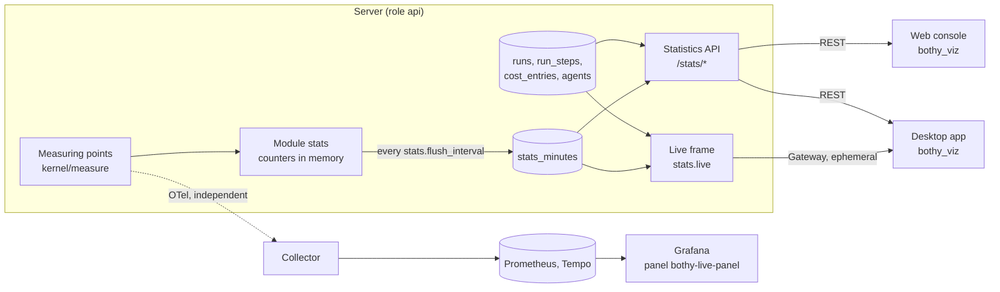

# 25 Visualization

Status: draft M0, addendum of 2026-10-10. Normative for the own measurement of the server
(minute aggregates and SLI counters), the live stream `stats.live`, the package
`packages/bothy_viz`, the visualizations in apps and web console, the Grafana panel plugin
`plugins/grafana-bothy-live` and the optional embedding of Grafana in the web console.
Terms: [00-glossary.md](00-glossary.md). Table: [03-data-model.md](03-data-model.md)
(`stats_minutes`, section 4.15). Live stream: [04-sync-protocol.md](04-sync-protocol.md),
section 12. Actions: [05-actions.md](05-actions.md) (`stats.read`, `cost.read.aggregate`).
Statistics and telemetry: [17-observability.md](17-observability.md),
[admin-statistics.md](../observability/admin-statistics.md),
[dashboards.md](../observability/dashboards.md). Privacy:
[20-privacy.md](20-privacy.md). Decision:
[ADR 0069](../adr/0069-visualization-on-two-levels-without-iframes-in-apps.md).

All limits, periods and intervals are named configuration values. Their defaults are only in
section 15.

## 1. Purpose and limits

Anyone who runs Bothy or manages a space sees at a glance what the agents are doing right now,
what they run on, whether messages arrive and what it costs. There are two levels in one design
language:

| Level | Place | Data | Purpose |
|---|---|---|---|
| a | Desktop app, mobile app (iOS, Android), web console; TV mode only desktop app and console | own statistics API and `stats.live` from own tables | product function, follows the permissions of the instance |
| b | Grafana of the instance operator | OTel metrics and traces from the collector (17) | operations, follows the permissions of Grafana |

Rules:

1. Level a never depends on the observability stack (R-OB-08, 17 rule 7). It reads only the
   server's own tables and own counters (section 3).
2. No values per person. No chart, no stream and no table of this level groups by people or
   names the triggering person of a run, not even with `privacy.per_person_stats_enabled`.
3. No content: no message texts, titles, prompts, step titles or step details. Tools appear only
   with their name (`run_steps.name`).
4. No iframes and no WebViews with Grafana in iOS, Android, macOS and Windows (section 9).
5. Both levels use the same colors, fonts and shapes; the values are generated from
   `design/tokens/` (section 10), never copied.

Anti-goals: performance monitoring of individual people; a second path around `authorize`; a
Grafana login as a prerequisite for the statistics of the app; data of level b in the app.

## 2. Overview



The measuring points report every value twice: to the telemetry (OTel histogram or counter, 17) and
to the own measurement. The two paths share nothing except the measuring point; if one fails, the
other keeps measuring.

## 3. Own measurement

### 3.1 Principle

The server itself counts what level a needs and writes it as a minute aggregate to
`stats_minutes` (03, section 4.15). Reason: the statistics must not read from the telemetry
(R-OB-08), and many values (delivery latency, reconnecting, acceptance at the push provider) are in
no domain table (ruling T7).

The cross-cutting port `kernel/measure` ([02-architecture.md](02-architecture.md), section 4.5)
has exactly one method `Record(metric, key, value)`; the module `stats` implements it. Every
measuring point calls it next to its OTel instrument. A call never writes to the database,
but increments a counter in the memory of the process.

### 3.2 Metrics

The list is closed (`CHECK` in 03). Columns: `count` number, `sum` sum (milliseconds or
micro-units), `good` number of good events of an SLI.

| `metric` | Measuring point (module) | `count` | `sum` | `good` | `dimension` | Channel, agent |
|---|---|---|---|---|---|---|
| `messages_created` | `messaging`, after commit | Messages | | | `human`, `agent`, `app`, `import` | Channel |
| `threads_created` | `messaging` | Threads | | | empty | Channel |
| `runs_started` | `runs`, transition to `running` | Runs | | | `billing_mode_used` (`personal`, `organization`) | Channel, agent |
| `runs_finished` | `runs`, final state | Runs | Duration in ms | | `completed`, `failed`, `cancelled` | Channel, agent |
| `tool_calls` | `runs`, step `tool_call` finished | Calls | Duration in ms | | `completed`, `failed` | Channel, agent |
| `approval_cards` | `runs`, approval card ([09-agents.md](09-agents.md), section 11.5) | Cards | | | `requested`, `approved`, `denied`, `expired` | Channel, agent |
| `cost` | `billing`, valid booking | Bookings | Amount in micro-units | | `personal`, `organization`; column `currency` | Channel, agent |
| `invocations_denied` | `runs`, denial before delivery (I2) or run `failed` with `billing_mode_mismatch` (I3) | Denials | | | `i2_denied`, `billing_mode_mismatch` | Channel, agent |
| `billing_mode_switches` | `agents`, `agent.billing_mode.set` and `.set_all` | Switches | | | new mode | Agent |
| `catchups` | `gateway`, catch-up finished | Catch-ups | Duration in ms | | empty | none |
| `resyncs` | `gateway`, `resync_required` sent | Occurrences | | | reason code from 04, section 7.3 | none |
| `slow_consumer_closes` | `gateway`, close with `4014` | Closes | | | empty | none |
| `sli.api_availability` | `platform/httpserver`, response to a REST request | Requests without `/api/v1/gateway` | | without `5xx` | empty | none |
| `sli.delivery_latency` | `gateway`, writing a `dispatch` frame of a durable event (live) | Deliveries | Duration in ms | Duration up to the threshold | empty | none |
| `sli.reconnect` | `gateway`, `ready` or `resumed` or abort | Connections without `client_error` | Duration in ms | `ok` up to the threshold | empty | none |
| `sli.push_acceptance` | `notify`, response of the push provider | Sends without `rejected_token` | | `accepted` | Provider (values of `bothy.push.provider`, [signals.md](../observability/signals.md)) | none |
| `sli.run_start` | `runs`, leaving `queued` | Runs without `cancelled` | Duration in ms | `started` up to the threshold | empty | Channel, agent |
| `sli.turn_duration` | `runs`, run `completed` | Completed runs | Duration in ms | up to the threshold | empty | Channel, agent |

The six `sli.*` metrics correspond exactly to the SLOs from
[slos.md](../observability/slos.md); "good" and "all" are defined there and counted the same way
here. Tool names are not in `stats_minutes` (open set); tool statistics still come from
`run_steps` ([admin-statistics.md](../observability/admin-statistics.md)).

### 3.3 Bounds from the Sloth files

Targets and thresholds are only in the Sloth files under `infra/observability/slo/`
(17, section 6). The mapping of an SLO to its metric of the own measurement is also there:
every SLO carries the label `bothy_sli_metric` with the name of the `sli.*` metric from 3.2 (for
example, `requests-availability` carries the label `bothy_sli_metric: sli.api_availability`). The
table in [slos.md](../observability/slos.md), section 2, reproduces the mapping. The build ticket
of the generator (PLAN M6-11) sets the labels and regenerates the Prometheus rules in doing so.
Reason: the names of SLO and metric do not match mechanically, and a second mapping list would
drift apart.

A generator `tools/observability/sli_bounds.py` reads, per SLO, the name, the metric from
`bothy_sli_metric`, the target (`objective`), the threshold (value of `le` in `error_query`, if
present) and the period (Sloth default 30 days, [slos.md](../observability/slos.md)
section 1) and writes:

- `services/server/internal/stats/domain/slibounds.gen.go` (thresholds for `good`, targets for the
  traffic light);
- `packages/bothy_viz/lib/src/slo/slo_catalog.g.dart` (names and display, no thresholds; the
  server delivers the values in `getStatsSlo`).

Both files carry "DO NOT EDIT"; a check in the gate regenerates them and compares. Reason: a
threshold in two places would drift apart; the Sloth file is already the source for
Prometheus, alerts and [slos.md](../observability/slos.md). A second check requires that every
SLO carries exactly one label `bothy_sli_metric`, that its value is in the `CHECK` of
`stats_minutes.metric` and that every `sli.*` metric is mapped to exactly one SLO.

### 3.4 Writing

1. Every api and worker process holds counters per key `(minute, metric, channel_id, agent_id,
   dimension, currency)` in memory.
2. Every `stats.flush_interval`, a background job of the process writes the counters with an
   additive upsert (`INSERT ... ON CONFLICT ... DO UPDATE SET count = count + excluded.count`, the
   same for `sum` and `good`) in its own short transaction and clears them. Several processes and
   several nodes add into the same row; there is no coordinator.
3. The measurement never blocks the domain path. If the database is unreachable or more than
   `stats.flush_queue_max` keys are in memory, the process discards the oldest counters and counts
   `bothy.stats.flush.dropped` ([signals.md](../observability/signals.md), section 4.3b).
4. On an orderly shutdown, the process writes once before the end. A hard crash loses at most the
   counters of one `stats.flush_interval`. The traffic light is therefore called "own
   measurement" and is not a billing record.
5. Domain counters (`messages_created`, `runs_*`, `cost` and so on) measure the same as the domain
   tables, but are no substitute for them: long periods and exports are still computed from the
   domain tables ([admin-statistics.md](../observability/admin-statistics.md)).

### 3.5 Retention

`stats_minutes` has the retention class `stats` with the period `retention.stats_minutes`
([20-privacy.md](20-privacy.md)). The table is partitioned by day; the job
`stats.retention` detaches whole partitions. `bothy config check` rejects a period shorter than
the longest SLO period from 3.3, because the traffic light would otherwise show a period that is
too short.

## 4. Permissions and privacy

| Scope | Action | Who | Filter |
|---|---|---|---|
| Instance (all views, traffic light) | `stats.read` on `instance` | Owner | all channels |
| Space (live topology, timeline, backend view without costs) | `stats.read` on `space` | `manage` on the space | only channels that `authz` returns for the principal (P2) |
| Costs in every view | additionally `cost.read.aggregate` on the same target | Owner; space with `manage` | as above |
| SLO traffic light | `stats.read` on `instance` | Owner | instance values without a channel |

Rules:

1. Every query and every live frame filters to the visible channels of the receiver. Rows without
   a channel (`sli.*`, `catchups`, `resyncs`, `slow_consumer_closes`, `billing_mode_switches`) are
   seen only by someone with `stats.read` on the instance.
2. Cost fields are missing in the response and the frame when `cost.read.aggregate` is not allowed
   on the target (filter mode, no error). Costs in the mode `personal` always carry the note
   "information only" ([admin-statistics.md](../observability/admin-statistics.md), section 2).
3. Minimum group: live frame, timeline and `stats_minutes` contain no counters about people.
   Numbers about people (active people) are shown only by the executive page from `getUsageStats`,
   with the rule `privacy.stats_min_group_size` from
   [admin-statistics.md](../observability/admin-statistics.md), section 3.
4. In a channel with only one person, runs allow an inference about this person. The views never
   name the triggering person; the owner can switch off the live stream with `stats.live_enabled`
   (codetermination, [20-privacy.md](20-privacy.md), section 9).
5. Clients contain no permission logic (15, principle 1): they show what the server delivers.

## 5. Live stream `stats.live`

### 5.1 Flow

1. **Subscription.** A client sends `stats.subscribe {space_id?}` on the gateway (without
   `space_id`: the whole instance). The server checks
   `authorize(principal, stats.read, instance | space)`; on denial it responds with `error` (code
   `forbidden` or `not_found`), and the connection stays. At most one subscription applies per
   connection; a new one replaces the old one. `stats.unsubscribe` ends it. `resume` restores the
   subscription (04, section 6.3).
2. **Frames.** As long as the subscription exists, the server sends the ephemeral event
   `stats.live` with a live frame (5.2) every `stats.live_interval`. Ephemeral means: no `seq`, not
   in the log, no catch-up (04, section 2.1). The next frame replaces a lost frame.
3. **Permissions.** Every frame passes through the delivery mode of `authorize` with the receive
   action `stats.read` (05, section 6). If the receiver loses the permission (`access.changed`), the
   subscription ends; the server sends `error` once with code `forbidden` and a reference to
   `stats.subscribe`.
4. **Building.** Every api node builds exactly one base frame for the instance per interval, only
   if there is at least one subscription, and filters it per connection in memory (channels,
   costs). Reason: the load depends on the number of intervals, not on the number of viewers. At
   most `stats.live_max_subscribers` subscriptions per node; above that, `stats.subscribe`
   responds with `error` `rate_limited`.
5. **Sources of the frame.** The node reads states (active runs, open approval cards, presence of
   the agents) from `runs`, `run_steps` and `agents` through their ports or from the presence store
   (04, section 12). It reads rates from `stats_minutes` (last full minute and current minute).
   With `cluster.mode = multi`, rates are therefore the same across all nodes, but delayed by up to
   `stats.flush_interval`.
6. **Switched off.** With `stats.live_enabled = false`, the server rejects `stats.subscribe` and
   `getStatsLive` with `403 feature_disabled`.

The web console holds no gateway connection (15, section 3.1, rule 3; ADR 0028). It fetches
the same frame via `GET /api/v1/stats/live` every `viz.live_poll_interval`. The server returns
the most recently built base frame (no rebuild per request). Reason: one frame schema for both
paths, no gateway code in the console.

### 5.2 Live frame (`StatsLiveFrame`)

Schema in [openapi.yaml](../api/openapi.yaml) (`StatsLiveFrame`); English according to L5. Content:

| Field | Content |
|---|---|
| `at` | time of the frame (server clock) |
| `interval_ms` | `stats.live_interval` |
| `scope` | `instance`, or `space` with `space_id` |
| `runs` | active runs (`queued`, `running`, `waiting_input`) in visible channels, at most `stats.live_max_runs`, newest first; per run: `run_id`, `thread_id`, `channel_id`, `space_id`, `agent_id`, `state`, `queued_at`, `started_at`, `billing_mode` (reported mode, otherwise configured mode), current step (`kind`, `name`), `approval_pending`, cost so far (`cost_micros`, `currency`, `cost_is_estimate`; only with `cost.read.aggregate`) |
| `runs_truncated` | `true` if more runs are active than `stats.live_max_runs` |
| `agents` | per agent with a run or an operator role in visible channels: `agent_id`, presence (`online`, `degraded`, `offline`), `billing_mode` (configured mode), `reported_billing_mode` (reported mode, missing for adapters that follow per run), `rate_limit` with `state` and `resets_at` (09, section 4.8) |
| `rates` | per metric from 3.2 without `sli.*`: sum of the last full minute and of the current minute up to `at`, in visible channels; costs only with `cost.read.aggregate` |
| `sli` | only with instance scope: per `sli.*` metric, the good share and the count over the last `stats.live_sli_window` |
| `connections` | gateway connections of this node by kind (`user`, `agent`, `app`); only with instance scope and `cluster.mode = single`, otherwise the field is missing |

A frame is at most `sync.event_payload_max_bytes` in size. If it would grow larger, the server
shortens the list `runs` and sets `runs_truncated`; it never sets `truncated` (04, section 2.2),
because there is nothing to reload.

## 6. Views (level a)

Every view has a table view with the same data as an alternative for screen readers
(section 7.4). Milestone: M6 (section 13).

### 6.1 Live topology

Shows the channels with running agents in lanes per space. A run is a card with agent, state
(color and icon like the live box, [components.md](../design/components.md) section 2), current
tool as a tool chip, badge of the backend policy, costs in the mode `organization` and a note
"Approval waiting" when an approval card is open. A click on a card opens the thread via deep link
(console: "Open in the app"). Data: `stats.live`.

```text
+---------------------------------------------------------------------------------------------+
| Live   Space [all v]                                        12:04:31   [Table] [TV]         |
+---------------------------------------------------------------------------------------------+
| Engineering  | #backend   [Agent Runner | running | Tool: Bash | Org | 0,42 USD estimate]   |
|              | #infra     [Agent Ops    | waiting_input | Approval waiting | Personal]      |
| Support      | #tickets   [Agent Helper | queued | Personal]                                |
| Research     | (no active runs)                                                             |
+---------------------------------------------------------------------------------------------+
| Rates last minute: messages 14 | runs started 3 | tool calls 41 | errors 0                  |
+---------------------------------------------------------------------------------------------+
```

### 6.2 Backend view

Shows per agent what it runs on (ruling T8): configured billing mode (`agents.billing_mode`) and
reported billing mode (`reported_billing_mode` or `billing_mode_used` of the runs), supported
modes, switches in the period (`billing_mode_switches`), denials by I2 and I3
(`invocations_denied`), costs per mode (`cost`) and the rate-limit state reported by the adapter
(`rate_limit` with `state` and `resets_at`). The view
is product-neutral: no names of the runtimes of an instance, no subscriptions, no credentials (I5).
Data: `getStatsBackends`, supplemented live by `stats.live` (`agents`).

The product does not show data about individual subscription seats or credentials, because it
knows no credentials (I5, [10-backend-policy.md](10-backend-policy.md), section 3;
ruling T8, DECISIONS).

### 6.3 Delivery and sync live

Shows deliveries per second and the share within the threshold (`sli.delivery_latency`),
reconnecting (`sli.reconnect`), catch-ups with duration (`catchups`), `resync_required` by
reason (`resyncs`), closes due to slow clients (`slow_consumer_closes`), acceptance at the
push provider (`sli.push_acceptance`) and, with one node, the open connections
(`connections`). Instance scope only (owner). Data: `stats.live`, for the history
`getStatsTimeline`.

Build note (M6-12): the live frame gives the deliveries of the last `stats.live_sli_window`
without the length of that window, which is a server value. The view therefore shows the count
of the window with its good share, and the deliveries per minute as the history from
`getStatsTimeline`; it computes no rate per second.

### 6.4 Executive page

One page for the overview, also on mobile:

| Tile | Data |
|---|---|
| Usage (messages, new threads, active people with minimum group) | `getUsageStats` |
| Runs and error rate | `getRunStats`, `getErrorStats` |
| Costs per mode with "estimate" or "information only" | `getCostStats` |
| SLO traffic light "own measurement" | `getStatsSlo` |

Traffic light per SLO from `stats_minutes` over the SLO period (3.3): good share, remaining
error budget `1 - (1 - share) / (1 - target)`.

| Color | Condition | Text |
|---|---|---|
| green | remaining budget at least `stats.slo_warn_budget_ratio` | "on target" |
| yellow | remaining budget greater than 0 and less than `stats.slo_warn_budget_ratio` | "budget tight" |
| red | remaining budget 0 or less | "target missed" |
| gray | fewer than `stats.slo_min_events` events in the period | "not enough data" |

Never color alone: icon and text per state. The tile always carries the label "own measurement"
with a note: values can differ from Prometheus because the own measurement counts in the process
(an error in the proxy is missing there) and loses at most one `stats.flush_interval` in a crash.
Burn-rate alerts stay in Prometheus (17, section 6); the traffic light does not alert.

### 6.5 Replayable daily timeline

Replays a selected period of up to `stats.timeline_max_range` with minute precision: rates from
`stats_minutes` as areas, above them the runs as bars per channel and agent (start, end,
final state). Controls: play, pause, jump, speed from `viz.timeline_speeds`. Data:
`getStatsTimeline`; the client loads once and plays locally. Limits: at most
`stats.timeline_max_runs` runs (`runs_truncated`), period within `retention.stats_minutes`;
day boundaries according to `stats.time_zone`
([admin-statistics.md](../observability/admin-statistics.md), section 5, item 4).

### 6.6 TV mode

Full screen, dark theme, density `comfortable` with the font one step larger, rotates through the
selected views every `viz.tv_rotation_interval`, without controls; a key press or a click ends
it. It runs in the session of the logged-in person and shows only what this person sees. It shows
costs only with `viz.tv_show_costs`. Motion follows `motion.*`; with reduced motion it switches
without a transition. Desktop app and web console; not mobile.

There is no separate kiosk token without a person in this version. Reason: a token that reads the
instance statistics without device binding would be access without a person and without step-up; a
screen in the office needs a normal login of a person with `stats.read`.

## 7. Package `packages/bothy_viz`

### 7.1 Structure

Flutter package in the pub workspace (15, section 3). Dependencies: `design_system`, `l10n`,
`domain`, `api_client`. Not: `sync_engine`, `local_store`.

| Part | Content |
|---|---|
| `lib/src/model/` | View models from the generated types of `api_client` (`StatsLiveFrame`, `StatsTimeline`, `StatsSloReport`, `StatsBackendReport`) |
| `lib/src/sources/` | Port `LiveFrameSource` (stream of frames) and `StatsQuerySource` (REST); the apps supply the implementations |
| `lib/src/views/` | the six views from section 6, each with a table view |
| `lib/src/marks/` | Basic forms: lane, run card, area, bar, traffic light, metric tile; all with `CustomPainter` and semantics |
| `lib/src/slo/` | `slo_catalog.g.dart` (3.3) |
| `fixtures/` | JSON fixtures per view and state (empty, normal, load, truncated, without cost permission, offline) |
| `harness/` | Flutter app for desktop and web that shows every view from the fixtures, with switches for theme, density, text size, language and time-lapse |

The desktop app and the mobile app implement `LiveFrameSource` through `sync_engine` (gateway,
`stats.subscribe`; on mobile only in the foreground, because the app disconnects in the background),
the web console through REST polling of `getStatsLive` (5.1). Reason: the views know no
transport; fixtures, fake server and real server are interchangeable.

Built state (M6-11, docs/DECISIONS.md D-M6-11-1 to D-M6-11-7): `lib/src/model/` also holds
`LiveTopologyModel`, `BackendModel`, `DeliveryModel`, `ExecutiveModel`, `TimelineModel`,
`RunCardModel`, `LaneModel`, `SeriesModel` and `TrafficLightModel`, built from `StatsSeries` and
`CostSeries` too; a missing cost member stays "not shown", never zero. `lib/src/sources/` holds
the base class `LiveFrameSourceBase` with the stale rule (`viz.stale_after` on an injected
`VizClock`), the error events `forbidden`, `not_found`, `feature_disabled` and `rate_limited`, and
the fixture sources `FixtureLiveFrameSource` and `FixtureStatsQuerySource`. `lib/src/slo/` adds
`slo_catalog.dart` (display names through `l10n`). `harness/` is the workspace member
`bothy_viz_harness` without checked-in platform folders.

No charting library: the basic forms are custom `CustomPainter`s. Reason: the forms (lanes,
run cards with live box colors) exist in no library; custom forms keep tokens,
semantics and golden tests under our control. The build ticket can propose a library with a license
check if a view would otherwise become disproportionate.

### 7.2 Contract

1. All types come from the generated `api_client` (openapi-generator `dart-dio`, baseline
   R-Clients). There is no handwritten type for statistics data.
2. Every fixture file is checked in the gate against the schema from
   [openapi.yaml](../api/openapi.yaml) (ticket "Fixture check"). If a schema changes, the check
   fails until the fixtures are adapted.
3. The fake server of the integration tests delivers the same fixtures (15, section 20).
4. Fixture names and the check (D-M6-11-4): one file per schema and state,
   `<schema>.<state>.json`, or `<schema>.<query>.<state>.json` where one schema serves several
   queries (`StatsSeries.usage.normal.json`); the part before the first dot names the schema in
   `components.schemas`. States: `empty`, `normal`, `load`, `truncated`, `no_cost_permission`,
   `offline`, where they apply; `StatsLiveFrame.load.json` has the default of
   `stats.live_max_runs` runs, `StatsLiveFrame.truncated.json` has `runs_truncated = true`. The
   check `viz-fixtures` of `make api-checks` (`tools/api-checks/viz_fixtures.py`) validates every
   file against its schema with its references (JSON Schema 2020-12) and fails on an unknown
   schema name, an invalid file, a file missing from the table of `fixtures/README.md` and a listed
   schema without a file; `test/fixtures_decode_test.dart` decodes every file with the generated
   serializers.

### 7.3 Tests

Golden tests as in 15, section 20 (`alchemist`, CI goldens identical on all hosts): every view
with every fixture in light and dark, `comfortable`, `compact` and `touch`, text scaling 1 and 2,
de and en (same matrix as 15, section 20).
In addition, widget tests for semantics and the table view and a performance test for the live
topology with `stats.live_max_runs` runs (target `viz.perf.frame_build_p95`).
The target holds on the reference hardware: `make perf` runs the test with
`BOTHY_PERF_BUDGET=reference` and fails above `viz.perf.frame_build_p95`. On a shared hosted CI
runner (`CI` set, job `apps-macos` through `make apps-platform`) the same test runs, records the
p95 and fails only above the CI budget `viz.perf.frame_build_p95_ci`; `BOTHY_PERF_BUDGET`
(`reference` or `ci`) overrides the choice.

### 7.4 Accessibility

- Every view has a switch "As table" with the same values and column headers.
- States carry an icon and text, never only color.
- Live values are not read out continuously; the screen reader reads changes of the traffic light
  and the end of a run (polite), not every frame.
- Reduced motion: no animated transitions, the timeline jumps.

## 8. Level b: Grafana panel plugin

### 8.1 Structure

- Folder `plugins/grafana-bothy-live`, plugin ID `bothy-live-panel`, type panel, TypeScript and
  React, generated with `@grafana/create-plugin` (`npx @grafana/create-plugin@latest`; Grafana
  names panel, data source and app plugins as kinds and the folder
  `<orgName>-<pluginName>-<pluginType>`;
  https://grafana.com/developers/plugin-tools/, retrieved 2026-10-10 [verified]).
- Its own version and its own changelog ([18-release.md](18-release.md), component
  `grafana-bothy-live`).
- The panel uses the data sources of Grafana (Prometheus, Tempo from
  [datasources.yaml](../../infra/observability/grafana/provisioning/datasources/datasources.yaml)); it
  never talks to the Bothy server. Reason: level b belongs to operations and to the permissions of
  Grafana.
- As built (M7-25): scaffolded once with the pinned `@grafana/create-plugin` 7.13.0 (not
  `@latest`), panel type, TypeScript and React; `grafanaDependency` is `>=13.2.3`, the Grafana pin
  `BOTHY_GRAFANA_VERSION` of the Compose stack, and `@grafana/data` and `@grafana/ui` are pinned to
  the same version. The configuration in `.config/` stays as generated; root files extend it.
  React, Emotion and `@grafana/*` are webpack externals that Grafana provides, so the bundle holds
  only the plugin's code, the token constants and the fonts of section 10. The display name in
  Grafana's panel picker is "Live views"; the working name stays in the places of
  [02-architecture.md](02-architecture.md) section 6 (folder, release component, plugin ID,
  dashboard).

### 8.2 Views from metrics

Metrics carry no IDs (17, rule 9). The views therefore show agents and states, not individual
channels or runs; details lead to Tempo via exemplars.

| View (level a) | In the plugin | Metrics ([signals.md](../observability/signals.md)) |
|---|---|---|
| Live topology | Lanes per agent with active runs by state, tool steps per minute, costs | `bothy.run.active`, `bothy.run.steps`, `bothy.run.cost` |
| Backend view | Mode per agent, mismatches, denials, costs per mode | `bothy.run.start.latency` (attribute `bothy.billing_mode`), `bothy.agent.billing_mode_mismatch`, `bothy.agent.invocation.denied`, `bothy.run.cost`; rate-limit state only in level a |
| Delivery and sync | Latency, connecting, catch-up, fan-out lag | `bothy.delivery.duration`, `bothy.gateway.connect.duration`, `bothy.gateway.catchup.duration`, `bothy.event.fanout.lag` |
| Executive page | SLO traffic light from the recording rules | `slo:sli_error:ratio_rate30d`, `slo:period_error_budget_remaining:ratio`, `slo:objective:ratio` |
| Timeline | Playback over the period of the dashboard | the same |
| TV mode | Kiosk mode of Grafana: URL parameter `kiosk` (`/d/bothy-live?kiosk`, also `kiosk=1` or `kiosk=true`), the user menu item "Enable kiosk mode" or the shortcut `d k`; `Esc` leaves it [verified for 13.2, see below] | |

The queries are in `plugins/grafana-bothy-live/queries.yaml`; a script generates
`src/queries.gen.ts` from it. The naming test from 17, section 10 checks every metric in it against
the catalogue. The six file dashboards remain ([dashboards.md](../observability/dashboards.md)); a
seventh dashboard `bothy-live.json` uses the panel.

As built (M7-25):

1. Each view is a React component from data frames to a rendering; it reads only the frames of
   the refIds its entry in `queries.yaml` names. Lanes, rows and tiles group by the attribute
   values the catalogue allows (`bothy.agent.handle`, `bothy.run.state`, `bothy.billing_mode`,
   `bothy.reason`, `bothy.currency`, `bothy.cost.estimate`, `sloth_service`, `sloth_slo`). Every
   view shows its values as a table or as labelled text, so colour never carries meaning alone.
2. Live topology and backend view use instant queries at the end of the dashboard period (active
   runs, tool steps per minute, increases over `$__range`); delivery and sync shows the latest
   p95 values and fan-out lag with a sparkline over the period.
3. Executive page: traffic light per SLO from the three recording rules with the colours and
   texts of 6.4: green "on target" (remaining budget at least the panel option
   `warnBudgetRatio`, default 0.25 like `stats.slo_warn_budget_ratio`), yellow "budget tight",
   red "target missed" (0 or less), gray "not enough data" when a recording rule has no value for
   the SLO (Prometheus has no event count per SLO here, so `stats.slo_min_events` has no
   equivalent). The note names the source: the Prometheus recording rules, not the own
   measurement.
4. Timeline: playback over the dashboard period with play, pause, jump to start or end and the
   speeds of `viz.timeline_speeds` (60, 300, 900); the area shows active runs, the table the
   values of every query at the playhead. A dashboard refresh keeps the playhead inside the new
   period.
5. TV mode: the plugin adds no full-screen mode. Grafana 13.2 documents kiosk mode as "the main
   menu and top navigation bar of a dashboard are hidden", turned on with "Enable kiosk mode"
   in the user menu or `d k` and off with `Esc`
   (https://grafana.com/docs/grafana/v13.2/visualizations/dashboards/use-dashboards/, retrieved
   2026-10-18 [verified]); playlists start in a kiosk view mode and their link can be copied
   (https://grafana.com/docs/grafana/v13.2/visualizations/dashboards/create-manage-playlists/,
   retrieved 2026-10-18 [verified]). The 13.2 documentation names no URL form; the URL parameter
   `kiosk` is the one the source of v13.2.3 reads (`AppChromeService.setKioskModeFromUrl` accepts
   `kiosk` without a value or `kiosk=1`, and writes `kiosk=true` when the menu turns kiosk mode on;
   https://github.com/grafana/grafana/blob/v13.2.3/public/app/core/components/AppChrome/AppChromeService.tsx,
   retrieved 2026-10-18 [verified]). The value `kiosk=tv` of older versions no longer exists there.
6. The name test of 17 section 10 item 4 runs in `make signal-check` (`tools/signalcheck`): every
   `expr` of `queries.yaml` passes the same rules as a dashboard query (catalogue names, labels
   only from the metric's attributes, `le` bounds, `promtool` syntax). A unit test of the plugin
   holds the targets of `bothy-live.json` equal to `queries.yaml`; `make -C
   plugins/grafana-bothy-live generate-check` fails when `src/queries.gen.ts` is stale.

### 8.3 Distribution

1. Until V1, the plugin is unsigned and is provisioned locally: the Compose stack puts the build
   into `/var/lib/grafana/plugins/bothy-live-panel` and sets
   `GF_PLUGINS_ALLOW_LOADING_UNSIGNED_PLUGINS=bothy-live-panel`, exactly this ID (ruling T11).
   Grafana does not load unsigned plugins by default; the setting
   `allow_loading_unsigned_plugins` in the section `[plugins]` takes a comma-separated list of
   plugin IDs, and Grafana advises against it
   (https://grafana.com/docs/grafana/latest/setup-grafana/configure-grafana/, retrieved 2026-10-10
   [verified, wording via web search]; https://grafana.com/docs/grafana/latest/administration/plugin-management/plugin-sign/,
   retrieved 2026-10-10 [verified]). Grafana then logs "Running an unsigned plugin" (same
   source [verified]). Unsigned plugins do not run in Grafana Cloud (same source [verified]).
2. Signature levels: Private (only your own Grafana, bound to `root_url` via `--rootUrls`, not in
   the catalogue), Community (dependencies open source, not for profit, in the catalogue) and
   Commercial (https://grafana.com/docs/grafana/latest/administration/plugin-management/plugin-sign/ and
   https://grafana.com/developers/plugin-tools/publish-a-plugin/sign-a-plugin, retrieved 2026-10-10
   [verified]). Every signature needs an access policy token with scope `plugins:write` from a
   Grafana Cloud account; the first part of the plugin ID must match the account; Grafana reviews
   public plugins before signing (same sources [verified]).
3. After V1: application as a community plugin. This needs a Grafana Cloud account of the owner
   and an organization whose name matches the prefix `bothy` of the ID. Owner question
   (OPEN-QUESTIONS), default: unsigned and local until publication, then create the account.
4. The plugin ID contains the working name; it is in the list of places with the product name
   ([02-architecture.md](02-architecture.md), section 6; ADR 0044).

## 9. Embedding

### 9.1 Apps

In iOS, Android, macOS and Windows there are no iframes and no WebViews with Grafana. The
visualizations of the apps are native (level a). A link "Open in Grafana" leads with
`telemetry.dashboard_url` into the system browser. Reason: a WebView would need a second
login, would bypass permissions and design and would open a clickjacking and cookie surface in the
app.

### 9.2 Web console (optional, off by default)

The console can embed a Grafana dashboard when the instance operator sets
`console.grafana_embed_url` (default empty; then there is no embedding and no loosening of the
CSP). Conditions:

1. Grafana allows embedding only with `allow_embedding = true` in the section `[security]`. If the
   value is `false` (default), Grafana sends `X-Frame-Options: deny`; Grafana names protection
   against clickjacking as the purpose (https://grafana.com/docs/grafana/latest/setup-grafana/configure-grafana/,
   retrieved 2026-10-10 [verified]). Whoever switches it on removes this protection for Grafana;
   therefore the proxy in front of Grafana must replace it (item 3).
2. Grafana sits behind an auth proxy (`[auth.proxy]`, a header with the user name, a
   list of allowed senders `whitelist`, because otherwise anyone can forge the header;
   https://grafana.com/docs/grafana/latest/setup-grafana/configure-access/configure-authentication/auth-proxy/,
   retrieved 2026-10-10 [verified]). The proxy logs in only people who are also owners of the
   instance; the product does not pass on the identity (no tokens of the instance to Grafana).
3. The proxy sets `Content-Security-Policy: frame-ancestors
   <origin of the console>`, `Cross-Origin-Resource-Policy: cross-origin` and
   `Cross-Origin-Embedder-Policy: require-corp` on all responses from Grafana. Reason: the console
   is cross-origin isolated (SEC-HDR-3); COEP also applies to resources in iframes
   (https://developer.mozilla.org/en-US/docs/Web/HTTP/Reference/Headers/Cross-Origin-Embedder-Policy,
   retrieved 2026-10-10 [verified]); without these headers the browser does not load the dashboard
   [derived]. `frame-ancestors` replaces the clickjacking protection from item 1.
4. Grafana and the console are on the same site (same registrable domain), so that the cookie
   of the auth proxy is sent in the iframe [derived: browsers increasingly block third-party
   cookies in iframes]. `bothy config check` does not reject a foreign site, but warns. The
   origin of `console.grafana_embed_url` must, however, differ from the origin of the console
   (its own subdomain); `bothy config check` rejects the same origin. Reason: with
   `allow-scripts allow-same-origin` (item 5), an iframe of the same origin lifts the sandbox;
   scripts of Grafana would then have full access to the console with its terminal.
5. Only then does the console set `frame-src <origin of console.grafana_embed_url>` in its CSP;
   without a value, `frame-src` stays unset and is therefore blocked by `default-src 'none'`
   ([19-security.md](19-security.md), section 5, SEC-VZ-2). The iframe carries `sandbox` with
   `allow-scripts allow-same-origin` and `referrerpolicy="no-referrer"`.
6. The embedded page is level b: it follows the permissions of Grafana, not those of the instance.
   The console shows it only to owners and labels it "Operations (Grafana)".

## 10. Shared design language

1. The source of all colors, fonts, spacing and motion is `design/tokens/` (ADR 0030).
2. Roles for charts (present in `design/tokens/`, color blindness check in PLAN M6-10):
   `color.viz.series.1` to `color.viz.series.8` (categorical, checked in both themes with contrast
   `ui` against the surface and distinguishable despite red-green confusion),
   `color.viz.grid`, `color.viz.axis`, `color.viz.area-fill` and the
   mapping of the traffic light onto the existing state roles `color.success.*`, `color.warning.*`,
   `color.danger.*`. States of runs use the roles of the live box. Every pairing is in
   `design/design-rules.json`. "Distinguishable despite red-green confusion" is a gate: `make
   tokens` simulates protanopia, deuteranopia and tritanopia (Machado et al. 2009, severity 1.0)
   and requires the OKLab distance `cvd_min_delta_e_ok` of `design/design-rules.json` between
   adjacent series (series 8 with series 1 included) and between the three traffic light states
   (`success.fg`, `warning.fg`, `danger.fg`); [contrast.md](../design/contrast.md) lists the rows.
3. `tools/design-tokens` gets a further output `design/build/ts/tokens.gen.ts` (colors per
   theme, font families, font sizes, radii as TypeScript constants) and copies the
   font files to `design/build/ts/fonts/`. The plugin imports only this file; `tokens.py
   check` compares it like all outputs. Reason: tokens are generated, not copied.
   Shape (docs/DECISIONS.md D-M7-24-1): `light` and `dark` carry every colour role of the themes
   (the roles of `DsColors`, including `color.viz.*` and the state roles), nested by role without
   the prefix `color`, keys camelCase and numeric segments as numeric keys; values are the hex
   strings of `tokens.resolved.json`, translucent roles `{ hex, alpha }`; the type `Theme` is
   derived from `light` and `dark` must satisfy it; `fonts`, `sizes` (px) and `radii` (px)
   follow. The license texts (`<family>.OFL.txt`) lie next to the fonts, and `make tokens`
   compiles the file with `tsc --strict`.
4. The plugin adapts to the light or dark theme of Grafana and then takes the matching
   theme of the tokens; the font is Atkinson Hyperlegible from the bundled files (OFL).
   As built (M7-25): `src/theme.ts` maps `useTheme2().isDark` to `dark` or `light` of
   `tokens.gen.ts`; the build copies the font files and their OFL texts to `dist/fonts/`. The lint
   rule `bothy/no-color-literal` rejects a hex colour, a CSS colour function or a named colour in
   `src/`.
5. Component notes: [components.md](../design/components.md), section 11.

## 11. Errors

| Problem code | Status | When |
|---|---|---|
| `not_found` | `404` | no read permission on the space (`space_id`) |
| `forbidden` | `403` | space readable, but no `stats.read` there; SLO traffic light without `stats.read` on the instance |
| `feature_disabled` | `403` | `stats.live_enabled = false` for `getStatsLive` or `stats.subscribe` |
| `validation_failed` | `400` | period empty, longer than `stats.timeline_max_range` or outside `retention.stats_minutes` |
| `rate_limited` | `429` or `error` | rate limit `rl.read`; more than `stats.live_max_subscribers` subscriptions on the node |

## 12. Tests

| ID | Test | Expected |
|---|---|---|
| VZ-T01 | Measuring point per metric from 3.2 with a controlled clock, two processes, flush | Rows in `stats_minutes` with the sum of both processes; `good` never greater than `count` |
| VZ-T02 | SLI threshold: values exactly at, just below and just above the threshold from the Sloth file | `good` counts up to and including the threshold, the same as the histogram (R-OB-06) |
| VZ-T03 | Generator `sli_bounds.py` against the checked-in files; SLO without label `bothy_sli_metric`, with an unknown metric, two SLOs with the same metric, `sli.*` metric without an SLO | no difference; every error case breaks the check |
| VZ-T04 | Database unreachable during the flush; more than `stats.flush_queue_max` keys | Domain request still succeeds unchanged, `bothy.stats.flush.dropped` rises |
| VZ-T05 | Space manager subscribes to `stats.live` and queries the timeline and the backend view | only channels from their visible set; no rows without a channel; without `cost.read.aggregate` no cost fields |
| VZ-T06 | Revocation of `manage` during a subscription | Subscription ends, one `error` `forbidden`, no further frame |
| VZ-T07 | Canary values in the message, thread title, step title and step detail of an active run | Canary in no frame, no REST response and no row of `stats_minutes` (19, SEC-T10) |
| VZ-T08 | Frame with more active runs than `stats.live_max_runs` and over `sync.event_payload_max_bytes` | `runs_truncated = true`, frame within the limit |
| VZ-T09 | Traffic light with generated minutes: remaining budget above, below `stats.slo_warn_budget_ratio`, at 0, below `stats.slo_min_events` | green, yellow, red, gray |
| VZ-T10 | `stats.live_enabled = false` | `403 feature_disabled` for REST and op |
| VZ-T11 | Fixtures against OpenAPI schemas; golden tests of every view | valid; goldens equal |
| VZ-T12 | Console without `console.grafana_embed_url`; with a value; with the origin of the console as the value | CSP without `frame-src`; CSP with exactly this origin in `frame-src` (SEC-T19); `bothy config check` fails |
| VZ-T13 | Grafana provisioning in the portability test with the plugin build | Plugin loaded, log names only `bothy-live-panel` as unsigned, dashboard `bothy-live` without errors |
| VZ-T14 | `retention.stats_minutes` shorter than the SLO period | `bothy config check` fails |
| VZ-T15 | Retention job with a controlled clock | only partitions older than `retention.stats_minutes` detached |
| VZ-T16 | Static check of `apps/client`: no WebView package, no `HtmlElementView` with an iframe | no hits (rule 1.4) |

## 13. Milestones

| Milestone | Content |
|---|---|
| after the early M4 tickets (design system; track in parallel, PLAN P-21) | `bothy_viz` with fixtures, harness and golden tests against the fake server; color blindness check of the viz tokens; `sli_bounds.py` with labels `bothy_sli_metric` |
| M6 | Server: `kernel/measure`, `stats_minutes`, flush, retention, `stats.live`, `getStatsLive`, `getStatsTimeline`, `getStatsSlo`, `getStatsBackends`, heartbeat field `rate_limit`; views in the desktop app, mobile app and web console; TV mode in the desktop app and console; optional embedding in the console |
| M7 | Grafana panel plugin, token output for TypeScript, dashboard `bothy-live`, provisioning in the Compose stack |
| after V1 | Signature as a community plugin (owner question) |

## 14. Decisions of this chapter

| No. | Decision | Reason |
|---|---|---|
| R-VZ-01 | Two levels: native visualizations from the own measurement (a) and a Grafana panel from OTel (b). | Statistics without the telemetry stack (R-OB-08), operations with the instance operator's tool ([ADR 0069](../adr/0069-visualization-on-two-levels-without-iframes-in-apps.md)). |
| R-VZ-02 | Own measurement through `kernel/measure` with minute aggregates in `stats_minutes`, additive upsert per process. | Values without a domain table (latency, push acceptance) need their own counters; addition needs no coordinator across nodes (ruling T7). |
| R-VZ-03 | SLI thresholds and targets only from the Sloth files, generated for server and app. | One source for Prometheus and the own measurement. |
| R-VZ-04 | Measurement fails open with counted loss; the traffic light is called "own measurement" and does not alert. | Statistics must never slow down the message path; alerts stay in Prometheus. |
| R-VZ-05 | `stats.live` as an ephemeral gateway event with a subscribe op, one base frame per node and interval. | Same login, permission check and close codes as the gateway; load independent of the number of viewers. |
| R-VZ-06 | The web console fetches the live frame via REST instead of via the gateway. | Console without `sync_engine` (ADR 0028, 15 rule 3); one schema for both paths. |
| R-VZ-07 | No values per person and no counters about people in the live frame, timeline and `stats_minutes`; the live stream can be switched off. | Statistics are not a tool for performance monitoring (20, section 9). |
| R-VZ-08 | Product-neutral backend view; the product does not show data about individual subscription seats or credentials. | The product knows no credentials (I5, ruling T8). |
| R-VZ-09 | No kiosk token; TV mode in the session of a person, costs hidden by default. | No access without a person and device binding; a screen in the room does not show costs unasked. |
| R-VZ-10 | Custom basic forms with `CustomPainter` instead of a charting library. | Custom forms; tokens, semantics and goldens stay under our own control. |
| R-VZ-11 | Plugin unsigned until V1, allowed only by its ID; signature after the owner's decision. | A signature needs a Grafana Cloud account (ruling T11). |
| R-VZ-12 | No iframes or WebViews with Grafana in apps; embedding in the console optional, off by default, with an auth proxy, `frame-ancestors`, COEP/CORP and `frame-src` of exactly this origin. | Grafana's clickjacking protection falls away with `allow_embedding`; the console is cross-origin isolated. |
| R-VZ-13 | Tokens for the plugin as a further output of `tools/design-tokens`. | Same design language without a copy (ADR 0030). |

## 15. Configuration values of this chapter

Column "Place": Server = configuration reference of the server; App = constant or setting of
`bothy_viz` in apps and console.

| Name | Place | Default | Meaning |
|---|---|---|---|
| `stats.live_enabled` | Server | `true` | live stream and `getStatsLive` on; off: `403 feature_disabled` |
| `stats.live_interval` | Server | `1s` | interval between live frames; also the lifetime of the base frame for `getStatsLive` |
| `stats.live_max_runs` | Server | `200` | at most this many active runs per frame |
| `stats.live_max_subscribers` | Server | `200` | subscriptions to `stats.live` per api node |
| `stats.live_sli_window` | Server | `5m` | period of the SLI values in the live frame |
| `stats.flush_interval` | Server | `10s` | interval at which a process writes its counters to `stats_minutes` |
| `stats.flush_queue_max` | Server | `20000` | counter keys in memory per process; above that, the oldest are discarded |
| `stats.timeline_max_range` | Server | `24h` | longest period of a timeline query |
| `stats.timeline_max_runs` | Server | `5000` | at most this many runs in a timeline response |
| `stats.slo_warn_budget_ratio` | Server | `0.25` | below this remaining budget, the traffic light turns yellow |
| `stats.slo_min_events` | Server | `100` | below this many events in the SLO period, the traffic light is gray |
| `console.grafana_embed_url` | Server | empty | dashboard URL for embedding in the console; empty means no embedding and no `frame-src` |
| `viz.live_poll_interval` | App | `2s` | polling of `getStatsLive` in the web console |
| `viz.stale_after` | App | `5s` | without a new frame, the view shows "stale" |
| `viz.timeline_speeds` | App | `60, 300, 900` | playback speeds of the timeline (seconds of time of day per second) |
| `viz.tv_rotation_interval` | App | `30s` | switching of the views in TV mode |
| `viz.tv_show_costs` | App | `false` | show costs in TV mode |
| `viz.perf.frame_build_p95` | App | `8ms` | target: build of one frame of the live topology with `stats.live_max_runs` runs |
| `viz.perf.frame_build_p95_ci` | App | `50ms` | budget of the same test on a shared hosted CI runner (measured p95 about 23 ms on the macOS runner, about twice that as headroom); the reference target above holds on reference hardware through `make perf` |

Values of other chapters that this chapter refers to: `retention.stats_minutes`,
`privacy.stats_min_group_size`, `privacy.per_person_stats_enabled`
([20-privacy.md](20-privacy.md)), `sync.event_payload_max_bytes`
([04-sync-protocol.md](04-sync-protocol.md)), `cluster.mode`
([02-architecture.md](02-architecture.md)), `telemetry.dashboard_url`, `stats.cache_ttl`,
`stats.max_range` ([17-observability.md](17-observability.md)).
